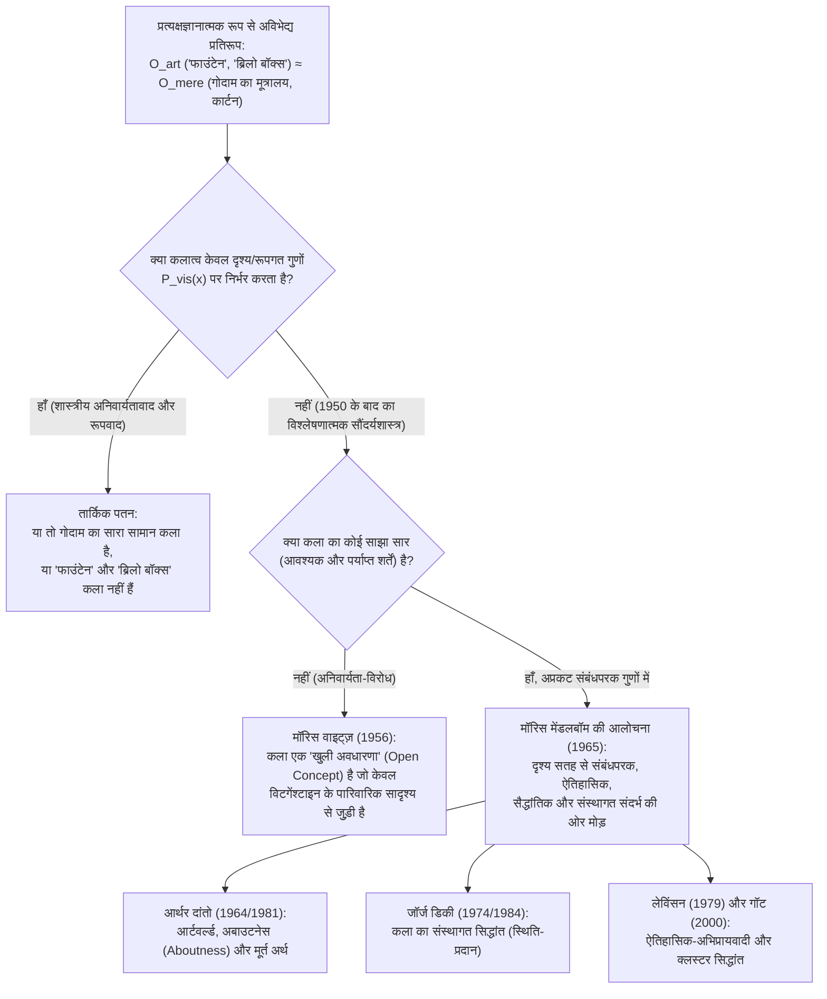
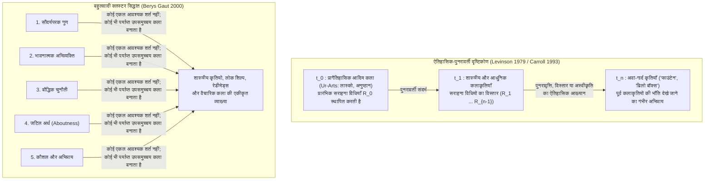

## 1. परिचय: 1917 का चीनी मिट्टी का मूत्रालय और 1964 का प्लाईवुड साबुन डिब्बा

अप्रैल 1917 में नवगठित <strong>सोसाइटी ऑफ इंडिपेंडेंट आर्टिस्ट्स (Society of Independent Artists)</strong> ने न्यूयॉर्क में अपनी पहली प्रदर्शनी एक क्रांतिकारी लोकतांत्रिक सिद्धांत के साथ आयोजित की: *"कोई जूरी नहीं, कोई पुरस्कार नहीं।"* छह डॉलर का शुल्क देने वाला कोई भी कलाकार दो कृतियाँ प्रदर्शित कर सकता था। उद्घाटन से कुछ दिन पहले "रिचर्ड मट (Richard Mutt)" नामक एक अज्ञात कलाकार के नाम से एक बक्सा आया: उसके भीतर जे.एल. मॉट आयरन वर्क्स के प्लंबिंग शोरूम से खरीदा गया एक सामान्य सफेद चीनी मिट्टी का मूत्रालय (urinal) था, जिसे $90^\circ$ घुमाकर रखा गया था, उस पर काले पेंट से <strong>"R. Mutt 1917"</strong> हस्ताक्षरित था और शीर्षक दिया गया था—<strong>*फाउंटेन (Fountain / फव्वारा)*</strong>।

"रिचर्ड मट" के पीछे स्वयं प्रदर्शनी समिति के प्रमुख और फ्रांसीसी अवां-गार्द कलाकार <strong>मार्सेल ड्यूशैम्प (Marcel Duchamp, 1887–1968)</strong> थे। 1913 से ही ड्यूशैम्प <strong>"रेडीमेड्स" (Readymades / बनी-बनाई वस्तुएँ)</strong> (*साइकिल का पहिया* 1913, *बोतल रैक* 1914) के साथ प्रयोग कर रहे थे ताकि केवल भौतिक आँख को सुख देने वाली <strong>"रेटिनल कला" (*art rétinien*)</strong> को उखाड़ फेंका जा सके और कला को पुनः बुद्धि (*cosa mentale*) की सेवा में लाया जा सके—जिसके लिए वस्तु का चयन पूर्ण <strong>"सौंदर्यशास्त्रीय उदासीनता" (*anesthésie*)</strong> की स्थिति में किया जाना आवश्यक था। जब निदेशक मंडल ने *फाउंटेन* को "साधारण प्लंबिंग वस्तु" कहकर छुपा दिया, तो ड्यूशैम्प ने इस्तीफा दे दिया और मई 1917 में दादावादी पत्रिका *द ब्लाइंड मैन (The Blind Man)* में वह ऐतिहासिक बचाव प्रकाशित किया जिसने बीसवीं सदी के सौंदर्यशास्त्र की दिशा बदल दी:

> *"मिस्टर मट ने फाउंटेन को अपने हाथों से बनाया या नहीं, इसका कोई महत्व नहीं है। उन्होंने उसे <strong>चुना (CHOSE)</strong>। उन्होंने जीवन की एक साधारण वस्तु ली, उसे इस प्रकार स्थापित किया कि नए शीर्षक और नए दृष्टिकोण के नीचे उसका उपयोगी अर्थ लुप्त हो गया—<strong>उन्होंने उस वस्तु के लिए एक नया विचार रच दिया</strong>।"*

लगभग आधी सदी बाद, अप्रैल 1964 में, <strong>एंडी वारहोल (Andy Warhol, 1928–1987)</strong> ने मैनहट्टन की स्टेबल गैलरी को <strong>*ब्रिलो बॉक्सेस (Brillo Boxes)*</strong> के ढेर से भर दिया—प्लाईवुड से बने और सिल्कस्क्रीन से छपे ऐसे डिब्बे जो सुपरमार्केट के गोदामों में रखे ब्रिलो साबुन पैड के गत्ते के डिब्बों से देखने में बिल्कुल अभिन्न थे। प्रदर्शनी देखने आए कोलंबिया विश्वविद्यालय के दार्शनिक <strong>आर्थर सी. दांतो (Arthur C. Danto, 1924–2013)</strong> ने समझा कि ड्यूशैम्प और वारहोल ने मिलकर <strong>प्रत्यक्षज्ञानात्मक रूप से अविभेद्य प्रतिरूपों की समस्या (Problem of Perceptually Indiscernible Counterparts)</strong> खड़ी कर दी है:

* गोदाम में रखे अन्य 99 एक जैसे मूत्रालय "महज वास्तविक वस्तुएँ" (*mere real things*) क्यों हैं, जबकि 100वाँ मूत्रालय (*फाउंटेन*) महान कलाकृति है?
* वारहोल का *ब्रिलो बॉक्स* उच्च कला क्यों है, जबकि जेम्स हार्वे द्वारा डिज़ाइन किया गया सुपरमार्केट का ब्रिलो कार्टन केवल एक साधारण पैकेजिंग है?

---

## 2. शास्त्रीय सौंदर्यशास्त्रीय अनिवार्यतावाद का पतन: अनुकरण, अभिव्यक्ति और सार्थक रूप

प्लेटो से लेकर बीसवीं सदी के मध्य तक कला की परिभाषा को <strong>आवश्यक और पर्याप्त शर्तों (necessary and sufficient conditions)</strong> की खोज माना जाता था:

$$\forall x \Big( \text{Art}(x) \iff C_1(x) \land C_2(x) \land \dots \land C_n(x) \Big)$$

किंतु रेडीमेड्स और अविभेद्य प्रतिरूपों के सामने तीनों शास्त्रीय प्रतिमान ढह गए:

1. <strong>अनुकरण सिद्धांत (Mimesis — प्लेटो *रिपब्लिक* X, अरस्तू *काव्यशास्त्र*)</strong>: कला प्रकृति या मानवीय क्रिया का अनुकरण है। शुद्ध वाद्य संगीत, अमूर्त कला (कैंडिंस्की, मोंद्रियान) और ड्यूशैम्प के *फाउंटेन* ने इसे गलत सिद्ध किया—*फाउंटेन* किसी मूत्रालय की नकल नहीं करता, बल्कि स्वयं मूत्रालय *है*, जबकि कारखाने में छपे हजारों ब्रिलो कार्टन मूल प्रतिरूप की हूबहू नकल होने पर भी कला नहीं हैं।
2. <strong>अभिव्यक्ति सिद्धांत (Expression Theory — लियो टॉल्स्टॉय *कला क्या है?*, आर.जी. कॉलिंगवुड *द प्रिंसिपल्स ऑफ आर्ट*)</strong>: कला कलाकार की आंतरिक भावनाओं का स्पष्टीकरण और संप्रेषण है। ड्यूशैम्प की "सौंदर्यशास्त्रीय उदासीनता", वारहोल की यांत्रिक सिल्कस्क्रीनिंग (*"मैं एक मशीन बनना चाहता हूँ"*) और जॉन केज के संयोग-आधारित संगीत (*4'33"*) ने इसे निरस्त कर दिया।
3. <strong>रूपवाद (Formalism — क्लाइव बेल *Art* 1914, रॉजर फ्राई, मोनरो बियर्ड्सली)</strong>: कला को सौंदर्यपरक भावना जगाने वाले <strong>"सार्थक रूप" (Significant Form)</strong> से परिभाषित किया गया। <strong>प्रत्यक्षज्ञानात्मक अविभेद्यता का तर्क</strong> इसे औपचारिक रूप से ध्वस्त करता है:

मान लीजिए $O_{\text{art}}$ ड्यूशैम्प का *फाउंटेन* (या वारहोल का *ब्रिलो बॉक्स*) है और $O_{\text{mere}}$ गोदाम में रखा उसका साधारण प्रतिरूप है। मान लीजिए $P_{\text{vis}}(x)$ वस्तु $x$ के सभी दृश्य और रूपगत गुणों का समुच्चय है। परिकल्पना के अनुसार:

$$P_{\text{vis}}(O_{\text{art}}) = P_{\text{vis}}(O_{\text{mere}}) \quad \Big( O_{\text{art}} \approx_{\text{percept}} O_{\text{mere}} \Big)$$

फिर भी कला के संदर्भ में उनकी सत्तामीमांसीय स्थिति विपरीत है:

$$\text{Art}(O_{\text{art}}) \land \neg\text{Art}(O_{\text{mere}})$$

यदि कला होना केवल दृश्य रूपगत गुणों $P_{\text{vis}}(x)$ पर निर्भर करता, तो या तो दुनिया के सभी सार्वजनिक शौचालयों के मूत्रालय कलाकृतियाँ होते, या फिर *फाउंटेन* और *ब्रिलो बॉक्स* भी कला नहीं होते। अतः <strong>कला और अ-कला के बीच की सत्तामीमांसीय सीमा वस्तु के किसी भी प्रत्यक्ष दृश्य गुण में निहित नहीं हो सकती</strong>।

| शास्त्रीय प्रतिमान | प्रमुख विचारक | केंद्रीय सिद्धांत (प्रस्तावित सार) | रेडीमेड्स और अविभेद्य प्रतिरूपों द्वारा खंडन |
| :--- | :--- | :--- | :--- |
| <strong>अनुकरण सिद्धांत (Mimesis)</strong> | प्लेटो, अरस्तू, वज़ारी | कला प्रकृति, यथार्थ या मानवीय क्रिया का अनुकरण है | अमूर्त कला कुछ भी अनुकरण नहीं करती; *फाउंटेन* वास्तविक वस्तु प्रस्तुत करता है; फैक्ट्री प्रतियाँ कला नहीं हैं |
| <strong>अभिव्यक्ति सिद्धांत (Expression)</strong> | टॉल्स्टॉय, कॉलिंगवुड | कला कलाकार की आंतरिक भावनाओं का कल्पनाशील स्पष्टीकरण और संप्रेषण है | ड्यूशैम्प की उदासीनता, वारहोल की यांत्रिकता और केज का संयोग संगीत भावनाओं को बाहर रखते हैं |
| <strong>रूपवाद (Formalism)</strong> | क्लाइव बेल, रॉजर फ्राई, बियर्ड्सली | कला "सार्थक रूप" द्वारा परिभाषित होती है जो सौंदर्यबोध जगाता है | दो प्रत्यक्षतः समान वस्तुओं ($O_{\text{art}} \approx_{\text{percept}} O_{\text{mere}}$) में दृश्य रूप अंतर नहीं कर सकता |

---

## 3. मॉरिस वाइट्ज़ का नव-विटगेंश्टाइनवादी अनिवार्यता-विरोध और मेंडलबॉम का संबंधपरक मोड़

### 3.1 विटगेंश्टाइन का "पारिवारिक सादृश्य" और "खुली अवधारणा"

अपने प्रसिद्ध शोधपत्र *"The Role of Theory in Aesthetics"* (1956) में <strong>मॉरिस वाइट्ज़ (1916–1981)</strong> ने <strong>लुडविग विटगेंश्टाइन</strong> के *फिलॉसॉफिकल इन्वेस्टिगेशंस* (1953, §§65–75) के "खेल" (*Spiel*) विश्लेषण को कला पर लागू किया। बोर्ड गेम, ताश के खेल, गेंद के खेल और ओलंपिक खेलों में कोई एक सर्वनिष्ठ गुण नहीं है, बल्कि *"एक-दूसरे को काटती और आच्छादित करती समानताओं का जटिल जाल"* है—जिसे <strong>"पारिवारिक सादृश्य" (*Familienähnlichkeiten*)</strong> कहते हैं। चूँकि निरंतर नवाचार और नियम-भंग कला के तर्क का ही हिस्सा हैं, इसलिए वाइट्ज़ के अनुसार "कला" एक <strong>"खुली अवधारणा" (Open Concept)</strong> है जिसे आवश्यक और पर्याप्त शर्तों से बंद नहीं किया जा सकता।

### 3.2 मॉरिस मेंडलबॉम की निर्णायक आलोचना (1965): अप्रकट संबंधपरक गुण

1965 में <strong>मॉरिस मेंडलबॉम (Maurice Mandelbaum)</strong> ने विटगेंश्टाइन के रूपक में छिपी विडंबना को उजागर किया: छह तस्वीरों में दिखने वाली चेहरे की समानताएँ अजनबियों के आकस्मिक हमशक्ल होने के बजाय *पारिवारिक* सादृश्य क्यों कहलाती हैं? क्योंकि वे एक <strong>अप्रकट आनुवंशिक संबंधपरक गुण (साझा जैविक वंश)</strong> साझा करती हैं जो फोटो की सतह पर दिखाई नहीं देता! इसके अलावा, यदि केवल दृश्य सादृश्य से कला की पहचान होती, तो *फाउंटेन* से सर्वाधिक दृश्य समानता गोदाम के लाखों साधारण मूत्रालयों की होती। इस प्रकार मेंडलबॉम ने सिद्ध किया कि <strong>दृश्य अनिवार्यतावाद की विफलता यह प्रमाणित करती है कि कला का सार अप्रकट संबंधपरक गुणों (अभिप्राय, इतिहास, संस्था) में निहित है</strong>।

---

## 4. आर्थर दांतो का "द आर्टवर्ल्ड" (1964) और *साधारण का रूपांतरण* (1981)

अक्टूबर 1964 के अपने निबंध *"The Artworld"* में <strong>आर्थर सी. दांतो</strong> ने आधुनिक सौंदर्यशास्त्र का सबसे प्रसिद्ध वाक्य लिखा:

> <strong>"किसी वस्तु को कला के रूप में देखने के लिए किसी ऐसी चीज़ की आवश्यकता होती है जिसे आँख नहीं देख सकती—कलात्मक सिद्धांत का एक वातावरण, कला के इतिहास का ज्ञान: एक कला-जगत (*an artworld*)."</strong>

### 4.1 विचार-प्रयोग: अविभेद्य लाल वर्गों की दीर्घा

अपनी 1981 की महान कृति <strong>*द ट्रांसफिगरेशन ऑफ द कॉमनप्लेस (The Transfiguration of the Commonplace)*</strong> में दांतो एक ऐसी गैलरी की कल्पना करते हैं जहाँ कैडमियम लाल रंग से रंगे नौ भौतिक रूप से बिल्कुल अभिन्न कैनवास टंगे हैं:

1. <strong>*लाल सागर पार करते इज़राइली*</strong> (ऐतिहासिक चित्र जहाँ मिस्र की सेना अभी-अभी डूबी है)
2. <strong>*कीर्केगार्ड की मनोदशा*</strong> (मनोवैज्ञानिक अभिव्यंजनावादी चित्र)
3. <strong>*रेड स्क्वायर (लाल चौक)*</strong> (मॉस्को के चौक का ज्यामितीय परिदृश्य)
4. <strong>*निर्वाण*</strong> (बौद्ध तत्वमीमांसीय चित्र)
5. <strong>*लाल मेज़पोश*</strong> (मातिस के शिष्य द्वारा बनाया गया फॉविस्ट स्टिल-लाइफ)
6. <strong>*शीर्षकहीन*</strong> (न्यूनतमवादी मोनोक्रोम जो चित्र-तल की सपाटता को दर्शाता है)
7. <strong>जॉर्जियोन का प्राइम किया हुआ कैनवास</strong> (16वीं सदी का कैनवास जिस पर वेनिस के उस्ताद जॉर्जियोन ने प्लेग से मरने से पहले केवल लाल सीसे का अस्तर लगाया था—<strong>यह कलाकृति नहीं है</strong>)
8. <strong>महज लाल रंगा हुआ धरातल</strong> (किसी पेंटर द्वारा रोलर जांचने के लिए रंगा गया कैनवास—<strong>"महज एक वास्तविक वस्तु"</strong>)
9. <strong>वैचारिक कलाकार J का *शीर्षकहीन ("कुछ भी नहीं के बारे में")*</strong> (इस घोषणा के साथ प्रदर्शित कि यह चित्र "बिल्कुल किसी भी चीज़ के बारे में नहीं है")

### 4.2 दांतो की दो आवश्यक शर्तें: *अबाउटनेस (Aboutness)* और *मूर्त अर्थ (Embodied Meaning)*

कलाकृतियों (1–6 और 9) को महज साधारण वस्तुओं (7 और 8) से अलग करने के लिए दांतो दो आवश्यक शर्तें रखते हैं:

1. <strong>अबाउटनेस (*Aboutness* / अर्थगत अभिप्राय / "किसी-विषय-के-बारे-में-होना")</strong>: प्रत्येक कलाकृति किसी न किसी विषय *के बारे में* होती है (यहाँ तक कि कलाकार J का कैनवास 9 भी मेटा-कलात्मक स्तर पर कला और रिक्त भौतिकता के विरोध *के बारे में* है, ठीक गणित के शून्य $0$ की तरह)। इसके विपरीत, सुपरमार्केट का ब्रिलो कार्टन किसी भी विषय के बारे में नहीं है।
2. <strong>मूर्त अर्थ (Embodied Meaning)</strong>: समाचार पत्र के लेख की तरह कलाकृति केवल अर्थ का कथन नहीं करती, बल्कि दृश्य रूपक या अरस्तू के लुप्त-अवयव न्यायवाक्य (enthymeme) की भाँति अपने भौतिक माध्यम में अर्थ को <strong>मूर्त (embody)</strong> करती है।

---

## 5. जॉर्ज डिकी का कला का संस्थागत सिद्धांत (1974/1984) और वोलहाइम की दुविधा

दार्शनिक <strong>जॉर्ज डिकी (George Dickie, 1926–2020)</strong> ने *Art and the Aesthetic* (1974) में कला-जगत की एक समाजशास्त्रीय व्याख्या प्रस्तुत की:

> <strong>[डिकी की संस्थागत परिभाषा (1974)]</strong>
> वर्गीकरण के अर्थ में एक कलाकृति (1) <strong>एक मानव-निर्मित वस्तु (artifact)</strong> है, (2) <strong>जिसके पहलुओं के समुच्चय को किसी सामाजिक संस्था (कला-जगत) की ओर से कार्य करने वाले किसी व्यक्ति या व्यक्तियों (प्रायः स्वयं कलाकार) द्वारा 'सराहना के उम्मीदवार' (candidate for appreciation) का दर्जा प्रदान किया गया हो</strong>।

### 5.1 रिचर्ड वोलहाइम की दुविधा (1980): सौंदर्यशास्त्र की *यूथिफ्रो* समस्या

1980 में <strong>रिचर्ड वोलहाइम (1923–2003)</strong> ने प्लेटो के *यूथिफ्रो (Euthyphro)* संवाद से प्रेरित होकर डिकी के सामने एक घातक दुविधा रखी:

> जब कला-जगत के प्रतिनिधि किसी वस्तु $x$ को कला का दर्जा देते हैं, तो क्या वे ऐसा <strong>ठोस कलात्मक कारणों $R$</strong> से करते हैं, या <strong>बिना किसी कारण के मनमाने ढंग से</strong>?

- <strong>पहला सींग (ठोस कारणों से)</strong>: यदि आंतरिक कलात्मक कारण $R$ (जैसे दांतो का मूर्त अर्थ) आवश्यक हैं, तो वही गुण $R$ वस्तु को कला बनाते हैं और संस्था केवल बाद में उसकी पुष्टि करती है।
- <strong>दूसरा सींग (मनमाना दर्जा)</strong>: यदि किसी कारण की आवश्यकता नहीं है, तो कला एक खोखला नौकरशाही खेल बन कर रह जाती है और यह स्पष्ट नहीं हो पाता कि मानव समाज कला को इतना सर्वोच्च आध्यात्मिक मूल्य क्यों देता है।

इसके अलावा, संस्थागत सिद्धांत <strong>एकाकी / आउटसाइडर कलाकारों</strong> (जैसे हेनरी डार्जर) और किसी भी संग्रहालय संस्था के अस्तित्व में आने से 30,000 वर्ष पूर्व रची गई <strong>प्रागैतिहासिक लास्को गुफा चित्रकला (*Ur-Art*)</strong> की व्याख्या करने में विफल रहता है।

---

## 6. ऐतिहासिक अभिप्रायवाद और क्लस्टर सिद्धांत (Cluster Account)

इन सीमाओं को पार करने के लिए समकालीन सौंदर्यशास्त्र में दो प्रमुख दृष्टिकोण उभरे हैं:

1. <strong>जेरोल्ड लेविंसन की ऐतिहासिक-अभिप्रायवादी परिभाषा (1979)</strong>: कोई वस्तु $x$ समय $t$ पर कलाकृति होती है यदि और केवल यदि उसका वैध स्वामी <strong>गंभीरतापूर्वक यह अभिप्राय रखता है कि $x$ को उन तरीकों से देखा/सराहा (regarded) जाए जिन तरीकों से $t$ से पूर्व की कलाकृतियों को सही रूप में देखा जाता रहा है</strong>। प्रागैतिहासिक आदिम कला ($t_0$) तक जाने वाली इस पुनरावर्ती श्रृंखला द्वारा एकाकी कलाकार और अवां-गार्द दोनों की व्याख्या हो जाती है।
2. <strong>बेरिस गॉट का क्लस्टर सिद्धांत (Cluster Account, 2000)</strong>: कला से संबंधित लगभग दस गुणों का एक समूह (सौंदर्यपरक गुण, भावनात्मक अभिव्यक्ति, बौद्धिक चुनौती, जटिल अर्थ, कौशल और कलात्मक अभिप्राय) मौजूद है—<strong>कोई भी एक गुण अकेले आवश्यक नहीं है, किंतु उनका कोई भी पर्याप्त उपसमुच्चय किसी वस्तु को कला बनाने के लिए पर्याप्त है</strong>।

