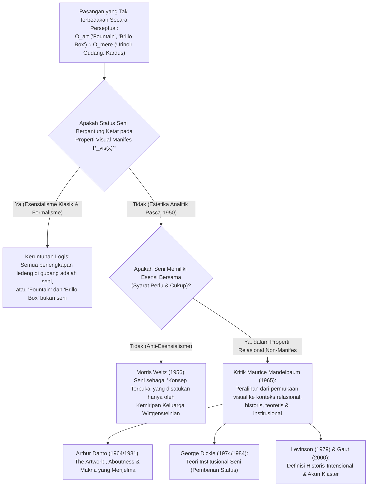
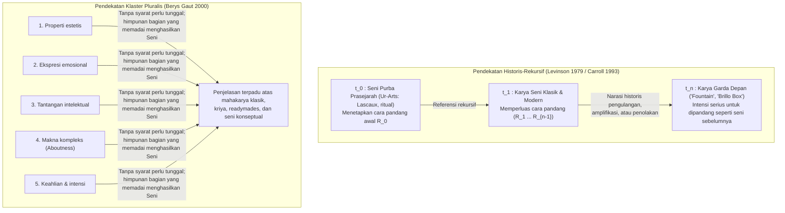

## 1. Pendahuluan: Urinoir Porselen 1917 dan Kotak Sabun Kayu Lapis 1964

Pada April 1917, <strong>Society of Independent Artists</strong> yang baru didirikan menyiapkan pameran perdananya di New York dengan semboyan demokratis radikal: *"Tanpa juri, tanpa hadiah."* Setiap seniman yang membayar iuran enam dolar berhak memamerkan dua karya. Beberapa hari sebelum pembukaan, sebuah peti tiba atas nama "Richard Mutt": di dalamnya terdapat urinoir porselen putih standar yang dibeli dari ruang pamer pipa J.L. Mott Iron Works, diputar $90^\circ$, ditandatangani dengan cat hitam <strong>"R. Mutt 1917"</strong>, dan diberi judul <strong>*Fountain* (*Air Mancur*)</strong>.

Sosok di balik "Richard Mutt" adalah <strong>Marcel Duchamp (1887–1968)</strong>, ketua komite pemasangan pameran itu sendiri. Sejak 1913, Duchamp bereksperimen dengan <strong>"Readymades"</strong> (*Roda Sepeda* 1913, *Rak Botol* 1914) untuk menggulingkan <strong>"seni сетчатка / retinal" (*art rétinien*)</strong>—lukisan yang hanya memanjakan mata fisik—dan mengembalikan seni ke pelayanan intelek (*cosa mentale*), dengan memilih objek dalam kondisi <strong>"ketidakpedulian estetis" (*anesthésie*)</strong> sepenuhnya. Ketika dewan direksi menyembunyikan *Fountain* dan menyebutnya sekadar "perlengkapan ledeng biasa", Duchamp mengundurkan diri dan pada Mei 1917 menerbitkan pembelaan di jurnal Dadais *The Blind Man* yang mengubah sejarah filsafat seni abad ke-20:

> *"Apakah Tuan Mutt membuat air mancur itu dengan tangannya sendiri atau tidak, sama sekali tidak penting. Dia <strong>MEMILIHNYA (CHOSE)</strong>. Dia mengambil barang biasa dari kehidupan, menempatkannya sedemikian rupa sehingga makna kegunaannya lenyap di bawah judul dan sudut pandang baru—<strong>menciptakan pemikiran baru bagi objek tersebut</strong>."*

Hampir setengah abad kemudian, pada April 1964, <strong>Andy Warhol (1928–1987)</strong> memenuhi Stable Gallery di Manhattan dengan tumpukan <strong>*Brillo Boxes*</strong>—kotak kayu lapis bersablon yang secara visual tak terbedakan dari kardus karton sabut sabun Brillo di gudang supermarket. Saat mengunjungi galeri tersebut, filsuf <strong>Arthur C. Danto (1924–2013)</strong> menyadari bahwa Duchamp dan Warhol telah mengajukan <strong>Masalah Pasangan yang Tak Terbedakan Secara Perseptual (Perceptually Indiscernible Counterparts)</strong>:

* Mengapa urinoir ke-100 (*Fountain*) menjadi mahakarya seni rupa, sedangkan 99 urinoir identik lainnya di gudang hanyalah "benda nyata belaka" (*mere real things*)?
* Mengapa *Brillo Box* karya Warhol adalah patung seni tinggi, sedangkan kardus Brillo komersial rancangan James Harvey hanyalah kemasan biasa?

---

## 2. Runtuhnya Esensialisme Estetika Klasik: Mimesis, Ekspresi, dan Bentuk Bermakna

Sejak Plato hingga pertengahan abad ke-20, mendefinisikan seni dipahami sebagai pencarian <strong>syarat perlu dan cukup (necessary and sufficient conditions)</strong>:

$$\forall x \Big( \text{Art}(x) \iff C_1(x) \land C_2(x) \land \dots \land C_n(x) \Big)$$

Namun, ketiga paradigma esensialis klasik runtuh di hadapan readymades dan pasangan tak terbedakan:

1. <strong>Mimesis / Teori Imitasi (Plato *Republic* X, Aristoteles *Poetics*)</strong>: Seni sebagai tiruan alam. Dibantah oleh musik absolut, seni abstrak (Kandinsky, Mondrian), dan *Fountain* karya Duchamp yang tidak melukiskan urinoir melainkan *adalah* urinoir itu sendiri—sementara sepuluh ribu kardus Brillo dari pabrik meniru prototipe tanpa menjadi karya seni.
2. <strong>Teori Ekspresi (Leo Tolstoy *What Is Art?*, R.G. Collingwood *The Principles of Art*)</strong>: Seni sebagai penjernihan dan penyampaian emosi subjektif seniman. Dibantah oleh "ketidakpedulian estetis" Duchamp, sablon mekanis Warhol (*"Saya ingin menjadi mesin"*), dan musik peluang John Cage (*4'33"*).
3. <strong>Formalisme (Clive Bell *Art* 1914, Roger Fry, Monroe Beardsley)</strong>: Seni didefinisikan oleh <strong>"Bentuk Bermakna" (Significant Form)</strong> yang membangkitkan emosi estetis. <strong>Argumen Ketakterbedaan Perseptual</strong> membantah tesis ini secara formal:

Misalkan $O_{\text{art}}$ adalah *Fountain* Duchamp (atau *Brillo Box* Warhol) dan $O_{\text{mere}}$ adalah pasangannya di gudang. Misalkan $P_{\text{vis}}(x)$ adalah himpunan seluruh properti visual dan formal manifes dari $x$. Berdasarkan hipotesis:

$$P_{\text{vis}}(O_{\text{art}}) = P_{\text{vis}}(O_{\text{mere}}) \quad \Big( O_{\text{art}} \approx_{\text{percept}} O_{\text{mere}} \Big)$$

Namun status ontologis keduanya terkait kesenian bertolak belakang:

$$\text{Art}(O_{\text{art}}) \land \neg\text{Art}(O_{\text{mere}})$$

Jika status seni hanya bergantung pada properti visual manifes $P_{\text{vis}}(x)$, maka entah semua urinoir di dunia sudah menjadi karya seni, atau *Fountain* dan *Brillo Box* bukanlah seni. Kesimpulannya, <strong>batas ontologis antara seni dan bukan-seni tidak mungkin terletak pada properti perseptual manifes dari objek itu sendiri</strong>.

| Paradigma Klasik | Tokoh Utama | Tesis Inti (Esensi yang Diajukan) | Mengapa Dibantah oleh Readymades & Pasangan Tak Terbedakan |
| :--- | :--- | :--- | :--- |
| <strong>Mimesis (Imitasi)</strong> | Plato, Aristoteles, Vasari | Seni adalah tiruan atau representasi alam dan tindakan manusia | Seni abstrak tidak meniru apa pun; *Fountain* menampilkan objek nyata; salinan pabrik bukan seni |
| <strong>Teori Ekspresi</strong> | Tolstoy, Collingwood | Seni adalah penjernihan imajinatif dan transmisi emosi batin seniman | "Ketidakpedulian estetis" Duchamp, mekanika Warhol, dan kebetulan Cage menyingkirkan emosi |
| <strong>Formalisme</strong> | Clive Bell, Roger Fry, Beardsley | Seni ditentukan oleh "Bentuk Bermakna" yang memicu pengalaman estetis | Pada dua objek yang identik secara perseptual ($O_{\text{art}} \approx_{\text{percept}} O_{\text{mere}}$), bentuk visual tak dapat membedakannya |

---

## 3. Anti-Esensialisme Neo-Wittgensteinian Morris Weitz dan Peralihan Relasional Mandelbaum

### 3.1 "Kemiripan Keluarga" Wittgenstein dan "Konsep Terbuka"

Dalam makalah terkenalnya *"The Role of Theory in Aesthetics"* (1956), <strong>Morris Weitz (1916–1981)</strong> menerapkan analisis kata "permainan" (*Spiel*) dari *Philosophical Investigations* (1953, §§65–75) karya <strong>Ludwig Wittgenstein</strong> pada seni. Antara permainan papan, kartu, bola, dan Olimpiade tidak ada satu pun sifat tunggal yang sama, melainkan *"jaringan kemiripan rumit yang tumpang-tindih dan bersilangan"*—<strong>"kemiripan keluarga" (*Familienähnlichkeiten*)</strong>. Karena kreativitas ekspansif dan pendobrakan aturan merupakan bagian dari logika seni, "seni" menurut Weitz adalah <strong>"konsep terbuka" (Open Concept)</strong> yang tidak boleh ditutup dengan syarat perlu dan cukup.

### 3.2 Kritik Menentukan Maurice Mandelbaum (1965): Properti Relasional yang Tak Tampak

Pada tahun 1965, <strong>Maurice Mandelbaum</strong> membongkar ironi dalam metafora Wittgenstein: apa yang membuat kemiripan wajah pada enam foto menjadi kemiripan *keluarga* alih-alih kebetulan antar orang asing? Tepat karena mereka berbagi <strong>properti relasional genetik non-manifes (leluhur biologis bersama)</strong> yang tidak terlihat langsung di permukaan foto! Selain itu, jika kemiripan visual saja cukup, objek yang paling mirip dengan *Fountain* adalah jutaan urinoir di gudang ledeng. Mandelbaum membuktikan bahwa <strong>kegagalan esensialisme visual membuktikan bahwa esensi seni terletak pada properti relasional non-manifes (intensi, sejarah, institusi)</strong>.

---

## 4. "The Artworld" (1964) dan *The Transfiguration of the Commonplace* (1981) Karya Arthur Danto

Dalam esai Oktober 1964, *"The Artworld"*, <strong>Arthur C. Danto</strong> menulis kalimat paling terkenal dalam estetika modern:

> <strong>"Melihat sesuatu sebagai seni membutuhkan sesuatu yang tidak dapat ditangkap oleh mata—suatu atmosfer teori seni, suatu pengetahuan tentang sejarah seni: sebuah dunia seni (*an artworld*)."</strong>

### 4.1 Eksperimen Pikiran: Galeri Persegi Merah yang Tak Terbedakan

Dalam mahakaryanya tahun 1981, <strong>*The Transfiguration of the Commonplace*</strong>, Danto membayangkan galeri berisi sembilan kanvas persegi panjang berwarna merah kadmium yang identik secara fisik:

1. <strong>*Bangsa Israel Menyeberangi Laut Merah*</strong> (lukisan sejarah di mana pasukan Mesir baru saja tenggelam)
2. <strong>*Suasana Hati Kierkegaard*</strong> (potret psikologis ekspresionis)
3. <strong>*Lapangan Merah*</strong> (lanskap geometris Moskow)
4. <strong>*Nirwana*</strong> (lukisan metafisik Buddhis)
5. <strong>*Taplak Meja Merah*</strong> (lukisan alam benda Fauvis karya murid Matisse)
6. <strong>*Tanpa Judul*</strong> (monokrom minimalis yang menegaskan kedataran bidang gambar)
7. <strong>Kanvas Dasar Giorgione</strong> (kanvas abad ke-16 yang baru dilapisi cat dasar timbal merah oleh Giorgione sebelum ia wafat karena wabah—<strong>bukan karya seni</strong>)
8. <strong>Permukaan Biasa Bercat Merah</strong> (dicat dengan rol oleh tukang cat—<strong>"benda nyata belaka"</strong>)
9. <strong>*Tanpa Judul ("Tentang Ketiadaan")* karya seniman konseptual J</strong> (dipamerkan secara polemis dengan klaim bahwa karya itu "sama sekali bukan tentang apa-apa")

### 4.2 Dua Syarat Perlu Danto: *Aboutness* dan *Makna yang Menjelma*

Untuk membedakan karya seni (1–6 dan 9) dari benda biasa (7 dan 8), Danto merumuskan dua syarat perlu:

1. <strong>*Aboutness* (Intensionalitas Semantik / "Tentang-Sesuatu")</strong>: Setiap karya seni selalu *tentang* sesuatu (bahkan kanvas 9 milik J secara meta-artistik adalah *tentang* kontras antara seni dan материalitas kosong, seperti angka $0$ dalam matematika). Kardus Brillo di supermarket bukan tentang apa-apa.
2. <strong>Makna yang Menjelma (Embodied Meaning)</strong>: Berbeda dari artikel koran, karya seni tidak sekadar menyatakan makna, melainkan <strong>menjelmakan</strong> maknanya di dalam medium materialnya bagaikan metafora visual atau entimem retoris.

---

## 5. Teori Institusional Seni George Dickie (1974/1984) dan Dilema Wollheim

Filsuf <strong>George Dickie (1926–2020)</strong> dalam *Art and the Aesthetic* (1974) mengajukan pembacaan sosiologis dan performatif atas dunia seni:

> <strong>[Definisi Institusional Seni Dickie (1974)]</strong>
> Karya seni dalam pengertian klasifikatori adalah (1) <strong>sebuah artefak</strong>, (2) <strong>yang seperangkat aspeknya telah diberi status sebagai kandidat untuk apresiasi (candidate for appreciation) oleh seseorang atau beberapa orang yang bertindak atas nama institusi sosial tertentu (dunia seni)</strong>—biasanya oleh seniman itu sendiri.

### 5.1 Dilema Richard Wollheim (1980): Masalah *Euthyphro* dalam Estetika

Pada tahun 1980, <strong>Richard Wollheim (1923–2003)</strong> menghadapkan Dickie pada dilema tajam yang diilhami oleh *Euthyphro* karya Plato:

> Ketika perwakilan dunia seni memberikan status seni pada objek $x$, apakah mereka melakukannya karena <strong>alasan artistik yang kuat $R$</strong>, atau secara <strong>sewenang-wenang tanpa alasan</strong>?

- <strong>Tanduk Pertama (Karena alasan kuat)</strong>: Jika alasan substantif $R$ (seperti makna yang menjelma menurut Danto) diperlukan, maka properti $R$ itulah yang sesungguhnya menjadikan $x$ karya seni, sedangkan institusi hanya mengesahkannya belakangan.
- <strong>Tanduk Kedua (Pemberian sewenang-wenang)</strong>: Jika tidak diperlukan alasan apa pun, seni merosot menjadi permainan birokrasi yang hampa dan gagal menjelaskan mengapa umat manusia begitu menghargai seni.

Selain itu, teori institusional gagal menjelaskan <strong>seni outsider / penyendiri</strong> (seperti karya rahasia Henry Darger) serta <strong>seni prasejarah purba (*Ur-Art*)</strong> di gua Lascaux atau Sulawesi yang diciptakan puluhan ribu tahun sebelum adanya institusi museum.

---

## 6. Intensionalisme Historis dan Akun Klaster (Cluster Account)

Untuk mengatasi kebuntuan ini, dua pendekatan kontemporer tampil ke depan:

1. <strong>Definisi Historis-Intensional Jerrold Levinson (1979)</strong>: Sebuah objek $x$ adalah karya seni pada waktu $t$ jika dan hanya jika pemilik sahnya <strong>berniat secara serius agar $x$ dipandang (regarded) dengan salah satu cara sebagaimana karya-karya seni sebelum $t$ telah dipandang secara tepat</strong>. Melalui rantai rekursif hingga seni prasejarah ($t_0$), definisi ini mencakup baik pertapa penyendiri maupun garda depan.
2. <strong>Akun Klaster (Cluster Account) Berys Gaut (2000)</strong>: Terdapat klaster sekitar sepuluh properti relevan (kualitas estetis, ekspresi emosi, tantangan intelektual, makna kompleks, keahlian, dan intensi artistik): <strong>tidak ada satu pun yang secara tunggal menjadi syarat perlu, tetapi himpunan bagian mana pun yang memadai sudah cukup untuk menjadikan objek sebagai seni</strong>.

