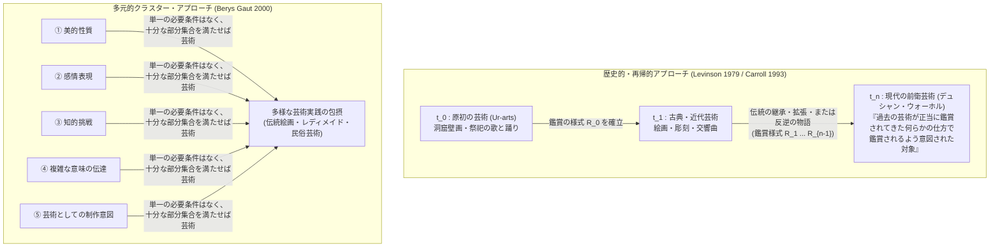

## 1. はじめに：1917年の男性用小便器と1964年の洗剤箱が突きつけた2500年目の問い

1917年4月、ニューヨークのグランド・セントラル・パレスで開催される予定だった「独立芸術家協会（Society of Independent Artists）」の第1回展覧会に、奇妙な白い磁器の塊が持ち込まれた。その展覧会は「審査員なし、賞なし（No jury, no prizes）」を掲げ、年会費と出品料の合計6ドルを支払えば誰でも2点まで作品を展示できるという徹底した民主的ルールを謳っていた。

しかし、小包を開けた展示委員会の理事たちは凍りついた。中から現れたのは、マンハッタン5番街の配管設備メーカー「J.L.モット鉄工所（J.L. Mott Iron Works）」のショールームで市販されていた、大量生産品の磁器製男性用小便器（ベッドフォードシャー・モデル）だったのである。ただ一つ工場出荷時と異なっていたのは、本来の設置向きから$90^\circ$回転されて平らな背面が下に置かれ、その縁に黒い塗料で<strong>「R. Mutt 1917」</strong>という謎の署名と年号が記され、<strong>『泉（Fountain）』</strong>という題名が添えられていたことだけだった。

この出品作の背後にいた真の仕掛け人は、当時その独立芸術家協会の理事自身のひとりでもあったフランス出身の芸術家<strong>マルセル・デュシャン（Marcel Duchamp, 1887–1968）</strong>である。デュシャンはすでに1913年にスツールの上に逆さまにした車輪を取り付けた『自転車の車輪（Bicycle Wheel）』、1914年にパリのバザール・ド・ロテル・ド・ヴィルで購入した亜鉛メッキ鉄製の乾燥機をそのまま署名も手も加えずに作品とした『瓶掛け（Bottle Rack / Égouttoir）』、1915年に金物屋で買った除雪用シャベルに題名を付けた『折れた腕の前に（In Advance of the Broken Arm）』といった一連の<strong>「レディメイド（Readymades：既製品）」</strong>を試みていた。彼は、クールベ以来の近代絵画が網膜を喜ばせるだけの「網膜的芸術（Retinal Art）」に堕していると批判し、美醜の趣味判断（Good or bad taste）が一切働かない「美的無関心（Aesthetic Indifference）」の状態で日用品を選択（Select）することによって、芸術を再び「精神（知性）に奉仕するもの」へと引き戻そうとしたのである。

独立芸術家協会の理事会は激論の末、「これはいかなる定義によっても芸術作品ではなく、不道徳で下品なただの配管器具である」として『泉』の展示を拒絶し、会場の衝立の後ろに隠してしまった（オリジナルの磁器はその後紛失し、現在世界中の美術館に所蔵されているのは、写真家アルフレッド・スティーグリッツが撮影した1枚の写真と、1950年代〜60年代にデュシャン自身が承認して制作されたレプリカ群である）。だが、デュシャンが匿名誌『ザ・ブラインド・マン（The Blind Man）』第2号で反論した次の言葉は、20世紀以降の芸術哲学の運命を決定づけた。

> 「ムット氏が自分の手で『泉』を作ったかどうかは重要ではない。彼はそれを<strong>選択した（He CHOSE it）</strong>のだ。彼は日常のありふれた生活の品物を取り上げ、その新しいタイトルと視点のもとで、その物体の実用的な意味が消え去るように配置し、<strong>その物体のための新しい思考を創造した</strong>のである。」

それから約半世紀後の1964年4月、マンハッタン東74丁目のステイブル・ギャラリー（Stable Gallery）で、美学の歴史における「第2の巨大地震」が発生した。ポップ・アートの旗手<strong>アンディ・ウォーホル（Andy Warhol, 1928–1987）</strong>が、スーパーマーケットの倉庫さながらに、家庭用研磨パッド「ブリロ（Brillo）」の段ボール箱を会場いっぱいに積み上げて展示したのである。

正確に言えば、ウォーホルの<strong>『ブリロ・ボックス（Brillo Box）』</strong>は、工場から出荷された本物の段ボール箱（レディメイド）ではなかった。それはウォーホルと助手たちが合板（Plywood）で箱を組み立て、白い塗料を塗った上に、赤と青のインクで本物のブリロの箱と寸分違わぬロゴとデザインをシルクスクリーン印刷した木箱であった。さらに歴史の皮肉なことに、もともとスーパーマーケットで売られていた本物のブリロの段ボール箱のパッケージをデザインしたのは、生活費を稼ぐために商業デザイナーとして働いていた第2世代の抽象表現主義の画家ジェームズ・ハーヴェイ（James Harvey）であった。

この展覧会を訪れ、頭をハンマーで殴られたような哲学的衝撃を受けたのが、コロンビア大学の哲学者<strong>アーサー・C・ダントー（Arthur C. Danto, 1924–2013）</strong>である。ダントーが直面した問いは、極めてシンプルでありながら、プラトンやアリストテレス以来2500年間続いてきた西洋美学の根幹を根底から突き崩すものだった。

* J.L.モット鉄工所の倉庫に並んでいる99個の男性用小便器は「ただの配管設備（単なる実物：Mere Real Thing）」であるのに、なぜデュシャンが署名して展覧会に置いた100個目の小便器『泉』は、芸術史を塗り替える「芸術作品（Work of Art）」なのか？
* ジェームズ・ハーヴェイがデザインし、スーパーマーケットの棚に積まれている本物のブリロの箱は1箱数ドルの「商業用パッケージ」に過ぎないのに、それと視覚的にほとんど見分けがつかないウォーホルの『ブリロ・ボックス』は、なぜ数千ドル（のちに数百万ドル）で取引され、美術館に収蔵される「ファイン・アート（純粋芸術）」なのか？
* 逆に、もしハーヴェイがデザインした本物の段ボール箱とウォーホルの木箱の見た目が完全に同じであるなら、<strong>なぜウォーホルは本物の段ボール箱を置くだけで済ませず、わざわざ合板でそれを作る必要があったのか？</strong> また、もしウォーホルが本物の段ボール箱をそのまま展示していたとしても、それはやはり芸術になり得たのではないか？

この問いこそが、現代の分析美学（Analytic Aesthetics）における最重要問題――<strong>「知覚的不可識別対（Perceptually Indiscernible Counterparts）の問題」</strong>である。本稿では、この「見た目がまったく同じであるにもかかわらず、一方は芸術であり、他方は単なる日用品である」という逆説を手がかりに、古典的な芸術定義の崩壊から、ヴィトゲンシュタイン派の反本質主義、ダントーの「アートワールド」と意味の体現、ジョージ・ディッキーの「制度説」、ジェロルド・レヴィンソンの「歴史的意図説」、そしてマウリツィオ・カテランのバナナや生成AI（Generative AI）が突きつける21世紀のフロンティアまで、芸術の定義をめぐる哲学の全貌を徹底的に解き明かしていく。

---

## 2. 古典的本質主義の崩壊：模倣・表現・形式はなぜ『泉』と『ブリロ・ボックス』の前で無力なのか

哲学において何かの概念 $F$ を「定義する（Define）」とは、伝統的にソクラテスやプラトンの対話篇以来、ある対象 $x$ が $F$ であるための<strong>必要十分条件（Necessary and Sufficient Conditions）</strong>を過不足なく特定することを意味してきた。

$$\forall x \Big( \text{Art}(x) \iff C_1(x) \land C_2(x) \land \dots \land C_n(x) \Big)$$

ここで右辺の条件 $C_i(x)$ がもしすべて満たされれば $x$ は必ず芸術であり（十分条件）、もし $x$ が芸術であるならば必ずすべての $C_i(x)$ を満たしていなければならない（必要条件）。もし1つでも、すべての条件を満たしているのに芸術ではないもの（過剰包摂の反例）や、明らかに芸術であるのに条件を満たさないもの（過小包摂の反例）が見つかれば、その定義は論理的に破綻する。

20世紀半ばに至るまで、西洋の芸術哲学は大きく分けて<strong>3つの古典的パラダイム</strong>によって芸術の本質（Essence）を定義しようと試みてきた。

### 2.1 第1のパラダイム：模倣説（Mimesis / Representation Theory）
古代ギリシアから18世紀に至るまで2000年以上にわたって支配的だったのは、<strong>「芸術とは自然や現実の模倣（ミメーシス：$M\acute{\iota}\mu\eta\sigma\iota\varsigma$）・再現（Representation）である」</strong>という定義である。

プラトンは『国家』第10巻において、職人がイデア（形相）としての「寝台そのもの」を模倣して木製の寝台を作り、画家はその職人が作った個別の寝台の見かけ（現象）をさらに模倣して絵を描くのだから、絵画とは「真理（イデア）から三番目に遠い模倣の模倣」に過ぎないと論じた。これに対しアリストテレスは『詩学』において、模倣こそが人間に生まれつき備わった本能的快楽の源泉であり、悲劇は単なる過去の事実ではなく「起こり得ること（普遍的な人間の行為）」を模倣することによって魂の浄化（カタルシス）をもたらすとして模倣の価値を救い出した。ルネサンスのアルベルティやヴァザーリ、レオナルド・ダ・ヴィンチにとっても、絵画とは「自然に対して掲げられた鏡」であり、遠近法と解剖学によって三次元空間のイリュージョンをいかに迫真的に再現するかが芸術の基準であった。

しかし、この模倣説は19世紀の写真技術の発明と、それに続く印象派・ポスト印象派、そして20世紀初頭のカンディンスキーやモンドリアン、マレーヴィチによる<strong>抽象絵画（Abstract Art）</strong>の登場によってまず必要条件として崩壊した。さらにバッハのフーガやモーツァルトの交響曲のような「絶対音楽（標題を持たない器楽）」や建築は何も模倣していない。そして決定的なのはデュシャンの『泉』である。小便器は他の何かを模倣した彫刻ではなく、<strong>その物体そのものの提示（Presentation, not Representation）</strong>だからである。

では、合板で作られたウォーホルの『ブリロ・ボックス』は「本物の段ボール箱の精巧な模倣」だから芸術なのだろうか？ ダントーはこの逃げ道も封じる。もし「本物のブリロの箱そっくりに作られていること（模倣）」がウォーホルの箱を芸術にする十分条件だとするなら、ブリロの工場で最初に作られた1個目の段ボール箱とまったく同じように製造された2個目、3個目の段ボール箱も1個目の箱の完全な模倣なのだから芸術になってしまい、さらには名画の精巧な贋作や、犯罪者が作った精巧な偽札までがすべて「優れた模倣ゆえに芸術」になってしまうからである。

### 2.2 第2のパラダイム：表現説（Expression Theory）
19世紀のロマン主義以降、模倣説に代わって台頭したのが、<strong>「芸術とは芸術家の内面的な感情（Emotion）や精神状態の表出・伝達である」</strong>とする<strong>表現説</strong>である。

ロシアの文豪レフ・トルストイは『芸術とは何か（What Is Art?, 1897）』において、芸術とは「作者がかつて経験した感情を、色彩や音や言葉という外的記号によって呼び起こし、他者が同じ感情に感染（Infect）して追体験するように伝達する人間活動である」と定義した。またイギリスの哲学者・歴史家<strong>R.G.コリングウッド（R.G. Collingwood, 1889–1943）</strong>は『芸術の原理（The Principles of Art, 1938）』において、あらかじめ決まった目的と設計図に従って手段を選び取る「単なる技術（Craft）」と「本来の芸術（Art proper）」を峻別し、芸術とは作者自身が最初は自分でも何であるか分かっていない曖昧で混沌とした感情（Inchoate emotion）を、想像的創造のプロセスを通じて明確化し自覚していく営みであると論じた。

この表現説は、ベートーヴェンの後期弦楽四重奏曲やゴッホの絵画、ジャクソン・ポロックのアクション・ペインティング（抽象表現主義）を説明するには極めて強力だった。しかし、デュシャンのレディメイドとウォーホルのポップ・アートは、まさにこのロマン主義的・表現主義的な「作家の苦悩や主観的感情の吐露」に対する冷徹な拒絶として登場したのである。デュシャンは自らの感情や趣味が一切介入しないように工場の既製品を選び、ウォーホルは自らのアトリエを「ファクトリー（工場）」と呼び、「僕は機械になりたい（I want to be a machine）」と公言してシルクスクリーンによる機械的複製を行った。ジョン・ケージが易経やサイコロの偶然性（チャンス・オペレーション）によって作曲した音楽や、ピアニストが4分33秒間一度も鍵盤を叩かない『4分33秒』（1952年）、ソル・ルウィットの幾何学的な指示書によるコンセプチュアル・アートにおいて、作者の主観的な感情の表出は必要条件ではない。

### 2.3 第3のパラダイム：形式主義（Formalism）と美的経験説
模倣でも感情表現でもないとすれば、芸術の本質はその対象が持つ「視覚的・聴覚的な形式（Form）」と、それが鑑賞者に引き起こす固有の「美的感情・美的経験（Aesthetic Experience）」にあるのではないか。

イギリスの美術批評家<strong>クライヴ・ベル（Clive Bell, 1881–1964）</strong>は、セザンヌやポスト印象派を擁護するために執筆した『芸術（Art, 1914）』において、あらゆる視覚芸術に共通する唯一の本質を<strong>「有意味な形式（Significant Form）」</strong>と名付けた。線、色彩、空間の特定の組み合わせとしての「有意味な形式」とは、鋭敏な鑑賞者のうちに日常的な欲望や利害関心から切り離された固有の「美的感情（Aesthetic Emotion）」を喚起する形式のことである。また20世紀後半のアメリカの美学者<strong>モンロー・ビアズリー（Monroe Beardsley, 1915–1985）</strong>も、ある対象が芸術作品であるとは、それが「顕著な美的性格を持つ経験（Aesthetic Experience）を生み出す能力を満たす意図で作られた配列」であることだと定義した（機能主義的・美的定義）。

だが、ここでも『泉』と『ブリロ・ボックス』という<strong>知覚的不可識別対（Perceptually Indiscernible Counterparts）</strong>が致命的な刃を突きつける。

今、目の前に2つの物体 $O_{\text{art}}$（デュシャンの『泉』またはウォーホルの『ブリロ・ボックス』）と、$O_{\text{mere}}$（配管工の倉庫にある同じ型番のモット社製小便器、またはスーパーの倉庫にあるブリロの箱）が並んでいるとしよう。両者の視覚的・物理的・知覚的性質（Manifest Perceptual Properties）の集合を $P_{\text{vis}}(x)$ と書くとき、次が成り立つ。

$$P_{\text{vis}}(O_{\text{art}}) = P_{\text{vis}}(O_{\text{mere}}) \quad \text{すなわち} \quad O_{\text{art}} \approx_{\text{percept}} O_{\text{mere}}$$

それにもかかわらず、

$$\text{Art}(O_{\text{art}}) \land \neg\text{Art}(O_{\text{mere}})$$

である。もしクライヴ・ベルや形式主義者が言うように、ある物体を芸術たらしめているのがその物体の線・色・曲面の配置といった「視覚的形式 $P_{\text{vis}}$」であるならば、二つの論理的帰結のうちどちらかを受け入れなければならない。
1. もし『泉』や『ブリロ・ボックス』が「有意味な形式」を持っているのだとすれば、それとまったく同じ色と形をした配管工の倉庫の全小便器とスーパーの全洗剤箱も「有意味な形式」を持っており、したがって工場から出荷されたすべての工業製品が最初から芸術作品だということになる（不条理）。
2. 逆に、工場の小便器や洗剤箱に「有意味な形式」がないのだとすれば、それと同じ形をしたデュシャンの『泉』やウォーホルの『ブリロ・ボックス』も芸術ではないことになる（現代美術史の否定）。

要するに、<strong>「何を芸術たらしめているのか」という境界線は、人間の肉眼（網膜）が捉えることのできる物理的・視覚的性質の内部には絶対に引くことができない</strong>のである。

| 芸術定義の古典的パラダイム | 代表的論者・著作 | 定義の核心（必要十分条件の候補） | レディメイド／不可識別対による破綻の理由 |
| :--- | :--- | :--- | :--- |
| <strong>模倣説（Mimesis）</strong> | プラトン『国家』 アリストテレス『詩学』 | 自然・現実・人間の行為の外観や本質を再現・模倣していること | 抽象絵画や絶対音楽は何も模倣しておらず、『泉』は模倣ではなく日用品そのものの提示である。また工場の2個目の箱は1個目の模倣でも芸術ではない。 |
| <strong>表現説（Expression）</strong> | トルストイ『芸術とは何か』 コリングウッド『芸術の原理』 | 作家の内面的な感情を明確化し、鑑賞者に伝達・感染させること | デュシャンの「美的無関心」、ウォーホルの機械的シルクスクリーン、ケージの偶然性の音楽には、作家の主観的情動の表出が含まれない。 |
| <strong>形式主義（Formalism）・美的機能説</strong> | クライヴ・ベル『芸術』 ロジャー・フライ モンロー・ビアズリー | 線・色・形の関係からなる「有意味な形式」を持ち、固有の美的経験を喚起すること | 視覚的形式が100%同一である2つの物体（『泉』と倉庫の便器、『ブリロ・ボックス』と日用品の箱）の一方だけが芸術であるため、視覚的形式だけでは区別不可能。 |

---

## 3. モーリス・ワイツの反本質主義：「開かれた概念」と家族的類似性、そしてマンデルバウムの批判

模倣説も、表現説も、形式主義もすべて反例によって打ち砕かれたとき、1950年代の英語圏の美学者たちは根本的な懐疑へと向かった。「そもそも、あらゆる芸術作品に共通する『本質（必要十分条件）』を探し求めること自体が、最初から論理的な誤りだったのではないか？」

この<strong>反本質主義（Anti-Essentialism）</strong>の立場を鮮やかに定式化し、その後の分析美学の議論の出発点となったのが、アメリカの美学者<strong>モーリス・ワイツ（Morris Weitz, 1916–1981）</strong>が1956年に発表した記念碑的論文<strong>『美学における理論の役割（"The Role of Theory in Aesthetics"）』</strong>である（同時期にポール・ジフやウィリアム・ケニックも同様の議論を展開した）。

### 3.1 ヴィトゲンシュタインの「ゲーム」と家族的類似性
ワイツが理論的武器として援用したのは、1953年に出版されたルートヴィヒ・ヴィトゲンシュタインの遺稿『哲学探究（Philosophical Investigations）』第66節〜67節における<strong>「ゲーム（Spiele / Games）」</strong>の分析であった。

ヴィトゲンシュタインはこう問いかける。ボードゲーム、カードゲーム、球技、オリンピック競技、さらには子供が一人で壁にボールをぶつけて遊ぶ遊びや、輪になって歌う遊びまで、私たちが「ゲーム」と呼ぶすべての活動を見渡してみよ。「それらすべてに共通する何かが必ずあるはずだ、さもなければそれらをすべて『ゲーム』とは呼ばないはずだ、と決して言ってはならない。そうではなく、それらすべてに共通する何かがあるかどうか、<strong>見てみよ（Schau, ob ihnen allen etwas gemeinsam ist）</strong>。」

実際に観察してみると、すべてのゲームに共通する単一の本質（例えば「勝敗があること」「娯楽であること」「ルールがあること」「複数人で競うこと」など）は存在しない。その代わりに見えてくるのは、ある家族のメンバーたちの間で、体格、顔つき、目の色、歩き方、気質などが少しずつ重なり合いながら遺伝しているような、<strong>「重なり合い、交差する類似性の複雑な網の目」</strong>である。ヴィトゲンシュタインはこれを<strong>「家族的類似性（Family Resemblances / Familienähnlichkeiten）」</strong>と呼んだ。1本の麻縄が強靭なのは、端から端まで貫いている1本の繊維があるからではなく、無数の短い繊維が少しずつ重なり合って撚り合わされているからなのである。

### 3.2 「開かれた概念（Open Concept）」としての芸術
ワイツはこの洞察を芸術に適用し、概念には2つの種類があると主張した。
一つは数学や論理学における「三角形」のような<strong>「閉じた概念（Closed Concept）」</strong>であり、これには「3本の直線で囲まれた平面図形」という厳密な必要十分条件を与えることができる。
もう一つは、状況や歴史の展開に応じて常に新しい事例が予測不可能な仕方で出現し、概念の境界線を拡張し直すかどうかの決断が常に開かれている<strong>「開かれた概念（Open Concept）」</strong>である。

ワイツによれば、「芸術（Art）」とはまさに典型的な「開かれた概念」である（のみならず、小説や悲劇、喜劇といった下位ジャンルでさえ、ジェイムズ・ジョイスの『フィネガンズ・ウェイク』のように既存の条件を破壊する新作が常に現れるため開かれた概念である）。なぜなら、<strong>「芸術である」ということの最も根本的な論理的条件の一つが、まさに「創造的・革新的・冒険的であること（Creativity and Adventurousness）」だからである</strong>。もし哲学者が「これが芸術の必要十分条件だ」として概念の境界を閉じてしまえば、それは「既存の条件を打ち破る未来の前衛芸術」の可能性をあらかじめ封殺することになり、芸術の実践そのものと矛盾してしまう。

では、プラトン、アリストテレス、ベル、コリングウッドといった過去の偉大な美学者たちの「芸術の定義」はすべて無意味な失敗だったのか？ ワイツはそうは言わない。彼は「これは芸術である」という文には2つの異なる用法があると指摘する。
1. <strong>記述的・分類的用法（Descriptive / Classificatory use）</strong>：価値判断を含まず、ある対象が芸術というカテゴリーに属するかどうかを識別する用法。
2. <strong>評価的・称賛的用法（Evaluative / Honorific use）</strong>：「これぞ真の芸術（優れた芸術）だ！」と称賛する用法。

ワイツによれば、クライヴ・ベルが「芸術とは有意味な形式である」と言ったとき、彼は分類的な定義に成功したのではなく、同時代の保守的な批評家が見落としていたセザンヌの絵画の「形式的な構成美」に光を当てよという<strong>「評価基準の説得的勧告（Honorific recommendation）」</strong>を行ったのである。過去の芸術理論は、真なる定義としてはすべて失敗しているが、「芸術のどの側面に注目して鑑賞すべきか」を教える批評的ガイドとしては極めて有益だったのだ。

### 3.3 モーリス・マンデルバウムの決定的な反論（1965年）：非顕在的な関係的性質への転回
ワイツのこの反本質主義は1950年代〜60年代前半の美学界を席巻し、「芸術を定義しようとする試みは終わった」と広く信じられた。しかし1965年、アメリカの哲学者<strong>モーリス・マンデルバウム（Maurice Mandelbaum, 1908–1987）</strong>が発表した論文『家族的類似性と芸術に関する一般化（"Family Resemblances and Generalization Concerning the Arts"）』が、ワイツの議論の急所を正確に射抜いた。

マンデルバウムはまず、「家族的類似性」という比喩そのものに潜むトリックを暴いた。私たちが写真に写った何人かの人々の顔を見て「この人たちは目や鼻の形が少しずつ似ている、いわゆる家族的類似性がある」と言うとき、なぜそれを単なる「他人の空似」ではなく<strong>「家族的（Family）類似性」</strong>と呼ぶことができるのか？ それは、写真に写った「顔の表面的な見た目の類似」の背後に、<strong>「同じ共通の祖先から生まれた生物学的・血縁的関係（Genetic / Relational connection）」という、写真には直接写っていない厳密な共通属性（本質）</strong>が存在するからである！

マンデルバウムは指摘する。ヴィトゲンシュタインやワイツが「ゲームや芸術には共通の本質がない」と結論づけたのは、彼らが対象の表面に直接現れている<strong>「顕在的・視覚的性質（Exhibited / Manifest Properties）」</strong>しか探さなかったからだ。
例えば、ソリティア（一人遊びのトランプ）とタロット占い（Fortune-telling）を比べてみよ。机の上にカードを並べるという「見た目の振る舞い（顕在的性質）」はソリティアとタロット占いのほうが、ソリティアとラグビーよりもはるかに似ている。それにもかかわらず、なぜソリティアとラグビーは「ゲーム」であり、タロット占いは「ゲームではない」のか？ それはゲームの本質が表面的な見た目ではなく、「どのような規則と目的（知的・身体的挑戦や吸収的関心）のもとで行われているか」という<strong>「非顕在的な関係的性質（Non-exhibited Relational Properties）」</strong>にあるからである。

芸術についてもまったく同じことが言える。さらに言えば、もしワイツが言うように「既存の芸術作品との視覚的な家族的類似性」によって新しい芸術が認識されるのだとしたら、デュシャンの『泉』と最も強い家族的類似性（視覚的類似性）を持っているのは、世界中の配管工の倉庫にある何百万個もの男性用小便器であり、ウォーホルの『ブリロ・ボックス』と最も似ているのはスーパーマーケットの全洗剤箱である！ 家族的類似性だけでは、なぜ『泉』だけが芸術で、隣の便器が芸術ではないのかを絶対に説明できない。

マンデルバウムの結論は明快だった。<strong>「芸術に視覚的な共通本質がないからといって、芸術一般の定義が不可能だということにはならない。私たちは芸術の本質を、物体の物理的表面ではなく、制作者・鑑賞者・歴史・理論・社会制度を結ぶ『目に見えない関係的性質（Relational Properties）』の中にこそ探求すべきなのである。」</strong>

そしてまさにその前年（1964年）、ウォーホルの『ブリロ・ボックス』の衝撃からこの「目に見えない関係的性質」の正体を鮮やかに突き止めていたのが、アーサー・ダントーであった。

---

## 4. アーサー・ダントーの「アートワールド」と『ありふれたものの変容』：赤い正方形の思考実験

1964年10月、アメリカ哲学会で発表され『ジャーナル・オブ・フィロソフィー（The Journal of Philosophy）』に掲載されたアーサー・ダントーの論文<strong>『アートワールド（"The Artworld"）』</strong>は、20世紀の美学において最も有名な次の一文を含んでいる。

> <strong>「あるものを芸術として見るためには、目が見分けることのできない何か――芸術理論の雰囲気、芸術史の知識、すなわちアートワールド（Artworld）――が必要である。」</strong>
> (*"To see something as art requires something the eye cannot decry—an atmosphere of artistic theory, a knowledge of the history of art: an artworld."*)

なぜ1964年のニューヨークではウォーホルの『ブリロ・ボックス』が芸術作品になり得たのに、もし15世紀のフィレンツェや17世紀のアムステルダムの画家がまったく同じ洗剤箱を作ったとしても、それは絶対に芸術作品にはなり得なかったのか？ それは、1964年の時点では、印象派、キュビスム、デュシャンのレディメイド、抽象表現主義、そしてジャスパー・ジョーンズやロバート・ラウシェンバーグのネオ・ダダを経由した<strong>「芸術史と芸術理論の蓄積（アートワールド）」</strong>が存在しており、その理論的空間の中で初めて『ブリロ・ボックス』が芸術としての意味を担うことができたからである。ちょうど、素人が物理学のクラウド・チェンバー（霧箱）の中の水滴の筋を見ても「ただの白い線」にしか見えないが、素粒子物理学の理論を知る科学者にはそれが「陽電子の軌跡」として見えるのと同じように、芸術作品を単なる物体から区別して成立させているのは<strong>「芸術理論（Artistic Theory）」</strong>なのだ。

ダントーはこれを<strong>「芸術的識別の『である』（The *is* of artistic identification）」</strong>という言語哲学的な概念で説明する。美術館で子どもにブリューゲルの絵の中の小さな白いしぶきを指差して「この白い絵具の塊は、海に落ちたイカロス<strong>である（is）</strong>」と教えるとき、あるいはウォーホルの合板の箱を指して「これはブリロ・ボックス<strong>である（is）</strong>」と言うとき、この「である」は「水は $\text{H}_2\text{O}$ である」という物理的同一性の「である」ではない。それは日常の物質（絵具や合板や日用品）が、理論と解釈を媒介として別の次元の存在へと<strong>「変容（Transfiguration）」</strong>したことを示す特有の繋辞（コピュラ）なのである。

### 4.1 思考実験「見分けのつかない赤い正方形のギャラリー」
ダントーは1981年の主著<strong>『ありふれたものの変容：芸術の哲学（The Transfiguration of the Commonplace: A Philosophy of Art）』</strong>の第1章において、この問題を極限まで研ぎ澄ました有名な思考実験――<strong>「見分けのつかない赤い正方形のギャラリー（Gallery of Indiscernible Red Squares）」</strong>――を提示した。

あるギャラリーの壁に、縦横のサイズも、塗られている赤いカドミウム・レッド（または鉛丹）の色合いも、表面の質感も、科学的な分光計で測定しても<strong>視覚的・物理的に100%同一である複数の「赤い正方形のキャンバス」</strong>が並んでいると想像してみよう。

1. <strong>作品①『紅海を渡るイスラエル人（The Israelites Crossing the Red Sea）』</strong>：デンマークの哲学者キルケゴールが言及した逸話に基づく歴史画。画家は「イスラエル人はすでに渡り終え、追跡してきたエジプト軍は全員溺れ死んだ直後の紅海」を描いたのだと説明する。
2. <strong>作品②『キルケゴールの気分（Kierkegaard's Mood）』</strong>：別の肖像画家が描いた、キルケゴールの内面的な情念と不安を色彩化した心理的ポートレート。
3. <strong>作品③『赤い広場（Red Square）』</strong>：モスクワの有名な広場を極端に平面化して切り取った風景画。
4. <strong>作品④『ニルヴァーナ（Nirvana）』</strong>：ヒンドゥー教・仏教の教えに基づき、輪廻の苦しみ（サンサーラ）の果ての解脱の境地を象徴した形而上学的・宗教的絵画。
5. <strong>作品⑤『赤いテーブルクロス（Red Tablecloth）』</strong>：アンリ・マティスの『赤いハーモニー』に不満を持った弟子が、テーブルクロスだけをクローズアップして描いた静物画。
6. <strong>作品⑥『無題（Untitled）』</strong>：いかなる物語も象徴も排除し、「赤という色彩と正方形の平面性そのもの」を探求したミニマリスト（幾何学的抽象）の作品。
7. <strong>物体⑦ ジョルジョーネが下塗り（Ground）だけ済ませて急死したキャンバス</strong>：ルネサンスの巨匠ジョルジョーネがこれから神話画を描こうとして、当時の技法に従い赤い鉛丹（Red Lead）でキャンバスに下地を塗った直後にペストで亡くなった歴史的遺物。これは美術史的に貴重ではあっても、まだ<strong>「芸術作品ではない（Not a work of art）」</strong>単なる下塗り済みの布である。
8. <strong>物体⑧ ペンキ職人が塗っただけの赤い板（Mere Real Thing）</strong>：何の意図も文脈もなく、ただ赤く塗られただけの単なる物質（単なる実物）。
9. <strong>作品⑨ 芸術家Jによる『無題（単なる赤い物体）』</strong>：この7番や8番の「ただの赤い板」を見た前衛芸術家Jが、怒りあるいは挑発として、それとまったく見分けがつかない無塗装または赤塗りのキャンバスを持ち込み、「私の作品は紅海でも涅槃でもなく、<strong>何についても語っていない（About nothing）空虚な物質そのものについて</strong>の作品だ！」と宣言したもの。

この思考実験が証明する事実は驚異的である。
第1に、物体⑦・⑧（非芸術）と作品①〜⑥・⑨（芸術作品）は視覚的に完全に同一であるから、<strong>「芸術作品であるか否か（Arthood）」は視覚的性質によって決まらない</strong>。
第2に、それだけでなく、作品①〜⑥・⑨はすべて芸術作品であり、しかも視覚的に完全に同一であるにもかかわらず、<strong>「それぞれが全く異なる芸術作品であり、全く異なる美的・芸術的性質を持っている」</strong>！ 作品①はユーモラスな物語画であり、作品④は静謐な宗教画であり、作品⑥は厳格なモダニズムの抽象画であり、作品⑨はシニカルなコンセプチュアル・アートである。つまり、作品の題名、作者の意図、制作された歴史的・理論的文脈が異なれば、まったく同じ赤い正方形であっても、私たちがその中に見る構造や深み、批評的評価さえも根本的に変わってしまうのである。

### 4.2 ダントーの2つの必要条件：「〜についてであること（Aboutness）」と「意味の体現（Embodied Meaning）」
では、ジョルジョーネの下塗りキャンバスやスーパーの洗剤箱（単なる実物）には欠けていて、作品①〜⑥やウォーホルの『ブリロ・ボックス』（芸術作品）には備わっている本質とは何か？ ダントーはそれを次の<strong>2つの不可欠な条件</strong>（および後の2013年の遺作『What Art Is』で付加された「目覚めた夢 Wakeful Dreams」としての修辞性）に集約した。

1. <strong>「〜についてであること（Aboutness：意味論的志向性）」</strong>
   言語や思考が世界の何かを指し示すのと同様に、<strong>芸術作品は必ず「何かについて（about something）」の存在であり、意味（Meaning）を持つ</strong>。これに対し、単なる実物（倉庫の小便器やスーパーのブリロの箱、下塗りされただけのキャンバス）はただそこに物理的に存在するだけであり、何についても語っていない（Not *about* anything）。
   ウォーホルの『ブリロ・ボックス』は、商業デザインと純粋芸術の境界、大量消費社会のフェティシズム、そして「なぜこれが芸術なのか」という芸術自身の自己言及的な問い<strong>について（about）</strong>の作品である。前衛芸術家Jが「私の赤い板は何についても語っていない！」と主張した作品⑨でさえ、実際には「伝統的な芸術が常に意味や物語を求めてきたことに対する拒絶・無意味さ」<strong>について</strong>高度に哲学的な主張を行っているのである。

2. <strong>「意味の体現（Embodied Meaning：修辞的・隠喩的構造）」</strong>
   しかし、「何かについてである（Aboutnessを持つ）」だけでは十分ではない。なぜなら、新聞記事も、科学論文も、ブリロの箱に書かれた成分表示も、さらにはダントーが書いた美学の哲学書もすべて「何かについて」語っているが、それらは芸術作品ではないからである。
   哲学書や新聞記事は、意味を外部の命題として「述べる（State）」だけである。それに対して<strong>芸術作品は、自らが語ろうとする意味を、その物質的な媒体・形式・提示の仕方そのもののうちに「体現（Embody）」している</strong>。
   ダントーはこの「体現」のメカニズムを、アリストテレスの修辞学における<strong>「省略三段論法（Enthymeme）」</strong>や<strong>「隠喩（Metaphor）」</strong>として分析する。省略三段論法とは、前提の一部をあえて省略し、聞き手（鑑賞者）自身が自らの知識と想像力を動員してその空白を埋めることで初めて完結する推論である。デュシャンが小便器を$90^\circ$倒して台座に載せ『泉』と名付けたとき、あるいはウォーホルが合板で洗剤箱を作ったとき、その物質的な形態そのものが「日常の消費物という低い形式によって、崇高な芸術という高い概念を照射する」という視覚的隠喩として機能し、鑑賞者に<strong>「解釈（Interpretation）」</strong>という能動的な思考を要求する。ダントーにとって、<strong>解釈とは芸術作品という物質に後から付け足されるおまけではなく、単なる物質（Mere real thing）を芸術作品（Artwork）へと構成・変容させる存在論的プロセスそのもの</strong>なのである。

---

## 5. ジョージ・ディッキーの「芸術の制度説（Institutional Theory of Art）」とウォルハイムのジレンマ

ダントーが1964年に提唱した「アートワールド」という概念に触発されつつも、それをダントーのような「芸術理論・芸術史・意味の解釈」という哲学的・意味論的な空間から、より具体的で社会学的な<strong>「社会的制度と地位授与のシステム」</strong>へと読み替えたのが、イリノイ大学シカゴ校の哲学者<strong>ジョージ・ディッキー（George Dickie, 1926–2020）</strong>である。

ディッキーは1969年の論文および1974年の主著『芸術と美的なもの：制度的分析（*Art and the Aesthetic: An Institutional Analysis*）』において、現代美学で最も多くの議論を巻き起こした<strong>「芸術の制度説（Institutional Theory of Art）」</strong>を提唱した。

### 5.1 遂行的行為としての「地位授与（Status-Conferral）」
ディッキーは、ダントーの「何かについてであること（Aboutness）」という条件に対して疑問を呈した。世の中には、純粋な装飾模様や、何も特定のテーマを持たないミニマリズムの彫刻、あるいはジョン・ケージの偶然性の音楽のように、明確な「〜についての意味（Aboutness）」を持たない（あるいは解釈を必要としない）芸術作品も存在するのではないか？

そこでディッキーが注目したのは、イギリスの日常言語哲学者J.L.オースティンが分析した<strong>「遂行的発話（Performative Utterance）」</strong>や法制度・宗教儀式のメカニズムである。
例えば、牧師や役所の戸籍係が2人の男女の前で「あなた方を夫婦と宣言します」と言うとき、あるいは大学総長が学生に「博士の学位を授与します」と言うとき、その2人の人間のDNAや物理的な姿形（顕在的性質）には何の変化も起きていない。しかし、<strong>「結婚制度」や「大学制度」という確立された社会的実践（Social Institution）の権限を持つ代理人が所定の手続きを踏むことによって、その対象に新しい「社会的地位（Status）」が授与（Confer）される</strong>。

ディッキーによれば、デュシャンが小便器を展覧会に送り、ウォーホルがギャラリーに木箱を並べたときに起きたことも、これと全く同じ「制度による地位授与」である。ディッキーは1974年の定義（第1版）を次のように定式化した。

> <strong>【ディッキーの制度説（1974年版）】</strong>
> 分類的意味（Classificatory sense）における芸術作品とは、
> 1. <strong>人工物（Artifact）</strong>であり、かつ
> 2. <strong>ある特定の社会制度（アートワールド）を代表して行為する1人または複数の人物によって、「鑑賞の候補（Candidate for appreciation）」という地位を授与された諸側面の集合</strong>である。

この定義にはいくつかの重要なポイントがある。
* <strong>分類的意味と評価的意味の分離</strong>：ディッキーが定義するのは「優れた芸術」ではなく、「駄作や失敗作も含めて、そもそも芸術というカテゴリーに属するもの（分類的意味）」である。したがって、付与される地位は「実際に鑑賞に値する傑作であること」ではなく、あくまで<strong>「鑑賞の候補（Candidate for appreciation）」</strong>でよい。たとえ批評家から「こんなものは駄作だ」と酷評されたとしても、鑑賞・批評の対象としてアートワールドの土俵に乗せられた時点で、それは分類的には芸術作品である。
* <strong>人工物性（Artifactuality）の拡張</strong>：デュシャンの小便器は工場で作られた人工物だが、もし誰かが海岸で拾った自然の「流木（Driftwood）」を一切削らずにそのまま美術館の壁に掛けて展示したらどうなるか？ ディッキーは1974年版では「自然物であっても、それを拾い上げて展示するという行為によって『人工物化（Artifactualized）』される」と論じ、後の1984年の改訂版では「人間の手または選択によって変容・使用された対象」として人工物性をより厳密に定義し直した。
* <strong>誰が地位を授与するのか？</strong>：ディッキーの言う「アートワールドを代表して行為する人物」とは、必ずしも美術館の館長や審査員だけではない。<strong>芸術家自身（Artist）</strong>が一人で自らのアトリエで作品を制作し、「これは鑑賞されるべき芸術作品である」として世に送り出す（あるいは公衆への提示を意図する）時点で、芸術家自身がアートワールドの代理人として「鑑賞の候補」という地位を授与しているのである。

### 5.2 リチャード・ウォルハイムのジレンマ（プラトン『エウテュプロン』の再来）
このディッキーの制度説は、レディメイドからコンセプチュアル・アートまであらゆる前衛芸術を一刀両断に説明できる明快さを持っていたが、同時に他の哲学者たちから猛烈な批判を浴びることになった。その中でも最も鋭く制度説の心臓部を突いたのが、イギリスの哲学者<strong>リチャード・ウォルハイム（Richard Wollheim, 1923–2003）</strong>が1980年に突きつけた<strong>「ウォルハイムのジレンマ（Wollheim's Dilemma）」</strong>である。

これは、古代ギリシアのプラトンの対話篇『エウテュプロン』においてソクラテスが問いかけた有名なジレンマ（「敬虔な行為は、それが敬虔であるがゆえに神々に愛されるのか、それとも神々に愛されるがゆえに敬虔なのか？」）の美学版である。ウォルハイムはこう問う。

> <strong>「アートワールドの代表者（芸術家やキュレーター）がある対象 $x$ に『芸術作品（鑑賞の候補）』という地位を授与するとき、彼らにはそうするだけの『正当な理由（Good reasons）』があるのか、それとも『理由なく恣意的に（Arbitrarily）』授与できるのか？」</strong>

この二択のどちらを選んでも、ディッキーの制度説は致命的な困難に陥る。

1. <strong>第1の角（正当な理由がある場合）</strong>：
   もしアートワールドの代表者が、単なる気まぐれではなく、対象 $x$ が持つある重要な性質 $R$（例えば「芸術史に対する深い批評性を持っている」「視覚的・知的に興味深い構造をしている」「意味を体現している」など）を<strong>理由として</strong> $x$ を芸術と認めるのだとしよう。すると、$x$ を本当に芸術作品たらしめている本質はその理由 $R$（例えばダントーの言う Aboutness と意味の体現）の側にあることになり、アートワールドという制度による「地位授与」は、すでに芸術であるものを後から追認しているだけに過ぎなくなる。つまり、<strong>制度説は芸術の本質を説明しておらず、余計な理論になってしまう</strong>。
2. <strong>第2の角（理由がなく恣意的である場合）</strong>：
   逆に、対象 $x$ に何の理由も根拠も必要なく、ただアートワールドの肩書きを持つ人物が魔法の杖を振るように「これを鑑賞の候補とする」と宣言しさえすれば何でも芸術になるのだとしよう。すると、芸術とは単なる権威主義的・官僚主義的なスタンプ押しゲームに堕してしまい、<strong>なぜ人類がこれほどまでに芸術に深い精神的価値を見出し、人生を懸けて芸術を創造・鑑賞するのかという理由が完全に失われてしまう</strong>。

### 5.3 循環性・孤立した芸術家・そして1984年の改訂版『アート・サークル』
さらに制度説には、次の3つの重大な反例・批判が突きつけられた。

* <strong>問題① 定義の循環性（Circularity）</strong>：「芸術作品とはアートワールドによって地位を授与されたものである」と言いながら、「ではアートワールドとは何か（下水処理場の作業員たちの組織とどう違うのか）？」と問われると、「芸術作品を制作・展示・鑑賞する制度である」と答えるしかなく、定義が循環しているのではないか。
* <strong>問題② 孤立した芸術家（Solitary / Outsider Artist）と先史時代の芸術</strong>：誰にも見せることなくシカゴの安アパートで一人ひっそりと1万5000ページもの物語と挿絵を描き続けたアウトサイダー・アーティストのヘンリー・ダーガー（Henry Darger）や、いかなる「美術館や批評家の制度」も存在しなかった旧石器時代にラスコーやアルタミラの洞窟壁画を描いた人類最初の画家たちは、「アートワールドの制度」の外にいた。制度説に従えば、彼らの作品は（後の時代のキュレーターに発見されるまでは）芸術ではなかったことになってしまう。
* <strong>問題③ デュシャンの『泉』自身の逆説</strong>：1917年、独立芸術家協会というまさに「アートワールドの制度的機関」は、『泉』を芸術として受け入れることを<strong>拒絶した</strong>。もし制度による承認が芸術の条件なら、1917年の時点で『泉』は芸術ではなかったのか？

これらの批判を受け止めたディッキーは、1984年の著書<strong>『アート・サークル（The Art Circle）』</strong>において自説を大幅に改訂した（<strong>第2版定義</strong>）。彼は「魔術的な1回の儀式としての地位授与（Status-conferral）」という表現を撤回し、代わりに芸術を<strong>5つの相互依存的な定義の連鎖（開かれた循環）</strong>として再構築した。

1. <strong>芸術家（Artist）</strong>とは、芸術作品を作る際に理解をもって参加する人物である。
2. <strong>芸術作品（Work of art）</strong>とは、<strong>アートワールドの公衆（Artworld public）に提示されるために創られた人工物</strong>である。
3. <strong>公衆（Public）</strong>とは、自らに提示された対象をある程度理解する準備ができている人々の集合である。
4. <strong>アートワールド・システム（Artworld system）</strong>とは、芸術家がアートワールドの公衆に芸術作品を提示するための枠組み（演劇、絵画、文学などの諸ジャンル）である。
5. <strong>アートワールド（Artworld）</strong>とは、すべてのアートワールド・システムの総体である。

ディッキーはこの循環を「悪循環ではなく、芸術という社会的実践の相互依存性を正しく映し出す情報豊かな循環（Informative circle）」であると擁護した。しかし、それでもなお「アートワールドの枠組みの外で孤立して作られた作品」や「最初の芸術（Ur-art）」を排除してしまうという限界は残されたままであった。

---

## 6. 意図と歴史の復権：レヴィンソンの歴史的意図説、キャロルの歴史的物語説、ゴートのクラスター理論

ダントーの理論主義では「高度な哲学的意味（Aboutness）を持たない素朴な芸術や装飾芸術」がこぼれ落ち、ディッキーの制度説では「制度から孤立した芸術家」や「なぜ芸術に価値があるのかという歴史的連続性」がこぼれ落ちる。この両者の弱点を克服するために、1970年代末から2000年代にかけて登場したのが、<strong>「歴史的定義（Historical Definitions）」</strong>と<strong>「クラスター理論（Cluster Accounts）」</strong>である。

### 6.1 ジェロルド・レヴィンソンの「歴史的・意図的定義（Historical-Intentional Definition, 1979）」
メリーランド大学の美学者<strong>ジェロルド・レヴィンソン（Jerrold Levinson）</strong>は、1979年の論文『芸術を歴史的に定義する（"Defining Art Historically"）』において、現在のアートワールドという「横の社会制度」ではなく、<strong>過去の芸術作品との「縦の歴史的関係」と「制作者の意図（Intention）」</strong>を結びつけた独創的な定義を提唱した。

レヴィンソンは問う。ある孤独な芸術家が、美術館や画壇と一切関わらずに自分の部屋で作ったオブジェであっても、なぜそれは芸術作品になり得るのか？ それは、その制作者がその対象に対して<strong>「これまでの歴史の中で既存の芸術作品が正当に鑑賞・処遇されてきたのと同じような仕方で、この対象も鑑賞・処遇（Regard）されてほしい」という真剣な意図（Intention）</strong>を持っているからである。

レヴィンソンの定義は、数学の<strong>再帰的定義（Recursive Definition：帰納的定義）</strong>の構造をとる。

> <strong>【レヴィンソンの歴史的・意図的定義】</strong>
> ある対象 $x$ が時点 $t$ において芸術作品であるとは、<strong>$x$ に対して所有権・処分権（Proprietary right）を持つ1人または複数の人物が、時点 $t$ より前の過去の芸術作品が正当に鑑賞・処遇されてきた何らかの仕方（またはその総体）で $x$ が鑑賞・処遇される（Regarded-as-a-work-of-art）ように、真剣に意図した対象であること</strong>である。

この定義の巧妙さは3点ある。
1. <strong>内容の多様性と歴史的連続性の両立</strong>：「過去の芸術が鑑賞されてきた仕方（Ways of regarding）」には、色彩や形の美しさを味わうこと、感情を読み取ること、空間のスケールに圧倒されること、さらには近代以降に確立された「概念的な挑発や皮肉を思考すること」まで、歴史的に蓄積された無数のモードが含まれる。デュシャンの『泉』も、突如として無から現れたのではなく、過去の彫刻作品と同じように「台座の上に置かれ、視覚的・概念的な注意を向けられ、その意味を問われる対象として処遇されるように」デュシャンが意図したからこそ、芸術の歴史の連鎖に連なるのである。
2. <strong>原初の芸術（Ur-arts）への遡及</strong>：時点 $t_n$ の芸術が時点 $t_{n-1}$ の芸術を参照し、それがさらに $t_{n-2}$ を参照する……と遡っていくと、ついには人類史の最初期（時点 $t_0$）に存在した<strong>「原初の芸術（Ur-arts：洞窟壁画や祭祀の舞踊など）」</strong>に行き着く。この $t_0$ の原初の芸術だけはそれ以前の芸術を参照できないが、後のすべての芸術がそこから派生した「基底段階（Base case）」として指定することで、循環論法を完全に回避できる。
3. <strong>「所有権条件（Proprietary Right Condition）」の発見</strong>：なぜレヴィンソンは定義の中に「その対象に対して所有権・処分権を持つ人物が意図すること」という一見法律めいた条件を入れたのか？
   想像してみよう。もし「誰かが芸術として鑑賞されるよう意図すれば芸術になる」という条件だけだったなら、私がパリのルーヴル美術館に行って、壁に掛かっているレオナルド・ダ・ヴィンチの『モナ・リザ』や、美術館の廊下に設置されている備品の消火器を勝手に指差し、「今日からこの消火器は、私（ケンジ）のレディメイド作品『赤い情熱』である！」と真剣に意図した瞬間に、美術館の消火器が私の芸術作品になってしまう！ デュシャンが『泉』を自分の作品にできたのは、彼がJ.L.モット鉄工所に代金を支払ってその小便器の所有権（処分権）を正当に取得していたからなのである。

### 6.2 ノエル・キャロルの「歴史的物語説（Historical Narrativism, 1993）」
アメリカの美学者<strong>ノエル・キャロル（Noël Carroll）</strong>は、レヴィンソンの歴史的視点をさらに進めつつ、「厳密な必要十分条件による定義」そのものは不要であるとして<strong>「歴史的物語説（Historical Narrativism）」</strong>を提唱した。

キャロルによれば、新しい前衛的な作品（デュシャンの『泉』やウォーホルの『ブリロ・ボックス』）が現れたとき、私たちが「これは芸術なのか？」という論争を解決する方法は、固定された定義のチェックリストに照らし合わせることではない。そうではなく、<strong>「誰もが芸術として合意している過去の公認された芸術実践・作品（先例）」を出発点とし、そこにある問題意識や慣習に対して、新しい作品がどのようにそれを「反復（Repetition）」「増幅・発展（Amplification）」あるいは「反逆・拒絶（Repudiation）」したのかを説明する、歴史的に正確で筋の通った『同定のための物語（Identifying Historical Narrative）』を構築すること</strong>である。

デュシャンの『泉』が単なるいたずらではなく芸術であるのは、19世紀末の印象派以降、「絵画や彫刻とは職人の手わざによる自然の再現である」という伝統的慣習が段階的に解体され、セザンヌ、キュビスム、コラージュ（ピカソやブラックが新聞紙や壁紙をキャンバスに貼り付けた実践）を経て、「芸術家の仕事とは手作業ではなく知的な選択と配置である」という問題系が成熟していたという<strong>美術史の物語（Narrative）</strong>の中に、『泉』が論理的な次の一手として位置づけられるからである。

### 6.3 ベリス・ゴートの「クラスター理論（Cluster Account, 2000）」
一方、イギリスの美学者<strong>ベリス・ゴート（Berys Gaut）</strong>は2000年の論文『クラスター概念としての「芸術」（"'Art' as a Cluster Concept"）』において、ヴィトゲンシュタインとワイツの「家族的類似性」のアプローチを、マンデルバウムの批判に耐え得る形で精密に復活させた。これが<strong>「クラスター理論（Cluster Account）」</strong>である。

ゴートによれば、ある対象を芸術にする性質は単一の必要十分条件ではなく、互いに独立した<strong>複数の基準（Criteria）のクラスター（束）</strong>として存在する。ゴートが挙げる代表的な10個の基準は以下の通りである。

1. 積極的な美的性質（美、優美さ、崇高さなど）を持つこと。
2. 感情を表現していること。
3. 知的に挑戦的であること（既存の思考に問いを投げかけること）。
4. 形式的に複雑で、統一された構造を持つこと。
5. 複雑な意味（Aboutness）を伝達する能力を持つこと。
6. 特定の個人的な視点・世界観を示していること。
7. 独創的な想像力の行使の産物であること。
8. 高度な技能・熟練（Skill）の産物であること。
9. 確立された芸術形式（絵画、彫刻、音楽、詩など）に属していること。
10. 芸術作品として作られるという意図の産物であること。

クラスター理論の核心ルールは次の3つである。
* <strong>（選言的十分性）</strong> これらすべての基準を満たす必要はなく、<strong>いくつかの基準の組み合わせ（部分集合）を満たしていれば、その対象は芸術である</strong>。
* <strong>（単一必要条件の不在）</strong> これら10個のうち、<strong>「すべての芸術作品が絶対に満たさなければならない単一の条件」は1つもない</strong>（ただし、「行為主体による行為の産物＝人工物であること」だけはすべての芸術の前提条件とされる）。
* <strong>（多様な充足パターン）</strong> 例えば、古代エジプトの宗教彫刻は「⑩芸術としての意図」や「③知的挑戦」を欠いていたかもしれないが、「①美的性質」「④形式的統一」「⑧高度な技能」を満たすため芸術である。逆に、デュシャンの『泉』は「①美的性質」「②感情表現」「⑧手わざの技能」を完全に欠いているが、「③知的挑戦」「⑤複雑な意味の伝達」「⑦独創的な想像力」「⑩芸術としての意図」を強力に満たしているため、紛れもない芸術作品なのである！

| 現代の芸術定義理論 | 提唱者・代表的年代 | 芸術を成立させる核心メカニズム | 強み（説明できる事例） | 主な批判・弱点 |
| :--- | :--- | :--- | :--- | :--- |
| <strong>反本質主義（開かれた概念）</strong> | モーリス・ワイツ (1956) | 必要十分条件は存在せず、重なり合う「家族的類似性」と概念の拡張可能性のみがある | 前衛芸術の予測不可能な創造性・革新性を阻害しない | 視覚的に同一な「便器と『泉』」「洗剤箱と『ブリロ・ボックス』」の境界を区別できない（マンデルバウムの批判） |
| <strong>アートワールド・意味体現説</strong> | アーサー・ダントー (1964 / 1981) | 芸術理論・美術史の文脈のもとで、「何かについてであること（Aboutness）」を物質的・修辞的に「体現（Embody）」していること | 見た目が同じ複数の作品（赤い正方形やブリロ・ボックス）の存在論的違いを最も深く説明できる | 明確な「〜についての意味」を持たない純粋な装飾芸術や絶対音楽、素朴な造形を排除してしまう恐れがある |
| <strong>制度説（Institutional Theory）</strong> | ジョージ・ディッキー (1974 / 1984) | アートワールドという社会制度の代理人（芸術家・キュレーター等）によって「鑑賞の候補」という地位を授与された人工物 | レディメイドやコンセプチュアル・アートがなぜ社会的に芸術として機能するかを明快に説明できる | ウォルハイムのジレンマ（理由があるなら制度は不要、理由がないなら空疎な権威主義）、孤立した芸術家や洞窟壁画の排除 |
| <strong>歴史的意図説・歴史的物語説</strong> | ジェロルド・レヴィンソン (1979) ノエル・キャロル (1993) | 過去の芸術作品が鑑賞されてきた何らかの仕方で処遇されるよう意図されること／先行する芸術実践と合理的な物語で結ばれること | 制度から孤立した芸術家（アウトサイダー・アート）とアヴァンギャルドの歴史的連続性の双方を救出できる | 「原初の芸術（Ur-arts）」の認定問題や、過去の鑑賞様式を一切参照しない過激な未来の芸術の可能性 |
| <strong>クラスター理論（Cluster Account）</strong> | ベリス・ゴート (2000) | 美的性質・感情表現・知的挑戦・意味伝達・技能・意図など約10個の基準のうち、十分な部分集合を満たす人工物 | 古典芸術、民俗芸術、レディメイドまでを無理なく包摂する現実的な多元主義 | 「どの部分集合なら十分で、どの部分集合なら非芸術なのか」という境界がアドホック（場当たり的）になりやすい |

---

## 7. 21世紀のフロンティア：マウリツィオ・カテランのバナナ、NFT、そして生成AIに「意図」と「についての意味」はあるか

1917年のデュシャンの『泉』と1964年のウォーホルの『ブリロ・ボックス』から始まったこの哲学的探求は、21世紀の今日、さらに過激な3つの現象――<strong>ハイパー・コンセプチュアル・アート、NFT（非代替性トークン）、そして生成AI（Generative AI）</strong>――によって新たな試練に直面している。

### 7.1 壁に貼られたバナナ『コメディアン』と所有される「概念」
2019年12月、マイアミで開催された世界最大級のアートフェア「アート・バーゼル・マイアミ・ビーチ」において、イタリアの現代美術家<strong>マウリツィオ・カテラン（Maurizio Cattelan）</strong>が発表した作品<strong>『コメディアン（Comedian）』</strong>は、100年前の『泉』の騒動をそのまま現代に再現したかのような世界的なスキャンダルを巻き起こした。

カテランがギャラリー・ペロタンの壁に展示したのは、マイアミの地元の食料品店で約30セントで購入した<strong>本物の生のバナナ1本を、シルバーのダクトテープで壁に斜めに貼り付けただけのもの</strong>であった。この作品は3つのエディションが12万ドル〜15万ドル（約1300万〜1600万円）で販売され、2024年11月のサザビーズのオークションではついに手数料込みで<strong>624万ドル（約9億6000万円）</strong>という途方もない価格で落札された。さらに会期中、別のパフォーマンス・アーティスト（および後には観客の大学生）が壁からバナナを剥がしてその場で食べてしまうという事件まで起きたが、ギャラリー側は「彼は作品を破壊したのではない、バナナはもともと腐るから定期的に交換されるものだ」と発表し、すぐさま新しいバナナをテープで貼り直した。

なぜバナナを食べられても作品は消滅しなかったのか？
ここで購入者が数億円を支払って手に入れたのは、果物としてのバナナでもダクトテープでもない。カテランが発行した<strong>「真正性証明書（Certificate of Authenticity）」と「床から何センチの高さに、どの角度でバナナをダクトテープで貼り付けるか」を記した14ページの指示書（インストラクション）</strong>である。

これは1960年代のソル・ルウィット（Sol LeWitt）やジョセフ・コスース（Joseph Kosuth）が確立した<strong>コンセプチュアル・アート（概念芸術）</strong>の論理の極致であり、同時にダントーとディッキーの理論の見事な実例でもある。
* <strong>ディッキーの制度説の視点</strong>から見れば、アート・バーゼルとサザビーズという現代アートワールドの最高権威の制度空間そのものが、30セントのバナナに624万ドルの「鑑賞と投機の候補」としての地位を授与している。
* <strong>ダントーの理論の視点</strong>から見れば、『コメディアン』は単なる果物ではなく、グローバルなアート市場の狂乱、富裕層の投機熱、そして「人はなぜ壁に貼られたバナナに数億円を払うのか」という資本主義と芸術制度の喜劇（コメディ）そのもの<strong>について（Aboutness）</strong>の痛烈な風刺を、腐りゆく生身のバナナという最も儚く滑稽な物質によって<strong>体現（Embody）</strong>しているのである（同様に、デジタルデータそのものは無限にコピー可能でありながら、ブロックチェーン上の所有権証明書に価値が宿る<strong>NFTアート</strong>もまた、デュシャンのレディメイドとレヴィンソンの「所有権条件」がデジタル空間で結合した形態と解釈できる）。

### 7.2 生成AI（Generative AI）が突きつける「逆・ブリロ・ボックス問題」
しかし、2020年代に登場した画像生成AI（Midjourney, Stable Diffusion, DALL-E）や大規模言語モデル（LLM）、音楽生成AIは、デュシャンやウォーホルとは<strong>正反対のベクトル</strong>から芸術の定義を揺さぶっている。美学者たちはこれを<strong>「逆・ブリロ・ボックス問題（The Inverse Brillo Box Problem）」</strong>と呼ぶことができる。

1964年のウォーホルの『ブリロ・ボックス』が突きつけた問題はこうだった。
* <strong>【1964年の問題（ブリロ・ボックス）】</strong>：視覚的な見た目は「ただの退屈な日用品（洗剤箱）」であり、職人の手わざも伝統的な美的形式も全くないのに、<strong>背後に人間の芸術的意図・理論・歴史的文脈（Aboutness）が充満しているもの</strong>は芸術か？（答え：Yes）

これに対し、2020年代の生成AIが突きつけている問題は、その鏡像（反転）である。
* <strong>【2020年代の問題（生成AI）】</strong>：視覚的な見た目は「レンブラントの肖像画や印象派の風景画、あるいは誰も見たことがない幻想的な絵画」のように圧倒的に美しく洗練された<strong>「有意味な形式（Significant Form）」を持っており、人間の鑑賞者に強烈な美的感動を与えるのに、それを作ったAI自身には主観的な意識も、感情も、世界についての志向的意図（Mental Intentionality / Aboutness）も一切存在しない画像</strong>は、果たして「芸術作品」なのか？

2022年8月、アメリカのコロラド州立博覧会の美術コンテスト（デジタルアート部門）において、ジェイソン・アレン（Jason Allen）という人物が画像生成AI「Midjourney」を用いて制作した『Théâtre D'opéra Spatial（宇宙のオペラ座）』が第1位を獲得し、世界中のアーティストから「これは芸術の死だ」「カンニングだ」という激しい抗議が巻き起こった。

これまで本稿で学んできた芸術定義の諸理論を適用すると、生成AIによる生成物はどう判定されるだろうか？

1. <strong>形式主義・美的経験説（ベル／ビアズリー）による判定 → 【芸術である】</strong>
   もし芸術の本質が、対象が持つ視覚的な「有意味な形式」と、それを受け取る鑑賞者の側の「美的経験」だけにあるのだとすれば、それを作ったのが生身の人間かニューラルネットワークの確率的拡散過程（Diffusion Model）かは関係ない。人間が見分けられないほど美しい形式を持つなら、それは芸術である。
2. <strong>ダントーの「Aboutness と意味の体現」による判定 → 【AI単独では芸術ではない】</strong>
   ダントーの赤い正方形の思考実験を思い出そう。偶然ペンキがこぼれてできた赤い染みや、コンピュータの乱数によってたまたま出力された画像が、どれほど『紅海を渡るイスラエル人』やレオナルド・ダ・ヴィンチの絵画とピクセル単位で100%一致していたとしても、<strong>そこに「世界や人間についての意味論的志向性（Aboutness）」が存在しない限り、それは「単なる実物（Mere real thing / 統計的ピクセル配列）」であって芸術作品ではない</strong>。現在の生成AIは、膨大な訓練データ内のトークンやピクセルの潜在空間（Latent Space）における条件付き確率分布 $p(x \mid \text{prompt})$ を計算しているだけであり、自らが生きている世界の苦悩や歴史について何かを語ろうとする主観的意識（意図）を持っていないからである。
3. <strong>レヴィンソンの歴史的意図説とデュシャンの「レディメイドの選択」による救出 → 【人間がキュレーション・選択する限りにおいて芸術になり得る】</strong>
   しかし、ここでデュシャンの『泉』の論理が驚くべき仕方で再び甦る。
   ジェイソン・アレンは『宇宙のオペラ座』を作る際、ただ1回ボタンをポンと押しただけではなかった。彼は80時間以上をかけて900回以上もプロンプト（指示文）を書き換え、出力された何百枚もの画像の中から構図と光が最も優れたものを<strong>「選択（Select）」</strong>し、さらにPhotoshop等で細部を加筆・修正して出品した。
   考えてみれば、カメラという機械（光学的・化学的自動装置）が発明された19世紀にも、シャルル・ボードレールをはじめとする批評家たちは「写真は機械が自動的に現実を焼き付けるだけだから芸術ではない」と攻撃した。またデュシャン自身、小便器を自分の手で造形したのではなく、工場という機械システムが生産した既製品の中から1つを<strong>選択（Chose）</strong>し、文脈と題名を与えた。
   もしそうなら、生成AIの潜在空間（無限の画像が眠る巨大な仮想の倉庫）から、人間のアーティストが明確な批評的・美的意図をもって特定のプロンプトを設計し、出力された画像を選択・編集してアートワールドの文脈に提示するとき、それは<strong>「潜在空間からのレディメイド（Readymade from Latent Space）」</strong>として、人間の意図とAboutnessを宿した芸術作品になり得るのではないだろうか。

---

## 8. 結論：美術館の台座は何を変えるのか？

「日用品を美術館に置くと芸術になるのか？」という最初の問いに立ち返ろう。

私たちがどれほど目を凝らしてデュシャンの『泉』の表面の磁器の釉薬を眺めようとも、どれほどルーペでウォーホルの『ブリロ・ボックス』の赤いインクの網点を観察しようとも、そこに「芸術素（Art-particles）」とでも呼ぶべき物理的な粒子が見つかることは永遠にない。マンデルバウムが看破し、ダントー、ディッキー、レヴィンソンがそれぞれ異なる角度から定式化したように、ある物質を単なる日用品（Mere real thing）から芸術作品（Work of art）へと変容させるのは、<strong>その物質が取り結ぶ「目に見えない関係性のネットワーク」――芸術史という時間の文脈、アートワールドという社会制度、作者の志向的意図、そして何よりも「意味（Aboutness）を体現する媒体としてそれを解釈しようとする鑑賞者のまなざし」</strong>だからである。

では、美術館の白い壁（ホワイト・キューブ）や彫刻の台座（ペデスタル）とは、結局のところ何をしている装置なのだろうか？
それは、権威によって日用品に不当な高値を付けるための魔術的な祭壇ではない。それは、私たちが普段の生活の中で物質に対して向けている<strong>「実用的・消費的な態度（Practical / Consumptive Attitude）」をいったん停止させ（現象学で言うエポケー／括弧入れ）、その対象を「解釈的・哲学的省察の対象」へと切り替えるための認知的フレーム（枠組み）</strong>である。

街の公衆トイレで小便器を見ても、私たちはそれを「使用する道具」としてしか見ず、その白さや曲線の異様さ、あるいは「人間の排泄という行為を隠蔽し処理する近代の衛生システム」について立ち止まって考えることはない。スーパーマーケットでブリロの箱を見ても、私たちはそれを「鍋を洗うための消費財」としてカゴに入れ、使い終われば箱を潰してゴミ箱に捨てるだけである。
しかし、デュシャンとウォーホルがそれを実用的な連関から引き剥がし、美術館という「解釈の空間」に置いた瞬間、私たちはハッと立ち止まり、問い始める。「なぜこれがここにあるのか？」「工業製品と手仕事の境界とは何か？」「私たちが美しいと信じてきた消費社会のアイコンとは何なのか？」「そしてそもそも、芸術とは何なのか？」

アーサー・ダントーが喝破したように、デュシャンとウォーホルが成し遂げた最大の革命とは、芸術を破壊したことではない。彼らは、<strong>「芸術とは何か？」という従来は哲学者だけが外側から問うていた問題を、芸術作品そのものの内部で問う（芸術が自ら自身の哲学者になる）という新しい段階</strong>へと芸術を引き上げたのである。日用品が美術館で芸術へと変容するその瞬間、変容しているのは磁器や合板の箱ではなく、物質を通して世界と自己の意味を問い直す私たち自身の「知覚と精神のあり方」そのものなのである。

---

## 参考文献・主要論考

* <strong>Danto, Arthur C.</strong> (1964). "The Artworld". *The Journal of Philosophy*, 61(19), 571–584.
* <strong>Danto, Arthur C.</strong> (1981). *The Transfiguration of the Commonplace: A Philosophy of Art*. Harvard University Press.（アーサー・C・ダントー『ありふれたものの変容：芸術の哲学』松尾大訳、慶應義塾大学出版会）
* <strong>Danto, Arthur C.</strong> (1997). *After the End of Art: Contemporary Art and the Pale of History*. Princeton University Press.（『芸術の終焉のあと：現代芸術と歴史の境界』西村清和訳、三元社）
* <strong>Dickie, George</strong> (1974). *Art and the Aesthetic: An Institutional Analysis*. Cornell University Press.
* <strong>Dickie, George</strong> (1984). *The Art Circle: A Theory of Art*. Haven Publications.
* <strong>Weitz, Morris</strong> (1956). "The Role of Theory in Aesthetics". *The Journal of Aesthetics and Art Criticism*, 15(1), 27–35.
* <strong>Mandelbaum, Maurice</strong> (1965). "Family Resemblances and Generalization Concerning the Arts". *American Philosophical Quarterly*, 2(3), 219–228.
* <strong>Wollheim, Richard</strong> (1980). *Art and Its Objects* (2nd ed., with "The Institutional Theory of Art"). Cambridge University Press.
* <strong>Levinson, Jerrold</strong> (1979). "Defining Art Historically". *The British Journal of Aesthetics*, 19(3), 232–250.
* <strong>Carroll, Noël</strong> (1993). "Historical Narrativism". In *Theories of Art Today* (ed. Noël Carroll, 2000), University of Wisconsin Press.
* <strong>Gaut, Berys</strong> (2000). "'Art' as a Cluster Concept". In *Theories of Art Today* (ed. Noël Carroll), University of Wisconsin Press.
