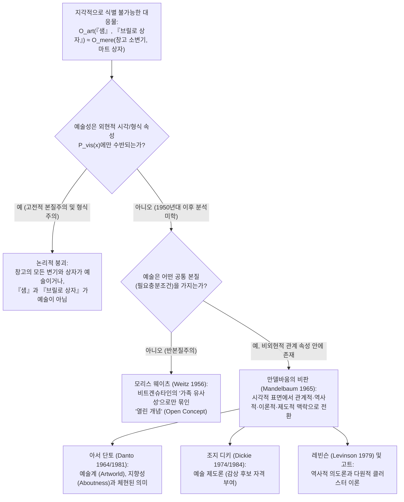
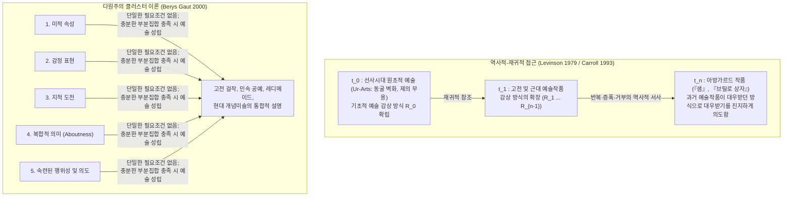

## 1. 서론: 1917년의 도자기 소변기와 1964년의 합판 비누 상자

1917년 4월, 뉴욕의 <strong>독립미술가협회(Society of Independent Artists)</strong>는 "심사위원 없음, 상금 없음"이라는 급진적 민주주의 원칙 아래 첫 전시회를 준비했다. 6달러의 회비만 내면 누구나 작품을 출품할 수 있었다. 그러나 필라델피아의 무명 예술가 "리처드 머트(R. Mutt)"의 이름으로 도착한 상자 안에는 J.L. Mott 배관용품 쇼룸에서 구입한 대량생산된 흰색 도자기 소변기가 들어 있었다. $90^\circ$ 회전되어 평평한 뒷면이 받침대에 놓인 이 소변기에는 검은 페인트로 <strong>"R. Mutt 1917"</strong>이라 서명되어 있었고, <strong>『샘』(Fountain)</strong>이라는 제목이 붙어 있었다.

"R. Mutt"의 정체는 바로 전시 설치위원장이었던 프랑스 아방가르드 예술가 <strong>마르셀 뒤샹(Marcel Duchamp, 1887–1968)</strong>이었다. 뒤샹은 1913년 『자전거 바퀴』, 1914년 『병걸이』, 1915년 눈삽 『부러진 팔에 앞서』 등 일련의 <strong>‘레디메이드’(Readymades, 기성품)</strong>를 실험하며, 안구의 쾌락만을 추구하는 <strong>‘망막적 예술’(art rétinien)</strong>을 타파하고 예술을 지성의 영역(*cosa mentale*)으로 되돌리고자 했다. 그는 좋은 취향이나 나쁜 취향에 물들지 않은 완전한 <strong>‘미적 무관심’(aesthetic indifference / anesthésie)</strong> 상태에서 레디메이드를 선택해야 한다고 주장했다. 협회 이사회는 『샘』을 칸막이 뒤에 숨기고 전시를 거부했으나, 뒤샹은 다다이즘 잡지 『블라인드 맨』(1917년 5월호)에서 현대 미학사를 뒤바꾼 선언을 남겼다.

> "머트 씨가 자신의 손으로 그 샘을 직접 만들었는지 여부는 전혀 중요하지 않다. 그는 그것을 <strong>선택(CHOSE)</strong>했다. 그는 일상의 평범한 물건을 가져다 새로운 제목과 관점 아래 그 실용적 의미가 사라지도록 배치함으로써, <strong>그 사물에 대한 새로운 사유를 창조했다</strong>."

반세기 뒤인 1964년 4월, <strong>앤디 워홀(Andy Warhol, 1928–1987)</strong>은 맨해튼 스테이블 갤러리(Stable Gallery)에 슈퍼마켓 창고의 골판지 비누 패드 상자와 육안으로 전혀 구별할 수 없는 합판 실크스크린 작품 <strong>『브릴로 상자』(Brillo Box)</strong>를 가득 쌓아 올렸다. 이 전시를 본 컬럼비아 대학교 철학자 <strong>아서 단토(Arthur C. Danto, 1924–2013)</strong>는 뒤샹과 워홀이 <strong>‘지각적으로 식별 불가능한 대응물의 문제’(Problem of Perceptually Indiscernible Counterparts)</strong>를 제기했음을 간파했다. 왜 창고에 있는 나머지 99개의 동일한 소변기와 슈퍼마켓의 브릴로 상자는 ‘단순한 실제 사물’(mere real thing)인데, 『샘』과 워홀의 『브릴로 상자』는 위대한 예술작품인가?

---

## 2. 고전적 미학 본질주의의 붕괴: 모방론, 표현론, 의미 있는 형식

소크라테스와 플라톤 이래 20세기 중반까지 예술 철학은 모든 예술작품이 공유하는 <strong>필요충분조건(Necessary and Sufficient Conditions)</strong>을 찾는 작업이었다.

$$\forall x \Big( \text{Art}(x) \iff C_1(x) \land C_2(x) \land \dots \land C_n(x) \Big)$$

그러나 서양 미학사의 3대 고전적 본질주의 패러다임은 레디메이드 앞에서 모두 무너졌다.

1. <strong>모방론 / 재현론(Mimesis — 플라톤 『국가』 10권, 아리스토텔레스 『시학』)</strong>: 예술을 자연이나 인간 행동의 모방으로 정의한다. 그러나 순수 기악곡과 칸딘스키·몬드리안의 추상화는 아무것도 모방하지 않으며, 뒤샹의 『샘』은 소변기를 묘사한 것이 아니라 그냥 실제 소변기 자체다. 또한 공장에서 찍어낸 수만 개의 브릴로 상자는 원본을 완벽히 모방하지만 예술이 아니다.
2. <strong>표현론(Expression Theory — 톨스토이 『예술이란 무엇인가』, 콜링우드 『예술의 원리』)</strong>: 예술을 예술가의 내면적 감정의 명료화 및 전달로 본다. 그러나 뒤샹의 ‘미적 무관심’, 워홀의 기계적 대량 실크스크린, 존 케이지(John Cage)의 우연성 음악과 『4분 33초』는 주관적 감정 표현을 철저히 배제한다.
3. <strong>형식주의(Formalism — 클라이브 벨 Clive Bell 『예술』 1914, 로저 프라이)</strong>: 벨은 미적 정서를 유발하는 선·색채·형태의 결합인 <strong>‘의미 있는 형식’(Significant Form)</strong>을 예술의 본질로 제시했다. 그러나 <strong>지각적 식별 불가능성 논증</strong>은 이를 논박한다.

뒤샹의 『샘』(또는 워홀의 『브릴로 상자』)을 $O_{\text{art}}$, 창고의 일반 소변기(또는 마트의 브릴로 상자)를 $O_{\text{mere}}$라 하고, 사물 $x$의 외현적 시각·형식적 속성 전체를 $P_{\text{vis}}(x)$라 하자. 가정에 의해 두 사물의 시각적 속성은 동일하다.

$$P_{\text{vis}}(O_{\text{art}}) = P_{\text{vis}}(O_{\text{mere}}) \quad \Big( O_{\text{art}} \approx_{\text{percept}} O_{\text{mere}} \Big)$$

그러나 예술 여부에 관한 존재론적 지위는 정반대이다.

$$\text{Art}(O_{\text{art}}) \land \neg\text{Art}(O_{\text{mere}})$$

만약 예술성이 오직 시각적 형식 속성 $P_{\text{vis}}(x)$에만 수반된다면, 세상의 모든 공중화장실 소변기가 이미 예술작품이거나, 아니면 『샘』과 『브릴로 상자』조차 예술이 아니어야 한다. 따라서 <strong>예술과 비예술을 가르는 존재론적 경계는 결코 사물의 외현적 지각 속성 안에 존재할 수 없다</strong>.

| 고전 미학 패러다임 | 핵심 사상가 | 핵심 테제 (제안된 예술의 본질) | 레디메이드와 식별 불가능한 대응물에 의한 논박 |
| :--- | :--- | :--- | :--- |
| <strong>모방론 (Mimesis)</strong> | 플라톤, 아리스토텔레스, 바사리 | 예술은 자연, 현실, 인간 행동의 모방 및 재현이다 | 추상미술은 모방하지 않으며, 『샘』은 사물 자체의 직접 제시이고, 공장 복제품은 예술이 아니다 |
| <strong>표현론 (Expression)</strong> | 톨스토이, 콜링우드 (Collingwood) | 예술은 예술가의 내적 감정의 상상적 명료화와 전달이다 | 뒤샹의 ‘미적 무관심’, 워홀의 기계적 실크스크린, 케이지의 우연성 음악은 감정을 배제한다 |
| <strong>형식주의 (Formalism)</strong> | 클라이브 벨 (Bell), 비어즐리 | 예술은 미적 정서를 일깨우는 ‘의미 있는 형식’이다 | 지각적으로 동일한 두 사물 ($O_{\text{art}} \approx_{\text{percept}} O_{\text{mere}}$) 중 하나만 예술이므로 시각 형식만으로는 구별 불가 |

---

## 3. 모리스 웨이츠의 신비트겐슈타인주의 반본질주의와 만델바움의 관계적 전환

### 3.1 비트겐슈타인의 ‘가족 유사성’과 ‘열린 개념’

1956년 논문 「미학에서 이론의 역할」( *"The Role of Theory in Aesthetics"*)에서 <strong>모리스 웨이츠(Morris Weitz, 1916–1981)</strong>는 <strong>루트비히 비트겐슈타인의 『철학적 탐구』</strong>(1953, §§65–75)에 등장하는 ‘게임’(*Spiel*) 분석을 예술에 적용했다. 보드게임, 카드게임, 구기 종목, 올림픽 경기 사이에는 단일한 공통 본질이 없으며, 가족 구성원들이 체격, 이목구비, 눈 색깔, 걸음걸이를 교차하며 닮듯 <strong>‘중첩되고 교차하는 유사성들의 그물망’—즉 ‘가족 유사성’(Familienähnlichkeiten)</strong>만 존재한다.

웨이츠는 예술 실천의 본령이 끊임없는 창조적 파괴와 확장에 있으므로, ‘예술’은 적용 조건이 언제나 수정 가능한 <strong>‘열린 개념’(Open Concept)</strong>이며, 이를 필요충분조건으로 닫으려는 시도는 예술적 창의성 자체를 말살한다고 주장했다.

### 3.2 모리스 만델바움의 결정적 반박(1965): 비외현적 관계 속성

1965년 철학자 <strong>모리스 만델바움(Maurice Mandelbaum)</strong>은 날카로운 반론을 제기했다. 사진 속 여섯 명의 얼굴이 우연히 닮은 남남이 아니라 ‘가족 유사성’을 지닌 이유는 무엇인가? 바로 사진 표면에는 직접 보이지 않는 <strong>비외현적·유전적 관계 속성(공통의 생물학적 조상)</strong>을 공유하기 때문이다! 또한 시각적 가족 유사성으로 예술을 판별한다면 뒤샹의 『샘』과 가장 닮은 사물은 배관 창고의 일반 소변기들인데 그것들은 예술이 아니다. 따라서 만델바움은 <strong>예술의 본질이 외현적 시각 속성이 아닌 ‘비외현적 관계 속성’(Non-Exhibited Relational Properties)에 있음</strong>을 입증했다.

---

## 4. 아서 단토의 「예술계」(1964)와 『일상적인 것의 변용』(1981)

1964년 10월 『철학 저널』에 실린 기념비적 논문 「예술계」( *"The Artworld"*)에서 <strong>아서 단토</strong>는 현대 미학에서 가장 유명한 문장을 남겼다.

> <strong>"무언가를 예술로 본다는 것은 눈으로는 결코 식별할 수 없는 무언가를 요구한다—즉 예술 이론의 분위기, 예술사에 대한 지식: 바로 예술계(an artworld)이다."</strong>

### 4.1 사고실험: 식별 불가능한 붉은 사각형들의 미술관

1981년 주저 <strong>『일상적인 것의 변용』(The Transfiguration of the Commonplace)</strong>에서 단토는 완벽히 동일한 붉은색 정사각형 캔버스 9점이 나란히 걸린 사고실험을 제시한다.

1. <strong>『홍해를 건너는 이스라엘 백성』</strong> (이스라엘인은 이미 건넜고 이집트군은 막 물에 잠긴 역사화)
2. <strong>『키르케고르의 기분』</strong> (심리적 표현주의 초상화)
3. <strong>『붉은 광장』</strong> (모스크바 광장의 기하학적 풍경화)
4. <strong>『열반(Nirvana)』</strong> (불교 형이상학적 회화)
5. <strong>『붉은 식탁보』</strong> (마티스 제자의 야수파 정물화)
6. <strong>『무제』(미니멀리즘 단색화)</strong> (회화 평면성을 강조한 모더니즘 작품)
7. <strong>조르조네의 붉은 밑칠 캔버스</strong> (16세기 거장 조르조네가 붉은 납 밑칠만 해두고 페스트로 사망해 남긴 유물—<strong>예술작품이 아닌 단순 준비된 표면</strong>)
8. <strong>단순한 붉은 페인트칠 표면</strong> (페인트공이 롤러를 시험하며 칠한 <strong>‘단순한 실제 사물’</strong>)
9. <strong>개념미술가 J의 『무제(아무것도 아닌 것에 대하여)』</strong> (7·8번의 배제에 항의하며 "아무것도 다루지 않는 빈 사물"이라 선언한 개념미술 작품)

### 4.2 단토의 두 가지 필요조건: 지향성(Aboutness)과 체현된 의미(Embodied Meaning)

단토는 이 사고실험을 통해 예술작품(1~6, 9번)을 단순한 실제 사물(7, 8번)과 구별하는 두 가지 필요조건을 도출한다.

1. <strong>지향성 / 무엇에 관한 것임(Aboutness)</strong>: 모든 예술작품은 세계나 예술 자체에 대해 <strong>무언가를 다루는(about something)</strong> 의미론적 지향성을 가진다(J의 9번 캔버스조차 예술과 물질성의 대비에 *관한* 메타 예술적 발언이다). 반면 창고의 소변기나 조르조네의 밑칠 캔버스는 아무것에 관해서도 말하지 않는다.
2. <strong>체현된 의미(Embodied Meaning)</strong>: 예술작품은 신문 기사처럼 의미를 단순히 진술하는 데 그치지 않고, 아리스토텔레스 수사학의 은유와 생략삼단논법(enthymeme)처럼 <strong>물질적·형식적 매체 안에 그 의미를 체현(embody)</strong>하여 관객의 해석을 통해 완성된다.

---

## 5. 조지 디키의 예술 제도론(1974/1984)과 울하임의 딜레마

철학자 <strong>조지 디키(George Dickie, 1926–2020)</strong>는 『예술과 미학』(1974)에서 단토의 이론적 분위기를 사회학적 제도로 재해석하여 <strong>예술 제도론(Institutional Theory of Art)</strong>을 정식화했다.

> <strong>[디키의 예술 제도론적 정의 (1974)]</strong>
> 분류적 의미에서 예술작품이란 (1) <strong>인공물(artifact)</strong>로서, (2) <strong>특정한 사회적 제도(예술계, Artworld)를 대리하여 행동하는 어떤 사람(들)—대개 예술가 자신—에 의해 그 측면들의 집합에 ‘감상 후보’(candidate for appreciation)라는 지위가 부여된 것</strong>이다.

### 5.1 리처드 울하임의 딜레마(1980): 미학의 『에우티프론』 문제

영국 철학자 <strong>리처드 울하임(Richard Wollheim)</strong>은 1980년 플라톤의 『에우티프론』 딜레마를 원용한 <strong>울하임의 딜레마(Wollheim's Dilemma)</strong>로 디키를 비판했다.

> 예술계의 대리인이 사물 $x$에 예술의 지위를 부여할 때, 그들은 <strong>타당한 예술적 이유 $R$</strong> 때문에 부여하는가, 아니면 <strong>아무 이유 없이 자의적으로(arbitrarily)</strong> 부여하는가?

- <strong>첫째 뿔(타당한 이유에 기반함)</strong>: 만약 $x$가 지닌 내적·예술적 이유 $R$(예: 단토의 체현된 의미) 때문에 지위를 부여한다면, $x$를 예술로 만드는 진짜 원인은 이유 $R$ 자체이며 제도적 지위 부여는 사후 승인에 불과해 제도론은 설명력을 잃는다.
- <strong>둘째 뿔(이유 없는 자의적 부여)</strong>: 만약 아무 이유 없이 순수한 선언만으로 무엇이든 예술이 된다면, 예술은 공허한 관료적 유희로 전락하며 인류가 왜 예술을 그토록 깊이 존중하는지 설명할 수 없다.

또한 제도론은 예술계 제도와 완전히 단절된 <strong>고독한 아웃사이더 아티스트</strong>(헨리 다거 등)나 제도가 존재하기 이전의 <strong>구석기 시대 라스코 동굴 벽화(원초적 예술, Ur-Art)</strong>를 설명하지 못한다.

---

## 6. 역사적 의도론과 다원적 클러스터 이론: 현대적 종합

이 한계를 극복하기 위해 현대 분석미학은 두 가지 대안을 발전시켰다.

1. <strong>제럴드 레빈슨(Jerrold Levinson, 1979)의 역사적-의도적 정의(Historical-Intentional Definition)</strong>: 사물 $x$가 시점 $t$에 예술작품인 것은, $x$의 정당한 소유자가 <strong>과거($t$ 이전)에 올바르게 예술작품으로 인정된 사물들이 대우받던(regarded) 방식대로 $x$가 대우받기를 진지하게 의도</strong>할 때 그리고 그때뿐이다. 이 재귀적 정의는 선사시대의 원초적 예술($t_0$)부터 아웃사이더 아트와 아방가르드까지 일관되게 포괄한다.
2. <strong>베리스 고트(Berys Gaut, 2000)의 클러스터 이론(Cluster Account)</strong>: 미적 속성, 감정 표현, 지적 도전, 복합적 의미(Aboutness), 숙련된 기술, 예술적 의도 등 약 10개의 속성 클러스터 중 <strong>어느 하나도 단일한 필요조건은 아니지만, 그중 충분한 부분집합을 만족하면 예술이 된다</strong>는 다원주의적 해법이다.

1917년 뒤샹의 소변기부터 2019년 마우리치오 카텔란의 테이프로 붙인 바나나 『코미디언』(*Comedian*), 그리고 오늘날 생성형 AI에 이르기까지, 예술 정의의 철학은 예술이 망막에 맺히는 물리적 표면이 아니라 인간의 의도와 역사적 서사, 그리고 사유가 물질과 만나는 지평임을 보여준다.
