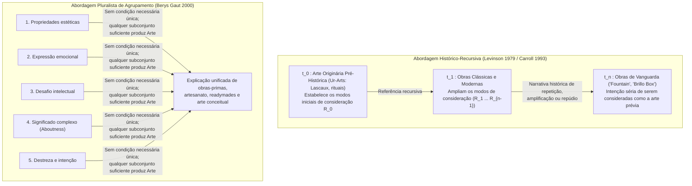

## 1. Introdução: O Mictório de Porcelana de 1917 e a Caixa de Sabão de 1964

Em abril de 1917, a recém-fundada <strong>Society of Independent Artists</strong> preparava sua exposição inaugural em Nova York sob um lema radicalmente democrático: *«Sem júri, sem prêmios»*. Qualquer artista que pagasse seis dólares tinha o direito de exibir duas obras. Dias antes da abertura, chegou uma caixa enviada por um desconhecido «Richard Mutt»: continha um mictório padrão de porcelana branca comprado na loja de encanamentos J.L. Mott Iron Works, girado em $90^\circ$, assinado em tinta preta <strong>«R. Mutt 1917»</strong> e intitulado <strong>*Fountain* (*Fonte*)</strong>.

Por trás de «Richard Mutt» estava <strong>Marcel Duchamp (1887–1968)</strong>, chefe do próprio comitê de montagem. Desde 1913, Duchamp vinha experimentando com os <strong>«Readymades»</strong> (*Roda de Bicicleta* 1913, *Secador de Garrafas* 1914) para derrubar a <strong>«arte retiniana» (*art rétinien*)</strong> — a pintura reduzida ao mero prazer do olho físico — e devolver a arte ao serviço do intelecto (*cosa mentale*), escolhendo objetos em um estado de completa <strong>«indiferença estética» (*anesthésie*)</strong>. Quando a diretoria ocultou *Fountain* declarando que era um simples «artigo de encanamento», Duchamp renunciou e publicou em maio de 1917 na revista dadaísta *The Blind Man* a defesa que transformou a filosofia da arte do século XX:

> *«Se o Sr. Mutt fez a fonte com as próprias mãos ou não, não tem nenhuma importância. Ele a <strong>ESCOLHEU (CHOSE)</strong>. Pegou um artigo comum da vida, colocou-o de tal modo que seu significado útil desapareceu sob o novo título e ponto de vista — <strong>criou um novo pensamento para esse objeto</strong>.»*

Quase meio século depois, em abril de 1964, <strong>Andy Warhol (1928–1987)</strong> encheu a Stable Gallery de Manhattan com pilhas de <strong>*Brillo Boxes*</strong>: caixas de madeira compensada serigrafadas, visualmente indistinguíveis das caixas de papelão de esponjas de aço Brillo armazenadas nos supermercados. Ao visitar a galeria, o filósofo <strong>Arthur C. Danto (1924–2013)</strong> compreendeu que Duchamp e Warhol haviam formulado o <strong>Problema das Contrapartes Perceptivamente Indiscerníveis (Perceptually Indiscernible Counterparts)</strong>:

* Por que o 100º mictório (*Fountain*) é uma obra-prima da arte enquanto os outros 99 mictórios idênticos no depósito são «meras coisas reais» (*mere real things*)?
* Por que a *Brillo Box* de Warhol é escultura enquanto a caixa comercial de Brillo desenhada por James Harvey é uma simples embalagem?

---

## 2. O Colapso do Essencialismo Estético Clássico: Mimese, Expressão e Forma Significante

De Platão até meados do século XX, definir a arte consistia em buscar <strong>condições necessárias e suficientes</strong>:

$$\forall x \Big( \text{Art}(x) \iff C_1(x) \land C_2(x) \land \dots \land C_n(x) \Big)$$

Contudo, os três grandes paradigmas clássicos ruíram diante dos readymades e dos indiscerníveis:

1. <strong>Mimese / Teoria da Imitação (Platão *República* X, Aristóteles *Poética*)</strong>: A arte como imitação da natureza. Refutada pela música absoluta, pela arte abstrata (Kandinsky, Mondrian) e por *Fountain* de Duchamp, que não representa um mictório, mas *é* um mictório — enquanto dez mil caixas Brillo saídas da fábrica copiam o protótipo sem serem arte.
2. <strong>Teoria da Expressão (Liev Tolstói *O que é Arte?*, R.G. Collingwood *Os Princípios da Arte*)</strong>: A arte como clarificação e transmissão da emoção subjetiva do artista. Refutada pela «indiferença estética» de Duchamp, pela serigrafia mecânica de Warhol (*«Quero ser uma máquina»*) e pela música aleatória de John Cage (*4'33"*).
3. <strong>Formalismo (Clive Bell *Art* 1914, Roger Fry, Monroe Beardsley)</strong>: A arte definida pela <strong>«Forma Significante» (Significant Form)</strong> capaz de despertar uma emoção estética. O <strong>Argumento da Indiscernibilidade Perceptiva</strong> refuta formalmente essa tese:

Seja $O_{\text{art}}$ *Fountain* de Duchamp (ou a *Brillo Box* de Warhol) e $O_{\text{mere}}$ sua contraparte comum no depósito. Seja $P_{\text{vis}}(x)$ o conjunto completo de propriedades visuais e formais manifestas de $x$. Por hipótese:

$$P_{\text{vis}}(O_{\text{art}}) = P_{\text{vis}}(O_{\text{mere}}) \quad \Big( O_{\text{art}} \approx_{\text{percept}} O_{\text{mere}} \Big)$$

Apesar disso, seu estatuto ontológico quanto à arte é oposto:

$$\text{Art}(O_{\text{art}}) \land \neg\text{Art}(O_{\text{mere}})$$

Se ser arte sobreviesse exclusivamente às propriedades visuais manifestas $P_{\text{vis}}(x)$, ou todos os mictórios do planeta já seriam obras de arte, ou *Fountain* e *Brillo Box* não seriam arte. Portanto, <strong>a fronteira ontológica entre arte e não-arte não pode residir em nenhuma propriedade perceptiva manifesta do próprio objeto</strong>.

| Paradigma Clássico | Autores-Chave | Tese Central (Essência Proposta) | Refutação por Readymades e Indiscerníveis |
| :--- | :--- | :--- | :--- |
| <strong>Mimese (Imitação)</strong> | Platão, Aristóteles, Vasari | A arte é imitação ou representação da natureza e da ação humana | A arte abstrata não imita nada; *Fountain* apresenta um objeto real; cópias de fábrica não são arte |
| <strong>Teoria da Expressão</strong> | Tolstói, Collingwood | A arte é a clarificação imaginativa e transmissão de emoções internas | A «indiferença estética» de Duchamp, a mecânica de Warhol e o acaso de Cage excluem a emoção |
| <strong>Formalismo</strong> | Clive Bell, Roger Fry, Beardsley | A arte define-se pela «Forma Significante» que evoca emoção estética | Diante de dois objetos perceptivamente idênticos ($O_{\text{art}} \approx_{\text{percept}} O_{\text{mere}}$), a forma visual não os distingue |

---

## 3. O Antiessencialismo Neowittgensteiniano de Morris Weitz e a Virada Relacional de Mandelbaum

### 3.1 As «Semelhanças de Família» de Wittgenstein e o «Conceito Aberto»

Em seu célebre artigo *«The Role of Theory in Aesthetics»* (1956), <strong>Morris Weitz (1916–1981)</strong> aplicou à arte a análise da palavra «jogo» (*Spiel*) desenvolvida por <strong>Ludwig Wittgenstein</strong> nas *Investigações Filosóficas* (1953, §§65–75). Entre jogos de tabuleiro, de cartas, de bola e os Jogos Olímpicos não há uma propriedade comum a todos, mas *«uma complicada rede de semelhanças que se sobrepõem e se cruzam»*: <strong>«semelhanças de família» (*Familienähnlichkeiten*)</strong>. Como a criatividade expansiva e a quebra de regras fazem parte da própria lógica da arte, «arte» é segundo Weitz um <strong>«conceito aberto» (Open Concept)</strong> que nenhuma definição por condições necessárias e suficientes pode fechar sem sufocar a criação.

### 3.2 A Crítica Decisiva de Maurice Mandelbaum (1965): Propriedades Relacionais Não Exibidas

Em 1965, <strong>Maurice Mandelbaum</strong> expôs a ironia oculta na metáfora de Wittgenstein: o que faz com que as semelhanças faciais em seis fotografias sejam semelhanças *de família* em vez de meras coincidências entre estranhos? Precisamente o fato de compartilharem uma <strong>propriedade relacional genética não manifesta (uma ancestralidade biológica comum)</strong> invisível na superfície das fotos! Além disso, se bastasse a semelhança visual, os objetos mais parecidos com *Fountain* seriam os milhões de mictórios nos depósitos. Mandelbaum demonstrou assim que <strong>o fracasso do essencialismo visual prova que a essência da arte reside em propriedades relacionais não exibidas (intenção, história, instituição)</strong>.

---

## 4. «The Artworld» (1964) e *A Transfiguração do Lugar-Comum* (1981) de Arthur Danto

Em seu ensaio de outubro de 1964, *«The Artworld»*, <strong>Arthur C. Danto</strong> escreveu a frase mais famosa da estética moderna:

> <strong>«Ver algo como arte requer algo que o olho não pode discernir — uma atmosfera de teoria artística, um conhecimento da história da arte: um mundo da arte (*an artworld*).»</strong>

### 4.1 O Experimento Mental: A Galeria dos Quadrados Vermelhos Indiscerníveis

Em sua obra-prima de 1981, <strong>*A Transfiguração do Lugar-Comum* (*The Transfiguration of the Commonplace*)</strong>, Danto imagina uma galeria com nove telas retangulares pintadas uniformemente de vermelho-cádmio, fisicamente indiscerníveis:

1. <strong>*Os Israelitas Cruzando o Mar Vermelho*</strong> (pintura histórica onde os egípcios acabam de se afogar)
2. <strong>*O Humor de Kierkegaard*</strong> (retrato psicológico expressionista)
3. <strong>*Praça Vermelha*</strong> (paisagem geométrica de Moscou)
4. <strong>*Nirvana*</strong> (pintura metafísica budista)
5. <strong>*Toalha de Mesa Vermelha*</strong> (natureza-morta fauvista de um discípulo de Matisse)
6. <strong>*Sem Título*</strong> (monocromo minimalista afirmando a planicidade pictórica)
7. <strong>A tela imprimada de Giorgione</strong> (tela do século XVI sobre a qual o mestre veneziano aplicou uma camada de base de chumbo vermelho antes de morrer de peste: <strong>não é uma obra de arte</strong>)
8. <strong>Uma mera superfície pintada de vermelho</strong> (pintada com rolo por um pintor de paredes: uma <strong>«mera coisa real»</strong>)
9. <strong>*Sem Título («Sobre Nada»)* do artista conceitual J</strong> (exposta polemicamente afirmando que a obra «não é sobre absolutamente nada»)

### 4.2 As Duas Condições Necessárias de Danto: *Aboutness* e *Significado Corporificado*

Para distinguir as obras de arte (1–6 e 9) das meras coisas (7 e 8), Danto formula duas condições necessárias:

1. <strong>*Aboutness* (Intencionalidade semântica / «ser-sobre-algo»)</strong>: Toda obra de arte é *sobre* algo (mesmo a tela 9 de J é meta-artisticamente *sobre* o contraste entre arte e materialidade vazia, tal como o número $0$ na matemática). Uma caixa Brillo no supermercado não é sobre nada.
2. <strong>Significado Corporificado (Embodied Meaning)</strong>: Diferentemente de um texto jornalístico, uma obra de arte não se limita a enunciar um sentido; ela <strong>corporifica</strong> seu significado em seu suporte material como uma metáfora visual ou um entimema retórico.

---

## 5. A Teoria Institucional da Arte de George Dickie (1974/1984) e o Dilema de Wollheim

O filósofo <strong>George Dickie (1926–2020)</strong> propôs em *Art and the Aesthetic* (1974) uma leitura sociológica e performativa do mundo da arte:

> <strong>[Definição Institucional da Arte de Dickie (1974)]</strong>
> Uma obra de arte no sentido classificatório é (1) <strong>um artefato</strong>, (2) <strong>cujo conjunto de aspectos teve conferido a si o estatuto de candidato à apreciação (candidate for appreciation) por alguma pessoa ou pessoas agindo em nome de certa instituição social (o mundo da arte)</strong> — normalmente o próprio artista.

### 5.1 O Dilema de Richard Wollheim (1980): O Problema de *Eutífron* na Estética

Em 1980, <strong>Richard Wollheim (1923–2003)</strong> colocou a Dickie um dilema devastador inspirado no *Eutífron* de Platão:

> Quando os representantes do mundo da arte conferem o estatuto de arte a um objeto $x$, fazem-no por <strong>boas razões artísticas $R$</strong> ou de maneira <strong>puramente arbitrária sem razões</strong>?

- <strong>Primeiro chifre (Por boas razões)</strong>: Se razões substantivas $R$ (como o significado corporificado de Danto) são exigidas, então são essas propriedades $R$ que fazem de $x$ uma obra de arte, e a instituição apenas ratifica esse estatuto a posteriori.
- <strong>Segundo chifre (Conferição arbitrária)</strong>: Se nenhuma razão é exigida, a arte reduz-se a um jogo burocrático vazio, incapaz de explicar por que a humanidade valoriza tão profundamente a arte.

Além disso, a teoria institucional falha em explicar a <strong>arte bruta / solitária</strong> (como a obra secreta de Henry Darger) e a <strong>arte pré-histórica originária (*Ur-Art*)</strong> das cavernas de Lascaux ou Chauvet, criada 30.000 anos antes de qualquer instituição museológica.

---

## 6. Intencionalismo Histórico e Teoria de Agrupamento (Cluster Account)

Para superar essas aporias, duas abordagens contemporâneas ganharam destaque:

1. <strong>A Definição Histórico-Intencional de Jerrold Levinson (1979)</strong>: Um objeto $x$ é uma obra de arte no tempo $t$ se e somente se seu proprietário legítimo <strong>tem a intenção séria de que $x$ seja considerado (regarded) de alguma das maneiras pelas quais obras de arte anteriores a $t$ foram corretamente consideradas</strong>. Por recursão até a arte pré-histórica ($t_0$), essa definição abrange tanto o eremita solitário quanto a vanguarda.
2. <strong>A Teoria de Agrupamento (Cluster Account) de Berys Gaut (2000)</strong>: Existe um agrupamento de cerca de dez propriedades relevantes (qualidades estéticas, expressão emocional, desafio intelectual, significado complexo, destreza e intenção artística): <strong>nenhuma é individualmente necessária, mas qualquer subconjunto suficiente faz de um objeto uma obra de arte</strong>.

