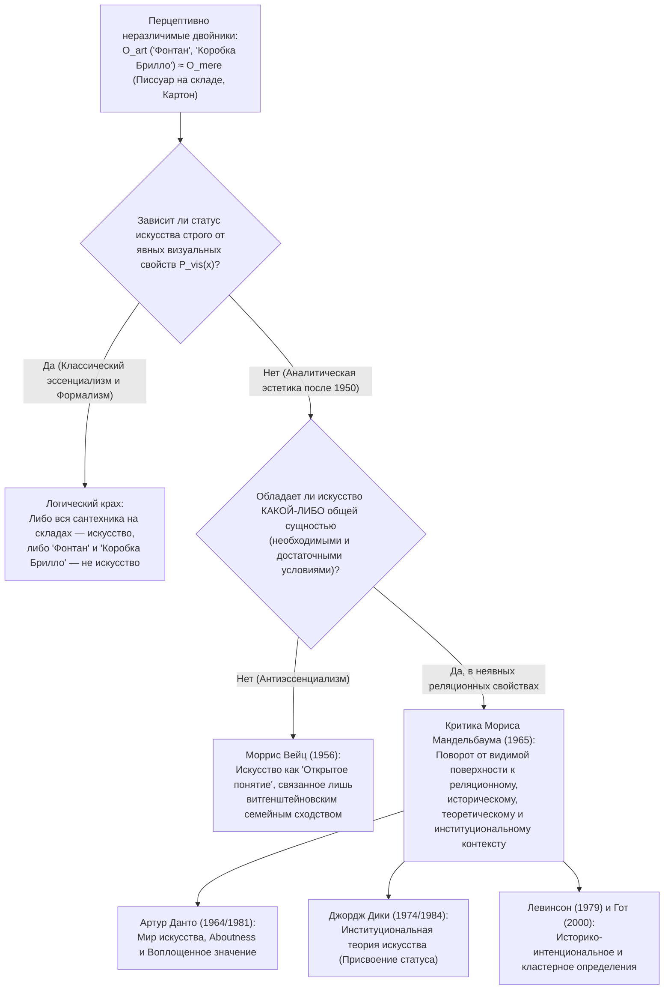
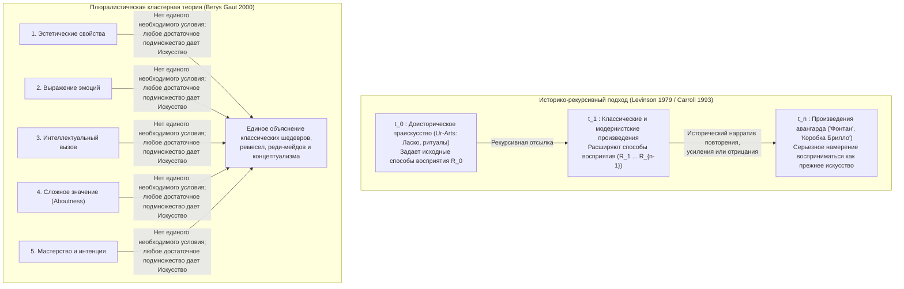

## 1. Введение: Фарфоровый писсуар 1917 года и фанерная коробка 1964 года

В апреле 1917 года недавно созданное <strong>Общество независимых художников (Society of Independent Artists)</strong> готовило свою первую выставку в Нью-Йорке под радикально демократическим лозунгом: *«Ни жюри, ни призов»*. Любой художник, заплативший шесть долларов взноса, получал право выставить две работы. За несколько дней до открытия поступил ящик от неизвестного «Ричарда Матта»: внутри лежал стандартный белый фарфоровый писсуар фирмы J.L. Mott Iron Works, повернутый на $90^\circ$, подписанный черной краской <strong>«R. Mutt 1917»</strong> и озаглавленный <strong>*«Фонтан» (Fountain)*</strong>.

За псевдонимом «Ричард Матт» скрывался французский авангардист <strong>Марсель Дюшан (1887–1968)</strong>, сам возглавлявший развесочную комиссию выставки. Начиная с 1913 года Дюшан экспериментировал с так называемыми <strong>«реди-мейдами» (Readymades)</strong> (*Велосипедное колесо* 1913, *Сушилка для бутылок* 1914), стремясь ниспровергнуть <strong>«ретинальное искусство» (*art rétinien*)</strong>, услаждающее лишь физический глаз, и вернуть искусство на службу интеллекту (*cosa mentale*), выбирая предметы в состоянии полного <strong>«эстетического безразличия» (*anesthésie*)</strong>. Когда совет директоров спрятал *«Фонтан»* за перегородкой, объявив его «обычной сантехникой», Дюшан подал в отставку и в мае 1917 года опубликовал в дадаистском журнале *The Blind Man* защиту, перевернувшую эстетику XX века:

> *«Сделал ли мистер Матт фонтан собственными руками или нет — не имеет никакого значения. Он <strong>ВЫБРАЛ (CHOSE)</strong> его. Он взял обычный предмет быта, поместил его так, что его утилитарное значение исчезло под новым названием и углом зрения — <strong>он создал новую мысль для этого предмета</strong>».*

Почти полвека спустя, в апреле 1964 года, <strong>Энди Уорхол (1928–1987)</strong> заполнил манхэттенскую галерею Stable штабелями <strong>*«Коробок Брилло» (Brillo Boxes)*</strong> — фанерных ящиков с шелкографией, визуально неотличимых от картонных коробок с мыльными губками Brillo на складах супермаркетов. Посетив выставку, философ <strong>Артур Данто (1924–2013)</strong> понял, что Дюшан и Уорхол поставили перед философией <strong>проблему перцептивно неразличимых двойников (Perceptually Indiscernible Counterparts)</strong>:

* Почему 100-й писсуар (*«Фонтан»*) — шедевр искусства, тогда как 99 идентичных писсуаров на складе остаются «просто реальными вещами» (*mere real things*)?
* Почему *«Коробка Брилло»* Уорхола — скульптура, а визуально неотличимая коммерческая коробка Brillo, оформленная Джеймсом Харви, — просто тара?

---

## 2. Крах классического эстетического эссенциализма: Мимесис, Выражение и Значимая форма

От Платона до середины XX века определение искусства понималось как поиск <strong>необходимых и достаточных условий</strong>:

$$\forall x \Big( \text{Art}(x) \iff C_1(x) \land C_2(x) \land \dots \land C_n(x) \Big)$$

Однако все три классические парадигмы рушатся при столкновении с реди-мейдами и неразличимыми двойниками:

1. <strong>Мимесис / Теория подражания (Платон *«Государство»* X, Аристотель *«Поэтика»*)</strong>: Искусство как подражание природе. Опровергается абсолютной музыкой, абстрактным искусством (Кандинский, Мондриан) и *«Фонтаном»* Дюшана, который не изображает писсуар, а просто *является* им, тогда как десять тысяч заводских коробок Brillo копируют прототип, не становясь искусством.
2. <strong>Теория выражения (Лев Толстой *«Что такое искусство?»*, Р. Дж. Коллингвуд *«Принципы искусства»*)</strong>: Искусство как прояснение и передача субъективных эмоций художника. Опровергается «эстетическим безразличием» Дюшана, механической шелкографией Уорхола (*«Я хочу быть машиной»*) и алеаторической музыкой Джона Кейджа (*4'33"*).
3. <strong>Формализм (Клайв Белл *Art* 1914, Роджер Фрай, Монро Бирдсли)</strong>: Искусство определяется через <strong>«Значимую форму» (Significant Form)</strong>, вызывающую эстетическую эмоцию. <strong>Аргумент перцептивной неразличимости</strong> строго опровергает этот тезис:

Пусть $O_{\text{art}}$ — *«Фонтан»* Дюшана (или *«Коробка Брилло»* Уорхола), а $O_{\text{mere}}$ — его обычный двойник на складе. Пусть $P_{\text{vis}}(x)$ — полное множество явных визуальных и формальных свойств объекта $x$. По условию:

$$P_{\text{vis}}(O_{\text{art}}) = P_{\text{vis}}(O_{\text{mere}}) \quad \Big( O_{\text{art}} \approx_{\text{percept}} O_{\text{mere}} \Big)$$

Однако их онтологический статус противоположный:

$$\text{Art}(O_{\text{art}}) \land \neg\text{Art}(O_{\text{mere}})$$

Если бы статус искусства супервентно зависел только от видимых формальных свойств $P_{\text{vis}}(x)$, то либо все писсуары мира уже были бы произведениями искусства, либо *«Фонтан»* и *«Коробка Брилло»* не были бы искусством. Следовательно, <strong>онтологическая граница между искусством и не-искусством не может находиться ни в каких видимых перцептивных свойствах самого объекта</strong>.

| Классическая парадигма | Ключевые авторы | Центральный тезис (Предлагаемая сущность) | Опровержение реди-мейдами и неразличимыми двойниками |
| :--- | :--- | :--- | :--- |
| <strong>Мимесис (Подражание)</strong> | Платон, Аристотель, Вазари | Искусство есть подражание природе, реальности или действиям людей | Абстракционизм ничему не подражает; *«Фонтан»* предъявляет сам предмет; заводские копии не искусство |
| <strong>Теория выражения</strong> | Л. Толстой, Р. Коллингвуд | Искусство есть образное прояснение и передача внутренних эмоций творца | «Эстетическое безразличие» Дюшана, механика Уорхола и случайность Кейджа исключают эмоции |
| <strong>Формализм</strong> | Клайв Белл, Роджер Фрай, Бирдсли | Искусство определяется «Значимой формой», пробуждающей эстетическое чувство | При двух визуально идентичных объектах ($O_{\text{art}} \approx_{\text{percept}} O_{\text{mere}}$) форма не способна их различить |

---

## 3. Неовитгенштейнианский антиэссенциализм Морриса Вейца и реляционный поворот Мандельбаума

### 3.1 «Семейные сходства» Витгенштейна и «открытое понятие»

В знаменитой статье *«Роль теории в эстетике»* (1956) <strong>Моррис Вейц (1916–1981)</strong> применил к искусству анализ слова «игра» (*Spiel*) из *«Философских исследований»* (1953, §§65–75) <strong>Людвига Витгенштейна</strong>. Между настольными, карточными играми, играми с мячом и Олимпийскими играми нет единого общего признака, но есть *«сложная сеть пересекающихся и переплетающихся подобий»* — <strong>«семейные сходства» (*Familienähnlichkeiten*)</strong>. Поскольку радикальное творчество и нарушение правил входят в саму логику искусства, «искусство», по Вейцу, есть <strong>«открытое понятие» (Open Concept)</strong>, которое нельзя замкнуть необходимыми и достаточными условиями, не уничтожив само творчество.

### 3.2 Решающая критика Мориса Мандельбаума (1965): Неявные реляционные свойства

В 1965 году <strong>Морис Мандельбаум</strong> вскрыл иронию в метафоре Витгенштейна: что делает черты шести лиц на фотографиях именно *семейным* сходством, а не случайным сходством незнакомцев? Наличие <strong>неявного генетического реляционного свойства (общего биологического предка)</strong>, невидимого на самой поверхности снимков! Кроме того, если бы искусство определялось визуальным сходством, больше всего на *«Фонтан»* походили бы миллионы писсуаров на складах. Мандельбаум доказал: <strong>крах визуального эссенциализма доказывает, что сущность искусства лежит в неявных реляционных свойствах (интенции, истории, институтах)</strong>.

---

## 4. «Мир искусства» (1964) и *«Преображение банального»* (1981) Артура Данто

В эссе октября 1964 года *«The Artworld»* <strong>Артур Данто</strong> написал самую знаменитую фразу современной эстетики:

> <strong>«Чтобы видеть нечто как искусство, требуется то, чего глаз не способен разглядеть, — атмосфера художественной теории, знание истории искусства: мир искусства (*an artworld*)»</strong>.

### 4.1 Мысленный эксперимент: Галерея неразличимых красных квадратов

В своем главном труде 1981 года <strong>*«Преображение банального»* (*The Transfiguration of the Commonplace*)</strong> Данто описывает галерею с девятью физически неразличимыми холстами, равномерно закрашенными кадмиевым красным:

1. <strong>*«Переход израильтян через Чермное море»*</strong> (историческая картина: египтяне только что утонули)
2. <strong>*«Настроение Кьеркегора»*</strong> (психологический экспрессионистский портрет)
3. <strong>*«Красная площадь»*</strong> (геометрический московский пейзаж)
4. <strong>*«Нирвана»*</strong> (буддийская метафизическая живопись)
5. <strong>*«Красная скатерть»*</strong> (фовистский натюрморт ученика Матисса)
6. <strong>*«Без названия»*</strong> (минималистский монохром, утверждающий плоскостность холста)
7. <strong>Загрунтованный холст Джорджоне</strong> (холст XVI века, покрытый свинцовым суриком перед смертью мастера от чумы — <strong>не произведение искусства</strong>)
8. <strong>Просто закрашенная красным поверхность</strong> (покрашенная маляром — <strong>«просто реальная вещь»</strong>)
9. <strong>*«Без названия („Ни о чем“)»* концептуалиста J</strong> (выставлено с полемическим заявлением, что работа «вообще ни о чем»)

### 4.2 Два необходимых условия Данто: *Aboutness* и *Воплощенное значение*

Чтобы отличить произведения искусства (1–6 и 9) от простых вещей (7 и 8), Данто выдвигает два условия:

1. <strong>*Aboutness* (Семантическая интенциональность / «быть-о-чем-то»)</strong>: Каждое произведение искусства *о чем-то* говорит (даже холст 9 художника J метахудожественно говорит о контрасте искусства и пустой материи, подобно числу $0$ в математике). Коробка Brillo в супермаркете — ни о чем.
2. <strong>Воплощенное значение (Embodied Meaning)</strong>: В отличие от газетной статьи, произведение искусства не просто сообщает смысл, но <strong>воплощает</strong> его в своем материальном носителе подобно визуальной метафоре или риторической энтимеме.

---

## 5. Институциональная теория искусства Джорджа Дики (1974/1984) и дилемма Уоллхейма

Философ <strong>Джордж Дики (1926–2020)</strong> в книге *Art and the Aesthetic* (1974) предложил социологическую и перформативную трактовку мира искусства:

> <strong>[Институциональное определение искусства Дики (1974)]</strong>
> Произведение искусства в классификационном смысле — это (1) <strong>артефакт</strong>, (2) <strong>набору аспектов которого был присвоен статус кандидата на оценку (candidate for appreciation) лицом или лицами, действующими от имени определенного социального института (мира искусства)</strong> — как правило, самим художником.

### 5.1 Дилемма Ричарда Уоллхейма (1980): Проблема *«Евтифрона»* в эстетике

В 1980 году <strong>Ричард Уоллхейм (1923–2003)</strong> предъявил Дики разрушительную дилемму, восходящую к *«Евтифрону»* Платона:

> Когда представители мира искусства присваивают объекту $x$ статус искусства, делают ли они это по <strong>веским художественным основаниям $R$</strong> или <strong>чисто произвольно без оснований</strong>?

- <strong>Первый рог (По веским основаниям)</strong>: Если требуются содержательные основания $R$ (например, воплощенное значение Данто), то именно эти свойства $R$ делают $x$ искусством, а институт лишь задним числом подтверждает это.
- <strong>Второй рог (Произвольное присвоение)</strong>: Если никаких оснований не требуется, искусство превращается в пустую бюрократическую игру, и невозможно объяснить, почему человечество так высоко ценит искусство.

Кроме того, институциональная теория не способна объяснить <strong>аутсайдерское / одиночное искусство</strong> (например, тайный эпос Генри Дарджера) и <strong>доисторическое праискусство (*Ur-Art*)</strong> пещер Ласко и Шове, созданное за 30 000 лет до появления музейных институтов.

---

## 6. Исторический интенционализм и кластерная теория (Cluster Account)

Для преодоления этих тупиков в современной эстетике утвердились два подхода:

1. <strong>Историко-интенциональное определение Джерольда Левинсона (1979)</strong>: Объект $x$ является произведением искусства в момент $t$ тогда и только тогда, когда его законный владелец <strong>серьезно намеревается, чтобы к $x$ относились (regarded) так, как прежде (до $t$) правильно относились к существовавшим произведениям искусства</strong>. По рекурсии до доисторического праискусства ($t_0$) это определение охватывает и отшельника, и авангард.
2. <strong>Кластерная теория (Cluster Account) Бериса Гота (2000)</strong>: Существует кластер из примерно десяти релевантных свойств (эстетические достоинства, выражение эмоций, интеллектуальный вызов, сложное значение, мастерство и художественная интенция): <strong>ни одно из них не является по отдельности необходимым, но любого достаточного подмножества хватает, чтобы объект был искусством</strong>.

