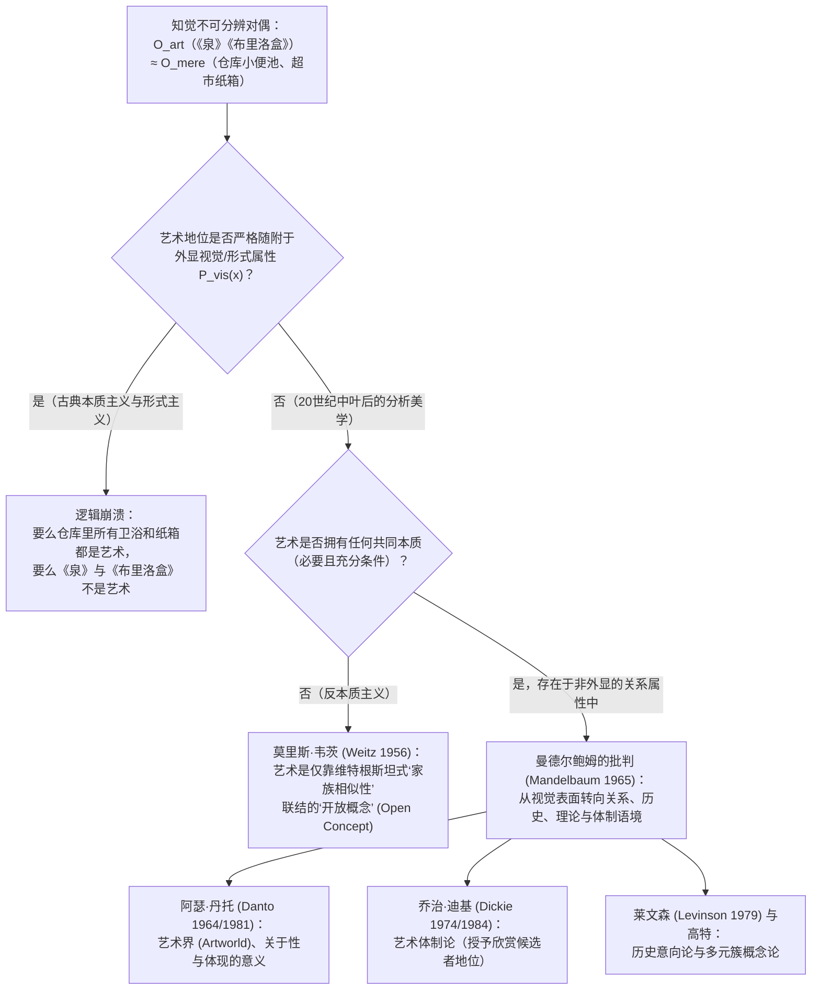
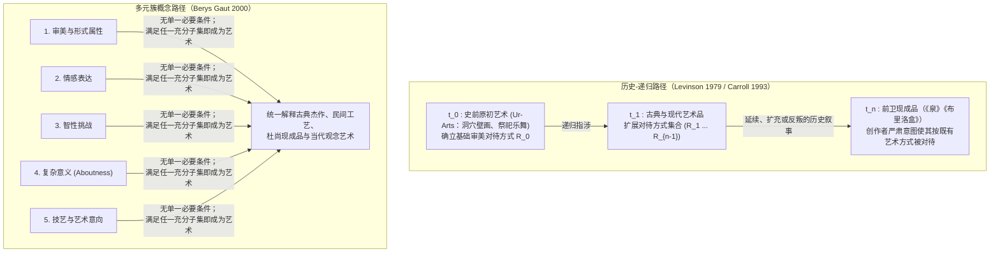

## 1. 引言：1917年的瓷质小便池与1964年的胶合板肥皂盒

1917年4月，纽约新成立的<strong>独立艺术家协会（Society of Independent Artists）</strong>宣布举办首届展览，章程极其民主：“无评审团，无奖项”，任何缴纳六美元会费的艺术家均可参展。然而，一位化名“R. Mutt”的费城艺术家寄来了一件令董事会震惊的作品：一个从J.L. Mott五金卫浴展厅购买的标准白瓷小便池，被旋转了 $90^\circ$ 平放在基座上，边缘用黑漆签着<strong>“R. Mutt 1917”</strong>，题为<strong>《泉》（Fountain）</strong>。

幕后操纵者正是法裔前卫艺术家<strong>马塞尔·杜尚（Marcel Duchamp, 1887–1968）</strong>。自1913年起，杜尚便开始试验他所谓的<strong>“现成品”（Readymades）</strong>——包括《自行车轮》（1913）、《瓶架》（1914）和雪铲《折臂之前》（1915）。杜尚旨在推翻自库尔贝以来仅取悦肉眼的<strong>“视网膜艺术”（art rétinien）</strong>，让艺术重归智性（*cosa mentale*），并强调必须以完全<strong>“审美冷漠”（aesthetic indifference / anesthésie）</strong>的状态挑选现成品。董事会最终拒绝展出《泉》，宣称它“在任何定义下都不是艺术品，只是普通的卫浴产品”。杜尚随即辞职，并在达达主义杂志《盲人》（*The Blind Man*）上发表了改变二十世纪美学史的辩护：

> “Mutt先生是否亲手制作了《泉》根本无关紧要。他<strong>选择（CHOSE）</strong>了它。他拿来一件日常用品，将其重新安置，使其原本的实用意义在新标题和新视角下消失——<strong>为那个物体创造了一个新的思想</strong>。”

近半个世纪后的1964年4月，<strong>安迪·沃霍尔（Andy Warhol, 1928–1987）</strong>在纽约Stable画廊展出了成堆的<strong>《布里洛盒子》（Brillo Box）</strong>——用胶合板制作并丝网印刷上与超市仓库里装肥皂擦的瓦楞纸箱一模一样的红蓝图案（具有讽刺意味的是，原版商业纸箱正是由一位兼职做商业设计的抽象表现主义画家James Harvey设计的）。哥伦比亚大学哲学家<strong>阿瑟·丹托（Arthur C. Danto, 1924–2013）</strong>参观展览后意识到，杜尚与沃霍尔共同提出了<strong>“知觉不可分辨对偶问题”（Problem of Perceptually Indiscernible Counterparts）</strong>：

* 为什么卫浴仓库里另外99个一模一样的小便池只是普通器物，而第100个小便池（《泉》）却是殿堂级艺术品？
* 为什么沃霍尔的《布里洛盒子》是高雅雕塑，而超市库房里视觉上无法区分的布里洛纸箱却只是几美分的包装盒？

---

## 2. 古典美学本质主义的崩塌：摹仿论、表现论与有意味的形式

自柏拉图和亚里士多德以来，传统美学一直试图为艺术寻找<strong>必要且充分条件（Necessary and Sufficient Conditions）</strong>：

$$\forall x \Big( \text{Art}(x) \iff C_1(x) \land C_2(x) \land \dots \land C_n(x) \Big)$$

然而，西方美学史上的三大本质主义范式在现成品面前悉数瓦解：

1. <strong>摹仿论 / 再现论（Mimesis — 柏拉图《理想国》第十卷、亚里士多德《诗学》）</strong>：认为艺术是对自然或人类行动的摹仿。但绝对音乐、康定斯基与蒙德里安的抽象画并不摹仿任何外物；杜尚的《泉》也不是对小便池的描绘，它本身<strong>就是</strong>一个小便池；而工厂流水线上复制出的成千上万个布里洛纸箱虽然彼此完美摹仿，却并非艺术品。
2. <strong>表现论（Expression Theory — 托尔斯泰《什么是艺术？》、科林伍德《艺术原理》）</strong>：认为艺术是艺术家主观情感的外化与澄清。然而杜尚的“审美冷漠”、沃霍尔“我想成为一台机器”的工厂化丝网印刷，以及约翰·凯奇（John Cage）靠掷硬币查《易经》创作的偶然音乐与《4分33秒》，彻底排除了个人情感表达的必要性。
3. <strong>形式主义（Formalism — 克莱夫·贝尔 Clive Bell《艺术》1914、罗杰·弗莱）</strong>：贝尔提出艺术的本质在于能够唤起独特审美情感的<strong>“有意味的形式”（Significant Form）</strong>。但我们可以用形式逻辑构建<strong>知觉不可分辨性论证</strong>来反驳它：

设 $O_{\text{art}}$ 为杜尚的《泉》（或沃霍尔的《布里洛盒子》），$O_{\text{mere}}$ 为其在仓库中的普通对偶物，设 $P_{\text{vis}}(x)$ 为物体 $x$ 的全部外显视觉与形式属性（线条、色彩、比例、曲面）。根据假设：

$$P_{\text{vis}}(O_{\text{art}}) = P_{\text{vis}}(O_{\text{mere}}) \quad \Big( O_{\text{art}} \approx_{\text{percept}} O_{\text{mere}} \Big)$$

然而二者的本体论地位却截然相反：

$$\text{Art}(O_{\text{art}}) \land \neg\text{Art}(O_{\text{mere}})$$

如果艺术地位仅随附于外显视觉形式属性 $P_{\text{vis}}(x)$，那么要么全世界的公共厕所小便池都天然具有“有意味的形式”而全是艺术品，要么《泉》和《布里洛盒子》都不是艺术。由此可见，<strong>艺术与非艺术的本体论边界绝不可能存在于肉眼可见的物理或感官属性之中</strong>。

| 古典美学范式 | 核心代表人物 | 核心命题（提议的艺术本质） | 为何被现成品与不可分辨对偶彻底证伪 |
| :--- | :--- | :--- | :--- |
| <strong>摹仿论 (Mimesis)</strong> | 柏拉图、亚里士多德、瓦萨里 | 艺术是对自然、现实或人类行动的摹仿与再现 | 抽象艺术不摹仿外物；《泉》直接呈现实物而非再现；流水线复制品不是艺术 |
| <strong>表现论 (Expression)</strong> | 托尔斯泰、科林伍德 (Collingwood) | 艺术是艺术家内在情感的想象性澄清与传达 | 杜尚的“审美冷漠”、沃霍尔的机械复制与凯奇的偶然音乐排除了主观情感 |
| <strong>形式主义 (Formalism)</strong> | 克莱夫·贝尔 (Bell)、比尔兹利 | 艺术由唤起审美体验的“有意味的形式”定义 | 面对视觉完全相同的对偶物 ($O_{\text{art}} \approx_{\text{percept}} O_{\text{mere}}$)，形式主义无法区分艺术与普通物 |

---

## 3. 莫里斯·韦茨的新维特根斯坦反本质主义与曼德尔鲍姆的关系转向

### 3.1 维特根斯坦的“家族相似性”与“开放概念”

在1956年的经典论文《美学中理论的角色》（*"The Role of Theory in Aesthetics"*）中，<strong>莫里斯·韦茨（Morris Weitz, 1916–1981）</strong>直接援引<strong>路德维希·维特根斯坦《哲学研究》</strong>（1953，第65–75节）对“游戏”（*Spiel*）的分析。维特根斯坦指出，棋类游戏、纸牌游戏、球类游戏与奥林匹克运动会之间并没有任何单一的共同本质，而是像同一家族成员的脸型、瞳色、步态一样，呈现出<strong>“重叠交错的相似性网络”——即“家族相似性”（Familienähnlichkeiten）</strong>。

韦茨据此论证，“艺术”是一个<strong>“开放概念”（Open Concept）</strong>而非封闭概念。因为艺术实践的内在逻辑就是不断追求突破与反叛创新，任何试图用必要充分条件“封闭”艺术概念的哲学定义，都会扼杀艺术创造力本身。传统美学理论只是伪装成分类定义的“荣誉性价值推荐”。

### 3.2 莫里斯·曼德尔鲍姆的决定性反驳（1965）：非外显的关系属性

1965年，哲学家<strong>莫里斯·曼德尔鲍姆（Maurice Mandelbaum）</strong>发表了致命反驳：为什么照片上六个长相相似的人具有“家族相似性”，而不是毫无关联的路人撞脸？正是因为他们共享一个<strong>照片表面看不见的非外显关系属性——共同的生物学血缘祖先！</strong>

同样，单人纸牌游戏与塔罗牌占卜在视觉动作上几乎一样，但前者是游戏、后者不是，因为游戏的本质在于“规则与非功利挑战”这一关系属性。再者，如果靠视觉上的家族相似性来识别艺术，那么与杜尚《泉》视觉相似度最高的恰恰是五金仓库里那几百万个普通小便池！曼德尔鲍姆由此证明：<strong>视觉本质主义的失败并不意味着反本质主义，而是证明艺术的本质必须隐藏在“非外显的关系属性”（Non-Exhibited Relational Properties）之中</strong>。

---

## 4. 阿瑟·丹托的“艺术界”（1964）与《寻常物的嬗变》（1981）

在1964年《哲学杂志》的里程碑论文《艺术界》（*"The Artworld"*）中，<strong>阿瑟·丹托</strong>写下了现代美学最著名的一句话：

> <strong>“将某物视为艺术，需要某种肉眼无法察觉的东西——一种艺术理论的氛围，一种对艺术史的认知：一个艺术界（an artworld）。”</strong>

### 4.1 思想实验：不可分辨的红方块画廊

在1981年的巨著<strong>《寻常物的嬗变》（The Transfiguration of the Commonplace）</strong>中，丹托设计了著名的<strong>“九幅不可分辨红方块画廊”</strong>思想实验。假设展厅里并排挂着九块在尺寸、纹理和镉红颜料分子分布上100%相同的红色矩形画布：

1. <strong>《以色列人渡过红海》</strong>：历史叙事画（以色列人已上岸，埃及追兵刚被红海淹没）。
2. <strong>《克尔凯郭尔的心境》</strong>：丹麦表现主义心理肖像画。
3. <strong>《红场》</strong>：描绘莫斯科广场的几何风景画。
4. <strong>《涅槃》</strong>：象征轮回寂灭的佛教形而上学绘画。
5. <strong>《红桌布》</strong>：马蒂斯门徒画的野兽派静物局部。
6. <strong>《无题》（极简主义单色画）</strong>：强调画面平面性的现代主义作品。
7. <strong>乔尔乔内的红铅底色画布</strong>：16世纪威尼斯大师乔尔乔内涂好红铅底漆（*imprimatura*）后尚未作画便染瘟疫去世留下的遗物——<strong>它不是艺术品，只是一块准备好的画布</strong>。
8. <strong>普通红漆画布</strong>：油漆工试滚筒刷涂红的画布——<strong>纯粹的“寻常实际物”（mere real thing）</strong>。
9. <strong>观念艺术家J的《无题（关于无）》</strong>：艺术家J抗议前两者被排除，故意展出一块同样涂红的画布，宣称它“不关于任何事物”。

### 4.2 丹托的两个必要条件：关于性（Aboutness）与体现的意义（Embodied Meaning）

丹托从中提炼出艺术品的两个核心必要条件（后在2013年《什么是艺术》中补充为“清醒的梦”）：

1. <strong>关于性（Aboutness / 语义意向性）</strong>：艺术品必然<strong>“关于”（about）某物</strong>，具有语义指向性；而寻常实际物（乔尔乔内的底漆画布、超市纸箱、仓库小便池）只是物理世界里的普通家具，不关于任何事物（就连J宣称“关于无”的画布9，也是在元艺术层面上*关于*艺术与空洞物质之对比，正如数学中的数字 $0$ 是表示空无的特定数字）。
2. <strong>体现的意义（Embodied Meaning）</strong>：报纸和教科书也有“关于性”，但艺术品不仅陈述意义，更将意义<strong>体现（embody）</strong>在物质载体中，如同亚里士多德修辞学中的视觉隐喻与省略三段论（enthymeme），邀请观者在艺术史与理论氛围中完成阐释。

---

## 5. 乔治·迪基的艺术体制论（1974/1984）与沃尔海姆两难

哲学家<strong>乔治·迪基（George Dickie, 1926–2020）</strong>认为丹托过度强调了语义阐释（许多极简主义雕塑或纯图案并无深奥的“关于性”）。受奥斯汀言语行为理论启发，迪基将“艺术界”重构为一种像婚姻登记或授予学位一样的社会体制，并在《艺术与审美》（1974）中提出了<strong>艺术体制论（Institutional Theory of Art）</strong>：

> <strong>[迪基的艺术体制定义（1974）]</strong>
> 分类意义上的艺术品是：(1) <strong>一件人工制品（artifact）</strong>（包括通过挑选展示而被“人工制品化”的浮木或小便池）；(2) <strong>它的某些方面由代表特定社会体制（艺术界）行事的一个或几个人（通常就是艺术家本人），授予了“欣赏候选者”（candidate for appreciation）的地位</strong>。

### 5.1 理查德·沃尔海姆的《游叙弗伦》两难（1980）

英国哲学家<strong>理查德·沃尔海姆（Richard Wollheim）</strong>在1980年对迪基提出了致命的<strong>沃尔海姆两难（Wollheim's Dilemma）</strong>：

> 当艺术界代表授予某物 $x$ 艺术品地位时，他们是<strong>基于充分的艺术理由 $R$</strong> 授予的，还是<strong>毫无理由地任意（arbitrarily）</strong>授予的？

- <strong>第一角（基于充分理由）</strong>：如果需要内部艺术理由 $R$（如体现深刻意义或形式创新），那么正是理由 $R$ 本身使 $x$ 成为艺术，体制的授予只是事后承认，体制论沦为多余。
- <strong>第二角（毫无理由的武断）</strong>：如果无需任何理由，只需体制官员挥动魔杖即可指鹿为马，那么艺术就退化为空洞的官僚游戏，无法解释人类为何如此珍视艺术。

此外，体制论还无法解释完全脱离体制的<strong>局外人艺术</strong>（如孤独的医院清洁工Henry Darger秘密创作的1.5万页史诗画卷）以及尚无任何画廊体制的<strong>旧石器时代拉斯科（Lascaux）洞穴壁画（原初艺术 Ur-Art）</strong>。尽管迪基在1984年《艺术圈》（*The Art Circle*）中将其修改为“旨在呈现给艺术界公众的人工制品”的五元循环系统，仍难以摆脱循环定义与局外人反例的困境。

---

## 6. 历史意向论与多元簇概念论：当代综合

为克服体制论的社会学僵化，当代分析美学发展出了两大极具解释力的方案：

1. <strong>杰罗尔德·莱文森（Jerrold Levinson, 1979）的历史-意向定义（Historical-Intentional Definition）</strong>：一件物品 $x$ 在时间 $t$ 是艺术品，当且仅当其拥有者严肃地<strong>意图将 $x$ 当作以往在 $t$ 之前被正确承认为艺术品的那些物品所被对待（regarded）的方式去对待</strong>。通过这一向后递归的链条（回溯至史前原初艺术 $t_0$），即便与世隔绝的隐士创作的作品，只要其意图与既有艺术传统（无论是延续还是反叛，如诺埃尔·卡罗尔 Noël Carroll 的历史叙事论）相联结，依然是真正的艺术。
2. <strong>贝里斯·高特（Berys Gaut, 2000）的簇概念论（Cluster Account）</strong>：重返维特根斯坦传统，提出存在一组约十项与艺术相关的属性簇（具备审美属性、表达情感、智性挑战、体现复杂意义、展现高超技艺、具有艺术意向等）——<strong>没有任何单一属性是必要条件，但满足其中若干属性的子集即构成艺术的充分条件</strong>。

从1917年的小便池到2019年莫瑞吉奥·卡特兰（Maurizio Cattelan）用胶带贴在墙上的香蕉《喜剧演员》（*Comedian*），再到今天缺乏人类主体意向性的生成式AI图像，定义艺术的哲学探索证明：艺术从来不是锁在视网膜表层的静止矿物，而是人类意向、历史叙事与思想借由物质载体不断展开的自我超越。
