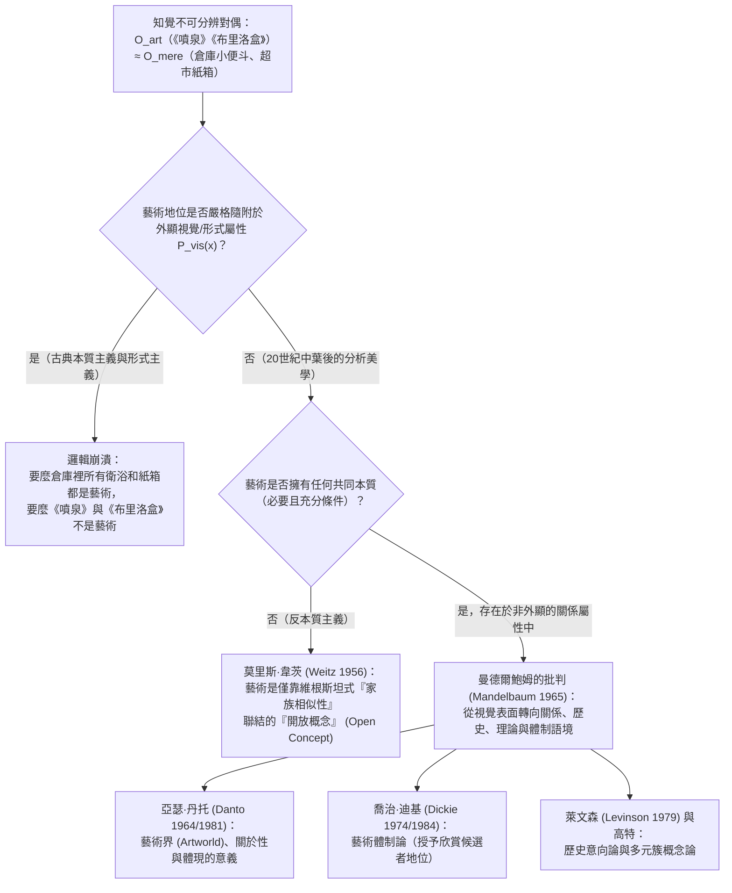
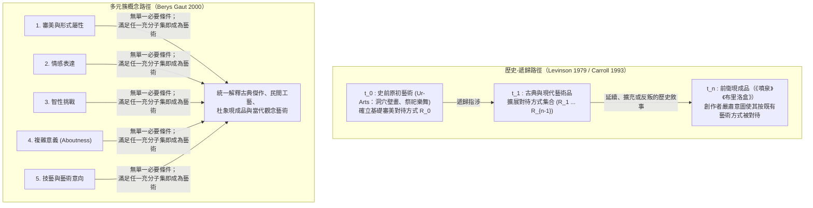

## 1. 引言：1917年的瓷質小便斗與1964年的膠合板肥皂盒

1917年4月，紐約新成立的<strong>獨立藝術家協會（Society of Independent Artists）</strong>宣布舉辦首屆展覽，章程極其民主：「無評審團，無獎項」，任何繳納六美元會費的藝術家均可參展。然而，一位化名「R. Mutt」的費城藝術家寄來了一件令董事會震驚的作品：一個從J.L. Mott五金衛浴展廳購買的標準白瓷小便斗，被旋轉了 $90^\circ$ 平放在基座上，邊緣用黑漆簽著<strong>「R. Mutt 1917」</strong>，題為<strong>《噴泉》（Fountain）</strong>。

幕後操縱者正是法裔前衛藝術家<strong>馬塞爾·杜象（Marcel Duchamp, 1887–1968）</strong>。自1913年起，杜象便開始試驗他所謂的<strong>「現成品」（Readymades）</strong>——包括《自行車輪》（1913）、《瓶架》（1914）和雪鏟《斷臂之前》（1915）。杜象旨在推翻自庫爾貝以來僅取悅肉眼的<strong>「視網膜藝術」（art rétinien）</strong>，讓藝術重歸智性（*cosa mentale*），並強調必須以完全<strong>「審美冷漠」（aesthetic indifference / anesthésie）</strong>的狀態挑選現成品。董事會最終拒絕展出《噴泉》，宣稱它「在任何定義下都不是藝術品，只是普通的衛浴產品」。杜象隨即辭職，並在達達主義雜誌《盲人》（*The Blind Man*）上發表了改變二十世紀美學史的辯護：

> 「Mutt先生是否親手製作了《噴泉》根本無關緊要。他<strong>選擇（CHOSE）</strong>了它。他拿來一件日常用品，將其重新安置，使其原本的實用意義在新標題和新視角下消失——<strong>為那個物體創造了一個新的思想</strong>。」

近半個世紀後的1964年4月，<strong>安迪·沃荷（Andy Warhol, 1928–1987）</strong>在紐約Stable畫廊展出了成堆的<strong>《布里洛盒子》（Brillo Box）</strong>——用膠合板製作並網版印刷上與超市倉庫裡裝肥皂擦的瓦楞紙箱一模一樣的紅藍圖案（極具諷刺意味的是，原版商業紙箱正是由一位兼職做商業設計的抽象表現主義畫家James Harvey設計的）。哥倫比亞大學哲學家<strong>亞瑟·丹托（Arthur C. Danto, 1924–2013）</strong>參觀展覽後意識到，杜象與沃荷共同提出了<strong>「知覺不可分辨對偶問題」（Problem of Perceptually Indiscernible Counterparts）</strong>：

* 為什麼衛浴倉庫裡另外99個一模一樣的小便斗只是普通器物，而第100個小便斗（《噴泉》）卻是殿堂級藝術品？
* 為什麼沃荷的《布里洛盒子》是高雅雕塑，而超市庫房裡視覺上無法區分的布里洛紙箱卻只是幾美分的包裝盒？

---

## 2. 古典美學本質主義的崩塌：摹仿論、表現論與有意味的形式

自柏拉圖和亞里斯多德以來，傳統美學一直試圖為藝術尋找<strong>必要且充分條件（Necessary and Sufficient Conditions）</strong>：

$$\forall x \Big( \text{Art}(x) \iff C_1(x) \land C_2(x) \land \dots \land C_n(x) \Big)$$

然而，西方美學史上的三大本質主義典範在現成品面前悉數瓦解：

1. <strong>摹仿論 / 再現論（Mimesis — 柏拉圖《理想國》第十卷、亞里斯多德《詩學》）</strong>：認為藝術是對自然或人類行動的摹仿。但絕對音樂、康丁斯基與蒙德里安的抽象畫並不摹仿任何外物；杜象的《噴泉》也不是對小便斗的描繪，它本身<strong>就是</strong>一個小便斗；而工廠流水線上複製出的成千上萬個布里洛紙箱雖然彼此完美摹仿，卻並非藝術品。
2. <strong>表現論（Expression Theory — 托爾斯泰《什麼是藝術？》、柯林伍德《藝術原理》）</strong>：認為藝術是藝術家主觀情感的外化與澄清。然而杜象的「審美冷漠」、沃荷「我想成為一台機器」的工廠化網版印刷，以及約翰·凱吉（John Cage）靠擲硬幣查《易經》創作的偶然音樂與《4分33秒》，徹底排除了個人情感表達的必要性。
3. <strong>形式主義（Formalism — 克萊夫·貝爾 Clive Bell《藝術》1914、羅傑·弗萊）</strong>：貝爾提出藝術的本質在於能夠喚起獨特審美情感的<strong>「有意味的形式」（Significant Form）</strong>。但我們可以用形式邏輯構建<strong>知覺不可分辨性論證</strong>來反駁它：

設 $O_{\text{art}}$ 為杜象的《噴泉》（或沃荷的《布里洛盒子》），$O_{\text{mere}}$ 為其在倉庫中的普通對偶物，設 $P_{\text{vis}}(x)$ 為物體 $x$ 的全部外顯視覺與形式屬性（線條、色彩、比例、曲面）。根據假設：

$$P_{\text{vis}}(O_{\text{art}}) = P_{\text{vis}}(O_{\text{mere}}) \quad \Big( O_{\text{art}} \approx_{\text{percept}} O_{\text{mere}} \Big)$$

然而二者的本體論地位卻截然相反：

$$\text{Art}(O_{\text{art}}) \land \neg\text{Art}(O_{\text{mere}})$$

如果藝術地位僅隨附於外顯視覺形式屬性 $P_{\text{vis}}(x)$，那麼要麼全世界的公共廁所小便斗都天然具有「有意味的形式」而全是藝術品，要麼《噴泉》和《布里洛盒子》都不是藝術。由此可見，<strong>藝術與非藝術的本體論邊界絕不可能存在於肉眼可見的物理或感官屬性之中</strong>。

| 古典美學典範 | 核心代表人物 | 核心命題（提議的藝術本質） | 為何被現成品與不可分辨對偶徹底證偽 |
| :--- | :--- | :--- | :--- |
| <strong>摹仿論 (Mimesis)</strong> | 柏拉圖、亞里斯多德、瓦薩里 | 藝術是對自然、現實或人類行動的摹仿與再現 | 抽象藝術不摹仿外物；《噴泉》直接呈現實物而非再現；流水線複製品不是藝術 |
| <strong>表現論 (Expression)</strong> | 托爾斯泰、柯林伍德 (Collingwood) | 藝術是藝術家內在情感的想像性澄清與傳達 | 杜象的「審美冷漠」、沃荷的機械複製與凱吉的偶然音樂排除了主觀情感 |
| <strong>形式主義 (Formalism)</strong> | 克萊夫·貝爾 (Bell)、比爾茲利 | 藝術由喚起審美體驗的「有意味的形式」定義 | 面對視覺完全相同的對偶物 ($O_{\text{art}} \approx_{\text{percept}} O_{\text{mere}}$)，形式主義無法區分藝術與普通物 |

---

## 3. 莫里斯·韋茨的新維根斯坦反本質主義與曼德爾鮑姆的關係轉向

### 3.1 維根斯坦的「家族相似性」與「開放概念」

在1956年的經典論文《美學中理論的角色》（*"The Role of Theory in Aesthetics"*）中，<strong>莫里斯·韋茨（Morris Weitz, 1916–1981）</strong>直接援引<strong>路德維希·維根斯坦《哲學研究》</strong>（1953，第65–75節）對「遊戲」（*Spiel*）的分析。維根斯坦指出，棋類遊戲、紙牌遊戲、球類遊戲與奧林匹克運動會之間並沒有任何單一的共同本質，而是像同一家族成員的臉型、瞳色、步態一樣，呈現出<strong>「重疊交錯的相似性網絡」——即「家族相似性」（Familienähnlichkeiten）</strong>。

韋茨據此論證，「藝術」是一個<strong>「開放概念」（Open Concept）</strong>而非封閉概念。因為藝術實踐的內在邏輯就是不斷追求突破與反叛創新，任何試圖用必要充分條件「封閉」藝術概念的哲學定義，都會扼殺藝術創造力本身。傳統美學理論只是偽裝成分類定義的「榮譽性價值推薦」。

### 3.2 莫里斯·曼德爾鮑姆的決定性反駁（1965）：非外顯的關係屬性

1965年，哲學家<strong>莫里斯·曼德爾鮑姆（Maurice Mandelbaum）</strong>發表了致命反駁：為什麼照片上六個長相相似的人具有「家族相似性」，而不是毫無關聯的路人撞臉？正是因為他們共享一個<strong>照片表面看不見的非外顯關係屬性——共同的生物學血緣祖先！</strong>

同樣，單人紙牌遊戲與塔羅牌占卜在視覺動作上幾乎一樣，但前者是遊戲、後者不是，因為遊戲的本質在於「規則與非功利挑戰」這一關係屬性。再者，如果靠視覺上的家族相似性來識別藝術，那麼與杜象《噴泉》視覺相似度最高的恰恰是五金倉庫裡那幾百萬個普通小便斗！曼德爾鮑姆由此證明：<strong>視覺本質主義的失敗並不意味著反本質主義，而是證明藝術的本質必須隱藏在「非外顯的關係屬性」（Non-Exhibited Relational Properties）之中</strong>。

---

## 4. 亞瑟·丹托的「藝術界」（1964）與《尋常物的嬗變》（1981）

在1964年《哲學雜誌》的里程碑論文《藝術界》（*"The Artworld"*）中，<strong>亞瑟·丹托</strong>寫下了現代美學最著名的一句話：

> <strong>「將某物視為藝術，需要某種肉眼無法察覺的東西——一種藝術理論的氛圍，一種對藝術史的認知：一個藝術界（an artworld）。」</strong>

### 4.1 思想實驗：不可分辨的紅方塊畫廊

在1981年的巨著<strong>《尋常物的嬗變》（The Transfiguration of the Commonplace）</strong>中，丹托設計了著名的<strong>「九幅不可分辨紅方塊畫廊」</strong>思想實驗。假設展廳裡並排掛著九塊在尺寸、紋理和鎘紅顏料分子分布上100%相同的紅色矩形畫布：

1. <strong>《以色列人渡過紅海》</strong>：歷史敘事畫（以色列人已上岸，埃及追兵剛被紅海淹沒）。
2. <strong>《齊克果的心境》</strong>：丹麥表現主義心理肖像畫。
3. <strong>《紅場》</strong>：描繪莫斯科廣場的幾何風景畫。
4. <strong>《涅槃》</strong>：象徵輪迴寂滅的佛教形上學繪畫。
5. <strong>《紅桌布》</strong>：馬諦斯門徒畫的野獸派靜物局部。
6. <strong>《無題》（極簡主義單色畫）</strong>：強調畫面平面性的現代主義作品。
7. <strong>喬爾喬內的紅鉛底色畫布</strong>：16世紀威尼斯大師喬爾喬內塗好紅鉛底漆（*imprimatura*）後尚未作畫便染瘟疫去世留下的遺物——<strong>它不是藝術品，只是一塊準備好的畫布</strong>。
8. <strong>普通紅漆畫布</strong>：油漆工試滾筒刷塗紅的畫布——<strong>純粹的「尋常實際物」（mere real thing）</strong>。
9. <strong>觀念藝術家J的《無題（關於無）》</strong>：藝術家J抗議前兩者被排除，故意展出一塊同樣塗紅的畫布，宣稱它「不關於任何事物」。

### 4.2 丹托的兩個必要條件：關於性（Aboutness）與體現的意義（Embodied Meaning）

丹托從中提煉出藝術品的兩個核心必要條件（後在2013年《什麼是藝術》中補充為「清醒的夢」）：

1. <strong>關於性（Aboutness / 語義意向性）</strong>：藝術品必然<strong>「關於」（about）某物</strong>，具有語義指向性；而尋常實際物（喬爾喬內的底漆畫布、超市紙箱、倉庫小便斗）只是物理世界裡的普通家具，不關於任何事物（就連J宣稱「關於無」的畫布9，也是在元藝術層面上*關於*藝術與空洞物質之對比，正如數學中的數字 $0$ 是表示空無的特定數字）。
2. <strong>體現的意義（Embodied Meaning）</strong>：報紙和教科書也有「關於性」，但藝術品不僅陳述意義，更將意義<strong>體現（embody）</strong>在物質載體中，如同亞里斯多德修辭學中的視覺隱喻與省略三段論（enthymeme），邀請觀者在藝術史與理論氛圍中完成詮釋。

---

## 5. 喬治·迪基的藝術體制論（1974/1984）與沃爾海姆兩難

哲學家<strong>喬治·迪基（George Dickie, 1926–2020）</strong>認為丹托過度強調了語義詮釋（許多極簡主義雕塑或純圖案並無深奧的「關於性」）。受奧斯汀言語行為理論啟發，迪基將「藝術界」重構為一種像婚姻登記或授予學位一樣的社會體制，並在《藝術與審美》（1974）中提出了<strong>藝術體制論（Institutional Theory of Art）</strong>：

> <strong>[迪基的藝術體制定義（1974）]</strong>
> 分類意義上的藝術品是：(1) <strong>一件人工製品（artifact）</strong>（包括通過挑選展示而被「人工製品化」的浮木或小便斗）；(2) <strong>它的某些方面由代表特定社會體制（藝術界）行事的一個或幾個人（通常就是藝術家本人），授予了「欣賞候選者」（candidate for appreciation）的地位</strong>。

### 5.1 理查德·沃爾海姆的《游敘弗倫》兩難（1980）

英國哲學家<strong>理查德·沃爾海姆（Richard Wollheim）</strong>在1980年對迪基提出了致命的<strong>沃爾海姆兩難（Wollheim's Dilemma）</strong>：

> 當藝術界代表授予某物 $x$ 藝術品地位時，他們是<strong>基於充分的藝術理由 $R$</strong> 授予的，還是<strong>毫無理由地任意（arbitrarily）</strong>授予的？

- <strong>第一角（基於充分理由）</strong>：如果需要內部藝術理由 $R$（如體現深刻意義或形式創新），那麼正是理由 $R$ 本身使 $x$ 成為藝術，體制的授予只是事後承認，體制論淪為多餘。
- <strong>第二角（毫無理由的武斷）</strong>：如果無需任何理由，只需體制官員揮動魔杖即可指鹿為馬，那麼藝術就退化為空洞的官僚遊戲，無法解釋人類為何如此珍視藝術。

此外，體制論還無法解釋完全脫離體制的<strong>局外人藝術</strong>（如孤獨的醫院清潔工Henry Darger秘密創作的1.5萬頁史詩畫卷）以及尚無任何畫廊體制的<strong>舊石器時代拉斯科（Lascaux）洞穴壁畫（原初藝術 Ur-Art）</strong>。儘管迪基在1984年《藝術圈》（*The Art Circle*）中將其修改為「旨在呈現給藝術界公眾的人工製品」的五元循環系統，仍難以擺脫循環定義與局外人反例的困境。

---

## 6. 歷史意向論與多元簇概念論：當代綜合

為克服體制論的社會學僵化，當代分析美學發展出了兩大極具解釋力的方案：

1. <strong>傑羅爾德·萊文森（Jerrold Levinson, 1979）的歷史-意向定義（Historical-Intentional Definition）</strong>：一件物品 $x$ 在時間 $t$ 是藝術品，當且僅當其擁有者嚴肅地<strong>意圖將 $x$ 當作以往在 $t$ 之前被正確承認為藝術品的那些物品所被對待（regarded）的方式去對待</strong>。通過這一向後遞歸的鏈條（回溯至史前原初藝術 $t_0$），即便與世隔絕的隱士創作的作品，只要其意圖與既有藝術傳統（無論是延續還是反叛，如諾埃爾·卡羅爾 Noël Carroll 的歷史敘事論）相聯結，依然是真正的藝術。
2. <strong>貝里斯·高特（Berys Gaut, 2000）的簇概念論（Cluster Account）</strong>：重返維根斯坦傳統，提出存在一組約十項與藝術相關的屬性簇（具備審美屬性、表達情感、智性挑戰、體現複雜意義、展現高超技藝、具有藝術意向等）——<strong>沒有任何單一屬性是必要條件，但滿足其中若干屬性的子集即構成藝術的充分條件</strong>。

從1917年的小便斗到2019年莫瑞吉奧·卡特蘭（Maurizio Cattelan）用膠帶貼在牆上的香蕉《喜劇演員》（*Comedian*），再到今天缺乏人類主體意向性的生成式AI圖像，定義藝術的哲學探索證明：藝術從來不是鎖在視網膜表層的靜止礦物，而是人類意向、歷史敘事與思想藉由物質載體不斷展開的自我超越。
