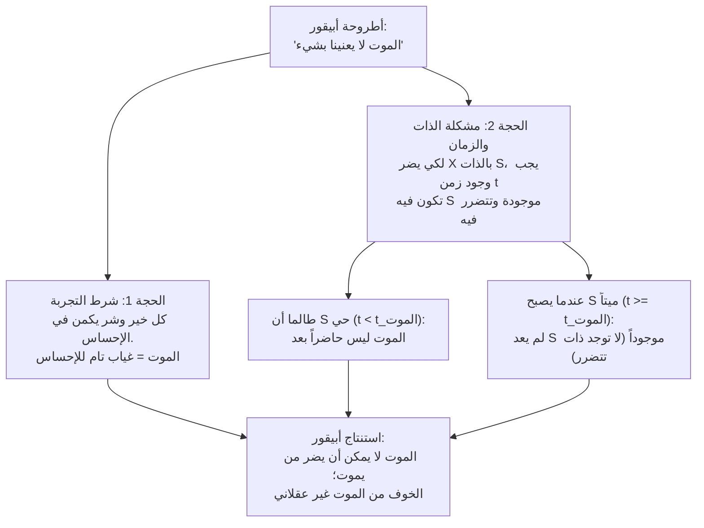
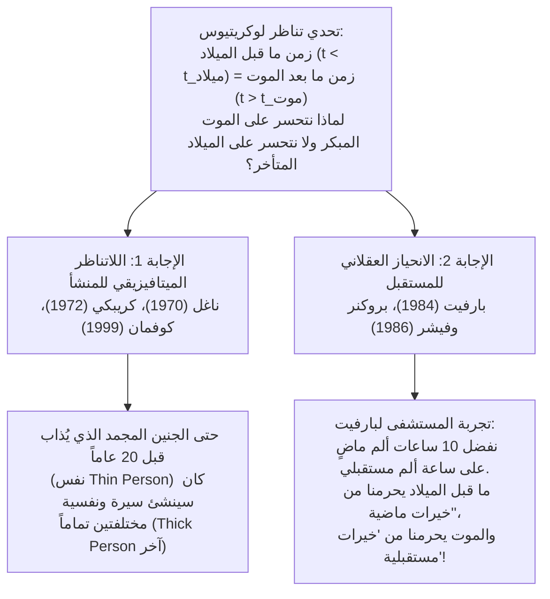

## 1. مقدمة: هل الخوف من الموت أمر غير عقلاني؟

من بين جميع الانفعالات البشرية، قلَّما يبدو شعورٌ أكثر شمولية وتجذراً بيولوجياً وحتمية من <strong>الخوف من الموت</strong>. ونحن لا نقصد هنا مجرد الخوف من الألم الجسدي المصاحب للاحتضار (*عملية الموت*، *dying*)، بل الرعب الوجودي أمام حقيقة <strong>كون المرء ميتاً (*being dead*)</strong> في حد ذاتها: الانطفاء غير القابل للرجعة للوعي، والفناء النهائي لـ«الأنا»، والانتقال من كون المرء شخصاً موجوداً إلى العدم المحض.

غير أنه قبل أكثر من ألفين وثلاثمائة عام، صاغ الفيلسوف اليوناني <strong>أبيقور</strong> (341–270 ق.م) في رسالته الشهيرة *«رسالة إلى مينويكيوس»* واحدة من أكثر الحجج إثارةً للدهشة وإحكاماً من الناحية المنطقية في تاريخ الفلسفة: <strong>إن موتنا لا يمكن أن يلحق بنا أي ضرر على الإطلاق، ومن ثَمَّ فإن الخوف من الموت أمرٌ غير عقلاني تماماً</strong>. وبعد ذلك بوقت قصير، عزز الشاعر والفيلسوف الروماني <strong>لوكريتيوس</strong> (نحو 99–55 ق.م) في قصيدته الفلسفية الملحمية *«في طبيعة الأشياء»* (*De rerum natura*) هذه الأطروحة من خلال <strong>حجة التناظر (أو المرآة)</strong> الشهيرة: إن الزمن اللانهائي الذي مضى قبل ولادتنا مطابقٌ تماماً للزمن اللانهائي الذي سيعقب موتنا؛ وبما أننا لا نشعر بأي فزع أو حسرة حين ننظر إلى الوراء نحو عدم وجودنا قبل الميلاد، فلماذا نشعر بالرعب حين ننظر إلى الأمام نحو عدم وجودنا بعد الموت؟

في الفلسفة التحليلية المعاصرة — بدءاً من المقال التأسيسي الذي كتبه <strong>توماس ناغل</strong> بعنوان *«الموت»* (*Death*، 1970) ووصولاً إلى إسهامات <strong>فريد فيلدمان</strong>، و<strong>جيف ماكماهان</strong>، و<strong>ديريك بارفيت</strong>، و<strong>أنتوني بروكنر</strong>، و<strong>جون مارتن فيشر</strong>، و<strong>برنارد ويليامز</strong> — تحول هذا التحدي الأبيقوري القديم إلى حقل بحثي ميتافيزيقي وأكسيولوجي فائق الدقة. يتناول هذا المقال بالتحليل الصارم الألغاز الثلاثة الكبرى في فلسفة الموت:

1. <strong>مشكلة التجربة والذات والزمان</strong>: كيف يمكن للموت أن يكون شراً أو ضرراً لشخصٍ ما إذا كان هذا الشخص لا يستطيع اختبار حالة الموت، بل ولا وجود له أصلاً عندما يكون ميتاً؟ (أبيقور في مواجهة <strong>نظرية الحرمان</strong> عند ناغل وفيلدمان).
2. <strong>لغز تناظر لوكريتيوس</strong>: إذا كان الموت سيئاً لأنه يحرمنا من وقت حياة كنا سنعيشه، فلماذا لا نتحسر بالطريقة نفسها على أننا لم نولد في وقت أبكر؟ (ضرورة المنشأ عند ناغل في مواجهة <strong>الانحياز العقلاني للمستقبل</strong> عند بارفيت وبروكنر/فيشر).
3. <strong>معضلة الخلود</strong>: إذا كان الموت شراً لأنه يقطع خيرات الحياة، فهل يعني ذلك أن العيش إلى الأبد سيكون أعظم خير ممكن، أم أن الخلود الأبدي سيتحول إلى لعنة لا تُطاق؟ (<strong>قضية ماكروبولوس</strong> عند برنارد ويليامز).

---

## 2. تحدي أبيقور: «الموت لا يعنينا بشيء»

في *رسالته إلى مينويكيوس*، يكتب أبيقور كلماتٍ ظلت تتردد عبر القرون بوصفها تعويذة منطقية ضد رهاب الموت:

> «عوِّد نفسك على الاعتقاد بأن <strong>الموت لا يعنينا بشيء</strong> (*ὁ θάνατος οὐδὲν πρὸς ἡμᾶς*)؛ لأن كل خير وكل شر إنما يكمن في الإحساس، والموت هو حرمانٌ من كل إحساس [...]. وهكذا فإن أفظع الشرور، أي الموت، لا يعنينا بشيء، إذ <strong>ما دمنا نحن موجودين فالموت ليس حاضراً، وعندما يحضر الموت نكون نحن قد لم نعد موجودين</strong>. وإذن فهو لا يخص الأحياء ولا الأموات: لأن الأحياء لم يمسهم بعد، وأما الأموات فلم يعودوا موجودين.»

في الفلسفة التحليلية للموت، تُعاد صياغة النقد الأبيقوري عادةً عبر حجتين متمايزتين لكنهما مترابطتان بعمق: <strong>حجة التجربة</strong> (المستندة إلى مذهب اللذة القيمي) و<strong>حجة غياب الذات والزمان</strong> (*The Subject / Timing Problem*).

### 2.1. الصياغة الصورية لحجة التجربة (مذهب اللذة)

1. <strong>المقدمة 1 (مبدأ التجربة / مذهب اللذة الجوهري)</strong>: تكون حالة معينة أو حدث $E$ شراً في ذاته بالنسبة للذات $S$ إذا وفقط إذا تسبب $E$ في أن تختبر $S$ حالات ذهنية مؤلمة أو غير سارة (ألماً جسدياً أو معاناة نفسية).
2. <strong>المقدمة 2 (أطروحة الفناء)</strong>: الموت هو الانطفاء الكلي وغير القابل للرجعة للوعي ولكل قدرة على الإحساس والتجربة ($\text{حالة الموت} \implies \neg\text{تجربة}(S)$).
3. <strong>المقدمة 3</strong>: بالتالي، لا يمكن لحالة الموت أن تسبب أي تجربة مؤلمة أو غير سارة للذات $S$.
4. <strong>النتيجة</strong>: <strong>لا يمكن لكون المرء ميتاً أن يكون شراً في ذاته بالنسبة لـ $S$.</strong>

### 2.2. الصياغة الصورية لمشكلة الذات والزمان (*The Timing Problem*)

حتى لو تخلينا عن مذهب اللذة الضيق، فإن أبيقور ينصب لنا فخاً ميتافيزيقياً ثانياً أعمق بكثير: <strong>مَن الذي يعاني من شر الموت، ومتى (*في أي لحظة زمنية $t$*) يلحق به هذا الضرر؟</strong>

1. <strong>المقدمة 1 (شرط وجود الذات والزمان)</strong>: لكي يكون أي حدث أو حالة $E$ شراً (ضرراً أو مصيبة) بالنسبة للذات $S$، يجب أن توجد لحظة زمنية $t$ بحيث:
   - (أ) تكون الذات $S$ موجودة في اللحظة $t$، و
   - (ب) تتعرض رفاهية $S$ للانتقاص أو التدهور في اللحظة $t$ بسبب $E$.
2. <strong>المقدمة 2 (التنافي المتبادل بين الذات والموت)</strong>: لتكن $t_{\text{الموت}}$ هي لحظة وفاة $S$:
   - في كل لحظة $t < t_{\text{الموت}}$ (أي طالما أن $S$ على قيد الحياة)، لم يقع الموت بعد؛ وبالتالي فإن حالة الموت لم تلحق الضرر بـ $S$ بعد.
   - في كل لحظة $t \ge t_{\text{الموت}}$ (أي بعد أن مات $S$)، لم يعد $S$ موجوداً ($\neg\exists S\text{ في }t$). ومَن لا وجود له لا يمكن أن يمتلك مستوى رفاهية سلبياً ولا أن يكون محلاً لأي ضرر.
3. <strong>النتيجة</strong>: لا توجد أي لحظة زمنية $t$ يكون فيها الموت سيئاً بالنسبة لـ $S$. ومن ثَمَّ لا يمكن للموت أن يكون شراً لمن يموت.

---

## 3. دحض توماس ناغل ونظرية الحرمان (*Deprivation Account*)

في مقاله الشهير *«Death»* (1970، الذي ضُمَّ لاحقاً إلى كتابه *Mortal Questions*، 1979)، أثبت <strong>توماس ناغل</strong> أن النتيجة الجذابة التي توصل إليها أبيقور تقوم على تصور ضيق للغاية لما يشكل خيراً أو شراً للإنسان. وقد أسست إجابة ناغل للموقف السائد في الفلسفة التحليلية المعاصرة، ألا وهو <strong>نظرية الحرمان</strong> (*Deprivation Account of the Badness of Death*).

### 3.1. الشرور الجوهرية مقابل الشرور العرضية (المقارنة)

تتمثل الفكرة المحورية لنظرية الحرمان في التمييز بين طريقتين مختلفتين تماماً يمكن أن يكون بهما شيءٌ ما سيئاً للإنسان:

- <strong>الشر الجوهري (أو الإيجابي)</strong>: حالةٌ يكون حضورها الفعلي سيئاً في ذاته، مثل المعاناة من صداع نصفي حاد أو كآبة نفسية شديدة.
- <strong>الشر العرضي (المقارن أو القائم على الحرمان)</strong>: حدثٌ أو حالة لا تكون مؤلمة في ذاتها، لكنها سيئة بالنسبة للذات $S$ لأنها <strong>تمنعها من نيل خيرات جوهرية أو تسلبها إياها بعد أن كانت ستنعم بها لولا وقوع ذلك الحدث</strong>.

فالموت ليس شراً جوهرياً (لا أحد يدعي أن كون المرء ميتاً *يؤلم*)، بل هو <strong>الشر المقارن القائم على الحرمان بامتياز</strong>: إنه سيئ لأنه <strong>يحرمنا من الحياة ومن جميع التجارب والمشاريع والمحبة والصداقات والمسرات القيمة التي كنا سنعيشها لو استمررنا على قيد الحياة</strong>.

### 3.2. الصياغة عبر العوالم الممكنة وحساب الرفاهية الحياتية

قام الفيلسوف <strong>فريد فيلدمان</strong> في كتابه المؤثر *Confrontations with the Reaper* (1992) بصياغة نظرية الحرمان صياغةً دقيقة باستخدام دلالات العوالم الممكنة عند ديفيد لويس وروبرت ستالناكر:

ليكن $w_{\text{الفعلي}}$ هو العالم الواقعي الذي تموت فيه الذات $S$ عند اللحظة $t_1$ (مثلاً في سن الثلاثين إثر حادث)، وليكن $w_{\text{الأقرب}}$ هو أقرب عالم ممكن لا يقع فيه ذلك الحادث المميت وتستمر فيه $S$ في العيش حتى اللحظة $t_2$ (مثلاً حتى سن الخامسة والثمانين). إذا عرَّفنا القيمة الجوهرية الكلية لحياة $S$ في عالم $w$ عبر تكامل رفاهيتها اللحظية $V_S(t, w)$ عبر الزمن:

$$W(S, w) = \int_{t_{\text{البداية}}}^{t_{\text{النهاية}}(w)} V_S(t, w) \, dt$$

فإن القيمة المقارنة الإجمالية لحدث الموت $D$ بالنسبة لـ $S$ عند $t_1$ تُعطى بالفرق بين القيمة الكلية لحياة $S$ في العالم الفعلي والقيمة الكلية لحياتها في أقرب عالم مضاد للواقع:

$$\text{Value}(D, S) = W(S, w_{\text{الفعلي}}) - W(S, w_{\text{الأقرب}}) = -\int_{t_1}^{t_2} V_S(t, w_{\text{الأقرب}}) \, dt$$

وطالما أن الحياة المستقبلية التي كانت $S$ ستعيشها بين $t_1$ و$t_2$ في العالم $w_{\text{الأقرب}}$ تتضمن رصيداً صافياً موجباً من الخيرات ($\int_{t_1}^{t_2} V_S(t, w_{\text{الأقرب}}) \, dt > 0$)، فإن النتيجة تكون $\text{Value}(D, S) < 0$: <strong>أي أن الموت في اللحظة $t_1$ هو شرٌّ موضوعي بالنسبة لـ $S$</strong>.

وتفسر هذه المعادلة بوضوح وأناقة حدوسنا الأخلاقية اليومية:
1. <strong>لماذا يُعد موت شاب في العشرين من عمره أكثر مأساوية بكثير من موت شيخ في الخامسة والتسعين</strong>: لأن فترة الحرمان $[t_1, t_2]$ وتكامل الخيرات المستقبلية المفقودة أكبر بما لا يقاس لمن يموت في سن العشرين.
2. <strong>متى يمكن أن يكون الموت خيراً (القتل الرحيم العقلاني)</strong>: إذا كان العالم المضاد للواقع $w_{\text{الأقرب}}$ لا يحمل في الفترة المتبقية بين $t_1$ و$t_2$ سوى عذاب عضال لا شفاء منه واحتضار بلا أمل ($\int_{t_1}^{t_2} V_S(t, w_{\text{الأقرب}}) \, dt < 0$)، فإن القيمة $-\int_{t_1}^{t_2} V_S$ تنقلب إشارتها لتصبح موجبة ($\text{Value}(D, S) > 0$). وفي هذه الحالة لا يحرم الموت صاحبه من خيرات مستقبلية، بل يخلصه من شرور مستقبلية، فيغدو خلاصاً مقارناً.

### 3.3. الأمثلة المضادة الثلاثة لناغل ضد شرط التجربة («ما لا تعلمه قد يضرك بالفعل»)

غالباً ما يرد أنصار أبيقور على نظرية الحرمان بالاستشهاد بالمثل الشائع *«ما لا تراه العين لا يحزن له القلب»* (*What you don't know can't hurt you*): فإذا كان الميت لا يعلم بما فقده ولا يشعر بأي إحباط من جراء ذلك، فكيف يمكن لهذا الفقدان أن يكون شراً حقيقياً بالنسبة له؟

ولكي يهدم ناغل مقدمة أن كل شر يستلزم أن يختبره الضحية بوعيه، يقدم ثلاثة أمثلة مضادة شهيرة:

1. <strong>الخيانة والازدراء في الخفاء</strong>: لنفترض أن أصدقاءك المزعومين يخونونك ويسخرون منك بقسوة من وراء ظهرك، لكنهم يخفون ذلك بإتقانٍ تام حتى إنك تموت وأنت مطمئن إلى محبتهم واحترامهم، دون أن تشعر بأي ألم ذاتي على الإطلاق. فهل تكف الخيانة بذلك عن كونها شراً بالنسبة لك؟ يؤكد ناغل أنها لا تكف: فكون المرء مخدوعاً ومغدوراً به هو أمرٌ سيئ موضوعياً لحياته، حتى لو لم يكتشف ذلك أبداً.
2. <strong>تلف الدماغ غير القابل للشفاء الذي يعيد الراشد إلى حالة الرضيع</strong>: تخيل عالماً ناضجاً وذكياً يتعرض لإصابة دماغية بالغة تهبط بقدراته العقلية إلى مستوى طفل رضيع في شهره الثالث. لم يعد المريض يدرك ما خسره: إنه يبتسم بسعادة في مهده حين يُعطى زجاجة الحليب وتُبدَّل حفاضاته، دون أن يعاني أي ألم أو إحباط. لو كانت التجربة الذاتية الداخلية وحدها هي المعيار، لكانت حالته مدعاةً للغبطة؛ غير أننا جميعاً ندرك أن هذا الرجل قد حلت به كارثة هائلة، وتحديداً بسبب <strong>حرمانه من الحياة الراشدة العاقلة التي كان سيعيشها</strong>.
3. <strong>نكث العهد المقطوع لميت</strong>: يكرس شخصٌ حياته لمشروع أو لرعاية أطفاله، وعلى فراش الموت يأخذ عهداًوثيقاً من صديق بتنفيذ وصيته الأخيرة؛ وبعد وفاته ينكث الصديق العهد باستهتار.

تكشف هذه الحالات أن رفاهية الإنسان ومصالحه <strong>ليست حبيسة حدود جلده ولا وعيه اللحظي</strong>، بل تمتد لتشمل تاريخه السيري الكامل، وعلاقاته الحقيقية بالعالم، وإمكاناته المضادة للواقع.

---

## 4. مشكلة الزمان (*The Timing Problem*): خمس استراتيجيات في الفلسفة المعاصرة

حتى لو سلمنا بأن الموت سيئ لأنه يحرمنا من مستقبل ثمين، فإن الحجة الثانية لأبيقور لا تزال تتطلب إجابة دقيقة: <strong>في أي لحظة زمنية $t$ بالتحديد يعاني الشخص من شر الموت؟</strong> في الأدبيات التحليلية المعاصرة، تبلورت خمسة مواقف رئيسية لحل *مشكلة الزمان*:

| الموقف الفلسفي | أبرز الفلاسفة | متى يكون الموت سيئاً للذات $S$؟ | الفكرة المركزية والاعتراض الرئيسي |
| :--- | :--- | :--- | :--- |
| <strong>1. اللانهائية الزمنية / الأزلية</strong> (*Eternalism*) | فريد فيلدمان (1992)، توماس ناغل (1970) | <strong>خارج الزمان</strong> (بالنظر إلى الحياة ككل، دون تاريخ محدد) | يقارن القيمة الكلية للعالم الفعلي $w_{\text{الفعلي}}$ بالعالم الأقرب $w_{\text{الأقرب}}$. *الاعتراض*: يبدو غريباً أن تقع مصيبة حقيقية دون أن يكون لها موقع في الزمان. |
| <strong>2. التزامنية</strong> (*Concurrentism*) | جوليان لامونت (1998) | <strong>في لحظة وقوع الموت بالضبط</strong> ($t = t_{\text{الموت}}$) | يقع الضرر في اللحظة التي يقطع فيها الحدث المميت خيط الحياة. *الاعتراض*: يخلط بين لحظة الضربة السببية والفترة التي يفتقد فيها المرء الخيرات المفقودة. |
| <strong>3. القبلية</strong> (*Priorism*) | جورج بيتشر (1984)، جويل فاينبرغ (1984) | <strong>قبل الموت، أثناء الحياة</strong> ($t < t_{\text{الموت}}$) | يحبط الموت المبكر بأثر رجعي المصالح والمشاريع التي كان الشخص يحملها *أثناء حياته*. *الاعتراض*: يبدو وكأنه يفترض «سببية عكسية» (*backward causation*). |
| <strong>4. البعدية</strong> (*Subsequentism*) | بن برادلي (2009)، نيل فايت (2002) | <strong>بعد الموت، طوال الفترة التي يكون فيها ميتاً</strong> ($t_1 < t \le t_2$) | يكون الموت سيئاً تحديداً في السنوات التي كان الشخص *سينعم فيها* بالحياة ($V_S(t, w_{\text{الفعلي}}) = 0 < V_S(t, w_{\text{الأقرب}})$). *الاعتراض*: كيف يمكن لمن لا وجود له في $t$ أن يمتلك مستوى رفاهية يساوي $0$ في $t$؟ |
| <strong>5. اللامحدودية</strong> (*Indefinitism*) | توماس ناغل (1970)، هاري سيلفرستاين (1980) | <strong>ليس له موقع زمني محدد</strong> | بما أن شر الموت يكمن في غياب شوط كامل من الحياة الممكنة، فإن هذا الحرمان ينتمي إلى سيرة الذات دون أن يتمركز في نقطة زمنية مفردة. |

ومن بين هذه المقترحات، حظيت <strong>النظرية البعدية</strong> لبن برادلي (*Well-Being and Death*، 2009) بقبول واسع؛ إذ يجادل برادلي بأنه لا يوجد أي تناقض ميتافيزيقي في إسناد مستوى رفاهية يساوي صفراً ($V_S(t, w_{\text{الفعلي}}) = 0$) لشخصٍ ما خلال العقود التي تلي وفاته، والتي كان سيتمتع فيها برفاهية موجبة ($V_S(t, w_{\text{الأقرب}}) > 0$) في العالم الممكن الأقرب. وكما يمكننا تحديد *متى* تضررتُ من حرماني من ترقية وظيفية (خلال الأشهر التي تقاضيت فيها راتباً أقل)، يمكننا تحديد *متى* يضر الموت بشخص مات في الثلاثين بدلاً من الثمانين: <strong>خلال الخمسين عاماً الممتدة بين سن الثلاثين وسن الثمانين</strong>.

---

## 5. حساب المصلحة النسبية للزمان (*Time-Relative Interest Account*, TRIA) عند جيف ماكماهان

تواجه الصياغة القياسية لنظرية الحرمان (مثل صياغة فيلدمان) مفارقةً كبرى في الأخلاقيات الطبية الحيوية. فلو كان شر الموت يتوقف فقط على إجمالي عدد السنوات السعيدة المفقودة ($\int_{t_1}^{t_2} V_S(t) \, dt$)، <strong>لكان موت جنين في أسبوعه الأول أو شهره الثالث مأساةً أعظم من موت شاب في الخامسة والعشرين من عمره</strong>، لأن الجنين يفقد 80 عاماً من الحياة المستقبلية بينما يفقد الشاب ابن الخامسة والعشرين 55 عاماً فقط. غير أن الجميع تقريباً يحكمون بأن موت شاب في الخامسة والعشرين — يمتلك وعياً بذاته وخططاً وذكريات وروابط عاطفية عميقة — هو مأساة أشد هولاً بكثير بالنسبة للضحية من الإجهاض التلقائي المبكر. فلماذا؟

لحل هذه المعضلة، طور <strong>جيف ماكماهان</strong> في كتابه *The Ethics of Killing* (2002) نظريته المؤثرة المسماة <strong>حساب المصلحة النسبية للزمان</strong> (*Time-Relative Interest Account*، <strong>TRIA</strong>). بالاستناد إلى نظرية الهوية الشخصية عند ديريك بارفيت، يرى ماكماهان أنه لتقييم مدى سوء الموت بالنسبة للفرد $S$ في اللحظة $t_1$، لا يكفي جمع الخيرات المستقبلية بين $t_1$ و$t_2$، بل يجب ترجيح كل خير مستقبلي في اللحظة $t$ بـ <strong>درجة الوحدة النفسية (ترابط واستمرارية الذاكرة والشخصية والرغبات والمقاصد) $\mathcal{R}(t_1, t) \in [0, 1]$</strong> التي كانت ستقوم بين الذات في $t_1$ وذاتها المستقبلية في $t$:

$$\text{Badness}_{\text{TRIA}}(D, S, t_1) = \int_{t_1}^{t_2} V_S(t, w_{\text{الأقرب}}) \cdot \mathcal{R}(t_1, t) \, dt$$

- في <strong>الجنين المبكر</strong>، لا توجد بعدُ حياة ذهنية ولا ذكريات ولا مشاريع؛ ولذلك فإن علاقة الوحدة النفسية بينه وبين الشخص البالغ الذي سيغدوه بعد ثلاثين عاماً تكاد تكون معدومة ($\mathcal{R}(t_1, t) \approx 0$). ورغم أن الكمية الخام للحياة المفقودة هائلة، فإن المصلحة *النسبية للزمان* للجنين في ذلك المستقبل ضعيفة للغاية.
- أما في <strong>طفل في العاشرة أو شاب في العشرين</strong>، فإن كلاً من مقدار المستقبل المفقود ($t_2 - t_1$) وقوة الرابطة النفسية $\mathcal{R}(t_1, t)$ مع ذاته المستقبلية يبلغان الذروة القصوى ($\mathcal{R}(t_1, t) \approx 1$). ولهذا السبب يمثل الموت فيريعان الشباب قمة المأساة السيرية.

---

## 6. لغز تناظر لوكريتيوس (*The Lucretian Symmetry Puzzle*)

نصل الآن إلى أكثر الألغاز إثارةً في فلسفة الموت. في الكتاب الثالث من قصيدة *«في طبيعة الأشياء»* (الأبيات 832–842 و972–975)، يقدم الشاعر الأبيقوري الروماني <strong>لوكريتيوس</strong> <strong>حجة المرآة (أو التناظر)</strong> الشهيرة:

> «انظر إلى الوراء وتأمل كيف أن أبدية الزمن الماضي بأسرها قبل أن نولد لم تكن تعنينا بشيء. إن الطبيعة ترفع لنا هذا بوصفه مرآةً (*speculum*) للزمن المستقبلي الذي سيأتي بعد موتنا النهائي.»

لنفترض أن شخصاً وُلد عام 1980 ومات عام 2060.
- هناك أبدية من <strong>العدم السابق للميلاد</strong> ($t < 1980$).
- وهناك أبدية من <strong>العدم اللاحق للموت</strong> ($t > 2060$).

إذا كان أنصار نظرية الحرمان (مثل ناغل وفيلدمان) على حق في قولهم إن الموت عام 2060 (بدلاً من العيش حتى 2080) أمرٌ سيئ لأنه <strong>يحرمنا من عشرين عاماً من الخيرات بين 2060 و2080</strong>، فإن لوكريتيوس يتساءل: <strong>لماذا لا يكون سيئاً بالقدر نفسه تماماً أن نكون قد وُلدنا عام 1980 بدلاً من عام 1960، وهو ما حرمنا من عشرين عاماً من الخيرات بين 1960 و1980؟</strong>

في الواقع، نحن جميعاً نُظهر <strong>لاتناظراً عاطفياً وتقييمياً عميقاً</strong>: إذ ننظر بطمأنينة أو لامبالاة إلى القرون التي سبقت ميلادنا، لكننا ننظر بأسى أو فزع إلى الزمن الذي سيعقب موتنا ولن يتسنى لنا أن نعيشه. فهل هذا اللاتناظر تناقضٌ غير عقلاني (كما اعتقد لوكريتيوس)، أم أن هناك فرقاً ميتافيزيقياً أو عقلانياً عميقاً بين الماضي السابق للميلاد والمستقبل اللاحق للموت؟

### 6.1. الإجابة الميتافيزيقية لتوماس ناغل: ضرورة المنشأ

تتسم إجابة <strong>توماس ناغل</strong> (المدعومة بأطروحة *ضرورة المنشأ* عند شاول كريبكي في كتابه *Naming and Necessity*، 1972) بطابع <strong>ميتافيزيقي (جهتي)</strong>:

- <strong>تاريخ الوفاة أمرٌ عَرَضي (ممكن)</strong>: إن الشخص نفسه الذي مات عام 2060 *كان بإمكانه أن يعيش فترة أطول* (حتى 2080) دون أن يكف عن كونه هو نفسه عددياً. فثمة عالم ممكن حقيقي أعيش فيه *أنا* عشرين عاماً إضافية.
- <strong>تاريخ الميلاد (والحمل) أمرٌ جوهري</strong>: <strong>لا يمكن لشخصٍ ما أن يولد في وقت أبكر بكثير</strong> مما وُلد فيه فعلاً، لأن الهوية الجينية والبيولوجية للفرد تتوقف على البويضة والحيوان المنوي المحددين اللذين نشأ منهما ولحظة الإخصاب. وأي شخص يولد عام 1960 أو في القرن الثامن عشر بدلاً من عام 1980 <strong>لم يكن ليكون أنا، بل شخصاً آخر مختلفاً تماماً</strong>. وبالتالي فإن الزمن السابق لعام 1980 ليس زمناً حُرمتُ *أنا* منه، لأنني لم أكن لأوجد فيه أصلاً.

### 6.2. اعتراض الأجنة المجمدة وإجابة فريدريك كوفمان («الشخص النحيل» مقابل «الشخص الكثيف»)

غير أن الأخلاقيات الحيوية الحديثة وضعت حجة ناغل البيولوجية على المحك. لنتخيل <strong>جنيناً أُخصب في المختبر عام 1980</strong> وحُفظ بالتجميد في النيتروجين السائل. في العالم الواقعي، أُذيب الجنين وزُرع في الرحم عام <strong>2000</strong> ووُلد في ذلك العام. ولكن من الممكن ميتافيزيقياً وبيولوجياً أن يكون *ذلك الجنين نفسه بالضبط* (بالحمض النووي والمنشأ المشيجي ذاته) قد أُذيب وزُرع عام <strong>1980</strong>، ليولد قبل ذلك بعشرين عاماً. وحتى لو علم هذا الشخص أن جنينه ظل مجمداً عشرين عاماً، فهل يتحسر بمرارة على فقدان الأعوام 1980–2000 بالطريقة نفسها التي يخشى بها الموت قبل أوانه بعشرين عاماً؟ كلا على الإطلاق!

وللدفاع عن موقف ناغل في مواجهة حالة الجنين المجمد، قدم <strong>فريدريك كوفمان</strong> (1999) التمييز بين:
- <strong>الشخص بالمعنى النحيل (*Thin Person*)</strong>: الكائن البيولوجي أو الأساس الجيني المجرد (الجنين).
- <strong>الشخص بالمعنى الكثيف (*Thick Person*)</strong>: الذات النفسية العينية، المشكَّلة من ذكرياتها السيرية ولغتها وثقافتها وأصدقائها وقيمها وشخصيتها التاريخية.

يجادل كوفمان بأنه لو أُذيب الجنين قبل ذلك بعشرين عاماً (عام 1980 بدلاً من 2000)، لكان قد نشأ في حقبة مختلفة، مع أصدقاء آخرين وتجارب أخرى وقصة حياة مغايرة: فرغم أنه كان سيكون *الشخص النحيل* نفسه (الكائن الجيني ذاته)، فإنه كان سيغدو <strong>شخصاً كثيفاً (نفسياً وسيرياً) مختلفاً تماماً</strong>. وعندما أخشى الموت، فإن من يرغب في مواصلة الحياة هو *ذاتي الكثيفة الحالية* بذكرياتي ومشاريعي؛ وهذه *الذات الكثيفة* ما كان يمكن أن توجد قبل ميلادي بعشرين عاماً، لكنها تستطيع الامتداد عشرين عاماً أخرى نحو المستقبل.

### 6.3. إجابة الانحياز العقلاني للمستقبل: ديريك بارفيت، وأنتوني بروكنر، وجون مارتن فيشر

ثمة مسار بديل — دافع عنه ببراعة <strong>أنتوني بروكنر وجون مارتن فيشر</strong> في مقالهما *«Why Is Death Bad?»* (1986) بالاستناد إلى <strong>ديريك بارفيت</strong> (*Reasons and Persons*، 1984) — يسلم للوكريتيوس بأن الحرمان السابق للميلاد والحرمان اللاحق للموت قد يكونان متناظرين من منظور لازمني، لكنه يبرهن على أن لاتناظر موقفنا تجاه الموت يفسره ملمح أساسي من ملامح العقلانية البشرية: <strong>إن مواقفنا العقلانية تجاه الخيرات والشرور غير متناظرة زمنياً (فنحن ننحاز إلى المستقبل، *future-bias*)</strong>.

في الفصل الثامن من كتاب *Reasons and Persons*، يطرح بارفيت تجربته الفكرية الشهيرة <strong>«عملية المستشفى» (*My Past or Future Operations*)</strong>:

> تستيقظ على سرير في مستشفى وأنت مصاب بفقدان ذاكرة مؤقت بشأن اليوم الذي أنت فيه. وتعلم أن هذا المستشفى يجري عملية جراحية مؤلمة للغاية بدون تخدير (لأن التخدير سيكون قاتلاً)، لكنه يعطي المريض بعدها عقاراً يمحو تماماً تذكر الألم. تسأل الممرضة عما إذا كنت قد خضعت للعملية بالفعل. فتراجع الممرضة ملفين محتملين وتقول لك:
> - <strong>الحالة أ (مريض الماضي)</strong>: «إما أنك المريض الذي أُجريت له العملية <strong>أمس</strong> وعانى <strong>10 ساعات</strong> من الألم المبرح (الذي نسيته بالفعل بفضل العقار)...»
> - <strong>الحالة ب (مريض المستقبل)</strong>: «...وإما أنك المريض الذي ستُجرى له العملية <strong>مساء اليوم</strong> وسيعاني <strong>ساعة واحدة</strong> من الألم المبرح.»

أي الخبرين تتمنى بصدق أن يكون هو الصحيح؟ <strong>إن كل إنسان بلا استثناء يفضل بارتياح هائل الحالة (أ) (10 ساعات من ألم مضى وانقضى) على الحالة (ب) (ساعة واحدة من ألم مستقبلي).</strong> فنحن نهتم اهتماماً مباشراً وعميقاً بالآلام واللذات *المستقبلية*، في حين نقف موقف اللامبالاة النسبية تجاه الآلام واللذات *التي طواها الماضي*.

ويطبق بروكنر وفيشر هذا المبدأ المتناظر نفسه على <strong>ملذات الحياة وخيراتها</strong>:
- تخيل أن يُقال لك إن في حياتك 1000 يوم من السعادة الغامرة: في السيناريو الأول، هذه الـ 1000 يوم <strong>قد انقضت بالفعل في ماضيك</strong> (ونسيتها)؛ وفي السيناريو الثاني، هذه الـ 1000 يوم <strong>تنتظرك في مستقبلك</strong>. عقلانياً، يفضل الجميع أن تكون الخيرات *أمامهم* (في المستقبل) لا *خلفهم* (في الماضي).
- وعليه: فإن <strong>الولادة المتأخرة</strong> لا تحرمنا إلا من *خيرات ماضية* (تجارب كانت ستنتهي وتُطوى بحلول اليوم)، بينما <strong>الموت المبكر</strong> يحرمنا من *خيرات مستقبلية* (تجارب كانت ستنتظرنا أمامنا). ومن ثَمَّ فإن التحسر على الموت المستقبلي مع النظر بلامبالاة إلى العدم السابق للميلاد <strong>ليس تناقضاً غير عقلاني على الإطلاق</strong>، بل هو النتيجة المباشرة لتوجهنا الزمني نحو المستقبل.

---

## 7. هل يكون الخلود نعمة؟ برنارد ويليامز وقضية ماكروبولوس

إذا كان الموت شراً لأنه يسلبنا المستقبل ويقطع مشاريعنا، فيبدو منطقياً أن <strong>الغاية المثلى هي ألا نموت أبداً: أي بلوغ الخلود الأبدي ($t_{\text{النهاية}} \to \infty$)</strong>. غير أنه في واحد من ألمع المقالات الفلسفية وأكثرها تأثيراً في القرن العشرين، بعنوان *«قضية ماكروبولوس: تأملات في سأم الخلود»* (*The Makropulos Case: Reflections on the Tedium of Immortality*، 1973)، طرح الفيلسوف البريطاني <strong>برنارد ويليامز</strong> أطروحة جريئة: على الرغم من أن الموت يأتي عادةً قبل أوانه ويمثل شراً في أي لحظة معينة، فإن <strong>الخلود الأبدي سيكون لعنةً لا تُطاق</strong>.

### 7.1. إلينا ماكروبولوس والعمر المتجمد عند 337 عاماً

يستمد ويليامز عنوان مقاله من مسرحية الكاتب التشيكي كاريل تشابك (التي حولها ليوش ياناتشيك إلى أوبرا) *«قضية ماكروبولوس»*. بطلة المسرحية، مغنية الأوبرا <strong>إلينا ماكروبولوس</strong> (المعروفة عبر العصور بأسماء تحمل الحرفين الأولين <strong>E.M.</strong>)، شربت في القرن السادس عشر وهي في <strong>الثانية والأربعين من عمرها</strong> إكسير الحياة الذي أعده والدها، طبيب بلاط الإمبراطور رودولف الثاني. أوقف الإكسير شيخوختها البيولوجية طوال ثلاثمائة عام.

وعندما تدور أحداث المسرحية، تبلغ إلينا ماكروبولوس <strong>337 عاماً</strong>، لكنها تحتفظ بجسد وصحة امرأة في الثانية والأربعين. إنها لا تعاني من الهرم الجسدي الذي أصاب الخالدين (*struldbruggs*) في رواية جوناثان سويفت؛ ومع ذلك، فقد هوت روحها في <strong>حالة من الضجر والبرود الجليدي والسأم السحيق (*tedium*)</strong>. لقد عشقت عشرات المرات، وشهدت انتصار وانهيار جميع القضايا السياسية، وأتقنت الفن إلى حد الكمال، وبات كل ما يجري أمام عينيها يبدو تكراراً آلياً لأنماط جوفاء. وكما يكتب ويليامز، فقد أصبح كل شيء في داخلها «بارداً، عملاقاً، وفارغاً». وفي النهاية، حين يُعرض عليها تناول الوصفة مرة أخرى لتعيش ثلاثمائة عام إضافية، <strong>ترفض إلينا رفضاً قاطعاً، وتحرق الرق، وتموت بشعور عميق بالارتياح</strong>.

### 7.2. الرغبات المشروطة مقابل الرغبات المطلقة ومعضلة الخلود

ولكي يثبت أن مصير إلينا ماكروبولوس ليس حادثاً نفسياً عارضاً بل ضرورة بنيوية للوضع البشري، يقدم ويليامز تمييزاً أساسياً بين نوعين من الرغبات:

1. <strong>الرغبات المشروطة (*Conditional Desires*)</strong>: رغبات تفترض مسبقاً شرط *«إذا كنتُ سأظل حياً...»* (مثل: *«إذا كنت حياً غداً، أريد أن آكل طعاماً جيداً وألا أشعر بالبرد وأن أرتدي ثياباً مريحة»*). تفترض الرغبات المشروطة وجود الحياة، لكنها <strong>لا تعطينا أي سبب للرغبة في مواصلة الحياة</strong>.
2. <strong>الرغبات المطلقة أو القطعية (*Categorical Desires*)</strong>: مشاريع وشغف ومحبة والتزامات عميقة لا تتوقف على شرط البقاء حياً، بل هي التي <strong>تجيب عن سؤال: لماذا تستحق الحياة أن نواصل عيشها؟</strong> (مثل: إنجاز اكتشاف علمي، أو تربية طفل، أو النضال من أجل العدالة، أو تأليف عمل إبداعي). إن رغباتنا المطلقة هي التي تدفعنا نحو المستقبل وتجعل الموت شراً لأنه يقطعها.

ومن هنا يصوغ ويليامز <strong>معضلة الخلود</strong>: لكي تكون الحياة الخالدة مرغوبة بالنسبة لي، يجب أن تستوفي شرطين في آنٍ واحد:
- <strong>الشرط 1 (غياب السأم)</strong>: يجب أن تستمر في توليد رغبات مطلقة تبقيني مهتماً ومرتبطاً بالحياة دون السقوط في الضجر اللانهائي الذي أصاب E.M.
- <strong>الشرط 2 (الحفاظ على الهوية)</strong>: يجب أن يظل الشخص الذي يعيش ذلك الوجود المستقبلي *أنا حقاً*، محتفظاً باستمرارية يمكن التعرف عليها مع شخصيتي وقيمي وهويتي الفردية.

ويجادل ويليامز بأنه في الزمن اللانهائي ($t \to \infty$) يكون هذان الشرطان <strong>متنافيين بالضرورة</strong>:

$$\begin{cases} \text{الفرع أ (شخصية محددة وثابتة)} \implies \text{استنفاد التجارب الممكنة} \implies \text{سأم حتمي (قضية ماكروبولوس)} \\ \text{الفرع ب (تحول جذري ومستمر للشخصية والذاكرة)} \implies \text{انقطاع الاستمرارية النفسية} \implies \text{فقدان 'الأنا' (يعادل الموت)} \end{cases}$$

- <strong>الفرع أ</strong>: إذا كانت لديَّ شخصية إنسانية محددة (لها أذواقها ومزاجها وحدودها)، فبعد قرون وآلاف السنين سأكون قد استنفدتُ جميع التوليفات الممكنة من التجارب المتوافقة مع تلك الشخصية. وستتلاشى الجدة، وأسقط حتماً في السأم الجليدي لإلينا ماكروبولوس.
- <strong>الفرع ب</strong>: أما إذا جرى، تفادياً للملل، محوُ شخصيتي وذكرياتي وقيمي واستبدالها بأخرى جديدة تماماً كل مائتي عام، فإن الكائن الذي سيوجد بعد عشرة آلاف عام لن تربطه بي صلة نفسية أكثر مما يربطني بأي غريب عابر. لن أكون *أنا* من نجا: بل ستكون هناك مجرد سلسلة متعاقبة من أشخاص مختلفين يسكنون الجسد ذاته.

### 7.3. رد جون مارتن فيشر: اللذات القابلة للاستنفاد مقابل اللذات القابلة للتكرار

لا يقبل جميع الفلاسفة المعاصرين تشاؤم برنارد ويليامز بشأن الخلود. ففي مقاله *«Why Immortality Is Not So Bad»* (1994)، يرى <strong>جون مارتن فيشر</strong> أن ويليامز يقع في خطأين:

1. <strong>اللذات التي تستنفد ذاتها (*self-exhausting pleasures*) مقابل اللذات القابلة للتكرار (*repeatable pleasures*)</strong>: يتصور ويليامز الحياة كقائمة من الإنجازات التي تُحقَّق لمرة واحدة ثم تفقد جاذبيتها بمجرد شطبها (مثل تسلق قمة إيفرست لأول مرة). غير أن جزءاً كبيراً من التجارب التي تجعل الحياة جديرة بالعيش هي تجارب <strong>قابلة للتكرار بطبيعتها</strong> دون أن تفقد قيمتها أبداً: كالاستماع إلى متتاليات التشيلو لباخ، أو تأمل المحيط عند الغروب، أو الحديث مع صديق حميم، أو التمتع بالطعام الطيب والمحبة والتأمل الروحي.
2. <strong>التحول التدريجي العضوي</strong>: لا تضطر الشخصية الإنسانية إلى الاختيار بين الجمود الصخري لإلينا ماكروبولوس وفقدان الذاكرة المفاجئ الشامل. إذ يمكن للشخص الخالد أن يتطور بصورة عضوية وتدريجية عبر القرون — متعلماً علوماً ولغات وفنوناً جديدة — مع الحفاظ دائماً على حلقات متداخلة من الاستمرارية النفسية مع ماضيه دون أن ينضب معينه أبداً.

---

## 8. خاتمة: الموت بوصفه الوجه الآخر لقيمة الحياة

بعد قطع هذه الرحلة الطويلة من حديقة أبيقور في أثينا إلى النقاشات المعاصرة في الفلسفة التحليلية، نكتشف حقيقةً عميقة تجمع بين الميتافيزيقا والحكمة الوجودية:

1. <strong>كان أبيقور محقاً في نقطة جوهرية واحدة</strong>: إن حالة الموت ليست غرفة مظلمة تُحبس فيها أرواحنا لتعاني البرد أو الوحدة أو الصمت. ففي الموت لا توجد تجربة ولا ألم؛ والخوف من الموت كما لو كنا «سنشهد» عدمنا الخاص هو وهمٌ من أوهام الخيال.
2. <strong>ولكن توماس ناغل ونظرية الحرمان على حق في الجوهر</strong>: إن الموت شرٌّ حقيقي وموضوعي حين يقطع حياةً ذات قيمة، لا بسبب ما يجعلنا *نشعر به*، بل بسبب أفق التجارب والمحبة والمعرفة والمشاريع الذي <strong>يحرمنا منه</strong>.
3. <strong>وتكتمل الصورة بمرآة لوكريتيوس وقضية ماكروبولوس عند ويليامز</strong>: فنحن نتحسر على الموت المستقبلي لا على العدم السابق للميلاد لأننا كائنات متجهة نحو المستقبل عبر رغباتنا المطلقة؛ وإن <strong>التناهي الزمني</strong> بالذات هو ما يمنح كل خيار نتخذه إلحاحه وعمقه وثقله الذي لا يتكرر.

وفي التحليل الأخير، <strong>ليس الخوف العقلاني من الموت سوى الظل الذي يلقيه حبنا للحياة</strong>. فلو لم يكن الموت يسلبنا شيئاً ذا قيمة، لما كانت للحياة نفسها أي قيمة. إن الفهم الفلسفي لكون الموت حرماناً لا يلقي بنا في اليأس؛ بل على العكس، يذكرنا بأن هذه الفسحة المتناهية بين ميلادنا وموتنا — هذا الحاضر الفريد الذي ما زلنا نوجد فيه ونشعر فيه — جديرةٌ بأن تُعاش بأقصى درجات الوعي والامتنان والامتلاء.
