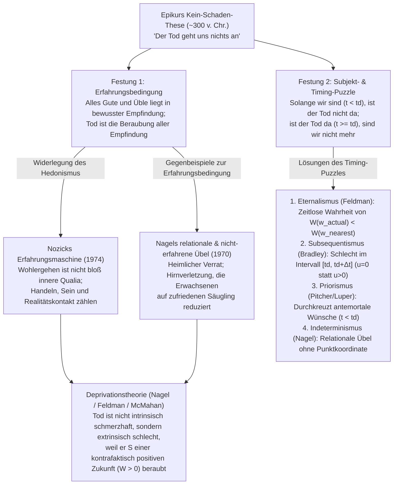
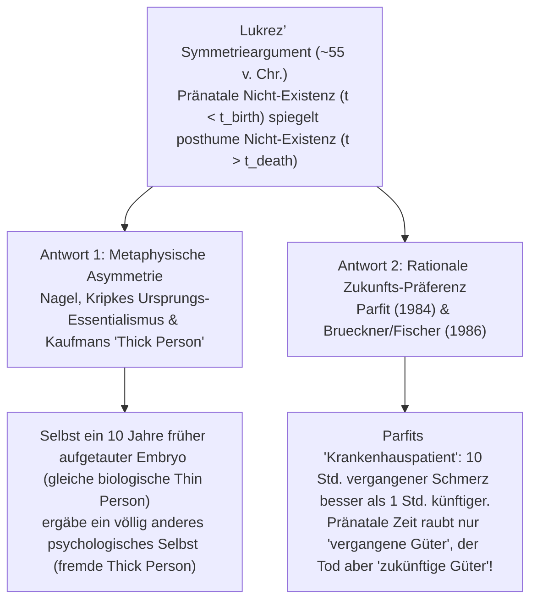

## 1. Einleitung: Das existenzielle Paradox der Sterblichkeit

In Recht, Moral und Alltag gilt der <strong>Tod als eines der größten Übel, die einem Menschen widerfahren können</strong>. Doch sobald wir die in der analytischen Philosophie übliche <strong>Vernichtungsannahme (Annihilation Assumption / Termination Thesis)</strong> zugrunde legen – dass der biologische Tod das unwiderrufliche Ende jedes bewussten Erlebens und der personalen Existenz markiert –, entsteht ein tiefes metaphysisches und axiologisches Paradox: Wenn Tote weder Dunkelheit noch Schmerz noch Reue empfinden und das Subjekt selbst nicht mehr existiert, <strong>wie kann das Totsein (being dead) dann schlecht für den Verstorbenen sein?</strong>

Vor über zweitausend Jahren formulierte <strong>Epikur (341–270 v. Chr.)</strong> im *Brief an Menoikeus* sein berühmtes Argument der Harmlosigkeit des Todes, ergänzt durch das zeitliche <strong>Symmetrieargument</strong> des römischen Dichters <strong>Lukrez (ca. 99–55 v. Chr.)</strong> in *De Rerum Natura*. Seit <strong>Thomas Nagels</strong> wegweisendem Aufsatz *„Death“* (1970) haben Philosophen wie Fred Feldman, Derek Parfit, Jeff McMahan, John Martin Fischer, Ben Bradley und Bernard Williams dieses Problem mit den Mitteln der Mögliche-Welten-Semantik und der Theorie personaler Identität neu erschlossen.

### Begriffliche Klärung: Sterben, Sterblichkeit und Totsein

Wir müssen drei Phänomene trennen (sei $t_{\text{birth}}$ die Geburt und $t_d$ der Todeszeitpunkt von $S$):
1. <strong>Der Prozess des Sterbens (Dying, $t \in [t_0, t_d)$)</strong>: $S$ lebt noch und empfindet oft physischen Schmerz (intrinsisches Übel $u_S(t) < 0$). Doch auch ein völlig schmerzloser Sekundentod im Schlaf einer Zwanzigjährigen ist eine Tragödie – das Übel des Todes geht also nicht im Schmerz des Sterbens auf.
2. <strong>Das Wissen um die Sterblichkeit (Mortality, $t_{\text{birth}} < t < t_d$)</strong>: Todesangst zu Lebzeiten; wäre das Totsein jedoch harmlos, wäre diese Angst irrational.
3. <strong>Das Totsein / Posthume Nicht-Existenz (Being Dead, $t \ge t_d$)</strong>: $S$ existiert nicht mehr, das Erfahrungswachstum ist null ($u_S(t) = 0$). Hier liegt das philosophische Kernproblem.

---

## 2. Epikurs „Kein-Schaden-Argument“ und seine zwei logischen Festungen

Im *Brief an Menoikeus* (§§124–125) schreibt Epikur:

> *„Gewöhne dich an den Gedanken, dass <strong>der Tod uns nichts angeht</strong>. Denn alles Gute und Schlimme beruht auf Empfindung, der Tod aber ist der Verlust aller Empfindung. … <strong>Das schauerlichste Übel also, der Tod, geht uns nichts an; denn solange wir existieren, ist der Tod nicht da, und wenn der Tod da ist, existieren wir nicht mehr.</strong>“*

Die analytische Philosophie zerlegt dies in zwei unabhängige Festungen:

- <strong>Festung 1: Die Erfahrungsbedingung (The Experience Requirement)</strong>: Ein Sachverhalt $X$ kann für $S$ nur dann schlecht sein, wenn $X$ unangenehme bewusste Empfindungen in $S$ verursacht (Hedonismus). Da das Totsein empfindungsfrei ist, kann es $S$ nicht schaden.
- <strong>Festung 2: Das Subjekt- und Timing-Puzzle (The Timing Puzzle)</strong>: Jedes Übel muss für ein existierendes Subjekt $S$ zu einem bestimmten Zeitpunkt $t$ schlecht sein. Vor dem Tod ($t < t_d$) ist der Tod noch nicht eingetreten; nach dem Tod ($t \ge t_d$) existiert $S$ nicht mehr. Also gibt es keinen Zeitpunkt $t$, zu dem der Tod für $S$ schlecht ist.

---

## 3. Widerlegung der Erfahrungsbedingung: Nozicks Erfahrungsmaschine und Nagels relationale Übel

### 3.1 Robert Nozicks „Erfahrungsmaschine“ (1974)

In *Anarchy, State, and Utopia* (1974) entwarf <strong>Robert Nozick</strong> das berühmte Gedankenexperiment einer <strong>Erfahrungsmaschine</strong>, die das Gehirn in einem Tank stimuliert und jede gewünschte glückliche Erfahrung perfekt simuliert. Gälte Epikurs Erfahrungsbedingung ($\int u_{\text{felt}}(t)\,dt$), müsste sich jeder lebenslang anschließen. Dass wir uns weigern, zeigt: Uns geht es nicht nur um subjektive Gefühle, sondern darum, Dinge <strong>tatsächlich zu tun</strong>, eine bestimmte Person <strong>zu sein</strong> und in <strong>Kontakt mit der wirklichen Welt</strong> zu stehen.

### 3.2 Thomas Nagels drei Gegenbeispiele in *„Death“* (1970)

<strong>Thomas Nagel</strong> zeigte 1970 anhand dreier Fälle, dass Übel oft relational sind und keine bewusste Schmerzerfahrung erfordern:
1. <strong>Heimlicher Verrat</strong>: Wer von Ehepartner und Freunden hinter seinem Rücken verspottet und betrogen wird, erleidet ein echtes Übel, selbst wenn er es nie erfährt.
2. <strong>Gebrochene Sterbebett-Versprechen</strong>: Wenn ein Freund nach dem Tod eines Gelehrten dessen Lebenswerk verbrennt, werden dessen zentrale Lebensprojekte rückwirkend vereitelt.
3. <strong>Der zufriedene Säugling (Schwere Hirnverletzung)</strong>: Ein brillanter 30-jähriger Wissenschaftler fällt durch ein Schädel-Hirn-Trauma dauerhaft auf den geistigen Stand eines friedlich lächelnden, schmerzfreien dreimonatigen Säuglings zurück.Obwohl er keinerlei Leid empfindet, betrachten wir dies als gewaltige Tragödie – wegen des <strong>Verlusts seiner kognitiven und schöpferischen Möglichkeiten</strong>. Genau deshalb ist auch der Tod, der alle Möglichkeiten auf null reduziert, ein massives Übel.

---

## 4. Die Deprivationstheorie (Deprivation Account) und zeitrelatives Interesse

Die von <strong>Fred Feldman (1991)</strong> und <strong>Ben Bradley (2009)</strong> formalisierte <strong>Deprivationstheorie</strong> unterscheidet <strong>intrinsische Übel</strong> ($u_S(t) < 0$) von <strong>extrinsischen (kontrafaktischen) Übeln</strong>: Der Tod ist nicht an sich schmerzhaft, sondern *extrinsisch schlecht*, weil er das Subjekt der positiven Lebensgüter <strong>beraubt (deprives)</strong>, die es genossen hätte, wäre es nicht zu diesem Zeitpunkt gestorben.

### 4.1 Mögliche-Welten-Semantik des kontrafaktischen Wohlfahrtsverlusts

Sei $W(S, w) = \int_{t_{\text{birth}}}^{t_d(w)} u_S(t, w)\,dt$ das gesamte Lebenswohlbefinden von $S$ in der möglichen Welt $w$. Stirbt $S$ in der aktuellen Welt $w_{\text{actual}}$ zum Zeitpunkt $t_d$ durch das Ereignis $e_d$, während $S$ in der <strong>nächstgelegenen möglichen Welt $w_{\text{nearest}}$</strong> (in der $e_d$ ausbleibt) noch für die Dauer $\Delta t > 0$ weiterlebt, so beträgt der extrinsische Wert des Todes:

$$\text{Val}_{\text{extrinsic}}(e_d, S, w_{\text{actual}}) = W(S, w_{\text{actual}}) - W(S, w_{\text{nearest}}) = -\int_{t_d}^{t_d + \Delta t} u_S(t, w_{\text{nearest}})\,dt$$

- Ist das kontrafaktische Zukunftsintegral positiv ($\int_{t_d}^{t_d+\Delta t} u_S > 0$), ist $\text{Val}_{\text{extrinsic}} < 0$ (der Tod ist ein Übel, und bei jungen Menschen wegen des großen $\Delta t$ besonders tragisch).
- Droht einem unheilbar Kranken nur noch unerträgliches Leiden ($\int_{t_d}^{t_d+\Delta t} u_S < 0$), wird $\text{Val}_{\text{extrinsic}} > 0$ – der Tod (bzw. Sterbehilfe) wird zur Wohltat.

### 4.2 Das Fötus-Paradox und Jeff McMahans Time-Relative Interest Account (TRIA, 2002)

Da ein früher Fötus beim Tod rund 80 Lebensjahre verliert, ein 25-Jähriger aber nur 55 Jahre, müsste der Tod des Fötus nach dem reinen Integral schlimmer sein. <strong>Jeff McMahan (2002)</strong> löst dieses Paradox unter Rückgriff auf Derek Parfits psychologische Kontinuitätsrelation $\mathcal{R}_S(t_d, t) \in [0, 1]$ im <strong>Time-Relative Interest Account (TRIA)</strong>:

$$\text{Badness}_{\text{TRIA}}(e_d, S, t_d) = \int_{t_d}^{t_d + \Delta t} \mathcal{R}_S(t_d, t) \cdot u_S(t, w_{\text{nearest}})\,dt$$

Beim frühen Fötus ist die psychologische Verbundenheit mit dem späteren Erwachsenen nahezu null ($\mathcal{R}_S \approx 0$), während sie beim 25-Jährigen maximal ist ($\mathcal{R}_S \approx 1$).

---

## 5. Das Timing-Puzzle: *Wann* ist der Tod schlecht für den Sterbenden?

| Position (Vertreter) | Zeitlicher Ort des Übels ($t$) | Metaphysischer & axiologischer Mechanismus | Hauptstärke | Haupteinwand |
| :--- | :--- | :--- | :--- | :--- |
| <strong>1. Eternalismus / Zeitlosigkeit</strong> (Fred Feldman) | <strong>Ewig / Zeitlos</strong> (Atemporally) | Die Ungleichung $W(S, w_{\text{actual}}) < W(S, w_{\text{nearest}})$ gilt zeitlos | Umgeht die Nicht-Existenz von $S$ ab $t_d$ komplett | Verwechselt zeitlose Satzwahrheit mit dem Datum der Schädigung |
| <strong>2. Subsequentismus</strong> (Ben Bradley, Neil Feit) | <strong>Posthumes Intervall</strong> $t \in [t_d, t_d + \Delta t]$ | Während $[t_d, t_d+\Delta t]$ ist das reale Wohl $u=0$ statt kontrafaktisch $u>0$ | Entspricht exakt dem Zeitpunkt sonstiger entgangener Güter | Muss Toten im Rahmen des Vierdimensionalismus $u=0$ zuschreiben |
| <strong>3. Priorismus</strong> (George Pitcher, Steven Luper) | <strong>Zu Lebzeiten</strong> $t < t_d$ | Früher Tod bei $t_d$ verurteilt schon zu Lebzeiten ($t < t_d$) Zukunftsprojekte zum Scheitern | Wahrung des Präsentismus (Geschädigter existiert bei $t < t_d$) | Kontraintuitiv, dass ein glücklicher 20-Jähriger schon jetzt geschädigt ist |
| <strong>4. Konkurrentismus</strong> (Julian Lamont) | <strong>Todesaugenblick</strong> $t = t_d$ | Schaden tritt exakt im Grenzpunkt $t_d$ ein | Koinzidenz von Ursache und Schaden | Grenzdilemma bei $t_d$ (noch lebend oder schon tot) |
| <strong>5. Indeterminismus</strong> (Thomas Nagel) | <strong>Zeitlich unlokalisiert</strong> | Relationale Verluste betreffen die historische Person als Ganze | Erfasst den narrativen Charakter des Lebens | Bestreitet die Datierbarkeit jedes realen Übels |

---

## 6. Lukrez’ Symmetrieargument und die Asymmetrie der Zeit

In *De Rerum Natura* (Buch III) hält <strong>Lukrez</strong> uns die Ewigkeit vor unserer Geburt (<strong>pränatale Nicht-Existenz, $t < t_{\text{birth}}$</strong>) als Spiegel (*speculum*) der Ewigkeit nach unserem Tod (<strong>posthume Nicht-Existenz, $t > t_d$</strong>) vor: Wenn wir nicht darüber klagen, nicht 40 Jahre früher geboren worden zu sein, warum klagen wir dann darüber, nicht 40 Jahre später zu sterben?

1. <strong>Metaphysische Asymmetrie (Nagel 1970, Saul Kripkes Ursprungs-Essentialismus & Frederik Kaufmans „Thick Person“)</strong>: Nach Kripke ist der genetische Ursprung aus genau dieser Eizelle und diesem Spermium essentiell; wer 100 Jahre früher geboren worden wäre, wäre nicht *du* gewesen. Gegen das <strong>Gefrorene-Embryo-Gegenbeispiel</strong> (ein kryokonservierter Embryo hätte 10 Jahre früher aufgetaut werden können) unterscheidet Frederik Kaufman (1999) die biologische „Thin Person“ von der biografisch-psychologischen <strong>„Thick Person“</strong>: Ein zehn Jahre früher aufgetauter Embryo hätte völlig andere Erinnerungen und Charakterzüge entwickelt und wäre als psychologische *Thick Person* ein Fremder, nicht *ich*.
2. <strong>Rationale Zeit-Asymmetrie (Derek Parfits „Krankenhauspatient“ & Brueckner/Fischer 1986)</strong>: In <strong>Derek Parfits</strong> berühmtem Gedankenexperiment (*Reasons and Persons*, 1984) erwachst du im Krankenhaus mit Amnesie und erfährst, dass du entweder <strong>Patient A</strong> bist (der gestern 10 Stunden Höllenschmerzen bei einer OP durchlitt) oder <strong>Patient B</strong> (dem heute Nachmittag 1 Stunde Schmerz-OP bevorsteht). Jeder hofft inständig, Patient A zu sein! Ebenso wünschen wir uns Freuden in der *Zukunft* statt in der bereits vergangenen *Vergangenheit*. Brueckner und Fischer (1986) zeigen: Pränatale Nicht-Existenz hat uns nur <strong>vergangene Güter</strong> vorenthalten (gegenüber denen wir rational gleichgültig sind), während der Tod uns <strong>zukünftige Güter</strong> raubt, die uns existenziell am Herzen liegen!

---

## 7. Wäre Unsterblichkeit ein Segen? Bernard Williams und der Fall Makropulos

In seinem berühmten Essay *„The Makropulos Case: Reflections on the Tedium of Immortality“* (1973) argumentierte <strong>Bernard Williams</strong>, dass ein zu früher Tod zwar ein Übel ist, <strong>ewige Unsterblichkeit ($t \to \infty$) aber ein unerträglicher Fluch wäre</strong>. Die Opernsängerin <strong>Elina Makropulos (E.M.)</strong>, die durch ein Elixier mit 42 Jahren biologisch eingefroren wird, versinkt im Alter von <strong>337 Jahren</strong> in eisige, bodenlose <strong>Langeweile (*tedium*)</strong>, weist das Elixier zurück und stirbt erlöst.

Williams unterscheidet <strong>bedingte Wünsche (Conditional Desires)</strong> von <strong>kategorischen Wünschen (Categorical Desires)</strong> (die uns überhaupt erst einen Grund geben, weiterleben zu wollen) und formuliert das <strong>Dilemma der Unsterblichkeit</strong>:
- <strong>Horn A (Fester Charakter $\implies$ Unvermeidliche Langeweile)</strong>: Bleibt mein Charakter gewahrt, erschöpfen sich in unendlicher Zeit alle mit ihm vereinbaren Erfahrungen bis zum völligen Überdruss.
- <strong>Horn B (Radikaler Charakterwandel $\implies$ Identitätsverlust)</strong>: Wird mein Charakter alle paar Jahrhunderte komplett ausgetauscht, um Langeweile zu vermeiden, hat die zukünftige Person keine Identität mehr mit *mir*.

Obwohl John Martin Fischer (1994) einwandte, dass <strong>wiederholbare Freuden (Repeatable Pleasures)</strong> (wie Musik, Natur, Freundschaft) und sanfte Charakterentwicklung ein unbegrenztes Leben tragen könnten, zeigt Williams’ Analyse doch: <strong>Das Übel des Todes ist nichts anderes als das Spiegelbild der Kostbarkeit unseres endlichen, von kategorischen Wünschen getragenen Lebens.</strong>
