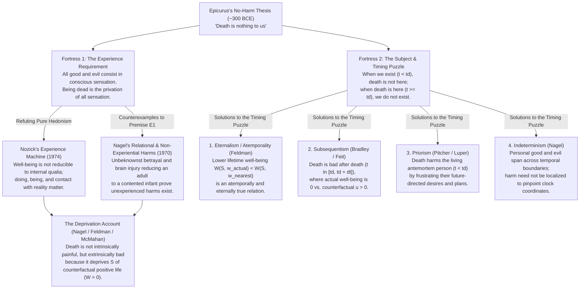
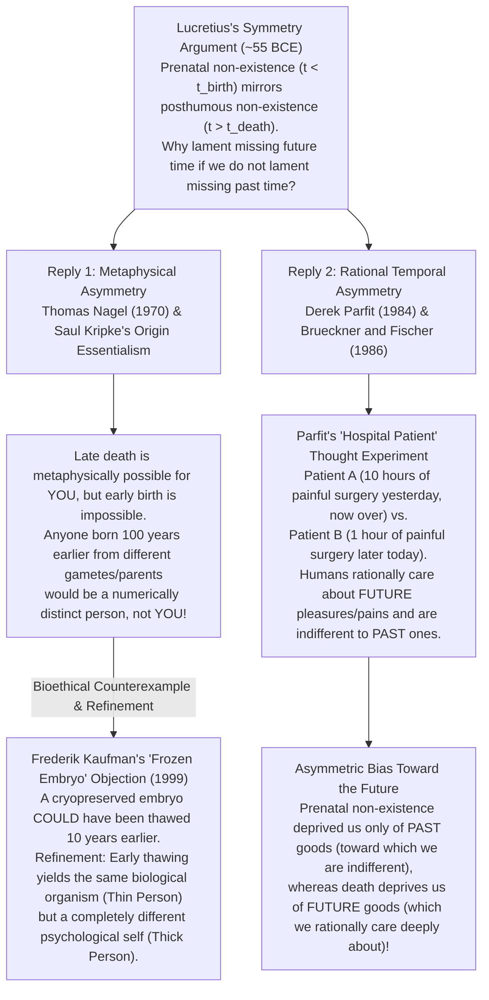

## Introduction: The Existential Paradox of Mortality and the Analytic Challenge

Human beings are creatures defined by the foreknowledge of their own mortality. Across civilizations, our myths, religions, legal codes, and medical institutions are built around a single, seemingly self-evident moral conviction: <strong>death is normally one of the greatest evils that can befall a person</strong>. Murder is universally condemned as the supreme crime precisely because shortening another person's life is thought to inflict an catastrophic, irreversible harm upon the victim. Even in our private lives, the prospect of ceasing to exist inspires a deep existential dread that philosophers and psychologists call *thanatophobia*.

Yet the moment we subject this everyday conviction to rigorous philosophical scrutiny, we encounter a profound metaphysical and axiological paradox. Suppose we adopt what contemporary philosophers call the <strong>Annihilation Assumption (or Termination Thesis)</strong>—the premise that biological death marks the permanent and irreversible extinction of conscious experience and personal existence. Under this assumption, being dead is not like being locked in a dark, cold room underground, wishing one could get out. Once we are dead, there is no darkness, no silence, no loneliness, and no regret, because <strong>there is no longer a conscious subject there to experience anything at all</strong>.

How, then, can being dead possibly be *bad for* the person who dies, if the dead cannot experience pain, suffering, or loss, and if the subject of the alleged harm no longer even exists?

This question was posed with unforgettable clarity over two millennia ago by the ancient Greek philosopher <strong>Epicurus (341–270 BCE)</strong> in his *Letter to Menoeceus*, and reinforced in the first century BCE by the Roman Epicurean poet <strong>Titus Lucretius Carus (c. 99–55 BCE)</strong> in *De Rerum Natura* (*On the Nature of Things*). Epicurus argued that our fear of death rests on a confusion—an illicit projection of living consciousness into a state of non-existence—and concluded that *"death is nothing to us."* Lucretius added a striking temporal mirror: since we do not lament the eternity of time before we were born (*prenatal non-existence*), consistency demands that we should not lament the eternity of time after we die (*posthumous non-existence*).

For over two thousand years, the Epicurean–Lucretian fortress stood as one of philosophy's most formidable challenges. Beginning with <strong>Thomas Nagel's</strong> seminal 1970 essay *"Death"*, however, contemporary analytic philosophers—including <strong>Fred Feldman</strong>, <strong>Bernard Williams</strong>, <strong>Derek Parfit</strong>, <strong>Jeff McMahan</strong>, <strong>John Martin Fischer</strong>, <strong>Anthony Brueckner</strong>, <strong>Steven Luper</strong>, and <strong>Ben Bradley</strong>—have brought the precision tools of possible-worlds semantics, counterfactual welfarism, the metaphysics of time, and the theory of personal identity to bear on the problem.

In this article, we reconstruct the entire architecture of this debate. First, we draw a sharp conceptual boundary between *the process of dying*, *mortality*, and *being dead*. Second, we dissect Epicurus's "No-Harm Argument" into its two distinct logical pillars: the <strong>Experience Requirement</strong> and the <strong>Problem of the Subject (the Timing Puzzle)</strong>. Third, we examine how Robert Nozick's *Experience Machine* and Thomas Nagel's non-experiential harms demolish pure hedonism. Fourth, we formalize the <strong>Deprivation Account</strong> using possible-worlds counterfactual calculus and Jeff McMahan's <strong>Time-Relative Interest Account (TRIA)</strong>. Fifth, we navigate the five rival solutions to the Timing Puzzle (*When* is death bad for the one who dies?). Sixth, we evaluate the two major replies to Lucretius's Symmetry Argument—Nagel and Kripke's *Origin Essentialism* versus Parfit and Fischer's *Rational Temporal Bias*. Finally, we confront <strong>Bernard Williams's "Makropulos Case"</strong> to ask whether the elimination of death—immortality—would actually be a blessing or an unbearable curse.

---

## Chapter 1: Conceptual Foundations—Dying, Mortality, and Being Dead

Before evaluating whether death is bad, we must disambiguate three distinct phenomena that ordinary language conflates under the single word "death." Let $t$ denote time along a linear continuum, let $t_{\text{birth}}$ mark the beginning of a subject $S$'s existence, let $t_0$ mark the onset of a terminal decline, and let $t_d$ mark the exact moment at which $S$'s biological and psychological life irreversibly ceases.

### 1. The Process of Dying ($t \in [t_0, t_d)$)
The first concept is the biological and psychological <strong>process of dying</strong>—the final phase of life leading up to $t_d$. Crucially, a person who is dying is still <strong>alive ($t < t_d$)</strong> and conscious. Dying frequently involves acute physical pain, nausea, suffocation, loss of bodily autonomy, and psychological anguish over leaving loved ones behind.

If "fear of death" meant nothing more than fear of a painful dying process, there would be no philosophical puzzle whatsoever. Even a strict hedonist like Epicurus readily concedes that physical pain and mental terror during $t \in [t_0, t_d)$ are <strong>intrinsically bad (Intrinsically Evil, $u_S(t) < 0$)</strong> because they are unpleasant conscious sensations experienced by an existing subject. Yet our conviction that death is a misfortune cannot be reduced to the pain of dying. Suppose a healthy, vibrant twenty-year-old student dies instantaneously and completely painlessly in her sleep from an undetected cerebral aneurysm—or is killed instantly by a sniper's bullet they never hear. There is zero pain in the process of dying. Nevertheless, we judge that a terrible tragedy has occurred *to her*. Thus, the badness of death must lie beyond the experiential suffering of dying.

### 2. Mortality and Foreknowledge of Death ($t_{\text{birth}} < t < t_d$)
The second concept is the condition of being mortal and knowing, while alive, that one's life is finite. Anticipating one's demise can generate debilitating existential anxiety while simultaneously lending urgency and structure to human choices. Yet the rationality of fearing future death depends entirely on whether death itself is genuinely bad. If being dead is completely harmless, then fearing it in advance is an irrational phobia—which is precisely what Epicurus sought to cure through philosophical therapy.

### 3. Being Dead / Posthumous Non-Existence ($t \ge t_d$)
This leaves the third concept: the event of death at $t_d$ and the subsequent state of <strong>being dead ($t \ge t_d$)</strong> under the <strong>Annihilation Assumption</strong>. Once $t \ge t_d$ arrives, $S$ no longer has thoughts, memories, pleasures, or pains; $S$'s instantaneous experiential utility is identically zero ($u_S(t) = 0$).

The table below summarizes the structural differences among these three concepts.

| Conceptual Category | Temporal Domain | Existence & Consciousness of Subject $S$ | Axiological Status | Philosophical Core Problem |
| :--- | :--- | :--- | :--- | :--- |
| <strong>1. Process of Dying</strong> | $t_0 \le t < t_d$ (Antemortem) | $S$ exists and possesses conscious sensation | <strong>Intrinsically Bad</strong> whenever accompanied by physical pain or psychological distress ($u_S(t) < 0$) | Medical and palliative issue; poses no metaphysical paradox |
| <strong>2. Awareness of Mortality</strong> | $t_{\text{birth}} < t < t_d$ (Antemortem) | $S$ exists and anticipates future cessation at $t_d$ | Psychologically burdensome, yet structures finite life projects | Target of Epicurean therapy: if state (3) is not bad, fear in state (2) is irrational |
| <strong>3. Being Dead (Non-existence)</strong> | $t \ge t_d$ (Posthumous) | $S$ <strong>does not exist</strong>; conscious experience is zero ($u_S(t) = 0$) | Involves zero intrinsic pain; debated whether it is <strong>Extrinsically / Counterfactually Bad</strong> | <strong>Central Analytic Puzzle</strong>: How and *when* can a state without a subject or experience harm $S$? |

---

## Chapter 2: Epicurus's "No-Harm Argument" and Its Two Logical Fortresses

In his *Letter to Menoeceus* (sections 124–125), Epicurus formulates his celebrated argument designed to liberate humanity from the terror of death and guide the soul toward *ataraxia* (untroubled tranquility):

> *"Accustom yourself to believe that <strong>death is nothing to us</strong>, for good and evil imply sensation, and death is the privation of all sensation; ... <strong>Death, therefore, the most awful of evils, is nothing to us, seeing that, when we are, death is not come, and, when death is come, we are not.</strong> It is nothing, then, either to the living or to the dead, for with the living it is not and the dead exist no longer."*
> — Epicurus, *Letter to Menoeceus*, §§124–125

Although stated in a few deceptively simple sentences, Epicurus's passage actually advances <strong>two logically distinct philosophical arguments</strong>. Contemporary analytic philosophers refer to these as (1) the argument from the <strong>Experience Requirement</strong> (or Hedonism), and (2) the argument from the <strong>Existence Requirement and the Timing Puzzle</strong>.

### Fortress 1: The Experience Requirement (Hedonistic Axiology)
Epicurus's first argument rests on an experiential theory of individual well-being (welfare):

* <strong>Premise E1 (The Experience Requirement)</strong>: A state of affairs or event $X$ can be bad (or good) for a subject $S$ only if $X$ causes or involves unpleasant (or pleasant) conscious sensations experienced by $S$.
* <strong>Premise E2 (The Annihilation Thesis)</strong>: Death ($t \ge t_d$) is the permanent privation of all conscious sensation; a dead person experiences neither pleasure nor pain.
* <strong>Conclusion E3</strong>: Therefore, death cannot be bad for $S$.

In everyday life, the Experience Requirement is reflected in the proverb *"What you don't know can't hurt you."* If a state of affairs never enters your consciousness and never alters your subjective phenomenology (qualia), how could it possibly make you worse off?

### Fortress 2: The Problem of the Subject and the Timing Puzzle
Even if a critic rejects Premise E1 and insists that a person can be harmed without experiencing pain, Epicurus's second argument immediately blocks the way. It challenges the critic to specify <strong>when</strong> death harms the person who dies:

* <strong>Premise T1 (The Existence / Timing Requirement)</strong>: If an event or state $X$ is bad for a subject $S$, there must be some specific time (or interval of time) $t$ at which $X$ is bad for $S$ ($S$ is worse off at $t$ because of $X$), and <strong>$S$ must exist at $t$</strong> in order to be the subject of that misfortune. (Nothing can be bad for a non-existent nothing).
* <strong>Premise T2 (No Harm Before Death)</strong>: For all times prior to death ($t < t_d$), while $S$ exists, death has not yet occurred. An event that has not yet happened cannot already be harming $S$ (setting aside $S$'s fear of death, whose rationality is the very point in question).
* <strong>Premise T3 (No Subject After Death)</strong>: For all times at and after death ($t \ge t_d$), when death is present, $S$ no longer exists as a person.
* <strong>Conclusion T4 (No Time of Harm)</strong>: Therefore, there is no time $t$—neither $t < t_d$ nor $t \ge t_d$—at which death is bad for $S$. Consequently, death is never bad for $S$.

The diagram below maps the architecture of Epicurus's two fortresses and the primary trajectories of contemporary philosophical rebuttal.

To vindicate our conviction that death is genuinely a misfortune for the person who dies, we must dismantle both Fortress 1 and Fortress 2. Let us begin with Fortress 1.

---

## Chapter 3: Refuting the Experience Requirement—Nozick's Experience Machine and Nagel's Relational Harms

Epicurus's first fortress depends on an internalist, experiential conception of welfare: nothing can affect your well-being unless it enters your stream of consciousness and changes how things *feel* to you from the inside. Is human well-being really confined inside the boundaries of subjective sensation? Two landmark contributions in twentieth-century analytic philosophy demonstrated that it is not.

### 1. Robert Nozick's "Experience Machine" (1974)
In *Anarchy, State, and Utopia* (1974), <strong>Robert Nozick</strong> devised a devastating thought experiment against mental-state hedonism:

> Suppose super-neuroscientists have constructed an <strong>Experience Machine</strong> that can stimulate your brain while you float in a tank, giving you any subjective experiences you desire. While plugged in, you will experience the vivid, indistinguishable phenomenology of writing a great novel, making wonderful friends, climbing mountains, and being deeply loved. You will not know that you are in a tank; you will believe everything is genuinely happening. Moreover, every two years you can briefly wake up to select your next two years of optimal experiential programming. Would you plug in for the rest of your life?

If Epicurus's Premise E1 were true—if all good and evil consisted exclusively in conscious sensation ($\int u_{\text{felt}}(t)\,dt$)—then plugging into the Experience Machine would be an overwhelmingly rational choice, since it guarantees maximum pleasant sensation and zero unpleasant sensation.

Yet almost everyone recoils from plugging in, judging that a life spent floating in a vat is deeply impoverished compared to a real life, even an imperfect one. Nozick identifies three fundamental reasons why we refuse the machine:
1. <strong>We want to *do* certain things, not merely have the experience of doing them</strong>: Genuine agency and achievement in the world have value independent of the feelings they produce.
2. <strong>We want to *be* a certain sort of person</strong>: Someone floating in a tank is an indeterminate blob passive to electrical currents, not a courageous, creative, or loving human being.
3. <strong>We want contact with actual reality, not a man-made illusion</strong>: Human well-being is essentially <strong>world-involving and relational</strong>.

### 2. Thomas Nagel's Three Counterexamples in *"Death"* (1970)
Four years before Nozick, <strong>Thomas Nagel</strong> attacked the Experience Requirement directly in his classic 1970 paper *"Death"* (later included in *Mortal Questions*, 1979). Nagel argued that a person's good and evil are determined not solely by their momentary states of consciousness at time $t$, but by their <strong>history, possibilities, and relations to the wider world across time</strong>. To prove this, Nagel presented three vivid counterexamples where a person is unmistakably harmed without ever experiencing a single moment of unpleasant consciousness:

#### Counterexample A: Betrayal Behind One's Back
Imagine a man who believes he is deeply loved and respected by his spouse and closest friends. In reality, behind his back, his spouse and friends despise him, mock his gullibility in secret gatherings, and betray his trust at every turn. Because they are consummate actors, he never discovers the truth and dies believing he had a wonderful marriage and loyal friendships.

According to the Experience Requirement, because this man never felt the sting of betrayal, he suffered no harm whatsoever. Nagel points out that this is absurd: we all recognize that being secretly betrayed and ridiculed makes a person's life worse, regardless of whether they ever find out. Why? Because what we value is *actually being loved and respected*, not merely *harboring the deluded belief that we are loved*.

#### Counterexample B: Unfulfilled Deathbed Promises
Consider a scholar or parent who labors for decades on a life project or sacrifice for their children, extracts a solemn deathbed promise from a trusted friend to carry out their final wishes, and dies in peace—only for the friend to immediately burn the manuscript or squander the inheritance after the funeral. Even though the deceased never experiences disappointment, their life's central projects have been rendered futile; a relational misfortune has befallen them.

#### Counterexample C: The Contented Infant (Severe Brain Injury)
A defender of Epicurus might object that secret betrayal and broken promises only strike us as bad because we illicitly imagine how furious the victim *would* feel *if* they discovered the truth. To silence this objection once and for all, Nagel introduces his most powerful case: <strong>the intelligent adult reduced by brain trauma to a contented infant</strong>.

> Suppose an intelligent, ambitious thirty-year-old scientist suffers a catastrophic brain injury in an accident. The trauma completely erases his higher cognitive faculties, reducing his mental life permanently to that of a contented three-month-old infant. He experiences zero physical pain and zero psychological frustration; so long as his diaper is changed, his bottle is warm, and a shiny rattle is shaken before his eyes, he gurgles and smiles with placid, uninterrupted pleasure.

Has anything bad happened to this man? On pure hedonism or the Experience Requirement, his current state is not bad at all—indeed, since he now enjoys constant, stress-free sensory pleasure without the anxieties of adult life, a strict hedonist might have to say his life has *improved*!

Yet every reasonable person views his condition as a <strong>devastating tragedy</strong>. We pity him profoundly—not because he feels miserable (he feels great!), but because of <strong>what has been taken away from him</strong>: the dramatic gulf between the rich intellectual, emotional, and creative life he was capable of living and the truncated state to which he has been reduced. And if severe brain injury is a massive misfortune solely because of the loss of cognitive and active possibilities—without any unpleasant conscious experience—then <strong>death</strong>, which reduces a person's realized possibilities not merely to infancy but to absolute zero, is an even greater misfortune on the very same grounds.

---

## Chapter 4: The Deprivation Account—Possible Worlds, Counterfactual Welfare, and Time-Relative Interests

Having dismantled the Experience Requirement, contemporary philosophy replaces Epicurus's hedonism with the <strong>Deprivation Account of the Badness of Death</strong>. Originating in Nagel (1970) and given rigorous formal expression by <strong>Fred Feldman</strong> (*Confrontations with the Reaper*, 1991) and <strong>Ben Bradley</strong> (*Well-Being and Death*, 2009), the Deprivation Account rests on a fundamental axiological distinction:

* <strong>Intrinsic Badness</strong>: A state or event is *intrinsically bad* for $S$ if and only if it is bad in itself, by virtue of its internal nature (such as excruciating physical pain or deep misery, where $u_S(t) < 0$).
* <strong>Extrinsic (Instrumental / Counterfactual) Badness</strong>: A state or event is *extrinsically bad* for $S$ if and only if it prevents $S$ from having intrinsic goods that $S$ would otherwise have enjoyed, thereby lowering $S$'s overall well-being compared to the relevant counterfactual alternative.

> <strong>Core Thesis of the Deprivation Account</strong>: Being dead is <strong>not intrinsically bad</strong> (it involves no negative utility $u_S < 0$). Rather, death is <strong>extrinsically bad</strong> for the person who dies whenever, and to the extent that, it <strong>deprives</strong> them of the net positive goods of life they would have enjoyed had they not died when they did.

### 1. Formalizing the Deprivation Account via Possible-Worlds Semantics
Following David Lewis's semantics for counterfactual conditionals (*Counterfactuals*, 1973), Fred Feldman formalizes the Deprivation Account by comparing the subject's lifetime well-being across possible worlds.

Let $u_S(t, w)$ denote the instantaneous well-being (hedonic utility, desire-satisfaction, or objective-list value) of subject $S$ at time $t$ in possible world $w$. If $S$ is born at $t_{\text{birth}}$ and dies at $t_d(w)$ in world $w$ (with $u_S(t, w) = 0$ for all $t > t_d(w)$), then $S$'s total <strong>Lifetime Well-Being</strong> $W(S, w)$ in world $w$ is given by the definite integral:

$$W(S, w) = \int_{t_{\text{birth}}}^{t_d(w)} u_S(t, w)\,dt$$

Now suppose that in the <strong>actual world $w_{\text{actual}}$</strong>, $S$ dies at time $t_d$ via a specific death event $e_d$. To evaluate the extrinsic value of $e_d$ for $S$ in $w_{\text{actual}}$, we consider the <strong>nearest possible world $w_{\text{nearest}}$</strong> in which the fatal event $e_d$ does not occur and $S$ continues living for an additional duration $\Delta t > 0$ until $t_d + \Delta t$. Assuming that $S$'s pre-death history prior to $t_d$ is identical in both worlds ($u_S(t, w_{\text{actual}}) = u_S(t, w_{\text{nearest}})$ for all $t < t_d$), the <strong>extrinsic value of death</strong> $\text{Val}_{\text{extrinsic}}(e_d, S, w_{\text{actual}})$ is the counterfactual difference:

$$\begin{aligned}
\text{Val}_{\text{extrinsic}}(e_d, S, w_{\text{actual}}) &= W(S, w_{\text{actual}}) - W(S, w_{\text{nearest}}) \\
&= \int_{t_{\text{birth}}}^{t_d} u_S(t, w_{\text{actual}})\,dt - \int_{t_{\text{birth}}}^{t_d + \Delta t} u_S(t, w_{\text{nearest}})\,dt \\
&= -\int_{t_d}^{t_d + \Delta t} u_S(t, w_{\text{nearest}})\,dt
\end{aligned}$$

This counterfactual difference equation yields three immediate explanatory triumphs:

1. <strong>Why Death Harmfully Deprives Without Posthumous Pain ($\text{Val}_{\text{extrinsic}} < 0$)</strong>: Whenever the counterfactual future interval $[t_d, t_d + \Delta t]$ in $w_{\text{nearest}}$ would have contained a life worth living ($\int_{t_d}^{t_d + \Delta t} u_S(t, w_{\text{nearest}})\,dt > 0$), subtracting that positive integral from zero yields a strictly negative number: $\text{Val}_{\text{extrinsic}}(e_d, S, w_{\text{actual}}) < 0$. Death harms $S$ not by inflicting negative utility ($u < 0$) after $t_d$, but by reducing $S$'s utility to $0$ during an interval when it would otherwise have been positive ($u > 0$).
2. <strong>Why Premature Death Is Worse Than Death in Old Age</strong>: If a healthy twenty-year-old dies in an accident, $\Delta t$ in $w_{\text{nearest}}$ spans some sixty years of rich experiences, projects, and relationships, making the magnitude $\left|-\int_{t_d}^{t_d + \Delta t} u_S(t)\,dt\right|$ immense. If a frail ninety-eight-year-old dies peacefully, $\Delta t$ in the nearest possible world where that specific organ failure was averted is relatively brief, explaining our intuition that youthful death is a far greater tragedy for the deceased.
3. <strong>Why Death and Euthanasia Can Be a Mercy ($\text{Val}_{\text{extrinsic}} > 0$)</strong>: Suppose a terminally ill patient faces only unremitting, untreatable agony for the remainder of their biological trajectory, such that $\int_{t_d}^{t_d + \Delta t} u_S(t, w_{\text{nearest}})\,dt < 0$. Then $-\int_{t_d}^{t_d + \Delta t} u_S(t, w_{\text{nearest}})\,dt > 0$, meaning that dying at $t_d$ has <strong>positive extrinsic value</strong> for $S$ by depriving $S$ of future net suffering. The Deprivation Account thus explains both why death is ordinarily a grave evil and why, in tragic end-of-life circumstances, death can be a blessing.

### 2. The Fetus Paradox and Jeff McMahan's Time-Relative Interest Account (TRIA)
Despite its elegance, the standard Lifetime Deprivation Account faces a formidable bioethical objection highlighted by <strong>Jeff McMahan</strong> in *The Ethics of Killing: Problems at the Margins of Life* (2002).

Compare two deaths: (A) the death of a <strong>early fetus (or newborn infant)</strong>, and (B) the death of a <strong>twenty-five-year-old adult</strong>. If the badness of death is measured solely by the total counterfactual lifetime well-being lost ($\int_{t_d}^{t_{\text{max}}} u_S(t)\,dt$), then the fetus loses roughly eighty years of future positive life, whereas the twenty-five-year-old loses only fifty-five years. Consequently, the unqualified Deprivation Account entails that <strong>the spontaneous miscarriage of an early fetus is a far worse tragedy for the fetus than murder or fatal illness is for a twenty-five-year-old adult!</strong>

Yet almost everyone shares the strong moral intuition that the death of the twenty-five-year-old—who possesses self-consciousness, deep personal relationships, accumulated memories, and ambitious future plans—is a vastly greater tragedy for the victim than the death of an early fetus that has not yet developed a mental life.

To resolve this paradox, McMahan integrates <strong>Derek Parfit's</strong> theory of personal identity (*Reasons and Persons*, 1984) into the Deprivation Account, formulating the <strong>Time-Relative Interest Account (TRIA)</strong>. Parfit famously argued that what matters rationally in survival is not bare biological or numerical identity, but <strong>Relation R: psychological connectedness and continuity</strong> (the holding of direct links of memory, character, beliefs, and future-directed intentions over time).

According to McMahan's TRIA, the badness of death for $S$ *evaluated from the standpoint of $S$ at the time of death $t_d$* must discount future counterfactual goods at $t > t_d$ by the <strong>strength of psychological unity $\mathcal{R}_S(t_d, t) \in [0, 1]$</strong> linking the subject at $t_d$ to their future counterfactual self at $t$:

$$\text{Badness}_{\text{TRIA}}(e_d, S, t_d) = \int_{t_d}^{t_d + \Delta t} \mathcal{R}_S(t_d, t) \cdot u_S(t, w_{\text{nearest}})\,dt$$

* <strong>For an early fetus or newborn</strong>: At $t_d$, the fetus has little or no psychological architecture—no autobiographical memories, values, or future-directed plans. Thus, the degree of psychological connectedness between the fetus at $t_d$ and the adult it would become decades later in $w_{\text{nearest}}$ is near zero ($\mathcal{R}_S(t_d, t) \approx 0$ or very weak). Even though $\Delta t$ is maximal, the discounted integral $\text{Badness}_{\text{TRIA}}$ is small.
* <strong>For a twenty-year-old or thirty-year-old</strong>: At $t_d$, the young adult is fully self-conscious and bound by maximal psychological unity ($\mathcal{R}_S(t_d, t) \approx 1$) to their future self across the coming decades, while still possessing a large remaining $\Delta t$. Therefore, $\text{Badness}_{\text{TRIA}}$ reaches its global maximum in young adulthood, matching our deepest moral intuitions with mathematical precision.

---

## Chapter 5: The Labyrinth of the Timing Puzzle—*When* Is Death Bad for the Person Who Dies?

While the Deprivation Account explains *why* death is bad (it deprives $S$ of positive life), Epicurus's <strong>Second Fortress—the Timing Puzzle</strong>—demands to know <strong>when</strong> this deprivation harms $S$. If $S$ is completely unharmed while alive ($t < t_d$) and non-existent once dead ($t \ge t_d$), at what temporal coordinate $t$ does the badness of death attach to $S$?

Contemporary analytic metaphysicians have developed five distinct solutions to this puzzle:

### 1. Eternalism / Atemporality (Fred Feldman)
<strong>Fred Feldman (1991)</strong> rejects Epicurus's assumption that every misfortune must be dated to a specific moment in time. When we ask "When is death bad for $S$?", Feldman replies: <strong>"Eternally (or atemporally)."</strong> Because the badness of death consists in the trans-world comparative fact that $W(S, w_{\text{actual}}) < W(S, w_{\text{nearest}})$, and because a mathematical inequality between two lifetime totals does not fluctuate over time, it is timelessly true at all moments—before $S$'s birth, during $S$'s life, and after $S$'s death—that $S$'s death is bad for $S$.

### 2. Subsequentism (Ben Bradley, Neil Feit)
Critics of Feldman point out that while the *proposition* " yesterday's toothache was bad for me" is eternally true, the toothache actually lowered my well-being *yesterday*, during the hours my tooth hurt. By parity of reasoning, <strong>Ben Bradley (2009)</strong> and <strong>Neil Feit</strong> defend <strong>Subsequentism</strong>: <strong>death is bad for $S$ *after* $S$ dies—specifically, during the posthumous interval $t \in [t_d, t_d + \Delta t]$ when $S$ would otherwise have been alive and flourishing!</strong>

If a broken leg prevents you from going on a Hawaiian vacation next week, *when* is the broken leg extrinsically bad for you? Next week—during the days you are stuck in bed instead of swimming in Hawaii. Similarly, if Abraham Lincoln's assassination in 1865 deprived him of fifteen additional years of rewarding life from 1865 to 1880, then the exact period during which Lincoln was worse off due to his assassination is <strong>1865 to 1880 ($t \in [t_d, t_d + \Delta t]$)</strong>.

To overcome Epicurus's objection that Lincoln does not exist between 1865 and 1880, Bradley invokes <strong>ontological eternalism (four-dimensionalism)</strong>—the view that past, present, and future persons all exist within the spacetime manifold and can be objects of reference and cross-world comparison—and distinguishes between having an *undefined* welfare level (like a rock or the number 7) and having a <strong>zero welfare level ($u_S(t, w_{\text{actual}}) = 0$)</strong>. During $[t_d, t_d + \Delta t]$, Lincoln's actual welfare level is $0$, whereas his counterfactual welfare level in $w_{\text{nearest}}$ is $u_S(t, w_{\text{nearest}}) > 0$. Since $0 < u_S(t, w_{\text{nearest}})$, Lincoln is worse off at every moment $t \in [t_d, t_d + \Delta t]$.

### 3. Priorism (George Pitcher, Steven Luper)
For philosophers who endorse ontological <strong>Presentism</strong> (only presently existing objects exist) or who insist that a subject can only be harmed at a time $t$ when that subject is alive, Subsequentism is unacceptable. Instead, <strong>George Pitcher (1984)</strong> and <strong>Steven Luper</strong> defend <strong>Priorism</strong>: <strong>death harms the living, *antemortem* person during their life ($t < t_d$)</strong>.

How can an event at $t_d$ harm $S$ at an earlier time $t < t_d$ without spooky <strong>backward causation</strong>? Pitcher distinguishes between altering a person's intrinsic physical state in the past (which is impossible) and retrospectively determining the relational truth-value of a person's states while alive. Throughout life ($t < t_d$), $S$ holds central <strong>future-directed desires and interests</strong> (e.g., desiring to raise one's children to adulthood or finish a symphony). The fact that $S$ will die prematurely at $t_d$ means that, even while $S$ is alive and healthy at $t < t_d$, $S$'s future-directed desires are *already doomed to frustration*. Just as the assassination of Caesar in 44 BCE makes it true that Caesar in 50 BCE bore the relational property of "having only six years left to live," premature death at $t_d$ casts a retrospective shadow over $S$'s antemortem life, making the living person's investments and plans tragically futile during $t < t_d$.

### 4. Concurrentism (Julian Lamont) and 5. Indeterminism (Thomas Nagel)
A fourth view, <strong>Concurrentism</strong> (championed by <strong>Julian Lamont, 1998</strong>), locates the harm of death at the exact instant of death ($t = t_d$), though it faces the boundary dilemma of whether $S$ is still alive or already dead at $t_d$. Finally, <strong>Thomas Nagel (1970)</strong> defends <strong>Indeterminism (Non-Localization)</strong>: because a person is a temporally extended historical creature whose hopes, memories, and possibilities span across time, certain relational misfortunes simply do not have strict temporal coordinates on a clock, even though their subject—the historical person $S$—is entirely real and identifiable.

The table below compares all five solutions to the Timing Puzzle.

| Theoretical Position (Proponents) | Temporal Locus of Harm ($t$) | Metaphysical & Axiological Mechanism | Chief Theoretical Strength | Principal Objection / Vulnerability |
| :--- | :--- | :--- | :--- | :--- |
| <strong>1. Eternalism / Atemporality</strong> (Fred Feldman) | <strong>Eternally / Always</strong> (Atemporally) | The inequality $W(S, w_{\text{actual}}) < W(S, w_{\text{nearest}})$ is a timeless truth across possible worlds | Completely bypasses the non-existence of the subject at $t \ge t_d$ | Conflates the timeless truth of a proposition with the dated time at which a harm occurs |
| <strong>2. Subsequentism</strong> (Ben Bradley, Neil Feit) | <strong>Posthumous Interval</strong> $t \in [t_d, t_d + \Delta t]$ | During $[t_d, t_d + \Delta t]$, $S$'s actual welfare is $u = 0$ while counterfactual welfare is $u > 0$ | Matches how we date all other extrinsic deprivations (the exact time the good is missed) | Requires assigning a welfare level ($u=0$) to a person at times when they no longer exist |
| <strong>3. Priorism</strong> (George Pitcher, Steven Luper) | <strong>Antemortem Life</strong> $t < t_d$ | Premature death at $t_d$ dooms the antemortem person's future-directed desires during $t < t_d$ | Respects Presentism and the strict requirement that a harmed subject must be alive | Counterintuitive to say a healthy, happy person at age 20 is *already* in a harmed state because they will die at 35 |
| <strong>4. Concurrentism</strong> (Julian Lamont) | <strong>Instant of Death</strong> $t = t_d$ | Harm occurs at the exact boundary moment $t_d$ when life and possibilities are lost | Aligns the time of the harm with the time of the causal event ($e_d$) | Boundary dilemma: at $t_d$, either $S$ is still alive (not yet deprived) or already dead (collapses into Subsequentism) |
| <strong>5. Indeterminism</strong> (Thomas Nagel) | <strong>Temporally Unlocalized</strong> (Indefinite) | Personal trajectories span across time; relational losses belong to the person's life as a whole | Captures the holistic, narrative character of human life without artificial clock-dating | Rejects the premise that genuine harms must occur at determinate times |

---

## Chapter 6: Lucretius's Symmetry Argument and the Asymmetry of Time

Even if the Deprivation Account and its solutions to the Timing Puzzle succeed against Epicurus, the Epicurean tradition holds a second, equally brilliant weapon: <strong>Lucretius's Symmetry Argument</strong>, set forth in Book III of *De Rerum Natura* (lines 832–842 and 972–977):

> *"Look back again—how the unending expanse of past time (*aeternum tempus*), before we are born, has been nothing to us. <strong>Nature holds this up to us as a mirror (*speculum*) of the time that is to come after our final death.</strong> Does anything appear terrible there, does anything seem gloomy? Is it not more peaceful than any sleep?"*
> — Lucretius, *De Rerum Natura*, III.972–977

### 1. The Symmetry Puzzle: Prenatal vs. Posthumous Non-Existence
Suppose you were born in the year 2000 and will die in the year 2080. Your finite life is bracketed by two infinite expanses of non-existence:
1. <strong>Prenatal Non-Existence ($t < 2000$)</strong>: The billions of years before your birth (e.g., the year 1750 or 1920).
2. <strong>Posthumous Non-Existence ($t > 2080$)</strong>: The billions of years after your death (e.g., the year 2150 or 2300).

According to the Deprivation Account, your death in 2080 is bad for you because your posthumous non-existence after 2080 deprives you of the goods you would have enjoyed had you died *later* (say, in 2100).

Lucretius turns this logic on its head: <strong>If posthumous non-existence is bad because it deprives you of a later death, why isn't prenatal non-existence equally bad because it deprived you of an *earlier birth*?</strong> Had you been born in 1960 instead of 2000 (while still dying in 2080), you would have enjoyed forty additional years of life goods between 1960 and 2000! Yet no sane person weeps in terror or grief over the fact that they did not exist during the Napoleonic Wars or in 1960.

Since prenatal non-existence and posthumous non-existence appear completely symmetrical (both are periods of experiential zero that reduce the total duration of your life), Lucretius concludes that our asymmetric attitude—indifference toward prenatal non-existence, terror toward posthumous non-existence—is irrational. To rescue the Deprivation Account, philosophers must identify a deep <strong>asymmetry</strong> between past non-existence and future non-existence. Two classic replies dominate contemporary discussion, as illustrated below.

### 2. Reply 1: Thomas Nagel and Saul Kripke's Origin Essentialism
In *"Death"* (1970), <strong>Thomas Nagel</strong> argued that the symmetry breaks down on strictly <strong>metaphysical (modal) grounds</strong>: it is metaphysically possible that *you* could have died later than you actually will, but it is metaphysically *impossible* that *you* could have been born substantially earlier than you actually were.

Why? As <strong>Saul Kripke</strong> famously argued in *Naming and Necessity* (1972/1980) under the banner of <strong>Origin Essentialism</strong>, a biological organism's causal origin—specifically, the exact sperm and egg (gametes) and ancestral lineage from which it developed—is an *essential property* of that individual.
* If you were born in 2000 and die in an accident in 2040, there is a genuine possible world in which that very same person—<strong>you</strong>—avoided the accident and lived until 2080. Thus, dying in 2040 deprives *you* of forty possible years.
* By contrast, suppose someone had been born in 1800 or 1950. At that earlier time, your parents had not met (or were not even born), and the specific gametes that fused to create you did not exist. Anyone born in 1800 or 1950 would therefore have been <strong>someone else entirely, not you</strong>! Because you cannot be "deprived" of something that it is metaphysically impossible for you to have had, prenatal non-existence deprives you of nothing.

#### Frederik Kaufman's "Frozen Embryo" Counterexample and the "Thick Person"
While Nagel's modal reply is ingenious, <strong>Frederik Kaufman (1999)</strong> and Christopher Belshaw raised a sharp counterexample drawn from modern reproductive technology: <strong>the Frozen Embryo</strong>.

> Suppose an embryo is created via *in vitro* fertilization in 1980 and cryopreserved in liquid nitrogen. In the actual world, the embryo is thawed and implanted in 2000, resulting in a person $S$.

Could $S$ have been born ten years earlier, in 1990? <strong>Metaphysically, yes!</strong> Had the clinic thawed that exact same embryo in 1990 instead of 2000, the resulting child would have originated from the *exact same sperm and egg*. Thus, Kripkean biological Origin Essentialism is satisfied. Yet even if $S$ learns that they were a frozen embryo that could have been thawed in 1990, $S$ still does not mourn the "lost years" of 1990–2000 with the dread and grief that $S$ feels toward premature death!

To defend Nagel's insight against this counterexample, Kaufman distinguishes between the <strong>"Thin Person"</strong> (the bare biological organism or genetic individual) and the <strong>"Thick Person"</strong> (the concrete psychological subject constituted by specific autobiographical memories, attachments, values, and character). Had the embryo been thawed in 1990, the resulting person would have grown up in a different decade, formed completely different memories and friendships, and become a <strong>completely different Thick Person</strong> from the self-conscious "I" who actually grew up after 2000. From the standpoint of my actual psychological identity, an earlier thawing would not have given *me* (this biographical self) ten extra years; it would have prevented *me* from ever coming into existence and replaced me with a psychological stranger!

### 3. Reply 2: Derek Parfit's Hospital Patient and the Rational Bias Toward the Future
A second, extraordinarily powerful response to Lucretius—developed by <strong>Anthony Brueckner and John Martin Fischer</strong> in their landmark 1986 paper *"Why Is Death Bad?"*—grants for the sake of argument that earlier birth *is* metaphysically possible, and explains our asymmetric attitude through the <strong>rational structure of human temporal preferences</strong>, drawing on <strong>Derek Parfit's</strong> *Reasons and Persons* (1984).

Consider Parfit's famous thought experiment, <strong>The Hospital Patient (My Past or Future Operations)</strong>:

> You wake up in a hospital bed with temporary amnesia regarding the last twenty-four hours. The hospital performs a painfully invasive procedure that must be conducted completely without anesthesia, after which patients are given a drug that selectively erases their memory of the surgery itself (so no trauma remains afterward).
> You ask the nurse whether you have already had your surgery. The nurse replies: *"I have two patients on my chart and I need to check which one you are. <strong>Either you are Patient A, who underwent ten hours of excruciating surgery yesterday, or you are Patient B, who is scheduled to undergo one hour of excruciating surgery later today.</strong>"*

Which patient do you desperately hope to be? Every single human being immediately hopes: <strong>"Please let me be Patient A!"</strong> Even though Patient A suffered *ten times as much total pain* (10 hours vs. 1 hour), Patient A's pain is <strong>in the past (already over)</strong>, whereas Patient B's pain lies <strong>in the future (yet to be experienced)</strong>.

Moreover, Brueckner and Fischer observe that we exhibit the exact same temporal asymmetry regarding <strong>positive pleasures and goods</strong>. Imagine waking up and being told that either you already enjoyed ten hours of your greatest possible pleasure yesterday (and forgot it), or you will enjoy two hours of that pleasure tomorrow. You will strongly prefer that the pleasure lies in your *future* rather than in your *past*, and you will feel keen disappointment if told that the pleasure is already behind you.

This deep-seated human disposition—<strong>the Bias Toward the Future</strong>—is not a cognitive confusion; it is an evolutionary and practically rational feature of agency for creatures who move forward through time. And once we combine the Deprivation Account with this temporal asymmetry, Lucretius's puzzle dissolves completely:
* <strong>Prenatal non-existence ($t < t_{\text{birth}}$)</strong> deprived us of goods that, from our present perspective in life, lie entirely in the <strong>past</strong>. Because we are temporally indifferent to past experiential goods that are already over, we rationally feel no grief over missing out on the pleasures of 1850 or 1970.
* <strong>Posthumous non-existence ($t > t_d$)</strong>, by contrast, deprives us of goods that lie in our <strong>future</strong>. Because we care intensely and asymmetrically about our future experiences, projects, and relationships, it is completely rational to view future non-existence (death) as a tragic loss while remaining wholly untroubled by past non-existence!

---

## Chapter 7: Would Immortality Be a Blessing? Bernard Williams and the Makropulos Case

If the Deprivation Account is right that death is bad because it cuts short the goods of life, a profound final question arises: <strong>Would it be best if we *never* died? Is personal immortality the ultimate human good, or does human flourishing actually require finitude?</strong>

In one of the most influential essays of twentieth-century philosophy, *"The Makropulos Case: Reflections on the Tedium of Immortality"* (1973), the British philosopher <strong>Bernard Williams (1929–2003)</strong> argued for a startling dual thesis: while dying *too early* is certainly a misfortune because it frustrates our desires, <strong>never dying at all (eternal immortality) would be an unbearable curse</strong>.

### 1. Elina Makropulos (E.M.) and the Frozen Soul at Age 337
Williams takes his title from Karel Čapek's play (and Leoš Janáček's opera) *The Makropulos Affair*. The protagonist, <strong>Elina Makropulos</strong> (who goes by various aliases with the initials <strong>E.M.</strong>), was born in sixteenth-century Prague. At the age of forty-two, she was given an elixir of life prepared for Emperor Rudolf II, which halted her biological aging for three hundred years.

Crucially, E.M.'s case avoids the trivial pitfalls of mythological immortality—such as the Greek myth of Tithonus, who was granted eternal life without eternal youth and withered into a helpless cicada. E.M. possesses perpetual biological youth and health (frozen at her prime age of 42), extraordinary beauty, wealth, and artistic genius as the greatest opera singer in the world.

Yet at the age of <strong>337</strong>, E.M.'s inner life has collapsed into an <strong>icy, bottomless boredom, detachment, and world-weariness (*tedium*)</strong>. Having lived through dozens of passionate love affairs, betrayals, artistic triumphs, and historical upheavals for over three centuries, everything now strikes her as mechanical, predictable, and hollow. As Williams describes her state: everything has become automatic; in her, *"joy and pain have dried up,"* and her soul is dead inside. When offered the formula to renew the elixir for another three hundred years, she refuses it, allows the parchment to be burned, and dies at last with relief.

### 2. Conditional Desires vs. Categorical Desires
To explain why E.M.'s condition is not an idiosyncratic psychological quirk but an inevitable consequence of human immortality, Williams introduces a foundational distinction between two kinds of desires:

1. <strong>Conditional Desires</strong>: Desires that are *conditional upon one's being alive*—for instance, "If I am going to be alive tomorrow, I want to have good food, avoid pain, and sleep in a warm bed." While conditional desires govern how to manage life so long as it continues, they cannot by themselves give a person a reason *to keep living* rather than dying.
2. <strong>Categorical Desires</strong>: Unconditional desires and commitments that propel a person forward into the future and <strong>settle the question of whether one wants to remain alive at all</strong>—for instance, "I want to finish writing this book," "I want to raise my child," "I want to fight for justice in my community," or "I want to share my life with this person."

Notice how Categorical Desires ground the Deprivation Account: premature death is bad precisely because it interrupts and frustrates our categorical desires!

### 3. Williams's Dilemma of Immortality: Boredom vs. Loss of Identity
However, Williams argues that if we extend a human life not merely by a few decades, but to <strong>literal infinity ($t \to \infty$)</strong>, Categorical Desires inevitably run dry. For an immortal life to be genuinely desirable *for me*, it must simultaneously satisfy two conditions:

* <strong>Condition 1 (The Identity Condition)</strong>: The future person living through eternity must genuinely be <strong>me</strong>—possessing a recognizable continuity of character, temperament, values, and fundamental personal identity with who I am now.
* <strong>Condition 2 (The Non-Tedium Condition)</strong>: The activities and experiences of that eternal life must remain genuinely engaging and absorbing to that character, generating ongoing categorical desires rather than collapsing into E.M.'s unbearable boredom.

Williams contends that <strong>Condition 1 and Condition 2 are mutually incompatible over infinite time</strong>:
* <strong>Horn A (Fixed Character $\implies$ Inevitable Boredom)</strong>: If I retain a determinate human character (Condition 1), there is a finite limit to the patterns of experience, personal relationships, and projects that can meaningfully engage *that specific character*. After centuries or millennia ($t \to \infty$), every possible permutation of love, ambition, art, and discovery compatible with my character will have been experienced repeatedly, until all novelty evaporates and everything feels like a stale *déjà vu* (violating Condition 2).
* <strong>Horn B (Radical Transformation $\implies$ Loss of Identity)</strong>: Suppose a defender of immortality proposes that we can escape boredom by periodically wiping our memories and radically reconstructing our personalities, tastes, and core values every few centuries (living a series of disconnected psychological lives). While those future subjects might not be bored (satisfying Condition 2), they will no longer bear any meaningful psychological or characterological continuity with *me* (violating Condition 1)! Looking forward to a future stranger with an alien character occupying my body is no different from dying and being replaced by someone else.

### 4. Rebuttals by Fischer and Nagel: Repeatable Pleasures and Evolving Selves
Williams's brilliant argument has sparked an ongoing debate. Philosophers such as <strong>John Martin Fischer (1994)</strong>, <strong>Thomas Nagel</strong>, and <strong>Connie Rosati</strong> have challenged Williams's dilemma on two fronts:

1. <strong>Self-Exhausting vs. Repeatable Pleasures (Fischer)</strong>: Fischer argues that Williams focuses too narrowly on <strong>self-exhausting pleasures</strong>—goals that lose their point once achieved (like climbing Mount Everest for the first time or solving a specific puzzle). Human life is also rich in <strong>repeatable pleasures</strong>: listening to a Bach cello suite, eating a delicious meal, making love, conversing with dear friends, meditating, or watching autumn leaves fall. So long as repeatable pleasures are spaced appropriately over time rather than binged continuously, they do not lose their intrinsic savor even after thousands of repetitions.
2. <strong>Gradual Character Evolution Without Loss of Identity</strong>: Furthermore, the Identity Condition does not require that one's character remain frozen as it was at age 42. Just as a normal human evolves substantially from age 15 to age 85 while preserving overlapping chains of psychological continuity (Parfit's Relation R), an indefinitely long-lived human in an open-ended, evolving universe of scientific, artistic, and interpersonal discovery could gradually transform and acquire new categorical desires without ever suffering either sudden identity death or terminal boredom.

---

## Conclusion: Death as the Mirror Image of the Goodness of Life

Let us step back and survey the vast philosophical landscape we have traversed from ancient Athens to twenty-first-century analytic metaphysics:

1. <strong>Disambiguating Death</strong>: We separated the *process of dying* ($t < t_d$, which can be intrinsically painful) from the *state of being dead* ($t \ge t_d$, where consciousness and the subject are absent).
2. <strong>Overcoming Epicurus's First Fortress</strong>: Through Robert Nozick's *Experience Machine* and Thomas Nagel's cases of secret betrayal and the brain-injured contented infant, we saw that human well-being is not trapped inside subjective sensation; it depends on our relational, historical, and modal realization of possibilities in the actual world.
3. <strong>The Deprivation Account and TRIA</strong>: Formalized via possible-worlds counterfactuals ($\text{Val}_{\text{extrinsic}} = -\int_{t_d}^{t_d+\Delta t} u_S(t, w_{\text{nearest}})\,dt$) and refined by Jeff McMahan's Time-Relative Interest Account ($\mathcal{R}_S(t_d, t)$), the Deprivation Account explains why death is ordinarily a profound extrinsic harm, why premature death in youth is uniquely tragic, and why euthanasia can be merciful when counterfactual future utility is negative.
4. <strong>Overcoming the Timing Puzzle and Lucretius's Mirror</strong>: Whether we locate the harm of death timelessly (Feldman), during the posthumous interval of missed goods (Bradley's Subsequentism), or in the frustration of antemortem desires (Pitcher and Luper's Priorism), Epicurus's timing challenge can be met. And Lucretius's Symmetry Argument is answered both by the metaphysical impossibility of the same psychological person ("Thick Person") being born in a different era (Nagel, Kripke, Kaufman) and by the rational human bias toward the future over the past (Parfit, Brueckner, and Fischer).
5. <strong>The Value of Finitude and Categorical Desires</strong>: Finally, Bernard Williams's *Makropulos Case* reminds us that what makes death bad is not a bare biological instinct to keep metabolizing forever, but the vibrant <strong>categorical desires</strong>—the loves, quests, and creative projects—that animate our lives and bind us to the future.

Epicurus offered his "No-Harm" argument as a medicine to cure humanity of despair. Yet the Deprivation Account reveals a deeper, more affirming truth. If death were truly "nothing to us," it could only be because continuing to live was also worth nothing to us. <strong>To say that death is a grave deprivation is simply to pay the highest possible tribute to life itself.</strong> We do not fear death because a monster waits in the dark beyond $t_d$; we mourn death because the light on this side of $t_d$—consciousness, love, inquiry, beauty, and agency—is so extraordinarily precious to lose. In the final analysis, the badness of death is nothing other than the mirror image of the goodness of life.
