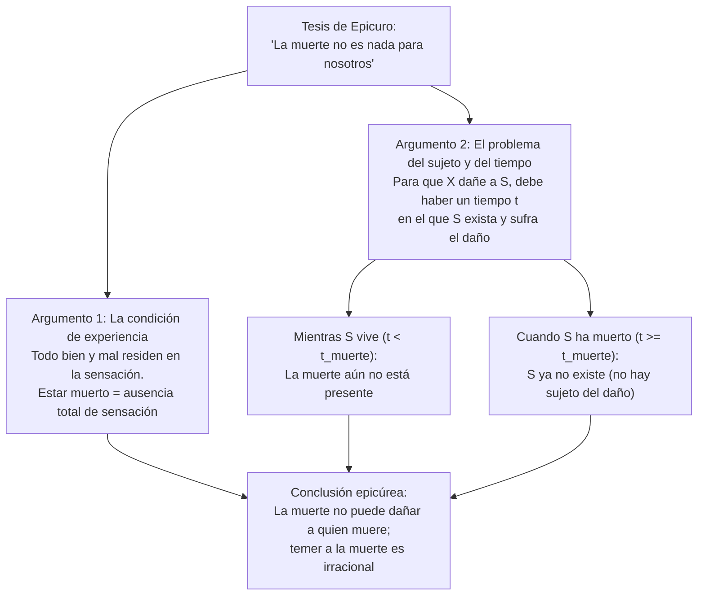
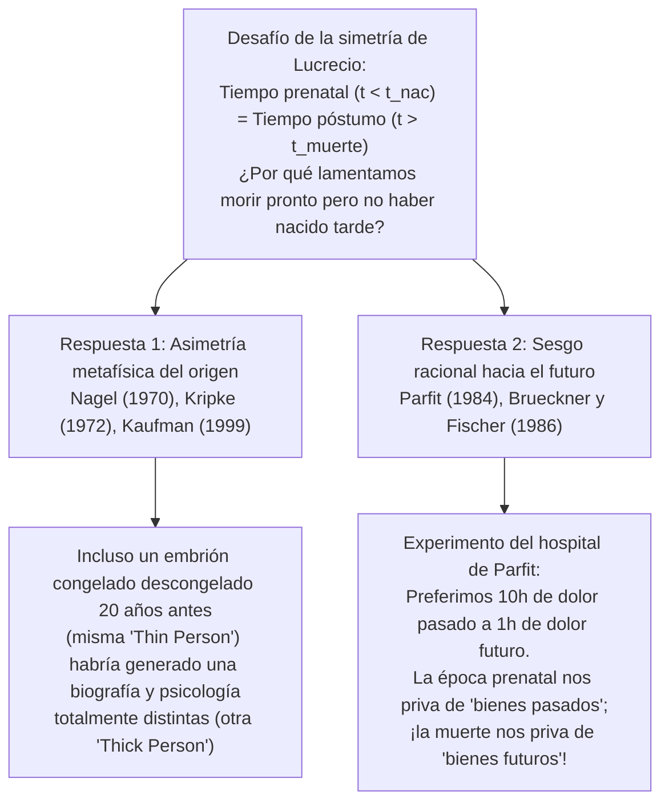

## 1. Introducción: ¿Acaso es irracional temer a la propia muerte?

De todas las emociones humanas, pocas parecen tan universales, biológicamente arraigadas e ineludibles como el <strong>miedo a la muerte</strong>. No nos referimos simplemente al temor al dolor físico de la agonía (*el proceso de morir*, *dying*), sino al terror existencial ante el hecho mismo de <strong>estar muerto (*being dead*)</strong>: la extinción irreversible de la conciencia, la aniquilación definitiva del «yo» y el paso de ser alguien a no ser absolutamente nada.

Sin embargo, hace más de dos mil trescientos años, el filósofo griego <strong>Epicuro</strong> (341–270 a. C.) formuló en su famosa *Carta a Meneceo* uno de los argumentos más desconcertantes y lógicamente implacables de la historia de la filosofía: <strong>la propia muerte no puede hacernos ningún daño en absoluto, por lo que temer a la muerte es completamente irracional</strong>. Poco después, el poeta y filósofo romano <strong>Lucrecio</strong> (c. 99–55 a. C.), en su poema épico *De rerum natura* (*Sobre la naturaleza de las cosas*), reforzó esta tesis con su célebre <strong>argumento de la simetría</strong>: el tiempo infinito que transcurrió antes de nuestro nacimiento es exactamente idéntico al tiempo infinito que seguirá a nuestra muerte; puesto que no sentimos ningún horror al mirar hacia atrás hacia nuestra inexistencia prenatal, ¿por qué habríamos de sentir terror al mirar hacia adelante hacia nuestra inexistencia póstuma?

En la filosofía analítica contemporánea —impulsada por el ensayo seminal de <strong>Thomas Nagel</strong> *«Death»* (1970) y enriquecida por pensadores como <strong>Fred Feldman</strong>, <strong>Jeff McMahan</strong>, <strong>Derek Parfit</strong>, <strong>Anthony Brueckner</strong>, <strong>John Martin Fischer</strong> y <strong>Bernard Williams</strong>—, este antiguo desafío epicúreo se ha convertido en un campo de investigación metafísica y axiológica de extraordinaria precisión. Este artículo examina rigurosamente los tres grandes enigmas de la filosofía de la muerte:

1. <strong>El problema de la experiencia y del sujeto y del tiempo</strong>: ¿Cómo puede la muerte ser mala para una persona si esa persona no puede experimentar el estar muerta y ni siquiera existe cuando está muerta? (Epicuro vs. la <strong>teoría de la privación</strong> de Nagel y el <strong>hedonismo actitudinal</strong> de Feldman).
2. <strong>El problema de la asimetría de Lucrecio</strong>: Si la muerte es mala porque nos priva de tiempo de vida que podríamos haber tenido, ¿por qué no lamentamos del mismo modo no haber nacido antes? (La identidad esencial del origen de Nagel vs. el <strong>sesgo racional hacia el futuro</strong> de Parfit y Brueckner/Fischer).
3. <strong>El dilema de la inmortalidad</strong>: Si la muerte es un mal porque interrumpe los bienes de la vida, ¿significa eso que vivir para siempre sería el mayor bien posible, o acaso la inmortalidad eterna se convertiría en una maldición insoportable? (<strong>El caso Makropulos</strong> de Bernard Williams).

---

## 2. El desafío de Epicuro: «La muerte no es nada para nosotros»

En su *Carta a Meneceo*, Epicuro escribe unas líneas que han resonado a través de los siglos como un conjuro lógico contra el terror mortal:

> «Acostúmbrate a pensar que <strong>la muerte no es nada para nosotros</strong> (*ὁ θάνατος οὐδὲν πρὸς ἡμᾶς*). Porque todo bien y todo mal residen en la sensación, y la muerte es la privación de toda sensación [...]. Así pues, el más horrendo de los males, la muerte, no es nada para nosotros, puesto que <strong>mientras nosotros somos, la muerte no está presente, y cuando la muerte está presente, entonces nosotros ya no somos</strong>. Por consiguiente, no afecta ni a los vivos ni a los muertos, ya que para aquéllos no está, y éstos ya no son.»

En la filosofía analítica de la muerte, la crítica epicúrea suele reconstruirse mediante dos argumentos distintos pero estrechamente entrelazados: el <strong>argumento de la experiencia</strong> (basado en el hedonismo axiológico) y el <strong>argumento de la inexistencia del sujeto y del tiempo</strong> (*The Subject / Timing Problem*).

### 2.1. Reconstrucción formal del argumento de la experiencia (Hedonismo)

1. <strong>Premisa 1 (Principio de la experiencia / Hedonismo intrínseco)</strong>: Un estado de cosas o un suceso $E$ es intrínsecamente malo para un sujeto $S$ si y sólo si $E$ causa que $S$ experimente estados mentales desagradables o dolorosos (dolor físico o sufrimiento psicológico).
2. <strong>Premisa 2 (Tesis de la aniquilación)</strong>: La muerte es la extinción total e irreversible de la conciencia y de toda capacidad de sensación y experiencia ($\text{Estar muerto} \implies \neg\text{Experiencia}(S)$).
3. <strong>Premisa 3</strong>: Por lo tanto, el estado de estar muerto no puede causar ninguna experiencia dolorosa o desagradable en $S$.
4. <strong>Conclusión</strong>: <strong>Estar muerto no puede ser intrínsecamente malo para $S$.</strong>

### 2.2. Reconstrucción formal del problema del sujeto y del tiempo (*The Timing Problem*)

Incluso si abandonamos el hedonismo estricto, Epicuro nos tiende una segunda trampa metafísica mucho más profunda: <strong>¿quién sufre el mal de la muerte y cuándo (*en qué instante $t$*) lo sufre?</strong>

1. <strong>Premisa 1 (Condición de existencia del sujeto y del tiempo)</strong>: Para que cualquier suceso o estado $E$ sea malo (un daño o infortunio) para un sujeto $S$, debe existir un momento temporal $t$ tal que:
   - (a) $S$ exista en el momento $t$, y
   - (b) $S$ sufra un deterioro de su bienestar en el momento $t$ a causa de $E$.
2. <strong>Premisa 2 (Exclusión mutua entre el sujeto y la muerte)</strong>: Sea $t_{\text{muerte}}$ el instante de la muerte de $S$:
   - Para todo instante $t < t_{\text{muerte}}$ (mientras $S$ está vivo), la muerte aún no ha ocurrido; por tanto, el estado de estar muerto todavía no daña a $S$.
   - Para todo instante $t \ge t_{\text{muerte}}$ (una vez que $S$ ha muerto), $S$ ya no existe ($\neg\exists S\text{ en }t$). Y quien no existe no puede tener un nivel de bienestar negativo ni ser sujeto de ningún daño.
3. <strong>Conclusión</strong>: No existe ningún momento $t$ en el que la muerte sea mala para $S$. Por ende, la muerte no puede ser mala para quien muere.

---

## 3. La refutación de Thomas Nagel y la Teoría de la Privación (*Deprivation Account*)

En su célebre artículo *«Death»* (1970, incluido luego en *Mortal Questions*, 1979), <strong>Thomas Nagel</strong> demostró que la seductora conclusión de Epicuro descansa en una concepción excesivamente estrecha de lo que constituye un bien o un mal para un ser humano. La respuesta de Nagel dio origen a la posición dominante en la filosofía analítica contemporánea: la <strong>teoría de la privación</strong> (*Deprivation Account of the Badness of Death*).

### 3.1. Males intrínsecos vs. Males extrínsecos (comparativos)

El punto clave de la teoría de la privación es distinguir entre dos maneras muy diferentes en que algo puede ser malo para una persona:

- <strong>Mal intrínseco (o positivo)</strong>: Un estado cuya presencia activa es mala en sí misma, como sentir una migraña atroz o sufrir una angustia intensa.
- <strong>Mal extrínseco (comparativo o por privación)</strong>: Un suceso o estado que no es doloroso en sí mismo, pero que es malo para un sujeto $S$ porque <strong>le impide tener o le arrebata bienes intrínsecos que de otro modo habría disfrutado</strong>.

La muerte no es un mal intrínseco (nadie afirma que estar muerto *duela*), sino el <strong>mal extrínseco y comparativo por excelencia</strong>: es mala porque <strong>nos priva de la vida y de todas las experiencias, proyectos, relaciones y alegrías valiosas que habríamos tenido si hubiésemos seguido viviendo</strong>.

### 3.2. Formulación mediante mundos posibles y cálculo del bienestar vital

El filósofo <strong>Fred Feldman</strong>, en su influyente libro *Confrontations with the Reaper* (1992), formalizó la teoría de la privación utilizando la semántica de mundos posibles de David Lewis y Robert Stalnaker:

Sea $w_{\text{actual}}$ el mundo real en el que el sujeto $S$ muere en el instante $t_1$ (por ejemplo, a los 30 años en un accidente), y sea $w_{\text{cercano}}$ el mundo posible más cercano en el que ese evento letal no ocurre y $S$ continúa viviendo hasta el instante $t_2$ (por ejemplo, hasta los 85 años). Si definimos el valor intrínseco total de la vida de $S$ en un mundo $w$ mediante la integral de su bienestar instantáneo $V_S(t, w)$ a lo largo del tiempo:

$$W(S, w) = \int_{t_{\text{inicio}}}^{t_{\text{fin}}(w)} V_S(t, w) \, dt$$

Entonces, el valor comparativo global del suceso de la muerte $D$ de $S$ en $t_1$ viene dado por la diferencia entre el valor total de la vida de $S$ en el mundo real y el valor total de su vida en el mundo contrafáctico más cercano:

$$\text{Valor}(D, S) = W(S, w_{\text{actual}}) - W(S, w_{\text{cercano}}) = -\int_{t_1}^{t_2} V_S(t, w_{\text{cercano}}) \, dt$$

Siempre que la vida futura que $S$ habría vivido entre $t_1$ y $t_2$ en $w_{\text{cercano}}$ contuviese un saldo neto positivo de bienes ($\int_{t_1}^{t_2} V_S(t, w_{\text{cercano}}) \, dt > 0$), resulta que $\text{Valor}(D, S) < 0$: <strong>la muerte en $t_1$ es objetivamente mala para $S$</strong>.

Esta ecuación explica de forma inmediata y elegante nuestras intuiciones éticas cotidianas:
1. <strong>Por qué la muerte de un joven de 20 años es mucho más trágica que la de un anciano de 95 años</strong>: Porque el intervalo de privación $[t_1, t_2]$ y la integral de bienes futuros perdidos son muchísimo mayores para quien muere a los 20 años.
2. <strong>Cuándo puede la muerte ser un bien (eutanasia racional)</strong>: Si en el mundo contrafáctico $w_{\text{cercano}}$ el resto de la vida entre $t_1$ y $t_2$ sólo contuviera sufrimiento irremediable y agonía sin esperanza ($\int_{t_1}^{t_2} V_S(t, w_{\text{cercano}}) \, dt < 0$), entonces $-\int_{t_1}^{t_2} V_S < 0$ cambia de signo y se vuelve positivo ($\text{Valor}(D, S) > 0$). En tal caso, la muerte no priva de bienes, sino de males futuros, convirtiéndose en una liberación comparativa.

### 3.3. Los tres contraejemplos de Nagel contra el requisito de experiencia ("Lo que no sabes sí te hace daño")

Los defensores de Epicuro suelen replicar a la teoría de la privación invocando el refrán popular *«Ojos que no ven, corazón que no siente»* (*What you don't know can't hurt you*): si el muerto no se entera de lo que ha perdido y jamás siente frustración por ello, ¿cómo puede esa pérdida ser un verdadero mal para él?

Para demoler la premisa de que todo mal requiere ser experimentado conscientemente por la víctima, Nagel presenta tres célebres contraejemplos:

1. <strong>La traición y el desprecio en secreto</strong>: Supongamos que tus supuestos amigos te traicionan y se burlan cruelmente de ti a tus espaldas, pero lo ocultan con tanta perfección que tú mueres creyendo que te amaban y respetaban, sin sentir jamás el menor sufrimiento subjetivo. ¿Deja por ello la traición de ser un mal para ti? Nagel sostiene que no: ser engañado y traicionado es objetivamente malo para tu vida, aunque nunca llegues a enterarte.
2. <strong>El daño cerebral infantil irreversible</strong>: Imagina a un adulto inteligente y pleno que sufre un traumatismo craneoencefálico severo que reduce sus facultades mentales al estado de un bebé de tres meses. El paciente ya no sabe lo que ha perdido: sonríe feliz en su cuna cuando le dan el biberón y le cambian los pañales, sin experimentar dolor ni frustración alguna. Si sólo contara la experiencia subjetiva interna, su estado sería envidiable; sin embargo, todos reconocemos que ese hombre ha sufrido una catástrofe colosal, precisamente por la <strong>privación de la vida adulta y racional que habría tenido</strong>.
3. <strong>La promesa incumplida a un difunto</strong>: Una persona dedica su vida a una obra o al bienestar de sus hijos y, en su lecho de muerte, obtiene la promesa solemne de un amigo de cumplir su última voluntad; tras su muerte, el amigo viola cínicamente la promesa.

Estos casos revelan que el bienestar y los intereses de una persona <strong>no están encerrados dentro de las fronteras de su piel ni de su conciencia momentánea</strong>, sino que se extienden a su historia biográfica completa, sus relaciones reales con el mundo y sus posibilidades contrafácticas.

---

## 4. El problema del tiempo (*The Timing Problem*): cinco estrategias en la filosofía contemporánea

Incluso si aceptamos que la muerte es mala porque nos priva de un futuro valioso, el segundo argumento de Epicuro sigue exigiendo una respuesta precisa: <strong>¿en qué momento exacto $t$ sufre la persona el mal de la muerte?</strong> En la literatura analítica contemporánea se han desarrollado cinco grandes posiciones para resolver el *Timing Problem*:

| Posición filosófica | Defensores principales | ¿Cuándo es mala la muerte para el sujeto $S$? | Idea central y objeción principal |
| :--- | :--- | :--- | :--- |
| <strong>1. Atemporalismo / Eternismo</strong> (*Eternalism*) | Fred Feldman (1992), Thomas Nagel (1970) | <strong>Atemporalmente</strong> (o con respecto a la vida como un todo, sin fecha puntual) | Compara el valor total del mundo real $w_{\text{actual}}$ con el mundo cercano $w_{\text{cercano}}$. *Objeción*: Parece extraño que una desgracia real ocurra sin tener ubicación en el tiempo. |
| <strong>2. Concurrentismo</strong> (*Concurrentism*) | Julian Lamont (1998), Ben Bradley (parcial) | <strong>En el instante exacto de la muerte</strong> ($t = t_{\text{muerte}}$) | El daño ocurre justo cuando el evento letal corta la línea vital. *Objeción*: Confunde el instante del golpe causal con el periodo en que se carece de los bienes perdidos. |
| <strong>3. Priorismo</strong> (*Priorism*) | George Pitcher (1984), Joel Feinberg (1984) | <strong>Antes de la muerte, durante la vida</strong> ($t < t_{\text{muerte}}$) | La muerte prematura frustra retroactivamente los intereses y proyectos que la persona tenía *mientras estaba viva* (como quien ya es desafortunado hoy porque su hijo morirá mañana). *Objeción*: Parecería implicar una «causalidad hacia atrás» (*backward causation*). |
| <strong>4. Subsecuentismo</strong> (*Subsequentism*) | Ben Bradley (2009), Neil Feit (2002) | <strong>Después de la muerte, durante el tiempo en que está muerto</strong> ($t_1 < t \le t_2$) | La muerte es mala exactamente en los años en que el sujeto *habría estado disfrutando* de la vida ($V_S(t, w_{\text{actual}}) = 0 < V_S(t, w_{\text{cercano}})$). *Objeción*: ¿Cómo puede tener un nivel de bienestar $0$ en $t$ alguien que no existe en $t$? |
| <strong>5. Indefinitismo</strong> (*Indefinitism*) | Thomas Nagel (1970), Harry Silverstein (1980) | <strong>No tiene una localización temporal definida</strong> | Puesto que el mal de la muerte consiste en la ausencia de un tramo entero de vida posible, esa privación pertenece a la historia del sujeto sin estar localizada en un instante puntual. |

Entre estas propuestas, el <strong>subsecuentismo</strong> de Ben Bradley (*Well-Being and Death*, 2009) ha ganado gran protagonismo: Bradley argumenta que no hay ninguna contradicción metafísica en asignar a una persona un nivel de bienestar igual a cero ($V_S(t, w_{\text{actual}}) = 0$) durante las décadas posteriores a su muerte en las que, en el mundo posible cercano $w_{\text{cercano}}$, habría tenido un bienestar positivo ($V_S(t, w_{\text{cercano}}) > 0$). Del mismo modo que podemos decir exactamente *cuándo* me perjudicó no haber recibido un ascenso (durante los meses en que cobré menos sueldo), podemos decir exactamente *cuándo* perjudica la muerte a alguien que muere a los 30 años en vez de a los 80: <strong>durante los 50 años comprendidos entre sus 30 y sus 80 años</strong>.

---

## 5. La cuenta del Interés Relativo al Tiempo (*Time-Relative Interest Account*, TRIA) de Jeff McMahan

La formulación estándar de la teoría de la privación (como la de Feldman) se enfrenta, no obstante, a una paradoja importante en bioética. Si el mal de la muerte dependiese únicamente de la cantidad total de años felices perdidos ($\int_{t_1}^{t_2} V_S(t) \, dt$), entonces <strong>la muerte de un embrión de una semana o de un feto de tres meses sería una tragedia mayor que la muerte de un joven de 25 años</strong>, puesto que el embrión pierde 80 años de vida futura mientras que el joven de 25 años pierde sólo 55 años. Sin embargo, casi todo el mundo juzga que la muerte de una persona de 25 años —con planes, recuerdos, afectos profundos y autoconciencia— es una tragedia muchísimo más grave para la víctima que un aborto espontáneo temprano. ¿Por qué?

Para resolver este problema, <strong>Jeff McMahan</strong> desarrolló en *The Ethics of Killing* (2002) su influyente <strong>Cuenta del Interés Relativo al Tiempo</strong> (*Time-Relative Interest Account*, <strong>TRIA</strong>). Inspirándose en la teoría de la identidad personal de Derek Parfit, McMahan sostiene que para evaluar cuán mala es la muerte para un individuo $S$ en el instante $t_1$, no basta con sumar los bienes futuros entre $t_1$ y $t_2$: debemos ponderar cada bien futuro en $t$ por el <strong>grado de unidad psicológica (conectividad y continuidad de memoria, carácter, deseos e intenciones) $\mathcal{R}(t_1, t) \in [0, 1]$</strong> que habría existido entre el sujeto en $t_1$ y su yo futuro en $t$:

$$\text{Mal}_{\text{TRIA}}(D, S, t_1) = \int_{t_1}^{t_2} V_S(t, w_{\text{cercano}}) \cdot \mathcal{R}(t_1, t) \, dt$$

- En un <strong>embrión o feto temprano</strong>, todavía no hay vida mental ni recuerdos ni proyectos; por tanto, la relación de unidad psicológica con el adulto que llegaría a ser dentro de 30 años es prácticamente nula ($\mathcal{R}(t_1, t) \approx 0$). Aunque la cantidad bruta de vida perdida sea enorme, el interés *relativo al tiempo* del feto en ese futuro es muy débil.
- En cambio, en un <strong>niño de 10 años o un joven de 20 años</strong>, tanto la cantidad de futuro perdido ($t_2 - t_1$) como la fuerza del vínculo psicológico $\mathcal{R}(t_1, t)$ con su yo futuro son máximas ($\mathcal{R}(t_1, t) \approx 1$). Por eso la muerte en la juventud o la adultez temprana constituye el pico máximo de tragedia biográfica.

---

## 6. El enigma de la simetría de Lucrecio (*The Lucretian Symmetry Puzzle*)

Llegamos ahora al rompecabezas más fascinante de la filosofía de la muerte. En el Libro III de *De rerum natura* (versos 832–842 y 972–975), el poeta epicúreo romano <strong>Lucrecio</strong> presenta su famoso <strong>argumento del espejo (o de la simetría)</strong>:

> «Mira hacia atrás y considera cómo toda la eternidad del tiempo pasado antes de que naciéramos no fue nada para nosotros. La naturaleza nos ofrece esto como un espejo (*speculum*) del tiempo futuro que vendrá después de nuestra muerte final.»

Supongamos que una persona nace en el año 1980 y muere en el año 2060.
- Hay una eternidad de <strong>inexistencia prenatal</strong> ($t < 1980$).
- Hay una eternidad de <strong>inexistencia póstuma</strong> ($t > 2060$).

Si los defensores de la teoría de la privación (como Nagel y Feldman) tienen razón al afirmar que morir en 2060 (en lugar de vivir hasta 2080) es un mal porque <strong>nos priva de los 20 años de bienes entre 2060 y 2080</strong>, entonces Lucrecio pregunta: <strong>¿por qué no es exactamente igual de malo haber nacido en 1980 en lugar de en 1960, lo cual nos privó de los 20 años de bienes entre 1960 y 1980?</strong>

De hecho, todos mantenemos una <strong>profunda asimetría emocional y evaluativa</strong>: miramos con serenidad o indiferencia los siglos anteriores a nuestro nacimiento, pero miramos con angustia o pesar el tiempo posterior a nuestra muerte que no llegaremos a vivir. ¿Es esta asimetría una incoherencia irracional (como creía Lucrecio), o existe alguna diferencia metafísica o racional profunda entre el pasado prenatal y el futuro póstumo?

### 6.1. La respuesta metafísica de Thomas Nagel: la esencialidad del origen

La respuesta de <strong>Thomas Nagel</strong> (respaldada por la tesis de la *necesidad del origen* de Saul Kripke en *Naming and Necessity*, 1972) es de carácter <strong>metafísico (modal)</strong>:

- <strong>La fecha de la muerte es contingente</strong>: La misma persona que murió en 2060 *podría haber vivido más tiempo* (hasta 2080) sin dejar de ser numéricamente ella misma. Existe un mundo posible genuino en el que *yo* vivo veinte años más.
- <strong>La fecha del nacimiento (y de la concepción) es esencial</strong>: Una persona <strong>no podría haber nacido sustancialmente antes</strong> de cuando nació, porque la identidad genética y biológica de un individuo depende del óvulo y el espermatozoide específicos de los que procede y del momento de su concepción. Cualquier persona nacida en 1960 o en el siglo XVIII en lugar de en 1980 <strong>no habría sido yo, sino otra persona completamente distinta</strong>. Por lo tanto, el tiempo anterior a 1980 no es un tiempo del que *yo* haya sido privado, porque yo no podría haber existido entonces.

### 6.2. La objeción de los embriones congelados y la respuesta de Frederik Kaufman («Persona fina» vs. «Persona densa»)

Sin embargo, la bioética moderna puso en jaque el argumento biológico de Nagel. Imaginemos que un <strong>embrión fecundado in vitro en 1980</strong> es criopreservado en nitrógeno líquido. En el mundo real, es descongelado e implantado en el año <strong>2000</strong> y nace en ese año. Pero es metafísica y biológicamente posible que *ese mismo embrión exacto* (con idéntico ADN y origen gamético) hubiera sido descongelado e implantado en <strong>1980</strong>, naciendo veinte años antes. Aun sabiendo que su embrión estuvo congelado veinte años, ¿acaso esa persona se lamenta amargamente de haber perdido los años 1980–2000 del mismo modo en que teme morir veinte años antes de tiempo? ¡En absoluto!

Para defender a Nagel frente al caso del embrión congelado, <strong>Frederik Kaufman</strong> (1999) introdujo la distinción entre:
- <strong>Persona en sentido fino (*Thin Person*)</strong>: El organismo biológico o sustrato genético desnudo (el embrión).
- <strong>Persona en sentido denso (*Thick Person*)</strong>: El sujeto psicológico concreto, constituido por sus recuerdos biográficos, su idioma, su cultura, sus amigos, sus valores y su personalidad histórica.

Kaufman argumenta que si el embrión hubiese sido descongelado veinte años antes (en 1980 en vez de en 2000), habría crecido en una época distinta, con otros amigos, otras experiencias y otra historia vital: aunque habría sido la misma *persona fina* (el mismo organismo genético), habría sido una <strong>persona densa (psicológica y biográfica) completamente diferente</strong>. Cuando yo temo a la muerte, quien quiere seguir viviendo es mi *yo denso actual*, con mis recuerdos y mis proyectos; y ese *yo denso* jamás podría haber existido veinte años antes de mi nacimiento, pero sí puede prolongarse veinte años más hacia el futuro.

### 6.3. La respuesta del sesgo racional hacia el futuro: Derek Parfit, Anthony Brueckner y John Martin Fischer

Una vía alternativa —defendida brillantemente por <strong>Anthony Brueckner y John Martin Fischer</strong> en *«Why Is Death Bad?»* (1986), basándose en <strong>Derek Parfit</strong> (*Reasons and Persons*, 1984)— concede a Lucrecio que la privación prenatal y la privación póstuma pueden ser simétricas desde una perspectiva atemporal, pero demuestra que nuestra asimetría hacia la muerte se explica por un rasgo fundamental de la racionalidad humana: <strong>nuestras actitudes racionales hacia los bienes y males son asimétricas respecto al tiempo (tenemos un sesgo hacia el futuro, *future-bias*)</strong>.

En el Capítulo 8 de *Reasons and Persons*, Parfit propone su célebre experimento mental de <strong>«La operación del hospital» (*My Past or Future Operations*)</strong>:

> Te despiertas en una cama de hospital con amnesia temporal sobre qué día es. Sabes que en este hospital se realiza una intervención quirúrgica dolorosa sin anestesia (porque la anestesia sería letal), pero que después se administra una droga que borra por completo el recuerdo del dolor. Preguntas a la enfermera si ya te han operado. La enfermera consulta dos expedientes posibles y te dice:
> - <strong>Caso A (Paciente del pasado)</strong>: «O bien usted es el paciente al que operaron <strong>ayer</strong> y sufrió <strong>10 horas</strong> de dolor atroz (que ya ha olvidado gracias a la droga)...»
> - <strong>Caso B (Paciente del futuro)</strong>: «...o bien usted es el paciente al que operarán <strong>esta tarde</strong> y sufrirá <strong>1 hora</strong> de dolor atroz.»

¿Cuál de las dos noticias prefieres fervientemente que sea cierta? <strong>Absolutamente todo el mundo prefiere con inmenso alivio el Caso A (10 horas de dolor ya pasado) antes que el Caso B (1 hora de dolor futuro).</strong> Nos preocupan de manera directa e intensa los sufrimientos y placeres *futuros*, mientras que somos relativamente indiferentes a los dolores y placeres *que ya quedaron atrás en el pasado*.

Brueckner y Fischer aplican este mismo principio simétrico a los <strong>placeres y bienes de la vida</strong>:
- Imaginemos que te dicen que en tu vida hay 1.000 días de felicidad extraordinaria: en un escenario, esos 1.000 días <strong>ya ocurrieron en tu pasado</strong> (y los has olvidado); en el otro escenario, esos 1.000 días <strong>están por venir en tu futuro</strong>. Racionalmente, todos preferimos tener los bienes *por delante* (en el futuro) y no *detrás* (en el pasado).
- Pues bien: <strong>nacer más tarde</strong> nos priva únicamente de *bienes pasados* (experiencias que hoy ya habrían terminado y quedado atrás), mientras que <strong>morir antes</strong> nos priva de *bienes futuros* (experiencias que estarían por venir delante de nosotros). Por consiguiente, temer y lamentar la muerte póstuma mientras miramos con indiferencia la inexistencia prenatal <strong>no es ninguna contradicción irracional</strong>, sino la consecuencia directa de nuestra orientación temporal hacia el futuro.

---

## 7. ¿Sería la inmortalidad una bendición? Bernard Williams y el caso Makropulos

Si la muerte es un mal porque nos arrebata el futuro y corta nuestros proyectos, parecería seguirse lógicamente que <strong>el ideal supremo sería no morir jamás: alcanzar la inmortalidad eterna ($t_{\text{fin}} \to \infty$)</strong>. Sin embargo, en uno de los ensayos más brillantes e influyentes del siglo XX, *«The Makropulos Case: Reflections on the Tedium of Immortality»* (1973), el filósofo británico <strong>Bernard Williams</strong> sostuvo una tesis provocadora: aunque la muerte suele llegar demasiado pronto y ser un mal en cualquier momento concreto, <strong>la inmortalidad eterna sería una maldición insoportable</strong>.

### 7.1. Elina Makropulos y la edad congelada a los 337 años

Williams toma su título de la obra de teatro de Karel Čapek (convertida en ópera por Leoš Janáček), *El asunto Makropulos*. Su protagonista, la cantante de ópera <strong>Elina Makropulos</strong> (conocida bajo diversas identidades con las iniciales <strong>E.M.</strong>), bebió en el siglo XVI a los <strong>42 años de edad</strong> un elixir de la vida preparado por su padre, el médico de la corte del emperador Rodolfo II. El elixir detuvo su envejecimiento biológico durante trescientos años.

Cuando la obra transcurre, Elina Makropulos tiene <strong>337 años</strong>, pero conserva el cuerpo y la salud de una mujer de 42 años. No sufre la decrepitud física de los inmortales *struldbruggs* de Jonathan Swift; sin embargo, su alma ha caído en un <strong>estado de hastío, frialdad glacial y aburrimiento abismal (*tedium*)</strong>. Ha amado decenas de veces, ha visto triunfar y fracasar todas las causas políticas, ha dominado el arte hasta la perfección, y todo cuanto ocurre ante sus ojos le parece una repetición mecánica de patrones vacíos. Como escribe Williams, en ella «todo se ha vuelto frío, gigantesco y vacío». Al final, cuando se le ofrece volver a tomar la fórmula para vivir otros trescientos años, <strong>Elina se niega rotundamente, destruye el pergamino y muere con profundo alivio</strong>.

### 7.2. Deseos condicionales vs. Deseos categóricos y el dilema de la inmortalidad

Para demostrar que el destino de Elina Makropulos no es un accidente psicológico sino una necesidad estructural de la condición humana, Williams introduce una distinción fundamental entre dos tipos de deseos:

1. <strong>Deseos condicionales (*Conditional Desires*)</strong>: Deseos que presuponen la condición *«si voy a seguir vivo...»* (por ejemplo: *«si mañana sigo vivo, quiero comer bien, no pasar frío y tener buena ropa»*). Los deseos condicionales presuponen la vida, pero <strong>no nos dan ninguna razón para querer seguir viviendo</strong>.
2. <strong>Deseos categóricos (*Categorical Desires*)</strong>: Proyectos, pasiones, amores y compromisos profundos que no dependen de la condición de seguir vivo, sino que <strong>responden a la pregunta de por qué vale la pena seguir vivo</strong> (por ejemplo: terminar una investigación científica, criar a un hijo, luchar por la justicia, escribir una obra maestra). Son nuestros deseos categóricos los que nos impulsan hacia el futuro y hacen que la muerte sea un mal porque los interrumpe.

A partir de aquí, Williams formula el <strong>dilemático trilema de la inmortalidad</strong>: para que una vida inmortal sea deseable para mí, debe cumplir dos condiciones simultáneas:
- <strong>Condición 1 (Ausencia de hastío)</strong>: Debe seguir generando deseos categóricos que me mantengan interesado y vivo sin caer en el tedio infinito de E.M.
- <strong>Condición 2 (Conservación de la identidad)</strong>: La persona que viva esa existencia futura debe seguir siendo *realmente yo*, manteniendo una continuidad reconocible con mi carácter, mis valores y mi identidad personal.

Williams argumenta que, en un tiempo infinito ($t \to \infty$), estas dos condiciones son <strong>mutuamente incompatibles</strong>:

$$\begin{cases} \text{Rama A (Carácter definido y constante)} \implies \text{Agotamiento de experiencias posibles} \implies \text{Hastío inevitable (Caso Makropulos)} \\ \text{Rama B (Transformación radical e incesante del carácter y la memoria)} \implies \text{Ruptura de la continuidad psicológica} \implies \text{Pérdida del 'yo' (equivale a la muerte)} \end{cases}$$

- <strong>Rama A</strong>: Si tengo un carácter humano determinado (con gustos, temperamento y límites definidos), tras siglos y milenios habré experimentado todas las combinaciones de vivencias compatibles con ese carácter. La novedad se agotará y caeré inevitablemente en el hastío glacial de Elina Makropulos.
- <strong>Rama B</strong>: Si para evitar el aburrimiento mi personalidad, mis recuerdos y mis valores son borrados y reemplazados por otros completamente nuevos cada doscientos años, entonces el ser que existirá dentro de diez mil años tendrá tan poca relación psicológica conmigo como un extraño cualquiera. No habré sobrevivido *yo*: simplemente habrá una sucesión de personas distintas habitando el mismo cuerpo.

### 7.3. La réplica de John Martin Fischer: placeres agotables vs. placeres repetibles

No todos los filósofos contemporáneos aceptan el pesimismo de Bernard Williams sobre la inmortalidad. <strong>John Martin Fischer</strong>, en *«Why Immortality Is Not So Bad»* (1994), sostiene que Williams comete dos errores:

1. <strong>Placeres auto-agotables (*self-exhausting pleasures*) vs. Placeres repetibles (*repeatable pleasures*)</strong>: Williams piensa la vida como una lista de logros únicos que, una vez tachados, pierden su atractivo (subir al Everest por primera vez). Pero gran parte de las experiencias que hacen que la vida valga la pena son <strong>intrínsecamente repetibles</strong> sin perder jamás su valor: escuchar las suites para violonchelo de Bach, contemplar el océano al atardecer, conversar con un amigo querido, disfrutar de la gastronomía, el amor o la meditación espiritual.
2. <strong>Transformación gradual orgánica</strong>: El carácter humano no necesita elegir entre la rigidez pétrea de Elina Makropulos y la amnesia abrupta total. Una persona inmortal podría evolucionar de manera orgánica y gradual a lo largo de los siglos —aprendiendo nuevas ciencias, lenguas y artes—, manteniendo siempre cadenas superpuestas de continuidad psicológica con su pasado sin agotarse jamás.

---

## 8. Conclusión: La muerte como el reverso del valor de la vida

Al recorrer este largo camino desde el jardín de Epicuro en Atenas hasta los debates contemporáneos de la filosofía analítica, descubrimos una verdad profunda que une la metafísica con la sabiduría existencial:

1. <strong>Epicuro tenía razón en un punto crucial</strong>: el estado de estar muerto no es una cámara oscura donde nuestra alma quede atrapada sufriendo frío, soledad o silencio. En la muerte no hay experiencia ni dolor alguno; temer a la muerte como si fuésemos a «presenciar» nuestra propia nada es una ilusión de la imaginación.
2. <strong>Pero Thomas Nagel y la teoría de la privación tienen razón en lo esencial</strong>: la muerte es un mal real y objetivo cuando interrumpe una vida valiosa, no por lo que nos hace *sentir*, sino por todo el horizonte de experiencias, amor, conocimiento y proyectos del que <strong>nos priva</strong>.
3. <strong>El espejo de Lucrecio y el caso Makropulos de Williams completan el cuadro</strong>: lamentamos la muerte futura y no la nada prenatal porque somos seres proyectados hacia el futuro a través de nuestros deseos categóricos; y es precisamente la <strong>finitud temporal</strong> la que otorga urgencia, dramatismo y peso irrepetible a cada elección que tomamos.

En última instancia, <strong>el miedo racional a la muerte no es más que la sombra proyectada por nuestro amor a la vida</strong>. Si la muerte no nos quitara nada de valor, tampoco la vida tendría valor alguno. Comprender filosóficamente por qué la muerte es una privación no nos hunde en la desesperación; al contrario, nos recuerda que el intervalo finito entre nuestro nacimiento y nuestra muerte —este presente irrepetible en el que aún existimos y aún sentimos— merece ser vivido con la mayor lucidez, gratitud e intensidad posibles.
