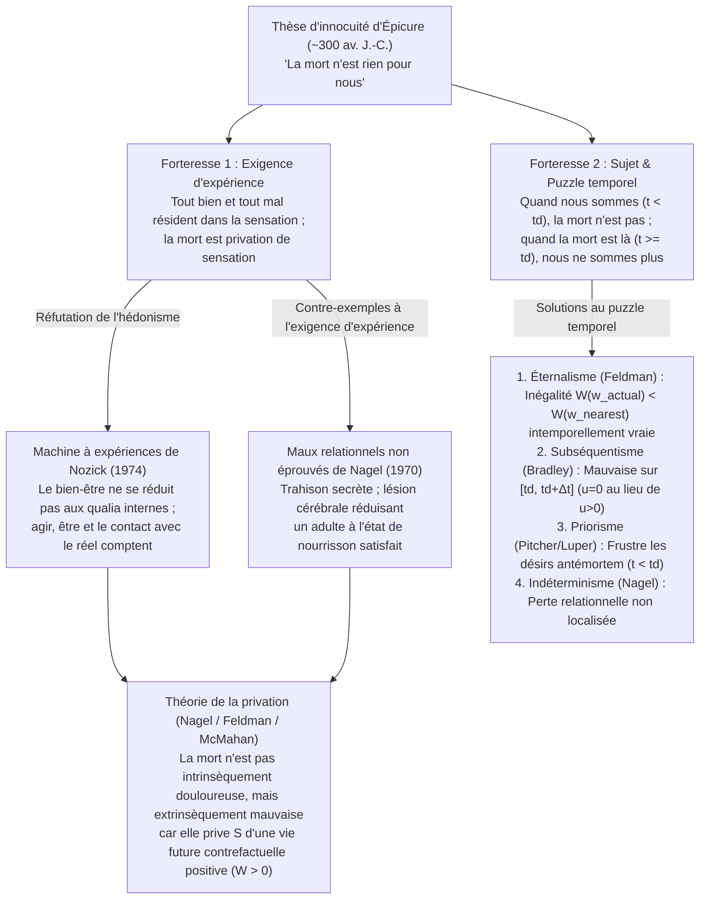
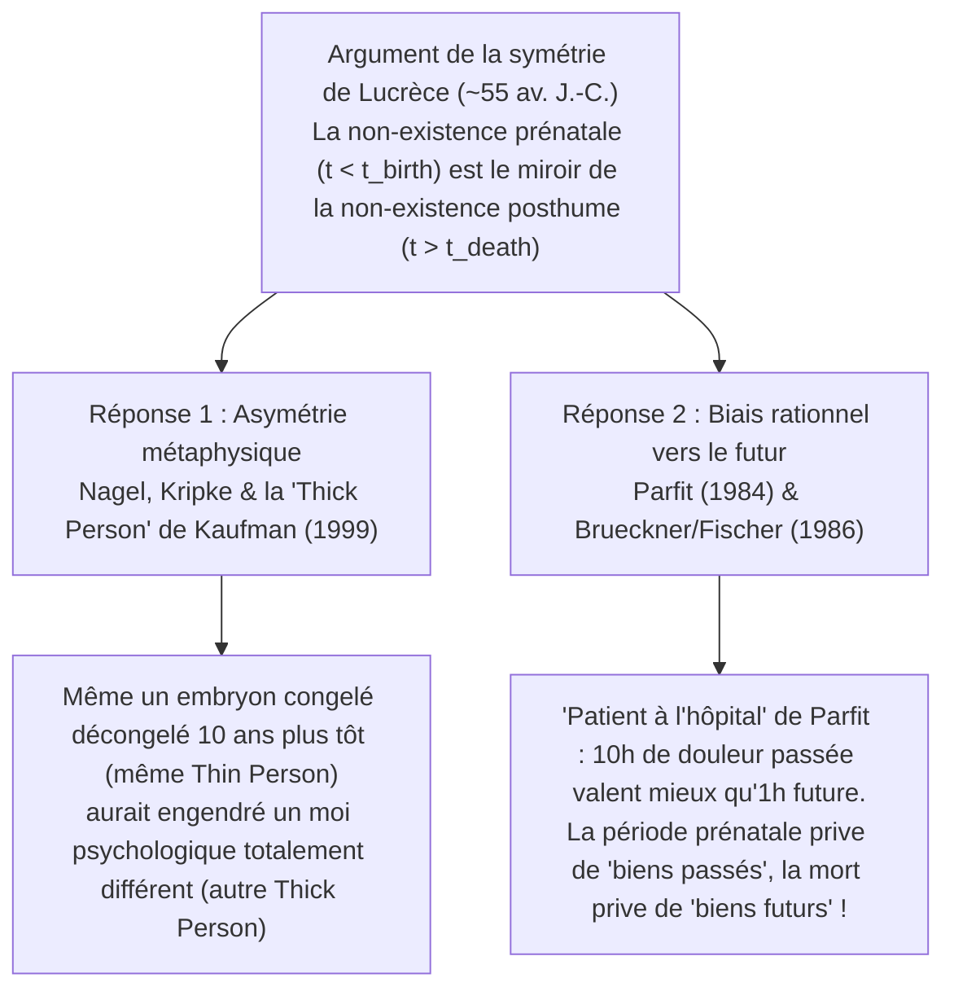

## 1. Introduction : Le paradoxe existentiel de la mortalité

Dans nos lois, notre morale et nos intuitions les plus profondes, <strong>la mort est ordinairement tenue pour l’un des pires maux qui puissent frapper une personne</strong>. Pourtant, dès que nous adoptons l’<strong>hypothèse de l’annihilation (Annihilation Assumption / Termination Thesis)</strong> — selon laquelle la mort biologique marque l’extinction irréversible de toute conscience et de l’existence personnelle —, un redoutable paradoxe métaphysique et axiologique surgit : puisque les morts n’éprouvent ni obscurité, ni souffrance, ni regret, et que le sujet même du préjudice a disparu, <strong>comment le fait d’être mort (being dead) pourrait-il être mauvais pour celui qui meurt ?</strong>

Il y a plus de deux millénaires, <strong>Épicure (341–270 av. J.-C.)</strong> formula dans sa *Lettre à Ménécée* son célèbre argument de l’innocuité de la mort, renforcé au Ier siècle av. J.-C. par l’<strong>argument de la symétrie</strong> du poète romain <strong>Lucrèce (v. 99–55 av. J.-C.)</strong> dans le *De Rerum Natura*. Depuis l’essai fondateur de <strong>Thomas Nagel</strong>, *« Death »* (1970), la philosophie analytique contemporaine — avec Fred Feldman, Derek Parfit, Jeff McMahan, John Martin Fischer, Ben Bradley et Bernard Williams — a mobilisé la sémantique des mondes possibles et la théorie de l’identité personnelle pour résoudre cette énigme.

### Distinctions conceptuelles : Mourir, mortalité et être mort

Il faut d’abord distinguer trois réalités confondues sous le mot « mort » (soit $t_{\text{birth}}$ la naissance et $t_d$ l’instant du décès de $S$) :
1. <strong>Le processus du mourir (Dying, $t \in [t_0, t_d)$)</strong> : $S$ est encore en vie et conscient, souffrant souvent de douleurs physiques (mal intrinsèque $u_S(t) < 0$). Mais la mort instantanée et indolore d’une étudiante de vingt ans dans son sommeil demeure une tragédie absolue, prouvant que le mal de la mort ne se réduit pas à la douleur de l’agonie.
2. <strong>La conscience de la mortalité (Mortality, $t_{\text{birth}} < t < t_d$)</strong> : L’angoisse anticipatrice de la mort ; mais si l’état de mort est inoffensif, cette crainte est irrationnelle.
3. <strong>L’état d’être mort / Non-existence posthume (Being Dead, $t \ge t_d$)</strong> : $S$ n’existe plus et son utilité expérientielle est nulle ($u_S(t) = 0$). C’est ici que réside le problème philosophique central.

---

## 2. L’argument d’Épicure et ses deux forteresses logiques

Dans la *Lettre à Ménécée* (§§124–125), Épicure écrit :

> *« Habitue-toi à penser que <strong>la mort n’est rien pour nous</strong>, puisque tout bien et tout mal résident dans la sensation, et que la mort est la privation de toute sensation. … <strong>Ainsi, le plus effroyable des maux, la mort, n’est rien pour nous, attendu que, lorsque nous sommes, la mort n’est pas là, et que, lorsque la mort est là, nous ne sommes plus.</strong> »*

La philosophie analytique décompose ce texte en deux forteresses distinctes :

- <strong>Forteresse 1 : L’exigence d’expérience (The Experience Requirement)</strong> : Un état de choses $X$ ne peut être mauvais pour un sujet $S$ que s’il provoque chez $S$ des sensations conscientes désagréables (hédonisme). La mort étant la privation de toute sensation, elle ne peut nuire à $S$.
- <strong>Forteresse 2 : Le problème du sujet et le puzzle temporel (The Timing Puzzle)</strong> : Tout préjudice doit nuire à un sujet existant $S$ à un instant déterminé $t$. Or, avant la mort ($t < t_d$), la mort n’est pas encore survenue ; après la mort ($t \ge t_d$), $S$ n’existe plus. Il n’y a donc aucun instant $t$ où la mort soit mauvaise pour $S$.

---

## 3. Réfuter l’exigence d’expérience : La machine de Nozick et les maux relationnels de Nagel

### 3.1 La « machine à expériences » de Robert Nozick (1974)

Dans *Anarchie, État et Utopie* (1974), <strong>Robert Nozick</strong> imagine une <strong>machine à expériences</strong> qui stimule votre cerveau dans une cuve pour vous donner l’illusion subjective parfaite d’écrire un grand roman ou d’être entouré d’amis aimants. Si l’exigence d’expérience d’Épicure était vraie ($\int u_{\text{felt}}(t)\,dt$), chacun devrait s’y brancher à vie. Notre refus prouve que notre bien-être exige de <strong>faire réellement</strong> certaines choses, d’<strong>être</strong> une certaine personne et d’être en <strong>contact avec la réalité effective</strong>.

### 3.2 Les trois contre-exemples de Thomas Nagel dans *« Death »* (1970)

<strong>Thomas Nagel</strong> montre par trois cas célèbres qu’un individu peut subir un grave préjudice sans jamais en souffrir consciemment :
1. <strong>La trahison dans le dos</strong> : Celui dont l’épouse et les amis se moquent secrètement subit un mal relationnel réel, même s’il meurt sans jamais l’apprendre.
2. <strong>Les promesses faites à un mourant bafouées</strong> : Si un ami brûle le manuscrit d’un chercheur après ses funérailles, le projet central de sa vie est réduit à néant.
3. <strong>Le nourrisson satisfait (Lésion cérébrale grave)</strong> : Un brillant scientifique de 30 ans subit un traumatisme crânien qui ramène définitivement son esprit à celui d’un bébé de trois mois souriant et sans douleur. Bien qu’il ne souffre nullement, tout le monde y voit une tragédie dévastatrice — en raison de <strong>ce qui lui a été ôté</strong> (ses possibilités intellectuelles et créatrices). À plus forte raison, la mort qui réduit nos possibilités à zéro est un mal majeur par privation.

---

## 4. La théorie de la privation (Deprivation Account) et l’intérêt relatif au temps

Formalisée par <strong>Fred Feldman (1991)</strong> et <strong>Ben Bradley (2009)</strong>, la <strong>théorie de la privation</strong> distingue le <strong>mal intrinsèque</strong> ($u_S(t) < 0$) du <strong>mal extrinsèque (contrefactuel)</strong> : la mort n’est pas douloureuse en soi, mais *extrinsèquement mauvaise* parce qu’elle <strong>prive</strong> le défunt des biens positifs de la vie dont il aurait joui s’il n’était pas mort à cet instant.

### 4.1 Formalisation dans la sémantique des mondes possibles

Soit $W(S, w) = \int_{t_{\text{birth}}}^{t_d(w)} u_S(t, w)\,dt$ le bien-être total sur la vie entière de $S$ dans le monde possible $w$. Si $S$ meurt à $t_d$ dans le monde actuel $w_{\text{actual}}$ suite à l’événement $e_d$, tandis que dans le <strong>monde possible le plus proche $w_{\text{nearest}}$</strong> où $e_d$ n’a pas lieu, $S$ vit jusqu’à $t_d + \Delta t$, la valeur extrinsèque de sa mort est :

$$\text{Val}_{\text{extrinsic}}(e_d, S, w_{\text{actual}}) = W(S, w_{\text{actual}}) - W(S, w_{\text{nearest}}) = -\int_{t_d}^{t_d + \Delta t} u_S(t, w_{\text{nearest}})\,dt$$

- Lorsque l’intégrale future contrefactuelle est positive ($\int_{t_d}^{t_d+\Delta t} u_S > 0$), $\text{Val}_{\text{extrinsic}} < 0$ (et la mort prématurée d’un jeune adulte est bien pire que celle d’un centenaire car $\Delta t$ est immense).
- Lorsqu’un malade incurable n’a plus devant lui que des souffrances atroces ($\int_{t_d}^{t_d+\Delta t} u_S < 0$), $\text{Val}_{\text{extrinsic}} > 0$, expliquant pourquoi l’euthanasie peut être un bienfait.

### 4.2 Le paradoxe du fœtus et le compte rendu de l’intérêt relatif au temps de Jeff McMahan (TRIA, 2002)

Pour éviter la conséquence absurde selon laquelle la fausse couche d’un fœtus précoce (perdant 80 ans) serait pire que le meurtre d’un adulte de 25 ans (perdant 55 ans), <strong>Jeff McMahan (2002)</strong> pondère les biens futurs par le degré de continuité psychologique $\mathcal{R}_S(t_d, t) \in [0, 1]$ de Derek Parfit dans son <strong>Time-Relative Interest Account (TRIA)</strong> :

$$\text{Badness}_{\text{TRIA}}(e_d, S, t_d) = \int_{t_d}^{t_d + \Delta t} \mathcal{R}_S(t_d, t) \cdot u_S(t, w_{\text{nearest}})\,dt$$

Chez le fœtus précoce, la connexion psychologique avec l’adulte futur est quasi nulle ($\mathcal{R}_S \approx 0$), tandis qu’elle est maximale ($\mathcal{R}_S \approx 1$) chez le jeune adulte de 25 ans.

---

## 5. Le labyrinthe du puzzle temporel : *Quand* la mort est-elle mauvaise ?

| Position théorique (Auteurs) | Lieu temporel du préjudice ($t$) | Mécanisme métaphysique & axiologique | Force principale | Objection principale |
| :--- | :--- | :--- | :--- | :--- |
| <strong>1. Éternalisme / Intemporalité</strong> (Fred Feldman) | <strong>Éternellement / Toujours</strong> (Atemporally) | L’inégalité $W(S, w_{\text{actual}}) < W(S, w_{\text{nearest}})$ est une vérité intemporelle | Contourne totalement la non-existence posthume | Confond la vérité intemporelle d’un énoncé et la date du préjudice |
| <strong>2. Subséquentisme</strong> (Ben Bradley, Neil Feit) | <strong>Intervalle posthume</strong> $t \in [t_d, t_d + \Delta t]$ | Durant $[t_d, t_d+\Delta t]$, le bien-être réel est $u=0$ contre $u>0$ contrefactuel | Coïncide avec la date exacte des biens manqués | Exige d’attribuer un niveau $u=0$ à un sujet qui n’existe plus |
| <strong>3. Priorisme</strong> (George Pitcher, Steven Luper) | <strong>Durant la vie</strong> $t < t_d$ | La mort à $t_d$ condamne dès $t < t_d$ les désirs tournés vers l’avenir | Respecte le présentisme (le sujet lésé est vivant) | Contre-intuitif de dire qu’un jeune heureux de 20 ans est *déjà* lésé |
| <strong>4. Concurrentisme</strong> (Julian Lamont) | <strong>Instant du décès</strong> $t = t_d$ | Le dommage survient à l’instant frontière $t_d$ | Aligne la date du dommage sur l’événement causal | Dilemme de la frontière à $t_d$ (encore vivant ou déjà mort) |
| <strong>5. Indéterminisme</strong> (Thomas Nagel) | <strong>Non localisé</strong> | Les pertes relationnelles appartiennent à la personne historique entière | Préserve l’unité narrative de l’existence humaine | Rejette le principe de localisation temporelle des maux |

---

## 6. L’argument de la symétrie de Lucrèce et l’asymétrie du temps

Dans le livre III du *De Rerum Natura*, <strong>Lucrèce</strong> nous tend l’éternité du temps antérieur à notre naissance (<strong>non-existence prénatale, $t < t_{\text{birth}}$</strong>) comme un miroir (*speculum*) de la <strong>non-existence posthume ($t > t_d$)</strong> : si nous ne pleurons pas de n’être pas nés 40 ans plus tôt, pourquoi pleurer de ne pas mourir 40 ans plus tard ?

1. <strong>Asymétrie métaphysique (Nagel 1970, l’essentialisme de l’origine de Kripke & la « Thick Person » de Kaufman)</strong> : Selon Saul Kripke, l’origine génétique (gamètes précis) est essentielle à l’individu ; quelqu’un né un siècle plus tôt n’aurait pas été *vous*. Face au contre-exemple de l’<strong>embryon congelé</strong> (qui aurait pu être décongelé 10 ans plus tôt), Frederik Kaufman (1999) distingue l’organisme biologique (*Thin Person*) du sujet psychologique concret doté de souvenirs et d’un caractère (<strong>*Thick Person*</strong>) : décongelé en 1990 au lieu de 2000, l’embryon aurait produit une *Thick Person* totalement étrangère au « moi » actuel.
2. <strong>Asymétrie temporelle rationnelle (Le « patient à l’hôpital » de Derek Parfit & Brueckner/Fischer 1986)</strong> : Dans la célèbre expérience de pensée de <strong>Derek Parfit</strong> (*Reasons and Persons*, 1984), vous vous réveillez amnésique à l’hôpital et l’infirmière vous dit que vous êtes soit le <strong>Patient A</strong> (qui a subi hier 10 heures de chirurgie atroce sans anesthésie), soit le <strong>Patient B</strong> (qui va subir 1 heure de chirurgie douloureuse cet après-midi). Tout le monde espère ardemment être le Patient A ! De même, nous préférons que nos plaisirs soient dans le *futur* plutôt que dans le *passé*. Brueckner et Fischer (1986) montrent ainsi que la non-existence prénatale ne nous a privés que de <strong>biens passés</strong> (auxquels nous sommes rationnellement indifférents), tandis que la mort nous prive de <strong>biens futurs</strong> auxquels nous tenons passionnément !

---

## 7. L’immortalité serait-elle une bénédiction ? Bernard Williams et le cas Makropoulos

Dans son célèbre essai *« The Makropulos Case: Reflections on the Tedium of Immortality »* (1973), <strong>Bernard Williams</strong> soutient que si mourir trop tôt est un malheur, <strong>ne jamais mourir (l’immortalité éternelle) serait une malédiction insupportable</strong>. La cantatrice <strong>Elina Makropoulos (E.M.)</strong>, figée biologiquement à 42 ans grâce à un élixir de longue vie, sombre à <strong>337 ans</strong> dans un <strong>ennui glacial et abyssal (*tedium*)</strong>, refuse de reprendre l’élixir et meurt soulagée.

Williams distingue les <strong>désirs conditionnels</strong> des <strong>désirs catégoriques</strong> (qui nous donnent une raison de vouloir continuer à vivre) et pose le <strong>dilemme de l’immortalité</strong> :
- <strong>Branche A (Caractère fixe $\implies$ Ennui inévitable)</strong> : Si je conserve mon caractère déterminé, en un temps infini ($t \to \infty$), toutes les expériences compatibles avec ce caractère finiront par s’épuiser dans la répétition mécanique.
- <strong>Branche B (Transformation radicale $\implies$ Perte d’identité)</strong> : Si mon caractère et ma mémoire sont entièrement remplacés tous les quelques siècles pour éviter l’ennui, le sujet futur n’est plus *moi*.

Bien que John Martin Fischer (1994) ait objecté que les <strong>plaisirs répétables</strong> (écouter Bach, l’amitié, la gastronomie) et l’évolution graduelle du caractère permettent d’éviter cet ennui, la leçon finale demeure lumineuse : <strong>le mal de la mort n’est rien d’autre que le reflet inversé de la valeur inestimable de la vie.</strong>
