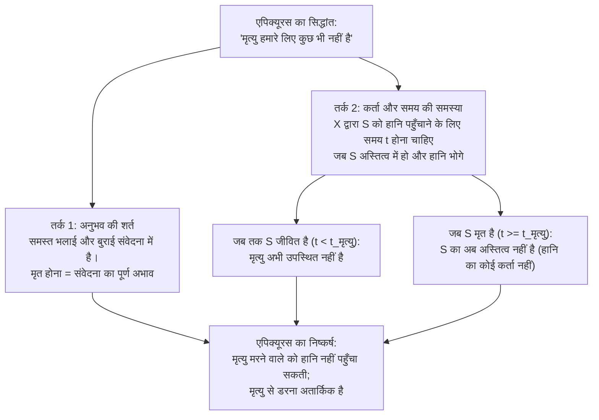
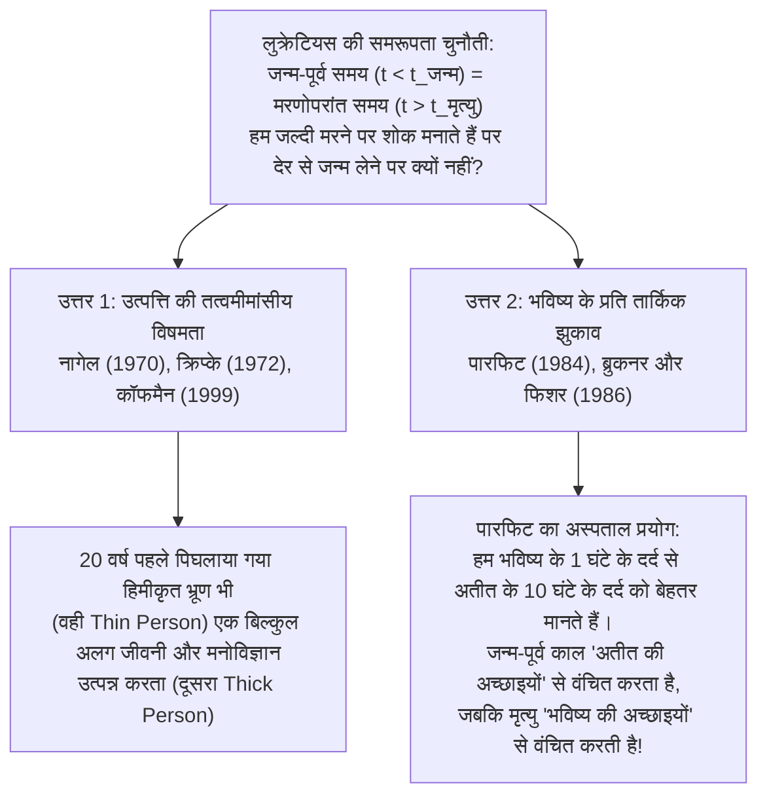

## 1. प्रस्तावना: क्या अपनी मृत्यु से डरना अतार्किक है?

सभी मानवीय भावनाओं में से कुछ ही भावनाएँ इतनी सार्वभौमिक, जैविक रूप से गहरी और अपरिहार्य प्रतीत होती हैं जितना कि <strong>मृत्यु का भय</strong>। यहाँ हमारा तात्पर्य केवल मरने की शारीरिक पीड़ा (*मरने की प्रक्रिया*, *dying*) के डर से नहीं है, बल्कि <strong>मृत होने (*being dead*)</strong> के तथ्य के प्रति अस्तित्वगत आतंक से है: चेतना का अपरिवर्तनीय रूप से बुझ जाना, 'मैं' का अंतिम विनाश, और किसी व्यक्ति के होने से पूर्ण शून्यता में बदल जाना।

फिर भी, दो हज़ार तीन सौ साल से भी पहले, प्राचीन यूनानी दार्शनिक <strong>एपिक्यूरस</strong> (Epicurus, 341–270 ईसा पूर्व) ने अपने प्रसिद्ध *'मेनोइकियस के नाम पत्र'* (*Letter to Menoeceus*) में दर्शनशास्त्र के इतिहास के सबसे चौंकाने वाले और तार्किक रूप से अचूक तर्कों में से एक प्रस्तुत किया: <strong>हमारी अपनी मृत्यु हमें बिल्कुल भी कोई हानि नहीं पहुँचा सकती, इसलिए मृत्यु से डरना पूरी तरह से अतार्किक है</strong>। इसके कुछ समय बाद, रोमन कवि और दार्शनिक <strong>लुक्रेटियस</strong> (Lucretius, लगभग 99–55 ईसा पूर्व) ने अपने महाकाव्य *डी रेरम नेचुरा* (*De rerum natura* — *वस्तुओं की प्रकृति पर*) में अपने प्रसिद्ध <strong>समरूपता तर्क (Symmetry Argument)</strong> के माध्यम से इस विचार को और मज़बूत किया: हमारे जन्म से पहले बीता हुआ अनंत समय हमारी मृत्यु के बाद आने वाले अनंत समय के बिल्कुल समान है; चूँकि हम अपने जन्म-पूर्व अस्तित्वहीनता को पीछे मुड़कर देखने में कोई आतंक या दुख महसूस नहीं करते, तो हमें अपनी मरणोपरांत अस्तित्वहीनता की ओर आगे देखने में भय क्यों महसूस करना चाहिए?

समकालीन विश्लेषणात्मक दर्शन (Analytic Philosophy) में — <strong>थॉमस नागेल</strong> (Thomas Nagel) के युगांतरकारी निबंध *'Death'* (1970) से प्रेरित होकर और <strong>फ्रेड फेल्डमैन</strong> (Fred Feldman), <strong>जेफ मैकमाहन</strong> (Jeff McMahan), <strong>डेरेक पारफिट</strong> (Derek Parfit), <strong>एंथनी ब्रुकनर</strong> (Anthony Brueckner), <strong>जॉन मार्टिन फिशर</strong> (John Martin Fischer) तथा <strong>बर्नार्ड विलियम्स</strong> (Bernard Williams) जैसे विचारकों द्वारा समृद्ध किए जाने के बाद — एपिक्यूरस की यह प्राचीन चुनौती अत्यंत सूक्ष्म तत्वमीमांसीय और मूल्यमीमांसीय (axiological) जांच का क्षेत्र बन गई है। यह लेख मृत्यु के दर्शन की तीन प्रमुख पहेलियों का कठोर विश्लेषण करता है:

1. <strong>अनुभव, कर्ता और समय की समस्या</strong>: मृत्यु किसी व्यक्ति के लिए बुरी कैसे हो सकती है यदि वह व्यक्ति मृत होने की स्थिति का अनुभव ही नहीं कर सकता और जब वह मृत होता है तब उसका अस्तित्व ही नहीं रहता? (एपिक्यूरस बनाम नागेल और फेल्डमैन का <strong>वंचन सिद्धांत / Deprivation Account</strong>)।
2. <strong>लुक्रेटियस की समरूपता पहेली</strong>: यदि मृत्यु इसलिए बुरी है क्योंकि वह हमें उस जीवन-समय से वंचित करती है जो हम जी सकते थे, तो हम इस बात पर समान रूप से शोक क्यों नहीं मनाते कि हमारा जन्म और पहले क्यों नहीं हुआ? (नागेल की उत्पत्ति की अनिवार्यता बनाम पारफिट और ब्रुकनर/फिशर का <strong>भविष्य के प्रति तार्किक झुकाव</strong>)।
3. <strong>अमरता की दुविधा</strong>: यदि मृत्यु इसलिए बुरी है क्योंकि वह जीवन की अच्छाइयों को समाप्त कर देती है, तो क्या इसका अर्थ यह है कि हमेशा के लिए जीवित रहना सर्वोच्च भलाई होगी, या फिर अनंत अमरता एक असहनीय अभिशाप बन जाएगी? (बर्नार्ड विलियम्स का <strong>माक्रोपुलोस प्रकरण / The Makropulos Case</strong>)।

---

## 2. एपिक्यूरस की चुनौती: «मृत्यु हमारे लिए कुछ भी नहीं है»

अपने *मेनोइकियस के नाम पत्र* में, एपिक्यूरस ऐसी पंक्तियाँ लिखते हैं जो सदियों से मृत्यु के आतंक के विरुद्ध एक तार्किक मंत्र की तरह गूँजती रही हैं:

> «अपने आप को यह मानने की आदत डालो कि <strong>मृत्यु हमारे लिए कुछ भी नहीं है</strong> (*ὁ θάνατος οὐδὲν πρὸς ἡμᾶς*)। क्योंकि समस्त भलाई और बुराई संवेदना (अनुभव) में निहित है, और मृत्यु समस्त संवेदनाओं का अभाव है [...]। इसलिए, बुराइयों में सबसे भयावह समझी जाने वाली मृत्यु हमारे लिए कुछ भी नहीं है, क्योंकि <strong>जब तक हम हैं, मृत्यु उपस्थित नहीं है, और जब मृत्यु उपस्थित होती है, तब हम नहीं रहते</strong>। अतः इसका न तो जीवितों से कोई संबंध है और न ही मृतकों से, क्योंकि जीवितों के लिए यह अभी है नहीं, और मृतक स्वयं अब अस्तित्व में नहीं हैं।»

मृत्यु के विश्लेषणात्मक दर्शन में, एपिक्यूरस की आलोचना को आमतौर पर दो अलग-अलग लेकिन गहराई से जुड़े तर्कों के माध्यम से पुनर्गठित किया जाता है: <strong>अनुभव का तर्क</strong> (सुखवाद / Hedonism पर आधारित) और <strong>कर्ता तथा समय के अभाव का तर्क</strong> (*The Subject / Timing Problem*)।

### 2.1. अनुभव के तर्क (सुखवाद) का औपचारिक पुनर्गठन

1. <strong>आधार वाक्य 1 (अनुभव का सिद्धांत / आंतरिक सुखवाद)</strong>: कोई स्थिति या घटना $E$ किसी कर्ता $S$ के लिए आंतरिक रूप से तभी और केवल तभी बुरी होती है जब $E$ के कारण $S$ को अप्रिय या कष्टदायक मानसिक अवस्थाओं (शारीरिक दर्द या मानसिक पीड़ा) का अनुभव हो।
2. <strong>आधार वाक्य 2 (विनाश का सिद्धांत)</strong>: मृत्यु चेतना और संवेदना तथा अनुभव की समस्त क्षमताओं का पूर्ण और अपरिवर्तनीय अंत है ($\text{मृत होना} \implies \neg\text{अनुभव}(S)$)।
3. <strong>आधार वाक्य 3</strong>: इसलिए, मृत होने की अवस्था $S$ में कोई भी कष्टदायक या अप्रिय अनुभव उत्पन्न नहीं कर सकती।
4. <strong>निष्कर्ष</strong>: <strong>मृत होना $S$ के लिए आंतरिक रूप से बुरा नहीं हो सकता।</strong>

### 2.2. कर्ता और समय की समस्या (*The Timing Problem*) का औपचारिक पुनर्गठन

भले ही हम कठोर सुखवाद को छोड़ दें, एपिक्यूरस हमारे सामने एक दूसरा और कहीं अधिक गहरा तत्वमीमांसीय जाल बिछाते हैं: <strong>मृत्यु की हानि कौन उठाता है और वह इसे कब (*किस समय-बिंदु $t$ पर*) उठाता है?</strong>

1. <strong>आधार वाक्य 1 (कर्ता और समय के अस्तित्व की शर्त)</strong>: किसी भी घटना या अवस्था $E$ के किसी कर्ता $S$ के लिए बुरा (हानि या दुर्भाग्य) होने के लिए, एक ऐसा समय-बिंदु $t$ होना चाहिए कि:
   - (क) समय $t$ पर $S$ का अस्तित्व हो, और
   - (ख) $E$ के कारण समय $t$ पर $S$ के कल्याण (well-being) में गिरावट आए।
2. <strong>आधार वाक्य 2 (कर्ता और मृत्यु का पारस्परिक अपवर्जन)</strong>: मान लीजिए $t_{\text{मृत्यु}}$ कर्ता $S$ की मृत्यु का क्षण है:
   - प्रत्येक क्षण $t < t_{\text{मृत्यु}}$ के लिए (जब तक $S$ जीवित है), मृत्यु अभी घटित नहीं हुई है; इसलिए मृत होने की अवस्था अभी $S$ को कोई हानि नहीं पहुँचाती।
   - प्रत्येक क्षण $t \ge t_{\text{मृत्यु}}$ के लिए (जब $S$ मर चुका है), $S$ का अब अस्तित्व ही नहीं है ($\neg\exists S\text{ समय }t\text{ पर}$)। और जिसका अस्तित्व ही नहीं है, उसका कल्याण-स्तर नकारात्मक नहीं हो सकता और न ही वह किसी हानि का पात्र हो सकता है।
3. <strong>निष्कर्ष</strong>: ऐसा कोई भी समय-बिंदु $t$ नहीं है जिस पर मृत्यु $S$ के लिए बुरी हो। अतः मरने वाले के लिए मृत्यु बुरी नहीं हो सकती।

---

## 3. थॉमस नागेल का खंडन और वंचन सिद्धांत (*Deprivation Account*)

अपने प्रसिद्ध लेख *'Death'* (1970, जिसे बाद में *Mortal Questions*, 1979 में शामिल किया गया) में, <strong>थॉमस नागेल</strong> ने सिद्ध किया कि एपिक्यूरस का आकर्षक निष्कर्ष इस बात की अत्यंत संकीर्ण समझ पर टिका है कि किसी मनुष्य के लिए क्या अच्छा या बुरा होता है। नागेल के उत्तर ने समकालीन विश्लेषणात्मक दर्शन में सबसे प्रमुख सिद्धांत को जन्म दिया: <strong>मृत्यु की बुराई का वंचन सिद्धांत</strong> (*Deprivation Account of the Badness of Death*)।

### 3.1. आंतरिक बुराई बनाम बाह्य (तुलनात्मक) बुराई

वंचन सिद्धांत का मुख्य बिंदु उन दो बिल्कुल अलग तरीकों के बीच अंतर करना है जिनसे कोई चीज़ किसी व्यक्ति के लिए बुरी हो सकती है:

- <strong>आंतरिक (या सकारात्मक) बुराई</strong>: ऐसी अवस्था जिसकी सक्रिय उपस्थिति अपने आप में बुरी हो, जैसे तीव्र माइग्रेन का दर्द या गहरी मानसिक यातना का अनुभव करना।
- <strong>बाह्य (तुलनात्मक या वंचनकारी) बुराई</strong>: ऐसी घटना या अवस्था जो अपने आप में दर्दनाक नहीं है, लेकिन कर्ता $S$ के लिए इसलिए बुरी है क्योंकि <strong>वह उसे उन आंतरिक अच्छाइयों को प्राप्त करने से रोकती है या उनसे वंचित कर देती है जिनका वह अन्यथा आनंद लेता</strong>।

मृत्यु कोई आंतरिक बुराई नहीं है (कोई यह दावा नहीं करता कि मृत होने में *दर्द होता है*), बल्कि यह <strong>सर्वोच्च बाह्य और तुलनात्मक बुराई</strong> है: यह इसलिए बुरी है क्योंकि <strong>यह हमें जीवन और उन सभी मूल्यवान अनुभवों, योजनाओं, प्रेम, मित्रता और आनंदों से वंचित कर देती है जो हमें तब मिलते यदि हम जीवित रहते</strong>।

### 3.2. संभावित लोकों (Possible Worlds) के माध्यम से सूत्रबद्धता और जीवन-कल्याण की गणना

दार्शनिक <strong>फ्रेड फेल्डमैन</strong> ने अपनी प्रभावशाली पुस्तक *Confrontations with the Reaper* (1992) में डेविड लुईस और रॉबर्ट स्टालनाकर के संभावित लोकों के अर्थविज्ञान (possible worlds semantics) का उपयोग करते हुए वंचन सिद्धांत को गणितीय रूप से स्पष्ट किया:

मान लीजिए $w_{\text{वास्तविक}}$ वह वास्तविक संसार है जिसमें कर्ता $S$ समय $t_1$ पर (उदाहरण के लिए, 30 वर्ष की आयु में एक दुर्घटना में) मर जाता है, और $w_{\text{निकटतम}}$ वह निकटतम संभावित संसार (closest possible world) है जिसमें वह घातक घटना नहीं घटती और $S$ समय $t_2$ तक (उदाहरण के लिए, 85 वर्ष की आयु तक) जीवित रहता है। यदि हम किसी संसार $w$ में $S$ के जीवन के कुल आंतरिक मूल्य को समय के सापेक्ष उसके तात्कालिक कल्याण $V_S(t, w)$ के समाकलन (integral) के रूप में परिभाषित करें:

$$W(S, w) = \int_{t_{\text{प्रारंभ}}}^{t_{\text{अंत}}(w)} V_S(t, w) \, dt$$

तब समय $t_1$ पर $S$ की मृत्यु की घटना $D$ का समग्र तुलनात्मक मूल्य वास्तविक संसार में $S$ के जीवन के कुल मूल्य और निकटतम प्रति-तथ्यात्मक (counterfactual) संसार में उसके जीवन के कुल मूल्य के अंतर द्वारा दिया जाता है:

$$\text{Value}(D, S) = W(S, w_{\text{वास्तविक}}) - W(S, w_{\text{निकटतम}}) = -\int_{t_1}^{t_2} V_S(t, w_{\text{निकटतम}}) \, dt$$

जब भी वह भावी जीवन जो $S$ ने संसार $w_{\text{निकटतम}}$ में $t_1$ और $t_2$ के बीच जिया होता, अच्छाइयों का सकारात्मक शुद्ध संतुलन रखता है ($\int_{t_1}^{t_2} V_S(t, w_{\text{निकटतम}}) \, dt > 0$), तो परिणाम $\text{Value}(D, S) < 0$ होता है: <strong>समय $t_1$ पर मृत्यु वस्तुनिष्ठ रूप से $S$ के लिए बुरी है</strong>।

यह समीकरण हमारे दैनिक नैतिक अंतर्ज्ञान को तुरंत और सुंदर ढंग से स्पष्ट करता है:
1. <strong>20 वर्ष के युवा की मृत्यु 95 वर्ष के वृद्ध की मृत्यु की तुलना में कहीं अधिक दुखद क्यों है</strong>: क्योंकि 20 वर्ष की आयु में मरने वाले के लिए वंचन का अंतराल $[t_1, t_2]$ और खोई हुई भावी अच्छाइयों का समाकलन कहीं अधिक बड़ा होता है।
2. <strong>मृत्यु कब एक भलाई हो सकती है (तार्किक इच्छामृत्यु)</strong>: यदि प्रति-तथ्यात्मक संसार $w_{\text{निकटतम}}$ में $t_1$ और $t_2$ के बीच का शेष जीवन केवल लाइलाज पीड़ा और आशाहीन यातना से भरा होता ($\int_{t_1}^{t_2} V_S(t, w_{\text{निकटतम}}) \, dt < 0$), तो $-\int_{t_1}^{t_2} V_S$ का चिह्न बदलकर धनात्मक हो जाता है ($\text{Value}(D, S) > 0$)। ऐसी स्थिति में, मृत्यु भावी अच्छाइयों से नहीं बल्कि भावी दुखों से वंचित करती है, और एक तुलनात्मक मुक्ति बन जाती है।

### 3.3. अनुभव की शर्त के विरुद्ध नागेल के तीन प्रति-उदाहरण ("जो आप नहीं जानते वह भी आपको नुकसान पहुँचा सकता है")

एपिक्यूरस के समर्थक अक्सर वंचन सिद्धांत का जवाब लोकप्रिय कहावत *«जो आप नहीं जानते वह आपको चोट नहीं पहुँचा सकता»* (*What you don't know can't hurt you*) का हवाला देकर देते हैं: यदि मृत व्यक्ति को पता ही नहीं है कि उसने क्या खोया है और वह इसके लिए कभी निराशा महसूस नहीं करता, तो वह क्षति उसके लिए वास्तविक बुराई कैसे हो सकती है?

इस धारणा को ध्वस्त करने के लिए कि प्रत्येक बुराई का पीड़ित द्वारा सचेत रूप से अनुभव किया जाना आवश्यक है, नागेल तीन प्रसिद्ध प्रति-उदाहरण (counterexamples) प्रस्तुत करते हैं:

1. <strong>गुप्त विश्वासघात और उपहास</strong>: मान लीजिए कि आपके तथाकथित मित्र आपकी पीठ पीछे आपको धोखा देते हैं और क्रूरता से आपका मज़ाक उड़ाते हैं, लेकिन वे इसे इतनी कुशलता से छिपाते हैं कि आप यह विश्वास करते हुए मर जाते हैं कि वे आपसे प्रेम और सम्मान करते थे, और आपको कभी कोई व्यक्तिनिष्ठ पीड़ा महसूस नहीं होती। क्या इससे वह विश्वासघात आपके लिए बुरा होना बंद हो जाता है? नागेल का कहना है कि नहीं: धोखा दिया जाना और अपमानित होना आपके जीवन के लिए वस्तुनिष्ठ रूप से बुरा है, भले ही आपको इसका कभी पता न चले।
2. <strong>अपरिवर्तनीय मस्तिष्क क्षति जिससे वयस्क शिशु की अवस्था में पहुँच जाए</strong>: कल्पना कीजिए कि एक बुद्धिमान और पूर्ण विकसित वयस्क को गंभीर मस्तिष्क आघात होता है जिससे उसकी मानसिक क्षमताएँ तीन महीने के शिशु के स्तर पर आ जाती हैं। रोगी को अब पता नहीं है कि उसने क्या खोया है: दूध की बोतल मिलने और डायपर बदले जाने पर वह अपने पालने में खुश होकर मुस्कुराता है, और उसे कोई दर्द या कुंठा महसूस नहीं होती। यदि केवल आंतरिक व्यक्तिनिष्ठ अनुभव ही मायने रखता, तो उसकी स्थिति ईर्ष्या के योग्य होती; फिर भी हम सभी मानते हैं कि उस व्यक्ति के साथ एक भयानक त्रासदी हुई है — ठीक इसलिए क्योंकि <strong>वह उस पूर्ण और तार्किक वयस्क जीवन से वंचित हो गया जो वह जी सकता था</strong>।
3. <strong>मृत व्यक्ति से किया गया वादा तोड़ना</strong>: एक व्यक्ति अपना पूरा जीवन किसी कार्य या अपने बच्चों के कल्याण के लिए समर्पित कर देता है और मृत्युशय्या पर अपने मित्र से अपनी अंतिम इच्छा पूरी करने का गंभीर वचन लेता है; उसकी मृत्यु के बाद मित्र निर्लज्जता से उस वचन को तोड़ देता है।

ये उदाहरण प्रकट करते हैं कि किसी व्यक्ति का कल्याण और उसके हित <strong>उसकी त्वचा की सीमाओं या उसकी तात्कालिक चेतना के भीतर कैद नहीं हैं</strong>, बल्कि उसके संपूर्ण जीवन-इतिहास, संसार के साथ उसके वास्तविक संबंधों और उसकी प्रति-तथ्यात्मक संभावनाओं तक फैले हुए हैं।

---

## 4. समय की समस्या (*The Timing Problem*): समकालीन दर्शन में पाँच रणनीतियाँ

भले ही हम यह स्वीकार कर लें कि मृत्यु इसलिए बुरी है क्योंकि वह हमें एक मूल्यवान भविष्य से वंचित करती है, एपिक्यूरस का दूसरा तर्क अभी भी एक सटीक उत्तर की मांग करता है: <strong>व्यक्ति ठीक किस समय-बिंदु $t$ पर मृत्यु की बुराई को भोगता है?</strong> समकालीन विश्लेषणात्मक साहित्य में *Timing Problem* को हल करने के लिए पाँच प्रमुख दृष्टिकोण विकसित हुए हैं:

| दार्शनिक दृष्टिकोण | प्रमुख दार्शनिक | कर्ता $S$ के लिए मृत्यु कब बुरी है? | केंद्रीय विचार और मुख्य आपत्ति |
| :--- | :--- | :--- | :--- |
| <strong>1. कालातीतवाद / शाश्वतवाद</strong> (*Eternalism*) | फ्रेड फेल्डमैन (1992), थॉमस नागेल (1970) | <strong>कालातीत रूप से</strong> (संपूर्ण जीवन के संदर्भ में, बिना किसी विशेष तिथि के) | वास्तविक संसार $w_{\text{वास्तविक}}$ के कुल मूल्य की तुलना निकटतम संसार $w_{\text{निकटतम}}$ से करता है। *आपत्ति*: यह अजीब लगता है कि कोई वास्तविक दुर्भाग्य समय में किसी स्थान के बिना घटित हो। |
| <strong>2. समकालिकतावाद</strong> (*Concurrentism*) | जूलियन लामोंट (1998) | <strong>मृत्यु के ठीक उसी क्षण में</strong> ($t = t_{\text{मृत्यु}}$) | हानि ठीक तब होती है जब घातक घटना जीवन-रेखा को काटती है। *आपत्ति*: यह कारण-प्रहार के क्षण को खोई हुई अच्छाइयों के अभाव की अवधि के साथ मिला देता है। |
| <strong>3. पूर्वकालिकतावाद</strong> (*Priorism*) | जॉर्ज पिचर (1984), जोएल फाइनबर्ग (1984) | <strong>मृत्यु से पहले, जीवन के दौरान</strong> ($t < t_{\text{मृत्यु}}$) | अकाल मृत्यु उन हितों और परियोजनाओं को पूर्वव्यापी रूप से विफल कर देती है जो व्यक्ति के पास *जीवित रहते हुए* थीं। *आपत्ति*: यह 'पश्चगामी कारणता' (*backward causation*) जैसा प्रतीत होता है। |
| <strong>4. उत्तरकालिकतावाद</strong> (*Subsequentism*) | बेन ब्रैडली (2009), नील फेट (2002) | <strong>मृत्यु के बाद, उस समय के दौरान जब वह मृत है</strong> ($t_1 < t \le t_2$) | मृत्यु ठीक उन वर्षों में बुरी है जब कर्ता जीवन का *आनंद ले रहा होता* ($V_S(t, w_{\text{वास्तविक}}) = 0 < V_S(t, w_{\text{निकटतम}})$)। *आपत्ति*: समय $t$ पर अस्तित्व न रखने वाले व्यक्ति का समय $t$ पर कल्याण-स्तर $0$ कैसे हो सकता है? |
| <strong>5. अनिश्चिततावाद</strong> (*Indefinitism*) | थॉमस नागेल (1970), हैरी सिल्वरस्टीन (1980) | <strong>इसका कोई निश्चित कालिक स्थान नहीं है</strong> | चूँकि मृत्यु की बुराई संभावित जीवन के एक पूरे हिस्से के अभाव में निहित है, यह वंचन किसी एक बिंदु पर स्थित हुए बिना कर्ता के इतिहास से संबंधित होता है। |

इन प्रस्तावों में, बेन ब्रैडली के <strong>उत्तरकालिकतावाद (Subsequentism)</strong> (*Well-Being and Death*, 2009) को व्यापक समर्थन मिला है: ब्रैडली का तर्क है कि किसी व्यक्ति को उसकी मृत्यु के बाद के उन दशकों के दौरान शून्य कल्याण-स्तर ($V_S(t, w_{\text{वास्तविक}}) = 0$) प्रदान करने में कोई तत्वमीमांसीय विरोधाभास नहीं है जिनमें निकटतम संभावित संसार $w_{\text{निकटतम}}$ में उसका कल्याण धनात्मक ($V_S(t, w_{\text{निकटतम}}) > 0$) होता। जिस प्रकार हम ठीक-ठीक बता सकते हैं कि पदोन्नति न मिलने से मुझे *कब* नुकसान हुआ (उन महीनों के दौरान जब मुझे कम वेतन मिला), उसी प्रकार हम ठीक-ठीक बता सकते हैं कि 80 वर्ष के बजाय 30 वर्ष की आयु में मरने वाले व्यक्ति को मृत्यु *कब* नुकसान पहुँचाती है: <strong>उसकी 30 से 80 वर्ष की आयु के बीच के 50 वर्षों के दौरान</strong>।

---

## 5. जेफ मैकमाहन का समय-सापेक्ष हित सिद्धांत (*Time-Relative Interest Account*, TRIA)

वंचन सिद्धांत के मानक रूप (जैसे फेल्डमैन का सिद्धांत) को जैव-नीतिशास्त्र (bioethics) में एक गंभीर विरोधाभास का सामना करना पड़ता है। यदि मृत्यु की बुराई केवल खोए हुए सुखद वर्षों की कुल संख्या ($\int_{t_1}^{t_2} V_S(t) \, dt$) पर निर्भर करती, तो <strong>एक सप्ताह के भ्रूण (embryo) या तीन महीने के गर्भस्थ शिशु (fetus) की मृत्यु 25 वर्षीय युवा की मृत्यु से कहीं बड़ी त्रासदी होती</strong>, क्योंकि भ्रूण भविष्य के 80 वर्ष खोता है जबकि 25 वर्षीय युवा केवल 55 वर्ष खोता है। फिर भी, लगभग हर कोई यह मानता है कि 25 वर्षीय व्यक्ति — जिसके पास योजनाएँ, यादें, गहरे संबंध और आत्म-चेतना है — की मृत्यु स्वयं पीड़ित के लिए प्रारंभिक गर्भपात की तुलना में कहीं अधिक भयानक त्रासदी है। क्यों?

इस समस्या को हल करने के लिए, <strong>जेफ मैकमाहन</strong> ने अपनी प्रसिद्ध पुस्तक *The Ethics of Killing* (2002) में <strong>समय-सापेक्ष हित सिद्धांत</strong> (*Time-Relative Interest Account*, <strong>TRIA</strong>) विकसित किया। डेरेक पारफिट के व्यक्तिगत तादात्म्य (personal identity) के सिद्धांत से प्रेरणा लेते हुए, मैकमाहन का तर्क है कि समय $t_1$ पर किसी व्यक्ति $S$ के लिए मृत्यु कितनी बुरी है, इसका आकलन करने के लिए केवल $t_1$ और $t_2$ के बीच की भावी अच्छाइयों को जोड़ना पर्याप्त नहीं है: हमें समय $t$ पर प्रत्येक भावी अच्छाई को <strong>मनोवैज्ञानिक एकता की मात्रा (स्मृति, चरित्र, इच्छाओं और इरादों की संबद्धता और निरंतरता) $\mathcal{R}(t_1, t) \in [0, 1]$</strong> से भारित (weight) करना चाहिए जो समय $t_1$ के कर्ता और समय $t$ के उसके भावी स्वरूप के बीच होती:

$$\text{Badness}_{\text{TRIA}}(D, S, t_1) = \int_{t_1}^{t_2} V_S(t, w_{\text{निकटतम}}) \cdot \mathcal{R}(t_1, t) \, dt$$

- एक <strong>प्रारंभिक भ्रूण या गर्भस्थ शिशु</strong> में अभी कोई मानसिक जीवन, यादें या परियोजनाएँ नहीं होतीं; इसलिए 30 वर्ष बाद बनने वाले वयस्क के साथ उसकी मनोवैज्ञानिक एकता का संबंध लगभग शून्य ($\mathcal{R}(t_1, t) \approx 0$) होता है। यद्यपि खोए हुए जीवन की कुल मात्रा बहुत बड़ी है, उस भविष्य में भ्रूण का *समय-सापेक्ष हित* अत्यंत दुर्बल है।
- इसके विपरीत, <strong>10 वर्ष के बच्चे या 20 वर्ष के युवा</strong> में खोए हुए भविष्य की मात्रा ($t_2 - t_1$) और अपने भावी स्वरूप के साथ मनोवैज्ञानिक संबंध की प्रबलता $\mathcal{R}(t_1, t)$ दोनों अधिकतम ($\mathcal{R}(t_1, t) \approx 1$) होते हैं। यही कारण है कि युवावस्था या प्रारंभिक वयस्कता में मृत्यु जीवन-त्रासदी के शिखर का प्रतिनिधित्व करती है।

---

## 6. लुक्रेटियस की समरूपता पहेली (*The Lucretian Symmetry Puzzle*)

अब हम मृत्यु के दर्शन की सबसे रोचक पहेली पर आते हैं। *डी रेरम नेचुरा* की तीसरी पुस्तक (पंक्तियाँ 832–842 और 972–975) में, रोमन एपिक्यूरियन कवि <strong>लुक्रेटियस</strong> अपना प्रसिद्ध <strong>दर्पण (या समरूपता) का तर्क</strong> प्रस्तुत करते हैं:

> «पीछे मुड़कर देखो और विचार करो कि हमारे जन्म से पहले बीते हुए अनंत काल का पूरा विस्तार हमारे लिए कुछ भी नहीं था। प्रकृति इसे हमारी अंतिम मृत्यु के बाद आने वाले भविष्य के समय के एक दर्पण (*speculum*) के रूप में हमारे सामने रखती है।»

मान लीजिए कि किसी व्यक्ति का जन्म वर्ष 1980 में होता है और उसकी मृत्यु वर्ष 2060 में होती है।
- वर्ष 1980 से पहले <strong>जन्म-पूर्व अस्तित्वहीनता</strong> ($t < 1980$) का एक अनंत काल है।
- वर्ष 2060 के बाद <strong>मरणोपरांत अस्तित्वहीनता</strong> ($t > 2060$) का एक अनंत काल है।

यदि वंचन सिद्धांत के समर्थक (जैसे नागेल और फेल्डमैन) यह कहने में सही हैं कि 2080 तक जीने के बजाय 2060 में मरना इसलिए बुरा है क्योंकि यह <strong>हमें 2060 और 2080 के बीच के 20 वर्षों की अच्छाइयों से वंचित करता है</strong>, तो लुक्रेटियस पूछते हैं: <strong>तो फिर 1960 के बजाय 1980 में जन्म लेना ठीक उतना ही बुरा क्यों नहीं है, जिसने हमें 1960 और 1980 के बीच के 20 वर्षों की अच्छाइयों से वंचित कर दिया?</strong>

वास्तव में, हम सभी एक <strong>गहरी भावनात्मक और मूल्यांकनात्मक विषमता (asymmetry)</strong> प्रदर्शित करते हैं: हम अपने जन्म से पहले की सदियों को शांति या उदासीनता से देखते हैं, लेकिन अपनी मृत्यु के बाद के उस समय को पीड़ा या भय से देखते हैं जिसे हम नहीं जी पाएँगे। क्या यह विषमता एक अतार्किक असंगति है (जैसा कि लुक्रेटियस मानते थे), या जन्म-पूर्व अतीत और मरणोपरांत भविष्य के बीच कोई गहरा तत्वमीमांसीय या तार्किक अंतर है?

### 6.1. थॉमस नागेल का तत्वमीमांसीय उत्तर: उत्पत्ति की अनिवार्यता

<strong>थॉमस नागेल</strong> का उत्तर (जिसे सॉल क्रिप्के की पुस्तक *Naming and Necessity*, 1972 के *उत्पत्ति की अनिवार्यता* के सिद्धांत से समर्थन मिलता है) <strong>तत्वमीमांसीय (modal)</strong> प्रकृति का है:

- <strong>मृत्यु की तिथि आकस्मिक (contingent) है</strong>: वही व्यक्ति जो 2060 में मरा, संख्यात्मक रूप से स्वयं बने रहते हुए *अधिक समय तक (2080 तक) जीवित रह सकता था*। एक वास्तविक संभावित संसार है जिसमें *मैं* बीस वर्ष और अधिक जीता हूँ।
- <strong>जन्म (और गर्भाधान) की तिथि अनिवार्य (essential) है</strong>: कोई भी व्यक्ति अपने वास्तविक जन्म के समय से <strong>काफी पहले पैदा नहीं हो सकता था</strong>, क्योंकि किसी व्यक्ति की आनुवंशिक और जैविक पहचान उस विशिष्ट अंडाणु और शुक्राणु पर निर्भर करती है जिससे वह उत्पन्न हुआ है। 1980 के बजाय 1960 या 18वीं शताब्दी में पैदा होने वाला कोई भी व्यक्ति <strong>मैं नहीं होता, बल्कि कोई बिल्कुल अलग व्यक्ति होता</strong>। इसलिए, 1980 से पहले का समय ऐसा समय नहीं है जिससे *मुझे* वंचित किया गया हो, क्योंकि उस समय मेरा अस्तित्व ही संभव नहीं था।

### 6.2. हिमीकृत भ्रूण (Frozen Embryo) की आपत्ति और फ्रेडरिक कॉफमैन का उत्तर ('Thin Person' बनाम 'Thick Person')

किंतु आधुनिक जैव-नीतिशास्त्र ने नागेल के जैविक तर्क के सामने एक कड़ी चुनौती खड़ी कर दी। कल्पना कीजिए कि <strong>1980 में इन-विट्रो निषेचित (IVF) एक भ्रूण</strong> को तरल नाइट्रोजन में हिमीकृत (cryopreserved) कर दिया जाता है। वास्तविक संसार में, उसे वर्ष <strong>2000</strong> में पिघलाकर गर्भ में प्रत्यारोपित किया जाता है और उसका जन्म उसी वर्ष होता है। लेकिन तत्वमीमांसीय और जैविक रूप से यह पूरी तरह संभव था कि *ठीक उसी भ्रूण* (समान डीएनए और युग्मक उत्पत्ति वाले) को <strong>1980</strong> में ही पिघलाकर प्रत्यारोपित कर दिया जाता, जिससे उसका जन्म बीस वर्ष पहले हो जाता। यह जानने के बाद भी कि उसका भ्रूण बीस वर्षों तक फ्रीजर में बंद रहा, क्या वह व्यक्ति 1980–2000 के वर्षों को खोने पर उसी तरह फूट-फूटकर शोक मनाता है जिस तरह वह समय से बीस वर्ष पहले मरने से डरता है? बिल्कुल नहीं!

हिमीकृत भ्रूण के मामले में नागेल का बचाव करने के लिए, <strong>फ्रेडरिक कॉफमैन</strong> (Frederik Kaufman, 1999) ने दो अवधारणाओं के बीच अंतर किया:
- <strong>सूक्ष्म अर्थ में व्यक्ति (*Thin Person*)</strong>: केवल जैविक जीव या आनुवंशिक आधार (भ्रूण)।
- <strong>सघन अर्थ में व्यक्ति (*Thick Person*)</strong>: ठोस मनोवैज्ञानिक कर्ता, जो अपनी जीवनी संबंधी यादों, भाषा, संस्कृति, मित्रों, मूल्यों और ऐतिहासिक व्यक्तित्व से निर्मित होता है।

कॉफमैन का तर्क है कि यदि उस भ्रूण को बीस वर्ष पहले (2000 के बजाय 1980 में) पिघलाया गया होता, तो वह एक अलग युग में, अलग मित्रों, अलग अनुभवों और अलग जीवन-कथा के साथ बड़ा होता: भले ही वह वही *सूक्ष्म व्यक्ति (thin person)* (वही आनुवंशिक जीव) होता, लेकिन वह एक <strong>बिल्कुल अलग सघन व्यक्ति (thick person — मनोवैज्ञानिक और जीवनी संबंधी व्यक्ति)</strong> होता। जब मैं मृत्यु से डरता हूँ, तो जो जीवित रहना चाहता है वह मेरा *वर्तमान सघन 'मैं'* है, मेरी यादों और परियोजनाओं के साथ; और यह *सघन 'मैं'* मेरे जन्म से बीस वर्ष पहले कभी अस्तित्व में नहीं आ सकता था, लेकिन भविष्य में बीस वर्ष आगे तक विस्तारित हो सकता है।

### 6.3. भविष्य के प्रति तार्किक झुकाव का उत्तर: डेरेक पारफिट, एंथनी ब्रुकनर और जॉन मार्टिन फिशर

एक वैकल्पिक मार्ग — जिसका <strong>एंथनी ब्रुकनर और जॉन मार्टिन फिशर</strong> ने अपने लेख *'Why Is Death Bad?'* (1986) में <strong>डेरेक पारफिट</strong> (*Reasons and Persons*, 1984) के विचारों के आधार पर शानदार ढंग से प्रतिपादन किया — लुक्रेटियस की यह बात मान लेता है कि जन्म-पूर्व वंचन और मरणोपरांत वंचन कालातीत दृष्टिकोण से समरूप हो सकते हैं, लेकिन यह सिद्ध करता है कि मृत्यु के प्रति हमारी विषमता मानवीय तार्किकता की एक मौलिक विशेषता द्वारा स्पष्ट होती है: <strong>अच्छाइयों और बुराइयों के प्रति हमारे तार्किक दृष्टिकोण समय के सापेक्ष असममित हैं (हमारे भीतर भविष्य के प्रति झुकाव / *future-bias* होता है)</strong>।

*Reasons and Persons* के अध्याय 8 में, पारफिट अपना प्रसिद्ध विचार-प्रयोग <strong>«अस्पताल का ऑपरेशन» (*My Past or Future Operations*)</strong> प्रस्तुत करते हैं:

> आप अस्पताल के बिस्तर पर जागते हैं और आपको अस्थायी रूप से याद नहीं है कि आज कौन सा दिन है। आप जानते हैं कि इस अस्पताल में बिना एनेस्थीसिया के एक अत्यंत दर्दनाक सर्जरी की जाती है (क्योंकि एनेस्थीसिया जानलेवा होगा), लेकिन सर्जरी के बाद एक ऐसी दवा दी जाती है जो दर्द की पूरी याद मिटा देती है। आप नर्स से पूछते हैं कि क्या आपका ऑपरेशन हो चुका है। नर्स दो संभावित फाइलें देखती है और कहती है:
> - <strong>स्थिति A (अतीत का रोगी)</strong>: «या तो आप वह रोगी हैं जिसका ऑपरेशन <strong>कल</strong> हुआ था और जिसने <strong>10 घंटे</strong> की असहनीय पीड़ा झेली थी (जिसे आप दवा के कारण अब भूल चुके हैं)...»
> - <strong>स्थिति B (भविष्य का रोगी)</strong>: «...या फिर आप वह रोगी हैं जिसका ऑपरेशन <strong>आज शाम</strong> किया जाएगा और जिसे <strong>1 घंटे</strong> की असहनीय पीड़ा झेलनी होगी।»

आप इन दोनों में से किस खबर के सच होने की तीव्र कामना करेंगे? <strong>बिना किसी अपवाद के हर व्यक्ति भारी राहत के साथ स्थिति B (भविष्य के 1 घंटे के दर्द) की तुलना में स्थिति A (अतीत में बीत चुके 10 घंटे के दर्द) को चुनता है।</strong> हम *भविष्य* के दुखों और सुखों के प्रति प्रत्यक्ष और गहरी चिंता रखते हैं, जबकि उन दुखों और सुखों के प्रति सापेक्ष रूप से उदासीन रहते हैं *जो अतीत में पीछे छूट चुके हैं*।

ब्रुकनर और फिशर इसी समरूप सिद्धांत को <strong>जीवन के सुखों और अच्छाइयों</strong> पर लागू करते हैं:
- कल्पना कीजिए कि आपको बताया जाता है कि आपके जीवन में असाधारण आनंद के 1,000 दिन हैं: एक परिदृश्य में, वे 1,000 दिन <strong>आपके अतीत में पहले ही बीत चुके हैं</strong> (और आप उन्हें भूल चुके हैं); दूसरे परिदृश्य में, वे 1,000 दिन <strong>आपके भविष्य में आने वाले हैं</strong>। तार्किक रूप से, हम सभी अच्छाइयों को *पीछे* (अतीत में) होने के बजाय *आगे* (भविष्य में) होना पसंद करते हैं।
- अब देखिए: <strong>देर से जन्म लेना</strong> हमें केवल *अतीत की अच्छाइयों* (ऐसे अनुभव जो आज तक समाप्त होकर पीछे छूट चुके होते) से वंचित करता है, जबकि <strong>जल्दी मरना</strong> हमें *भविष्य की अच्छाइयों* (ऐसे अनुभव जो हमारे सामने आने वाले होते) से वंचित करता है। फलस्वरूप, जन्म-पूर्व शून्यता के प्रति उदासीन रहते हुए मरणोपरांत मृत्यु पर शोक मनाना <strong>कोई अतार्किक विरोधाभास नहीं है</strong>, बल्कि भविष्य की ओर हमारे कालिक उन्मुखीकरण का सीधा परिणाम है।

---

## 7. क्या अमरता एक वरदान होगी? बर्नार्ड विलियम्स और माक्रोपुलोस प्रकरण

यदि मृत्यु इसलिए बुरी है क्योंकि वह हमारा भविष्य छीन लेती है और हमारी परियोजनाओं को अधूरा छोड़ देती है, तो तार्किक रूप से ऐसा प्रतीत होगा कि <strong>सर्वोच्च आदर्श कभी न मरना होगा: अनंत अमरता ($t_{\text{अंत}} \to \infty$) प्राप्त करना</strong>। फिर भी, 20वीं शताब्दी के सबसे प्रतिभाशाली और प्रभावशाली दार्शनिक निबंधों में से एक, *'The Makropulos Case: Reflections on the Tedium of Immortality'* (1973) में, ब्रिटिश दार्शनिक <strong>बर्नार्ड विलियम्स</strong> ने एक क्रांतिकारी विचार प्रस्तुत किया: यद्यपि मृत्यु प्रायः बहुत जल्दी आती है और किसी भी विशिष्ट क्षण में एक बुराई होती है, फिर भी <strong>अनंत अमरता एक असहनीय अभिशाप होगी</strong>।

### 7.1. एलिना माक्रोपुलोस और 337 वर्ष की आयु में ठहरा हुआ यौवन

विलियम्स ने अपने निबंध का शीर्षक कारेल चापेक (Karel Čapek) के नाटक (जिसे लियोश यानाचेक ने ओपेरा में बदला) *द माक्रोपुलोस केस* से लिया है। इसकी नायिका, ओपेरा गायिका <strong>एलिना माक्रोपुलोस</strong> (जो विभिन्न युगों में <strong>E.M.</strong> आद्याक्षरों वाले अलग-अलग नामों से जानी जाती है), ने 16वीं शताब्दी में <strong>42 वर्ष की आयु</strong> में अपने पिता (सम्राट रुडोल्फ द्वितीय के शाही चिकित्सक) द्वारा तैयार किया गया जीवन-अमृत पिया था। उस अमृत ने तीन सौ वर्षों के लिए उसकी जैविक वृद्धावस्था को रोक दिया।

जब नाटक की घटनाएँ घटती हैं, तब एलिना माक्रोपुलोस की आयु <strong>337 वर्ष</strong> है, लेकिन उसके पास 42 वर्षीय महिला का शरीर, सौंदर्य और स्वास्थ्य है। वह जोनाथन स्विफ्ट के अमर *स्ट्रल्डब्रग्स (struldbruggs)* की तरह शारीरिक जर्जरता से पीड़ित नहीं है; फिर भी उसकी आत्मा <strong>विरक्ति, बर्फीलेपन और अथाह ऊब (*tedium*)</strong> की अवस्था में डूब चुकी है। उसने दर्जनों बार प्रेम किया है, सभी राजनीतिक आंदोलनों का उत्थान और पतन देखा है, कला में पूर्णता प्राप्त की है, और अब उसकी आँखों के सामने घटने वाली हर घटना उसे खोखले साँचों की यांत्रिक पुनरावृत्ति लगती है। जैसा कि विलियम्स लिखते हैं, उसके भीतर «सब कुछ ठंडा, विशाल और शून्य हो गया है»। अंत में, जब उसे तीन सौ साल और जीने के लिए फिर से वह सूत्र लेने का प्रस्ताव दिया जाता है, तो <strong>एलिना दृढ़ता से इनकार कर देती है, उस नुस्खे को जला देती है, और गहरी राहत के साथ मर जाती है</strong>।

### 7.2. सशर्त इच्छाएँ बनाम निरपेक्ष (Categorical) इच्छाएँ और अमरता की दुविधा

यह सिद्ध करने के लिए कि एलिना माक्रोपुलोस की नियति कोई आकस्मिक मनोवैज्ञानिक घटना नहीं बल्कि मानवीय स्थिति की संरचनात्मक अनिवार्यता है, विलियम्स दो प्रकार की इच्छाओं के बीच एक मौलिक अंतर प्रस्तुत करते हैं:

1. <strong>सशर्त इच्छाएँ (*Conditional Desires*)</strong>: ऐसी इच्छाएँ जो *«यदि मैं जीवित रहूँगा...»* की शर्त मानकर चलती हैं (उदाहरण के लिए: *«यदि मैं कल जीवित रहा, तो मैं अच्छा भोजन करना चाहता हूँ, ठंड से बचना चाहता हूँ और आरामदायक कपड़े पहनना चाहता हूँ»*)। सशर्त इच्छाएँ जीवन की पूर्व-कल्पना करती हैं, लेकिन <strong>हमें जीवित रहने की इच्छा करने का कोई कारण नहीं देतीं</strong>।
2. <strong>निरपेक्ष इच्छाएँ (*Categorical Desires*)</strong>: गहरी परियोजनाएँ, जुनून, प्रेम और प्रतिबद्धताएँ जो जीवित रहने की शर्त पर निर्भर नहीं करतीं, बल्कि <strong>इस प्रश्न का उत्तर देती हैं कि आगे जीवित रहना क्यों सार्थक है</strong> (उदाहरण के लिए: किसी वैज्ञानिक खोज को पूरा करना, बच्चे का पालन-पोषण करना, न्याय के लिए लड़ना, या कोई महान कृति लिखना)। हमारी निरपेक्ष इच्छाएँ ही हमें भविष्य की ओर प्रेरित करती हैं और मृत्यु को बुरा बनाती हैं क्योंकि मृत्यु उन्हें बीच में ही तोड़ देती है।

यहाँ से विलियम्स <strong>अमरता की दुविधा</strong> सूत्रबद्ध करते हैं: किसी अमर जीवन के मेरे लिए वांछनीय होने के लिए उसे एक साथ दो शर्तों को पूरा करना होगा:
- <strong>शर्त 1 (ऊब का अभाव)</strong>: उसे निरंतर ऐसी निरपेक्ष इच्छाएँ उत्पन्न करते रहना चाहिए जो मुझे E.M. की अनंत ऊब में गिरे बिना जीवन में रुचि बनाए रखें।
- <strong>शर्त 2 (पहचान का संरक्षण)</strong>: उस भावी अस्तित्व को जीने वाला व्यक्ति *वास्तव में मैं* ही होना चाहिए, अर्थात मेरे चरित्र, मूल्यों और व्यक्तिगत पहचान के साथ उसकी एक पहचानने योग्य निरंतरता बनी रहनी चाहिए।

विलियम्स का तर्क है कि अनंत समय ($t \to \infty$) में ये दोनों शर्तें <strong>परस्पर असंगत</strong> हैं:

$$\begin{cases} \text{शाखा A (निश्चित और स्थिर चरित्र)} \implies \text{संभावित अनुभवों का रीतना} \implies \text{अपरिहार्य ऊब (माक्रोपुलोस प्रकरण)} \\ \text{शाखा B (चरित्र और स्मृति का आमूलचूल और निरंतर परिवर्तन)} \implies \text{मनोवैज्ञानिक निरंतरता का टूटना} \implies \text{'मैं' का लोप (मृत्यु के समान)} \end{cases}$$

- <strong>शाखा A</strong>: यदि मेरा एक निश्चित मानवीय चरित्र है (जिसकी अपनी रुचियाँ, स्वभाव और सीमाएँ हैं), तो सदियों और सहस्राब्दियों के बाद मैं उस चरित्र के अनुकूल अनुभवों के सभी संयोजनों को जी चुका होऊँगा। नवीनता समाप्त हो जाएगी और मैं अनिवार्य रूप से एलिना माक्रोपुलोस की बर्फीली ऊब में गिर जाऊँगा।
- <strong>शाखा B</strong>: यदि ऊब से बचने के लिए हर दो सौ साल में मेरे व्यक्तित्व, यादों और मूल्यों को पूरी तरह मिटाकर बिल्कुल नए व्यक्तित्व और यादों से बदल दिया जाए, तो दस हज़ार साल बाद अस्तित्व में रहने वाले प्राणी का मुझसे किसी अजनबी से अधिक मनोवैज्ञानिक संबंध नहीं होगा। उसमें *मैं* जीवित नहीं बचूँगा: बस एक ही शरीर में अलग-अलग व्यक्तियों की एक श्रृंखला निवास करेगी।

### 7.3. जॉन मार्टिन फिशर का प्रत्युत्तर: समाप्त होने वाले सुख बनाम दोहराए जाने योग्य सुख

सभी समकालीन दार्शनिक अमरता के बारे में बर्नार्ड विलियम्स के निराशावाद को स्वीकार नहीं करते। <strong>जॉन मार्टिन फिशर</strong> अपने लेख *'Why Immortality Is Not So Bad'* (1994) में तर्क देते हैं कि विलियम्स दो गलतियाँ करते हैं:

1. <strong>स्वयं-समाप्त होने वाले सुख (*self-exhausting pleasures*) बनाम दोहराए जाने योग्य सुख (*repeatable pleasures*)</strong>: विलियम्स जीवन को एक बार की जाने वाली उपलब्धियों की सूची की तरह देखते हैं जो एक बार पूरी होने के बाद अपना आकर्षण खो देती हैं (जैसे पहली बार माउंट एवरेस्ट पर चढ़ना)। लेकिन जीवन को सार्थक बनाने वाले अनुभवों का एक बड़ा हिस्सा <strong>आंतरिक रूप से दोहराए जाने योग्य</strong> होता है और कभी अपना मूल्य नहीं खोता: बाख के सेलो सुइट्स सुनना, सूर्यास्त के समय महासागर को निहारना, किसी प्रिय मित्र से बात करना, स्वादिष्ट भोजन, प्रेम या आध्यात्मिक ध्यान का आनंद लेना।
2. <strong>क्रमिक जैविक रूपांतरण</strong>: मानवीय चरित्र को एलिना माक्रोपुलोस की पथरीली जड़ता और पूर्ण आकस्मिक स्मृति-लोप के बीच चुनाव करने की आवश्यकता नहीं है। एक अमर व्यक्ति सदियों के दौरान क्रमिक और स्वाभाविक रूप से विकसित हो सकता है — नए विज्ञान, भाषाएँ और कलाएँ सीखते हुए — और अपने अतीत के साथ मनोवैज्ञानिक निरंतरता की परस्पर जुड़ी कड़ियों को हमेशा बनाए रख सकता है।

---

## 8. निष्कर्ष: जीवन के मूल्य के प्रतिबिंब के रूप में मृत्यु

एथेंस में एपिक्यूरस के उद्यान से लेकर समकालीन विश्लेषणात्मक दर्शन की बहसों तक की इस लंबी यात्रा को तय करने के बाद, हम एक ऐसे गहरे सत्य की खोज करते हैं जो तत्वमीमांसा को अस्तित्वगत प्रज्ञा से जोड़ता है:

1. <strong>एपिक्यूरस एक महत्वपूर्ण बिंदु पर सही थे</strong>: मृत होने की अवस्था कोई अंधेरा कमरा नहीं है जहाँ हमारी आत्मा ठंड, अकेलेपन या सन्नाटे को झेलते हुए कैद रहे। मृत्यु में न कोई अनुभव है और न कोई पीड़ा; मृत्यु से इस तरह डरना मानो हम अपनी शून्यता के स्वयं «साक्षी» बनेंगे, कल्पना का एक भ्रम है।
2. <strong>लेकिन थॉमस नागेल और वंचन सिद्धांत मूल बात में सही हैं</strong>: जब मृत्यु किसी मूल्यवान जीवन को बीच में ही रोक देती है तो वह एक वास्तविक और वस्तुनिष्ठ बुराई होती है — इसलिए नहीं कि वह हमें कुछ *महसूस* कराती है, बल्कि अनुभव, प्रेम, ज्ञान और संभावनाओं के उस पूरे क्षितिज के कारण जिससे <strong>वह हमें वंचित कर देती है</strong>।
3. <strong>लुक्रेटियस का दर्पण और विलियम्स का माक्रोपुलोस प्रकरण इस चित्र को पूर्ण करते हैं</strong>: हम जन्म-पूर्व शून्यता पर नहीं बल्कि भावी मृत्यु पर शोक मनाते हैं क्योंकि हम अपनी निरपेक्ष इच्छाओं के माध्यम से भविष्य की ओर उन्मुख प्राणी हैं; और वास्तव में हमारी <strong>कालिक ससीमता (finitude)</strong> ही हमारे प्रत्येक चुनाव को तात्कालिकता, गहराई और अद्वितीय महत्व प्रदान करती है।

अंततः, <strong>मृत्यु का तार्किक भय जीवन के प्रति हमारे प्रेम की ही परछाईं है</strong>। यदि मृत्यु हमसे कुछ भी मूल्यवान न छीनती, तो स्वयं जीवन का भी कोई मूल्य न होता। दार्शनिक रूप से यह समझना कि मृत्यु एक वंचन क्यों है, हमें निराशा में नहीं धकेलता; इसके विपरीत, यह हमें याद दिलाता है कि हमारे जन्म और मृत्यु के बीच का यह सीमित अंतराल — यह अद्वितीय वर्तमान जिसमें हम अभी भी अस्तित्व में हैं और अभी भी अनुभव कर रहे हैं — सर्वोच्च स्पष्टता, कृतज्ञता और गहनता के साथ जिए जाने योग्य है।
