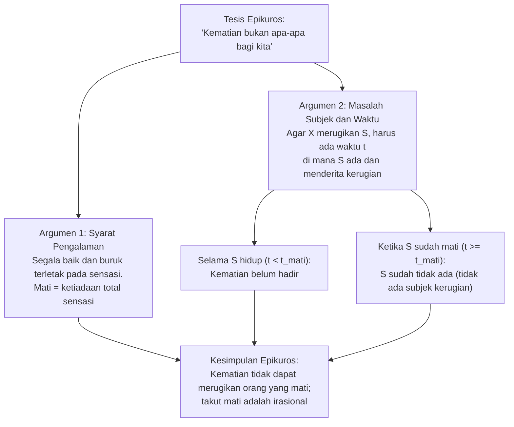
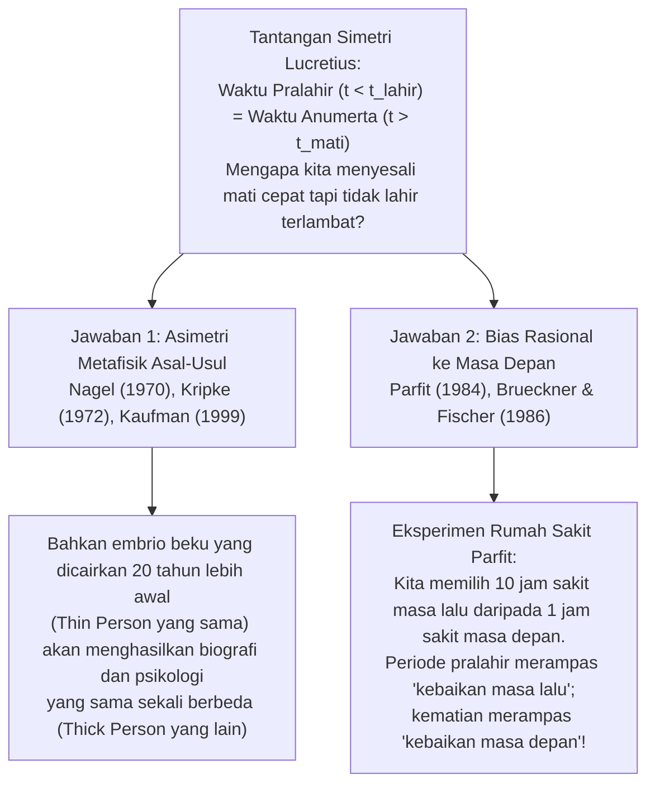

## 1. Pendahuluan: Apakah Takut akan Kematian Sendiri Itu Irasional?

Dari semua emosi manusia, hanya sedikit yang tampak begitu universal, berakar secara biologis, dan tak terelakkan seperti <strong>ketakutan akan kematian</strong>. Yang kita maksud di sini bukan sekadar rasa takut terhadap rasa sakit fisik saat sekarat (*proses menjelang ajal*, *dying*), melainkan kengerian eksistensial terhadap fakta <strong>menjadi mati (*being dead*)</strong> itu sendiri: padamnya kesadaran secara permanen, lenyapnya sang «aku» untuk selamanya, dan peralihan dari menjadi seseorang menjadi ketiadaan mutlak.

Namun, lebih dari dua ribu tiga ratus tahun yang lalu, filsuf Yunani kuno <strong>Epikuros</strong> (341–270 SM) dalam *Surat kepada Menoikeus* yang terkenal merumuskan salah satu argumen paling mencengangkan dan tak terbantahkan secara logis dalam sejarah filsafat: <strong>kematian kita sendiri sama sekali tidak dapat membahayakan atau merugikan kita, sehingga takut akan kematian adalah hal yang sepenuhnya irasional</strong>. Tak lama kemudian, penyair dan filsuf Romawi <strong>Lucretius</strong> (skt. 99–55 SM), dalam puisi epiknya *De rerum natura* (*Tentang Hakikat Segala Sesuatu*), memperkuat tesis ini dengan <strong>argumen simetri</strong> yang terkenal: waktu tak terbatas yang berlalu sebelum kelahiran kita persis identik dengan waktu tak terbatas yang akan mengikuti kematian kita; karena kita tidak merasakan kengerian apa pun saat menoleh ke belakang menuju ketiadaan pralahir kita, mengapa kita harus merasa ngeri saat menatap ke depan menuju ketiadaan anumerta kita?

Dalam filsafat analitis kontemporer — yang dipelopori oleh esai seminal <strong>Thomas Nagel</strong> *«Death»* (1970) dan diperkaya oleh para pemikir seperti <strong>Fred Feldman</strong>, <strong>Jeff McMahan</strong>, <strong>Derek Parfit</strong>, <strong>Anthony Brueckner</strong>, <strong>John Martin Fischer</strong>, dan <strong>Bernard Williams</strong> — tantangan kuno Epikuros ini telah berkembang menjadi bidang penyelidikan metafisika dan aksiologi yang sangat presisi. Artikel ini mengkaji secara ketat tiga teka-teki utama dalam filsafat kematian:

1. <strong>Masalah pengalaman, subjek, dan waktu</strong>: Bagaimana mungkin kematian menjadi sesuatu yang buruk bagi seseorang jika orang tersebut tidak dapat mengalami keadaan mati dan bahkan tidak ada lagi ketika ia mati? (Epikuros vs. <strong>teori deprivasi</strong> Nagel dan <strong>hedonisme atitudinal</strong> Feldman).
2. <strong>Teka-teki asimetri Lucretius</strong>: Jika kematian itu buruk karena merampas waktu hidup yang seharusnya bisa kita miliki, mengapa kita tidak menyesali dengan cara yang sama fakta bahwa kita tidak lahir lebih awal? (Esensialitas asal-usul Nagel vs. <strong>bias rasional terhadap masa depan</strong> dari Parfit dan Brueckner/Fischer).
3. <strong>Dilema keabadian</strong>: Jika kematian adalah keburukan karena memutus kebaikan hidup, apakah itu berarti hidup selamanya akan menjadi kebaikan tertinggi, atau justru keabadian kekal akan berubah menjadi kutukan yang tak tertahankan? (<strong>Kasus Makropulos</strong> dari Bernard Williams).

---

## 2. Tantangan Epikuros: «Kematian Bukan Apa-Apa bagi Kita»

Dalam *Surat kepada Menoikeus*, Epikuros menulis kalimat-kalimat yang telah menggema selama berabad-abad sebagai penawar logis terhadap rasa takut mati:

> «Biasakanlah dirimu untuk berpikir bahwa <strong>kematian bukan apa-apa bagi kita</strong> (*ὁ θάνατος οὐδὲν πρὸς ἡμᾶς*). Sebab segala kebaikan dan keburukan terletak pada indra perasa (sensasi), sedangkan kematian adalah hilangnya seluruh indra perasa [...]. Oleh karena itu, keburukan yang paling mengerikan, yakni kematian, bukanlah apa-apa bagi kita, karena <strong>selama kita ada, kematian belum hadir, dan ketika kematian hadir, maka kita sudah tidak ada lagi</strong>. Dengan demikian, kematian tidak menyangkut orang yang masih hidup maupun orang yang sudah mati, sebab bagi yang hidup kematian belum ada, sedangkan yang mati sudah tidak ada lagi.»

Dalam filsafat analitis tentang kematian, kritik Epikuros biasanya direkonstruksi melalui dua argumen yang berbeda namun saling terkait erat: <strong>argumen pengalaman</strong> (berdasarkan hedonisme aksiologis) dan <strong>argumen ketiadaan subjek dan waktu</strong> (*The Subject / Timing Problem*).

### 2.1. Rekonstruksi Formal Argumen Pengalaman (Hedonisme)

1. <strong>Premis 1 (Prinsip Pengalaman / Hedonisme Intrinsik)</strong>: Suatu keadaan atau peristiwa $E$ secara intrinsik buruk bagi subjek $S$ jika dan hanya jika $E$ menyebabkan $S$ mengalami kondisi mental yang tidak menyenangkan atau menyakitkan (rasa sakit fisik atau penderitaan psikologis).
2. <strong>Premis 2 (Tesis Anihilasi)</strong>: Kematian adalah pemadaman total dan ireversibel atas kesadaran serta seluruh kapasitas sensasi dan pengalaman ($\text{Keadaan mati} \implies \neg\text{Pengalaman}(S)$).
3. <strong>Premis 3</strong>: Oleh karena itu, keadaan mati tidak dapat menyebabkan pengalaman menyakitkan atau tidak menyenangkan apa pun pada $S$.
4. <strong>Kesimpulan</strong>: <strong>Keadaan mati tidak mungkin buruk secara intrinsik bagi $S$.</strong>

### 2.2. Rekonstruksi Formal Masalah Subjek dan Waktu (*The Timing Problem*)

Bahkan jika kita meninggalkan hedonisme ketat, Epikuros memasang jebakan metafisik kedua yang jauh lebih dalam: <strong>siapa yang menderita keburukan kematian dan kapan (*pada saat $t$ mana*) ia menderitanya?</strong>

1. <strong>Premis 1 (Syarat Keberadaan Subjek dan Waktu)</strong>: Agar suatu peristiwa atau keadaan $E$ menjadi buruk (merugikan atau mencelakakan) bagi subjek $S$, harus ada suatu titik waktu $t$ sedemikian rupa sehingga:
   - (a) $S$ eksis pada waktu $t$, dan
   - (b) kesejahteraan $S$ mengalami penurunan pada waktu $t$ akibat $E$.
2. <strong>Premis 2 (Eksklusi Timbal Balik antara Subjek dan Kematian)</strong>: Misalkan $t_{\text{mati}}$ adalah saat kematian $S$:
   - Untuk setiap waktu $t < t_{\text{mati}}$ (selama $S$ masih hidup), kematian belum terjadi; dengan demikian, keadaan mati belum merugikan $S$.
   - Untuk setiap waktu $t \ge t_{\text{mati}}$ (setelah $S$ mati), $S$ sudah tidak ada lagi ($\neg\exists S\text{ pada }t$). Dan sesuatu yang tidak ada tidak dapat memiliki tingkat kesejahteraan negatif maupun menjadi subjek kerugian apa pun.
3. <strong>Kesimpulan</strong>: Tidak ada satu pun titik waktu $t$ di mana kematian menjadi buruk bagi $S$. Oleh karena itu, kematian tidak mungkin buruk bagi orang yang mati.

---

## 3. Bantahan Thomas Nagel dan Teori Deprivasi (*Deprivation Account*)

Dalam artikel terkenalnya *«Death»* (1970, yang kemudian dimuat dalam buku *Mortal Questions*, 1979), <strong>Thomas Nagel</strong> membuktikan bahwa kesimpulan Epikuros yang memikat itu bertumpu pada konsepsi yang terlalu sempit tentang apa yang merupakan kebaikan atau keburukan bagi seorang manusia. Jawaban Nagel melahirkan posisi dominan dalam filsafat analitis kontemporer: <strong>teori deprivasi (perampasan)</strong> (*Deprivation Account of the Badness of Death*).

### 3.1. Keburukan Intrinsik vs. Keburukan Ekstrinsik (Komparatif)

Inti dari teori deprivasi adalah membedakan dua cara yang sangat berbeda di mana sesuatu dapat menjadi buruk bagi seseorang:

- <strong>Keburukan intrinsik (atau positif)</strong>: Suatu keadaan yang kehadirannya secara aktif buruk pada dirinya sendiri, seperti merasakan sakit kepala migrain yang hebat atau mengalami penderitaan batin yang parah.
- <strong>Keburukan ekstrinsik (komparatif atau karena deprivasi)</strong>: Suatu peristiwa atau keadaan yang tidak menyakitkan pada dirinya sendiri, tetapi buruk bagi subjek $S$ karena <strong>menghalanginya mendapatkan atau merampas darinya kebaikan-kebaikan intrinsik yang seandainya peristiwa itu tidak terjadi pasti akan ia nikmati</strong>.

Kematian bukanlah keburukan intrinsik (tidak ada yang mengklaim bahwa menjadi mati itu *terasa sakit*), melainkan <strong>keburukan ekstrinsik dan komparatif yang paling utama</strong>: kematian itu buruk karena <strong>merampas dari kita kehidupan beserta seluruh pengalaman berharga, proyek, cinta, persahabatan, dan kegembiraan yang seharusnya kita miliki seandainya kita tetap hidup</strong>.

### 3.2. Formulasi Melalui Dunia-Dunia Mungkin dan Kalkulus Kesejahteraan Hidup

Filsuf <strong>Fred Feldman</strong>, dalam bukunya yang berpengaruh *Confrontations with the Reaper* (1992), memformalkan teori deprivasi menggunakan semantik dunia mungkin (*possible worlds*) dari David Lewis dan Robert Stalnaker:

Misalkan $w_{\text{aktual}}$ adalah dunia nyata di mana subjek $S$ meninggal pada waktu $t_1$ (misalnya, pada usia 30 tahun dalam sebuah kecelakaan), dan misalkan $w_{\text{dekat}}$ adalah dunia mungkin terdekat di mana peristiwa mematikan itu tidak terjadi dan $S$ terus hidup hingga waktu $t_2$ (misalnya, hingga usia 85 tahun). Jika kita mendefinisikan nilai intrinsik total kehidupan $S$ di suatu dunia $w$ melalui integral kesejahteraan sesaatnya $V_S(t, w)$ terhadap waktu:

$$W(S, w) = \int_{t_{\text{awal}}}^{t_{\text{akhir}}(w)} V_S(t, w) \, dt$$

Maka, nilai komparatif menyeluruh dari peristiwa kematian $D$ bagi $S$ pada $t_1$ diberikan oleh selisih antara nilai total kehidupan $S$ di dunia aktual dan nilai total kehidupannya di dunia kontrafaktual terdekat:

$$\text{Nilai}(D, S) = W(S, w_{\text{aktual}}) - W(S, w_{\text{dekat}}) = -\int_{t_1}^{t_2} V_S(t, w_{\text{dekat}}) \, dt$$

Selama kehidupan masa depan yang seharusnya dijalani $S$ antara $t_1$ dan $t_2$ di $w_{\text{dekat}}$ mengandung saldo bersih kebaikan yang positif ($\int_{t_1}^{t_2} V_S(t, w_{\text{dekat}}) \, dt > 0$), maka $\text{Nilai}(D, S) < 0$: <strong>kematian pada $t_1$ secara objektif buruk bagi $S$</strong>.

Persamaan ini secara langsung dan elegan menjelaskan intuisi etis kita sehari-hari:
1. <strong>Mengapa kematian seorang pemuda berusia 20 tahun jauh lebih tragis daripada kematian seorang lansia berusia 95 tahun</strong>: Karena rentang deprivasi $[t_1, t_2]$ dan integral kebaikan masa depan yang hilang jauh lebih besar bagi seseorang yang meninggal pada usia 20 tahun.
2. <strong>Kapan kematian dapat menjadi kebaikan (eutanasia rasional)</strong>: Jika di dunia kontrafaktual $w_{\text{dekat}}$ sisa hidup antara $t_1$ dan $t_2$ hanya berisi penderitaan tak tersembuhkan dan sekarat tanpa harapan ($\int_{t_1}^{t_2} V_S(t, w_{\text{dekat}}) \, dt < 0$), maka $-\int_{t_1}^{t_2} V_S < 0$ berubah tanda menjadi positif ($\text{Nilai}(D, S) > 0$). Dalam kasus seperti itu, kematian tidak merampas kebaikan, melainkan merampas penderitaan masa depan, sehingga menjadi kelegaan komparatif.

### 3.3. Tiga Contoh Penyangkal Nagel terhadap Syarat Pengalaman ("Apa yang Tidak Anda Ketahui Tetap Dapat Merugikan Anda")

Para pembela Epikuros sering menanggapi teori deprivasi dengan mengutip pepatah populer *«Apa yang tidak Anda ketahui tidak dapat menyakiti Anda»* (*What you don't know can't hurt you*): jika orang mati tidak tahu apa yang telah hilang darinya dan tidak pernah merasa frustrasi karenanya, bagaimana mungkin kehilangan itu menjadi keburukan nyata baginya?

Untuk meruntuhkan premis bahwa setiap keburukan harus dialami secara sadar oleh korbannya, Nagel mengajukan tiga contoh penyangkal (*counterexamples*) yang terkenal:

1. <strong>Pengkhianatan dan penghinaan rahasia</strong>: Bayangkan teman-teman Anda mengkhianati dan mencemooh Anda secara kejam di belakang punggung Anda, tetapi mereka menyembunyikannya dengan begitu sempurna sehingga Anda meninggal dengan keyakinan bahwa mereka mencintai dan menghormati Anda, tanpa pernah merasakan penderitaan subjektif sedikit pun. Apakah pengkhianatan itu lantas berhenti menjadi keburukan bagi Anda? Nagel menegaskan tidak: ditipu dan dikhianati secara objektif buruk bagi hidup Anda, meskipun Anda tidak pernah mengetahuinya.
2. <strong>Kerusakan otak ireversibel yang menurunkan mental ke tingkat bayi</strong>: Bayangkan seorang dewasa yang cerdas dan sukses mengalami cedera otak parah yang menurunkan kapasitas mentalnya ke kondisi bayi berusia tiga bulan. Pasien itu tidak lagi tahu apa yang telah hilang darinya: ia tersenyum bahagia di ranjang bayi saat diberi botol susu dan diganti popoknya, tanpa mengalami rasa sakit atau frustrasi apa pun. Jika hanya pengalaman subjektif internal yang diperhitungkan, keadaannya akan tampak sangat menyenangkan; namun kita semua mengakui bahwa orang tersebut telah mengalami bencana besar, justru karena <strong>deprivasi atas kehidupan dewasa yang rasional yang seharusnya ia jalani</strong>.
3. <strong>Janji yang diingkari kepada orang yang telah meninggal</strong>: Seseorang mendedikasikan hidupnya untuk sebuah karya atau kesejahteraan anak-anaknya dan, di ranjang kematiannya, memperoleh janji suci dari seorang sahabat untuk memenuhi wasiat terakhirnya; setelah kematiannya, sahabat tersebut secara sinis melanggar janji itu.

Kasus-kasus iniyingkapkan bahwa kesejahteraan dan kepentingan seseorang <strong>tidak terkurung di dalam batas-batas kulitnya maupun kesadaran sesaatnya</strong>, melainkan meluas ke seluruh sejarah biografisnya, relasi nyatanya dengan dunia, dan kemungkinan-kemungkinan kontrafaktualnya.

---

## 4. Masalah Waktu (*The Timing Problem*): Lima Strategi dalam Filsafat Kontemporer

Bahkan jika kita menerima bahwa kematian itu buruk karena merampas masa depan yang berharga, argumen kedua Epikuros tetap menuntut jawaban yang tepat: <strong>pada titik waktu $t$ manakah tepatnya seseorang menderita keburukan kematian?</strong> Dalam literatur analitis kontemporer, lima posisi utama telah dikembangkan untuk memecahkan *Timing Problem*:

| Posisi Filosofis | Tokoh Utama | Kapan Kematian Buruk bagi Subjek $S$? | Gagasan Inti dan Keberatan Utama |
| :--- | :--- | :--- | :--- |
| <strong>1. Atemporalisme / Eternalisme</strong> (*Eternalism*) | Fred Feldman (1992), Thomas Nagel (1970) | <strong>Secara atemporal</strong> (terhadap kehidupan secara keseluruhan, tanpa tanggal spesifik) | Membandingkan nilai total dunia aktual $w_{\text{aktual}}$ dengan dunia dekat $w_{\text{dekat}}$. *Keberatan*: Tampak ganjil bahwa kemalangan nyata terjadi tanpa memiliki lokasi di dalam waktu. |
| <strong>2. Konkurentisme</strong> (*Concurrentism*) | Julian Lamont (1998) | <strong>Pada saat kematian itu terjadi</strong> ($t = t_{\text{mati}}$) | Kerugian terjadi tepat ketika peristiwa mematikan memutus garis kehidupan. *Keberatan*: Mencampuradukkan saat terjadinya pukulan kausal dengan periode ketiadaan kebaikan yang hilang. |
| <strong>3. Priorisme</strong> (*Priorism*) | George Pitcher (1984), Joel Feinberg (1984) | <strong>Sebelum kematian, semasa hidup</strong> ($t < t_{\text{mati}}$) | Kematian dini secara retroaktif menggagalkan kepentingan dan proyek yang dimiliki seseorang *semasa ia hidup*. *Keberatan*: Tampak menyiratkan «kausalitas mundur» (*backward causation*). |
| <strong>4. Subsekuentisme</strong> (*Subsequentism*) | Ben Bradley (2009), Neil Feit (2002) | <strong>Setelah kematian, selama waktu ia berada dalam keadaan mati</strong> ($t_1 < t \le t_2$) | Kematian itu buruk tepat pada tahun-tahun ketika subjek *seharusnya menikmati* hidup ($V_S(t, w_{\text{aktual}}) = 0 < V_S(t, w_{\text{dekat}})$). *Keberatan*: Bagaimana mungkin seseorang yang tidak eksis pada $t$ memiliki tingkat kesejahteraan $0$ pada $t$? |
| <strong>5. Indefinitisme</strong> (*Indefinitism*) | Thomas Nagel (1970), Harry Silverstein (1980) | <strong>Tidak memiliki lokasi waktu yang pasti</strong> | Karena keburukan kematian berupa hilangnya seluruh rentang kehidupan yang mungkin, deprivasi itu menjadi milik sejarah subjek tanpa terlokalisasi pada satu titik instan. |

Di antara usulan-usulan ini, <strong>subsekuentisme</strong> Ben Bradley (*Well-Being and Death*, 2009) memperoleh pengaruh luas: Bradley berargumen bahwa tidak ada kontradiksi metafisik dalam memberikan tingkat kesejahteraan sama dengan nol ($V_S(t, w_{\text{aktual}}) = 0$) kepada seseorang selama dekade-dekade setelah kematiannya di mana, di dunia mungkin terdekat $w_{\text{dekat}}$, ia seharusnya memiliki kesejahteraan positif ($V_S(t, w_{\text{dekat}}) > 0$). Sama seperti kita dapat mengatakan dengan tepat *kapan* saya dirugikan karena gagal mendapatkan promosi jabatan (yakni selama bulan-bulan ketika saya menerima gaji yang lebih rendah), kita dapat mengatakan dengan tepat *kapan* kematian merugikan seseorang yang meninggal pada usia 30 tahun alih-alih 80 tahun: <strong>selama 50 tahun antara usia 30 dan 80 tahunnya</strong>.

---

## 5. Teori Kepentingan Relatif terhadap Waktu (*Time-Relative Interest Account*, TRIA) dari Jeff McMahan

Formulasi standar teori deprivasi (seperti milik Feldman) menghadapi paradoks besar dalam bioetika. Jika keburukan kematian hanya bergantung pada jumlah total tahun bahagia yang hilang ($\int_{t_1}^{t_2} V_S(t) \, dt$), maka <strong>kematian embrio berusia satu minggu atau janin berusia tiga bulan akan menjadi tragedi yang lebih besar daripada kematian pemuda berusia 25 tahun</strong>, karena embrio kehilangan 80 tahun kehidupan masa depan sedangkan pemuda 25 tahun hanya kehilangan 55 tahun. Namun, hampir semua orang menilai bahwa kematian seseorang berusia 25 tahun — dengan rencana hidup, ingatan, ikatan cinta yang dalam, dan kesadaran diri — adalah tragedi yang jauh lebih berat bagi korbannya dibandingkan keguguran dini. Mengapa?

Untuk memecahkan masalah ini, <strong>Jeff McMahan</strong> mengembangkan dalam *The Ethics of Killing* (2002) <strong>Teori Kepentingan Relatif terhadap Waktu</strong> (*Time-Relative Interest Account*, <strong>TRIA</strong>). Terinspirasi oleh teori identitas personal Derek Parfit, McMahan berpendapat bahwa untuk menilai seberapa buruk kematian bagi individu $S$ pada saat $t_1$, tidak cukup hanya menjumlahkan kebaikan masa depan antara $t_1$ dan $t_2$: kita harus membobot setiap kebaikan masa depan pada $t$ dengan <strong>derajat kesatuan psikologis (konektivitas dan kontinuitas memori, karakter, keinginan, dan niat) $\mathcal{R}(t_1, t) \in [0, 1]$</strong> yang seharusnya ada antara subjek pada $t_1$ dan dirinya di masa depan pada $t$:

$$\text{Keburukan}_{\text{TRIA}}(D, S, t_1) = \int_{t_1}^{t_2} V_S(t, w_{\text{dekat}}) \cdot \mathcal{R}(t_1, t) \, dt$$

- Pada <strong>embrio atau janin awal</strong>, belum ada kehidupan mental, ingatan, maupun proyek masa depan; oleh karena itu, relasi kesatuan psikologis dengan orang dewasa yang akan terbentuk 30 tahun kemudian hampir nol ($\mathcal{R}(t_1, t) \approx 0$). Meskipun jumlah kasar kehidupan yang hilang sangat besar, kepentingan *relatif terhadap waktu* dari janin tersebut terhadap masa depan itu sangat lemah.
- Sebaliknya, pada <strong>anak berusia 10 tahun atau pemuda berusia 20 tahun</strong>, baik jumlah masa depan yang hilang ($t_2 - t_1$) maupun kekuatan ikatan psikologis $\mathcal{R}(t_1, t)$ dengan dirinya di masa depan berada pada titik maksimum ($\mathcal{R}(t_1, t) \approx 1$). Itulah sebabnya kematian di masa muda atau dewasa awal merupakan puncak tragedi biografis.

---

## 6. Teka-Teki Simetri Lucretius (*The Lucretian Symmetry Puzzle*)

Kini kita tiba pada teka-teki paling memikat dalam filsafat kematian. Dalam Buku III *De rerum natura* (baris 832–842 dan 972–975), penyair Epikurean Romawi <strong>Lucretius</strong> mengajukan <strong>argumen cermin (atau simetri)</strong> yang terkenal:

> «Menolehlah ke belakang dan lihatlah betapa seluruh keabadian waktu lampau sebelum kita dilahirkan bukanlah apa-apa bagi kita. Alam menyodorkan hal ini kepada kita sebagai sebuah cermin (*speculum*) dari waktu masa depan yang akan datang setelah kematian akhir kita.»

Misalkan seseorang lahir pada tahun 1980 dan meninggal pada tahun 2060.
- Ada keabadian <strong>ketiadaan pralahir</strong> ($t < 1980$).
- Ada keabadian <strong>ketiadaan anumerta</strong> ($t > 2060$).

Jika para pendukung teori deprivasi (seperti Nagel dan Feldman) benar dalam menyatakan bahwa meninggal pada tahun 2060 (alih-alih hidup sampai 2080) adalah buruk karena <strong>merampas dari kita 20 tahun kebaikan antara tahun 2060 dan 2080</strong>, maka Lucretius bertanya: <strong>mengapa tidak sama buruknya dilahirkan pada tahun 1980 alih-alih tahun 1960, yang merampas dari kita 20 tahun kebaikan antara tahun 1960 dan 1980?</strong>

Faktanya, kita semua mempertahankan <strong>asimetri emosional dan evaluatif yang mendalam</strong>: kita memandang dengan tenang atau acuh tak acuh berabad-abad sebelum kelahiran kita, tetapi memandang dengan cemas atau sedih waktu setelah kematian kita yang tidak akan sempat kita jalani. Apakah asimetri ini merupakan inkonsistensi yang irasional (seperti yang diyakini Lucretius), atau adakah perbedaan metafisik atau rasional yang mendalam antara masa lalu pralahir dan masa depan anumerta?

### 6.1. Jawaban Metafisik Thomas Nagel: Esensialitas Asal-Usul

Jawaban <strong>Thomas Nagel</strong> (yang didukung oleh tesis *keniscayaan asal-usul* dari Saul Kripke dalam *Naming and Necessity*, 1972) bersifat <strong>metafisik (modal)</strong>:

- <strong>Tanggal kematian bersifat kontingen</strong>: Orang yang sama yang meninggal pada tahun 2060 *bisa saja hidup lebih lama* (sampai 2080) tanpa berhenti menjadi dirinya sendiri secara numerik. Ada dunia mungkin yang sejati di mana *saya* hidup dua puluh tahun lebih lama.
- <strong>Tanggal kelahiran (dan konsepsi) bersifat esensial</strong>: Seseorang <strong>tidak mungkin dilahirkan jauh lebih awal</strong> daripada waktu kelahirannya yang sebenarnya, karena identitas genetik dan biologis seorang individu bergantung pada sel telur dan sperma spesifik tempat ia berasal serta waktu pembuahannya. Siapa pun yang lahir pada tahun 1960 atau abad ke-18 alih-alih tahun 1980 <strong>bukanlah saya, melainkan orang lain yang sama sekali berbeda</strong>. Oleh karena itu, waktu sebelum tahun 1980 bukanlah waktu yang dirampas dari *saya*, karena saya tidak mungkin eksis pada saat itu.

### 6.2. Keberatan Embrio Beku dan Jawaban Frederik Kaufman («Thin Person» vs. «Thick Person»)

Namun, bioetika modern mengguncang argumen biologis Nagel. Bayangkan sebuah <strong>embrio hasil pembuahan in vitro pada tahun 1980</strong> dibekukan dalam nitrogen cair (kriopreservasi). Di dunia nyata, embrio itu dicairkan dan ditanamkan pada tahun <strong>2000</strong> lalu lahir pada tahun tersebut. Tetapi secara metafisik dan biologis sangat mungkin bahwa *embrio yang persis sama itu* (dengan DNA dan asal-usul gamet yang identik) dicairkan dan ditanamkan pada tahun <strong>1980</strong>, sehingga lahir dua puluh tahun lebih awal. Bahkan setelah mengetahui bahwa embrionya pernah dibekukan selama dua puluh tahun, apakah orang tersebut meratapi dengan pedih hilangnya tahun 1980–2000 sebagaimana ia takut mati dua puluh tahun lebih cepat? Sama sekali tidak!

Untuk membela Nagel menghadapi kasus embrio beku, <strong>Frederik Kaufman</strong> (1999) memperkenalkan pembedaan antara:
- <strong>Pribadi dalam arti tipis (*Thin Person*)</strong>: Organisme biologis atau substrat genetik telanjang (sang embrio).
- <strong>Pribadi dalam arti tebal (*Thick Person*)</strong>: Subjek psikologis konkret, yang dibentuk oleh ingatan biografisnya, bahasanya, budayanya, teman-temannya, nilai-nilainya, dan kepribadian historisnya.

Kaufman berargumen bahwa seandainya embrio itu dicairkan dua puluh tahun lebih awal (pada tahun 1980 alih-alih 2000), ia akan tumbuh di zaman yang berbeda, dengan teman-teman, pengalaman, dan kisah hidup yang berbeda: meskipun ia tetap merupakan *thin person* yang sama (organisme genetik yang sama), ia akan menjadi <strong>thick person (pribadi psikologis dan biografis) yang sama sekali berbeda</strong>. Ketika saya takut mati, yang ingin terus hidup adalah *diri tebal saya saat ini*, lengkap dengan ingatan dan proyek-proyek saya; dan *diri tebal* ini tidak mungkin eksis dua puluh tahun sebelum kelahiran saya, tetapi dapat diperpanjang dua puluh tahun ke masa depan.

### 6.3. Jawaban Bias Rasional terhadap Masa Depan: Derek Parfit, Anthony Brueckner, dan John Martin Fischer

Jalur alternatif — yang dikembangkan dengan cemerlang oleh <strong>Anthony Brueckner dan John Martin Fischer</strong> dalam *«Why Is Death Bad?»* (1986), berdasarkan pemikiran <strong>Derek Parfit</strong> (*Reasons and Persons*, 1984) — mengakui kepada Lucretius bahwa deprivasi pralahir dan deprivasi anumerta bisa saja simetris dari sudut pandang atemporal, namun membuktikan bahwa asimetri kita terhadap kematian dijelaskan oleh ciri mendasar rasionalitas manusia: <strong>sikap rasional kita terhadap kebaikan dan penderitaan bersifat asimetris terhadap waktu (kita memiliki bias masa depan, *future-bias*)</strong>.

Dalam Bab 8 *Reasons and Persons*, Parfit mengajukan eksperimen pikiran terkenalnya tentang <strong>«Operasi di Rumah Sakit» (*My Past or Future Operations*)</strong>:

> Anda terbangun di ranjang rumah sakit dengan amnesia sementara mengenai hari apa sekarang. Anda tahu bahwa di rumah sakit ini dilakukan prosedur operasi yang sangat menyakitkan tanpa bius (karena bius akan berakibat fatal), tetapi setelah itu diberikan obat yang menghapus seluruh ingatan tentang rasa sakit tersebut. Anda bertanya kepada perawat apakah Anda sudah dioperasi. Perawat memeriksa dua berkas kemungkinan dan berkata:
> - <strong>Kasus A (Pasien Masa Lalu)</strong>: «Entah Anda adalah pasien yang telah dioperasi <strong>kemarin</strong> dan telah menderita <strong>10 jam</strong> rasa sakit luar biasa (yang kini sudah Anda lupakan berkat obat tersebut)...»
> - <strong>Kasus B (Pasien Masa Depan)</strong>: «...atau Anda adalah pasien yang akan dioperasi <strong>sore ini</strong> dan akan menderita <strong>1 jam</strong> rasa sakit luar biasa.»

Kabar manakah dari keduanya yang sangat Anda harapkan benar? <strong>Semua orang tanpa terkecuali memilih dengan kelegaan luar biasa Kasus A (10 jam rasa sakit yang sudah berlalu) daripada Kasus B (1 jam rasa sakit di masa depan).</strong> Kita peduli secara langsung dan mendalam terhadap penderitaan dan kesenangan *masa depan*, sementara kita relatif acuh tak acuh terhadap rasa sakit dan kesenangan *yang sudah berlalu di masa lampau*.

Brueckner dan Fischer menerapkan prinsip simetris yang sama ini pada <strong>kesenangan dan kebaikan hidup</strong>:
- Bayangkan Anda diberi tahu bahwa dalam hidup Anda terdapat 1.000 hari kebahagiaan luar biasa: dalam satu skenario, 1.000 hari itu <strong>sudah terjadi di masa lalu Anda</strong> (dan Anda telah melupakannya); dalam skenario lain, 1.000 hari itu <strong>menanti di masa depan Anda</strong>. Secara rasional, kita semua lebih memilih memiliki kebaikan *di depan* (di masa depan) daripada *di belakang* (di masa lalu).
- Nah: <strong>lahir lebih lambat</strong> hanya merampas dari kita *kebaikan masa lalu* (pengalaman yang hari ini sudah akan berakhir dan tertinggal di belakang), sedangkan <strong>mati lebih cepat</strong> merampas dari kita *kebaikan masa depan* (pengalaman yang seharusnya menanti di hadapan kita). Dengan demikian, menyesali kematian anumerta sambil memandang ketiadaan pralahir dengan tenang <strong>bukanlah kontradiksi yang irasional</strong>, melainkan konsekuensi langsung dari orientasi temporal kita yang menghadap ke masa depan.

---

## 7. Apakah Keabadian Merupakan Berkah? Bernard Williams dan Kasus Makropulos

Jika kematian adalah suatu keburukan karena merampas masa depan dan memutus proyek-proyek kita, secara logis tampak seolah-olah <strong>ideal tertinggi adalah tidak pernah mati: mencapai keabadian kekal ($t_{\text{akhir}} \to \infty$)</strong>. Namun, dalam salah satu esai paling cemerlang dan berpengaruh di abad ke-20, *«The Makropulos Case: Reflections on the Tedium of Immortality»* (1973), filsuf Inggris <strong>Bernard Williams</strong> mengajukan tesis provokatif: meskipun kematian biasanya datang terlalu cepat dan menjadi keburukan pada setiap momen konkret, <strong>keabadian kekal justru akan menjadi kutukan yang tak tertahankan</strong>.

### 7.1. Elina Makropulos dan Usia yang Membeku pada 337 Tahun

Williams mengambil judul esainya dari drama karya Karel Čapek (yang diadaptasi menjadi opera oleh Leoš Janáček), *Kasus Makropulos*. Tokoh utamanya, penyanyi opera <strong>Elina Makropulos</strong> (yang dikenal dengan berbagai identitas berinisial <strong>E.M.</strong>), pada abad ke-16 saat berusia <strong>42 tahun</strong> meminum ramuan keabadian yang dibuat oleh ayahnya, dokter istana Kaisar Rudolf II. Ramuan tersebut menghentikan penuaan biologisnya selama tiga ratus tahun.

Ketika kisah dalam drama itu berlangsung, Elina Makropulos berusia <strong>337 tahun</strong>, tetapi tetap memiliki tubuh dan kesehatan seorang wanita berusia 42 tahun. Ia tidak menderita kerapuhan fisik seperti kaum abadi *struldbruggs* dalam kisah Jonathan Swift; namun jiwanya telah jatuh ke dalam <strong>keadaan jenuh, dingin membeku, dan kebosanan yang tak terperi (*tedium*)</strong>. Ia telah jatuh cinta puluhan kali, menyaksikan kejayaan dan keruntuhan segala gerakan politik, menguasai seni hingga sempurna, dan segala sesuatu yang terjadi di depan matanya tampak seperti pengulangan mekanis dari pola-pola yang hampa. Seperti ditulis Williams, di dalam dirinya «segala sesuatu telah menjadi dingin, raksasa, dan kosong». Pada akhirnya, ketika ia ditawari untuk meminum kembali formula tersebut agar dapat hidup tiga ratus tahun lagi, <strong>Elina menolak dengan tegas, menghancurkan perkamen resep itu, dan meninggal dengan kelegaan mendalam</strong>.

### 7.2. Keinginan Bersyarat vs. Keinginan Kategoris dan Dilema Keabadian

Untuk membuktikan bahwa nasib Elina Makropulos bukanlah kebetulan psikologis semata melainkan keniscayaan struktural dari kondisi manusia, Williams memperkenalkan pembedaan mendasar antara dua jenis keinginan:

1. <strong>Keinginan bersyarat (*Conditional Desires*)</strong>: Keinginan yang mengandaikan syarat *«jika saya masih tetap hidup...»* (misalnya: *«jika besok saya masih hidup, saya ingin makan enak, tidak kedinginan, dan memakai pakaian yang nyaman»*). Keinginan bersyarat mengandaikan kehidupan, tetapi <strong>tidak memberi kita alasan apa pun untuk ingin terus hidup</strong>.
2. <strong>Keinginan kategoris (*Categorical Desires*)</strong>: Proyek, hasrat, cinta, dan komitmen mendalam yang tidak bergantung pada syarat tetap hidup, melainkan <strong>menjawab pertanyaan mengapa hidup ini layak untuk dilanjutkan</strong> (misalnya: menyelesaikan penelitian ilmiah, membesarkan anak, memperjuangkan keadilan, menulis mahakarya). Keinginan-keinginan kategoris inilah yang mendorong kita menuju masa depan dan membuat kematian menjadi buruk karena memutusnya.

Dari sini, Williams merumuskan <strong>dilema keabadian</strong>: agar kehidupan abadi layak saya inginkan, kehidupan itu harus memenuhi dua syarat secara bersamaan:
- <strong>Syarat 1 (Tidak adanya kejemuan)</strong>: Kehidupan itu harus terus melahirkan keinginan-keinginan kategoris yang membuat saya tetap tertarik dan hidup tanpa jatuh ke dalam kebosanan tak berujung seperti E.M.
- <strong>Syarat 2 (Pelestarian identitas diri)</strong>: Pribadi yang menjalani eksistensi masa depan itu harus tetap *benar-benar saya*, mempertahankan kesinambungan yang dapat dikenali dengan karakter, nilai-nilai, dan identitas personal saya.

Williams berargumen bahwa, dalam waktu yang tak terbatas ($t \to \infty$), kedua syarat ini <strong>saling bertentangan dan tidak mungkin dipenuhi bersama</strong>:

$$\begin{cases} \text{Cabang A (Karakter yang tetap dan terdefinisi)} \implies \text{Habisnya kemungkinan pengalaman} \implies \text{Kejemuan tak terelakkan (Kasus Makropulos)} \\ \text{Cabang B (Transformasi radikal dan terus-menerus atas karakter dan memori)} \implies \text{Putusnya kontinuitas psikologis} \implies \text{Hilangnya 'aku' (setara dengan kematian)} \end{cases}$$

- <strong>Cabang A</strong>: Jika saya memiliki karakter manusia tertentu (dengan selera, temperamen, dan batas-batas yang jelas), setelah berabad-abad dan ribuan tahun saya akan mengalami semua kombinasi pengalaman yang cocok dengan karakter tersebut. Kebaruan akan habis dan saya pasti akan jatuh ke dalam kejemuan membeku Elina Makropulos.
- <strong>Cabang B</strong>: Jika untuk menghindari kebosanan kepribadian, ingatan, dan nilai-nilai saya dihapus lalu digantikan dengan yang sama sekali baru setiap dua ratus tahun, maka makhluk yang akan eksis sepuluh ribu tahun lagi memiliki hubungan psikologis yang sama tipisnya dengan saya seperti orang asing mana pun. Bukan *saya* yang bertahan hidup: yang ada hanyalah pergantian pribadi-pribadi berbeda yang menghuni tubuh yang sama.

### 7.3. Tanggapan John Martin Fischer: Kesenangan yang Habis vs. Kesenangan yang Dapat Diulang

Tidak semua filsuf kontemporer menerima pesimisme Bernard Williams tentang keabadian. <strong>John Martin Fischer</strong>, dalam *«Why Immortality Is Not So Bad»* (1994), berpendapat bahwa Williams melakukan dua kekeliruan:

1. <strong>Kesenangan yang habis sekali pakai (*self-exhausting pleasures*) vs. Kesenangan yang dapat diulang (*repeatable pleasures*)</strong>: Williams membayangkan hidup seperti daftar pencapaian tunggal yang, begitu dicoret, kehilangan daya tariknya (mendaki Gunung Everest untuk pertama kalinya). Namun sebagian besar pengalaman yang membuat hidup layak dijalani bersifat <strong>dapat diulang secara intrinsik</strong> tanpa pernah kehilangan nilainya: mendengarkan suite cello Bach, memandang lautan saat matahari terbenam, berbincang dengan sahabat tercinta, menikmati hidangan lezat, cinta, atau meditasi spiritual.
2. <strong>Transformasi bertahap yang organis</strong>: Karakter manusia tidak perlu memilih antara kekakuan membatu Elina Makropulos dan amnesia mendadak yang total. Seseorang yang abadi dapat berkembang secara organis dan bertahap sepanjang abad — mempelajari ilmu pengetahuan, bahasa, dan seni baru — sambil selalu menjaga rantai kesinambungan psikologis yang tumpang tindih dengan masa lalunya tanpa pernah menjadi hampa.

---

## 8. Kesimpulan: Kematian sebagai Sisi Balik dari Nilai Kehidupan

Setelah menempuh perjalanan panjang dari taman Epikuros di Athena hingga perdebatan filsafat analitis kontemporer, kita menemukan sebuah kebenaran mendalam yang menyatukan metafisika dengan kebijaksanaan eksistensial:

1. <strong>Epikuros benar dalam satu hal krusial</strong>: keadaan mati bukanlah ruangan gelap tempat jiwa kita terkurung menderita dingin, kesepian, atau kesunyian. Dalam kematian tidak ada pengalaman maupun rasa sakit; takut akan kematian seolah-olah kita akan «menyaksikan» ketiadaan kita sendiri adalah ilusi imajinasi.
2. <strong>Tetapi Thomas Nagel dan teori deprivasi benar dalam hal yang paling esensial</strong>: kematian adalah keburukan nyata dan objektif ketika ia memutus kehidupan yang berharga, bukan karena apa yang dibuatnya *kita rasakan*, melainkan karena seluruh cakrawala pengalaman, cinta, pengetahuan, dan proyek yang <strong>dirampasnya dari kita</strong>.
3. <strong>Cermin Lucretius dan kasus Makropulos Williams melengkapi gambaran ini</strong>: kita menyesali kematian di masa depan dan bukan ketiadaan pralahir karena kita adalah makhluk yang terproyeksi ke masa depan melalui keinginan-keinginan kategoris kita; dan justru <strong>keterbatasan waktu (finitude)</strong> itulah yang memberikan urgensi, kedalaman, dan bobot tak tergantikan pada setiap pilihan yang kita ambil.

Pada akhirnya, <strong>ketakutan rasional akan kematian tidak lain adalah bayangan yang dipantulkan oleh cinta kita pada kehidupan</strong>. Seandainya kematian tidak mengambil sesuatu yang berharga dari kita, maka kehidupan pun tidak akan memiliki nilai apa-apa. Memahami secara filosofis mengapa kematian adalah sebuah deprivasi tidak menjerumuskan kita ke dalam keputusasaan; sebaliknya, hal itu mengingatkan kita bahwa rentang terbatas antara kelahiran dan kematian kita — saat kini yang tak terulang di mana kita masih ada dan masih merasakan — layak dijalani dengan kejernihan, rasa syukur, dan intensitas tertinggi.
