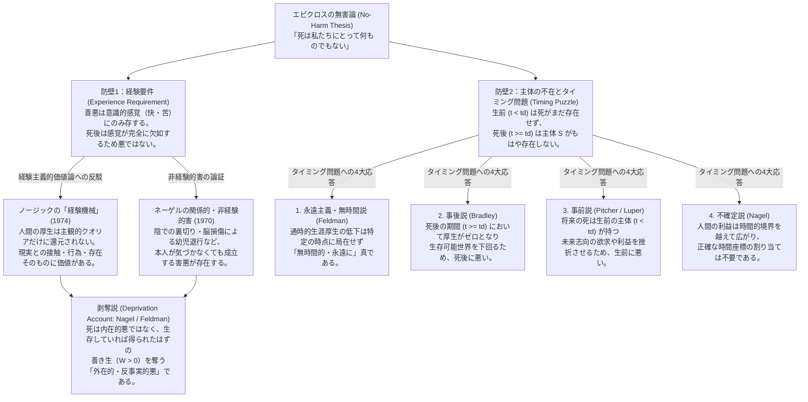
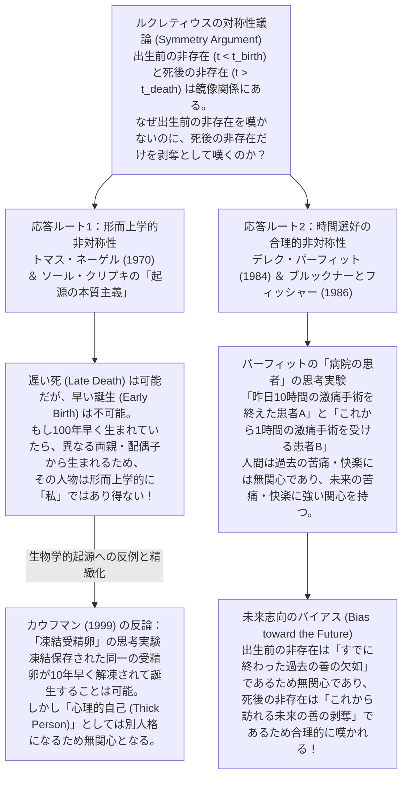

## はじめに：死の恐怖という実存的パラドックスと分析哲学の挑戦

人間は自らの死を予期し、それを最大の災厄として恐れる存在である。古今東西の神話や文学、宗教、そして医療や法制度に至るまで、人類の営みの大部分は「死をいかにして遠ざけるか」「死という避けがたい運命とどう折り合いをつけるか」という問いを中心に構築されてきたと言っても過言ではない。殺人（他者の死を早める行為）があらゆる社会において最も重い犯罪とみなされるのも、死が被害者に対して取り返しのつかない最大の害悪（Harm）をもたらすという強烈な道徳的直観に基づいている。

しかし、一歩立ち止まって冷静に考えてみると、ここには深い形而上学的・価値論的なパラドックスが潜んでいる。もし死が、霊魂の不滅や死後の世界（天国や地獄）への移行ではなく、<strong>意識と生命活動の完全かつ不可逆的な消滅（Annihilation）</strong>を意味するのだとすれば、死んだ後の私たちは「暗い闇の中に閉じ込められて寂しがっている」わけでも、「生きられなかったことを悔やんで苦しんでいる」わけでもない。死後には、苦痛を感じたり喪失を嘆いたりする主体（Subject）そのものが完全に消え失せているのである。

「経験することもできず、苦痛も後悔も一切伴わないにもかかわらず、なぜ『死んでいること』が当人にとって悪いと言えるのか？」

この鋭利な問いを人類史上もっとも鮮烈な形で突きつけたのが、紀元前4世紀から紀元前3世紀にかけてアテナイで活動した古代ギリシアの哲学者<strong>エピクロス（Epicurus, 紀元前341–270年）</strong>であった。エピクロスは『メノイケウス宛の手紙（*Letter to Menoeceus*）』の中で、死を悪とみなす日常的信念は論理的な錯誤にすぎず、死は私たちにとって「何ものでもない（無害である）」と喝破した。さらに紀元前1世紀のローマの詩人・哲学者<strong>ルクレティウス（Titus Lucretius Carus, 紀元前99頃–55年）</strong>は、私たちが「生まれる前の非存在の期間（出生前の永遠の時間）」に対して何の恐怖も悲しみも抱かない以上、「死んだ後の非存在の期間（死後の永遠の時間）」だけを恐れるのは非合理であると論じた。

エピクロスとルクレティウスが築き上げたこの要塞は、2000年以上にわたって哲学史上の巨大な難問として立ちはだかり続けた。そして20世紀後半、<strong>トマス・ネーゲル（Thomas Nagel）</strong>の画期的な論文「死（*Death*, 1970）」を皮切りに、<strong>フレッド・フェルドマン（Fred Feldman）</strong>、<strong>デレク・パーフィット（Derek Parfit）</strong>、<strong>バーナード・ウィリアムズ（Bernard Williams）</strong>、<strong>ジェフ・マクマハン（Jeff McMahan）</strong>、<strong>ジョン・マーティン・フィッシャー（John Martin Fischer）</strong>、<strong>ベン・ブラッドリー（Ben Bradley）</strong>といった現代分析哲学の第一線の論客たちが、可能世界意味論（Possible Worlds Semantics）、厚生主義（Welfarism）、人格の同一性（Personal Identity）、時間の形而上学（Metaphysics of Time）という精緻な分析ツールを総動員して、この「死の悪さ（The Badness of Death）」の解明に挑んできた。

本稿では、死をめぐる曖昧な感傷を排し、現代分析哲学が切り拓いた議論の地図を徹底的にたどる。まず「死ぬ過程」と「死んでいる状態」の概念的区別から出発し、エピクロスの無害論を支える二つの論理的防壁（経験要件とタイミング問題）を解剖する。続いて、ノージックの「経験機械」やネーゲルの関係的害の思考実験を経て、現代の標準理論である<strong>剥奪説（The Deprivation Account）</strong>を反事実的厚生比較の数理モデルとして定式化する。さらに、「死はいつ死者にとって悪いのか」というタイミング問題の5つの解決策、ルクレティウスの「対称性議論」に対する起源の本質主義と時間バイアスからの応答、そして最後にバーナード・ウィリアムズの「マクロプロス事件」が提起した「もし死ななかったら（不死であったら）人間は本当に幸福なのか」という究極の問いまでを一気通貫で論じ尽くす。

---

## 第1章：概念の精密な腑分け——「死ぬ過程」「定命性」「死んでいる状態」

「死は悪いか」という問いに哲学的なメスを入れる際、最初に行わなければならない作業は、日常言語において「死（Death）」という一語のもとに混同されている<strong>三つの異なる概念</strong>を厳密に切り分けることである。時刻 $t$ を時間軸上の変数とし、ある人物 $S$ が誕生する時刻を $t_{\text{birth}}$、死にゆく過程が始まる時刻を $t_0$、生命および意識が不可逆的に停止する死の瞬間を $t_d$ としよう。

### 1. 死ぬ過程（The Process of Dying: $t \in [t_0, t_d)$）
第一の概念は、病や老衰、事故などによって生命維持機能が崩壊していく<strong>「死にゆくプロセス（Dying）」</strong>である。重要なのは、死ぬ過程にある人間はまだ<strong>生きている（$t < t_d$）</strong>という事実だ。この期間には、激しい肉体的苦痛、呼吸困難、意識の混濁、身体的自律性の喪失、あるいは「もうすぐ愛する人々と別れなければならない」という強い恐怖や絶望が伴うことが多い。

もし死の恐怖が「死ぬときの苦痛や苦悶」に対する恐怖を意味するならば、それが当人にとって悪であることに哲学的パズルは一切存在しない。苦痛が内在的に悪い（Intrinsically Bad）ことは、エピクロス自身のような快楽主義者（Hedonist）であっても完全に認めるからである。しかし、もし苦痛だけが問題なのであれば、「睡眠中に痛みをまったく感じることなく一瞬で即死する」ことや、「完全な鎮痛処置のもとで若くして安らかに亡くなる」ことは、本人にとって何の害もない（まったく悪くない）ということになるはずである。だが私たちは、20歳の若者が眠っている間に無痛で突然死したとしても、やはり「彼にとって痛ましい悲劇（大きな不幸）が起きた」と考える。したがって、死の悪さの核心は「死ぬ過程の苦痛」には還元できない。

### 2. 定命性・死の予期（Mortality / Foreknowledge of Death）
第二の概念は、人間が「自分はいつか必ず死ぬ運命にある（Mortalである）」という事実そのもの、およびそれを生きている間に知っていることである。死の予期は、生者に実存的な不安（Angst）をもたらす一方で、人生の時間に希少価値を与え、優先順位をつけて真剣に生きる動機を生み出すという両義的な役割を果たす。しかし、そもそも「なぜ自分が将来死ぬという事実を知ることが恐怖や悲しみを引き起こすのか」と問えば、それはやはり「将来訪れる『死』そのものが自分にとって悪いこと（損失）だとみなされているから」にほかならない。もし死そのものが完全に無害で中立的な出来事であれば、将来死ぬと知ることも恐怖の対象にはなり得ないはずである。

### 3. 死んでいる状態・死という出来事（Being Dead / The Event of Death: $t \ge t_d$）
こうして残るのが第三の概念、すなわち時刻 $t_d$ において生命と意識が終わりを迎え、$t \ge t_d$ において<strong>「死んでいる状態（Being Dead：死後の非存在 Posthumous Non-existence）」</strong>に入ることそのものである。現代の死の哲学（Philosophy of Death）においては、議論の焦点を純化するため、原則として<strong>消滅仮説（Annihilation Assumption / Termination Thesis）</strong>——すなわち、死とは主観的経験を持つ意識主体としての存在が永久に消滅することであるという前提——を採用する。

以下の表に、これら三つの概念の構造的な違いを整理する。

| 概念区分 | 時間領域 | 主体 $S$ の存在と意識 | 価値論的性質 | 哲学的論争の焦点 |
| :--- | :--- | :--- | :--- | :--- |
| <strong>1. 死ぬ過程 (Dying)</strong> | $t_0 \le t < t_d$（生前） | 主体 $S$ は存在し、意識・感覚を持つ | 肉体的苦痛や精神的恐怖を伴う場合、<strong>内在的悪（Intrinsic Bad）</strong>となる | 医学的緩和ケアの対象であり、なぜ悪いかについての形而上学的謎はない |
| <strong>2. 定命性の意識 (Mortality)</strong> | $t_{\text{birth}} < t < t_d$（生前） | 主体 $S$ は存在し、未来の死を予期する | 不安を生む一方で、有限な生に意味と緊急性を付与する | エピクロス治療哲学の標的（死自体が悪でないなら、死への恐怖は根拠を失う） |
| <strong>3. 死んでいる状態 (Being Dead)</strong> | $t \ge t_d$（死後） | 主体 $S$ は<strong>存在せず</strong>、意識・感覚はゼロ（$u_S(t) = 0$） | 内在的な苦痛は存在しない。<strong>外在的・剥奪的悪（Extrinsic Bad）</strong>か否かが問われる | <strong>本稿の中心問題</strong>：主体も経験も存在しないのに、なぜ・いつ $S$ にとって悪いのか？ |

---

## 第2章：エピクロスの「無害論（No-Harm Argument）」の論理構造と二つの防壁

なぜ「死んでいる状態（あるいは死という出来事）」は、死んだ当人にとって悪いものではあり得ないのか。エピクロスは『メノイケウス宛の手紙』において、哲学史上もっとも有名な一節を書き残している。

> 「それゆえ、あらゆる悪の中で最も恐ろしいとされる<strong>死は、私たちにとって何ものでもない（Death is nothing to us）</strong>という考えに慣れ親しみなさい。なぜなら、あらゆる善と悪は感覚（Sensation / 意識的経験）のうちに存するが、死とは感覚の完全な喪失だからである。……したがって、<strong>私たちが存在する限り、死はここにはなく、死がここにあるとき、私たちはもはや存在しない（When we are, death is not come, and, when death is come, we are not）</strong>。ゆえに、死は生者にとっても死者にとっても何ものでもない。生者にとっては死はまだ存在せず、死者にとっては彼ら自身がもはや存在しないからである。」
> ——エピクロス『メノイケウス宛の手紙』第124–125節

エピクロスがこの論証を提示した目的は、単なる論理パズルの披露ではなく、人間を死の恐怖（Thanatophobia）から解放し、心の平静すなわち<strong>アタラクシア（Ataraxia：魂の不動・平穏）</strong>へと導く「哲学による魂の治療（Therapy of the Soul）」にあった。しかし、彼の簡潔な言葉の背後には、驚くほど堅固な<strong>二つの独立した哲学的議論（防壁）</strong>が組み込まれている。現代の分析哲学者は、これを「経験要件に基づく論証」と「主体の不在・タイミングに基づく論証」として再構成している。

### 防壁1：経験要件（The Experience Requirement）と快楽主義的価値論
エピクロスの第一の論証は、人間の厚生（Well-being / Welfare：その人にとって生がどれだけ良く進んでいるか）に関する<strong>快楽主義（Hedonism）</strong>および<strong>経験要件</strong>に基づいている。

* <strong>前提E1（経験要件）</strong>：ある事態や状態 $X$ が主体 $S$ にとって内在的あるいは外在的に悪い（Harmful / Bad for $S$）ためには、$S$ が $X$ または $X$ の結果として生じる不快な意識状態（苦痛、悲しみ、欲求不満の感覚など）を<strong>経験（Experience）</strong>できなければならない。
* <strong>前提E2（消滅テーゼ）</strong>：死んでいる状態（$t \ge t_d$）とは、あらゆる感覚・意識作用の永久かつ完全な欠如（Privation of all sensation）である。
* <strong>結論E3</strong>：ゆえに、死んでいる状態において主体 $S$ はいかなる不快な経験も持ち得ないため、死は $S$ にとって悪いものではあり得ない。

日常的な感覚としても、私たちは「本人が気づかず、痛みも感じないなら、苦しんでいるとは言えない」と考えがちである。全身麻酔で眠っている間に何が起きようと、麻酔中に痛みを感じることはない。死が「永遠に覚めることのない全身麻酔」のような無感覚状態であるならば、そこに苦痛（負の効用 $u < 0$）が存在しない以上、死後に恐れるべきものは何もないはずだ、というのが第一の防壁である。

### 防壁2：主体の不在とタイミング問題（The Problem of the Subject & The Timing Puzzle）
さらに手強いのが、「私たちが存在する限り死はなく、死があるとき私たちは存在しない」という後半の一節が突きつける形而上学的パズルである。かりに経験要件（前提E1）を棄却し、「意識されなくても害になることはある」と認めたとしても、なお次の問いが立ちはだかる。<strong>「死が主体 $S$ にとって悪であるならば、それは『いつ（どの時点 $t$ で）』$S$ にとって悪いのか？」</strong>

* <strong>前提T1（存在要件 Existence Requirement）</strong>：ある事態 $X$ が主体 $S$ にとって悪であるならば、$X$ が $S$ にとって悪であるような特定の時点（または期間）$t$ が存在しなければならず、かつその時点 $t$ において<strong>被害を受ける主体 $S$ が存在（Exist）していなければならない</strong>。（存在しない無に対して利益や損害が生じることはあり得ない）。
* <strong>前提T2（生前の無害性）</strong>：$S$ が生きている期間（$t < t_d$）においては、死という事態はまだ起きていない。まだ起きていない未来の出来事によって、生前の $S$ がすでに死の被害を受けているとは言えない（ただし死への恐怖を除くが、恐怖が合理的であるためには恐怖から独立に死が悪でなければならない）。
* <strong>前提T3（死後の主体不在）</strong>：死が起きた瞬間およびそれ以降の期間（$t \ge t_d$）においては、$S$ はもはやこの世に存在しない（身体は残骸として残るかもしれないが、人格的主体としての $S$ は消滅している）。
* <strong>結論T4（タイミングの不在）</strong>：ゆえに、$t < t_d$ においても $t \ge t_d$ においても、死が $S$ にとって悪となる時点 $t$ は存在しない。いかなる時点でも悪でないものは、そもそも悪ではあり得ない。

この二つの防壁と、それに対する現代哲学の反論戦略の全体構造を以下のダイアグラムに示す。

エピクロスの論証を打ち破り、「死はやはり死者にとって悪い」と主張するためには、これら二つの防壁の両方を論理的に突破しなければならない。まずは第一の防壁である「経験要件」から検証していこう。

---

## 第3章：経験要件の論駁——ノージックの「経験機械」とネーゲルの関係的害

エピクロスの第一の防壁を支えているのは、「自分が経験しないこと（意識にのぼらないこと）によって自分が害されることはない（What you don't know can't hurt you）」という<strong>経験要件（Experience Requirement）</strong>である。この前提は一見すると非常に強固に見える。もしある出来事 $X$ が私の意識状態（心理的クオリア）に1ミリも影響を与えないなら、どうして $X$ が私の人生の良し悪し（Well-being）を左右し得るのだろうか？

この経験主義的・快楽主義的な厚生観に対して壊滅的な打撃を与えたのが、<strong>ロバート・ノージック（Robert Nozick）</strong>と<strong>トマス・ネーゲル（Thomas Nagel）</strong>による思考実験である。

### 1. ロバート・ノージックの「経験機械（The Experience Machine, 1974）」
ノージックは著書『アナーキー・国家・ユートピア（*Anarchy, State, and Utopia*, 1974）』の中で、快楽主義（人間の善は快い意識経験のみによって決定されるという立場）をテストするために、次のような思考実験を提示した。

> 超高度な神経科学者たちが、あなたが望むあらゆる素晴らしく幸福な経験を脳に直接シミュレートできる<strong>「経験機械（Experience Machine）」</strong>を開発したとしよう。この機械に繋がれて培養槽の中に浮かべば、あなたは大傑作の小説を書き上げ、ノーベル賞を受賞し、素晴らしい友人たちに囲まれ、深い恋愛を成就させるという主観的経験を、寸分の違和感もなく味わうことができる。機械に入っている間、自分が機械の中にいることは完全に忘却され、すべてが現実だと確信して生涯を終えることができる。さらに、今後2年ごとに一度目覚めて次の2年間のプログラムを選び直すことさえ可能だとしよう。さて、あなたはこの機械に一生繋がれることを選ぶだろうか？

もしエピクロスや古典的快楽主義者が言うように、「私たちにとっての善悪のすべてが主観的な感覚・意識経験（$\int u_{\text{felt}}(t)\,dt$）のうちに存する」のだとすれば、経験機械にプラグインすることはためらう余地のない最善の選択であるはずだ。なぜなら、現実世界では失敗や裏切り、退屈や病のリスクがあるのに対し、経験機械は最大化された純粋な快のクオリアを保証してくれるからである。

にもかかわらず、ほとんどの人は経験機械に入ることを拒絶し、「機械の中の人生は何か決定的なものを欠いている」と直観する。ノージックはその理由として、私たちが主観的経験以外にも以下の三つの事柄に本質的な価値を置いていることを指摘した。

1. <strong>特定の経験を持つことだけでなく、実際に「あることを行う（Doing certain things）」こと</strong>：小説を書いたという「感覚」が欲しいのではなく、実際に自分の力で小説を書くという「行為」を成し遂げたいのである。
2. <strong>特定の種類の人間（Being a certain sort of person）であること</strong>：培養槽の中に浮かぶ無力な肉の塊でありながら「自分は勇敢で誠実な人間だ」という幻覚を見るのではなく、現実に勇敢で誠実な主体として存在したいのである。
3. <strong>人工的な仮想空間ではなく、客観的な「現実との接触（Contact with actual reality）」を持つこと</strong>：愛する人が実在し、自分と本当に心を通わせているという世界との関係性そのものが、私たちの厚生（Well-being）の構成要素になっている。

ノージックの経験機械が証明したのは、<strong>「ある人の人生がどれだけ良く進んでいるか（厚生 $W(S)$）は、その人の皮膚の内側（頭の中の意識状態）だけで決まる内在的性質ではなく、その人と外界の現実との『関係的・歴史的性質（Relational and Historical Properties）』に依存している」</strong>という決定的な事実である。

### 2. トマス・ネーゲル（1970）の3つの反例：意識されない害悪
ノージックに先立つ1970年、トマス・ネーゲルは論文「死（*Death*）」の中で、まさに死の悪さを擁護する文脈において、経験要件を直接論駁する3つの鮮やかな思考実験を提示した。

#### 反例A：陰での裏切り（Betrayal Behind One's Back）
ある人物 $S$ が、友人たちや配偶者から深く愛され尊敬されていると信じて、毎日幸せに暮らしているとしよう。しかし実際には、友人や配偶者は $S$ の陰で彼を徹底的に嘲笑し、軽蔑し、財産や信頼を裏切り続けている。ただし彼らは演技が完璧であるため、$S$ は死ぬまでその裏切りに一切気づかず、「自分は愛された幸福な人生だった」と満足して息を引き取ったとする。

経験要件に従えば、$S$ は裏切りによる心の痛みを一度も経験していないため、彼は何の害も被っておらず、真に愛されていた場合とまったく同じだけ幸福だったと言わなければならない。しかしネーゲルは、それは私たちの厚生概念に対する根本的な誤解であると論じる。「陰で騙され嘲笑されていること」は、たとえ本人が気づかなくても、それ自体としてその人の人生を惨めなもの（Bad for him）にする。なぜなら、私たちが望んでいるのは「愛されていると信じる主観的感覚」ではなく、「実際に愛され尊重されているという現実の状態」だからである。

#### 反例B：臨終の約束の不履行（Broken Deathbed Promises）
ある人が生涯をかけて築いた研究や遺産を、死の間際に最も信頼する友人に託し、「これを必ず公表し、遺児たちの教育に使ってくれ」と頼み、友人の快諾を得て安らかに亡くなったとする。ところが彼の死の直後、友人はその研究原稿をゴミ箱に捨て、遺産をすべてギャンブルに使い果たした。死者はそれを知ることができないが、彼の人生の中心的なプロジェクトと願いは無残に踏みにじられており、彼は害を被ったとみなすのが自然である。

#### 反例C：幸福な幼児への退行（The Contented Infant / Severe Brain Damage）
「それでも裏切りや約束破りは、もし本人が知れば苦しむはずの事柄だから悪く見えるだけではないか」という懐疑論者に対し、ネーゲルが繰り出した決定打が<strong>「脳損傷による幼児退行」</strong>のケースである。

> 高い知性と豊かな人間関係、情熱的な研究目標を持っていた30歳の健康な成人が、不慮の事故で深刻な脳損傷を受け、知能と精神状態が「生後数ヶ月の幼児」のレベルにまで不可逆的に退行してしまったとしよう。ただし、彼には一切の肉体的苦痛がなく、おむつを替えられ、温かいミルクを与えられ、ガラガラのおもちゃを振ってもらえば、毎日ニコニコと微笑んで完全に満足している（主観的な快楽レベルは、ストレスの多かった研究者時代よりもむしろ高いかもしれない）。

さて、この人物には「何も悪いことは起きなかった（むしろストレスが減って良くなった）」と言えるだろうか？ 断じて否である。私たちは彼に<strong>途方もない悲劇（巨大な害悪）</strong>が降りかかったとみなす。しかし、退行した後の彼は自分の失った知性やキャリアについて悩むこともなければ、不満を感じることも一切ない！

なぜ「幸福な幼児への退行」がこれほどまでに悪いのか？ それは、<strong>「彼という歴史的・通時的な主体が、もしその事故に遭わなければ実現し享受していたはずの豊かな生の可能性（知的な探究、愛、自律的な活動）を根こそぎ奪われたから」</strong>である。そして、脳損傷によって可能性を奪われたこの状態と、生命そのものが停止する「死」との間には、本質的な連続性がある。幼児退行が主観的苦痛なしに巨大な害悪となり得るならば、あらゆる意識と可能性を完全に奪い去る「死」もまた、主観的苦痛を一切伴うことなく当人にとって巨大な害悪となり得るのである。

---

## 第4章：剥奪説（The Deprivation Account）の定式化——可能世界と反事実的厚生比較

経験要件という第一の防壁が崩れ去ったことで、私たちは「死がなぜ悪いのか」を積極的かつ整合的に説明する理論を手に入れることができる。それが現代の死の哲学における圧倒的な標準理論となっている<strong>剥奪説（The Deprivation Account）</strong>である。

トマス・ネーゲル（1970）が基礎を据え、<strong>フレッド・フェルドマン（Fred Feldman, 1991, *Confrontations with the Reaper*）</strong>や<strong>ベン・ブラッドリー（Ben Bradley, 2009, *Well-Being and Death*）</strong>らが精緻化した剥奪説の核心命題は極めて明快である。

> <strong>剥奪説の根本テーゼ</strong>：死はそれ自体として苦痛をもたらす<strong>内在的悪（Intrinsic Bad）</strong>ではない。死が死者にとって悪いのは、もしその人がその時に死ななければ享受していたはずの「善き生（Good Life / Positive Well-Being）」をその人から<strong>剥奪する（Deprives）</strong>という意味において、<strong>外在的・道具的・反事実的な悪（Extrinsic / Instrumental / Counterfactual Bad）</strong>なのである。

### 1. 可能世界意味論による反事実的厚生比較の数理モデル
フェルドマンは、デイヴィッド・ルイス（David Lewis）の<strong>可能世界意味論（Possible Worlds Semantics）</strong>と反事実的条件法（Counterfactual Conditionals）の枠組みを用いて、剥奪説を厳密な数理的・論理的モデルとして定式化した。

ある主体 $S$ の特定の可能世界 $w$ における時刻 $t$ での瞬間的な厚生レベル（瞬時効用：快楽・欲求充足・客観的リストの価値など、採用する厚生説に基づく価値）を $u_S(t, w)$ と表そう。主体 $S$ が世界 $w$ において時刻 $t_{\text{birth}}$ に誕生し、時刻 $t_d(w)$ に死亡するとき、世界 $w$ における $S$ の<strong>通時的生涯厚生（Lifetime Well-Being）</strong> $W(S, w)$ は、生存期間にわたる瞬時厚生の積分として定義される（死後の期間 $t > t_d(w)$ においては、主体は経験も活動も持たないため $u_S(t, w) = 0$ とおく）。

$$W(S, w) = \int_{t_{\text{birth}}}^{t_d(w)} u_S(t, w)\,dt$$

いま、<strong>現実世界 $w_{\text{actual}}$</strong> において、主体 $S$ が時刻 $t_d$ に（例えば交通事故や急性疾患によって）死亡したとする。この特定の死（Death event $e_d$）が $S$ にとってどれだけ悪いか——すなわち死の<strong>外在的価値 $\text{Val}_{\text{extrinsic}}(e_d, S, w_{\text{actual}})$</strong>——は、現実世界 $w_{\text{actual}}$ における $S$ の生涯厚生と、「もしその死因となった出来事 $e_d$ が起きなかったならば実現していたであろう<strong>最近接可能世界（Nearest Possible World）$w_{\text{nearest}}$</strong>」における $S$ の生涯厚生との<strong>差分（Difference）</strong>として定義される。

最近接可能世界 $w_{\text{nearest}}$ において、$S$ が時刻 $t_d$ で死なずにさらに $\Delta t > 0$ の期間だけ生き延び、時刻 $t_d + \Delta t$ に天寿を全うするとしよう。また、時刻 $t_d$ 以前の過去の歴史は両世界で同一である（$t < t_d$ において $u_S(t, w_{\text{actual}}) = u_S(t, w_{\text{nearest}})$）とすれば、次の基本方程式が導かれる。

$$\begin{aligned}
\text{Val}_{\text{extrinsic}}(e_d, S, w_{\text{actual}}) &= W(S, w_{\text{actual}}) - W(S, w_{\text{nearest}}) \\
&= \int_{t_{\text{birth}}}^{t_d} u_S(t, w_{\text{actual}})\,dt - \int_{t_{\text{birth}}}^{t_d + \Delta t} u_S(t, w_{\text{nearest}})\,dt \\
&= -\int_{t_d}^{t_d + \Delta t} u_S(t, w_{\text{nearest}})\,dt
\end{aligned}$$

このシンプルかつ美しい反事実的積分方程式は、死に関する私たちの道徳的・日常的直観を驚くほど鮮やかに説明する。

1. <strong>なぜ通常の死は悪いのか（$\text{Val}_{\text{extrinsic}} < 0$）</strong>：もしその人が死なずに生き続けていた期間 $[t_d, t_d + \Delta t]$ において、全体として生きるに値する善き生（$\int_{t_d}^{t_d + \Delta t} u_S(t, w_{\text{nearest}})\,dt > 0$）を送っていたはずであるならば、上式の右辺にはマイナス符号がついているため、$\text{Val}_{\text{extrinsic}}(e_d, S, w_{\text{actual}}) < 0$ となる。つまり、現実の死は $S$ の生涯厚生を反事実的な生存世界よりも引き下げており、その差分の大きさだけ $S$ にとって<strong>悪い（Harmful）</strong>のである。しかもこの悪さを成立させるために、現実世界の死後に $u_S < 0$（地獄の苦しみのような負の内在的効用）が存在する必要はまったくない！ 現実世界の死後が $u_S = 0$（完全な無）であっても、$0 - (\text{正の価値}) < 0$ という引き算によって負の外在的価値が生じるからである。
2. <strong>なぜ若者の早世は高齢者の自然死よりも大きな悲劇なのか</strong>：95歳の高齢者が亡くなった場合、最近接可能世界 $w_{\text{nearest}}$ でその心不全が起きなかったとしても、別の老衰要因によって生存可能な残り時間 $\Delta t$ はごくわずかである。一方、20歳の健康な若者が事故で亡くなった場合、$w_{\text{nearest}}$ における $\Delta t$ は60年以上に及び、奪われる積分値 $\int_{t_d}^{t_d + \Delta t} u_S(t)\,dt$ が圧倒的に大きくなる。
3. <strong>なぜ終末期の死や安楽死は「本人にとっての救い（善）」になり得るのか（$\text{Val}_{\text{extrinsic}} > 0$）</strong>：もしある患者が、いかなる緩和医療によっても除去できない激しい苦痛や尊厳の崩壊だけが続く末期状態にあり、生き延びた場合の将来厚生が純粋にマイナス（$\int_{t_d}^{t_d + \Delta t} u_S(t, w_{\text{nearest}})\,dt < 0$）であるならば、マイナス×マイナス＝プラスとなり、$\text{Val}_{\text{extrinsic}}(e_d, S, w_{\text{actual}}) > 0$ となる。すなわち、この場合の死は「負の価値（苦痛に満ちた将来）を剥奪する」ことによって、当人にとって<strong>外在的な善（Mercy / Benefit）</strong>となる。剥奪説は「死は常に無条件に悪である」と独断的に主張するのではなく、「死の価値は、それが何を奪うかの符号と大きさに依存する」という柔軟かつ整合的な説明を与えるのである。

### 2. 単純な剥奪説の試練とマクマハンの「時間相対的利益説（TRIA）」
しかし、フェルドマン流の「生涯全体の厚生差分（$\Delta W$）」だけを見る標準的剥奪説（Lifetime Deprivation Account）には、生命倫理学上の重大な難問（反直観的な帰結）が存在する。それを鋭く指摘したのが<strong>ジェフ・マクマハン（Jeff McMahan, 2002, *The Ethics of Killing: Problems at the Margins of Life*）</strong>である。

いま、<strong>受精直後の胚（あるいは妊娠初期の胎児・無脳症でない重度未熟児）の死</strong>と、<strong>25歳の若き芸術家・科学者の死</strong>を比較してみよう。もし単純な生涯厚生の差分 $\int_{t_d}^{t_{\text{max}}} u_S(t)\,dt$ だけで死の悪さが決まるならば、25歳の若者が失う将来は約55年分であるのに対し、初期胎児が流産や中絶によって失う将来は約80年分（生まれてから80歳までの全生涯の善）である。したがって、単純な剥奪説は<strong>「25歳の成人が殺害されたり病死したりするよりも、初期胎児が流産することのほうが、本人にとってはるかに巨大な悲劇（最大の害悪）である」</strong>という結論を導き出してしまう！

しかし、私たちの深い道徳的直観はこれと正反対である。初期胎児の死も悲しい出来事ではあり得るが、すでに自己意識を持ち、過去の記憶を蓄積し、愛する人々との絆を結び、未来に向けた熱い夢や人生計画（Life Plans）を抱いている25歳の若者が志半ばで命を奪われることのほうが、比較にならないほど深刻な悲劇（当人にとっての最大の損失）だと感じられる。このギャップをどう説明すればよいのか？

マクマハンは、<strong>デレク・パーフィット（Derek Parfit, 1984, *Reasons and Persons*）</strong>が展開した「人格の同一性ではなく<strong>心理的連結性・連続性（Psychological Connectedness and Continuity）</strong>こそが自己利益の合理的基盤である」という理論を剥奪説に統合し、<strong>時間相対的利益説（Time-Relative Interest Account: TRIA）</strong>を構築した。

TRIAによれば、時刻 $t_d$ における死が「$t_d$ 時点の主体 $S$」にとってどれだけ悪いかを評価する際には、失われる将来の時刻 $t \in [t_d, t_d + \Delta t]$ の厚生 $u_S(t, w_{\text{nearest}})$ をそのまま単純合計してはならない。それに、<strong>時刻 $t_d$ の主体と将来の時刻 $t$ の主体との間の「心理的統一性の強度（Strength of Psychological Unity / Relation $\mathcal{R}$）」を表す割引係数 $\mathcal{R}_S(t_d, t) \in [0, 1]$</strong> を掛け合わせる必要がある。

$$\text{Badness}_{\text{TRIA}}(e_d, S, t_d) = \int_{t_d}^{t_d + \Delta t} \mathcal{R}_S(t_d, t) \cdot u_S(t, w_{\text{nearest}})\,dt$$

ここで心理的統一関数 $\mathcal{R}_S(t_d, t)$ は、以下の要素によって決定される。
* 時刻 $t_d$ の主体と将来の時刻 $t$ の主体との間で共有される<strong>自伝的記憶、性格特性、価値観、信念、および未来志向の意図・欲求（Future-directed intentions and desires）の直接的な繋がりの強さ（Psychological Connectedness）</strong>。
* それらの繋がりが時間を通じて連鎖的に重なり合っている度合い（Psychological Continuity）および脳の物理的・機能的連続性。

このマクマハンのTRIA方程式を用いれば、先ほどのパズルは見事に氷解する。
* <strong>初期胎児・新生児の場合</strong>：時刻 $t_d$ における胎児には、まだ自伝的記憶も、言語的思考も、未来に向けた人生計画もほとんど存在しない。そのため、たとえその胎児が生存世界 $w_{\text{nearest}}$ において30年後・50年後に素晴らしい成人へと成長するとしても、「いま（$t_d$）の胎児」と「30年後の成人」との間の心理的連結性はほぼゼロ（$\mathcal{R}_S(t_d, t) \approx 0$ または極めて微小な値）である。その結果、失われる将来の時間 $\Delta t$ は最大であっても、重みづけられた積分値 $\text{Badness}_{\text{TRIA}}$ は比較的小さくなる。
* <strong>20代〜30代の若者の場合</strong>：時刻 $t_d$ における彼は、すでに高度に発達した自己意識と豊かな記憶、そして今後数十年間にわたる具体的な目標や人間関係への強いコミットメントを持っており、将来の自分との心理的統一性がほぼ最大値（$\mathcal{R}_S(t_d, t) \approx 1$）に達している。さらに残された将来の時間 $\Delta t$ も十分に長いため、$\mathcal{R}_S(t_d, t) \cdot u_S(t)$ の積分値は人生の曲線の中で<strong>20代前後において鋭いピーク（最大値）</strong>を描くのである！

---

## 第5章：タイミング問題（The Timing Puzzle）の迷宮——死は「いつ」私にとって悪いのか？

剥奪説（およびTRIA）によって、エピクロスの第一の防壁「なぜ感覚のない死が悪いのか」は、「死は生きていれば得られたはずの善き将来を剥奪する外在的悪だからである」という形で鮮やかに突破された。

しかし、ここでエピクロスの<strong>第二の防壁</strong>が再び亡霊のように立ち上がる。それが現代形而上学において熾烈な論争を巻き起こしている<strong>タイミング問題（The Timing Puzzle / The Dating Problem）</strong>である。

エピクロス派はこう問い詰める。「よろしい、死が善の剥奪によって主体 $S$ にとって悪いとしよう。だが、およそ『$X$ が $S$ にとって悪い（$S$ が $X$ によって害を被る）』という事態が現実世界で成立するならば、<strong>『いつ（When：どの時点 $t$ において）』$S$ はその悪さを被っているのか？</strong> 生前（$t < t_d$）にはまだ死んでいないから何も奪われておらず、死後（$t \ge t_d$）には $S$ はもはや存在しないではないか！」

このタイミング問題に対して、現代の分析哲学者たちは大きく分けて<strong>5つの異なる時間論的・存在論的ポジション</strong>を打ち出している。それぞれの論理構造と長所・弱点を詳しく検討しよう。

### 1. 永遠主義・無時間説（Eternalism / Atemporality — Fred Feldman）
フレッド・フェルドマン（1991）が提唱した立場は、「すべての悪が特定の時点 $t$ に局在していなければならない」というエピクロスの前提（時間局在性仮説）そのものを拒絶するものである。
フェルドマンによれば、「時刻 $t_d$ における $S$ の死が $S$ にとって悪い」という命題は、「現実世界 $w_{\text{actual}}$ における $S$ の通時的生涯厚生 $W(S, w_{\text{actual}})$ が、最近接可能世界 $w_{\text{nearest}}$ における生涯厚生 $W(S, w_{\text{nearest}})$ よりも低い（$W(S, w_{\text{actual}}) < W(S, w_{\text{nearest}})$）」という通時的な世界間比較の事実を述べているにすぎない。そして、「ある数 $A$ が別の数 $B$ より小さい」という事実がいかなる特定の時刻にも縛られず常に真であるのと同様に、死が $S$ の生涯を悪くしているという事実は、生前・死後を問わず<strong>無時間的に（Atemporally）、あるいはすべての時点において永遠に（Eternally）真である</strong>。

* <strong>批判・弱点</strong>：通時的な比較命題が「永遠に真である」ことは確かだが、それだけでは「私が昨日歯痛で苦しんだことが、紀元前500年においても私にとって悪かった」と言うのと同じく単なる真理値の無時間性を述べているにすぎず、「その害悪によって主体の状態が実際に悪化している期間はいつなのか」という実質的な問いをはぐらかしているのではないか、という批判（Bradleyらによる批判）がある。

### 2. 事後説（Subsequentism — Ben Bradley, Neil Feit）
<strong>ベン・ブラッドリー（Ben Bradley, 2009）</strong>やニール・フェイトらが強力に擁護する<strong>事後説（Subsequentism）</strong>は、直観に最も忠実な答えを正面から選び取る。すなわち、<strong>「死が $S$ にとって悪いのは、$S$ が死んだ後の期間——正確には、もし $S$ が死ななければ生きて幸福を享受していたはずの期間 $t \in [t_d, t_d + \Delta t]$ ——においてである」</strong>という立場である。

考えてみれば、もし私が怪我をして今週のハワイ旅行に行けなくなったとしたら、その怪我が私にとって外在的に悪いのは「ハワイ旅行を楽しんでいたはずの今週」である。同様に、2000年に40歳で亡くなった人が、もし生き延びていれば2020年（60歳）まで幸福に暮らしていたはずだとすれば、彼が善を奪われている期間はまさに<strong>2000年から2020年までの20年間（$t \in [t_d, t_d + \Delta t]$）</strong>である！

* <strong>「死後に主体は存在しない」という反論への応答</strong>：事後説に対する最大の批判は、「2000年から2020年の間、彼はすでに死んで存在しないのに、どうやってその期間に彼の厚生レベル $u_S(t)$ が定義できるのか（主体の不在問題）」という点にある。ブラッドリーはこれに対し、<strong>四次元主義・永遠主義（Four-Dimensionalism / Ontological Eternalism：過去・現在・未来の対象はすべて時空多様体の中に実在し、通時的な指示対象となる）</strong>を援用しつつ、次のように答える。ある主体 $S$ が時刻 $t$ において意識を持たず存在しないとき、$S$ の時刻 $t$ における厚生レベルは「未定義（Undefined）」なのではなく、文字通り<strong>「ゼロ（$u_S(t, w_{\text{actual}}) = 0$）」</strong>なのである（靴や石ころが厚生レベルを持たないのとは異なり、かつて生きていた人格主体 $S$ については、死後の時刻 $t$ において「快も苦も善も悪も得ていない状態＝厚生ゼロ」を帰属させることができる）。そして、生存可能世界では同じ期間に $u_S(t, w_{\text{nearest}}) > 0$ であった以上、期間 $[t_d, t_d + \Delta t]$ のすべての時点 $t$ において $u_S(t, w_{\text{actual}}) - u_S(t, w_{\text{nearest}}) < 0$ が成立しており、まさにこの死後の期間において彼は悪（不利益）を被っているのである。

### 3. 事前説（Priorism — George Pitcher, Steven Luper）
事後説とは対照的に、「害を被る主体は、害を被るその時点において実在していなければならない（現在主義的・実在論的な存在要件）」を厳格に守ろうとするのが、<strong>ジョージ・ピッチャー（George Pitcher, 1984）</strong>や<strong>スティーヴン・ルーパー（Steven Luper）</strong>が唱える<strong>事前説（Priorism）</strong>である。

死後（$t \ge t_d$）に主体 $S$ が存在しない以上、死によって害を被る主体は<strong>「生きている間の主体（Antemortem Person, $t < t_d$）」</strong>でしかあり得ない。では、時刻 $t_d$ に起きる死が、なぜそれ以前の $t < t_d$ において生きている $S$ にとって悪となり得るのか？
ピッチャーとルーパーは次のように説明する。生きている人間 $S$ は、生前において様々な<strong>未来志向の欲求・計画・関心（Future-directed desires and interests）</strong>——たとえば「来年も家族と暮らしたい」「執筆中の本を完成させたい」「子どもの成長を見届けたい」という欲求——を持っている。時刻 $t_d$ に死が訪れるということは、「生前の $S$ が抱いていたそれらの欲求が、実は決して満たされない運命にある（Frustrated / Doomed to fail）」ということを意味する。

ここでピッチャーは、怪しげな<strong>逆向き因果（Backward Causation：未来の出来事が過去の物理的状態を書き換えること）</strong>を主張しているわけではない。たとえば、紀元前44年にカエサルが暗殺されたことで、「紀元前50年の時点のカエサルは、『6年後に暗殺されることになる人物』という関係的・歴史的性質（Relational property）を持っていた」と言えるのと同じように、時刻 $t_d$ に死ぬという事実によって、<strong>生前の $S$ は「その中心的な人生計画や欲求がすべて挫折することになる不運な人物」という状態に置かれていた</strong>のであり、したがって死は生前（$t < t_d$）の $S$ にとって悪かったのである。

### 4. 同時説（Concurrentism — Julian Lamont）と 5. 不確定説（Indeterminism — Thomas Nagel）
さらに第4の選択肢として、ジュリアン・ラモント（Julian Lamont, 1998）のように「死が $S$ にとって悪いのは、まさに<strong>死が起きたその瞬間（$t = t_d$）</strong>においてである」とする<strong>同時説（Concurrentism）</strong>がある。ただし同時説には、「死の瞬間 $t_d$ において $S$ はすでに死んで非存在になっているのか（ならば事後説と同じ問題を抱える）、それともまだかろうじて生きているのか（ならばまだ善を奪われていない）」という境界点のジレンマがつきまとう。

そして第5の選択肢が、<strong>トマス・ネーゲル（1970）</strong>自身が提示した<strong>不確定説・非局在説（Indeterminism / Indefinite View）</strong>である。ネーゲルによれば、物理的な粒子の位置や速度は各瞬間 $t$ における局所的な状態として完全に記述できるが、<strong>「一人の人間の人生とその利害（Life and Interests of a Person）」</strong>は、過去の記憶から未来の計画へと時間的・空間的な境界を越えて広がるマクロな統一体である。したがって、死による喪失という通時的な悲劇に対して「時計の針が何時何分を指した瞬間にその害が発生したか」というミクロな時間座標を割り当てようとすること自体が、人格と時間の本性を見誤ったカテゴリー・ミステイクなのである。

これら5つの理論的立場を以下の比較表にまとめる。

| 立場（提唱者） | 死が悪である時点 $t$ | 形而上学的・価値論的メカニズム | 最大の理論的強み | 直面する主な批判・難点 |
| :--- | :--- | :--- | :--- | :--- |
| <strong>1. 永遠主義・無時間説</strong> (Fred Feldman) | <strong>常に・無時間的に</strong> (Eternally / Atemporally) | $W(S, w_{\text{actual}}) < W(S, w_{\text{nearest}})$ という世界間比較の真理値は時間に依存しない | 主体不在のパラドックスを完全に回避し、論理的に最も整合的 | 命題の真理値が無時間的であることと、害を被る時期の問題を混同しているという批判 |
| <strong>2. 事後説</strong> (Ben Bradley, Neil Feit) | <strong>死後の喪失期間</strong> $t \in [t_d, t_d + \Delta t]$ | 生存していれば正の厚生 $u > 0$ を得ていたはずの期間において、現実の厚生が $u = 0$ となる | 「いつ善を失っているか」という日常的直観（旅行に行けなくなった期間と同じ）に合致 | 非存在の死者に対して時刻 $t$ での厚生レベル $u_S(t) = 0$ を帰属させる存在論的コスト |
| <strong>3. 事前説</strong> (George Pitcher, Steven Luper) | <strong>生前の期間</strong> $t < t_d$ | 死は生前の主体が持つ「未来志向の欲求・計画」を挫折させ、生前の生を不運なものにする | 害を受ける主体が確実に実在している期間（生前）にのみ悪を帰属させられる | 死ぬ前の元気な時期にすでに「死の被害を受けている」というのは直観に反する（逆向き帰属の違和感） |
| <strong>4. 同時説</strong> (Julian Lamont) | <strong>死の瞬間</strong> $t = t_d$ | 損失が確定するイベントの発生時刻 $t_d$ そのものに害を局在させる | 出来事としての死の発生時刻と害の発生時刻が一致する | 瞬間 $t_d$ で主体がすでに非存在なら事後説に帰着し、まだ生存なら喪失が未発生という境界問題 |
| <strong>5. 不確定説</strong> (Thomas Nagel) | <strong>特定の時点には局在しない</strong> (Indeterminate) | 人格の利害は時間的境界を越えて広がるため、ピンポイントの時点指定は不要 | 人間の通時的・物語的な生のあり方を最も自然に捉えている | 「いつ悪いか」という形而上学的問いに対する直接の解答を放棄しているとみなされやすい |

---

## 第6章：ルクレティウスの「対称性議論（The Symmetry Argument）」と時間の非対称性

ここまでの議論によって、私たちは剥奪説とタイミング問題の諸理論を手にし、エピクロスの無害論に対して強固な反論を構築してきた。ところが、エピクロス派にはもう一つ、剥奪説そのものの根底を揺さぶる極めてエレガントかつ強力な最終兵器が残されている。

それが、紀元前1世紀のローマの詩人・哲学者<strong>ルクレティウス（Lucretius）</strong>が長編哲学詩『物の本質について（*De Rerum Natura*）』第3巻（第832–842行および第972–975行）において展開した<strong>「対称性議論（The Symmetry Argument / Mirror of Nature Argument）」</strong>である。

> 「見よ、私たちがこの世に生まれる前に過ぎ去った、あの永遠の過去の時間（Prenatal Non-existence）が、私たちにとっていかに何ものでもなかったかを。<strong>自然はそれを、私たちの死後に訪れる未来の時間（Posthumous Non-existence）を映し出す『鏡（Mirror）』として、私たちの目の前に掲げているのだ。</strong>そこに何か恐ろしいものが見えるだろうか？ そこに何か陰鬱で悲痛なものがあるだろうか？ いかなる眠りよりも安らかなものではないか？」
> ——ルクレティウス『物の本質について』第3巻 第972–977行

### 1. 対称性のパズル：なぜ「2150年に存在しないこと」だけを嘆き、「1750年に存在しなかったこと」を嘆かないのか？
ルクレティウスの思考実験を、剥奪説に対する<strong>帰謬法（Reductio ad absurdum）</strong>として現代的に定式化してみよう。

いま、あなたが西暦2000年に生まれ、2080年に80歳で亡くなるとする。あなたの人生の前後には、二つの巨大な「非存在の期間（Non-existence）」が横たわっている。
1. <strong>出生前の非存在（Prenatal Non-existence: $t < 2000$）</strong>：あなたが生まれる前の何十億年という時間（たとえば1750年や1900年）。
2. <strong>死後の非存在（Posthumous Non-existence: $t > 2080$）</strong>：あなたが死んだ後の何十億年という時間（たとえば2150年や2200年）。

さて、剥奪説によれば、死（死後の非存在）が悪いのは、「もしあなたが2080年に死なずにもっと長く生きていれば（Late Death）、2080年以降の未来に得られたはずの素晴らしい経験や善き生を享受できたのに、非存在によってそれを奪われているからだ」と説明される。

しかしルクレティウスはこう切り返す。「もし『非存在によって本来得られたはずの生の時間を享受できないこと』が悪いのだとすれば、<strong>あなたが2000年よりももっと早く生まれていなかったこと（Early Birthの欠如：出生前の非存在）も、まったく同じ理由であなたにとって悪いはずではないか！</strong> もしあなたが1950年に生まれて2080年まで生きていれば、1950年から2000年までの50年間の素晴らしい善き生を追加で享受できたはずである。それなのに、なぜ誰一人として『ああ、私がナポレオンの時代や1950年にまだ生まれていなかったなんて、なんと恐ろしく悲しい剥奪だろう！』と嘆き悲しまないのか？」

ここに鮮烈なジレンマが生じる。
* もし出生前の非存在と死後の非存在が形而上学的・価値論的に<strong>対称（Symmetrical）</strong>であるならば、出生前の非存在に対して恐怖や悲しみを感じない（無関心である）のが合理的である以上、死後の非存在に対しても同じく無関心であるべきだ（エピクロス・ルクレティウスの勝利）。
* 逆に、死後の非存在だけを悪とみなす剥奪説を維持したいならば、<strong>出生前の非存在と死後の非存在との間に存在する「決定的な非対称性（Asymmetry）」</strong>を論理的に証明しなければならない！

現代の分析哲学において、このルクレティウスの鏡を打ち破るために提示された代表的な二つの応答ルート——<strong>（1）ネーゲル／クリプキの形而上学的非対称性（起源の本質主義）</strong>と、<strong>（2）パーフィット／ブルックナー＆フィッシャーの心理的・合理的時間バイアス</strong>——を以下のダイアグラムとともに検証しよう。

### 2. 応答ルート1：トマス・ネーゲルと「起源の本質主義（Origin Essentialism）」
トマス・ネーゲル（1970）は、ルクレティウスの対称性議論に対して極めて鋭い<strong>形而上学的（様相論理的）な反論</strong>を提示した。

ネーゲルによれば、出生前の非存在と死後の非存在はそもそも対称ではない。なぜなら、<strong>「私が現実よりも遅く死ぬこと（Late Death）」は形而上学的に可能であるが、「私が現実よりも早く生まれること（Early Birth）」は形而上学的に不可能だからである！</strong>

これは、様相論理学者<strong>ソール・クリプキ（Saul Kripke）</strong>が『名指しと必然性（*Naming and Necessity*, 1972/1980）』で定式化した<strong>起源の本質主義（Origin Essentialism）</strong>と深く結びついている。クリプキが論じたように、ある特定の人間（有機体）が「他の誰でもなくこの私（$S$）」であるための不可欠な本質的条件（必然的性質）は、その人間が<strong>「特定の両親の特定の精子と特定の卵子（受精卵）から発生した」</strong>という生物学的・歴史的起源にある。

* <strong>遅い死の可能世界</strong>：2000年に生まれ2080年に事故死した私が、もしその事故に遭わずに2100年まで生きたとしたら、その2100年まで生きている人物は紛れもなく<strong>「この私（$S$）」</strong>である。したがって、死は「私」から20年分の生を奪っている。
* <strong>早い誕生の不可能性</strong>：では、「もし私が2000年ではなく1900年に生まれていたら」と想像してみよう。1900年には私の両親さえ生まれておらず、2000年に私を生み出したあの特定の精子と卵子は存在し得ない。仮に1900年に誰かが生まれて私の名前で呼ばれていたとしても、その人物は<strong>私（$S$）ではなく、まったくの別人</strong>である！ そもそも「私」が1900年に存在することが形而上学的に不可能である以上、「私が1900年に生まれていなかったせいで、私が50年分の生を奪われた」ということは論理的に成り立たない（可能でさえないものを「奪われる」ことはないからである）。

#### カウフマン（Frederik Kaufman, 1999）の「凍結受精卵」による反撃と「厚い人格（Thick Person）」への精緻化
ネーゲルのこのエレガントな反論は長らく決定版とみなされていたが、現代の生殖医療技術の発展を背景に、<strong>フレデリック・カウフマン（Frederik Kaufman, 1999）</strong>やクリストファー・ベルショーらが巧妙な反例を突きつけた。それが<strong>「凍結受精卵（Frozen Embryo）」の思考実験</strong>である。

> ある夫婦の特定の精子と卵子から体外受精によって受精卵（胚）が作られ、1980年に液体窒素タンクで凍結保存されたとしよう。現実世界では、その受精卵は20年後の西暦2000年に解凍されて母体に着床し、誕生した人物 $S$ がいま生きているとする。

さて、この人物 $S$ にとって、「2000年ではなく、10年早い1990年に解凍されて生まれること」は形而上学的に可能だっただろうか？ <strong>完全に可能である！</strong> なぜなら、1990年に解凍されていたとしても、それは「まったく同一の精子と卵子から生じた同一の受精卵（生物学的起源）」だからである。したがって、クリプキ流の生物学的起源の本質主義に頼るだけでは、「なぜ凍結受精卵から生まれた $S$ でも、自分が1990年ではなく2000年に生まれたこと（1990年代の時間を失ったこと）を死と同じようには嘆かないのか」を説明できない。

この反例に対してカウフマン自身が提示した精緻化は、単なる「生物学的個体（Thin Person / Organism）」と、具体的な記憶・性格・価値観・人間関係を備えた<strong>「心理的・自伝的主体としての私（Thick Person / Psychological Person）」</strong>を区別することである。
たとえ同一の受精卵が1990年に解凍されて生まれていたとしても、10年異なる時代環境と人間関係の中で育ったその人物は、現在の私が持っている記憶、友人、愛する人々、価値観、プロジェクトを何一つ共有しない<strong>「心理的にはまったく別の人間（Different Thick Person）」</strong>になっていたはずである。現在の私（2000年に生まれ育ったこの自己意識）にとって切実な関心事であるのは、「現在の私の記憶と計画を引き継いだ未来の私」が生き続けることであり、「私とは記憶も人格もまったく無縁な1990年生まれの誰か」が存在することではない。これによって、起源の本質主義は「心理的・物語的起源の本質主義」として見事に救出されるのである。

### 3. 応答ルート2：パーフィットの「病院の患者」と未来志向の合理的時間バイアス
ルクレティウスの対称性議論に対するもう一つの（そしてカウフマンの凍結受精卵ケースにも直接答えることができる）決定的な解決策が、<strong>アンソニー・ブルックナーとジョン・マーティン・フィッシャー（Anthony Brueckner & John Martin Fischer, 1986, "Why Is Death Bad?"）</strong>によって提示された議論である。彼らは<strong>デレク・パーフィット（Derek Parfit, 1984, *Reasons and Persons* 第8章）</strong>の有名な思考実験を援用し、人間の価値評価における<strong>時間的非対称性（Temporal Asymmetry / Bias toward the Future）</strong>に着目した。

パーフィットが考案した<strong>「病院の患者（The Hospital Patient / My Past or Future Operations）」</strong>の思考実験を見てみよう。

> あなたはある病院のベッドで目を覚ます。この病院では、麻酔を一切使えない非常に苦痛な手術が行われているが、手術後には患者に「手術を受けたこと自体の記憶だけを消去する薬」が投与されるため、目が覚めた患者は自分がすでに手術を終えたのか、それともこれから手術を受けるのかが分からない。
> あなたが看護師に尋ねると、看護師はカルテを確認しながらこう言った。「すみません、あなたが患者Aなのか患者Bなのか、いま確認中です。<strong>もしあなたが患者Aなら、あなたは昨日、10時間にわたる激痛の手術をすでに受け終えています。もしあなたが患者Bなら、あなたは今日これから、1時間の激痛の手術を受けることになります。</strong>」

さて、看護師が確認から戻ってくるまでの間、あなたは「自分が患者Aであること（過去の10時間の激痛）」と「自分が患者Bであること（未来の1時間の激痛）」のどちらを強く望むだろうか？

答えは全員一致で明白である。<strong>「どうか私が患者Aでありますように！（すでに昨日のうちに10時間の苦痛が終わっていますように！）」</strong>と誰もが切実に祈るはずだ。たとえ過去の苦痛（10時間）が未来の苦痛（1時間）の10倍の大きさであったとしても、私たちは「すでに過ぎ去って終わった過去の苦痛」に対しては安堵し無関心であるのに対し、「これから経験しなければならない未来の苦痛」に対しては強い恐怖と忌避を抱く。

そしてブルックナーとフィッシャーが指摘したように、この非対称性は<strong>快楽や善き経験（Positive Goods）</strong>についてもまったく同様に当てはまる（たとえば、記憶が曖昧な状態で「あなたは昨日、人生最高の美食と音楽を10時間楽しんだ人か、あるいは明日それを2時間楽しめる人かのどちらかです」と言われれば、私たちは「昨日すでに終わってしまった人」ではなく「明日これからそれを楽しめる人」であることを強く望み、すでに終わった快楽の喪失よりもこれから得られる快楽の喪失をはるかに強く嘆く）。

この<strong>「未来へのバイアス（Bias toward the Future）」</strong>をルクレティウスの対称性問題に適用すれば、すべての謎が一挙に解ける。
* <strong>出生前の非存在（$t < t_{\text{birth}}$）</strong>によって私たちが失ったかもしれない善き経験は、現在生きている私たちの視点から見れば、すべて<strong>「すでに過ぎ去った過去（Past）」</strong>に属している。私たちが過去の快楽の有無に対して比較的無関心である以上、出生前に経験できなかった過去の善に対して悲嘆に暮れないのは極めて自然である。
* これに対し、<strong>死後の非存在（$t > t_d$）</strong>によって私たちが奪われる善き経験は、生きている私たちの視点から見れば、まさに<strong>「これから訪れるはずの未来（Future）」</strong>に属している！ 私たちが未来の快楽・活動・愛の継続に対して強い非対称的な関心を持っているからこそ、過去の非存在には平然としていながら、未来の非存在（死による剥奪）だけを深刻な損失として恐れ、嘆くことは<strong>完全に整合的かつ合理的（Rational）</strong>なのである。

---

## 第7章：もし死ななかったら幸福なのか？——バーナード・ウィリアムズの「マクロプロス事件」と不死のジレンマ

ここまで私たちは、「死は善き未来を奪う剥奪として悪である」という立場を擁護してきた。しかし、もし死が未来の善を奪う悪であるならば、その裏返しとして次の究極の問いが浮上する。
<strong>「では、もし私たちが決して死なない存在（不老不死 Immortal）になったとしたら、それは人間にとって最高の祝福（究極の善）なのだろうか？ それとも、死なないこと自体が別の地獄を生み出すのだろうか？」</strong>

この問題に対して現代哲学において最も影響力のある議論を展開したのが、イギリスの哲学者<strong>バーナード・ウィリアムズ（Bernard Williams, 1929–2003）</strong>による1973年の古典論文<strong>「マクロプロス事件：不死の退屈についての省察（*The Makropulos Case: Reflections on the Tedium of Immortality*）」</strong>である。

### 1. エリナ・マクロプロス（E.M.）の337年間の生と氷の退屈
ウィリアムズが題材に取ったのは、チェコの作家カレル・チャペックの戯曲（およびレオシュ・ヤナーチェクのオペラ）『マクロプロス事件』の主人公、<strong>エリナ・マクロプロス（Elina Makropulos、劇中ではイニシャル E.M. を持つ複数の偽名で生きてきた女性）</strong>の物語である。

16世紀のプラハで宮廷医師の娘として生まれた彼女は、父が皇帝ルドルフ2世のために調合した「不老不死の霊薬」の実験台としてそれを飲まされ、<strong>肉体年齢42歳の若さと美貌を保ったまま337年間生き続けてきた</strong>。老衰や病に苦しむギリシア神話のティトノス（不死だけを得て不老を得られなかった悲劇）とは異なり、E.M. は健康も美貌も知性も、そして世界最高のオペラ歌手としての名声も富もすべて手に入れている。

しかし、337歳になった彼女の心は、<strong>すべてが凍りついたような絶対的な退屈（Tedium）と無関心、虚無感</strong>に支配されていた。彼女は何十回もの情熱的な恋愛を経験し、裏切りも献身も、芸術の頂点も歴史の激動もすべて味わい尽くしてしまった結果、もはや世界の何ものに対しても驚きや感動、愛着を感じることができなくなっていたのである。「歌うことも、愛することも、生きることも、すべて同じことの退屈な反復にすぎない」と悟った彼女は、300年の効力が切れかけた霊薬を再び飲むことを拒絶し、処方箋を燃やして自らの意思で「死」を選び取る。

### 2. 「条件付き欲求」と「定言的欲求」の決定的な区別
なぜ E.M. の不死は悲劇に終わったのか。ウィリアムズはそれを分析するために、人間の欲求を二つのカテゴリーに分類した。

1. <strong>条件付き欲求（Conditional Desires）</strong>：「<strong>もし自分が明日も生きているならば</strong>、美味しいものを食べたい／痛みを避けたい／快適な部屋で眠りたい」というように、自分の生存を前提条件として派生する欲求である。条件付き欲求は生存中の質を高めるが、それ自体は「そもそもなぜ明日も生き続けなければならないのか」という生存そのものの理由を与えることはできない。
2. <strong>定言的欲求（Categorical Desires）</strong>：「この交響曲を完成させたい」「この社会不正を是正したい」「愛するこの人と共に人生を歩みたい」というように、生存を前提とするのではなく、<strong>「それを達成するためにこそ、私は明日も生き続けたい！」と願わせる、生を未来へと牽引する無条件（定言的）な欲求</strong>である。

私たちが通常、死を「悪（剥奪）」として恐れるのは、私たちが強烈な<strong>定言的欲求</strong>を持っており、死がその定言的欲求の実現を途中で断ち切ってしまうからである。

### 3. ウィリアムズの「不死の二律背反（The Dilemma of Immortality）」
ところがウィリアムズによれば、もし私たちが有限な寿命の延長ではなく<strong>文字通りの永遠の不死（$t \to \infty$）</strong>を手に入れた場合、定言的欲求そのものが必然的に崩壊するという<strong>二律背反（ジレンマ）</strong>に直面する。不死が「私（$S$）」にとって望ましい善であるためには、以下の二つの条件を同時に満たさなければならない。

* <strong>条件1：同一性条件（Identity Condition）</strong>：永遠の未来において生き続けている人物が、依然として<strong>「この私（特定の性格・気質・価値観・関心を持つ同一の人格）」</strong>であり続けなければならない。
* <strong>条件2：非退屈条件（Non-Tedium Condition）</strong>：その永遠の生が、E.M. のような耐え難い退屈や虚無感に陥ることなく、主体にとって生きるに値する魅力的な状態（定言的欲求が枯渇しない状態）であり続けなければならない。

ウィリアムズの結論は冷徹である。<strong>条件1と条件2は論理的・人間学的に決して両立しない！</strong>
* もし<strong>条件1（性格の一定性）</strong>が守られるならば、どれほど知的好奇心や感受性が豊かな人間であっても、特定の一人の人間（たとえば42歳の E.M. の性格構造）が関心を持ち、喜びを感じることができる経験やプロジェクトのパターンには限界がある。100年、300年、1万年、1億年と時間が経過すれば（$t \to \infty$）、その性格と両立するあらゆる経験は味わい尽くされ、すべての出来事が「かつて見たパターンの既視感（Déjà vu）」へと変質し、必然的に定言的欲求が消滅して<strong>絶対的な退屈（条件2の崩壊）</strong>に陥る。
* 逆に、永遠の退屈を避けて<strong>条件2（新鮮な関心の維持）</strong>を満たそうとすれば、たとえば数百年ごとに過去の記憶を完全に消去し、自分の性格・趣味・価値観を根本からまったく別の人格へと作り変え続ける（Serial Lives）しかない。しかし、自分の記憶も性格も定言的欲求もすべて捨て去った未来の誰かは、もはや現在の私が生き延びたいと願う<strong>「この私」ではない（条件1の崩壊：事実上の死と再生の繰り返しにすぎない）</strong>！

したがってウィリアムズはこう結論づける。<strong>「不死は、もし想像可能であるならば、耐え難いものである。……死は必然的に悪なのではない。むしろ、あまりにも早く死ぬこと（早世）が悪なのであるが、同時に『決して死なないこと』もまた悪なのである。」</strong>

### 4. フィッシャーとネーゲルによるウィリアムズへの反論：反復可能な快楽と成長する自己
もっとも、このウィリアムズの「不死の必然的退屈論」に対しては、<strong>ジョン・マーティン・フィッシャー（John Martin Fischer, 1994）</strong>やトマス・ネーゲル、コニー・ロザーティらから力強い反論（不死の擁護論）が寄せられている。

フィッシャーは、ウィリアムズが人間の経験や快楽を<strong>「自己消尽的な快楽（Self-Exhausting Pleasures）」</strong>に偏って捉えすぎていると批判する。
* <strong>自己消尽的快楽</strong>：エベレストに登頂することや、特定の数学の未解決問題を証明することのように、一度達成してしまうと2回目・100回目に同じことを繰り返しても最初の感動が得られない種類の活動。
* <strong>反復可能な快楽（Repeatable Pleasures）</strong>：バッハの音楽を聴くこと、季節の移ろいや美しい夕日を眺めること、美味しい食事やワインを味わうこと、愛する人と語り合い抱き合うこと、瞑想やスポーツに没頭すること。これらの経験は、毎日24時間連続で行えば飽きるとしても、適切な時間間隔を置いて生活のリズムの中に組み込まれれば、過去に何百回経験していようとも<strong>その都度、新鮮で充実した内在的価値</strong>を生み出し続けることができる。

さらに、条件1（人格の同一性）についても、人間の性格を「42歳の時点で固定された不変の箱」のようにみなす必要はない。私たちが10歳の頃から80歳になるまでの間に、記憶や価値観を緩やかにアップデートしながら（パーフィットの言う重なり合う心理的連続性 Psychological Continuity を保ちながら）成長していくように、もし人間が健康な脳を持って何千年も生きることができ、かつ人類の科学・芸術・宇宙探査・社会が進化し続けるならば、私たちは<strong>「自分らしさの連続性を失うことなく、新しい定言的欲求を次々と育みながら果てしなく成長していくこと」</strong>が十分に可能かもしれないのである。

---

## おわりに：死の悪さと生の有限性が照らし出すもの

紀元前4世紀のエピクロスが投じた「私たちが存在する限り死はなく、死があるとき私たちは存在しない」という一石から始まった2300年間の哲学的探求を、私たちは現代分析哲学の最前線まで駆け抜けてきた。最後に、本稿で明らかにした議論の到達点を総括しよう。

1. <strong>死の悪さの本質（剥奪説）</strong>：死んでいる状態（$t \ge t_d$）には意識も感覚も存在しないため、死は苦痛のような「内在的悪」ではない。しかし、人間の厚生（Well-being）は頭の中の主観的感覚だけに閉じ込められたものではなく（ノージックの経験機械・ネーゲルの関係的害）、現実世界における歴史的・通時的な展開に依存している。死が悪いのは、もしその時に死ななければ享受していたはずの未来の善き生（$\int_{t_d}^{t_d + \Delta t} u_S(t)\,dt > 0$）を当人から奪い去る<strong>「外在的・反事実的な剥奪（Deprivation）」</strong>だからである。
2. <strong>時間相対的利益とタイミングの解明</strong>：マクマハンの時間相対的利益説（TRIA）が示したように、死の悲劇の重さは単なる残余寿命の長さだけでなく、現在の自己と未来の自己との間の「心理的統一性の強さ（$\mathcal{R}_S(t_d, t)$）」によって重みづけられる。また、死がいつ悪いのかというタイミング問題に対しても、無時間的比較（永遠主義）、死後の喪失期間におけるゼロ厚生との差分（事後説）、生前の未来志向的欲求の挫折（事前説）といった精緻な形而上学的モデルによって、主体不在のパラドックスを乗り越える道筋が拓かれている。
3. <strong>出生前と死後の非対称性</strong>：ルクレティウスが掲げた「出生前の非存在という鏡」に対しては、私という心理的・生物学的個体が早く生まれることの形而上学的不可能性（ネーゲル・クリプキ・カウフマン）と、人間がすでに終わった過去の苦楽よりもこれから訪れる未来の苦楽に対して強い関心を持つという合理的な時間バイアス（パーフィット・ブルックナー＆フィッシャー）の双方から、死後の非存在だけを惜しむことの正当性が裏づけられた。
4. <strong>有限性と不死の弁証法</strong>：そしてバーナード・ウィリアムズの「マクロプロス事件」をめぐる論争が教えてくれるのは、私たちが死を悪として恐れるのは「ただ心臓が動いている状態を無限に引き延ばしたいから」ではなく、私たちの中に<strong>「生きたい、成し遂げたい、愛したい」という定言的欲求（Categorical Desires）</strong>が燃えているからだ、という深い真理である。

エピクロスは、死への恐怖を取り除くために「死は無である」と説いた。それに対して現代の剥奪説は、「たとえ死後の状態が無であっても、死はやはり私たちにとって大きな損失（悪）である」と結論づける。しかし、この結論は決して私たちを絶望させるためのものではない。

なぜなら、<strong>「死が悪い（奪われるものが大きい）ということは、とりもなおさず、私たちが今こうして生きている『生（Life）』そのものが素晴らしい価値に満ちていることの証明にほかならない」</strong>からである。死の向こう側に恐ろしい怪物や暗黒の牢獄が待っているのではない。私たちが死を惜しむのは、この世界の光、知的な驚き、芸術の美、そして他者とのかけがえのない絆が、手放すにはあまりにも尊いものだからである。死の悪さとは、生の良さの鏡像（The mirror image of the goodness of life）なのである。
