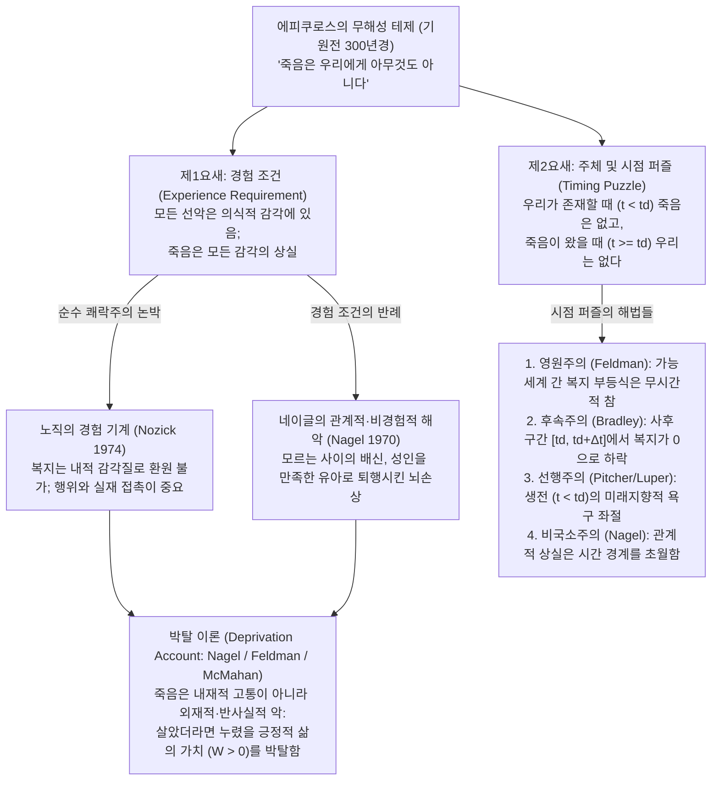
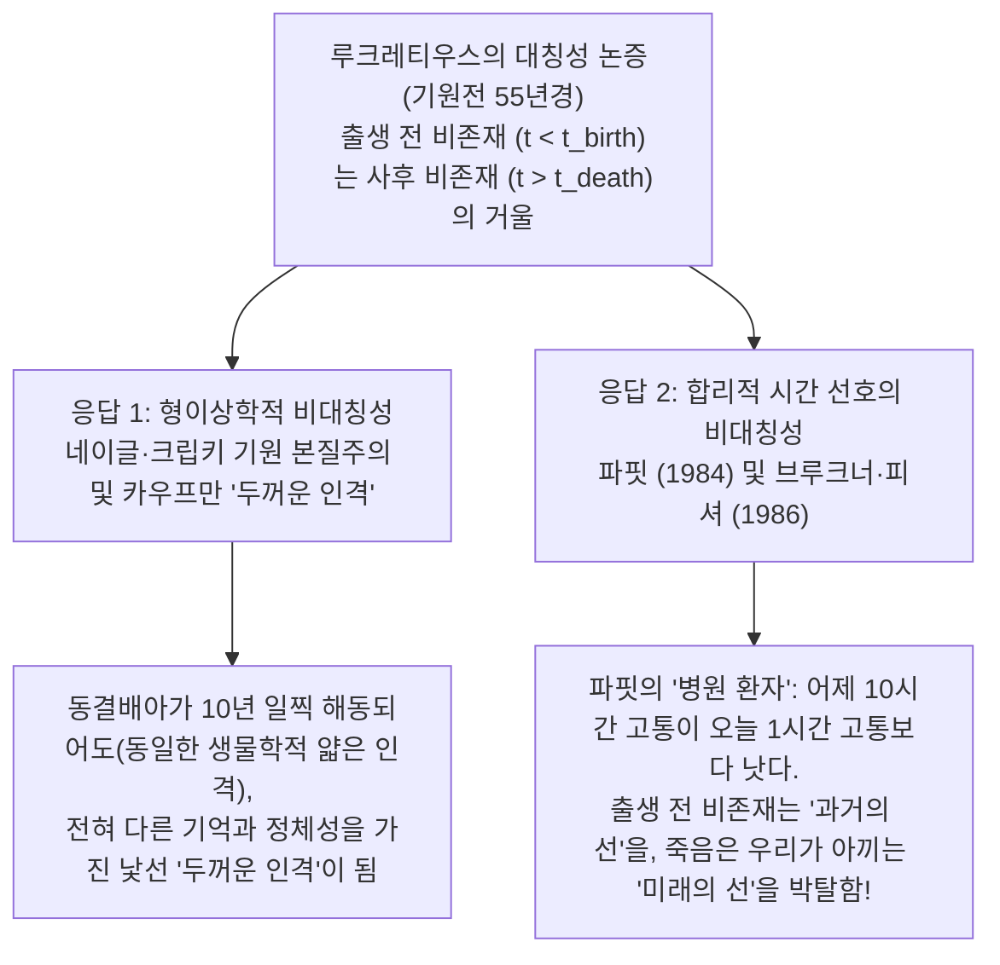

## 1. 서론: 필멸성의 실존적 역설과 분석철학의 도전

인류 문명의 법과 윤리, 일상적 직관에서 <strong>죽음은 개인에게 닥칠 수 있는 가장 큰 불행 중 하나</strong>로 여겨진다. 그러나 현대 철학이 말하는 <strong>‘소멸 가정’(Annihilation Assumption / Termination Thesis)</strong>—생물학적 죽음이 의식적 경험과 인격적 존재의 영구적 종말을 뜻한다는 전제—을 받아들이면 심오한 형이상학적·가치론적 역설이 발생한다. 죽은 뒤에는 어둠도, 고통도, 후회도 느낄 수 없고 해악을 겪을 주체조차 존재하지 않는데, <strong>죽어 있는 상태(being dead)가 어떻게 죽은 당사자에게 ‘나쁜 것’일 수 있는가?</strong>

2천 년 전 고대 그리스 철학자 <strong>에피쿠로스(Epicurus, 기원전 341–270)</strong>는 『메노이케우스에게 보낸 편지』에서 "죽음은 우리에게 아무것도 아니다"라는 ‘무해성 논증’을 펼쳤고, 로마 시인 <strong>루크레티우스(Lucretius, 기원전 99–55경)</strong>는 『사물의 본성에 관하여』(*De Rerum Natura*)에서 출생 전의 비존재와 사후의 비존재를 대비시키는 ‘대칭성 논증’을 제시했다. 1970년 <strong>토머스 네이글(Thomas Nagel)</strong>의 논문 「죽음」(*"Death"*)을 기점으로 프레드 펠드먼(Fred Feldman), 데릭 파핏(Derek Parfit), 제프 맥마한(Jeff McMahan), 벤 브래들리(Ben Bradley), 버나드 윌리엄스(Bernard Williams) 등 현대 분석철학자들은 가능세계 의미론과 반사실적 복지 적분을 통해 이 고전적 난제를 정밀하게 재구성했다.

### 개념 구분: 죽어가는 과정, 필멸성, 죽어 있는 상태

먼저 일상어에서 ‘죽음’으로 뭉뚱그려지는 세 범주를 엄밀히 구분해야 한다($t_{\text{birth}}$에 태어난 주체 $S$가 $t_d$에 비가역적으로 생명을 멈춘다고 하자):
1. <strong>죽어가는 과정(Dying, $t \in [t_0, t_d)$)</strong>: 주체가 아직 살아 있고 의식이 있으며 육체적 고통($u_S(t) < 0$, 내재적 악)을 겪는다. 그러나 수면 중 무통증 돌연사 역시 비극이므로 죽음의 나쁨은 죽어가는 고통으로 환원될 수 없다.
2. <strong>필멸성의 자각(Mortality, $t_{\text{birth}} < t < t_d$)</strong>: 생전의 죽음 불안. 만약 죽음 자체가 무해하다면 이러한 공포는 비합리적 공포증에 불과하다.
3. <strong>죽어 있는 상태 / 사후 비존재(Being Dead, $t \ge t_d$)</strong>: 주체가 존재하지 않으며 경험적 효용이 0($u_S(t) = 0$)인 상태. 바로 이것이 철학적 논쟁의 핵심이다.

---

## 2. 에피쿠로스의 ‘무해성 논증’과 두 개의 논리적 요새

에피쿠로스는 『메노이케우스에게 보낸 편지』(124–125절)에서 다음과 같이 선언한다.

> "<strong>죽음은 우리에게 아무것도 아니라고</strong> 믿는 습관을 들이십시오. 모든 좋음과 나쁨은 감각에 있는데, 죽음은 모든 감각의 상실이기 때문입니다. … <strong>따라서 가장 두려운 악인 죽음은 우리에게 아무것도 아닙니다. 우리가 존재할 때 죽음은 아직 오지 않았고, 죽음이 왔을 때 우리는 더 이상 존재하지 않기 때문입니다.</strong>"

현대 분석철학은 이를 두 개의 독립된 논증으로 분석한다.

- <strong>제1요새: 경험 조건(The Experience Requirement)</strong>: 어떤 사태 $X$가 주체 $S$에게 나쁘려면 $S$가 불쾌한 의식적 감각을 경험해야 한다(쾌락주의 가치론). 죽음은 모든 감각의 박탈이므로 $S$에게 나쁠 수 없다.
- <strong>제2요새: 주체 및 시점 퍼즐(The Timing Puzzle)</strong>: 어떤 해악이 $S$에게 나쁘려면 그 해악이 $S$를 해치는 특정 시점 $t$가 있어야 하고 그 시점에 $S$가 존재해야 한다. 그러나 $t < t_d$에는 죽음이 아직 일어나지 않았고, $t \ge t_d$에는 $S$가 존재하지 않는다. 따라서 죽음이 $S$에게 나쁜 시점 $t$는 존재하지 않는다.

---

## 3. 경험 조건 논박: 노직의 ‘경험 기계’와 네이글의 관계적 해악

### 3.1 로버트 노직의 ‘경험 기계’(Experience Machine, 1974)

『아나키에서 유토피아로』(1974)에서 <strong>로버트 노직(Robert Nozick)</strong>은 뇌를 자극해 위대한 소설 집필이나 깊은 사랑의 주관적 감각을 완벽히 시뮬레이션해 주는 ‘경험 기계’를 제시했다. 만약 에피쿠로스의 경험 조건이 참이라면 누구나 평생 기계에 접속해야 합리적이겠지만, 우리는 이를 거부한다. 인간은 단순한 쾌락 감각($\int u_{\text{felt}}(t)\,dt$)이 아니라 <strong>실제로 행위하고(do), 특정한 인격체로 존재하며(be), 실제 현실과 접촉하기를 원하기 때문</strong>이다.

### 3.2 토머스 네이글 「죽음」(1970)의 3대 반례

<strong>토머스 네이글</strong>은 인간의 복지가 순간적 의식 상태가 아니라 시공간적 역사·가능성·세계와의 관계에 달려 있음을 세 가지 반례로 입증했다.
1. <strong>등 뒤에서의 배신</strong>: 배우자와 친구들에게 몰래 조롱당하고 배신당하는 사람은 끝까지 그 사실을 몰라 고통을 느끼지 못해도 분명히 해악을 입은 것이다.
2. <strong>지켜지지 않은 임종 약속</strong>: 사후에 친구가 유언을 어기고 평생의 원고를 불태우면 고인의 삶은 관계적 해악을 입는다.
3. <strong>만족한 유아(심각한 뇌손상, The Contented Infant)</strong>: 유능한 30세 과학자가 뇌손상으로 지능이 생후 3개월 유아 수준으로 퇴행하여 기저귀와 우유만으로 매일 방긋 웃으며 지낸다고 하자. 고통은 전혀 없지만 누구나 이를 끔찍한 비극으로 여긴다. <strong>그가 누릴 수 있었던 지성적·창조적 삶의 가능성이 박탈되었기 때문</strong>이다. 가능성을 0으로 만드는 죽음 역시 동일한 이유로 박탈의 해악이다.

---

## 4. 박탈 이론(Deprivation Account): 가능세계 반사실적 적분과 시간-상대적 이익

<strong>프레드 펠드먼(Fred Feldman, 1991)</strong>과 <strong>벤 브래들리(Ben Bradley, 2009)</strong>가 정식화한 <strong>박탈 이론</strong>은 <strong>내재적 악(Intrinsic Badness, $u_S(t) < 0$)</strong>과 <strong>외재적/반사실적 악(Extrinsic Badness)</strong>을 구분한다. 죽음은 내재적 고통이 아니라, <strong>죽지 않았더라면 누렸을 긍정적 삶의 선(goods)을 박탈하기 때문에 외재적으로 나쁘다</strong>.

### 4.1 가능세계 의미론을 통한 수식화

가능세계 $w$에서 주체 $S$의 순간 복지를 $u_S(t, w)$라 하면, 생애 총 복지 $W(S, w)$는 다음과 같다.

$$W(S, w) = \int_{t_{\text{birth}}}^{t_d(w)} u_S(t, w)\,dt$$

현실 세계 $w_{\text{actual}}$에서 $S$가 사건 $e_d$로 시점 $t_d$에 사망했고, $e_d$가 일어나지 않은 <strong>가장 가까운 가능세계 $w_{\text{nearest}}$</strong>에서 $\Delta t > 0$만큼 더 살았을 것이라 하면, 죽음의 외재적 가치는 두 세계의 복지 차이이다.

$$\text{Val}_{\text{extrinsic}}(e_d, S, w_{\text{actual}}) = W(S, w_{\text{actual}}) - W(S, w_{\text{nearest}}) = -\int_{t_d}^{t_d + \Delta t} u_S(t, w_{\text{nearest}})\,dt$$

- 반사실적 미래의 삶이 긍정적($\int_{t_d}^{t_d+\Delta t} u_S > 0$)이면 $\text{Val}_{\text{extrinsic}} < 0$이므로 죽음은 나쁘며, 청년의 요절은 $\Delta t$가 크므로 노년의 죽음보다 훨씬 더 큰 비극이다.
- 반대로 불치병 환자에게 극심한 고통만 남아 있다면($\int_{t_d}^{t_d+\Delta t} u_S < 0$), $\text{Val}_{\text{extrinsic}} > 0$이 되어 안락사가 당사자에게 자비로운 이익이 됨을 명쾌히 설명한다.

### 4.2 태아 역설과 제프 맥마한의 시간-상대적 이익 이론(TRIA, 2002)

단순 생애 총합 비교는 초기 태아의 유산(80년 상실)이 25세 청년의 사망(55년 상실)보다 더 큰 비극이라는 <strong>태아 역설</strong>을 낳는다. <strong>제프 맥마한(Jeff McMahan, 2002)</strong>은 데릭 파핏의 <strong>심리적 연속성 관계 $\mathcal{R}_S(t_d, t) \in [0, 1]$</strong>를 가중치로 곱하는 <strong>시간-상대적 이익 이론(TRIA)</strong>으로 이를 해결했다.

$$\text{Badness}_{\text{TRIA}}(e_d, S, t_d) = \int_{t_d}^{t_d + \Delta t} \mathcal{R}_S(t_d, t) \cdot u_S(t, w_{\text{nearest}})\,dt$$

초기 태아는 미래 성인 자아와의 심리적 연결성 $\mathcal{R}_S(t_d, t) \approx 0$인 반면, 25세 청년은 심리적 통일성($\mathcal{R}_S \approx 1$)과 남은 수명 $\Delta t$가 모두 크므로 청년기 죽음의 해악이 최대가 된다.

---

## 5. 시점 퍼즐의 5대 해법: 죽음은 ‘언제’ 죽은 자에게 나쁜가?

| 이론적 입장 (대표 학자) | 해악의 시간적 위치 ($t$) | 형이상학적·가치론적 메커니즘 | 핵심 이론적 강점 | 주요 반론 및 한계 |
| :--- | :--- | :--- | :--- | :--- |
| <strong>1. 영원주의 / 무시간주의</strong> (Fred Feldman) | <strong>영원히 / 언제나</strong> (Atemporally) | $W(S, w_{\text{actual}}) < W(S, w_{\text{nearest}})$는 시간에 구애받지 않는 영원한 참 | 사후 주체 비존재 문제를 완전히 우회함 | 명제가 참인 시점과 실제 해악을 겪는 시점을 혼동함 |
| <strong>2. 후속주의 (Subsequentism)</strong> (Ben Bradley, Neil Feit) | <strong>사후 박탈 구간</strong> $t \in [t_d, t_d + \Delta t]$ | $[t_d, t_d+\Delta t]$ 동안 현실 복지 $u=0$이 반사실적 복지 $u>0$보다 낮음 | 다리 골절로 다음 주 하와이 여행을 놓친 해악의 시점과 일치 | 존재하지 않는 사후의 인물에게 복지 수준 $u=0$을 부여해야 함 |
| <strong>3. 선행주의 (Priorism)</strong> (George Pitcher, Steven Luper) | <strong>생전의 삶 동안</strong> $t < t_d$ | $t_d$의 요절이 생전($t < t_d$)의 미래지향적 욕구와 계획을 좌절시킴 | 현재주의 및 ‘피해 주체는 살아 있어야 한다’는 조건 충족 | 35세에 죽을 것이라는 이유로 행복한 20세가 이미 해를 입고 있다는 역설 |
| <strong>4. 동시주의 (Concurrentism)</strong> (Julian Lamont) | <strong>죽음의 순간</strong> $t = t_d$ | 생명과 가능성이 상실되는 정확한 경계 시점 $t_d$에 해악 발생 | 해악의 시점과 인과적 사건($e_d$)의 시점이 일치함 | $t_d$에서 아직 살아 있거나 이미 죽어 있다는 경계 딜레마 |
| <strong>5. 비국소주의 (Indeterminism)</strong> (Thomas Nagel) | <strong>특정 시점 없음</strong> (Unlocalized) | 역사적 존재자인 인간의 관계적 상실은 삶 전체에 귀속됨 | 인간 삶의 서사적 전체성을 인위적 시계 좌표 없이 포착 | 모든 해악은 특정 시점에 발생해야 한다는 전제를 거부함 |

---

## 6. 루크레티우스의 대칭성 논증과 시간의 비대칭성

『사물의 본성에 관하여』 3권에서 <strong>루크레티우스</strong>는 <strong>출생 전 비존재($t < t_{\text{birth}}$)</strong>를 <strong>사후 비존재($t > t_d$)</strong>의 거울(*speculum*)로 제시한다. 사후 비존재가 더 늦은 죽음을 박탈해서 나쁘다면, 왜 출생 전 비존재가 ‘더 이른 출생’을 박탈한 것에 대해서는 슬퍼하지 않는가?

이에 대한 현대 철학의 두 가지 핵심 응답은 다음과 같다.
1. <strong>네이글·크립키의 기원 본질주의(Origin Essentialism)와 카우프만의 ‘두꺼운 인격’(Thick Person)</strong>: 솔 크립키(Saul Kripke)에 따르면 특정 정자와 난자의 기원은 개체의 본질적 속성이므로 100년 일찍 태어난 사람은 ‘당신’일 수 없다. 프레더릭 카우프만(Frederik Kaufman 1999)은 동결배아가 10년 일찍 해동될 수 있다는 반례에 맞서, 생물학적 유기체인 ‘얇은 인격’과 구체적 기억·성격으로 구성된 <strong>‘두꺼운 인격’(Thick Person)</strong>을 구분했다. 배아가 10년 일찍 해동되었다면 현재의 자서전적 ‘나’(두꺼운 인격)는 결코 존재하지 못했을 것이다.
2. <strong>파핏의 ‘병원 환자’와 미래에 대한 합리적 편향(Brueckner & Fischer 1986)</strong>: <strong>데릭 파핏</strong>의 『이유와 인격』(1984)에 나오는 <strong>‘병원 환자’ 사고실험</strong>에서, 어제 이미 10시간의 무마취 고통 수술을 끝내고 기억만 지워진 환자 A와 오늘 오후 1시간의 고통 수술을 앞둔 환자 B 중 누구나 환자 A이기를 간절히 바란다. 쾌락 역시 이미 지나간 과거의 쾌락보다 <strong>앞으로 다가올 미래의 쾌락</strong>을 강력히 선호한다. 즉 출생 전 비존재는 우리가 무관심한 <strong>과거의 선</strong>을 박탈한 반면, 죽음은 우리가 절실히 아끼는 <strong>미래의 선</strong>을 박탈하므로 죽음만을 두려워하는 것은 지극히 합리적이다!

---

## 7. 불멸은 축복일까? 버나드 윌리엄스와 ‘마크로풀로스 사례’

죽음이 삶의 선을 끊어놓기 때문에 나쁘다면, 영원히 죽지 않는 <strong>불멸(Immortality)</strong>은 최상의 축복일까? <strong>버나드 윌리엄스(Bernard Williams, 1973)</strong>는 「마크로풀로스 사례: 불멸의 권태에 관한 성찰」에서 불멸이 견딜 수 없는 저주가 될 것이라고 논증했다. 42세에 불로장생약을 마시고 젊음을 유지한 채 <strong>337세</strong>가 된 주인공 <strong>엘리나 마크로풀로스(E.M.)</strong>는 모든 사랑과 예술이 기계적 반복으로 느껴지는 <strong>얼어붙은 권태(tedium)</strong>에 빠져 스스로 영생을 거부하고 죽음을 택한다.

윌리엄스는 살아 있음을 전제로 한 <strong>조건적 욕구(Conditional Desires)</strong>와 우리에게 살아갈 이유 자체를 부여하는 <strong>범주적 욕구(Categorical Desires)</strong>를 구분하며 <strong>불멸의 딜레마</strong>를 제시한다.
- <strong>첫째 뿔(고정된 성격 $\implies$ 필연적 권태)</strong>: 내 성격과 정체성이 유지된다면 무한한 시간($t \to \infty$) 속에서 그 성격이 수용할 수 있는 경험의 조합은 결국 고갈되어 극심한 권태에 빠진다.
- <strong>둘째 뿔(급진적 성격 변형 $\implies$ 정체성 상실)</strong>: 권태를 피하려고 수백 년마다 기억과 성격을 완전히 갈아치운다면, 미래의 그 존재는 더 이상 ‘나’와의 심리적 연속성을 갖지 못한 타인이 된다.

비록 피셔(John Martin Fischer)가 바흐의 첼로 모음곡 감상や 우정 같은 <strong>‘반복 가능한 쾌락’(Repeatable Pleasures)</strong>이 영생을 지탱할 수 있다고 반박했지만, 윌리엄스의 통찰은 역설적으로 박탈 이론의 핵심을 비춰준다. <strong>죽음이 나쁜 이유는 유한한 삶 속에서 우리가 품는 범주적 욕구와 사랑, 창조적 열정이 그토록 소중하기 때문이며, 결국 죽음의 나쁨은 삶의 좋음을 비추는 거울상이다.</strong>
