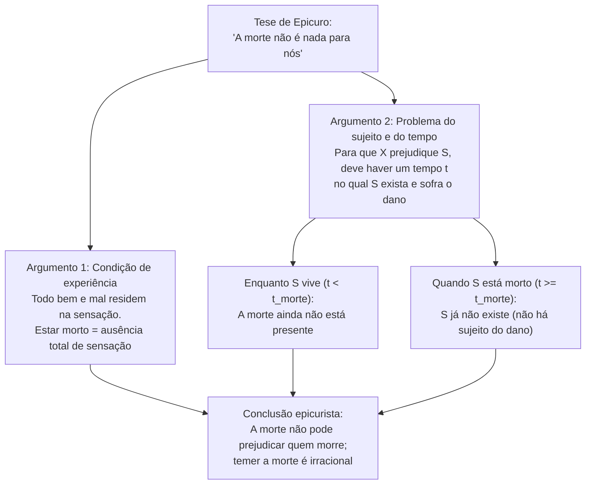
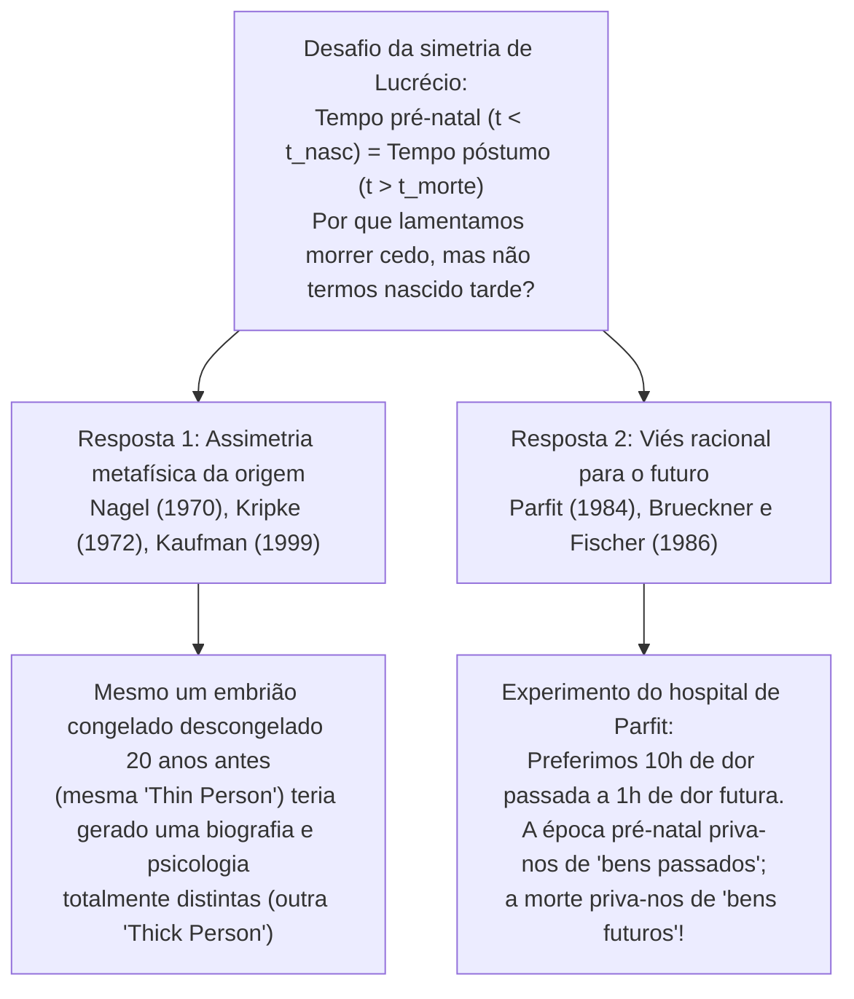

## 1. Introdução: Será irracional temer a própria morte?

De todas as emoções humanas, poucas parecem tão universais, biologicamente enraizadas e inescapáveis quanto o <strong>medo da morte</strong>. Não nos referimos apenas ao receio da dor física da agonia (*o processo de morrer*, *dying*), mas ao terror existencial diante do próprio fato de <strong>estar morto (*being dead*)</strong>: a extinção irreversível da consciência, a aniquilação definitiva do «eu» e a passagem de ser alguém para não ser absolutamente nada.

Contudo, há mais de dois mil e trezentos anos, o filósofo grego <strong>Epicuro</strong> (341–270 a.C.) formulou em sua famosa *Carta a Meneceu* um dos argumentos mais desconcertantes e logicamente implacáveis da história da filosofia: <strong>a própria morte não pode nos causar nenhum mal, de modo que temer a morte é inteiramente irracional</strong>. Pouco depois, o poeta e filósofo romano <strong>Lucrécio</strong> (c. 99–55 a.C.), em seu poema épico *De rerum natura* (*Sobre a natureza das coisas*), reforçou essa tese com seu célebre <strong>argumento da simetria</strong>: o tempo infinito que transcorreu antes do nosso nascimento é exatamente idêntico ao tempo infinito que se seguirá à nossa morte; uma vez que não sentimos nenhum horror ao olhar para trás em direção à nossa inexistência pré-natal, por que deveríamos sentir pavor ao olhar para a frente em direção à nossa inexistência póstuma?

Na filosofia analítica contemporânea — impulsionada pelo ensaio seminal de <strong>Thomas Nagel</strong>, *«Death»* (1970), e aprofundada por pensadores como <strong>Fred Feldman</strong>, <strong>Jeff McMahan</strong>, <strong>Derek Parfit</strong>, <strong>Anthony Brueckner</strong>, <strong>John Martin Fischer</strong> e <strong>Bernard Williams</strong> —, esse antigo desafio epicurista tornou-se um campo de investigação metafísica e axiológica de extraordinária precisão. Este artigo examina rigorosamente os três grandes enigmas da filosofia da morte:

1. <strong>O problema da experiência, do sujeito e do tempo</strong>: Como pode a morte ser ruim para uma pessoa se essa pessoa não pode experimentar o estado de estar morta e nem sequer existe quando está morta? (Epicuro vs. a <strong>teoria da privação</strong> de Nagel e o <strong>hedonismo atitudinal</strong> de Feldman).
2. <strong>O problema da assimetria de Lucrécio</strong>: Se a morte é um mal porque nos priva de tempo de vida que poderíamos ter vivido, por que não lamentamos da mesma maneira não termos nascido mais cedo? (A identidade essencial da origem de Nagel vs. o <strong>viés racional para o futuro</strong> de Parfit e Brueckner/Fischer).
3. <strong>O dilema da imortalidade</strong>: Se a morte é um mal porque interrompe os bens da vida, isso significa que viver para sempre seria o maior bem possível, ou será que a imortalidade eterna se tornaria uma maldição insuportável? (<strong>O caso Makropulos</strong> de Bernard Williams).

---

## 2. O desafio de Epicuro: «A morte não é nada para nós»

Em sua *Carta a Meneceu*, Epicuro escreve palavras que ecoaram através dos séculos como um antídoto lógico contra o pavor mortal:

> «Acostuma-te a pensar que <strong>a morte não é nada para nós</strong> (*ὁ θάνατος οὐδὲν πρὸς ἡμᾶς*). Pois todo bem e todo mal residem na sensação, e a morte é a privação de toda sensação [...]. Assim, o mais terrível dos males, a morte, não é nada para nós, visto que, <strong>enquanto nós somos, a morte não está presente, e, quando a morte está presente, então nós já não somos</strong>. Portanto, ela nada significa nem para os vivos nem para os mortos, pois para aqueles ainda não está presente, e estes já não existem.»

Na filosofia analítica da morte, a crítica epicurista costuma ser reconstruída por meio de dois argumentos distintos, mas intimamente interligados: o <strong>argumento da experiência</strong> (baseado no hedonismo axiológico) e o <strong>argumento da inexistência do sujeito e do tempo</strong> (*The Subject / Timing Problem*).

### 2.1. Reconstrução formal do argumento da experiência (Hedonismo)

1. <strong>Premissa 1 (Princípio da experiência / Hedonismo intrínseco)</strong>: Um estado de coisas ou evento $E$ é intrinsecamente ruim para um sujeito $S$ se e somente se $E$ faz com que $S$ experimente estados mentais desagradáveis ou dolorosos (dor física ou sofrimento psicológico).
2. <strong>Premissa 2 (Tese da aniquilação)</strong>: A morte é a extinção total e irreversível da consciência e de toda capacidade de sensação e experiência ($\text{Estar morto} \implies \neg\text{Experiência}(S)$).
3. <strong>Premissa 3</strong>: Portanto, o estado de estar morto não pode causar nenhuma experiência dolorosa ou desagradável em $S$.
4. <strong>Conclusão</strong>: <strong>Estar morto não pode ser intrinsecamente ruim para $S$.</strong>

### 2.2. Reconstrução formal do problema do sujeito e do tempo (*The Timing Problem*)

Mesmo que abandonemos o hedonismo estrito, Epicuro nos arma uma segunda armadilha metafísica muito mais profunda: <strong>quem sofre o mal da morte e quando (*em que instante $t$*) o sofre?</strong>

1. <strong>Premissa 1 (Condição de existência do sujeito e do tempo)</strong>: Para que qualquer evento ou estado $E$ seja ruim (um dano ou infortúnio) para um sujeito $S$, deve existir um momento temporal $t$ tal que:
   - (a) $S$ exista no momento $t$, e
   - (b) $S$ sofra um prejuízo em seu bem-estar no momento $t$ por causa de $E$.
2. <strong>Premissa 2 (Exclusão mútua entre o sujeito e a morte)</strong>: Seja $t_{\text{morte}}$ o instante da morte de $S$:
   - Para todo instante $t < t_{\text{morte}}$ (enquanto $S$ está vivo), a morte ainda não ocorreu; portanto, o estado de estar morto ainda não prejudica $S$.
   - Para todo instante $t \ge t_{\text{morte}}$ (depois que $S$ morreu), $S$ já não existe ($\neg\exists S\text{ em }t$). E quem não existe não pode ter um nível de bem-estar negativo nem ser sujeito de qualquer dano.
3. <strong>Conclusão</strong>: Não existe nenhum momento $t$ em que a morte seja ruim para $S$. Logo, a morte não pode ser um mal para quem morre.

---

## 3. A refutação de Thomas Nagel e a Teoria da Privação (*Deprivation Account*)

Em seu famoso artigo *«Death»* (1970, posteriormente incluído em *Mortal Questions*, 1979), <strong>Thomas Nagel</strong> demonstrou que a sedutora conclusão de Epicuro repousa sobre uma concepção excessivamente estreita do que constitui um bem ou um mal para um ser humano. A resposta de Nagel deu origem à posição dominante na filosofia analítica contemporânea: a <strong>teoria da privação</strong> (*Deprivation Account of the Badness of Death*).

### 3.1. Males intrínsecos vs. Males extrínsecos (comparativos)

O ponto central da teoria da privação consiste em distinguir duas maneiras muito diferentes pelas quais algo pode ser ruim para uma pessoa:

- <strong>Mal intrínseco (ou positivo)</strong>: Um estado cuja presença ativa é ruim em si mesma, como sentir uma enxaqueca lancinante ou sofrer uma angústia intensa.
- <strong>Mal extrínseco (comparativo ou por privação)</strong>: Um evento ou estado que não é doloroso em si mesmo, mas que é ruim para um sujeito $S$ porque <strong>o impede de ter ou lhe subtrai bens intrínsecos que, de outro modo, ele teria desfrutado</strong>.

A morte não é um mal intrínseco (ninguém afirma que estar morto *dói*), mas sim o <strong>mal extrínseco e comparativo por excelência</strong>: ela é ruim porque <strong>nos priva da vida e de todas as experiências, projetos, relações e alegrias valiosas que teríamos vivido se tivéssemos continuado vivos</strong>.

### 3.2. Formulação por meio de mundos possíveis e cálculo do bem-estar vital

O filósofo <strong>Fred Feldman</strong>, em seu influente livro *Confrontations with the Reaper* (1992), formalizou a teoria da privação utilizando a semântica de mundos possíveis de David Lewis e Robert Stalnaker:

Seja $w_{\text{atual}}$ o mundo real no qual o sujeito $S$ morre no instante $t_1$ (por exemplo, aos 30 anos em um acidente), e seja $w_{\text{próximo}}$ o mundo possível mais próximo no qual esse evento letal não ocorre e $S$ continua vivendo até o instante $t_2$ (por exemplo, até os 85 anos). Se definirmos o valor intrínseco total da vida de $S$ em um mundo $w$ pela integral de seu bem-estar instantâneo $V_S(t, w)$ ao longo do tempo:

$$W(S, w) = \int_{t_{\text{início}}}^{t_{\text{fim}}(w)} V_S(t, w) \, dt$$

Então, o valor comparativo global do evento da morte $D$ de $S$ em $t_1$ é dado pela diferença entre o valor total da vida de $S$ no mundo real e o valor total de sua vida no mundo contrafactual mais próximo:

$$\text{Valor}(D, S) = W(S, w_{\text{atual}}) - W(S, w_{\text{próximo}}) = -\int_{t_1}^{t_2} V_S(t, w_{\text{próximo}}) \, dt$$

Sempre que a vida futura que $S$ teria vivido entre $t_1$ e $t_2$ em $w_{\text{próximo}}$ contiver um saldo líquido positivo de bens ($\int_{t_1}^{t_2} V_S(t, w_{\text{próximo}}) \, dt > 0$), resulta que $\text{Valor}(D, S) < 0$: <strong>a morte em $t_1$ é objetivamente ruim para $S$</strong>.

Essa equação explica de maneira imediata e elegante nossas intuições éticas cotidianas:
1. <strong>Por que a morte de um jovem de 20 anos é muito mais trágica do que a de um idoso de 95 anos</strong>: Porque o intervalo de privação $[t_1, t_2]$ e a integral de bens futuros perdidos são imensamente maiores para quem morre aos 20 anos.
2. <strong>Quando a morte pode ser um bem (eutanásia racional)</strong>: Se no mundo contrafactual $w_{\text{próximo}}$ o restante da vida entre $t_1$ e $t_2$ contivesse apenas sofrimento irremediável e agonia sem esperança ($\int_{t_1}^{t_2} V_S(t, w_{\text{próximo}}) \, dt < 0$), então $-\int_{t_1}^{t_2} V_S < 0$ muda de sinal e torna-se positivo ($\text{Valor}(D, S) > 0$). Nesse caso, a morte não priva de bens, mas sim de males futuros, convertendo-se em um alívio comparativo.

### 3.3. Os três contraexemplos de Nagel contra o requisito de experiência ("O que você não sabe pode, sim, prejudicá-lo")

Os defensores de Epicuro costumam replicar à teoria da privação invocando o ditado popular *«O que os olhos não veem, o coração não sente»* (*What you don't know can't hurt you*): se o morto não sabe o que perdeu e jamais sente frustração por isso, como pode essa perda ser um verdadeiro mal para ele?

Para demolir a premissa de que todo mal precisa ser experimentado conscientemente pela vítima, Nagel apresenta três célebres contraexemplos:

1. <strong>A traição e o desprezo em segredo</strong>: Suponha que seus supostos amigos o traiam e zombem cruelmente de você pelas costas, mas escondam isso com tanta perfeição que você morre acreditando que era amado e respeitado, sem jamais sentir o menor sofrimento subjetivo. Deixa a traição, por isso, de ser um mal para você? Nagel sustenta que não: ser enganado e traído é objetivamente ruim para a sua vida, mesmo que você nunca descubra.
2. <strong>A lesão cerebral infantil irreversível</strong>: Imagine um adulto inteligente e pleno que sofre um traumatismo cranioencefálico severo que reduz suas faculdades mentais ao estado de um bebê de três meses. O paciente já não sabe o que perdeu: sorri feliz no berço quando lhe dão a mamadeira e trocam suas fraldas, sem experimentar dor nem frustração alguma. Se apenas a experiência subjetiva interna contasse, seu estado seria invejável; no entanto, todos reconhecemos que esse homem sofreu uma catástrofe colossal, justamente pela <strong>privação da vida adulta e racional que teria tido</strong>.
3. <strong>A promessa quebrada a um falecido</strong>: Uma pessoa dedica sua vida a uma obra ou ao bem-estar dos filhos e, no leito de morte, obtém a promessa solene de um amigo de cumprir sua última vontade; após sua morte, o amigo viola cinicamente a promessa.

Esses casos revelam que o bem-estar e os interesses de uma pessoa <strong>não estão confinados dentro das fronteiras de sua pele nem de sua consciência momentânea</strong>, mas estendem-se à sua história biográfica completa, às suas relações reais com o mundo e às suas possibilidades contrafactuais.

---

## 4. O problema do tempo (*The Timing Problem*): cinco estratégias na filosofia contemporânea

Mesmo que aceitemos que a morte é ruim porque nos priva de um futuro valioso, o segundo argumento de Epicuro continua exigindo uma resposta precisa: <strong>em que momento exato $t$ a pessoa sofre o mal da morte?</strong> Na literatura analítica contemporânea, desenvolveram-se cinco grandes posições para resolver o *Timing Problem*:

| Posição filosófica | Principais defensores | Quando a morte é ruim para o sujeito $S$? | Ideia central e principal objeção |
| :--- | :--- | :--- | :--- |
| <strong>1. Atemporalismo / Eternismo</strong> (*Eternalism*) | Fred Feldman (1992), Thomas Nagel (1970) | <strong>Atemporalmente</strong> (ou em relação à vida como um todo, sem data pontual) | Compara o valor total do mundo real $w_{\text{atual}}$ com o mundo próximo $w_{\text{próximo}}$. *Objeção*: Parece estranho que um infortúnio real ocorra sem ter localização no tempo. |
| <strong>2. Concorrentismo</strong> (*Concurrentism*) | Julian Lamont (1998), Ben Bradley (parcial) | <strong>No instante exato da morte</strong> ($t = t_{\text{morte}}$) | O dano ocorre exatamente quando o evento letal corta a linha vital. *Objeção*: Confunde o instante do golpe causal com o período em que se carece dos bens perdidos. |
| <strong>3. Priorismo</strong> (*Priorism*) | George Pitcher (1984), Joel Feinberg (1984) | <strong>Antes da morte, durante a vida</strong> ($t < t_{\text{morte}}$) | A morte prematura frustra retroativamente os interesses e projetos que a pessoa tinha *enquanto estava viva*. *Objeção*: Parece implicar uma «causalidade reversa» (*backward causation*). |
| <strong>4. Subsequentismo</strong> (*Subsequentism*) | Ben Bradley (2009), Neil Feit (2002) | <strong>Depois da morte, durante o tempo em que está morto</strong> ($t_1 < t \le t_2$) | A morte é ruim exatamente nos anos em que o sujeito *teria desfrutado* da vida ($V_S(t, w_{\text{atual}}) = 0 < V_S(t, w_{\text{próximo}})$). *Objeção*: Como pode ter um nível de bem-estar $0$ em $t$ alguém que não existe em $t$? |
| <strong>5. Indefinitismo</strong> (*Indefinitism*) | Thomas Nagel (1970), Harry Silverstein (1980) | <strong>Não possui localização temporal definida</strong> | Visto que o mal da morte consiste na ausência de um trecho inteiro de vida possível, essa privação pertence à história do sujeito sem estar localizada em um instante pontual. |

Entre essas propostas, o <strong>subsequentismo</strong> de Ben Bradley (*Well-Being and Death*, 2009) ganhou grande destaque: Bradley argumenta que não há nenhuma contradição metafísica em atribuir a uma pessoa um nível de bem-estar igual a zero ($V_S(t, w_{\text{atual}}) = 0$) durante as décadas posteriores à sua morte nas quais, no mundo possível próximo $w_{\text{próximo}}$, ela teria tido um bem-estar positivo ($V_S(t, w_{\text{próximo}}) > 0$). Do mesmo modo que podemos dizer exatamente *quando* fui prejudicado por não ter recebido uma promoção (durante os meses em que recebi um salário menor), podemos dizer exatamente *quando* a morte prejudica alguém que morre aos 30 anos em vez de aos 80: <strong>durante os 50 anos compreendidos entre seus 30 e seus 80 anos</strong>.

---

## 5. A Conta do Interesse Relativo ao Tempo (*Time-Relative Interest Account*, TRIA) de Jeff McMahan

A formulação padrão da teoria da privação (como a de Feldman) enfrenta, contudo, um importante paradoxo em bioética. Se o mal da morte dependesse unicamente da quantidade total de anos felizes perdidos ($\int_{t_1}^{t_2} V_S(t) \, dt$), então <strong>a morte de um embrião de uma semana ou de um feto de três meses seria uma tragédia maior do que a morte de um jovem de 25 anos</strong>, já que o embrião perde 80 anos de vida futura enquanto o jovem de 25 anos perde apenas 55 anos. Todavia, quase todo mundo julga que a morte de uma pessoa de 25 anos — com planos, memórias, afetos profundos e autoconsciência — é uma tragédia muitíssimo mais grave para a vítima do que um aborto espontâneo precoce. Por quê?

Para resolver esse problema, <strong>Jeff McMahan</strong> desenvolveu em *The Ethics of Killing* (2002) sua influente <strong>Conta do Interesse Relativo ao Tempo</strong> (*Time-Relative Interest Account*, <strong>TRIA</strong>). Inspirando-se na teoria da identidade pessoal de Derek Parfit, McMahan sustenta que, para avaliar quão ruim é a morte para um indivíduo $S$ no instante $t_1$, não basta somar os bens futuros entre $t_1$ e $t_2$: devemos ponderar cada bem futuro em $t$ pelo <strong>grau de unidade psicológica (conectividade e continuidade de memória, caráter, desejos e intenções) $\mathcal{R}(t_1, t) \in [0, 1]$</strong> que teria existido entre o sujeito em $t_1$ e seu eu futuro em $t$:

$$\text{Mal}_{\text{TRIA}}(D, S, t_1) = \int_{t_1}^{t_2} V_S(t, w_{\text{próximo}}) \cdot \mathcal{R}(t_1, t) \, dt$$

- Em um <strong>embrião ou feto inicial</strong>, ainda não há vida mental, nem memórias, nem projetos; portanto, a relação de unidade psicológica com o adulto que ele viria a ser daqui a 30 anos é praticamente nula ($\mathcal{R}(t_1, t) \approx 0$). Embora a quantidade bruta de vida perdida seja enorme, o interesse *relativo ao tempo* do feto nesse futuro é muito fraco.
- Em contrapartida, em uma <strong>criança de 10 anos ou em um jovem de 20 anos</strong>, tanto a quantidade de futuro perdido ($t_2 - t_1$) quanto a força do vínculo psicológico $\mathcal{R}(t_1, t)$ com seu eu futuro são máximas ($\mathcal{R}(t_1, t) \approx 1$). Por isso, a morte na juventude ou no início da vida adulta constitui o ápice da tragédia biográfica.

---

## 6. O enigma da simetria de Lucrécio (*The Lucretian Symmetry Puzzle*)

Chegamos agora ao quebra-cabeça mais fascinante da filosofia da morte. No Livro III de *De rerum natura* (versos 832–842 e 972–975), o poeta epicurista romano <strong>Lucrécio</strong> apresenta seu famoso <strong>argumento do espelho (ou da simetria)</strong>:

> «Olha para trás e vê como toda a eternidade do tempo passado antes de nascermos nada foi para nós. A natureza oferece-nos isso como um espelho (*speculum*) do tempo futuro que virá depois de nossa morte final.»

Suponhamos que uma pessoa nasça no ano 1980 e morra no ano 2060.
- Há uma eternidade de <strong>inexistência pré-natal</strong> ($t < 1980$).
- Há uma eternidade de <strong>inexistência póstuma</strong> ($t > 2060$).

Se os defensores da teoria da privação (como Nagel e Feldman) têm razão ao afirmar que morrer em 2060 (em vez de viver até 2080) é um mal porque <strong>nos priva dos 20 anos de bens entre 2060 e 2080</strong>, então Lucrécio pergunta: <strong>por que não é exatamente tão ruim ter nascido em 1980 em vez de em 1960, o que nos privou dos 20 anos de bens entre 1960 e 1980?</strong>

De fato, todos nós mantemos uma <strong>profunda assimetria emocional e avaliativa</strong>: olhamos com serenidade ou indiferença os séculos anteriores ao nosso nascimento, mas olhamos com angústia ou pesar o tempo posterior à nossa morte que não chegaremos a viver. Será essa assimetria uma incoerência irracional (como acreditava Lucrécio), ou existe alguma diferença metafísica ou racional profunda entre o passado pré-natal e o futuro póstumo?

### 6.1. A resposta metafísica de Thomas Nagel: a essencialidade da origem

A resposta de <strong>Thomas Nagel</strong> (respaldada pela tese da *necessidade da origem* de Saul Kripke em *Naming and Necessity*, 1972) é de caráter <strong>metafísico (modal)</strong>:

- <strong>A data da morte é contingente</strong>: A mesma pessoa que morreu em 2060 *poderia ter vivido mais tempo* (até 2080) sem deixar de ser numericamente ela mesma. Existe um mundo possível genuíno no qual *eu* vivo vinte anos a mais.
- <strong>A data do nascimento (e da concepção) é essencial</strong>: Uma pessoa <strong>não poderia ter nascido substancialmente antes</strong> de quando nasceu, porque a identidade genética e biológica de um indivíduo depende do óvulo e do espermatozoide específicos dos quais procede e do momento de sua concepção. Qualquer pessoa nascida em 1960 ou no século XVIII em vez de em 1980 <strong>não teria sido eu, mas outra pessoa completamente distinta</strong>. Portanto, o tempo anterior a 1980 não é um tempo do qual *eu* tenha sido privado, porque eu não poderia ter existido então.

### 6.2. A objeção dos embriões congelados e a resposta de Frederik Kaufman («Pessoa fina» vs. «Pessoa densa»)

Entretanto, a bioética moderna pôs em xeque o argumento biológico de Nagel. Imaginemos que um <strong>embrião fecundado in vitro em 1980</strong> seja criopreservado em nitrogênio líquido. No mundo real, ele é descongelado e implantado no ano <strong>2000</strong> e nasce nesse ano. Mas é metafísica e biologicamente possível que *esse mesmo embrião exato* (com idêntico DNA e origem gamética) tivesse sido descongelado e implantado em <strong>1980</strong>, nascendo vinte anos antes. Mesmo sabendo que seu embrião ficou congelado por vinte anos, será que essa pessoa lamenta amargamente ter perdido os anos 1980–2000 do mesmo modo que teme morrer vinte anos antes do tempo? De modo algum!

Para defender Nagel diante do caso do embrião congelado, <strong>Frederik Kaufman</strong> (1999) introduziu a distinção entre:
- <strong>Pessoa em sentido fino (*Thin Person*)</strong>: O organismo biológico ou substrato genético nu (o embrião).
- <strong>Pessoa em sentido denso (*Thick Person*)</strong>: O sujeito psicológico concreto, constituído por suas memórias biográficas, seu idioma, sua cultura, seus amigos, seus valores e sua personalidade histórica.

Kaufman argumenta que, se o embrião tivesse sido descongelado vinte anos antes (em 1980 em vez de em 2000), teria crescido em uma época distinta, com outros amigos, outras experiências e outra história de vida: embora tivesse sido a mesma *pessoa fina* (o mesmo organismo genético), teria sido uma <strong>pessoa densa (psicológica e biográfica) completamente diferente</strong>. Quando temo a morte, quem quer continuar vivendo é meu *eu denso atual*, com minhas memórias e meus projetos; e esse *eu denso* jamais poderia ter existido vinte anos antes do meu nascimento, mas pode prolongar-se por vinte anos a mais no futuro.

### 6.3. A resposta do viés racional para o futuro: Derek Parfit, Anthony Brueckner e John Martin Fischer

Uma via alternativa — defendida brilhantemente por <strong>Anthony Brueckner e John Martin Fischer</strong> em *«Why Is Death Bad?»* (1986), baseando-se em <strong>Derek Parfit</strong> (*Reasons and Persons*, 1984) — concede a Lucrécio que a privação pré-natal e a privação póstuma podem ser simétricas de uma perspectiva atemporal, mas demonstra que nossa assimetria em relação à morte é explicada por um traço fundamental da racionalidade humana: <strong>nossas atitudes racionais em relação aos bens e males são assimétricas no tempo (temos um viés para o futuro, *future-bias*)</strong>.

No Capítulo 8 de *Reasons and Persons*, Parfit propõe seu célebre experimento mental da <strong>«Operação no hospital» (*My Past or Future Operations*)</strong>:

> Você acorda em um leito de hospital com amnésia temporária sobre que dia é hoje. Sabe que nesse hospital realiza-se uma cirurgia dolorosa sem anestesia (porque a anestesia seria letal), mas que depois é administrada uma droga que apaga completamente a lembrança da dor. Você pergunta à enfermeira se já foi operado. A enfermeira consulta dois prontuários possíveis e diz:
> - <strong>Caso A (Paciente do passado)</strong>: «Ou você é o paciente que foi operado <strong>ontem</strong> e sofreu <strong>10 horas</strong> de dor atroz (que já esqueceu graças à droga)...»
> - <strong>Caso B (Paciente do futuro)</strong>: «...ou você é o paciente que será operado <strong>hoje à tarde</strong> e sofrerá <strong>1 hora</strong> de dor atroz.»

Qual das duas notícias você prefere fervorosamente que seja verdadeira? <strong>Absolutamente todo mundo prefere com imenso alívio o Caso A (10 horas de dor já passada) ao Caso B (1 hora de dor futura).</strong> Preocupamo-nos de maneira direta e intensa com os sofrimentos e prazeres *futuros*, enquanto somos relativamente indiferentes às dores e prazeres *que já ficaram para trás no passado*.

Brueckner e Fischer aplicam esse mesmo princípio simétrico aos <strong>prazeres e bens da vida</strong>:
- Imaginemos que lhe digam que em sua vida há 1.000 dias de felicidade extraordinária: em um cenário, esses 1.000 dias <strong>já ocorreram em seu passado</strong> (e você os esqueceu); no outro cenário, esses 1.000 dias <strong>estão por vir em seu futuro</strong>. Racionalmente, todos preferimos ter os bens *pela frente* (no futuro) e não *atrás* (no passado).
- Pois bem: <strong>nascer mais tarde</strong> priva-nos unicamente de *bens passados* (experiências que hoje já teriam terminado e ficado para trás), enquanto <strong>morrer mais cedo</strong> priva-nos de *bens futuros* (experiências que estariam por vir diante de nós). Consequentemente, temer e lamentar a morte póstuma enquanto olhamos com indiferença a inexistência pré-natal <strong>não é nenhuma contradição irracional</strong>, mas a consequência direta de nossa orientação temporal voltada para o futuro.

---

## 7. Seria a imortalidade uma bênção? Bernard Williams e o caso Makropulos

Se a morte é um mal porque nos rouba o futuro e interrompe nossos projetos, pareceria seguir-se logicamente que <strong>o ideal supremo seria jamais morrer: alcançar a imortalidade eterna ($t_{\text{fim}} \to \infty$)</strong>. No entanto, em um dos ensaios mais brilhantes e influentes do século XX, *«The Makropulos Case: Reflections on the Tedium of Immortality»* (1973), o filósofo britânico <strong>Bernard Williams</strong> sustentou uma tese provocadora: embora a morte costume chegar cedo demais e ser um mal em qualquer momento concreto, <strong>a imortalidade eterna seria uma maldição insuportável</strong>.

### 7.1. Elina Makropulos e a idade congelada aos 337 anos

Williams retira seu título da peça teatral de Karel Čapek (transformada em ópera por Leoš Janáček), *O Caso Makropulos*. Sua protagonista, a cantora de ópera <strong>Elina Makropulos</strong> (conhecida sob diversas identidades com as iniciais <strong>E.M.</strong>), bebeu no século XVI, aos <strong>42 anos de idade</strong>, um elixir da vida preparado por seu pai, médico da corte do imperador Rodolfo II. O elixir deteve seu envelhecimento biológico durante trezentos anos.

Quando a peça transcorre, Elina Makropulos tem <strong>337 anos</strong>, mas conserva o corpo e a saúde de uma mulher de 42 anos. Ela não sofre a decrepitude física dos imortais *struldbruggs* de Jonathan Swift; contudo, sua alma caiu em um <strong>estado de fastio, frieza glacial e tédio abissal (*tedium*)</strong>. Ela já amou dezenas de vezes, viu triunfar e fracassar todas as causas políticas, dominou a arte até a perfeição, e tudo o que ocorre diante de seus olhos parece-lhe uma repetição mecânica de padrões vazios. Como escreve Williams, nela «tudo se tornou frio, gigantesco e vazio». No final, quando lhe oferecem tomar novamente a fórmula para viver outros trezentos anos, <strong>Elina recusa-se terminantemente, destrói o pergaminho e morre com profundo alívio</strong>.

### 7.2. Desejos condicionais vs. Desejos categóricos e o dilema da imortalidade

Para demonstrar que o destino de Elina Makropulos não é um acidente psicológico, mas uma necessidade estrutural da condição humana, Williams introduz uma distinção fundamental entre dois tipos de desejos:

1. <strong>Desejos condicionais (*Conditional Desires*)</strong>: Desejos que pressupõem a condição *«se eu continuar vivo...»* (por exemplo: *«se amanhã eu estiver vivo, quero comer bem, não passar frio e ter boas roupas»*). Os desejos condicionais pressupõem a vida, mas <strong>não nos dão nenhuma razão para querer continuar vivendo</strong>.
2. <strong>Desejos categóricos (*Categorical Desires*)</strong>: Projetos, paixões, amores e compromissos profundos que não dependem da condição de continuar vivo, mas que <strong>respondem à pergunta sobre por que vale a pena continuar vivo</strong> (por exemplo: concluir uma pesquisa científica, criar um filho, lutar pela justiça, escrever uma obra-prima). São nossos desejos categóricos que nos impulsionam para o futuro e fazem com que a morte seja um mal porque os interrompe.

A partir daí, Williams formula o <strong>dilema da imortalidade</strong>: para que uma vida imortal seja desejável para mim, ela deve cumprir duas condições simultâneas:
- <strong>Condição 1 (Ausência de tédio)</strong>: Deve continuar gerando desejos categóricos que me mantenham interessado e vivo sem cair no tédio infinito de E.M.
- <strong>Condição 2 (Preservação da identidade)</strong>: A pessoa que viver essa existência futura deve continuar sendo *realmente eu*, mantendo uma continuidade reconhecível com meu caráter, meus valores e minha identidade pessoal.

Williams argumenta que, em um tempo infinito ($t \to \infty$), essas duas condições são <strong>mutuamente incompatíveis</strong>:

$$\begin{cases} \text{Ramo A (Caráter definido e constante)} \implies \text{Esgotamento das experiências possíveis} \implies \text{Tédio inevitável (Caso Makropulos)} \\ \text{Ramo B (Transformação radical e incessante do caráter e da memória)} \implies \text{Ruptura da continuidade psicológica} \implies \text{Perda do 'eu' (equivale à morte)} \end{cases}$$

- <strong>Ramo A</strong>: Se tenho um caráter humano determinado (com gostos, temperamento e limites definidos), após séculos e milênios terei experimentado todas as combinações de vivências compatíveis com esse caráter. A novidade se esgotará e cairei inevitavelmente no tédio glacial de Elina Makropulos.
- <strong>Ramo B</strong>: Se, para evitar o tédio, minha personalidade, minhas memórias e meus valores forem apagados e substituídos por outros completamente novos a cada duzentos anos, então o ser que existirá daqui a dez mil anos terá tão pouca relação psicológica comigo quanto um estranho qualquer. Não terei sobrevivido *eu*: haverá simplesmente uma sucessão de pessoas distintas habitando o mesmo corpo.

### 7.3. A réplica de John Martin Fischer: prazeres esgotáveis vs. prazeres repetíveis

Nem todos os filósofos contemporâneos aceitam o pessimismo de Bernard Williams sobre a imortalidade. <strong>John Martin Fischer</strong>, em *«Why Immortality Is Not So Bad»* (1994), sustenta que Williams comete dois erros:

1. <strong>Prazeres auto-esgotáveis (*self-exhausting pleasures*) vs. Prazeres repetíveis (*repeatable pleasures*)</strong>: Williams pensa a vida como uma lista de conquistas únicas que, uma vez riscadas, perdem seu encanto (subir o Everest pela primeira vez). Mas grande parte das experiências que fazem a vida valer a pena são <strong>intrinsecamente repetíveis</strong> sem jamais perderem seu valor: ouvir as suítes para violoncelo de Bach, contemplar o oceano ao pôr do sol, conversar com um amigo querido, apreciar a gastronomia, o amor ou a meditação espiritual.
2. <strong>Transformação gradual orgânica</strong>: O caráter humano não precisa escolher entre a rigidez pétrea de Elina Makropulos e a amnésia abrupta total. Uma pessoa imortal poderia evoluir de maneira orgânica e gradual ao longo dos séculos — aprendendo novas ciências, línguas e artes —, mantendo sempre cadeias sobrepostas de continuidade psicológica com seu passado sem jamais se esgotar.

---

## 8. Conclusão: A morte como o reverso do valor da vida

Ao percorrer este longo caminho desde o jardim de Epicuro em Atenas até os debates contemporâneos da filosofia analítica, descobrimos uma verdade profunda que une a metafísica à sabedoria existencial:

1. <strong>Epicuro tinha razão em um ponto crucial</strong>: o estado de estar morto não é uma câmara escura onde nossa alma fique presa sofrendo frio, solidão ou silêncio. Na morte não há experiência nem dor alguma; temer a morte como se fôssemos «testemunhar» o nosso próprio nada é uma ilusão da imaginação.
2. <strong>Mas Thomas Nagel e a teoria da privação têm razão no essencial</strong>: a morte é um mal real e objetivo quando interrompe uma vida valiosa, não pelo que nos faz *sentir*, mas por todo o horizonte de experiências, amor, conhecimento e projetos do qual <strong>nos priva</strong>.
3. <strong>O espelho de Lucrécio e o caso Makropulos de Williams completam o quadro</strong>: lamentamos a morte futura e não o nada pré-natal porque somos seres projetados para o futuro por meio de nossos desejos categóricos; e é precisamente a <strong>finitude temporal</strong> que confere urgência, densidade e peso irrepetível a cada escolha que fazemos.

Em última instância, <strong>o medo racional da morte nada mais é do que a sombra projetada pelo nosso amor à vida</strong>. Se a morte não nos tirasse nada de valor, tampouco a vida teria valor algum. Compreender filosoficamente por que a morte é uma privação não nos lança no desespero; ao contrário, lembra-nos de que o intervalo finito entre o nosso nascimento e a nossa morte — este presente irrepetível no qual ainda existimos e ainda sentimos — merece ser vivido com a maior lucidez, gratidão e intensidade possíveis.
