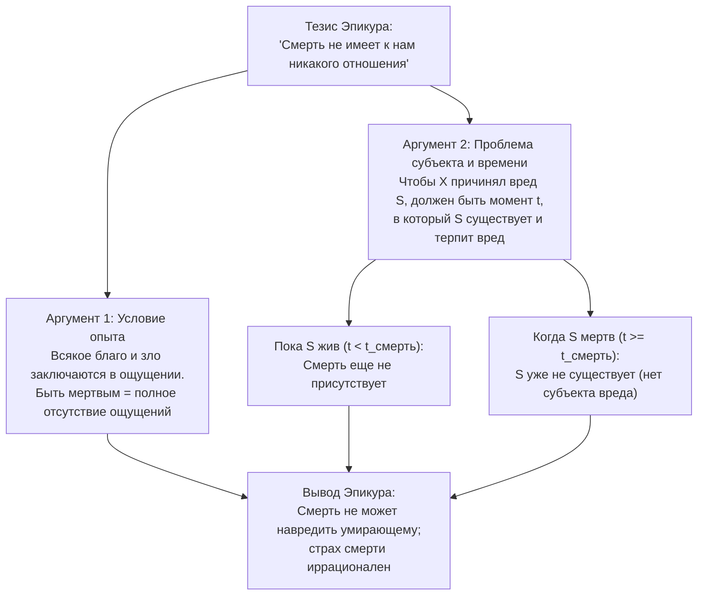
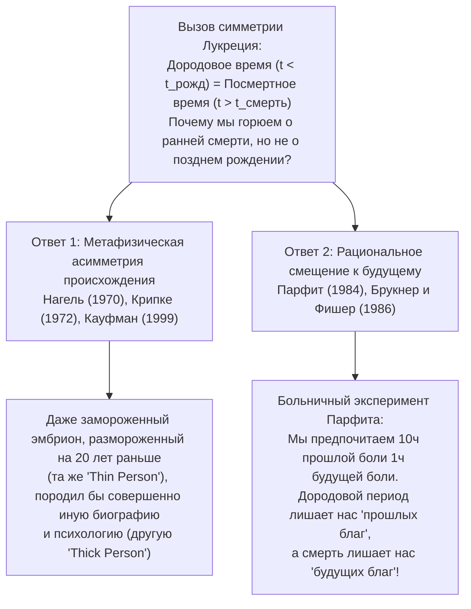

## 1. Введение: иррационален ли страх собственной смерти?

Из всех человеческих чувств лишь немногие кажутся столь универсальными, биологически укорененными и неизбежными, как <strong>страх смерти</strong>. Речь идет не просто о боязни физической боли агонии (*процесса умирания*, *dying*), а об экзистенциальном ужасе перед самим фактом <strong>бытия мертвым (*being dead*)</strong>: необратимым угасанием сознания, окончательным уничтожением «я» и переходом от бытия кем-то к абсолютному небытию.

Однако более двух тысяч трехсот лет назад древнегреческий философ <strong>Эпикур</strong> (341–270 гг. до н. э.) в своем знаменитом *«Письме к Менекею»* сформулировал один из самых парадоксальных и логически неумолимых аргументов в истории философии: <strong>собственная смерть не может причинить нам никакого вреда, а потому бояться смерти совершенно неразумно</strong>. Вскоре после этого римский поэт и философ <strong>Тит Лукреций Кар</strong> (ок. 99–55 гг. до н. э.) в поэме *«О природе вещей»* (*De rerum natura*) подкрепил этот тезис знаменитым <strong>аргументом симметрии</strong>: бесконечное время до нашего рождения в точности тождественно бесконечному времени после нашей смерти; и поскольку мы не испытываем ни малейшего ужаса, оглядываясь назад на свое дородовое небытие, почему мы должны испытывать страх, глядя вперед на свое посмертное небытие?

В современной аналитической философии — начиная с основополагающего эссе <strong>Томаса Нагеля</strong> *«Смерть»* (*Death*, 1970) и вплоть до работ <strong>Фреда Фельдмана</strong>, <strong>Джеффа Макмахана</strong>, <strong>Дерека Парфита</strong>, <strong>Энтони Брукнера</strong>, <strong>Джона Мартина Фишера</strong> и <strong>Бернарда Уильямса</strong> — этот древний эпикурейский вызов превратился в область строжайшего метафизического и аксиологического анализа. В настоящей статье подробно разбираются три центральные загадки философии смерти:

1. <strong>Проблема опыта, субъекта и времени</strong>: как смерть может быть злом для человека, если он не может испытывать состояние смерти и даже не существует, когда он мертв? (Эпикур против <strong>теории лишения</strong> Нагеля и Фельдмана).
2. <strong>Загадка симметрии Лукреция</strong>: если смерть плоха тем, что лишает нас времени жизни, которое мы могли бы прожить, почему мы точно так же не сожалеем о том, что не родились раньше? (Сущностность происхождения Нагеля против <strong>рационального смещения к будущему</strong> Парфита и Брукнера/Фишера).
3. <strong>Дилемма бессмертия</strong>: если смерть есть зло, потому что она обрывает блага жизни, означает ли это, что вечная жизнь была бы высшим благом, или же бессмертие обернулось бы невыносимым проклятием? (<strong>Случай Макропулос</strong> Бернарда Уильямса).

---

## 2. Вызов Эпикура: «Смерть не имеет к нам никакого отношения»

В *«Письме к Менекею»* Эпикур пишет строки, которые веками звучали как логическое заклинание против страха смерти:

> «Приучай себя к мысли, что <strong>смерть не имеет к нам никакого отношения</strong> (*ὁ θάνατος οὐδὲν πρὸς ἡμᾶς*). Ведь все хорошее и дурное заключается в ощущении, а смерть есть лишение ощущений [...]. Стало быть, самое страшное из зол, смерть, не имеет к нам никакого отношения, так как <strong>пока мы существуем, смерть еще отсутствует; когда же смерть присутствует, тогда мы не существуем</strong>. Следовательно, она не касается ни живущих, ни умерших, ибо для одних она еще не существует, а другие сами уже не существуют».

В аналитической философии смерти эпикурейская критика реконструируется в виде двух самостоятельных, но тесно связанных аргументов: <strong>аргумента опыта</strong> (опирающегося на гедонизм) и <strong>аргумента отсутствия субъекта и времени</strong> (*The Subject / Timing Problem*).

### 2.1. Формальная реконструкция аргумента опыта (Гедонизм)

1. <strong>Посылка 1 (Принцип опыта / Гедонизм)</strong>: Положение дел или событие $E$ внутренне плохо для субъекта $S$ тогда и только тогда, когда $E$ вызывает у $S$ неприятные или болезненные ментальные переживания (физическую боль или душевное страдание).
2. <strong>Посылка 2 (Тезис аннигиляции)</strong>: Смерть есть полное и необратимое угасание сознания и всякой способности к ощущению и переживанию ($\text{Быть мертвым} \implies \neg\text{Опыт}(S)$).
3. <strong>Посылка 3</strong>: Следовательно, состояние смерти не может вызывать у $S$ никаких болезненных или неприятных переживаний.
4. <strong>Вывод</strong>: <strong>Быть мертвым не может быть внутренним злом для $S$.</strong>

### 2.2. Формальная реконструкция проблемы субъекта и времени (*The Timing Problem*)

Даже если мы откажемся от узкого гедонизма, Эпикур ставит перед нами вторую, гораздо более глубокую метафизическую ловушку: <strong>кто именно терпит зло смерти и в какой момент времени $t$ он его терпит?</strong>

1. <strong>Посылка 1 (Условие существования субъекта и времени)</strong>: Чтобы любое событие или состояние $E$ было злом (вредом или несчастьем) для субъекта $S$, должен существовать такой момент времени $t$, в который:
   - (a) субъект $S$ существует в момент $t$, и
   - (b) благополучие $S$ в момент $t$ ухудшается вследствие $E$.
2. <strong>Посылка 2 (Взаимоисключение субъекта и смерти)</strong>: Пусть $t_{\text{смерть}}$ — момент смерти $S$:
   - Для любого момента $t < t_{\text{смерть}}$ (пока $S$ жив) смерть еще не наступила; следовательно, состояние бытия мертвым еще не вредит $S$.
   - Для любого момента $t \ge t_{\text{смерть}}$ (после того как $S$ умер) $S$ больше не существует ($\neg\exists S\text{ в }t$). А несуществующий не может иметь отрицательного уровня благополучия или быть носителем вреда.
3. <strong>Вывод</strong>: Не существует ни одного момента времени $t$, в который смерть была бы плоха для $S$. Следовательно, смерть не может быть злом для умершего.

---

## 3. Опровержение Томаса Нагеля и теория лишения (*Deprivation Account*)

В знаменитой статье *«Death»* (1970, позднее вошедшей в книгу *Mortal Questions*, 1979) <strong>Томас Нагель</strong> показал, что соблазнительный вывод Эпикура опирается на чрезмерно узкое представление о том, что является благом или злом для человека. Ответ Нагеля положил начало господствующей концепции в современной аналитической философии — <strong>теории лишения</strong> (*Deprivation Account of the Badness of Death*).

### 3.1. Внутреннее зло против внешнего (сравнительного) зла

Ключевая идея теории лишения состоит в разграничении двух принципиально разных способов, которыми нечто может быть плохим для человека:

- <strong>Внутреннее (позитивное) зло</strong>: состояние, само активное присутствие которого дурно само по себе, например приступ мигрени или оur душевное страдание.
- <strong>Внешнее (сравнительное или лишительное) зло</strong>: событие или состояние, которое само по себе не болезненно, но является плохим для субъекта $S$, поскольку <strong>лишает его внутренних благ, которыми он в противном случае обладал бы</strong>.

Смерть — это не внутреннее зло (никто не утверждает, что быть мертвым *больно*), а <strong>высшее сравнительное зло лишения</strong>: она плоха тем, что <strong>отнимает у нас жизнь и все те ценные переживания, замыслы, любовь и радости, которые мы испытали бы, если бы продолжали жить</strong>.

### 3.2. Формализация через возможные миры и интеграл жизненного благополучия

Философ <strong>Фред Фельдман</strong> в своей книге *Confrontations with the Reaper* (1992) строго формализовал теорию лишения с помощью семантики возможных миров Дэвида Льюиса и Роберта Сталнакера:

Пусть $w_{\text{действ}}$ — действительный мир, в котором субъект $S$ умирает в момент $t_1$ (например, в 30 лет в автокатастрофе), а $w_{\text{ближ}}$ — ближайший возможный мир, в котором это роковое событие не происходит и $S$ продолжает жить до момента $t_2$ (например, до 85 лет). Если определить совокупную внутреннюю ценность жизни $S$ в мире $w$ как интеграл его мгновенного благополучия $V_S(t, w)$ по времени:

$$W(S, w) = \int_{t_{\text{нач}}}^{t_{\text{кон}}(w)} V_S(t, w) \, dt$$

то общая сравнительная ценность события смерти $D$ субъекта $S$ в момент $t_1$ равна разности между совокупной ценностью жизни $S$ в действительном мире и совокупной ценностью его жизни в ближайшем контрфактическом мире:

$$\text{Ценность}(D, S) = W(S, w_{\text{действ}}) - W(S, w_{\text{ближ}}) = -\int_{t_1}^{t_2} V_S(t, w_{\text{ближ}}) \, dt$$

Всякий раз, когда будущая жизнь, которую $S$ прожил бы между $t_1$ и $t_2$ в мире $w_{\text{ближ}}$, содержит положительный чистый баланс благ ($\int_{t_1}^{t_2} V_S(t, w_{\text{ближ}}) \, dt > 0$), мы получаем $\text{Ценность}(D, S) < 0$: <strong>смерть в момент $t_1$ объективно плоха для $S$</strong>.

Эта формула мгновенно и элегантно объясняет наши базовые этические интуиции:
1. <strong>Почему смерть двадцатилетнего юноши гораздо трагичнее смерти девяностопятилетнего старца</strong>: потому что интервал лишения $[t_1, t_2]$ и интеграл утраченных будущих благ для умершего в 20 лет несоизмеримо больше.
2. <strong>Когда смерть может быть благом (рациональная эвтаназия)</strong>: если в ближайшем контрфактическом мире $w_{\text{ближ}}$ остаток жизни между $t_1$ и $t_2$ содержал бы лишь неисцелимые мучения и безнадежную агонию ($\int_{t_1}^{t_2} V_S(t, w_{\text{ближ}}) \, dt < 0$), то величина $-\int_{t_1}^{t_2} V_S$ меняет знак и становится положительной ($\text{Ценность}(D, S) > 0$). В таком случае смерть лишает не будущих благ, а будущих страданий, становясь сравнительным избавлением.

### 3.3. Три контрпримера Нагеля против условия опыта («То, чего вы не знаете, все равно вредит вам»)

Сторонники Эпикура часто возражают теории лишения с помощью поговорки *«Чего не знаешь, от того не страдаешь»* (*What you don't know can't hurt you*): если умерший не ведает о своей утрате и никогда не испытывает разочарования, как эта утрата может быть для него реальным злом?

Чтобы опровергнуть посылку о том, что всякое зло обязательно должно сознательно переживаться жертвой, Нагель приводит три знаменитых контрпримера:

1. <strong>Тайное предательство и насмешки за спиной</strong>: предположим, ваши мнимые друзья предают вас и жестоко высмеивают за глаза, но скрывают это настолько искусно, что вы умираете в полной уверенности в их любви и уважении, не испытав ни малейшего субъективного огорчения. Перестает ли от этого предательство быть злом для вас? Нагель утверждает, что нет: быть обманутым и преданным объективно плохо для вашей жизни, даже если вы никогда об этом не узнаете.
2. <strong>Необратимая травма мозга с впадением в младенчество</strong>: представьте умного, деятельного взрослого ученого, который получает тяжелую черепно-мозговую травму, снижающую его умственные способности до уровня трехмесячного младенца. Пациент больше не осознает, что он потерял: он счастливо улыбается в колыбели, когда его кормят и пеленают, не испытывая ни боли, ни фрустрации. Если бы имело значение только субъективное переживание, его положению можно было бы позавидовать; однако все мы понимаем, что с этим человеком произошла чудовищная катастрофа — именно из-за <strong>лишения той полноценной взрослой жизни, которую он мог бы прожить</strong>.
3. <strong>Нарушенное обещание, данное умирающему</strong>: человек посвящает всю жизнь труду или детям и на смертном одре берет с друга торжественное обещание исполнить его последнюю волю; после его смерти друг цинично нарушает клятву.

Эти примеры показывают, что благополучие и интересы человека <strong>не заперты в границах его кожи и мгновенных состояний сознания</strong>, а охватывают всю его биографическую историю, его реальные отношения с миром и его контрфактические возможности.

---

## 4. Проблема времени (*The Timing Problem*): пять стратегий в современной философии

Даже если мы согласимся, что смерть плоха как лишение ценного будущего, второй аргумент Эпикура по-прежнему требует точного ответа: <strong>в какой именно момент времени $t$ человек терпит зло смерти?</strong> В современной аналитической литературе сформировалось пять основных позиций для решения *Timing Problem*:

| Философская позиция | Основные представители | Когда смерть плоха для субъекта $S$? | Центральная идея и главное возражение |
| :--- | :--- | :--- | :--- |
| <strong>1. Атемпорализм / Этернализм</strong> (*Eternalism*) | Фред Фельдман (1992), Томас Нагель (1970) | <strong>Вневременно</strong> (по отношению к жизни как целому, без привязки к дате) | Сравнивает общую ценность действительного мира $w_{\text{действ}}$ с ближайшим миром $w_{\text{ближ}}$. *Возражение*: странно, что реальное несчастье происходит вообще вне времени. |
| <strong>2. Конкурентизм</strong> (*Concurrentism*) | Джулиан Ламонт (1998) | <strong>В самый момент наступления смерти</strong> ($t = t_{\text{смерть}}$) | Вред наносится в миг, когда летальное событие обрывает линию жизни. *Возражение*: смешивает момент причинения с периодом отсутствия утраченных благ. |
| <strong>3. Приоризм</strong> (*Priorism*) | Джордж Питчер (1984), Джоэл Фейнберг (1984) | <strong>До смерти, при жизни</strong> ($t < t_{\text{смерть}}$) | Преждевременная смерть ретроактивно обесценивает жизненные проекты и интересы, которые человек имел *при жизни*. *Возражение*: создает видимость «обратной причинности» (*backward causation*). |
| <strong>4. Субсеквентизм</strong> (*Subsequentism*) | Бен Брэдли (2009), Нил Фейт (2002) | <strong>После смерти, в период бытия мертвым</strong> ($t_1 < t \le t_2$) | Смерть плоха именно в те годы, когда субъект *наслаждался бы* жизнью ($V_S(t, w_{\text{действ}}) = 0 < V_S(t, w_{\text{ближ}})$). *Возражение*: как несуществующий в момент $t$ субъект может иметь уровень благополучия $0$ в $t$? |
| <strong>5. Индефинитизм</strong> (*Indefinitism*) | Томас Нагель (1970), Гарри Сильверстайн (1980) | <strong>Не имеет точной временной локализации</strong> | Поскольку зло смерти состоит в отсутствии целого отрезка возможной жизни, это лишение принадлежит истории субъекта без точечной локализации. |

Среди этих подходов широкое признание получил <strong>субсеквентизм</strong> Бена Брэдли (*Well-Being and Death*, 2009): Брэдли доказывает, что нет никакого метафизического противоречия в том, чтобы приписать человеку нулевой уровень благополучия ($V_S(t, w_{\text{действ}}) = 0$) в течение десятилетий после его смерти, когда в ближайшем возможном мире $w_{\text{ближ}}$ он имел бы положительное благополучие ($V_S(t, w_{\text{ближ}}) > 0$). Точно так же, как мы можем указать, *когда именно* мне повредил отказ в повышении по службе (в те месяцы, когда я получал меньшую зарплату), мы можем указать, *когда именно* смерть вредит человеку, умершему в 30 лет вместо 80: <strong>в течение тех 50 лет между его тридцатилетием и восьмидесятилетием</strong>.

---

## 5. Концепция относительного ко времени интереса (*Time-Relative Interest Account*, TRIA) Джеффа Макмахана

Стандартная формулировка теории лишения (как у Фельдмана) сталкивается, однако, с серьезным парадоксом в биоэтике. Если бы зло смерти определялось исключительно суммарным количеством утраченных счастливых лет ($\int_{t_1}^{t_2} V_S(t) \, dt$), то <strong>гибель недельного эмбриона или трехмесячного плода была бы большей трагедией, чем смерть 25-летнего человека</strong>, ведь эмбрион теряет 80 лет будущей жизни, тогда как 25-летний теряет только 55 лет. Тем не менее почти все мы убеждены, что смерть 25-летнего человека — со сформировавшимся самосознанием, планами, воспоминаниями и глубокими привязанностями — является неизмеримо более тяжелой трагедией для самой жертвы, чем ранний выкидыш. Почему?

Чтобы решить эту проблему, <strong>Джефф Макмахан</strong> в фундаментальном труде *The Ethics of Killing* (2002) разработал <strong>концепцию относительного ко времени интереса</strong> (*Time-Relative Interest Account*, <strong>TRIA</strong>). Опираясь на теорию тождества личности Дерека Парфита, Макмахан утверждает, что для оценки того, насколько плоха смерть для индивида $S$ в момент $t_1$, недостаточно просто сложить будущие блага между $t_1$ и $t_2$: каждое будущее благо в момент $t$ необходимо взвесить на <strong>степень психологического единства (связности и преемственности памяти, характера, желаний и намерений) $\mathcal{R}(t_1, t) \in [0, 1]$</strong>, которая существовала бы между субъектом в $t_1$ и его будущим «я» в момент $t$:

$$\text{Зло}_{\text{TRIA}}(D, S, t_1) = \int_{t_1}^{t_2} V_S(t, w_{\text{ближ}}) \cdot \mathcal{R}(t_1, t) \, dt$$

- У <strong>раннего эмбриона или плода</strong> еще нет ментальной жизни, воспоминаний и жизненных планов; поэтому степень психологического единства между ним и взрослым человеком, которым он стал бы через 30 лет, практически равна нулю ($\mathcal{R}(t_1, t) \approx 0$). Хотя сырой объем утраченной жизни огромен, *относительный ко времени интерес* плода в этом будущем крайне слаб.
- Напротив, у <strong>10-летнего ребенка или 20-летнего молодого человека</strong> и объем утраченного будущего ($t_2 - t_1$), и сила психологической связи $\mathcal{R}(t_1, t)$ с будущим «я» максимальны ($\mathcal{R}(t_1, t) \approx 1$). Вот почему смерть в юности или ранней зрелости представляет собой пик биографической трагедии.

---

## 6. Загадка симметрии Лукреция (*The Lucretian Symmetry Puzzle*)

Теперь мы подходим к самой тонкой головоломке философии смерти. В Книге III поэмы *«О природе вещей»* (стихи 832–842 и 972–975) римский эпикуреец <strong>Лукреций</strong> формулирует свой знаменитый <strong>аргумент зеркала (или симметрии)</strong>:

> «Оглянись назад и посмотри, как вся вечность минувшего времени до нашего рождения была для нас ничем. Природа подносит нам это как зеркало (*speculum*) того будущего времени, которое наступит после нашей окончательной смерти».

Допустим, человек родился в 1980 году и умер в 2060 году.
- Существует вечность <strong>дородового небытия</strong> ($t < 1980$).
- Существует вечность <strong>посмертного небытия</strong> ($t > 2060$).

Если сторонники теории лишения (Нагель и Фельдман) правы в том, что умереть в 2060 году (вместо того чтобы дожить до 2080 года) плохо, потому что это <strong>лишает нас 20 лет благ между 2060 и 2080 годами</strong>, то Лукреций спрашивает: <strong>почему же тогда не точно так же плохо родиться в 1980 году вместо 1960 года, что лишило нас 20 лет благ между 1960 и 1980 годами?</strong>

В действительности все мы демонстрируем <strong>глубокую эмоциональную и оценочную асимметрию</strong>: мы совершенно спокойно и равнодушно смотрим на века до нашего рождения, но с тоской или ужасом думаем о времени после нашей смерти, которое нам не суждено прожить. Является ли эта асимметрия иррациональной непоследовательностью (как считал Лукреций), или же между дородовым прошлым и посмертным будущим существует глубокое метафизическое или рациональное различие?

### 6.1. Метафизический ответ Томаса Нагеля: сущностность происхождения

Ответ <strong>Томаса Нагеля</strong> (подкрепленный тезисом о *необходимости происхождения* Сола Крипке в *Naming and Necessity*, 1972) носит <strong>метафизический (модальный)</strong> характер:

- <strong>Дата смерти случайна (контингентна)</strong>: тот самый человек, который умер в 2060 году, *мог бы прожить дольше* (до 2080 года), оставаясь нумерически самим собой. Существует подлинный возможный мир, в котором *я* живу на двадцать лет дольше.
- <strong>Дата рождения (и зачатия) сущностна</strong>: человек <strong>не мог бы родиться существенно раньше</strong> того времени, когда он родился, поскольку генетическая и биологическая идентичность индивида определяется конкретной яйцеклеткой и сперматозоидом, от которых он произошел, и временем зачатия. Любой человек, родившийся в 1960 году или в XVIII веке вместо 1980 года, <strong>был бы не мной, а совершенно другим человеком</strong>. Следовательно, время до 1980 года — это не время, которого *я* был лишен, ибо я просто не мог тогда существовать.

### 6.2. Возражение замороженных эмбрионов и ответ Фредерика Кауфмана («Тонкая личность» против «Толстой личности»)

Однако современная биоэтика поставила биологический аргумент Нагеля под удар. Представим, что <strong>эмбрион, зачатый in vitro в 1980 году</strong>, подвергается криоконсервации в жидком азоте. В действительном мире его размораживают и имплантируют в <strong>2000 году</strong>, и он рождается в этом году. Но метафизически и биологически возможно, чтобы *тот же самый эмбрион* (с идентичной ДНК и гаметическим происхождением) был разморожен и имплантирован в <strong>1980 году</strong>, родившись на двадцать лет раньше. Даже зная, что его эмбрион пролежал замороженным двадцать лет, станет ли этот человек горько оплакивать утрату 1980–2000 годов так же, как он боится умереть на двадцать лет раньше срока? Разумеется, нет!

Чтобы защитить позицию Нагеля перед лицом мысленного эксперимента с замороженным эмбрионом, <strong>Фредерик Кауфман</strong> (1999) ввел различие между:
- <strong>Личностью в «тонком» смысле (*Thin Person*)</strong>: голым биологическим организмом или генетическим субстратом (эмбрионом).
- <strong>Личностью в «толстом» (насыщенном) смысле (*Thick Person*)</strong>: конкретным психологическим субъектом, сформированным его биографической памятью, языком, культурой, друзьями, ценностями и историческим опытом.

Кауфман доказывает, что если бы эмбрион разморозили на двадцать лет раньше (в 1980 году вместо 2000-го), он вырос бы в другую эпоху, с другими друзьями, другим опытом и другой жизненной историей: хотя это была бы та же самая *тонкая личность* (тот же генетический организм), это была бы <strong>совершенно иная «толстая» (психологическая и биографическая) личность</strong>. Когда я боюсь смерти, продолжать жить хочет мое *нынешнее насыщенное «я»* с моими воспоминаниями и проектами; и это *насыщенное «я»* никогда не могло бы возникнуть за двадцать лет до моего рождения, но вполне может продлиться на двадцать лет в будущее.

### 6.3. Ответ рационального смещения к будущему: Дерек Парфит, Энтони Брукнер и Джон Мартин Фишер

Альтернативный путь — блестяще развитый <strong>Энтони Брукнером и Джоном Мартином Фишером</strong> в статье *«Why Is Death Bad?»* (1986) на основе идей <strong>Дерека Парфита</strong> (*Reasons and Persons*, 1984) — уступает Лукрецию в том, что дородовое и посмертное лишение могут быть симметричны с вневременной точки зрения, но показывает, что наша асимметрия по отношению к смерти объясняется фундаментальным свойством человеческой рациональности: <strong>наши рациональные установки по отношению к благам и страданиям асимметричны во времени (нам присуще смещение к будущему, *future-bias*)</strong>.

В главе 8 книги *Reasons and Persons* Парфит предлагает знаменитый мысленный эксперимент <strong>«Операция в больнице» (*My Past or Future Operations*)</strong>:

> Вы просыпаетесь на больничной койке с временной амнезией относительно того, какой сегодня день. Вы знаете, что в этой больнице проводят мучительную операцию без наркоза (поскольку наркоз был бы смертелен), но после нее дают препарат, полностью стирающий память о перенесенной боли. Вы спрашиваете медсестру, сделали ли вам уже операцию. Медсестра заглядывает в две карты и говорит:
> - <strong>Случай А (Пациент прошлого)</strong>: «Либо вы пациент, которого оперировали <strong>вчера</strong>, и вы перенесли <strong>10 часов</strong> мучительной боли (о которой уже забыли благодаря препарату)...»
> - <strong>Случай Б (Пациент будущего)</strong>: «...либо вы пациент, которого будут оперировать <strong>сегодня вечером</strong>, и вам предстоит перенести <strong>1 час</strong> мучительной боли».

Какую из двух новостей вы горячо предпочтете услышать? <strong>Абсолютно каждый человек с огромным облегчением предпочтет Случай А (10 часов уже прошедшей боли) Случаю Б (1 час боли в будущем).</strong> Нас непосредственно и глубоко волнуют *будущие* страдания и удовольствия, тогда как к болям и удовольствиям, *которые уже остались позади в прошлом*, мы относительно безразличны.

Брукнер и Фишер применяют этот же симметричный принцип к <strong>удовольствиям и благам жизни</strong>:
- Представьте, что вам говорят, будто в вашей жизни есть 1000 дней необычайного счастья: в одном сценарии эти 1000 дней <strong>уже прошли в вашем прошлом</strong> (и вы о них забыли); в другом сценарии эти 1000 дней <strong>ждут вас впереди в будущем</strong>. Рационально все мы предпочитаем, чтобы блага были *впереди* (в будущем), а не *позади* (в прошлом).
- Но ведь <strong>позднее рождение</strong> лишает нас исключительно *прошлых благ* (переживаний, которые к сегодняшнему дню уже закончились бы и остались позади), тогда как <strong>ранняя смерть</strong> лишает нас *будущих благ* (переживаний, которые ждали бы нас впереди). Следовательно, сожалеть о посмертном небытии и оставаться равнодушным к дородовому небытию — <strong>это вовсе не иррациональное противоречие</strong>, а прямое следствие нашей временной устремленности в будущее.

---

## 7. Было бы бессмертие благословением? Бернард Уильямс и случай Макропулос

Если смерть является злом потому, что отнимает у нас будущее и обрывает наши проекты, то логически казалось бы, что <strong>высшим идеалом было бы не умирать никогда — обрести вечное бессмертие ($t_{\text{кон}} \to \infty$)</strong>. Однако в одном из самых блестящих и влиятельных философских эссе XX века — *«Дело Макропулос: размышления о скуке бессмертия»* (*The Makropulos Case: Reflections on the Tedium of Immortality*, 1973) — британский философ <strong>Бернард Уильямс</strong> выдвинул провокационный тезис: хотя смерть почти всегда приходит слишком рано и является злом в любой конкретный момент, <strong>вечное бессмертие стало бы невыносимым проклятием</strong>.

### 7.1. Элина Макропулос и застывший возраст в 337 лет

Уильямс заимствует название из пьесы Карела Чапека (по которой Леош Яначек написал оперу) *«Средство Макропулоса»*. Ее главная героиня, оперная певица <strong>Элина Макропулос</strong> (скрывающаяся в разные эпохи под именами с инициалами <strong>Э. М.</strong>), в XVI веке в возрасте <strong>42 лет</strong> выпила эликсир долголетия, приготовленный ее отцом, придворным врачом императора Рудольфа II. Эликсир остановил ее биологическое старение на триста лет.

К моменту действия пьесы Элине Макропулос исполняется <strong>337 лет</strong>, но она сохраняет тело, красоту и здоровье 42-летней женщины. Она не страдает от физической дряхлости, как бессмертные *струльдбруги* у Джонатана Свифта; тем не менее ее душа погрузилась в <strong>состояние ледяного безразличия, пресыщения и бездонной скуки (*tedium*)</strong>. Она любила десятки раз, видела триумф и крах всех политических движений, достигла абсолютного совершенства в искусстве, и все происходящее вокруг кажется ей механическим повторением пустых декораций. Как пишет Уильямс, в ней «все стало холодным, гигантским и пустым». В финале, когда ей предлагают снова принять эликсир, чтобы прожить еще триста лет, <strong>Элина решительно отказывается, сжигает рецепт и умирает с глубоким облегчением</strong>.

### 7.2. Условные желания против категорических желаний и дилемма бессмертия

Чтобы доказать, что судьба Элины Макропулос — не случайная психологическая особенность, а структурная неизбежность человеческого существования, Уильямс вводит фундаментальное различие между двумя типами желаний:

1. <strong>Условные желания (*Conditional Desires*)</strong>: желания, которые предполагают условие *«если я буду продолжать жить...»* (например: *«если завтра я буду жив, я хочу вкусно поесть, не мерзнуть и носить удобную одежду»*). Условные желания опираются на факт жизни, но <strong>не дают нам никакого основания хотеть продолжать жить</strong>.
2. <strong>Категорические желания (*Categorical Desires*)</strong>: глубокие проекты, страсти, любовь и обязательства, которые не зависят от условия продолжения жизни, а сами <strong>отвечают на вопрос, ради чего вообще стоит продолжать жить</strong> (например: завершить научное открытие, вырастить ребенка, бороться за справедливость, написать книгу). Именно категорические желания движут нас в будущее и делают смерть злом, поскольку смерть их обрывает.

На этой основе Уильямс формулирует <strong>дилемму бессмертия</strong>: чтобы бессмертная жизнь была желанной для меня, она должна одновременно удовлетворять двум условиям:
- <strong>Условие 1 (Отсутствие скуки)</strong>: она должна продолжать порождать категорические желания, поддерживающие мой интерес к бытию без падения в бесконечную скуку Э. М.
- <strong>Условие 2 (Сохранение тождества личности)</strong>: человек, живущий этой будущей жизнью, должен оставаться *действительно мной*, сохраняя узнаваемую преемственность с моим характером, ценностями и личной идентичностью.

Уильямс доказывает, что на бесконечном интервале времени ($t \to \infty$) эти два условия <strong>взаимно несовместимы</strong>:

$$\begin{cases} \text{Ветвь А (Определенный и устойчивый характер)} \implies \text{Исчерпание возможных переживаний} \implies \text{Неизбежная скука (Случай Макропулос)} \\ \text{Ветвь Б (Радикальная и бесконечная смена характера и памяти)} \implies \text{Разрыв психологической преемственности} \implies \text{Утрата 'я' (равносильна смерти)} \end{cases}$$

- <strong>Ветвь А</strong>: если у меня есть определенный человеческий характер (со своими склонностями, темпераментом и границами), то через века и тысячелетия я исчерпаю все комбинации опыта, совместимые с этим характером. Новизна исчезнет, и я неизбежно впаду в ледяное оцепенение Элины Макропулос.
- <strong>Ветвь Б</strong>: если же ради спасения от скуки моя личность, память и ценности каждые двести лет будут полностью стираться и заменяться совершенно новыми, то существо, которое будет жить через десять тысяч лет, будет иметь со мной не больше психологической связи, чем любой случайный незнакомец. Это буду уже не *я*: просто в одном теле сменится череда совершенно разных личностей.

### 7.3. Ответ Джона Мартина Фишера: исчерпаемые удовольствия против повторяемых удовольствий

Не все современные философы согласны с пессимизмом Бернарда Уильямса относительно бессмертия. <strong>Джон Мартин Фишер</strong> в статье *«Why Immortality Is Not So Bad»* (1994) утверждает, что Уильямс допускает две ошибки:

1. <strong>Самоисчерпывающиеся удовольствия (*self-exhausting pleasures*) против повторяемых удовольствий (*repeatable pleasures*)</strong>: Уильямс рассматривает жизнь как список одноразовых достижений, которые после выполнения теряют привлекательность (покорить Эверест в первый раз). Но огромная часть переживаний, делающих жизнь ценной, <strong>по своей природе повторяема</strong> без малейшей утраты ценности: слушать виолончельные сюиты Баха, смотреть на океан на закате, беседовать с близким другом, наслаждаться вкусной едой, любовью или духовным созерцанием.
2. <strong>Органическая постепенная трансформация</strong>: человеческому характеру не нужно выбирать между каменной застылостью Элины Макропулос и полной внезапной амнезией. Бессмертный человек мог бы развиваться органично и постепенно на протяжении веков — осваивая новые науки, языки и искусства, — всегда сохраняя перекрывающиеся звенья психологической преемственности со своим прошлым и никогда не исчерпывая себя.

---

## 8. Заключение: смерть как обратная сторона ценности жизни

Пройдя этот долгий путь от сада Эпикура в Афинах до современных дискуссий в аналитической философии, мы открываем глубокую истину, соединяющую метафизику с экзистенциальной мудростью:

1. <strong>Эпикур был прав в одном важнейшем пункте</strong>: состояние бытия мертвым — это не темная комната, где наша душа заперта в холоде, одиночестве и тишине. В смерти нет ни переживаний, ни боли; бояться смерти так, словно мы будем «присутствовать» при собственном небытии, — это иллюзия воображения.
2. <strong>Но Томас Нагель и теория лишения правы в главном</strong>: смерть — это реальное и объективное зло, когда она обрывает ценную жизнь, не из-за того, что она заставляет нас *чувствовать*, а из-за всего горизонта опыта, любви, познания и замыслов, которого она <strong>нас лишает</strong>.
3. <strong>Зеркало Лукреция и случай Макропулос Уильямса завершают картину</strong>: мы скорбим о будущей смерти, а не о дородовом небытии, потому что мы — существа, устремленные в будущее через наши категорические желания; и именно <strong>временная конечность</strong> придает неотложность, драматизм и неповторимую весомость каждому нашему выбору.

В конечном счете <strong>рациональный страх смерти — это не что иное, как тень, отбрасываемая нашей любовью к жизни</strong>. Если бы смерть не отнимала у нас ничего ценного, то и сама жизнь не имела бы никакой цены. Философское понимание того, почему смерть есть лишение, не повергает нас в отчаяние; напротив, оно напоминает нам, что конечный промежуток между нашим рождением и нашей смертью — это неповторимое настоящее, в котором мы еще существуем и еще чувствуем, — достоин того, чтобы прожить его с предельной ясностью, благодарностью и полнотой.
