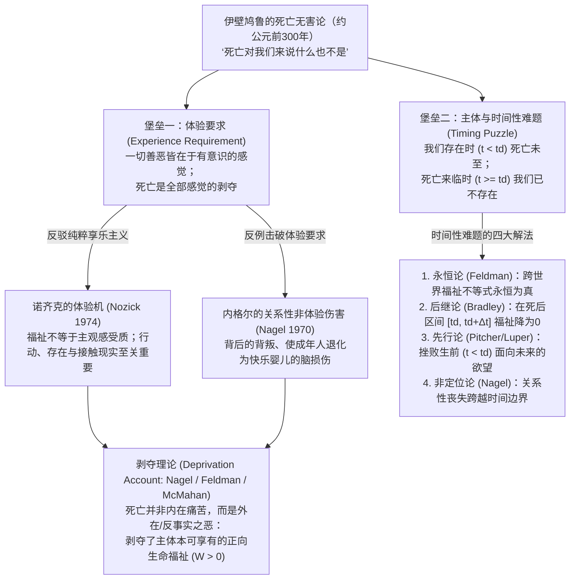
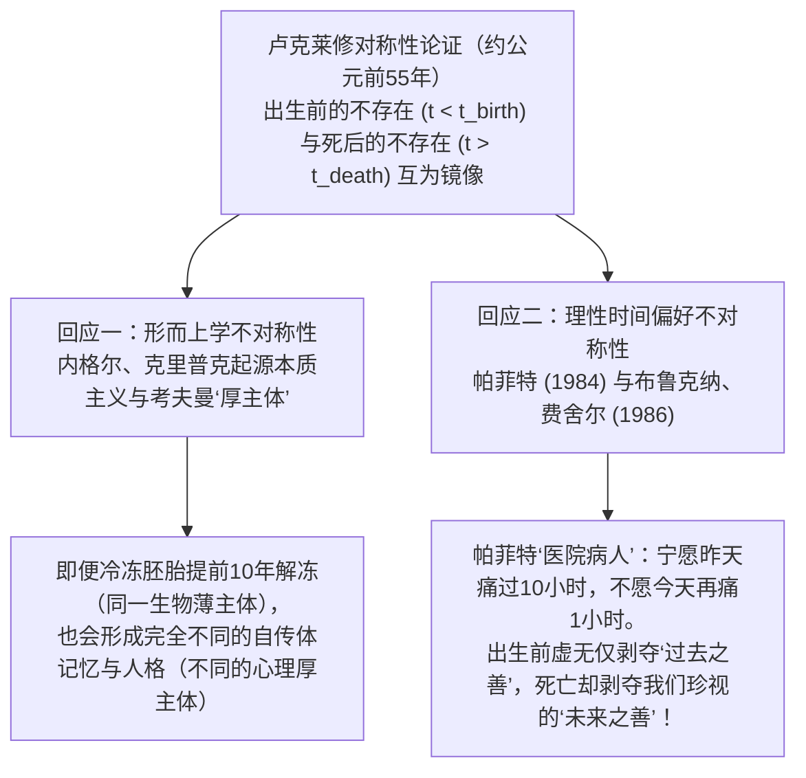

## 1. 引言：必死性的存在主义悖论与分析哲学的挑战

在人类文明的法律、伦理与日常直觉中，<strong>死亡通常被视为降临在个人身上最深重的灾祸之一</strong>。谋杀之所以被定为极罪，正是因为剥夺他人生命对受害者造成了不可逆转的巨大伤害。然而，一旦我们采纳当代哲学所说的<strong>“湮灭假设”（Annihilation Assumption / Termination Thesis）</strong>——即生理死亡标志着意识体验与个人存在的永久终结——一个深刻的形而上学与价值论悖论便浮出水面：既然死人不会感到黑暗、孤独、痛苦或悔恨，甚至连承受伤害的主体都已不复存在，<strong>处于已死状态（being dead）怎么可能对死者而言是一件“坏事”？</strong>

两千多年前，古希腊哲学家<strong>伊壁鸠鲁（Epicurus, 公元前341–270）</strong>在《致美诺西斯的信》（*Letter to Menoeceus*）中提出了著名的“无害论”，古罗马诗人<strong>卢克莱修（Lucretius, 约公元前99–55）</strong>则在《物性论》（*De Rerum Natura*）中补充了震撼人心的“对称性论证”。自1970年<strong>托马斯·内格尔（Thomas Nagel）</strong>发表经典论文《死亡》（*"Death"*）以来，弗雷德·费尔德曼（Fred Feldman）、德里克·帕菲特（Derek Parfit）、杰夫·麦克马汉（Jeff McMahan）、约翰·马丁·费舍尔（John Martin Fischer）、本·布拉德利（Ben Bradley）与伯纳德·威廉姆斯（Bernard Williams）等分析哲学家借助可能世界语义学、反事实福利积分与个人同一性理论，对这一古老难题展开了严密的现代重构。

### 概念澄清：临死过程、必死性与已死状态

首先必须严格区分日常语言中混称为“死亡”的三个概念（设主体 $S$ 出生于 $t_{\text{birth}}$，于 $t_d$ 时刻永久停止生命）：
1. <strong>临死的过程（Dying, $t \in [t_0, t_d)$）</strong>：主体仍然活着且有意识，常伴随剧烈肉体痛苦（内在恶 $u_S(t) < 0$）。但无痛的瞬间猝死依然是悲剧，说明死亡之恶不能化约为临死之痛。
2. <strong>对必死性的预知（Mortality, $t_{\text{birth}} < t < t_d$）</strong>：生前的死亡焦虑；但若死亡本身无害，这种恐惧便是非理性的。
3. <strong>已死状态 / 死后不存在（Being Dead, $t \ge t_d$）</strong>：主体不存在，体验效用恒为零（$u_S(t) = 0$）。这正是哲学争议的核心。

---

## 2. 伊壁鸠鲁的“无害论证”及其两座逻辑堡垒

在《致美诺西斯的信》（第124–125节）中，伊壁鸠鲁写道：

> “你应当习惯于相信<strong>死亡对我们来说什么也不是</strong>，因为一切善与恶都在于感觉，而死亡正是感觉的完全丧失……<strong>因此，死亡这最可怕的恶，对我们来说什么也不是：因为当我们存在时，死亡尚未来临；而当死亡来临时，我们已不复存在。</strong>”

当代分析哲学将其拆解为两座相互独立的逻辑堡垒：

- <strong>第一座堡垒：体验要求（The Experience Requirement）</strong>：一个事态 $X$ 对主体 $S$ 是坏事，当且仅当 $X$ 引起 $S$ 不愉快的有意识感觉（享乐主义价值论）。既然死亡是全部感觉的丧失，死亡便不可能伤害 $S$。
- <strong>第二座堡垒：主体与时间性难题（The Timing Puzzle）</strong>：任何伤害都必须在某个特定时间 $t$ 伤害某个在该时刻存在的主体 $S$。但在 $t < t_d$ 时死亡尚未发生，未发生之事不能造成伤害；在 $t \ge t_d$ 时 $S$ 已不存在，没有主体可受伤害。因此不存在任何时刻 $t$ 使死亡对 $S$ 为恶。

---

## 3. 击破体验要求：诺齐克的“体验机”与内格尔的非体验性伤害

### 3.1 罗伯特·诺齐克的“体验机”（Experience Machine, 1974）

在《无政府、国家和乌托邦》（1974）中，<strong>罗伯特·诺齐克（Robert Nozick）</strong>设计了著名的思想实验：假设神经科学家造出了一台“体验机”，只要漂浮在营养槽中接上电极，就能获得写出一流小说、攀登高峰、被挚爱包围等完美逼真的主观快乐体验。如果伊壁鸠鲁的“体验要求”成立（福祉仅取决于主观感受 $\int u_{\text{felt}}(t)\,dt$），人人都应毫不犹豫地终身接入机器。然而绝大多数人拒绝接入，因为我们不仅想要“做某事的感觉”，更想要<strong>真正去做某事（agency）、成为某种真实的人、并与客观现实世界发生真实联结</strong>。

### 3.2 托马斯·内格尔《死亡》（1970）中的三大反例

<strong>托马斯·内格尔</strong>在1970年指出，一个人的祸福不仅取决于瞬间的意识状态，更取决于其历史、可能性以及与世界的跨越时间的关系：
1. <strong>不知情的背叛（Betrayal Behind One's Back）</strong>：被配偶与挚友在背后无情嘲弄和背叛的人，即便至死不知情、从未感到痛苦，依然遭受了真实的关系性伤害。
2. <strong>临终诺言的背弃</strong>：学者去世后，挚友违背誓言将其毕生手稿付之一炬，使死者的核心人生计划归于徒劳。
3. <strong>满足的婴儿（Severe Brain Injury / The Contented Infant）</strong>：一位前途无量的30岁科学家因脑损伤永久退化为心满意足的三个月大婴儿，每天只要喝奶摇铃就咯咯傻笑，毫无痛苦。按享乐主义，他毫无损失；但所有人都视之为惨痛悲剧——因为<strong>他本可拥有的丰富智性与创造性生命被剥夺了</strong>。同理，将可能性降至零的死亡更是深重的剥夺之恶。

---

## 4. 剥夺理论（Deprivation Account）：可能世界反事实积分与时间相对利益

以<strong>弗雷德·费尔德曼（Fred Feldman, 1991）</strong>与<strong>本·布拉德利（Ben Bradley, 2009）</strong>为代表的<strong>剥夺理论</strong>区分了<strong>内在恶（Intrinsic Badness，$u_S(t) < 0$）</strong>与<strong>外在/反事实恶（Extrinsic Badness）</strong>：死亡并非内在痛苦，而是因为它<strong>剥夺了死者若未死本可继续享有的正向生命善好</strong>。

### 4.1 可能世界语义学公式化

设主体 $S$ 在可能世界 $w$ 的瞬时福祉为 $u_S(t, w)$，死于 $t_d(w)$（死后 $u_S = 0$），则其终生总福祉为：

$$W(S, w) = \int_{t_{\text{birth}}}^{t_d(w)} u_S(t, w)\,dt$$

若在现实世界 $w_{\text{actual}}$ 中 $S$ 因死亡事件 $e_d$ 死于 $t_d$，而在未发生 $e_d$ 的<strong>最近可能世界 $w_{\text{nearest}}$</strong> 中 $S$ 多活了 $\Delta t > 0$，则死亡事件 $e_d$ 的外在价值为：

$$\text{Val}_{\text{extrinsic}}(e_d, S, w_{\text{actual}}) = W(S, w_{\text{actual}}) - W(S, w_{\text{nearest}}) = -\int_{t_d}^{t_d + \Delta t} u_S(t, w_{\text{nearest}})\,dt$$

- 当未来反事实生命净值为正（$\int_{t_d}^{t_d+\Delta t} u_S > 0$）时，$\text{Val}_{\text{extrinsic}} < 0$，死亡是深重的外在恶；且青年早逝损失的 $\Delta t$ 极大，故比高龄善终悲惨得多。
- 当绝症患者未来只剩无法缓解的剧痛（$\int_{t_d}^{t_d+\Delta t} u_S < 0$）时，$\text{Val}_{\text{extrinsic}} > 0$，解释了为何安乐死或解脱性死亡可以是仁慈的福祉。

### 4.2 胚胎悖论与杰夫·麦克马汉的时间相对利益论（TRIA, 2002）

纯粹按终身积分计算会引发<strong>胚胎悖论</strong>：早期流产胎儿损失了80年未来生命，难道比25岁青年被谋杀（损失55年）更悲惨吗？<strong>杰夫·麦克马汉（Jeff McMahan）</strong>在《杀戮伦理学》（2002）中引入帕菲特的<strong>心理连续性关系 $\mathcal{R}_S(t_d, t) \in [0, 1]$</strong> 对未来反事实福祉进行折现，提出<strong>时间相对利益论（Time-Relative Interest Account, TRIA）</strong>：

$$\text{Badness}_{\text{TRIA}}(e_d, S, t_d) = \int_{t_d}^{t_d + \Delta t} \mathcal{R}_S(t_d, t) \cdot u_S(t, w_{\text{nearest}})\,dt$$

早期胎儿尚无自传体记忆与未来计划，与数十年后的成年自我心理联结度 $\mathcal{R}_S \approx 0$；而25岁青年既拥有极高的心理统一性（$\mathcal{R}_S \approx 1$），又拥有漫长的剩余寿命 $\Delta t$，故青年早逝的悲剧性达到全局峰值。

---

## 5. 时间性难题的五大解法：死亡究竟在“何时”伤害了死者？

面对伊壁鸠鲁的第二座堡垒（何时受伤害？），当代形而上学提出了五种竞争方案：

| 理论立场（代表人物） | 伤害发生的时间坐标 ($t$) | 核心形而上学与价值论机制 | 主要理论优势 | 主要面临的批评 |
| :--- | :--- | :--- | :--- | :--- |
| <strong>1. 永恒论 / 超时间论</strong> (Fred Feldman) | <strong>永恒 / 任何时刻</strong> (Atemporally) | 跨世界不等式 $W(S, w_{\text{actual}}) < W(S, w_{\text{nearest}})$ 是不受时间约束的永恒真理 | 彻底绕开死后主体不存在的难题 | 混淆了“命题永恒为真”与“伤害发生的具体日期” |
| <strong>2. 后继论 (Subsequentism)</strong> (Ben Bradley, Neil Feit) | <strong>死后被剥夺区间</strong> $t \in [t_d, t_d + \Delta t]$ | 在 $[t_d, t_d+\Delta t]$ 内现实福祉为 $0$，低于反事实福祉 $u > 0$ | 与摔断腿错过下周夏威夷度假的受伤时间完全一致 | 需借助四维时空永恒论向已死之人赋予 $u=0$ 的福祉值 |
| <strong>3. 先行论 (Priorism)</strong> (George Pitcher, Steven Luper) | <strong>生前在世期间</strong> $t < t_d$ | $t_d$ 的早逝使生前 ($t < t_d$) 面向未来的核心欲望与计划注定落空 | 严格遵守现在论及“受害主体必须活着”的条件 | 说一个20岁健康快乐的人因35岁会死而“当下已受损”违反直觉 |
| <strong>4. 同时论 (Concurrentism)</strong> (Julian Lamont) | <strong>死亡发生的瞬间</strong> $t = t_d$ | 伤害发生在生命与可能性丧失的精确边界点 $t_d$ | 使受伤害时刻与致死事件时刻重合 | 边界两难：在 $t_d$ 主体要么还活着要么已死 |
| <strong>5. 非定位论 (Indeterminism)</strong> (Thomas Nagel) | <strong>无精确时钟坐标</strong> (Unlocalized) | 历史性主体的可能性跨越时间，关系性丧失属于整个人生 | 契合人生整体叙事性，无需人工打时间戳 | 拒斥了“一切真实伤害必有精确时刻”的前提 |

---

## 6. 卢克莱修的对称性论证与帕菲特的时间偏见

在《物性论》第三卷中，<strong>卢克莱修</strong>举起了一面时间之镜：<strong>出生前的虚无（Prenatal Non-Existence, $t < t_{\text{birth}}$）</strong>与<strong>死后的虚无（Posthumous Non-Existence, $t > t_d$）</strong>完全对称。如果死后不存在因剥夺了更晚的死亡而可怕，为何我们从不因出生前不存在剥夺了我们“更早的出生”（比如早出生40年）而痛哭流涕？

当代哲学有两条经典回应路径：
1. <strong>内格尔与克里普克的“起源本质主义”（Origin Essentialism）及考夫曼的“厚主体”（Thick Person）</strong>：索尔·克里普克（Saul Kripke）指出，个体的受精卵配子起源是其本质属性，提前一百年出生的人绝不可能是“你”。针对弗雷德里克·考夫曼（Frederik Kaufman 1999）提出的<strong>“冷冻胚胎反例”</strong>（同一个冷冻胚胎本可提前十年解冻出生），考夫曼区分了生物学上的“薄主体”与由特定记忆、人际依恋和性格构成的<strong>“厚主体”（Thick Person）</strong>：即便胚胎提前十年解冻，长成的也是一个心理上完全陌生的厚主体，而非现在的“我”。
2. <strong>帕菲特的“医院病人”与面向未来的理性偏见（Brueckner & Fischer 1986）</strong>：在<strong>德里克·帕菲特</strong>《理与人》（1984）著名的<strong>“医院病人”思想实验</strong>中，你醒来失去短期记忆，护士告知你<strong>要么是昨天已做完10小时剧痛手术的病人A，要么是今天下午将做1小时剧痛手术的病人B</strong>。所有人都会祈祷自己是病人A！同样，我们也强烈偏好快乐位于未来而非已经结束的过去。布鲁克纳与费舍尔指出，正是这种<strong>面向未来的不对称时间偏好（Bias Toward the Future）</strong>解释了卢克莱修之谜：出生前的虚无剥夺的只是我们已经漠不关心的<strong>过去之善</strong>，而死亡剥夺的却是我们深切珍视的<strong>未来之善</strong>！

---

## 7. 永生会是祝福吗？伯纳德·威廉姆斯与“马克罗普洛斯案件”

如果死亡因截断生命而为恶，那么<strong>永生不死（Immortality）</strong>是否就是终极福祉？英国哲学家<strong>伯纳德·威廉姆斯（Bernard Williams, 1973）</strong>在名篇《马克罗普洛斯案件：论永生的厌倦》中给出了否定回答。剧作主角<strong>Elina Makropulos（E.M.）</strong>在42岁服下长生药，永葆青春与艺术才华活到<strong>337岁</strong>，最终却陷入了冰冷彻骨、万物皆如机械重复的<strong>终极厌倦（tedium）</strong>，主动拒绝续命并欣然赴死。

威廉姆斯区分了<strong>条件性欲望（Conditional Desires，“只要我还活着，我想吃好睡好”）</strong>与赋予我们活下去理由的<strong>范畴性欲望（Categorical Desires，“我想写完这部书、抚养孩子长大”）</strong>，并提出了<strong>永生两难（Dilemma of Immortality）</strong>：
- <strong>第一角（固定性格 $\implies$ 必然厌倦）</strong>：如果永生者保持确定的人格同一性，在无穷时间 $t \to \infty$ 中，一切与该性格相容的体验组合终将耗尽，范畴性欲望枯竭，陷入E.M.式的绝望厌倦。
- <strong>第二角（彻底重塑性格 $\implies$ 丧失同一性）</strong>：如果靠定期洗掉记忆、彻底更换人格来避免厌倦，那么未来的那个陌生主体已不再是“我”，这无异于经历一连串精神死亡。

尽管费舍尔（John Martin Fischer）反驳说像欣赏巴赫大提琴组曲、美食与友谊这类<strong>“可重复的快乐”（Repeatable Pleasures）</strong>以及渐进的人格演化足以支撑有意义的漫长生命，威廉姆斯的洞察依然深刻揭示了：<strong>死亡之所以为恶，恰恰是因为有限生命中的范畴性欲望、爱与创造如此珍贵——死亡的坏处，正是生命之美好的镜像。</strong>
