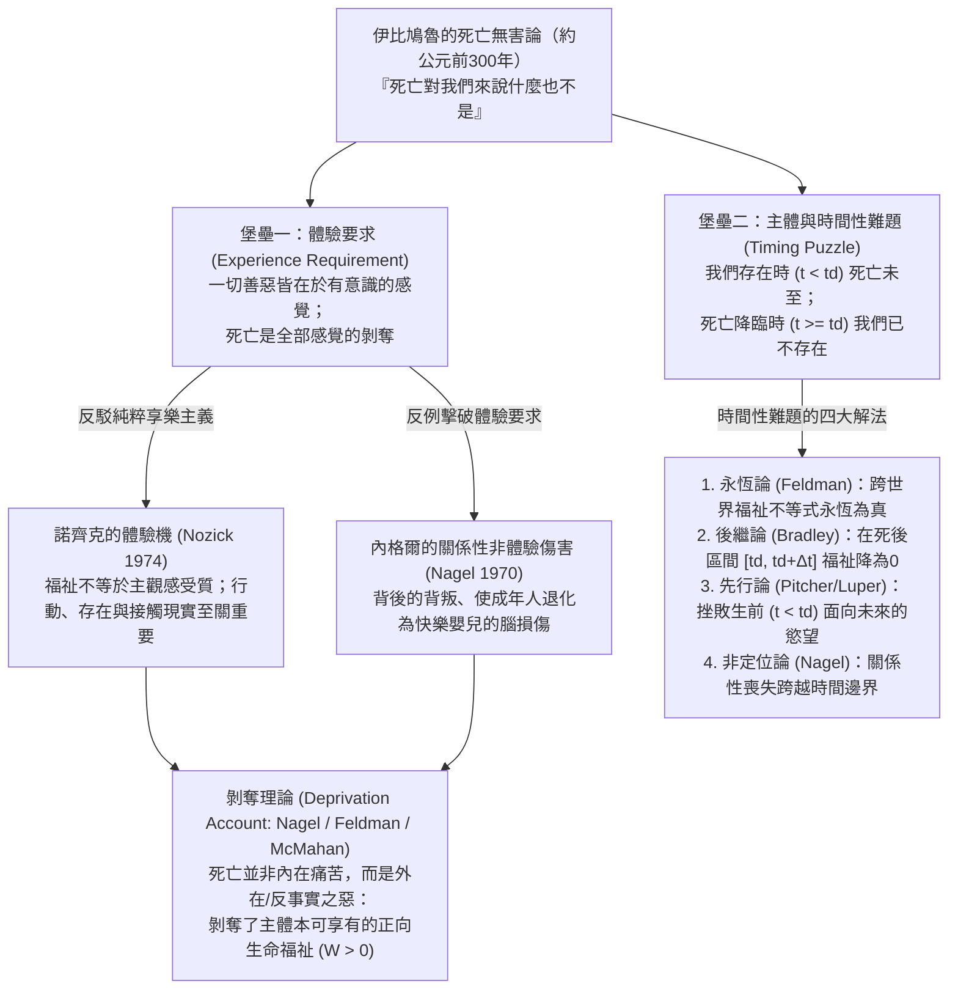
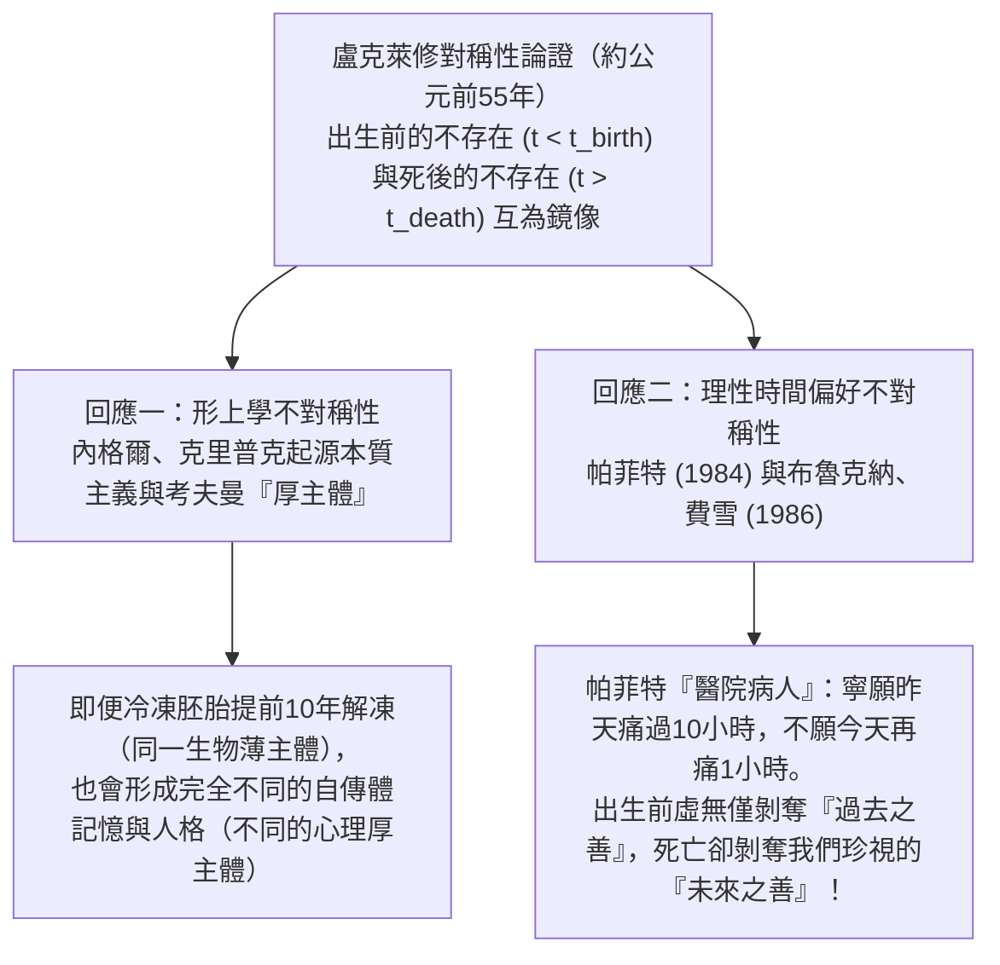

## 1. 引言：必死性的存在主義悖論與分析哲學的挑戰

在人類文明的法律、倫理與日常直覺中，<strong>死亡通常被視為降臨在個人身上最深重的災禍之一</strong>。謀殺之所以被定為極罪，正是因為剝奪他人生命對受害者造成了不可逆轉的巨大傷害。然而，一旦我們採納當代哲學所說的<strong>「湮滅假設」（Annihilation Assumption / Termination Thesis）</strong>——即生理死亡標誌著意識體驗與個人存在的永久終結——一個深刻的形上學與價值論悖論便浮出水面：既然死人不會感到黑暗、孤獨、痛苦或悔恨，甚至連承受傷害的主體都已不復存在，<strong>處於已死狀態（being dead）怎麼可能對死者而言是一件「壞事」？</strong>

兩千多年前，古希臘哲學家<strong>伊比鳩魯（Epicurus, 公元前341–270）</strong>在《致美諾西斯的信》（*Letter to Menoeceus*）中提出了著名的「無害論」，古羅馬詩人<strong>盧克萊修（Lucretius, 約公元前99–55）</strong>則在《物性論》（*De Rerum Natura*）中補充了震撼人心的「對稱性論證」。自1970年<strong>湯瑪斯·內格爾（Thomas Nagel）</strong>發表經典論文《死亡》（*"Death"*）以來，弗雷德·費爾德曼（Fred Feldman）、德瑞克·帕菲特（Derek Parfit）、傑夫·麥克馬漢（Jeff McMahan）、約翰·馬丁·費雪（John Martin Fischer）、本·布拉德利（Ben Bradley）與伯納德·威廉姆斯（Bernard Williams）等分析哲學家借助可能世界語義學、反事實福利積分與個人同一性理論，對這一古老難題展開了嚴密的現代重構。

### 概念澄清：臨死過程、必死性與已死狀態

首先必須嚴格區分日常語言中混稱為「死亡」的三個概念（設主體 $S$ 出生於 $t_{\text{birth}}$，於 $t_d$ 時刻永久停止生命）：
1. <strong>臨死的過程（Dying, $t \in [t_0, t_d)$）</strong>：主體仍然活著且有意識，常伴隨劇烈肉體痛苦（內在惡 $u_S(t) < 0$）。但無痛的瞬間猝死依然是悲劇，說明死亡之惡不能化約為臨死之痛。
2. <strong>對必死性的預知（Mortality, $t_{\text{birth}} < t < t_d$）</strong>：生前的死亡焦慮；但若死亡本身無害，這種恐懼便是非理性的。
3. <strong>已死狀態 / 死後不存在（Being Dead, $t \ge t_d$）</strong>：主體不存在，體驗效用恆為零（$u_S(t) = 0$）。這正是哲學爭議的核心。

---

## 2. 伊比鳩魯的「無害論證」及其兩座邏輯堡壘

在《致美諾西斯的信》（第124–125節）中，伊比鳩魯寫道：

> 「你應當習慣於相信<strong>死亡對我們來說什麼也不是</strong>，因為一切善與惡都在於感覺，而死亡正是感覺的完全喪失……<strong>因此，死亡這最可怕的惡，對我們來說什麼也不是：因為當我們存在時，死亡尚未降臨；而當死亡降臨時，我們已不復存在。</strong>」

當代分析哲學將其拆解為兩座相互獨立的邏輯堡壘：

- <strong>第一座堡壘：體驗要求（The Experience Requirement）</strong>：一個事態 $X$ 對主體 $S$ 是壞事，當且僅當 $X$ 引起 $S$ 不愉快的有意識感覺（享樂主義價值論）。既然死亡是全部感覺的喪失，死亡便不可能傷害 $S$。
- <strong>第二座堡壘：主體與時間性難題（The Timing Puzzle）</strong>：任何傷害都必須在某個特定時間 $t$ 傷害某個在該時刻存在的主體 $S$。但在 $t < t_d$ 時死亡尚未發生，未發生之事不能造成傷害；在 $t \ge t_d$ 時 $S$ 已不存在，沒有主體可受傷害。因此不存在任何時刻 $t$ 使死亡對 $S$ 為惡。

---

## 3. 擊破體驗要求：諾齊克的「體驗機」與內格爾的非體驗性傷害

### 3.1 羅伯特·諾齊克的「體驗機」（Experience Machine, 1974）

在《無政府、國家和烏托邦》（1974）中，<strong>羅伯特·諾齊克（Robert Nozick）</strong>設計了著名的思想實驗：假設神經科學家造出了一台「體驗機」，只要漂浮在營養槽中接上電極，就能獲得寫出一流小說、攀登高峰、被摯愛包圍等完美逼真的主觀快樂體驗。如果伊比鳩魯的「體驗要求」成立（福祉僅取決於主觀感受 $\int u_{\text{felt}}(t)\,dt$），人人都應毫不猶豫地終身接入機器。然而絕大多數人拒絕接入，因為我們不僅想要「做某事的感覺」，更想要<strong>真正去做某事（agency）、成為某種真實的人、並與客觀現實世界發生真實聯結</strong>。

### 3.2 湯瑪斯·內格爾《死亡》（1970）中的三大反例

<strong>湯瑪斯·內格爾</strong>在1970年指出，一個人的禍福不僅取決於瞬間的意識狀態，更取決於其歷史、可能性以及與世界的跨越時間的關係：
1. <strong>不知情的背叛（Betrayal Behind One's Back）</strong>：被配偶與摯友在背後無情嘲弄和背叛的人，即便至死不知情、從未感到痛苦，依然遭受了真實的關係性傷害。
2. <strong>臨終諾言的背棄</strong>：學者去世後，摯友違背誓言將其畢生手稿付之一炬，使死者的核心人生計畫歸於徒勞。
3. <strong>滿足的嬰兒（Severe Brain Injury / The Contented Infant）</strong>：一位前途無量的30歲科學家因腦損傷永久退化為心滿意足的三個月大嬰兒，每天只要喝奶搖鈴就咯咯傻笑，毫無痛苦。按享樂主義，他毫無損失；但所有人都視之為慘痛悲劇——因為<strong>他本可擁有的豐富智性與創造性生命被剝奪了</strong>。同理，將可能性降至零的死亡更是深重的剝奪之惡。

---

## 4. 剝奪理論（Deprivation Account）：可能世界反事實積分與時間相對利益

以<strong>弗雷德·費爾德曼（Fred Feldman, 1991）</strong>與<strong>本·布拉德利（Ben Bradley, 2009）</strong>為代表的<strong>剝奪理論</strong>區分了<strong>內在惡（Intrinsic Badness，$u_S(t) < 0$）</strong>與<strong>外在/反事實惡（Extrinsic Badness）</strong>：死亡並非內在痛苦，而是因為它<strong>剝奪了死者若未死本可繼續享有的正向生命善好</strong>。

### 4.1 可能世界語義學公式化

設主體 $S$ 在可能世界 $w$ 的瞬時福祉為 $u_S(t, w)$，死於 $t_d(w)$（死後 $u_S = 0$），則其終生總福祉為：

$$W(S, w) = \int_{t_{\text{birth}}}^{t_d(w)} u_S(t, w)\,dt$$

若在現實世界 $w_{\text{actual}}$ 中 $S$ 因死亡事件 $e_d$ 死於 $t_d$，而在未發生 $e_d$ 的<strong>最近可能世界 $w_{\text{nearest}}$</strong> 中 $S$ 多活了 $\Delta t > 0$，則死亡事件 $e_d$ 的外在價值為：

$$\text{Val}_{\text{extrinsic}}(e_d, S, w_{\text{actual}}) = W(S, w_{\text{actual}}) - W(S, w_{\text{nearest}}) = -\int_{t_d}^{t_d + \Delta t} u_S(t, w_{\text{nearest}})\,dt$$

- 當未來反事實生命淨值為正（$\int_{t_d}^{t_d+\Delta t} u_S > 0$）時，$\text{Val}_{\text{extrinsic}} < 0$，死亡是深重的外在惡；且青年早逝損失的 $\Delta t$ 極大，故比高齡善終悲慘得多。
- 當絕症患者未來只剩無法緩解的劇痛（$\int_{t_d}^{t_d+\Delta t} u_S < 0$）時，$\text{Val}_{\text{extrinsic}} > 0$，解釋了為何安樂死或解脫性死亡可以是仁慈的福祉。

### 4.2 胚胎悖論與傑夫·麥克馬漢的時間相對利益論（TRIA, 2002）

純粹按終身積分計算會引發<strong>胚胎悖論</strong>：早期流產胎兒損失了80年未來生命，難道比25歲青年被謀殺（損失55年）更悲慘嗎？<strong>傑夫·麥克馬漢（Jeff McMahan）</strong>在《殺戮倫理學》（2002）中引入帕菲特的<strong>心理連續性關係 $\mathcal{R}_S(t_d, t) \in [0, 1]$</strong> 對未來反事實福祉進行折現，提出<strong>時間相對利益論（Time-Relative Interest Account, TRIA）</strong>：

$$\text{Badness}_{\text{TRIA}}(e_d, S, t_d) = \int_{t_d}^{t_d + \Delta t} \mathcal{R}_S(t_d, t) \cdot u_S(t, w_{\text{nearest}})\,dt$$

早期胎兒尚無自傳體記憶與未來計畫，與數十年後的成年自我心理聯結度 $\mathcal{R}_S \approx 0$；而25歲青年既擁有極高的心理統一性（$\mathcal{R}_S \approx 1$），又擁有漫長的剩餘壽命 $\Delta t$，故青年早逝的悲劇性達到全局峰值。

---

## 5. 時間性難題的五大解法：死亡究竟在「何時」傷害了死者？

面對伊比鳩魯的第二座堡壘（何時受傷害？），當代形上學提出了五種競爭方案：

| 理論立場（代表人物） | 傷害發生的時間座標 ($t$) | 核心形上學與價值論機制 | 主要理論優勢 | 主要面臨的批評 |
| :--- | :--- | :--- | :--- | :--- |
| <strong>1. 永恆論 / 超時間論</strong> (Fred Feldman) | <strong>永恆 / 任何時刻</strong> (Atemporally) | 跨世界不等式 $W(S, w_{\text{actual}}) < W(S, w_{\text{nearest}})$ 是不受時間約束的永恆真理 | 徹底繞開死後主體不存在的難題 | 混淆了「命題永恆為真」與「傷害發生的具體日期」 |
| <strong>2. 後繼論 (Subsequentism)</strong> (Ben Bradley, Neil Feit) | <strong>死後被剝奪區間</strong> $t \in [t_d, t_d + \Delta t]$ | 在 $[t_d, t_d+\Delta t]$ 內現實福祉為 $0$，低於反事實福祉 $u > 0$ | 與摔斷腿錯過下週夏威夷度假的受傷時間完全一致 | 需借助四維時空永恆論向已死之人賦予 $u=0$ 的福祉值 |
| <strong>3. 先行論 (Priorism)</strong> (George Pitcher, Steven Luper) | <strong>生前在世期間</strong> $t < t_d$ | $t_d$ 的早逝使生前 ($t < t_d$) 面向未來的核心慾望與計畫注定落空 | 嚴格遵守現在論及「受害主體必須活著」的條件 | 說一個20歲健康快樂的人因35歲會死而「當下已受損」違反直覺 |
| <strong>4. 同時論 (Concurrentism)</strong> (Julian Lamont) | <strong>死亡發生的瞬間</strong> $t = t_d$ | 傷害發生在生命與可能性喪失的精確邊界點 $t_d$ | 使受傷害時刻與致死事件時刻重合 | 邊界兩難：在 $t_d$ 主體要麼還活著要麼已死 |
| <strong>5. 非定位論 (Indeterminism)</strong> (Thomas Nagel) | <strong>無精確時鐘座標</strong> (Unlocalized) | 歷史性主體的可能性跨越時間，關係性喪失屬於整個人生 | 契合人生整體敘事性，無需人工打時間戳 | 拒斥了「一切真實傷害必有精確時刻」的前提 |

---

## 6. 盧克萊修的對稱性論證與帕菲特的時間偏見

在《物性論》第三卷中，<strong>盧克萊修</strong>舉起了一面時間之鏡：<strong>出生前的虛無（Prenatal Non-Existence, $t < t_{\text{birth}}$）</strong>與<strong>死後的虛無（Posthumous Non-Existence, $t > t_d$）</strong>完全對稱。如果死後不存在因剝奪了更晚的死亡而可怕，為何我們從不因出生前不存在剝奪了我們「更早的出生」（比如早出生40年）而痛哭流涕？

當代哲學有兩條經典回應路徑：
1. <strong>內格爾與克里普克的「起源本質主義」（Origin Essentialism）及考夫曼的「厚主體」（Thick Person）</strong>：索爾·克里普克（Saul Kripke）指出，個體的受精卵配子起源是其本質屬性，提前一百年出生的人絕不可能是「你」。針對弗雷德里克·考夫曼（Frederik Kaufman 1999）提出的<strong>「冷凍胚胎反例」</strong>（同一個冷凍胚胎本可提前十年解凍出生），考夫曼區分了生物學上的「薄主體」與由特定記憶、人際依戀和性格構成的<strong>「厚主體」（Thick Person）</strong>：即便胚胎提前十年解凍，長成的也是一個心理上完全陌生的厚主體，而非現在的「我」。
2. <strong>帕菲特的「醫院病人」與面向未來的理性偏見（Brueckner & Fischer 1986）</strong>：在<strong>德瑞克·帕菲特</strong>《理與人》（1984）著名的<strong>「醫院病人」思想實驗</strong>中，你醒來失去短期記憶，護士告知你<strong>要麼是昨天已做完10小時劇痛手術的病人A，要麼是今天下午將做1小時劇痛手術的病人B</strong>。所有人都會祈禱自己是病人A！同樣，我們也強烈偏好快樂位於未來而非已經結束的過去。布魯克納與費雪指出，正是這種<strong>面向未來的不對稱時間偏好（Bias Toward the Future）</strong>解釋了盧克萊修之謎：出生前的虛無剝奪的只是我們已經漠不關心的<strong>過去之善</strong>，而死亡剝奪的卻是我們深切珍視的<strong>未來之善</strong>！

---

## 7. 永生會是祝福嗎？伯納德·威廉姆斯與「馬克羅普洛斯案件」

如果死亡因截斷生命而為惡，那麼<strong>永生不死（Immortality）</strong>是否就是終極福祉？英國哲學家<strong>伯納德·威廉姆斯（Bernard Williams, 1973）</strong>在名篇《馬克羅普洛斯案件：論永生的厭倦》中給出了否定回答。劇作主角<strong>Elina Makropulos（E.M.）</strong>在42歲服下長生藥，永葆青春與藝術才華活到<strong>337歲</strong>，最終卻陷入了冰冷徹骨、萬物皆如機械重複的<strong>終極厭倦（tedium）</strong>，主動拒絕續命並欣然赴死。

威廉姆斯區分了<strong>條件性慾望（Conditional Desires，「只要我還活著，我想吃好睡好」）</strong>與賦予我們活下去理由的<strong>範疇性慾望（Categorical Desires，「我想寫完這部書、撫養孩子長大」）</strong>，並提出了<strong>永生兩難（Dilemma of Immortality）</strong>：
- <strong>第一角（固定性格 $\implies$ 必然厭倦）</strong>：如果永生者保持確定的人格同一性，在無窮時間 $t \to \infty$ 中，一切與該性格相容的體驗組合終將耗盡，範疇性慾望枯竭，陷入E.M.式的絕望厭倦。
- <strong>第二角（徹底重塑性格 $\implies$ 喪失同一性）</strong>：如果靠定期洗掉記憶、徹底更換人格來避免厭倦，那麼未來的那個陌生主體已不再是「我」，這無異於經歷一連串精神死亡。

儘管費雪（John Martin Fischer）反駁說像欣賞巴哈大提琴組曲、美食與友誼這類<strong>「可重複的快樂」（Repeatable Pleasures）</strong>以及漸進的人格演化足以支撐有意義的漫長生命，威廉姆斯的洞察依然深刻揭示了：<strong>死亡之所以為惡，恰恰是因為有限生命中的範疇性慾望、愛與創造如此珍貴——死亡的壞處，正是生命之美好的鏡像。</strong>
