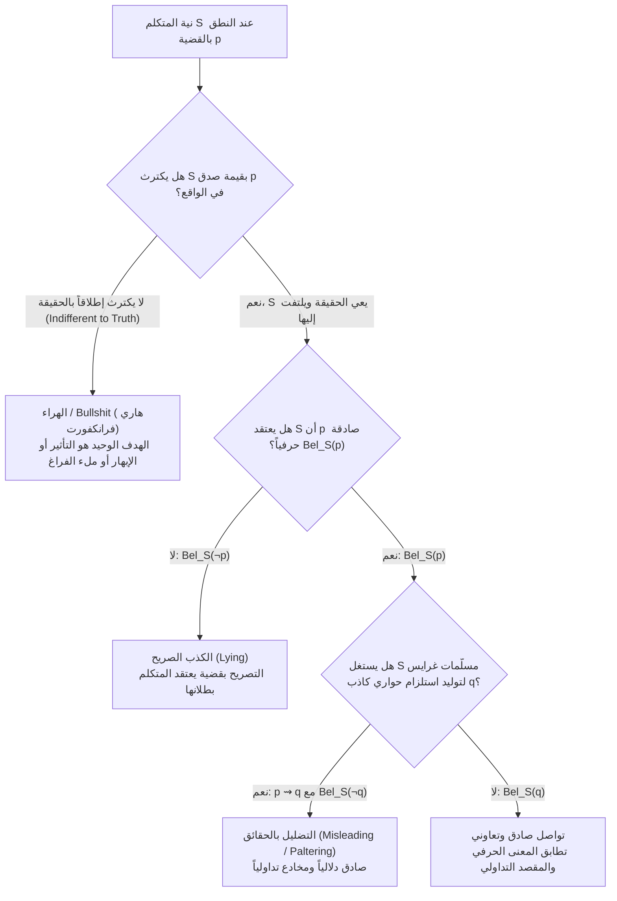

في القرن الرابع الميلادي، كان الأسقف <strong>أثناسيوس السكندري</strong> هارباً في قارب عبر نهر النيل من جنود الإمبراطورية الرومانية المكلفين بالقبض عليه وقتله. وحين اقتربت سفينة الجنود الرومان من قاربه دون أن يعرفوا ملامح وجهه، صاحوا به سائلين: *«هل رأيت الخائن أثناسيوس؟»* فوقف أثناسيوس بهدوء وأجابهم: <strong>«إنه ليس بعيداً عن هنا!»</strong> فاندفع الجنود يجدفون بأقصى سرعتهم متجاوزين قاربه، ونجا أثناسيوس بحياته.

من الناحية المنطقية والدلالية الحرفية، كانت جملة *«إنه ليس بعيداً عن هنا»* <strong>صادقة بنسبة 100%</strong> (بل إن المسافة الفيزيائية بين أثناسيوس ونفسه تساوي صفراً: $d(x, x) = 0$). غير أنها من الناحية التداولية والتواصلية صُمِّمت عمداً لزرع اعتقاد خاطئ في أذهان الجنود بأن أثناسيوس يفرّ أمامهم وليس واقفاً أمام أعينهم.

وبعد أكثر من ألف وستمائة عام، تجددت المعضلة ذاتها أمام المحكمة العليا للولايات المتحدة في القضية الشهيرة <strong>*Bronston v. United States* (1973)</strong>. فخلال استجواب تحت القسم في قضية إفلاس، سأل المدعي العام المنتج السينمائي صامويل برونستون:
- <strong>المدعي العام</strong>: *«هل تملك حساباً مصرفياً في بنوك سويسرا؟»*
- <strong>برونستون</strong>: *«لا يا سيدي.»* (كان حسابه الشخصي قد أُغلِق بالفعل وقت الجلسة).
- <strong>المدعي العام</strong>: *«هل <strong>سبق لك</strong> أن امتلكت حساباً مصرفياً في سويسرا؟»*
- <strong>برونستون</strong>: *«امتلكت الشركة حساباً في زيورخ لمدة ستة أشهر هناك.»*

في الواقع، كان برونستون قد امتلك على مدى خمس سنوات <strong>حساباً مصرفياً شخصياً ضخماً في جنيف</strong> مرّر عبره مئات الآلاف من الدولارات، لكنه أخفاه بإجابة حرفية صادقة تتحدث عن حساب شركته في زيورخ. وقد قضت المحكمة العليا الأمريكية بالإجماع ببراءة برونستون من جريمة <strong>الحنث باليمين (Perjury)</strong>، مقررةً أن قانون الشهادة الزور يعاقب على القول الكاذب حرفياً (*Lying*)، ولا يعاقب على القول الصادق حرفياً حتى لو كان مضلِّلاً (*Misleading*)، لأن عبء كشف المراوغة يقع على عاتق المحقق عبر طرح أسئلة أكثر دقة.

كيف تسمح بنية اللغة البشرية للإنسان بأن <strong>يخدع الآخرين بقول الحقيقة</strong>؟ ولماذا جادل فيلسوف جامعة برينستون <strong>هاري فرانكفورت (Harry G. Frankfurt)</strong> في كتابه الشهير <strong>*On Bullshit* (عن الهراء، 1986/2005)</strong> بأن ثمة ظاهرة ثالثة—هي <strong>الهراء (*Bullshit*)</strong>—تمثل خطراً على الحقيقة أشد فتكاً من الكذب نفسه؟ في هذا المقال، نفكك البنية المنطقية والتداولية والأخلاقية لهذه الظواهر الثلاث.

---

## الفصل الأول: التعريف الصوري للكذب (Lying) — ما يُقال مقابل ما يُعتقَد

منذ رسالتَي القديس أوغسطينوس *De Mendacio* (395 م) و*Contra Mendacium* وصولاً إلى الصياغات التحليلية المعاصرة لدى <strong>رودريك تشيزوم وتوماس فيهان (1977)</strong>، <strong>توماس كارسون (2010)</strong>، و<strong>جينيفر سول (2012)</strong>، يرتكز التعريف الفلسفي المعياري للكذب على أربعة شروط منطقية ضرورية وكافية:

يكذب المتكلم $S$ على المخاطَب $H$ إذا وفقط إذا تحقق:

$$\text{Lie}(S, H, p) \iff \text{Say}_S(p) \;\land\; \text{Bel}_S(\neg p) \;\land\; \text{Address}(S, H) \;\land\; \text{Warrant}(S, p)$$

1. <strong>شرط القول الصريح ($\text{Say}_S(p)$ — *What is Said*)</strong>: أن يصرّح المتكلم $S$ لفظياً بالقضية الدلالية $p$. (الصمت أو الإيماءات غير اللفظية قد تكون خداعاً، لكنها ليست كذباً بالمعنى اللغوي الدقيق).
2. <strong>شرط عدم الصدق المعرفي ($\text{Bel}_S(\neg p)$ — *Untruthfulness Condition*)</strong>: أن يعتقد المتكلم $S$ في قرارة نفسه أن القضية $p$ <strong>باطلة/كاذبة</strong>. وهنا تكمن ملاحظة فلسفية حاسمة: الكذب يتحدد <strong>بتناقض القول مع اعتقاد المتكلم ($\text{Bel}_S(\neg p)$)</strong>، وليس بمجرد بطلان $p$ في الواقع الخارجي! فإذا اعتقدتَ أن الجسر منهار ($\text{Bel}_S(\neg p)$)، فقلتَ لعدوك *«الجسر سليم»* ($p$) لكي يقع، ثم تبيّن مصادفةً أن العمال أصلحوا الجسر للتو دون علمك ($p$ صادقة واقعياً)، فأنت <strong>كاذب</strong> بلا شك! وعلى العكس، من ينقل معلومة خاطئة وهو يعتقد بصدق أنها صحيحة ليس كاذباً، بل مخطئ (*Honest Mistake*).
3. <strong>شرط سياق ضمان الحقيقة ($\text{Warrant}(S, p)$)</strong> أو <strong>نية الخداع</strong>: حين يقول الممثل على خشبة المسرح *«أنا ملك الدنمارك»*، فإن السياق المسرحي يعلّق ضمان الحقيقة. لكن كما أثبت <strong>روي سورنسن (2007)</strong> و<strong>توماس كارسون</strong> من خلال <strong>الأكاذيب المكشوفة (*Bald-Faced Lies*)</strong>—كشاهدٍ يهدده زعيم عصابة فيشهد أمام القاضي *«لم أرَ شيئاً»* رغم علم القاضي والجمهور جميعاً بأنه يكذب—فإن القول يظل كذباً حتى لو لم يتوقع المتكلم أن يصدقه أحد، ما دام قد أعلن $\text{Bel}_S(\neg p)$ في سياق رسمي يفترض التزام الصدق.

---

## الفصل الثاني: تداولية بول غرايس (H. Paul Grice) — المحرك المنطقي للتضليل بالحقائق

كيف نجح أثناسيوس وصامويل برونستون في خداع سامعيهم دون انتهاك شرط الكذب $\text{Say}_S(p) \land \text{Bel}_S(\neg p)$؟ تكمن الإجابة في الثورة التي أحدثها فيلسوف اللغة <strong>بول غرايس</strong> في محاضرات ويليام جيمس بجامعة هارفارد عام 1967 (*"Logic and Conversation"*، نُشرت 1975).

ميّز غرايس بدقة بين مستويين من المعنى:
- <strong>المعنى الدلالي الحرفي (*What is Said*, $p$)</strong>: شروط الصدق المنطقية التي تحددها المفردات والتركيب النحوي للجملة.
- <strong>الاستلزام الحواري (*Conversational Implicature*, $q$)</strong>: القضية الإضافية التي يستنتجها السامع تداولياً لأنه يفترض أن المتكلم يلتزم <strong>بمبدأ التعاون (*Cooperative Principle*)</strong>:

> *«اجعل مساهمتك الحوارية بالقدر المطلوب، وفي المرحلة التي تقع فيها، وفقاً للغرض أو الاتجاه المقبول للتبادل الكلامي الذي تشارك فيه.»*

ويتفرع مبدأ التعاون عند غرايس إلى <strong>أربع مسلَّمات (Maxims) تداولية</strong>:

1. <strong>مسلَّمة الكم (Maxim of Quantity)</strong>:
   - قدم من المعلومات بقدر ما هو مطلوب، ولا تزد على ذلك.
   - *الاستلزام السُّلَّمي (Scalar Implicature)*: إذا قال طالب لأبيه: *«لقد نجحتُ في <strong>بعض</strong> المواد»* ($p \equiv \exists x, \text{Passed}(x)$)، بينما هو في الحقيقة قد رسب في معظمها أو نجح فيها كلها، فمنطقياً في حساب القضايا تكون جملة $\exists x$ صادقة حتى لو تحقق $\forall x$. لكن السامع يستنتج فوراً عبر مسلَّمة الكم أن $q \equiv \neg(\forall x)$ لأن المتكلم لو كان قد نجح في الكل لقال *«كل المواد»*.
2. <strong>مسلَّمة الكيف (Maxim of Quality)</strong>: لا تقل ما تعتقد أنه كاذب، ولا تقل ما تعوزك عليه البينة.
3. <strong>مسلَّمة العلاقة / الملاءمة (Maxim of Relation)</strong>: كن ذا صلة بالموضوع (*Be relevant*).
   - في قضية *برونستون*، حين سُئل عن حسابه الشخصي في سويسرا فأجاب عن حساب الشركة في زيورخ، افترض المدعي العام أن إجابته ملتزمة بمسلَّمة الملاءمة والكم، فاستنتج الاستلزام الحواري الكاذب $q =$ *«ليس لدي أي حساب آخر في سويسرا»*.
   - ومثال غرايس الشهير: أستاذ فلسفة طُلب منه خطاب توصية لطالب يتقدم لوظيفة أكاديمية في الفلسفة، فكتب: *«السيد فلان خطه جميل ومواظب على الحضور في الموعد.»* الجملة حرفياً ($p$) مدح صادق، لكن خرقها الصارخ لمسلَّمة الكم والملاءمة يولّد استلزاماً حوارياً قاطعاً ($q$): *«هذا الطالب فاشل تماماً في الفلسفة!»*
4. <strong>مسلَّمة الجهة / الأسلوب (Maxim of Manner)</strong>: تجنب الغموض واللبس، وكن موجزاً ومرتباً.

وبناءً على ذلك، نصوغ رياضياً <strong>التضليل بالحقائق الصادقة (*Misleading / Paltering*)</strong>:

$$\text{Mislead}(S, H, p, q) \iff \text{Say}_S(p) \;\land\; \text{Bel}_S(p) \;\land\; (p \leadsto_{\text{Grice}} q) \;\land\; \text{Bel}_S(\neg q) \;\land\; \text{Intend}_S(\text{Bel}_H(q))$$

أي أن المتكلم ينطق بقضية $p$ يعتقد بصدق أنها <strong>صحيحة</strong> ($\text{Bel}_S(p)$)، لكنه يستثمر قوانين غرايس التداولية ($p \leadsto_{\text{Grice}} q$) ليدفع السامع إلى استنتاج قضية ضمنية $q$ يعلم المتكلم يقيناً أنها <strong>كاذبة</strong> ($\text{Bel}_S(\neg q)$)!

---

## الفصل الثالث: الجدل الأخلاقي — هل التضليل بالحقائق أقل قبحاً من الكذب؟

لطالما ميّزت التقاليد اللاهوتية والقانونية والأخلاقية—من <strong>عقيدة التحفظ الذهني (*Mental Reservation*)</strong> إلى <strong>إيمانويل كانط</strong>—بين الكذب الصريح والتضليل غير المباشر:

1. <strong>الصرامة المطلقة عند إيمانويل كانط (1797)</strong>:
   في مقالته الشهيرة *«حول حق مزعوم في الكذب بدافع محبة البشر»*، أعلن كانط أن الكذب خطيئة أخلاقية مطلقة تنتهك الواجب تجاه الإنسانية، حتى لو طرق قاتلٌ بابك وسألك عن مكان صديقك المختبئ في منزلك! غير أن كانط نفسه مارس التورية المحسوبة حين طالبه ملك بروسيا <strong>فريدريش فيلهلم الثاني</strong> بالتوقف عن نشر كتاباته الدينية، فكتب كانط تعهداً يقول فيه: *«بوصفي خادم <strong>جلالتكم</strong> الأوفى، أتعهد بالتوقف عن نشر المحاضرات الدينية»* — قاصداً بعبارة *«خادم جلالتكم»* أن التعهد ينتهي بموت ذلك الملك تحديداً، وهو ما فعله كانط فور وفاة الملك عام 1797!
2. <strong>حجة تقاسم المسؤولية المعرفية مقابل نقد جينيفر سول</strong>:
   يرى أنصار التمييز الأخلاقي (مثل برنارد ويليامز وجوناثان أدلر) أن الكاذب يزوّر الدليل المباشر، أما المضلِّل فيقول حقيقةً ويترك للسامع خطوة الاستنتاج، مما يُلقي بجزء من المسؤولية على السامع إذا لم يدقق. في المقابل، تُثبت الفيلسوفة <strong>جينيفر سول (Jennifer Saul, 2012)</strong> في كتابها *Lying, Misleading, and What is Said* أن التضليل المتعمد في الحياة اليومية لا يقل سوءاً من الناحية الأخلاقية عن الكذب الصريح، لأن كليهما ينتهك الاستقلالية العقلانية للمخاطَب ويهدف إلى زرع اعتقاد زائف $\text{Bel}_H(q)$.

---

## الفصل الرابع: هاري فرانكفورت وكتاب *On Bullshit* — لماذا الهراء أخطر من الكذب؟

في دراسته الكلاسيكية <strong>*On Bullshit* (1986/2005)</strong>، كشف الفيلسوف الأمريكي <strong>هاري فرانكفورت</strong> عن بنية مفهومية ثالثة تختلف جذرياً عن كلٍّ من الصدق والكذب:

$$\begin{aligned}
\text{Honest}(S, p) &: \quad \text{Bel}_S(p) \;\land\; \text{Goal}_S = \text{إظهار الحقيقة} \\
\text{Liar}(S, p) &: \quad \text{Bel}_S(\neg p) \;\land\; \text{Goal}_S = \text{إخفاء الحقيقة} \\
\text{Bullshitter}(S, p) &: \quad \text{Indifferent}_S(p, \neg p) \;\land\; \text{Goal}_S = \text{ترك انطباع أو إقناع بلا مبالاة بالصدق}
\end{aligned}$$

يوضح فرانكفورت أن <strong>الكذاب (Liar)</strong> لا يزال خاضعاً لسلطة الحقيقة؛ فهو يعرف الحقيقة جيداً ويراقبها بدقة لكي يصوغ نقيضها ويقود السامع بعيداً عنها. أما <strong>صانع الهراء (Bullshitter)</strong> فإنه <strong>لا يكترث إطلاقاً بما إذا كان كلامه صادقاً أم كاذباً</strong>! إنه يخلع نفسه تماماً من التزام المطابقة مع الواقع، ولا يهمه سوى الأثر البلاغي أو الترويجي أو الظهور بمظهر الخبير. ولذلك أطلق فرانكفورت حكمه الشهير:

> <strong>«إن الهراء عدوٌّ للحقيقة أشد خطراً من الكذب.»</strong>
> *(Bullshit is a greater enemy of the truth than lies are.)*

وفي عصر الذكاء الاصطناعي، أشار باحثو الفلسفة المعاصرون (مثل Hicks, Humphries & Slater 2024, *"ChatGPT is Bullshit"*) إلى أن ما يُسمّى مجازاً <strong>«هلوسة» النماذج اللغوية الكبيرة (LLM Hallucinations)</strong> ليس كذباً ولا هلوسة إدراكية، بل هو تجسيد رياضي لمفهوم فرانكفورت حين يقتصر النموذج على تعظيم الاحتمال الإحصائي للكلمة التالية $\arg\max_w P_\theta(w_t \mid w_{<t})$ لإنتاج نص يبدو مقنعاً دون آلية تحقّق مرجعية من صدق القضية في العالم الخارجي.

---

## الفصل الخامس: جدول مقارنة شامل بين الأنماط الأربعة للخطاب

| بُعد المقارنة | القول الصادق (*Truthful*) | الكذب الصريح (*Lying*) | التضليل بالحقائق (*Misleading / Paltering*) | الهراء (*Bullshit* — فرانكفورت) |
|---|---|---|---|---|
| <strong>القضية المنطوقة حرفياً ($p$)</strong> | يصرح بـ $p$ | يصرح بـ $p$ | يصرح بـ $p$ | يصرح بـ $p$ |
| <strong>موقف المتكلم المعرفي من $p$</strong> | $\text{Bel}_S(p)$ (يعتقد صدقها) | $\text{Bel}_S(\neg p)$ (يعتقد بطلانها) | $\text{Bel}_S(p)$ (يعتقد صدقها حرفياً) | <strong>عدم اكتراث تام</strong> بصدق $p$ أو كذبها |
| <strong>الاستلزام الحواري لغرايس ($q$)</strong> | صادق ومطابق للمقصد | ينطوي على تزوير مباشر | $p \leadsto_{\text{Grice}} q$ مع $\text{Bel}_S(\neg q)$ | غير معني بصدق $q$ |
| <strong>العلاقة بسلطة الحقيقة</strong> | الخضوع للحقيقة وإعلانها | الاعتراف بالحقيقة سراً ومقاومتها | استخدام حقائق منتقاة لحجب الحقيقة الكاملة | تقويض قيمة الحقيقة والمرجعية الواقعية ذاتها |
| <strong>المسؤولية القانونية (قضية برونستون)</strong> | شهادة سليمة | <strong>جريمة حنث باليمين (Perjury)</strong> | لا تُعد حنثاً باليمين حرفياً في القانون الأمريكي | تخضع لقوانين الاحتيال أو التضليل التجاري حسب السياق |
| <strong>أمثلة تطبيقية</strong> | الإقرار الكامل والدقيق بالوقائع | إنكار امتلاك الحساب مع وجوده | جواب أثناسيوس، وجواب برونستون عن حساب زيورخ | الدعاية السياسية الفارغة، والهلوسة غير المؤصَّلة للنماذج اللغوية |

---

## خاتمة

تُبيّن لنا فلسفة اللغة أن الكلمات ليست مجرد أوعية شفافة تنقل القضايا المنطقية، بل هي أفعال تداولية محكومة بتوقعات التعاون المشترك. وبين الكذب الصريح والتضليل الماكر بالحقائق الجزئية وطوفان الهراء اللامبالي بالحقيقة، يظل الوعي الفلسفي ببنية الدلالة والاستلزام الحواري خط الدفاع الأول لحماية العقل النقدي والنزاهة العلمية والأخلاقية.
