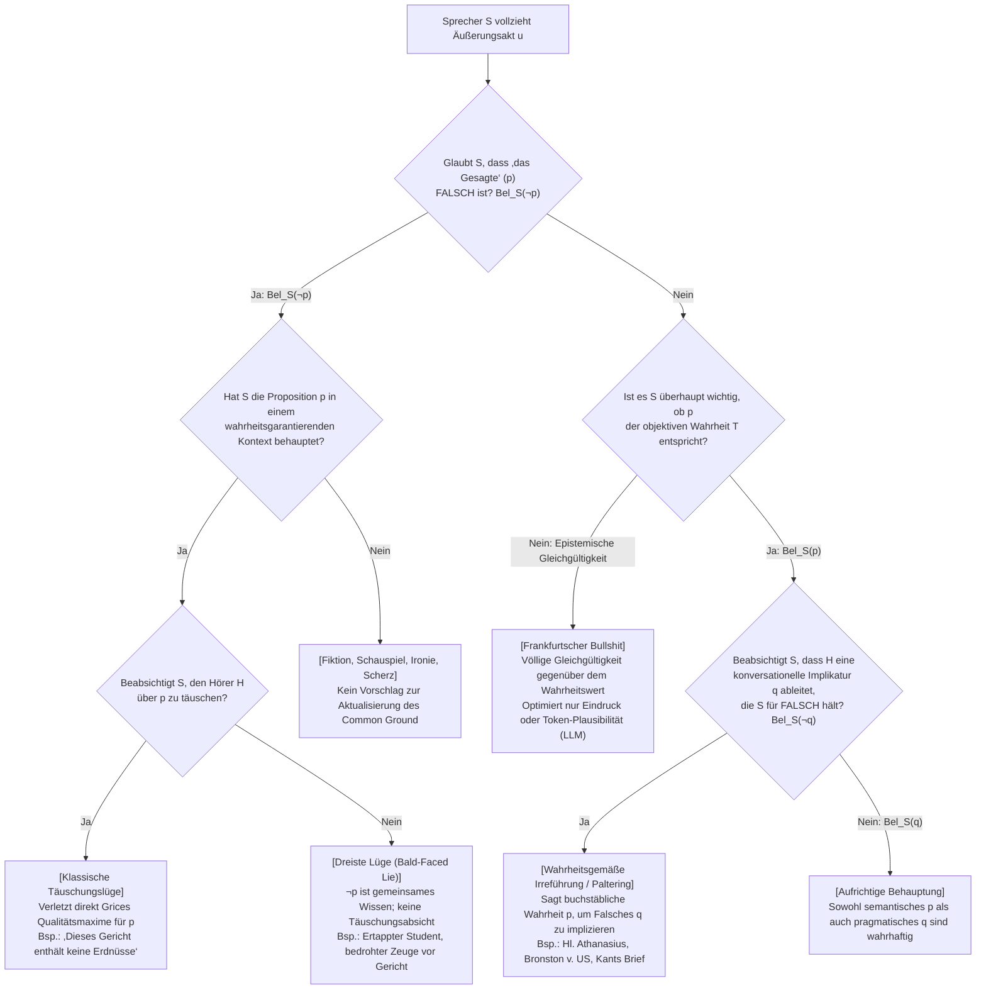
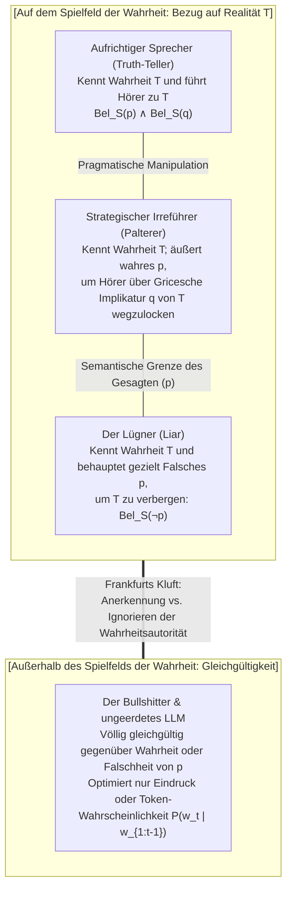

## 1. Einleitung: Das Paradoxon der Täuschung durch die 100-prozentige buchstäbliche Wahrheit

Im Jahr 362 n. Chr., während der Verfolgung unter dem römischen Kaiser Julian Apostata, floh <strong>Athanasius von Alexandria</strong> in einem kleinen Boot auf dem Nil. Als er bemerkte, dass die kaiserlichen Verfolger ihm dicht auf den Fersen waren, befahl Athanasius seinem Steuermann, das Boot um 180 Grad zu wenden und direkt auf die Verfolger zuzuhalten.

Als die beiden Boote aneinander vorbeifuhren, riefen die römischen Soldaten – ohne zu ahnen, wen sie vor sich hatten – über das Wasser:
*„Habt ihr den Verräter Athanasius gesehen? Wo ist er?“*
Athanasius selbst erhob sich im Boot und antwortete mit ruhiger Stimme:
<strong>„Er ist nicht weit von hier! Rudert schnell, dann werdet ihr ihn einholen!“</strong>
Die Soldaten bedankten sich und ruderten mit aller Kraft flussaufwärts an ihm vorbei, während Athanasius sicher nach Alexandria zurückkehrte.

Diese berühmte patristische Anekdote wirft ein scharfes sprachphilosophisches und ethisches Problem auf: Der Satz, den Athanasius äußerte (*„Er ist nicht weit von hier“*), war objektiv und subjektiv eine <strong>100-prozentige buchstäbliche Wahrheit (Literal Truth)</strong> – schließlich befand sich Athanasius selbst auf genau diesem Boot, sodass sein Abstand zu sich selbst null betrug. Er sprach keine einzige falsche Proposition aus. Dennoch beabsichtigte er gezielt, in den Soldaten die falsche Überzeugung hervorzurufen, Athanasius befinde sich weiter flussaufwärts, und täuschte sie erfolgreich. Hat der heilige Athanasius gelogen?

### 1.1 Der Meilenstein des US Supreme Court zum Meineid: *Bronston v. United States* (1973)

Dass diese Unterscheidung weit mehr ist als ein scholastisches Glasperlenspiel, beweist das berühmte Urteil des Obersten Gerichtshofs der Vereinigten Staaten im Fall <strong>*Bronston v. United States* (409 U.S. 352, 1973)</strong>.

Der Filmproduzent Samuel Bronston wurde in einem Insolvenzverfahren unter Eid nach etwaigen Schweizer Bankkonten befragt:

> <strong>Anwalt (F):</strong> *„Haben Sie Bankkonten bei Schweizer Banken, Mr. Bronston?“*
> <strong>Bronston (A):</strong> *„Nein, Sir.“*
> <strong>Anwalt (F):</strong> *„Hatten Sie jemals welche (Have you ever)?“*
> <strong>Bronston (A):</strong> <strong>*„Die Firma hatte dort etwa sechs Monate lang ein Konto, in Zürich.“</strong>*

Tatsächlich war Bronstons persönliches Konto zum Zeitpunkt der Vernehmung bereits aufgelöst (weshalb das erste *„Nein“* buchstäblich wahr war), und seine Produktionsfirma hatte tatsächlich sechs Monate lang ein Konto in Zürich unterhalten. Verschwiegen hatte Bronston jedoch, dass er <strong>persönlich</strong> fünf Jahre lang ein privates Bankkonto in Genf besessen hatte, über das mehr als 180.000 Dollar geflossen waren!

Obwohl die Vorinstanzen Bronston wegen Meineids verurteilten, <strong>hob der US Supreme Court das Urteil einstimmig (9:0) auf</strong>. Chief Justice Warren Burger stellte klar: Das Bundesgesetz gegen Meineid bestraft keinen Zeugen, der die <strong>buchstäbliche Wahrheit</strong> sagt, selbst wenn die Antwort ausweichend ist und mit der Absicht gegeben wird, den Fragenden in die Irre zu führen (*intent to mislead*). Es liege in der Verantwortung des fragenden Anwalts (*questioner's acuity*), unvollständige Antworten zu erkennen und durch präzises Nachfragen aufzudecken.

### 1.2 Theologische Kasuistik: Mentalreservation (*Restrictio Mentalis*) und Äquivokation (*Aequivocatio*)

In der christlichen Moraltheologie hatten <strong>Augustinus</strong> (*De Mendacio*, 395; *Contra Mendacium*, 420) und <strong>Thomas von Aquin</strong> (*Summa Theologiae* II-II, q. 110) jedes Lügen (*locutio contra mentem*) als intrinsisch sündhaft verurteilt. Als jedoch im 16. und 17. Jahrhundert katholische Priester im protestantischen England unter Folter verhört wurden, entwickelten jesuitische Moraltheologen wie <strong>Martín de Azpilcueta (Doctor Navarrus)</strong>, <strong>Francisco Suárez</strong> und <strong>Henry Garnet</strong> die Lehre von der <strong>Mentalreservation (*Restrictio Mentalis*)</strong> und der <strong>Äquivokation (*Aequivocatio*)</strong>: Während die *strikte Mentalreservation* (das bloß gedankliche Hinzufügen eines einschränkenden Satzteils zu einer geäußerten Falschaussage) 1679 von Papst Innozenz XI. als verdeckte Lüge verurteilt wurde, galt die *weite Mentalreservation* bzw. *Äquivokation* – bei der die geäußerte Aussage eine objektiv wahre Lesart besitzt, der Hörer jedoch selbstständig die falsche Lesart wählt – als erlaubte Selbstverteidigung ohne Lüge.

---

## 2. Die formale Definition der Lüge: Doxastische Logik und „dreiste Lügen“ (Bald-Faced Lies)

In der analytischen Sprachphilosophie (Chisholm & Feehan 1977; Carson 2010; Saul 2012; Stokke 2018) wird das <strong>Lügen (Lying)</strong> präzise mittels der <strong>doxastischen Logik</strong> (Logik der Überzeugungen) definiert. Sei $S$ der Sprecher, $H$ der Hörer und $p$ eine Proposition.

Die klassische täuschungstheoretische Definition ($\text{Lie}_{\text{trad}}$) lautet:

$$\text{Lie}_{\text{trad}}(S, H, p) \iff \underbrace{\text{Says}(S, H, p)}_{\text{1. Äußerungsbedingung}} \;\land\; \underbrace{\text{Bel}_S(\neg p)}_{\text{2. Unwahrhaftigkeitsbedingung}} \;\land\; \underbrace{\text{Warrant}(S, H, p)}_{\text{3. Garantie-Kontext}} \;\land\; \underbrace{\text{Intend}_S\big(\text{Bel}_H(p)\big)}_{\text{4. Täuschungsabsicht}}$$

1. <strong>Äußerungsbedingung ($\text{Says}(S, H, p)$)</strong>: $S$ muss die Proposition $p$ explizit als *das Gesagte (What is said)* behaupten.bloßes Schweigen, Nicken oder Fragen sind keine Lügen.
2. <strong>Unwahrhaftigkeitsbedingung ($\text{Bel}_S(\neg p)$) – Subjektive Überzeugung statt objektiver Falschheit</strong>:
   Man beachte, dass $\neg p$ (die objektive Falschheit von $p$) <strong>nicht</strong> Teil der Definition ist! Wer auf eine stehengebliebene Uhr blickt und aufrichtig eine falsche Uhrzeit nennt, begeht einen <strong>ehrlichen Irrtum (Honest Mistake)</strong>, lügt aber nicht. Wer hingegen glaubt, dass Georg zu Hause ist ($\text{Bel}_S(\neg p)$), und um $H$ in die Irre zu führen behauptet *„Georg ist in der Bibliothek“* ($p$), der <strong>lügt</strong>, selbst wenn Georg fünf Minuten zuvor zufällig tatsächlich in die Bibliothek gegangen ist und $p$ objektiv wahr ist!
3. <strong>Garantie-Kontext und Common Ground ($\text{Warrant}(S, H, p)$)</strong>: Schauspieler auf der Bühne, Romanautoren oder Sprecher offensichtlicher Ironie schlagen nicht vor, $p$ in den <strong>Common Ground</strong> (Stalnaker 2002) der Konversation aufzunehmen.
4. <strong>Die Revolution der „dreisten Lügen“ (Bald-Faced Lies — Carson 2006; Sorensen 2007; Fallis 2009)</strong>:
   Ein Student, der beim Spicken auf Video aufgenommen wurde und weiß, dass der Dekan den Betrug zweifelsfrei kennt, aber aus formalrechtlichen Gründen sagt *„Ich habe nicht gespickt“*, oder ein eingeschüchterter Zeuge im Mafia-Prozess, der trotz eindeutiger Videobeweise unter Eid sagt *„Ich habe nichts gesehen“*, hat <strong>keinerlei Täuschungsabsicht</strong> ($\neg \text{Intend}_S(\text{Bel}_H(p))$), lügt aber dennoch! Daher definiert die moderne „New Orthodoxy“ die Lüge rein als unaufrichtige Behauptung im Garantiekontext:

$$\text{Lie}(S, H, p) \iff \text{Says}(S, H, p) \;\land\; \text{Bel}_S(\neg p) \;\land\; \text{Warrant}(S, H, p)$$

---

## 3. H. Paul Grices Pragmatik: Die Maschine der irreführenden Wahrheiten

Warum sind Athanasius und Bronston nach dieser Definition keine Lügner, obwohl sie erfolgreich getäuscht haben? Weil für das von ihnen buchstäblich Gesagte $p$ galt: $\text{Bel}_S(p)$. Die Täuschung fand auf der Ebene dessen statt, was <strong>H. Paul Grice (1975)</strong> in *Logic and Conversation* als <strong>konversationelle Implikatur (Conversational Implicature, $q$)</strong> bezeichnete.

### 3.1 Das Kooperationsprinzip und die vier Konversationsmaximen

Grice zufolge unterstellen Hörer rationalerweise, dass der Sprecher das <strong>Kooperationsprinzip (Cooperative Principle)</strong> und vier kantisch inspirierte Maximen befolgt:

1. <strong>Maxime der Quantität (Maxim of Quantity)</strong>: Mache deinen Beitrag so informativ wie erforderlich.
   * <strong>Skalare Implikaturen (Horn 1972; Levinson 2000)</strong>: Wer alle 10 Kekse gegessen hat ($\forall x \, (\text{Keks}(x) \to \text{Gegessen}(S, x))$), aber sagt: *„Ich habe <strong>einige (some)</strong> der Kekse gegessen“* ($p \equiv \exists x \, (\text{Keks}(x) \land \text{Gegessen}(S, x))$), sagt logisch-semantisch die <strong>volle Wahrheit</strong> (da $\forall x \models \exists x$). Doch auf der Horn-Skala $\langle \text{alle}, \text{die meisten}, \text{einige} \rangle$ schließt der Hörer über die Quantitätsmaxime sofort auf die falsche Implikatur $q \equiv \neg \forall x$ (*„S hat nicht alle Kekse gegessen“*).
2. <strong>Maxime der Qualität (Maxim of Quality)</strong>: Sage nichts, was du für falsch hältst ($\neg \text{Bel}_S(\neg p)$) oder wofür dir Beweise fehlen.
3. <strong>Maxime der Relation / Relevanz (Maxim of Relation)</strong>: Sei relevant (*Be relevant*).
   * In Grices berühmtem <strong>Empfehlungsschreiben für einen Philosophiekandidaten</strong> schreibt ein Professor lediglich: *„Herr X beherrscht die englische Sprache ausgezeichnet und hat regelmäßig an den Tutorien teilgenommen.“* Durch das offenkundige Ausbeuten (*Flouting*) der Relevanz- und Quantitätsmaxime impliziert der Professor $q =$ *„Herr X ist ein miserabler Philosoph“*, ohne es je auszusprechen.
4. <strong>Maxime der Modalität (Maxim of Manner)</strong>: Vermeide Dunkelheit und Mehrdeutigkeit (*Ambiguity*); sei geordnet.

Das entscheidende Diagnosekriterium für konversationelle Implikaturen $q$ im Gegensatz zum semantisch Gesagten $p$ ist ihre <strong>Löschbarkeit (Cancellability)</strong> ohne logischen Widerspruch (*„Ich habe einige Kekse gegessen – genauer gesagt sogar alle!“*).

### 3.2 Bayessche Pragmatik (RSA-Modell) und „Paltering“

Im <strong>Rational Speech Act (RSA)</strong>-Modell (Frank & Goodman 2012) aktualisiert ein pragmatischer Hörer $L_1$ seine Überzeugungen über den Weltzustand $w \in W$ gemäß der Bayesschen Regel:

$$P_{L_1}(w \mid u) = \frac{P_{S_1}(u \mid w) \cdot P(w)}{\sum_{w' \in W} P_{S_1}(u \mid w') \cdot P(w')}, \quad P_{S_1}(u \mid w) \propto \exp\Big(\alpha \big(\ln P_{L_0}(w \mid u) - C(u)\big)\Big)$$

Beim <strong>wahrheitsgemäßen Irreführen (Truthful Misleading / Paltering, Rogers et al. 2017)</strong> wählt der strategische Sprecher im wahren Zustand $w^*$ eine buchstäblich wahre Äußerung $u^*$ ($\llbracket u^* \rrbracket(w^*) = 1$), welche die a-posteriori-Wahrscheinlichkeit $P_{L_1}(w_{\text{false}} \mid u^*)$ für einen falschen Weltzustand $w_{\text{false}} \neq w^*$ maximiert:

$$\text{Mislead}_{\text{truthful}}(S, H, p, q) \iff \text{Says}(S, H, p) \;\land\; \text{Bel}_S(p) \;\land\; \text{Implicates}(S, H, p, q) \;\land\; \text{Bel}_S(\neg q) \;\land\; \text{Intend}_S\big(\text{Bel}_H(q)\big)$$

---

## 4. Die moralphilosophische Debatte: Kants Rigorismus, Kants eigene List und Jennifer Sauls Kritik

### 4.1 Immanuel Kants „Mörder an der Tür“ vs. sein Versprechen an König Friedrich Wilhelm II.

In seinem berühmten Aufsatz <strong>*„Über ein vermeintes Recht aus Menschenliebe zu lügen“* (1797)</strong> sowie in der *Metaphysik der Sitten* vertrat <strong>Immanuel Kant</strong> einen absoluten Rigorismus: Selbst wenn ein Mörder an der Tür fragt, ob sich dein unschuldiger Freund im Haus versteckt, ist eine vorsätzliche unwahre Deklaration (*Aussage* / *mendacium*) bedingungslos verboten, da sie die Rechtsgrundlage aller Verträge und die Würde der Vernunft zerstört.

Doch <strong>derselbe Kant praktizierte im eigenen Leben meisterhaft die strategische Irreführung durch buchstäbliche Wahrheit!</strong> Als ihn der preußische König <strong>Friedrich Wilhelm II.</strong> im Oktober 1794 wegen seiner Religionsschrift maßregelte und eine feierliche Erklärung verlangte, künftig jede öffentliche Äußerung über Religion zu unterlassen, antwortete Kant mit chirurgischer Präzision:

> *„<strong>Als Ew. Königl. Majestät getreuester Untertan</strong> erkläre ich hiermit feierlich, dass ich mich fernerhin aller öffentlichen Vorträge und Schriften betreffend die Religion gänzlich enthalten werde.“*

Als König Friedrich Wilhelm II. im November 1797 starb, veröffentlichte Kant 1798 sofort den *Streit der Fakultäten* und enthüllte in einer Fußnote der Vorrede stolz seinen Kunstgriff: Er habe den Ausdruck *„Als Ew. Königl. Majestät getreuester Untertan“* absichtlich so gewählt, damit sein Schweigeversprechen <strong>nur so lange gelte, wie dieser König am Leben war</strong> (*Akademie-Ausgabe* 7:10n) – eine klassische Gricesche Irreführung ohne formale Lüge!

### 4.2 Asymmetrismus (Williams, Shiffrin) vs. Jennifer Sauls Kritik (2012)

Während <strong>Bernard Williams (2002)</strong> und <strong>Seana Shiffrin (2014)</strong> argumentieren, dass bloßes Irreführen moralisch etwas weniger verwerflich sei als Lügen, weil der Hörer für den pragmatischen Schluss $p \to q$ eine epistemische Mitverantwortung (*caveat auditor*) trägt, zeigte <strong>Jennifer Saul</strong> in <strong>*Lying, Misleading, and What is Said* (2012)</strong> anhand ihres <strong>Erdnussallergie-Mordfalls</strong> (jemanden durch die wahre Aussage *„Das Curry ist mit Sonnenblumenöl und Gewürzen gemacht“* statt der Lüge *„Es sind keine Erdnüsse darin“* in den Tod zu schicken), dass das Ausweichen auf technische Wahrheiten bei gleicher Täuschungsabsicht moralisch um keinen Deut besser ist und oft bloß selbstgerechter Heuchelei (*Moral Hypocrisy*) dient.

---

## 5. Harry G. Frankfurts *On Bullshit* (1986/2005) und KI-Halluzinationen

In seinem Klassiker <strong>*On Bullshit* (1986/2005)</strong> arbeitete <strong>Harry G. Frankfurt</strong> den fundamentalen Unterschied zwischen dem <strong>Lügner (Liar)</strong> und dem <strong>Bullshitter</strong> heraus:
* Sowohl der <strong>Wahrheitsliebende</strong> als auch der <strong>Lügner</strong> orientieren sich an der Wahrheit $T$: Um gezielt zu lügen ($\text{Bel}_S(\neg p)$), muss der Lügner genau wissen, was wahr ist, um den Hörer davon wegzuführen.
* Der <strong>Bullshitter</strong> hingegen ist <strong>gegenüber dem Wahrheitswert seiner Aussagen völlig gleichgültig</strong> ($\neg \text{Care}_S(p \leftrightarrow T)$). Ihm geht es ausschließlich um Eindrucksmanagement und Überzeugung. Deshalb schließt Frankfurt: <strong>*„Bullshit ist ein größerer Feind der Wahrheit als die Lüge.“</strong>*

Wie <strong>Hicks, Humphries & Slater (2024)</strong> in <strong>*"ChatGPT is Bullshit"</strong>* gezeigt haben, sind sogenannte „Halluzinationen“ großer Sprachmodelle (LLMs), die lediglich die bedingte Token-Wahrscheinlichkeit $P_\theta(w_t \mid w_{1:t-1}) = \text{softmax}(z_\theta / \tau)$ auf sprachliche Plausibilität hin optimieren, ohne über weltverankerte Überzeugungen $\text{Bel}_{\text{LLM}}(p)$ zu verfügen, im strengen philosophischen Sinn <strong>mathematischer Frankfurtscher Bullshit</strong>.

---

## 6. Synthese: Epistemische, pragmatische und ethische Taxonomie

| Sprechakt-Kategorie | Objektive Wahrheit des Gesagten ($p$) | Überzeugungszustand ($\text{Bel}_S$) | Konversationelle Implikatur ($q$) & Absicht | Verhältnis zu Grices Maximen | Paradigmatische Beispiele |
| :--- | :--- | :--- | :--- | :--- | :--- |
| <strong>1. Aufrichtige Behauptung</strong> | Wahr (oder zufällig falsch) | $\text{Bel}_S(p) \land \text{Bel}_S(q)$ | Beabsichtigt nur wahre Implikaturen $q$ | Befolgt alle vier Maximen kooperativ | Aufrichtige Zeugenaussage, Wissenschaft |
| <strong>2. Ehrlicher Irrtum</strong> | Falsch ($\neg p$) | $\text{Bel}_S(p)$ (irrtümlich) | Keine Täuschungsabsicht | Subjektiv konform mit Qualitätsmaxime | Ablesen einer stehengebliebenen Uhr |
| <strong>3. Klassische Lüge</strong> | Meist falsch (kann zufällig wahr sein) | <strong>$\text{Bel}_S(\neg p)$</strong> | Täuschungsabsicht: $\text{Intend}_S(\text{Bel}_H(p))$ | Verletzt direkt <strong>Qualitätsmaxime (1)</strong> für $p$ | Falsches Alibi; *„Keine Erdnüsse im Gericht“* |
| <strong>4. Dreiste Lüge</strong> *(Bald-Faced Lie)* | Falsch ($\neg p$ ist gemeinsames Wissen) | <strong>$\text{Bel}_S(\neg p)$</strong> | <strong>Keine Täuschungsabsicht</strong> (nur für das Protokoll) | Offener Bruch der Qualitätsmaxime im Garantiekontext | Ertappter Student; eingeschüchterter Zeuge |
| <strong>5. Wahrheitsgemäße Irreführung</strong> *(Misleading / Paltering)* | <strong>Wahr ($p$)</strong> | <strong>$\text{Bel}_S(p)$</strong>, aber <strong>$\text{Bel}_S(\neg q)$</strong> | Nutzt wahres $p$ zur Erzeugung einer falschen Implikatur $q$ | Wahrt Qualität für $p$, beutet <strong>Quantität, Relevanz, Modalität</strong> aus | Hl. Athanasius; *Bronston v. US*; Kants Brief an den König |
| <strong>6. Frankfurtscher Bullshit</strong> | Wahr oder falsch (zufällig) | <strong>Gleichgültig gegenüber Wahrheit</strong> | Zielt nur auf <strong>Eindruck, Rhetorik oder Token-Plausibilität</strong> | Gibt <strong>Qualitäts-Obermaxime & Beweispflicht</strong> völlig auf | Politische Demagogie; PR-Spin; LLM-Halluzinationen |

