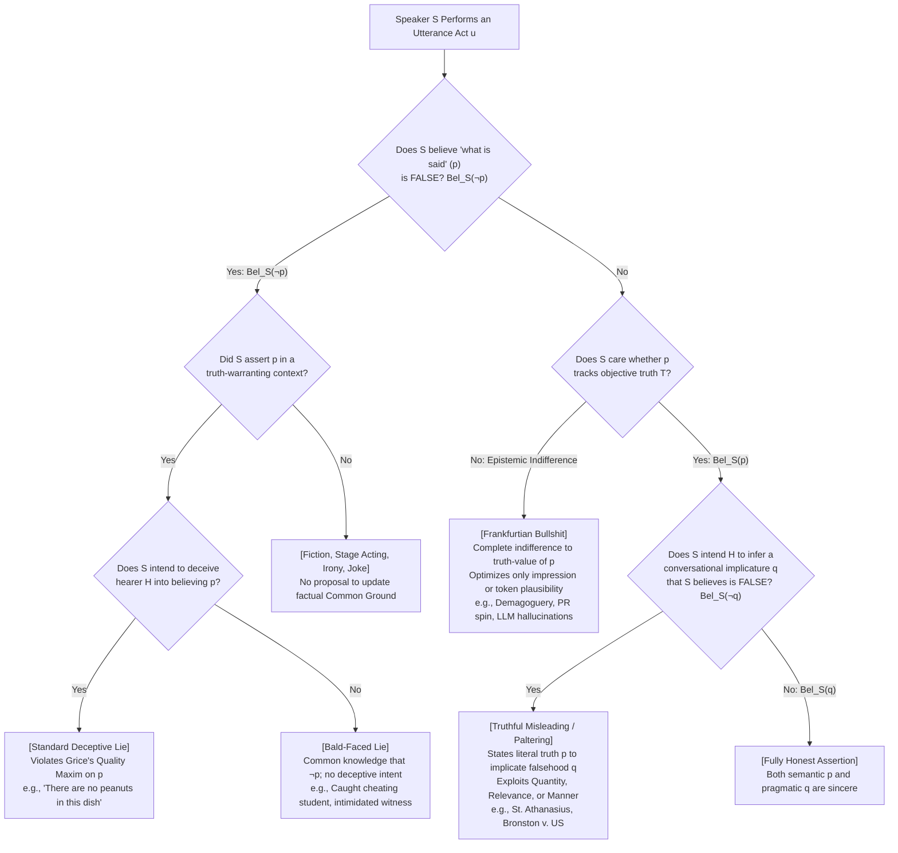
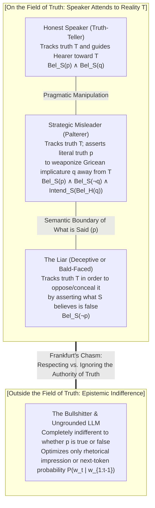

## 1. Introduction: The Paradox of Deceiving with the 100% Literal Truth

In AD 362, during the pagan revival of the Roman Emperor Julian the Apostate, <strong>Saint Athanasius of Alexandria</strong>—the fierce defender of Nicene orthodoxy—was fleeing imperial troops on a small boat heading up the Nile River. Realizing that the Emperor's galley was rapidly gaining on him, Athanasius ordered his steersman to turn the boat around immediately and row directly toward his pursuers.

As the two vessels passed each other on the river, the Roman soldiers—never suspecting that their quarry would be rowing straight toward them—shouted across the water:
*"Have you seen the traitor Athanasius? Where is he?"*
Athanasius himself stood up in the boat and called back in a calm voice:
<strong>*"He is not far from here! Row quickly and you will overtake him!"</strong>*
Thanking the stranger, the imperial soldiers rowed furiously past him up the Nile, while Athanasius sailed safely back into Alexandria.

This famous patristic anecdote poses a razor-sharp philosophical puzzle. The sentence uttered by Athanasius—*"He is not far from here"*—was <strong>100% literally and objectively true</strong>, both semantically and in his own mind. Since Athanasius was standing right there on the boat, his spatial distance from himself was zero; he was indeed "not far from here." He did not utter a single false proposition. Yet he spoke with the explicit intention of causing the Roman soldiers to form the false belief that Athanasius was just ahead of them up the river, and he succeeded in deceiving them completely. Did Saint Athanasius tell a lie?

### 1.1 The US Supreme Court Perjury Landmark: *Bronston v. United States* (1973)

That this distinction is far more than a medieval scholastic parlor game is demonstrated by one of the most famous decisions in American criminal law: the unanimous 1973 United States Supreme Court ruling in <strong>*Bronston v. United States* (409 U.S. 352)</strong>.

Samuel Bronston, a prominent Hollywood motion picture producer and president of `Bronston Productions, Inc.`, was being examined under oath at a federal bankruptcy hearing by a creditor's attorney seeking to uncover hidden assets. The courtroom transcript recorded the following exchange:

> <strong>Questioning Attorney (Q):</strong> *"Do you have any bank accounts in Swiss banks, Mr. Bronston?"*
> <strong>Bronston (A):</strong> *"No, sir."*
> <strong>Attorney (Q):</strong> *"Have you ever?"*
> <strong>Bronston (A):</strong> <strong>*"The company had an account there for about six months, in Zurich."</strong>*

The undisputed facts later uncovered by federal investigators were as follows. First, on the day Bronston testified, his personal Swiss bank account had already been closed, making his first answer (*"No, sir"*) literally true. Second, his company (`Bronston Productions, Inc.`) had indeed maintained an account in Zurich for six months, making his second answer literally true as well. However, between 1959 and 1964, Samuel Bronston <strong>personally</strong> had maintained a massive private bank account at International Credit Bank in Geneva, Switzerland, through which he had deposited and drawn more than \$180,000!

Federal prosecutors indicted Bronston for perjury under 18 U.S.C. § 1621. Their theory was straightforward: when asked whether *he* had ever held a Swiss bank account, Bronston responded by mentioning only his *company's* brief account in Zurich, thereby intentionally implying the false proposition that he had never personally held a Swiss account. Both the federal district court and the Second Circuit Court of Appeals convicted him.

Yet the <strong>United States Supreme Court, in an opinion written by Chief Justice Warren Burger, unanimously reversed the conviction (9–0)</strong>. The Court held that the federal perjury statute cannot be invoked to prosecute a witness who speaks the <strong>literal truth</strong>, even if the witness's answer is shrewdly evasive, unresponsive, and calculated to mislead the questioner into inferring a falsehood:

> *"Any special problems arising from the literally true but unresponsive answer are to be remedied through the 'questioner's acuity' and not by a federal perjury prosecution. It is the responsibility of the lawyer to probe; testimonial interrogation, and cross-examination in particular, is a probing, prying, pressing form of inquiry. If a witness evades, it is the lawyer's responsibility to recognize the evasion and to bring the witness back to the mark, to flush out the whole truth with the tools of sharp cross-examination."* (*Bronston v. United States*, 409 U.S. at 358–359).

### 1.2 Theological Casuistry: Mental Reservation (*Restrictio Mentalis*) and Equivocation (*Aequivocatio*)

Why do both legal systems and ordinary moral intuitions draw such a bright line between <strong>outright lying</strong> and <strong>deceiving via the literal truth (truthful misleading / paltering)</strong>?

Historically, this boundary was forged in the crucible of Christian moral theology and early modern casuistry. In the late fourth and early fifth centuries, <strong>Saint Augustine of Hippo</strong> authored two treatises—*De Mendacio* (*On Lying*, AD 395) and *Contra Mendacium* (*Against Lying*, AD 420)—arguing that every lie is inherently sinful and never permissible, even to save a life or protect someone from eternal heresy. In the thirteenth century, <strong>Saint Thomas Aquinas</strong> codified this absolutism in his *Summa Theologiae* (II-II, Q. 110), holding that speech was naturally ordained to signify inward thought, so that asserting what one believes to be false (*locutio contra mentem*) is an unnatural perversion of language itself.

During the late sixteenth and early seventeenth centuries, however, when Catholic priests hidden in Elizabethan and Jacobean England faced torture and execution on the rack if discovered, Jesuit moral theologians—most notably <strong>Martín de Azpilcueta (Doctor Navarrus)</strong>, <strong>Francisco Suárez</strong>, <strong>Leonard Lessius</strong>, and the English Jesuit superior <strong>Father Henry Garnet</strong> (author of *A Treatise of Equivocation*, c. 1598)—developed a sophisticated taxonomy of non-mendacious defensive speech:

* <strong>Strict Mental Reservation (*Restrictio pure mentalis*)</strong>: Uttering an overtly false statement aloud (e.g., saying *"I am not a priest"* to a magistrate) while silently adding a qualifying clause in one's head (*"...whom I am obligated to reveal to an heretical inquisitor"*). Because the external utterance possesses no true interpretation accessible in the public language, Pope Innocent XI officially condemned strict mental reservation in 1679 as nothing more than disguised lying.
* <strong>Broad Mental Reservation (*Restrictio late mentalis*) and Equivocation (*Aequivocatio* / *Amphibologia*)</strong>: Uttering a sentence that—by virtue of lexical polysemy, syntactic ambiguity, indexical shift, or pragmatic underspecification—actually possesses a <strong>literally true reading</strong> in the shared language, while foreseeing that the hostile listener will seize upon a prominent <strong>false reading</strong> or pragmatic inference. Under this doctrine, if the speaker asserts a true proposition and the hearer deceives himself by leaping to an unwarranted inference, the speaker commits no lie.

In this article, we bring together contemporary <strong>analytic philosophy of language</strong>, <strong>formal pragmatics</strong>, <strong>doxastic and epistemic logic</strong>, <strong>Bayesian cognitive modeling</strong>, and <strong>normative ethics</strong> to answer four foundational questions:

1. <strong>What is the exact formal definition of Lying?</strong> (Why lying depends on subjective belief rather than objective falsity, and how "bald-faced lies" overthrew the classical requirement of an intent to deceive.)
2. <strong>How does the human mind automatically infer falsehoods from literal truths?</strong> (H. Paul Grice's Cooperative Principle, the Four Conversational Maxims, Scalar Implicatures, and the Bayesian Rational Speech Act [RSA] model of strategic misleading.)
3. <strong>Is misleading with the truth morally preferable to lying?</strong> (Immanuel Kant's absolute prohibition on lying to the Murderer at the Door contrasted with Kant's own strategic equivocation to King Friedrich Wilhelm II, alongside the contemporary clash between Bernard Williams, Seana Shiffrin, and Jennifer Saul.)
4. <strong>Why is Harry Frankfurt's *Bullshit* a far greater enemy of the truth than lying?</strong> (Epistemic indifference to truth in *On Bullshit* and its mathematical realization in modern Large Language Model [LLM] "hallucinations.")

---

## 2. The Formal Definition of Lying: Doxastic Logic and the Revolution of Bald-Faced Lies

In everyday conversation, people loosely apply the word "lie" to any false statement or any act of deception. In analytic philosophy of language, however, <strong>lying</strong> is a precise speech act distinct from both <strong>honest error</strong> on one side and <strong>non-mendacious deception</strong> on the other.

### 2.1 The Classical Deceptionist Definition (Chisholm & Feehan, 1977)

Building on Augustine's classical formulation (*"a false signification of speech with the will to deceive"*), Roderick Chisholm and Thomas Feehan published their landmark 1977 paper *"The Intent to Deceive"* in *The Journal of Philosophy*, which served for decades as the standard definition of lying. Let us formalize this definition using multimodal <strong>Doxastic Logic</strong> (the logic of belief) and <strong>Speech Act Theory</strong>.

Let $S$ denote the speaker, $H$ the hearer, and $p$ a proposition. Let $\text{Says}(S, H, p)$ mean that $S$ explicitly <strong>states or asserts</strong> $p$ as *what is said* to $H$; let $\text{Bel}_x(p)$ mean that agent $x$ <strong>believes</strong> proposition $p$ to be true; let $\text{Warrant}(S, H, p)$ mean that the utterance occurs in an <strong>epistemically warranting context</strong>; and let $\text{Intend}_S(\phi)$ mean that $S$ acts with the <strong>intention</strong> of bringing about state $\phi$.

The traditional Deceptionist definition of lying ($\text{Lie}_{\text{trad}}$) is the conjunction of four necessary and jointly sufficient conditions:

$$\text{Lie}_{\text{trad}}(S, H, p) \iff \underbrace{\text{Says}(S, H, p)}_{\text{1. Statement Condition}} \;\land\; \underbrace{\text{Bel}_S(\neg p)}_{\text{2. Untruthfulness Condition}} \;\land\; \underbrace{\text{Warrant}(S, H, p)}_{\text{3. Warrant Condition}} \;\land\; \underbrace{\text{Intend}_S\big(\text{Bel}_H(p)\big)}_{\text{4. Intent-to-Deceive Condition}}$$

Each of these four clauses encodes a crucial philosophical boundary. Let us examine them in detail.

#### (1) The Statement / Assertion Condition: $\text{Says}(S, H, p)$
To lie, speaker $S$ must explicitly <strong>say or assert</strong> proposition $p$—that is, $p$ must be part of the conventional, truth-conditional semantic content (*what is said*) of $S$'s utterance. Consequently, non-linguistic deception—such as wearing a disguise, planting someone else's fingerprints at a crime scene, or feigning a limp—is <strong>deception</strong>, but it is <strong>not a lie</strong>. Similarly, uttering a grammatical question (*"Did Bernard steal the money?"*), an imperative (*"Look over there!"*), or an interjection cannot by itself be a lie because non-declarative mood lacks propositional assertion, even when deployed to mislead.

#### (2) The Untruthfulness (Insincerity) Condition: $\text{Bel}_S(\neg p)$
Inspect the formula above carefully: <strong>nowhere does the proposition $\neg p$ (the objective falsity of $p$ in the actual world) appear as a requirement!</strong>

Across nearly the entire philosophical literature (Subjectivism), whether an utterance counts as a lie is governed not by whether $p$ is *objectively false*, but by whether the speaker <strong>subjectively believes $p$ to be false</strong> ($\text{Bel}_S(\neg p)$, or at least does not believe $p$ to be true, $\neg \text{Bel}_S(p)$). This yields two counterintuitive but decisive consequences:

* <strong>Case A: Honest Mistake (Objective Falsity without Untruthfulness)</strong>
  Suppose Alice's wristwatch stopped an hour ago without her noticing. When Bob asks her the time, Alice sincerely consults her watch and says, *"It is 3:00 PM"* ($p$), when in reality it is 4:00 PM ($\neg p$). Here $p$ is objectively false, yet because $\text{Bel}_S(p)$ holds, Alice has <strong>not lied</strong>; she has merely made an honest mistake.
* <strong>Case B: Lying with an Objective Truth (Untruthfulness without Objective Falsity)</strong>
  Suppose Alice is 100% convinced that her friend George is currently at home in bed ($\text{Bel}_S(\neg p)$). Wishing to send Bob on a wild goose chase, Alice tells Bob, *"George is at the university library right now"* ($p$). Unknown to Alice, however, George woke up ten minutes earlier and actually walked to the university library, so $p$ happens to be <strong>objectively true</strong> at the moment of utterance! Did Alice lie to Bob? <strong>Yes!</strong> Because Alice asserted a proposition $p$ that she believed to be false ($\text{Bel}_S(\neg p)$) in order to deceive Bob, she told a full-fledged lie—even though Bob serendipitously ended up with a true belief and therefore was not *successfully deceived* ("deceive" is a success verb, whereas "lie" is an intentional speech-act verb).

#### (3) The Warranting / Common Ground Condition: $\text{Warrant}(S, H, p)$
When an actor on stage declares *"I am Hamlet, Prince of Denmark,"* when a novelist writes *"It was a bright cold day in April, and the clocks were striking thirteen,"* or when a drenched commuter remarks sarcastically during a torrential downpour *"What glorious sunshine we're having today!"*, the speaker utters a proposition believed to be false ($\text{Bel}_S(\neg p)$), yet no one accuses them of lying.

As <strong>Thomas Carson (2006, 2010)</strong> and <strong>Andreas Stokke (2018)</strong> have formalized, an assertion is a candidate for lying only when made in a <strong>warranting context</strong>—or, in <strong>Robert Stalnaker's (1978, 2002)</strong> influential framework of discourse pragmatics, when the speaker performs an assertive speech act that proposes to add $p$ to the <strong>Common Ground</strong> $CG$ (the set of propositions mutually presupposed as true by the participants in the conversation):

$$\text{Assert}(S, H, p) \implies \text{Propose}_S\big(CG_{\text{new}} = CG_{\text{old}} \cup \{p\}\big)$$

Stage acting, fiction, metaphor, and transparent irony operate outside truth-warranting assertions and do not propose to update the factual Common Ground with literal $p$.

### 2.2 The Shock of "Bald-Faced Lies": Why Lying Does Not Require an Intent to Deceive

For over sixteen centuries from Augustine to Chisholm & Feehan, almost every philosopher assumed Condition 4: that to lie is necessarily to act with the <strong>intent to deceive</strong> the hearer ($\text{Intend}_S(\text{Bel}_H(p))$).

In the early 2000s, however, <strong>Thomas Carson (2006)</strong>, <strong>Roy Sorensen (2007)</strong>, and <strong>Don Fallis (2009)</strong> demolished the Deceptionist orthodoxy by introducing a devastating class of counterexamples known as <strong>Bald-Faced Lies</strong>—cases in which it is common knowledge between speaker $S$ and hearer $H$ that $p$ is false ($\text{CommonKnowledge}_{S,H}(\neg p)$), so that $S$ has zero expectation or intention of deceiving $H$, yet $S$ indisputably lies!

* <strong>Example 1: The Cheating Student (Carson 2006)</strong>
  A college student is caught red-handed cheating on an exam by the Dean, with high-definition security footage capturing the crib notes in his hand. The student knows that the Dean knows he cheated, and knows that nothing he says will ever convince the Dean otherwise. However, the student also knows that by university policy, the Dean never expels a student unless the student formally confesses on the record. Looking the Dean straight in the eye, the student says: <strong>*"I did not cheat on this exam."</strong>*
* <strong>Example 2: The Intimidated Witness at a Mob Trial (Fallis 2009)</strong>
  During a murder trial, a ruthless mafia boss sits in the front row glaring at the sole eyewitness. Every person in the courtroom—judge, prosecutor, jury, and witness—knows from incontrovertible video evidence that the witness stood three feet away from the murder. The witness knows no one will believe a denial. Nevertheless, solely to avoid being assassinated by the mob for "ratting on the record," the witness testifies under oath: <strong>*"I saw nothing."</strong>*
* <strong>Example 3: Diplomatic and Bureaucratic Lies (Sorensen 2007)</strong>
  In totalitarian regimes or diplomatic standoffs, an official states a blatant fabrication that both sides know to be false, not to fool the interlocutor, but to force institutional compliance, display political dominance, or maintain an official legal fiction.

In all three scenarios, $\text{Intend}_S(\text{Bel}_H(p))$ is strictly <strong>false</strong>: the speaker has no intention of making the hearer believe $p$. Yet both ordinary linguistic intuition and the law of perjury classify these utterances as <strong>lies</strong>.

Consequently, the "New Orthodoxy" in contemporary philosophy of language (<strong>Carson 2010</strong>, <strong>Saul 2012</strong>, <strong>Stokke 2018</strong>) defines lying purely as <strong>insincere warranting assertion</strong>, dropping the intent-to-deceive clause altogether:

$$\text{Lie}(S, H, p) \iff \text{Says}(S, H, p) \;\land\; \text{Bel}_S(\neg p) \;\land\; \text{Warrant}(S, H, p)$$

---

## 3. H. Paul Grice's Pragmatics: The Engine of Misleading Truths

Armed with this formal definition of lying, let us return to Saint Athanasius on the Nile (*"He is not far from here"*) and Samuel Bronston in bankruptcy court (*"The company had an account there for about six months, in Zurich"*).

In both cases, the proposition $p$ explicitly stated by the speaker (*what is said*) was <strong>believed by the speaker to be true</strong> ($\text{Bel}_S(p)$) and was <strong>objectively true</strong> ($p$). Because $\text{Bel}_S(\neg p)$ fails, <strong>neither Athanasius nor Bronston told a lie</strong>.

How, then, did they succeed in deceiving their hearers? Why did the Roman soldiers and the questioning lawyer automatically infer a false proposition $q$ that the speaker never actually uttered?
The answer lies in the revolutionary theory of <strong>Pragmatics</strong> presented by the British philosopher of language <strong>H. Paul Grice (1913–1988)</strong> in his 1967 William James Lectures at Harvard University, famously published in 1975 as <strong>*"Logic and Conversation."</strong>*

### 3.1 Semantic Meaning ("What is Said") vs. Pragmatic Meaning ("Conversational Implicature")

Grice observed that the total meaning communicated by an utterance $u$ in context divides into two fundamentally distinct components:

$$\text{Total Signification}(u) = \underbrace{\text{What is Said } (p)}_{\text{Semantics (Truth-Conditional)}} \;\oplus\; \underbrace{\text{What is Implicated } (q)}_{\text{Pragmatics (Inferential)}}$$

1. <strong>What is Said ($p$)</strong>: The conventional, literal truth-conditional proposition expressed by the sentence after resolving indexicals (such as *"I"*, *"here"*, *"now"*) and structural disambiguation.
2. <strong>Conversational Implicature ($q$)</strong>: Additional propositions that are *not* logically entailed by $p$, but that a rational hearer infers the speaker intends to convey by assuming the speaker is cooperating in the conversation.

At the foundation of all human discourse, Grice argued, lies an overarching rational norm that he termed the <strong>Cooperative Principle (CP)</strong>:

> <strong>Grice's Cooperative Principle (CP):</strong>
> *"Make your conversational contribution such as is required, at the stage at which it occurs, by the accepted purpose or direction of the talk exchange in which you are engaged."* (Grice 1975, p. 45).

Echoing Immanuel Kant's table of categories in the *Critique of Pure Reason*, Grice decomposed the Cooperative Principle into <strong>Four Conversational Maxims</strong>: <strong>Quantity</strong>, <strong>Quality</strong>, <strong>Relation (Relevance)</strong>, and <strong>Manner</strong>.

### 3.2 The Four Conversational Maxims and How Deceivers Exploit Them

#### 1. The Maxim of Quantity
* <strong>Submaxim 1</strong>: *Make your contribution as informative as is required (for the current purposes of the exchange).*
* <strong>Submaxim 2</strong>: *Do not make your contribution more informative than is required.*

The First Submaxim of Quantity is the engine behind the most pervasive form of truthful deception in human language: <strong>Scalar Implicatures</strong> (systematized by <strong>Laurence Horn 1972</strong> and <strong>Stephen Levinson 2000</strong>).

Suppose there were 10 cookies in the jar, and you ate <strong>all 10 of them</strong>. When your roommate comes home and asks what happened to the cookies, you reply:
> <strong>Utterance $u$</strong>: *"I ate <strong>some</strong> of the cookies."*

In classical First-Order Predicate Logic, the semantic meaning (*what is said*, $p$) of *"I ate some of the cookies"* is translated using the existential quantifier $\exists$:

$$p \equiv \exists x \, \big(\text{Cookie}(x) \land \text{Ate}(S, x)\big) \quad \text{("There is at least one cookie that } S \text{ ate")}$$

Meanwhile, the stronger statement *"I ate all of the cookies"* ($p_{\text{strong}}$) is translated using the universal quantifier $\forall$:

$$p_{\text{strong}} \equiv \forall x \, \big(\text{Cookie}(x) \to \text{Ate}(S, x)\big)$$

Assuming a non-empty domain of cookies, universal quantification <strong>logically entails</strong> existential quantification ($p_{\text{strong}} \models p$). If you ate all 10 cookies, it is <strong>100% logically and semantically true</strong> that you ate at least one cookie! Therefore, by uttering *"I ate some of the cookies,"* you have stated a literal truth ($p$).

Yet pragmatically, expressions in natural language are organized along <strong>Horn Scales</strong> ordered by logical strength, such as:
* $\langle \text{all}, \text{most}, \text{many}, \text{some} \rangle$
* $\langle \text{always}, \text{often}, \text{sometimes} \rangle$
* $\langle \text{necessary}, \text{possible} \rangle$
* $\langle \text{and } (\land), \text{or } (\lor) \rangle$
* $\langle \text{succeeded}, \text{tried} \rangle$

When you choose the weaker term *"some"* ($p$) on the scale $\langle \text{all}, \text{some} \rangle$, your roommate assumes you are obeying the Maxim of Quantity. Since *"all"* ($p_{\text{strong}}$) would also be highly relevant and more informative, the only cooperative reason for you not to say *"all"* is that you believe *"all"* is false (obeying the Maxim of Quality). Thus, your roommate automatically computes the <strong>scalar conversational implicature $q$</strong>:

$$q \equiv \neg p_{\text{strong}} \equiv \neg \forall x \, \big(\text{Cookie}(x) \to \text{Ate}(S, x)\big) \quad \text{("} S \text{ did NOT eat all of the cookies")}$$

By stating a literal truth $p$ while knowing its scalar implicature $q$ is false ($\text{Bel}_S(p) \land \text{Bel}_S(\neg q)$), you have successfully misled your roommate without telling a lie!

#### 2. The Maxim of Quality
* <strong>Supermaxim</strong>: *Try to make your contribution one that is true.*
* <strong>Submaxim 1</strong>: *Do not say what you believe to be false* ($\neg \text{Bel}_S(\neg p)$).
* <strong>Submaxim 2</strong>: *Do not say that for which you lack adequate evidence.*

Notice the exact structural architecture here: <strong>Lying</strong> is a direct violation of Quality Submaxim 1 at the level of *what is said* ($p$). <strong>Bullshit</strong>, as we shall see in Section 5, is a wholesale abandonment of Quality Submaxim 2 and the Supermaxim itself. <strong>Misleading</strong>, by contrast, scrupulously obeys Quality at the level of *what is said* ($p$) in order to weaponize the remaining three maxims!

#### 3. The Maxim of Relation (Relevance)
* <strong>Maxim</strong>: <strong>*Be relevant.</strong>*

This maxim explains both <strong>Samuel Bronston's</strong> courtroom evasion and <strong>Grice's famous Recommendation Letter</strong>.
In *Bronston v. United States*, when the attorney asked *"Have you ever [had a Swiss bank account]?"*, Bronston answered *"The company had an account there for about six months, in Zurich."* Because a cooperative speaker obeying Relevance and Quantity would never mention only a corporate account if he also possessed a personal five-year account, the attorney inferred the conversational implicature $q =$ *"Bronston never had a personal Swiss bank account."*

Compare Grice's own classic illustration of <strong>flouting</strong> (ostentatiously violating a maxim at the surface level to generate an implicature):
A philosophy professor is asked to write a letter of recommendation for his pupil, Mr. X, who is applying for a competitive philosophy professorship. The professor writes only:

> *"Dear Sir, Mr. X's command of English is excellent, and his attendance at tutorials has been regular. Yours, etc."* (Grice 1975, p. 52).

Every word of $p$ is literally true. Why does the search committee immediately infer $q =$ <strong>*"Mr. X is no good at philosophy"</strong>*?
1. The professor did not opt out of the Cooperative Principle (otherwise he would have declined to write the letter).
2. As Mr. X's tutor, the professor certainly knows about Mr. X's philosophical ability, and knows that philosophical ability—not mere attendance or grammar—is what is relevant and required (Quantity & Relevance).
3. Therefore, the professor must be unwilling to write anything about Mr. X's philosophical prowess because <strong>Maxim of Quality</strong> (*"Do not say what you believe to be false"*) prevents him from praising Mr. X—hence Mr. X must be terrible at philosophy!

#### 4. The Maxim of Manner
* <strong>Supermaxim</strong>: *Be perspicuous.*
* <strong>Submaxims</strong>: (i) *Avoid obscurity of expression*; (ii) *Avoid ambiguity*; (iii) *Be brief (avoid unnecessary prolixity)*; (iv) *Be orderly.*

In classical propositional logic, conjunction ($\land$) is commutative: $p_1 \land p_2 \iff p_2 \land p_1$. Yet in natural language, saying *"Lone Ranger jumped on his horse and rode into the sunset"* means something altogether different from *"Lone Ranger rode into the sunset and jumped on his horse"*, because Manner Submaxim (iv) (*"Be orderly"*) induces a chronological and causal implicature. Similarly, Saint Athanasius's *"He is not far from here"* exploited Manner Submaxim (ii) (referential ambiguity between third-person detachment and self-reference) to mislead his pursuers with the literal truth.

### 3.3 The Diagnostic Litmus Test: Cancellability (Defeasibility)

How can a philosopher, linguist, or cross-examining lawyer prove whether a false impression $q$ was part of <strong>what was said ($p$, a lie)</strong> or merely a <strong>conversational implicature ($q$, misleading)</strong>? Grice provided a rigorous formal test: <strong>Explicit Cancellability</strong>.

* <strong>Semantic Entailments (*What is Said*) are NOT cancellable without contradiction</strong>:
  If a speaker says, *#"I assassinated the senator yesterday, <strong>but I don't mean to imply that he died</strong>,"* the speaker utters a strict logical contradiction ($\perp$). Because *"the victim died"* is semantically entailed by *"assassinated"*, it cannot be cancelled.
* <strong>Conversational Implicatures ARE cancellable without contradiction</strong>:
  If a speaker says, *"I ate some of the cookies—<strong>in fact, I ate all of them!</strong>"*, or if Samuel Bronston had said, *"The company had an account in Zurich for six months—<strong>and I should add that I also had a personal account in Geneva</strong>,"* the sentence is <strong>100% logically consistent</strong>! The second clause simply cancels the defeasible pragmatic inference $q$ before the hearer can lock it in.

### 3.4 Bayesian Pragmatics (The RSA Model) and the Mathematics of "Paltering"

In contemporary cognitive science and formal pragmatics, <strong>Michael C. Frank and Noah D. Goodman (2012)</strong> formalized Gricean reasoning as recursive Bayesian game theory in the <strong>Rational Speech Act (RSA) Model</strong>. This framework allows us to state the exact mathematical mechanism of <strong>Truthful Misleading</strong>—which Harvard negotiation theorists <strong>Todd Rogers, Richard Zeckhauser, Francesca Gino, Michael Norton, and Maurice Schweitzer (2017)</strong> termed <strong>"Paltering"</strong> (the active use of truthful statements to convey a mistaken impression).

Let $W$ be the space of possible states of the world, $w^* \in W$ the true state of the world known to speaker $S$, and $U$ the set of available utterances. Each utterance $u \in U$ has a boolean truth-conditional meaning function $\llbracket u \rrbracket : W \to \{0, 1\}$, where $\llbracket u \rrbracket(w) = 1$ iff $u$ is literally true in world $w$.

1. <strong>The Literal Listener ($L_0$)</strong>:
   $L_0$ interprets utterance $u$ purely via its literal semantic truth conditions, conditioning the prior probability $P(w)$ on $\llbracket u \rrbracket(w) = 1$:
   $$P_{L_0}(w \mid u) = \frac{\llbracket u \rrbracket(w) \cdot P(w)}{\sum_{w' \in W} \llbracket u \rrbracket(w') \cdot P(w')}$$

2. <strong>The Cooperative Pragmatic Speaker ($S_1$)</strong>:
   Given world state $w$, a cooperative speaker $S_1$ chooses utterance $u$ via a softmax decision rule (with rationality parameter $\alpha > 0$ and utterance cost $C(u)$) to maximize the epistemic informativity $\ln P_{L_0}(w \mid u)$ for $L_0$:
   $$P_{S_1}(u \mid w) \propto \exp\Big(\alpha \big(\ln P_{L_0}(w \mid u) - C(u)\big)\Big)$$

3. <strong>The Pragmatic Listener ($L_1$)</strong>:
   A normal human hearer $H$ operates as $L_1$, applying Bayes' Rule under the assumption that the speaker is behaving as a cooperative Gricean agent $S_1$:
   $$P_{L_1}(w \mid u) = \frac{P_{S_1}(u \mid w) \cdot P(w)}{\sum_{w' \in W} P_{S_1}(u \mid w') \cdot P(w')}$$

Now consider <strong>Strategic Truthful Misleading (Paltering)</strong>. A deceptive speaker $S_{\text{mislead}}$ knows the true state is $w^*$ (e.g., all 10 cookies were eaten; Bronston had a personal Geneva account), and wishes to induce the pragmatic listener $L_1$ to believe a false state $w_{\text{false}} \neq w^*$ (e.g., some cookies remain; Bronston never had a personal account), while strictly obeying the constraint of <strong>literal truth</strong> ($\llbracket u \rrbracket(w^*) = 1$). The misleader solves the constrained optimization problem:

$$u^* = \underset{u \in U \,:\, \llbracket u \rrbracket(w^*) = 1}{\arg\max} \; P_{L_1}(w_{\text{false}} \mid u)$$

Because $u^*$ is compatible with both $w^*$ and $w_{\text{false}}$ ($\llbracket u^* \rrbracket(w^*) = \llbracket u^* \rrbracket(w_{\text{false}}) = 1$), yet a cooperative speaker $S_1$ in state $w^*$ would have chosen a stronger, more informative utterance $u_{\text{strong}}$ ($P_{S_1}(u^* \mid w_{\text{false}}) \gg P_{S_1}(u^* \mid w^*)$), the listener's Bayesian inversion $P_{L_1}(w \mid u^*)$ shifts almost all posterior probability mass onto the false state $w_{\text{false}}$!

In doxastic logic, we therefore arrive at the exact formal definition of <strong>Truthful Misleading (Paltering)</strong>:

$$\text{Mislead}_{\text{truthful}}(S, H, p, q) \iff \text{Says}(S, H, p) \;\land\; \text{Bel}_S(p) \;\land\; \text{Implicates}(S, H, p, q) \;\land\; \text{Bel}_S(\neg q) \;\land\; \text{Intend}_S\big(\text{Bel}_H(q)\big)$$

---

## 4. The Moral & Ethical Debate: Is Misleading Morally Better Than Lying?

Having established the formal linguistic boundary between <strong>lying</strong> ($\text{Bel}_S(\neg p)$) and <strong>truthful misleading</strong> ($\text{Bel}_S(p) \land \text{Bel}_S(\neg q)$), we now confront the central question of normative ethics: <strong>When a speaker intentionally deceives a hearer, does choosing to mislead with the literal truth rather than tell an outright lie make the act morally better?</strong>

### 4.1 Immanuel Kant's Absolute Rigorism and the "Murderer at the Door"

In the history of moral philosophy, the most uncompromising condemnation of lying belongs to <strong>Immanuel Kant (1724–1804)</strong>. Both in *The Metaphysics of Morals* (*Die Metaphysik der Sitten*, 1797) and in his famous 1797 essay <strong>*"On a Supposed Right to Lie from Philanthropic Concerns"</strong>* (*Über ein vermeintes Recht aus Menschenliebe zu lügen*), Kant argued that telling an outright lie (*Lüge* / *mendacium*—defined strictly as an intentional untruthful <strong>declaration</strong>, *Aussage*) is an absolute violation of a <strong>Perfect Duty</strong>, forbidden under all conceivable circumstances.

Responding to the French philosopher Benjamin Constant's challenge—the celebrated <strong>"Murderer at the Door"</strong> scenario—Kant asked what you must do if a homicidal killer knocks on your door and asks whether your innocent friend, who has just taken refuge inside your house, is within.

Whereas utilitarianism and everyday moral intuition insist that you have a moral obligation to lie to save your friend's life, Kant answered that <strong>lying to the murderer is unconditionally wrong</strong>. For Kant, truthfulness in declarations that one cannot avoid is a formal duty to humanity as a rational species: to lie is to subvert the very possibility of rational contracts, legal order, and human personhood, reducing oneself to a "mere deceptive appearance of a human being" (*Doctrine of Virtue*, 6:429).

Even more strikingly, Kant argued that if you tell the truth (*"Yes, my friend is inside"*) and the murderer bursts in and kills him, the moral and legal guilt belongs solely to the murderer; whereas if you <strong>lie</strong> (*"No, he is not here"*), and unknown to you your friend had quietly climbed out the back window a moment earlier, so that the murderer—turning away from your house because of your lie—runs straight into your friend on the street and murders him, <strong>you are legally and morally responsible for your friend's death</strong> because you stepped outside the bounds of formal moral law!

### 4.2 How Kant Himself Practiced Strategic Misleading: The Pledge to King Friedrich Wilhelm II

Yet here lies one of the most fascinating episodes in the entire history of philosophy: <strong>Immanuel Kant—the fiercest absolutist against lying—deliberately practiced and defended strategic misleading via literal truth in his own life!</strong>

In 1793, Kant published *Religion within the Boundaries of Mere Reason*, which drew the wrath of the reactionary Prussian monarch <strong>King Friedrich Wilhelm II</strong> and his minister Johann Christoph von Wöllner. In October 1794, the King issued an official royal reprimand accusing Kant of distorting Scripture and demanded a solemn written pledge that Kant would never again lecture or publish on religion.

Refusing the King's order meant ruin and dismissal from his professorship at Königsberg; making a false promise meant violating his own supreme moral principle against lying. At age seventy, Kant drafted his reply to the King with surgical linguistic precision:

> *"As <strong>Your Royal Majesty's most faithful subject</strong> [Als Ew. Königl. Majestät getreuester Untertan], I solemnly declare that I shall hereafter completely refrain from all public lectures and writings concerning religion, whether natural or revealed..."*

Three years later, in November 1797, King Friedrich Wilhelm II died, and Friedrich Wilhelm III ascended the throne. Immediately, Kant resumed publishing on religion in *The Conflict of the Faculties* (*Der Streit der Fakultäten*, 1798)! In the preface to that book, Kant proudly explained in a footnote how he had outsmarted the late King without ever telling a lie:

> *"I chose this expression [<strong>'As Your Majesty's most faithful subject'</strong>] very carefully, so that I would not renounce my freedom of judgment in this religious suit forever, <strong>but only for as long as His Majesty remained alive</strong>."* (Kant, *Akademie-Ausgabe* 7:10n).

Consider the Gricean structure of Kant's maneuver:
* <strong>What Kant Literally Said ($p$)</strong>: *"In my capacity as the subject of King Friedrich Wilhelm II, I will refrain from publishing on religion."* Since one cannot be the subject of a deceased monarch, $p$ remained 100% literally true when Kant published in 1798!
* <strong>What Kant Conversational Implicated ($q$)</strong>: By the Maxim of Quantity and Relevance, King Friedrich Wilhelm II naturally inferred that Kant was promising to abstain from religious writing <strong>for the rest of Kant's life</strong> ($q$).

Similarly, in his *Lectures on Ethics* (*Vorlesungen über Ethik*, Collins 27:447–449), Kant argued that if a highwayman grabs you by the throat and demands *"Are you carrying any money?"*, you have no obligation to disclose the whole truth (*reticentia* / reserve), and concealing the truth through evasive or ambiguous statements when an attacker has no right to demand a declaration does not constitute a formal lie (*mendacium*), which occurs only when one explicitly declares a falsehood!

### 4.3 Contemporary Ethics: Preferentialism (Asymmetry) vs. Equivalencism

Does the moral distinction between lying and misleading survive modern philosophical scrutiny? Contemporary ethicists divide into two camps: <strong>Preferentialists (Asymmetrists)</strong>, who hold that, *ceteris paribus* (all else being equal), misleading is morally less wrong than lying, and <strong>Equivalencists</strong>, who argue that intentional deception carries identical moral weight regardless of whether the mechanism is semantic or pragmatic.

#### The Case for Preferentialism (Why Misleading Might Be Less Wrong Than Lying)

1. <strong>The Epistemic Responsibility / Caveat Auditor Argument (Chisholm & Feehan 1977; Jonathan Adler 1997; Bernard Williams 2002; Clea Rees 2014)</strong>
   In *Truth and Truthfulness* (2002), <strong>Bernard Williams</strong> argued that when a speaker $S$ explicitly <strong>asserts</strong> $p$, $S$ invites the hearer $H$ to rely entirely on $S$'s personal epistemic authority and trustworthiness. If $S$ lies, $S$ betrays that direct invitation of trust entirely.
   When $S$ merely misleads by stating a true proposition $p$ that implicates a false $q$, however, the transition from $p \to q$ requires an <strong>active inferential contribution by the hearer $H$</strong>. Because conversational implicatures are defeasible and cancellable, $H$ bears at least a small fraction of epistemic responsibility (*caveat auditor*—"let the listener beware") for jumping to the unstated conclusion $q$ rather than probing further—precisely the rationale adopted by the US Supreme Court in *Bronston v. United States*.
2. <strong>Preserving the Semantic Reliability of Assertion (Seana Shiffrin 2014; Alasdair MacIntyre 1994)</strong>
   In *Speech Matters: On Lying, Morality, and the Law* (2014), legal philosopher <strong>Seana Shiffrin</strong> argues that literal assertion is humanity's sole non-inferential epistemic conduit into the minds of other rational agents. Outright lying corrupts the semantic currency of language itself, whereas misleading leaves the literal truth-conditions of assertions intact.

#### Jennifer Saul's Critique (2012): Why Misleading Is NOT Morally Better Than Lying

In her groundbreaking monograph <strong>*Lying, Misleading, and What is Said: An Exploration in Philosophy of Language and in Ethics* (Oxford University Press, 2012)</strong>, <strong>Jennifer Saul</strong> dismantled the Preferentialist consensus with two powerful arguments.

1. <strong>The Semantic/Pragmatic Boundary Cannot Bear Heavy Moral Weight</strong>
   Drawing on contemporary <strong>Relevance Theory</strong> (Sperber & Wilson 1986; Robyn Carston 2002) and <strong>Semantic Contextualism</strong> (François Recanati 2004), Saul shows that the technical linguistic boundary between *what is said* ($p$) and *what is implicated* ($q$) depends on subtle sub-personal syntactic and contextual processes (such as *saturation*, *completion*, and *free enrichment*).
   Compare:
   * (a) *"Nothing is big enough to hurt Billy."* (Literally false unless domain-restricted via contextual completion).
   * (b) *"I have had breakfast."* (Literally entails only that the speaker has eaten breakfast at least once in their life, unless pragmatically enriched to *"today"*).
   If tiny, arbitrary variations in syntax shift content across the semantic/pragmatic border without changing either the speaker's deceptive intent or the hearer's comprehension, it is absurd to think that crossing this technical linguistic line suddenly transforms a permissible act into an absolute moral wrong.

2. <strong>The "Peanut Allergy Murder" Thought Experiment and Moral Hypocrisy</strong>
   Saul asks us to compare two versions of a lethal deception where intention, foreseeable harm, and epistemic trust are held strictly equal (adapted from her George cases, Saul 2012, Ch. 4):

   > <strong>The Lethal Allergy Case:</strong>
   > Suppose Frieda secretly hates her dinner guest George, who suffers from a fatal peanut allergy, and she has laced the curry with peanut oil and peanut flour in order to kill him. However, she also used sunflower oil and spices in the dish. Before taking a bite, George asks nervously: *"Is this dish safe for me to eat? You know I have a deadly allergy."*
   > * <strong>Version 1 (Outright Lie)</strong>: Frieda says, <strong>*"This dish contains no peanuts whatsoever."</strong>* George eats the curry and dies.
   > * <strong>Version 2 (Truthful Misleading / Paltering)</strong>: Frieda—who prides herself on never telling a lie—smiles and says, <strong>*"It's made with sunflower oil and spices!"</strong>* (100% literally true $p$). Reasonably trusting his host's cooperative relevance, George infers $q =$ *"There are no peanuts in it,"* eats the curry, and dies.

   Is Frieda in Version 2 (the truthful misleader) even one iota morally better than Frieda in Version 1 (the liar)? <strong>Obviously not!</strong>
   In fact, as Saul and empirical researchers on paltering (<strong>Rogers et al. 2017</strong>) point out, choosing to mislead rather than lie often reflects <strong>worse</strong> moral character: the deceiver inflicts the exact same epistemic and physical harm on the victim while engaging in self-righteous <strong>moral licensing</strong> (*"My hands are clean—I never told a single lie!"*) or calculating how to escape legal accountability if caught.

---

## 5. Harry G. Frankfurt's *On Bullshit* (1986/2005): Indifference to Truth and the Age of AI Hallucinations

Up to this point, we have examined <strong>lying</strong> and <strong>truthful misleading</strong>—two speech acts that operate via opposite truth-values at the semantic level, yet share a profound hidden commonality. In 1986 (republished as a bestselling book by Princeton University Press in 2005), the eminent moral philosopher <strong>Harry G. Frankfurt (1929–2023)</strong> identified a third pathology of human discourse that threatens civilization far more deeply than either lying or misleading: <strong>Bullshit</strong>.

### 5.1 The Tripartite Epistemic Taxonomy: Truth-Teller, Liar, and Bullshitter

Why is *bullshit* philosophically distinct from a *lie*? Building on Max Black's 1983 analysis of *"Humbug,"* Frankfurt analyzed the speaker's second-order <strong>epistemic attitude toward the authority of truth ($T$)</strong>:

1. <strong>The Honest Person (Truth-Teller)</strong>:
   Knows (or seeks to know) the truth $T$, cares about $T$, and aims to align their assertion $p$ with reality ($\text{Bel}_S(p)$) so as to guide the hearer toward $T$.
2. <strong>The Liar (and the Strategic Misleader)</strong>:
   Crucially, <strong>the Liar also knows and cares intensely about the truth $T$!</strong>
   As Frankfurt observes, it is impossible to tell a purposeful lie unless you think you know what is true ($\text{Bel}_S(\neg p)$). To design an effective falsehood (or a craftily misleading literal truth), the liar must keep their eyes fixed firmly on reality in order to conceal it and steer the hearer away from it. Thus, the Liar and the Honest Person are playing <strong>on the exact same field</strong>, governed by the authority of truth—one obeying it, the other defying it.
3. <strong>The Bullshitter</strong>:
   The bullshitter, by contrast, is <strong>not playing on the field of truth at all</strong>. When making an assertion $p$, the bullshitter <strong>does not care whether $p$ is true or false</strong> ($\neg \text{Care}_S(p \leftrightarrow T)$).
   The bullshitter's statements may happen by sheer coincidence to be true, or they may be completely false; their truth-value is simply irrelevant to the bullshitter's enterprise. What the bullshitter is trying to deceive us about is not the state of the world $w^*$, but <strong>their own enterprise and epistemic stance</strong>—namely, hiding the fact that the truth-values of their statements are of no concern to them whatsoever!

Frankfurt summarizes this devastating asymmetry in the most famous passage of *On Bullshit*:

> *"It is impossible for someone to lie unless he thinks he knows the truth. Producing bullshit requires no such conviction. A person who lies is thereby responding to the truth, and he is to that extent respectful of it. When an honest man speaks, he says only what he believes to be true; and for the liar, it is correspondingly indispensable that he consider his statements to be false. For the bullshitter, however, all these bets are off: he is neither on the side of the true nor on the side of the false. His eye is not on the facts at all, as the eyes of the honest man and of the liar are, except insofar as they may be pertinent to his interest in getting away with what he says. He does not care whether the things he says describe reality correctly. He just picks them out, or makes them up, to suit his purpose... <strong>By virtue of this, bullshit is a greater enemy of the truth than lies are.</strong>"* (Frankfurt 2005, pp. 55–61).

### 5.2 Producer-Focused vs. Utterance-Focused Bullshit (G. A. Cohen & Empirical Psychology)

Frankfurt identified two primary cultural engines that generate bullshit:
1. <strong>The Social Mandate to Speak Without Knowledge</strong>: *"Bullshit is unavoidable whenever circumstances require someone to talk without knowing what he is talking about."* (Frankfurt 2005, p. 63). Political campaigning, corporate public relations, talk-show punditry, and essay exams written by unprepared students structurally reward confident fluency over epistemic grounding.
2. <strong>Epistemic Anti-Realism and the Cult of "Sincerity"</strong>: When skepticism about objective inquiry leads people to replace the ideal of *correctness/accuracy* with the narcissistic ideal of *sincerity* ("speaking my truth" or expressing immediate feelings regardless of facts), discourse degenerates into bullshit.

In a celebrated 2002 response titled <strong>*"Deeper into Bullshit,"</strong>* the Oxford philosopher <strong>G. A. Cohen</strong> pointed out that Frankfurt's account defines *bullshit* purely in terms of the <strong>speaker's intentional state</strong> (indifference to truth in everyday/political bluffing), whereas there is a second, <strong>utterance-focused</strong> variety of bullshit pervasive in pseudo-academic and esoteric writing: <strong>unclarifiable obscurity</strong>—discourse that is so structurally vacuous that it cannot even be assigned a coherent truth-condition (later investigated empirically by <strong>Gordon Pennycook et al. 2015</strong> in *"On the reception and detection of pseudo-profound bullshit"*).

### 5.3 Large Language Models (LLMs) as Mathematical Frankfurtian Bullshit Machines

Forty years after Frankfurt published *"On Bullshit"*, his philosophical distinction has become the single most important analytical tool for understanding <strong>Artificial Intelligence</strong>.

When modern <strong>Large Language Models (LLMs)</strong> such as GPT, Claude, or Gemini fabricate nonexistent legal citations, invent biographical events, or output false mathematical proofs with supreme stylistic confidence, popular media and computer scientists routinely describe the model as <strong>"hallucinating"</strong> or <strong>"lying."</strong>

In a landmark 2024 paper published in *Ethics and Information Technology* titled <strong>*"ChatGPT is Bullshit,"</strong>* philosophers <strong>Michael Townsen Hicks, James Humphries, and Joe Slater (2024)</strong> demonstrated that calling LLM fabrications "hallucinations" or "lies" is a category mistake. In the strict technical vocabulary of analytic philosophy of language, an ungrounded LLM is a <strong>Frankfurtian Bullshit Machine</strong>.

Look at the mathematical objective function of an autoregressive Transformer language model with parameter vector $\theta$ operating over vocabulary $\mathcal{V}$. Given a sequence of preceding context tokens $w_{1:t-1} = (w_1, w_2, \ldots, w_{t-1})$, the model computes logit scores $z_\theta(v \mid w_{1:t-1})$ and samples the next token $w_t$ via the softmax distribution (with temperature $\tau$):

$$P_\theta(w_t \mid w_1, w_2, \ldots, w_{t-1}) = \frac{\exp\big(z_\theta(w_t \mid w_{1:t-1}) / \tau\big)}{\sum_{v \in \mathcal{V}} \exp\big(z_\theta(v \mid w_{1:t-1}) / \tau\big)}$$

During pre-training (minimizing cross-entropy loss over trillions of internet tokens) and post-training via Reinforcement Learning from Human Feedback (RLHF), what is this equation optimizing?
* It does <strong>not</strong> possess a belief state $\text{Bel}_{\text{LLM}}(p)$ or $\text{Bel}_{\text{LLM}}(\neg p)$ grounded in perceptual verification of the external world $w^*$. Thus, an LLM <strong>cannot lie</strong> ($\text{Bel}_S(\neg p)$ is absent).
* Nor does it perceive disordered sensory phantoms (it has no phenomenology, so it <strong>cannot hallucinate</strong>).
* Instead, the model optimizes exclusively for <strong>statistical linguistic plausibility and human impression approval</strong>—predicting what sequence of words *sounds like* the sort of authoritative text a knowledgeable human would write!

Whether the resulting sentence happens to be factually true (which it often is, when high-probability token continuations align with well-represented facts in the training corpus) or completely fabricated, the bare autoregressive mechanism is <strong>structurally indifferent to how things really are</strong>. It is the exact mathematical instantiation of Harry Frankfurt's bullshitter: an agent designed to produce convincing, fluent text with zero internal epistemic connection to truth conditions.

---

## 6. Comprehensive Synthesis: Epistemic, Pragmatic, and Ethical Taxonomy

Let us synthesize our entire investigation into a unified comparative table and structural diagram across all six categories of propositional communication.

| Speech Act Category | Objective Truth of *What is Said* ($p$) | Speaker's Doxastic State ($\text{Bel}_S$) | Pragmatic Implicature ($q$) & Intent | Relation to Grice's Maxims | Paradigm Examples |
| :--- | :--- | :--- | :--- | :--- | :--- |
| <strong>1. Honest Assertion</strong> | True (or accidentally false) | $\text{Bel}_S(p) \land \text{Bel}_S(q)$ | Intends $H$ to infer only true $q$ | Cooperatively obeys Quality, Quantity, Relevance, Manner | Sincere scientific report, honest testimony |
| <strong>2. Honest Mistake</strong> | False ($\neg p$) | $\text{Bel}_S(p)$ (mistaken belief) | No intent to deceive | Subjectively obeys Quality (objectively false) | Reading a stopped watch and stating the wrong time |
| <strong>3. Standard Deceptive Lie</strong> | Usually False (can be accidentally true!) | <strong>$\text{Bel}_S(\neg p)$</strong> | Intends to deceive $H$: $\text{Intend}_S(\text{Bel}_H(p))$ | Directly violates <strong>Maxim of Quality (Submaxim 1)</strong> on $p$ | Fabricating an alibi; Frieda saying *"There are no peanuts"* |
| <strong>4. Bald-Faced Lie</strong> | False ($\neg p$ is Common Knowledge) | <strong>$\text{Bel}_S(\neg p)$</strong> | <strong>No intent to deceive</strong> ($\neg \text{Intend}_S(\text{Bel}_H(p))$) | Violates Quality overtly on the official warranting record | Caught cheating student; intimidated mob trial witness |
| <strong>5. Truthful Misleading (Paltering)</strong> | <strong>True ($p$)</strong> | <strong>$\text{Bel}_S(p)$</strong>, but <strong>$\text{Bel}_S(\neg q)$</strong> | Uses true $p$ to induce false implicature $q$: $\text{Intend}_S(\text{Bel}_H(q))$ | Obeys Quality on $p$, while exploiting <strong>Quantity, Relevance, or Manner</strong> | St. Athanasius on the Nile; *Bronston v. US*; Kant's letter to the King |
| <strong>6. Frankfurtian Bullshit</strong> | Either True or False (incidental) | <strong>Indifferent to Truth</strong> ($\neg \text{Care}_S(p \leftrightarrow T)$) | Aims solely at <strong>impression, persuasion, or statistical plausibility</strong> | Abandons <strong>Quality Supermaxim & Submaxim 2</strong> altogether | Political demagoguery; PR spin; ungrounded LLM confabulations |

---

## 7. Conclusion: Epistemic Self-Defense in the Age of Paltering and AI

Our journey through two millennia of philosophy of language, formal pragmatics, and ethics yields three enduring lessons for navigating law, politics, and artificial intelligence:

1. <strong>Literal Truth Is Never a Guarantee of Honesty</strong>: As H. Paul Grice's theory of conversational implicature and the Bayesian Rational Speech Act (RSA) model prove, what a speaker *literally says* ($p$) is merely a trigger for a much larger cascade of pragmatic inferences ($q$). When evaluating a politician's denial, a corporate disclosure, or a counterparty's claim in a negotiation, we must never stop at verifying whether the sentence is technically true. Instead, we must apply Grice's <strong>cancellability test</strong> and ask: *What stronger proposition on the Horn scale did the speaker omit? How are Quantity, Relevance, and Manner being leveraged to steer my Bayesian posterior toward an unstated conclusion?* As the Supreme Court warned in *Bronston*, the burden of pinning down evasive literal truths rests on the questioner's acuity.
2. <strong>"I Never Lied" Is No Moral Shield</strong>: As Jennifer Saul demonstrated, the linguistic border between semantic content (*what is said*) and pragmatic content (*what is implicated*) cannot bear the moral weight that traditional casuistry and Kantian rigorism placed upon it. Deliberately poisoning a hearer's beliefs via strategic paltering inflicts the exact same violation of rational agency as an outright lie, often compounded by the moral hypocrisy of seeking plausible deniability.
3. <strong>Vigilance Against the Tide of Bullshit</strong>: Finally, Harry Frankfurt's warning rings more urgently today than ever before. A culture—or an information ecosystem flooded by ungrounded generative AI—that stops caring about the correspondence between language and reality loses the very capacity to distinguish truth from falsehood. While the liar at least acknowledges the authority of the truth by trying to hide it, the bullshitter erodes the epistemic foundation of human language itself.

---

## References & Further Reading

* Adler, Jonathan E. (1997). "Lying, Deceiving, or Falsely Implicating." *The Journal of Philosophy*, 94(9), 435–452.
* Aquinas, Thomas. (1265–1274). *Summa Theologiae*, II-II, Question 110: Of the Vices Opposed to Truth, and First of Lying.
* Augustine, Saint. (395 / 420). *De Mendacio* (On Lying) & *Contra Mendacium* (Against Lying).
* *Bronston v. United States*, 409 U.S. 352 (1973). Supreme Court of the United States.
* Carson, Thomas L. (2006). "The Definition of Lying." *Noûs*, 40(2), 284–306.
* Carson, Thomas L. (2010). *Lying and Deception: Theory and Practice*. Oxford University Press.
* Chisholm, Roderick M., & Feehan, Thomas D. (1977). "The Intent to Deceive." *The Journal of Philosophy*, 74(3), 143–159.
* Cohen, G. A. (2002). "Deeper into Bullshit." In S. Buss & L. Overton (Eds.), *Contours of Agency: Essays on Themes from Harry Frankfurt* (pp. 321–339). MIT Press.
* Fallis, Don. (2009). "What is Lying?" *The Journal of Philosophy*, 106(1), 29–56.
* Frank, Michael C., & Goodman, Noah D. (2012). "Predicting Pragmatic Reasoning in Language Games." *Science*, 336(6084), 998.
* Frankfurt, Harry G. (1986 / 2005). *On Bullshit*. Princeton University Press.
* Grice, H. Paul. (1975). "Logic and Conversation." In P. Cole & J. L. Morgan (Eds.), *Syntax and Semantics, Vol. 3: Speech Acts* (pp. 41–58). Academic Press.
* Hicks, Michael Townsen, Humphries, James, & Slater, Joe. (2024). "ChatGPT is Bullshit." *Ethics and Information Technology*, 26(2), 38.
* Horn, Laurence R. (1972). *On the Semantic Properties of Logical Operators in English*. PhD Dissertation, UCLA.
* Kant, Immanuel. (1797). *Über ein vermeintes Recht aus Menschenliebe zu lügen* (On a Supposed Right to Lie from Philanthropic Concerns). *Berlinische Blätter*, 1, 301–314.
* Levinson, Stephen C. (2000). *Presumptive Meanings: The Theory of Generalized Conversational Implicature*. MIT Press.
* Pennycook, Gordon, Cheyne, James Allan, Barr, Nathaniel, Koehler, Derek J., & Fugelsang, Jonathan A. (2015). "On the reception and detection of pseudo-profound bullshit." *Judgment and Decision Making*, 10(6), 549–563.
* Rogers, Todd, Zeckhauser, Richard, Gino, Francesca, Norton, Michael I., & Schweitzer, Maurice E. (2017). "Artful Paltering: The Risks and Rewards of Using Truthful Statements to Mislead Others." *Journal of Personality and Social Psychology*, 112(3), 456–473.
* Saul, Jennifer Mather. (2012). *Lying, Misleading, and What is Said: An Exploration in Philosophy of Language and in Ethics*. Oxford University Press.
* Shiffrin, Seana Valentine. (2014). *Speech Matters: On Lying, Morality, and the Law*. Princeton University Press.
* Sorensen, Roy. (2007). "Bald-Faced Lies! Thrilling Examples of Contempt for Rationality." *Pacific Philosophical Quarterly*, 88(2), 251–264.
* Stalnaker, Robert C. (2002). "Common Ground." *Linguistics and Philosophy*, 25(5–6), 701–721.
* Stokke, Andreas. (2018). *Lying and Insincerity*. Oxford University Press.
* Williams, Bernard. (2002). *Truth and Truthfulness: An Essay in Genealogy*. Princeton University Press.
