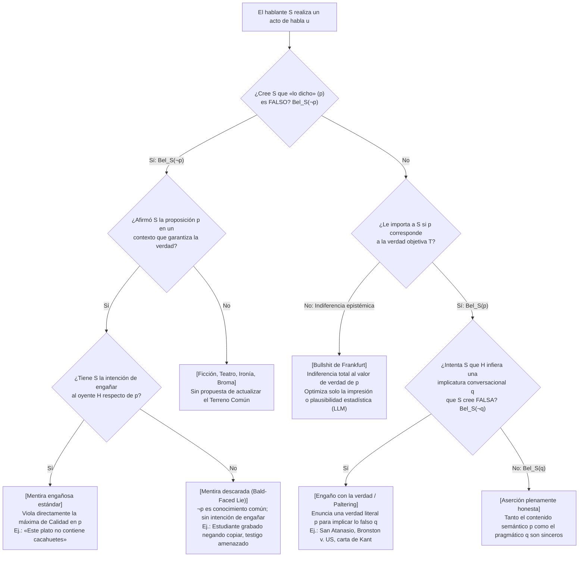
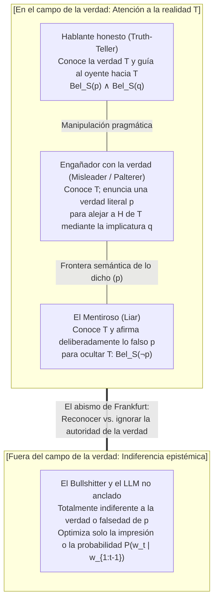

## 1. Introducción: La paradoja de engañar con el 100 % de la verdad literal

En el año 362 d. C., huyendo de la persecución del emperador romano Juliano el Apóstata, <strong>san Atanasio de Alejandría</strong> remontaba el río Nilo en una pequeña barca. Al advertir que la galera imperial le pisaba los talones, Atanasio ordenó a su timonel dar media vuelta de 180 grados y remar directamente hacia sus perseguidores.

Al cruzarse ambas embarcaciones, los soldados romanos —sin imaginar jamás que su presa navegaba hacia ellos— gritaron desde la borda:
*«¿Habéis visto al traidor Atanasio? ¿Dónde está?»*
El propio Atanasio se puso en pie y respondió con voz serena:
<strong>«¡No está lejos de aquí (He is not far from here!)! ¡Remad rápido y lo alcanzaréis!»</strong>
Los soldados dieron las gracias y remaron con furia río arriba, mientras Atanasio regresaba a salvo a Alejandría.

Esta célebre anécdota patrística plantea un agudo rompecabezas filosófico. La oración pronunciada por Atanasio (*«No está lejos de aquí»*) era <strong>100 % verdadera en sentido literal y objetivo</strong>: puesto que el propio Atanasio estaba en esa barca, su distancia respecto de sí mismo era cero. No pronunció ni una sola proposición falsa. Sin embargo, habló con la clara intención de inducir en los soldados la creencia falsa de que Atanasio huía río arriba, logrando engañarlos por completo. ¿Mintió san Atanasio?

### 1.1 El fallo histórico del Tribunal Supremo de EE. UU.: *Bronston v. United States* (1973)

Que esta distinción no es un mero juego escolástico lo demuestra la histórica sentencia del Tribunal Supremo de los Estados Unidos sobre el delito de perjurio en <strong>*Bronston v. United States* (409 U.S. 352, 1973)</strong>.

El productor cinematográfico Samuel Bronston fue interrogado bajo juramento en un tribunal federal de quiebras:

> <strong>Abogado (P):</strong> *«¿Tiene usted cuentas bancarias en bancos suizos, Sr. Bronston?»*
> <strong>Bronston (R):</strong> *«No, señor.»*
> <strong>Abogado (P):</strong> *«¿Las ha tenido alguna vez (Have you ever)?»*
> <strong>Bronston (R):</strong> <strong>*«La compañía tuvo una cuenta allí durante unos seis meses, en Zúrich.»</strong>*

En realidad, la cuenta personal de Bronston ya estaba cerrada el día de su declaración (por lo que su primer *«No»* era literalmente verdadero), y su empresa efectivamente había tenido una cuenta en Zúrich durante seis meses. ¡Pero Bronston ocultó que él <strong>personalmente</strong> había tenido una cuenta privada en Ginebra durante cinco años por la que pasaron más de 180.000 dólares!

Aunque fue condenado por perjurio en primera y segunda instancia, <strong>el Tribunal Supremo de EE. UU. revocó la condena por unanimidad (9–0)</strong>. El presidente del Tribunal, Warren Burger, dictaminó que el estatuto federal de perjurio no castiga al testigo que dice la <strong>verdad literal</strong>, incluso si su respuesta es evasiva y calculada para inducir a error (*intent to mislead*). Es responsabilidad del abogado interrogador (*caveat auditor*) detectar la evasión y repreguntar con agudeza.

### 1.2 La casuística teológica: Reserva mental (*Restrictio Mentalis*) y equívoco (*Aequivocatio*)

En la teología moral cristiana, <strong>san Agustín</strong> (*De Mendacio*, 395; *Contra Mendacium*, 420) y <strong>santo Tomás de Aquino</strong> (*Summa Theologiae* II-II, q. 110) condenaron toda mentira (*locutio contra mentem*) como intrínsecamente pecaminosa. Sin embargo, en los siglos XVI y XVII, ante la tortura y ejecución de sacerdotes católicos en la Inglaterra isabelina, teólogos jesuitas como <strong>Martín de Azpilcueta (Doctor Navarrus)</strong>, <strong>Francisco Suárez</strong> y <strong>Henry Garnet</strong> desarrollaron la doctrina de la <strong>reserva mental (*Restrictio Mentalis*)</strong> y el <strong>equívoco (*Aequivocatio*)</strong>: mientras que la reserva estrictamente mental fue condenada por el papa Inocencio XI en 1679, la reserva mental amplia y el equívoco —donde la expresión proferida posee un sentido literalmente verdadero en la lengua pública, dejando que el oyente infiera por sí mismo la lectura falsa— se consideraron exentos de mentira.

---

## 2. La definición formal de la mentira: Lógica doxástica y «mentiras descaradas» (Bald-Faced Lies)

En la filosofía analítica del lenguaje (Chisholm & Feehan 1977; Carson 2010; Saul 2012; Stokke 2018), el acto de <strong>mentir (lying)</strong> se formaliza mediante la <strong>lógica doxástica</strong> (lógica de la creencia). Sean $S$ el hablante, $H$ el oyente y $p$ una proposición.

La definición decepcionista clásica ($\text{Lie}_{\text{trad}}$) exige cuatro condiciones:

$$\text{Lie}_{\text{trad}}(S, H, p) \iff \underbrace{\text{Says}(S, H, p)}_{\text{1. Enunciación}} \;\land\; \underbrace{\text{Bel}_S(\neg p)}_{\text{2. Insinceridad}} \;\land\; \underbrace{\text{Warrant}(S, H, p)}_{\text{3. Contexto de garantía}} \;\land\; \underbrace{\text{Intend}_S\big(\text{Bel}_H(p)\big)}_{\text{4. Intención de engañar}}$$

1. <strong>Condición de enunciación ($\text{Says}(S, H, p)$)</strong>: $S$ debe afirmar explícitamente $p$ como *lo dicho (what is said)*. El silencio, el disfraz no verbal o las preguntas gramaticales no son mentiras.
2. <strong>Condición de insinceridad ($\text{Bel}_S(\neg p)$) — Creencia subjetiva frente a falsedad objetiva</strong>:
   Obsérvese que $\neg p$ (la falsedad objetiva de $p$) <strong>no figura en la fórmula</strong>. Si Alicia mira un reloj parado y dice sinceramente *«Son las tres»* cuando son las cuatro, comete un <strong>error honesto (honest mistake)</strong>, pero no miente. En cambio, si Alicia cree firmemente que Jorge está en su casa ($\text{Bel}_S(\neg p)$) y le dice a Bob *«Jorge está en la biblioteca»* ($p$) para despistarlo, pero por pura casualidad Jorge acaba de llegar a la biblioteca hace cinco minutos ($p$ es objetivamente verdadera), <strong>¡Alicia ha mentido diciendo una verdad objetiva!</strong>
3. <strong>Condición de garantía y terreno común ($\text{Warrant}(S, H, p)$)</strong>: En el teatro, la ficción o la ironía manifiesta, el hablante no propone añadir $p$ al <strong>terreno común (Common Ground, Stalnaker 2002)</strong> de la conversación.
4. <strong>La revolución de las «mentiras descaradas» (Bald-Faced Lies — Carson 2006; Sorensen 2007; Fallis 2009)</strong>:
   Un estudiante grabado en vídeo copiando en un examen que le dice al decano *«Yo no copié»* solo para evitar una confesión formal en el acta, o un testigo intimidado por un jefe mafioso que declara bajo juramento *«No vi nada»* cuando todo el tribunal sabe que presenció el crimen, <strong>no tiene intención de engañar a nadie</strong> ($\neg \text{Intend}_S(\text{Bel}_H(p))$), ¡pero indudablemente <strong>miente</strong>! Por ello, la «Nueva Ortodoxia» define la mentira sin la intención de engañar:

$$\text{Lie}(S, H, p) \iff \text{Says}(S, H, p) \;\land\; \text{Bel}_S(\neg p) \;\land\; \text{Warrant}(S, H, p)$$

---

## 3. La pragmática de H. Paul Grice: El motor de las verdades engañosas

¿Por qué ni san Atanasio ni Bronston mintieron pese a engañar con éxito? Porque creían verdadera la proposición literal $p$ que enunciaron ($\text{Bel}_S(p)$), mientras que la falsedad se generó como <strong>implicatura conversacional ($q$)</strong> según la teoría formulada por <strong>H. Paul Grice (1975)</strong> en *Logic and Conversation*.

### 3.1 El Principio de Cooperación y las cuatro máximas conversacionales

Según Grice, los oyentes asumen racionalmente que el hablante sigue el <strong>Principio de Cooperación (Cooperative Principle)</strong> y cuatro máximas de inspiración kantiana:

1. <strong>Máxima de Cantidad (Maxim of Quantity)</strong>: Haz tu contribución tan informativa como se requiera.
   * <strong>Implicaturas escalares (Horn 1972; Levinson 2000)</strong>: Si te has comido <strong>todas</strong> las 10 galletas ($\forall x \, (\text{Galleta}(x) \to \text{Comió}(S, x))$) pero dices *«Me comí <strong>algunas (some)</strong> galletas»* ($p \equiv \exists x \, (\text{Galleta}(x) \land \text{Comió}(S, x))$), tu enunciado $p$ es <strong>100 % verdadero en lógica de primer orden</strong> (pues $\forall x \models \exists x$). Pero en la escala de Horn $\langle \text{todas}, \text{la mayoría}, \text{algunas} \rangle$, el oyente deduce por la máxima de Cantidad la implicatura falsa $q \equiv \neg \forall x$ (*«S no se comió todas las galletas»*).
2. <strong>Máxima de Calidad (Maxim of Quality)</strong>: No digas lo que creas que es falso ($\neg \text{Bel}_S(\neg p)$) ni aquello de lo que carezcas de pruebas adecuadas.
3. <strong>Máxima de Relación / Relevancia (Maxim of Relation)</strong>: Sé relevante (*Be relevant*).
   * En el célebre ejemplo de Grice de la <strong>carta de recomendación para una cátedra de filosofía</strong>, un profesor escribe únicamente: *«El Sr. X tiene un excelente dominio del inglés y ha asistido regularmente a las tutorías.»* Al violar ostensiblemente (*flouting*) la Cantidad y la Relevancia para no violar la Calidad, implica $q =$ *«El Sr. X es pésimo en filosofía»*.
4. <strong>Máxima de Modo / Manera (Maxim of Manner)</strong>: Evita la oscuridad y la ambigüedad; sé ordenado.

La prueba diagnóstica que separa la implicatura $q$ de lo dicho $p$ es su <strong>cancelabilidad (Cancellability)</strong> sin contradicción lógica (*«Me comí algunas galletas; de hecho, ¡me las comí todas!»*).

### 3.2 Pragmática bayesiana (modelo RSA) y «Paltering»

En el modelo <strong>Rational Speech Act (RSA)</strong> (Frank & Goodman 2012), el oyente pragmático $L_1$ invierte el modelo del hablante cooperativo $S_1$ mediante el teorema de Bayes:

$$P_{L_1}(w \mid u) = \frac{P_{S_1}(u \mid w) \cdot P(w)}{\sum_{w' \in W} P_{S_1}(u \mid w') \cdot P(w')}, \quad P_{S_1}(u \mid w) \propto \exp\Big(\alpha \big(\ln P_{L_0}(w \mid u) - C(u)\big)\Big)$$

El <strong>engaño mediante la verdad (Truthful Misleading / Paltering, Rogers et al. 2017)</strong> consiste en elegir en el mundo real $w^*$ un enunciado literalmente verdadero $u^*$ ($\llbracket u^* \rrbracket(w^*) = 1$) que maximiza la probabilidad a posteriori $P_{L_1}(w_{\text{false}} \mid u^*)$ de un estado falso $w_{\text{false}} \neq w^*$:

$$\text{Mislead}_{\text{truthful}}(S, H, p, q) \iff \text{Says}(S, H, p) \;\land\; \text{Bel}_S(p) \;\land\; \text{Implicates}(S, H, p, q) \;\land\; \text{Bel}_S(\neg q) \;\land\; \text{Intend}_S\big(\text{Bel}_H(q)\big)$$

---

## 4. El debate ético: El rigorismo de Kant, su propio ardid y la crítica de Jennifer Saul

### 4.1 El «asesino en la puerta» de Kant frente a su promesa al rey Federico Guillermo II

En su célebre ensayo de 1797 <strong>*Sobre un supuesto derecho a mentir por filantropía</strong>*, <strong>Immanuel Kant</strong> sostuvo que incluso si un asesino llama a tu puerta preguntando por tu amigo inocente escondido dentro, realizar una declaración falsa (*Aussage* / *mendacium*) está absolutamente prohibido, pues destruye la base formal de todo contrato y la dignidad racional.

Sin embargo, <strong>¡el propio Kant practicó magistralmente el engaño estratégico mediante la verdad literal!</strong> En 1794, reprendido por el rey de Prusia <strong>Federico Guillermo II</strong> por sus escritos sobre religión, Kant redactó su promesa de silencio en estos términos:

> *«<strong>Como el súbdito más fiel de Vuestra Real Majestad</strong> [Als Ew. Königl. Majestät getreuester Untertan], declaro solemnemente que en adelante me abstendré por completo de toda lección y escrito públicos relativos a la religión...»*

Al morir Federico Guillermo II en noviembre de 1797, Kant publicó de inmediato *El conflicto de las facultades* (1798) y explicó con orgullo en una nota al pie que había elegido la frase *«súbdito de Vuestra Majestad»* para quedar obligado <strong>únicamente mientras ese monarca específico permaneciera con vida</strong>, induciendo al rey a inferir una promesa vitalicia ($q$) sin decir jamás una mentira formal ($p$)!

### 4.2 Asimetrismo (Williams, Shiffrin) frente a la crítica de Jennifer Saul (2012)

Mientras que <strong>Bernard Williams (2002)</strong> y <strong>Seana Shiffrin (2014)</strong> sostienen que inducir a error con la verdad es moralmente menos grave que mentir porque el oyente comparte responsabilidad epistémica en la inferencia $p \to q$, <strong>Jennifer Saul</strong> demuestra en <strong>*Lying, Misleading, and What is Said* (2012)</strong> —mediante el caso del <strong>asesinato por alergia a los cacahuetes</strong> (decir la verdad *«Este plato está hecho con aceite de girasol y especias»* en vez de mentir *«No lleva cacahuetes»* para matar a un invitado alérgico)— que el engaño calculado mediante verdades literales no es moralmente superior a la mentira y suele encubrir una profunda hipocresía moral.

---

## 5. *On Bullshit* (1986/2005) de Harry G. Frankfurt y las alucinaciones de la IA

En su clásico ensayo <strong>*On Bullshit* (1986/2005)</strong>, <strong>Harry G. Frankfurt</strong> trazó la distinción fundamental entre el <strong>mentiroso (liar)</strong> y el <strong>charlatán (bullshitter)</strong>:
* Tanto la <strong>persona honesta</strong> como el <strong>mentiroso</strong> juegan en el campo de la verdad $T$: para mentir ($\text{Bel}_S(\neg p)$), el mentiroso necesita conocer la verdad para ocultarla.
* Al <strong>bullshitter</strong>, en cambio, <strong>le es completamente indiferente si lo que dice es verdadero o falso</strong> ($\neg \text{Care}_S(p \leftrightarrow T)$). Solo busca causar impresión o persuadir. Por ello concluye Frankfurt: <strong>*«El bullshit es un enemigo de la verdad mayor que las mentiras.»</strong>*

Como demostraron <strong>Hicks, Humphries y Slater (2024)</strong> en <strong>*"ChatGPT is Bullshit"</strong>*, las llamadas «alucinaciones» de los grandes modelos de lenguaje (LLM), que optimizan exclusivamente la probabilidad condicional del siguiente token $P_\theta(w_t \mid w_{1:t-1}) = \text{softmax}(z_\theta / \tau)$ buscando plausibilidad estadística sin creencia anclada en la realidad $\text{Bel}_{\text{LLM}}(p)$, son <strong>bullshit frankfurtiano puro</strong> en sentido matemático.

---

## 6. Síntesis: Taxonomía epistémica, pragmática y ética

| Categoría de acto de habla | Verdad objetiva de *lo dicho* ($p$) | Estado doxástico ($\text{Bel}_S$) | Implicatura ($q$) e Intención | Relación con las máximas de Grice | Ejemplos paradigmáticos |
| :--- | :--- | :--- | :--- | :--- | :--- |
| <strong>1. Aserción honesta</strong> | Verdadero (o falso por accidente) | $\text{Bel}_S(p) \land \text{Bel}_S(q)$ | Intenta transmitir solo $q$ verdadero | Cumple cooperativamente las 4 máximas | Testimonio sincero, informe científico |
| <strong>2. Error honesto</strong> | Falso ($\neg p$) | $\text{Bel}_S(p)$ (creencia errónea) | Sin intención de engañar | Cumple subjetivamente la Calidad | Mirar la hora en un reloj parado |
| <strong>3. Mentira estándar</strong> | Usualmente falso (puede ser verdadero por azar) | <strong>$\text{Bel}_S(\neg p)$</strong> | Intención de engañar: $\text{Intend}_S(\text{Bel}_H(p))$ | Viola directamente la <strong>máxima de Calidad (1)</strong> en $p$ | Coartada falsa; *«No lleva cacahuetes»* |
| <strong>4. Mentira descarada</strong> *(Bald-Faced Lie)* | Falso ($\neg p$ es conocimiento común) | <strong>$\text{Bel}_S(\neg p)$</strong> | <strong>Sin intención de engañar</strong> (para el acta oficial) | Violación abierta de la Calidad en contexto de garantía | Estudiante grabado negando copiar; testigo intimidado |
| <strong>5. Engaño con la verdad</strong> *(Misleading / Paltering)* | <strong>Verdadero ($p$)</strong> | <strong>$\text{Bel}_S(p)$</strong>, pero <strong>$\text{Bel}_S(\neg q)$</strong> | Usa el verdadero $p$ para inducir el falso $q$ | Cumple Calidad en $p$, explota <strong>Cantidad, Relevancia, Modo</strong> | San Atanasio; *Bronston v. US*; carta de Kant al rey |
| <strong>6. Bullshit de Frankfurt</strong> | Verdadero o falso (incidental) | <strong>Indiferente a la verdad</strong> | Busca solo <strong>impresión, persuasión o plausibilidad</strong> | Abandona por completo la <strong>Calidad y la exigencia de pruebas</strong> | Demagogia política; spin de RR. PP.; alucinaciones de LLM |

