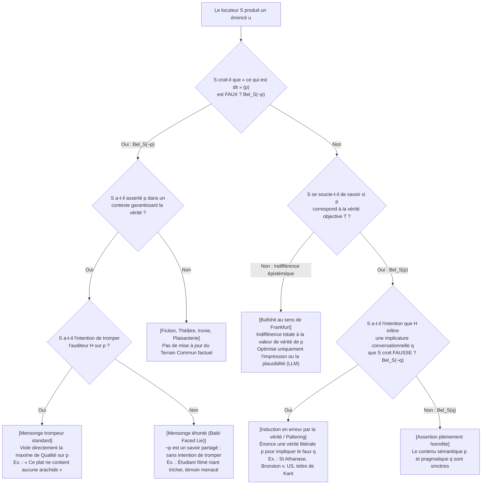
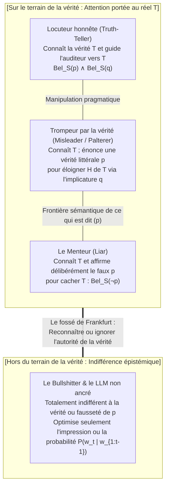

## 1. Introduction : Le paradoxe de la tromperie par la vérité littérale à 100 %

En l'an 362 après J.-C., fuyant la persécution de l'empereur romain Julien l'Apostat, <strong>saint Athanase d'Alexandrie</strong> remontait le Nil sur une petite embarcation. Voyant que la galère impériale lancée à sa poursuite gagnait rapidement du terrain, Athanase ordonna à son barreur de faire demi-tour à 180 degrés et de ramer droit vers ses poursuivants.

Lorsque les deux bateaux se croisèrent, les soldats romains — ne soupçonnant pas un instant que leur proie naviguait vers eux — crièrent à travers le fleuve :
*« Avez-vous vu le traître Athanase ? Où est-il ? »*
Athanase lui-même se leva dans la barque et répondit d'une voix calme :
<strong>« Il n'est pas loin d'ici (He is not far from here!) ! Ramez vite et vous le rattraperez ! »</strong>
Les soldats le remercièrent et ramèrent furieusement vers l'amont, tandis qu'Athanase regagnait Alexandrie sain et sauf.

Cette célèbre anecdote patristique pose une énigme philosophique redoutable. L'énoncé prononcé par Athanase (*« Il n'est pas loin d'ici »*) était <strong>littéralement et objectivement vrai à 100 %</strong> : puisqu'Athanase se trouvait lui-même sur ce bateau, sa distance par rapport à lui-même était nulle. Il n'a prononcé aucune proposition fausse. Pourtant, il avait clairement l'intention d'amener les soldats à former la croyance fausse qu'Athanase fuyait plus loin en amont, réussissant ainsi parfaitement à les tromper (*deceive*). Saint Athanase a-t-il menti ?

### 1.1 L'arrêt historique de la Cour suprême des États-Unis : *Bronston v. United States* (1973)

Loin d'être une simple subtilité théologique, cette distinction est au cœur d'un arrêt célèbre de la Cour suprême des États-Unis sur le parjure : <strong>*Bronston v. United States* (409 U.S. 352, 1973)</strong>.

Le producteur hollywoodien Samuel Bronston, interrogé sous serment lors d'une audience de faillite sur d'éventuels avoirs cachés, eut l'échange suivant avec l'avocat des créanciers :

> <strong>Avocat (Q) :</strong> *« Avez-vous des comptes bancaires dans des banques suisses, M. Bronston ? »*
> <strong>Bronston (R) :</strong> *« Non, monsieur. »*
> <strong>Avocat (Q) :</strong> *« En avez-vous jamais eu (Have you ever) ? »*
> <strong>Bronston (R) :</strong> <strong>*« La société y a eu un compte pendant environ six mois, à Zurich. »</strong>*

En réalité, le compte personnel de Bronston était déjà clôturé le jour de l'audience (rendant son premier *« Non »* littéralement vrai), et sa société avait effectivement détenu un compte à Zurich pendant six mois. Mais Bronston avait dissimulé qu'il avait détenu <strong>personnellement</strong> un compte bancaire privé à Genève pendant près de cinq ans, sur lequel avaient transité plus de 180 000 dollars !

Condamné en première instance et en appel pour parjure, Bronston vit sa condamnation <strong>annulée à l'unanimité (9–0) par la Cour suprême des États-Unis</strong>. Le juge en chef Warren Burger statua que la loi fédérale sur le parjure ne punit pas un témoin qui dit la <strong>vérité littérale</strong>, même si sa réponse est évasive et calculée pour induire l'interrogateur en erreur (*intent to mislead*). C'est à l'avocat qui pose les questions qu'incombe la responsabilité épistémique (*caveat auditor*) de détecter l'évasion et de poser des questions supplémentaires.

### 1.2 La casuistique théologique : Restriction mentale (*Restrictio Mentalis*) et équivoque (*Aequivocatio*)

Dans la tradition chrétienne, <strong>saint Augustin</strong> (*De Mendacio*, 395 ; *Contra Mendacium*, 420) et <strong>saint Thomas d'Aquin</strong> (*Summa Theologiae* II-II, q. 110) avaient condamné tout mensonge (*locutio contra mentem*) comme un péché intrinsèque. Mais aux XVIe et XVIIe siècles, lorsque les prêtres catholiques cachés dans l'Angleterre élisabéthaine risquaient la torture et la mort, les théologiens jésuites (<strong>Martín de Azpilcueta [Doctor Navarrus]</strong>, <strong>Francisco Suárez</strong>, <strong>Henry Garnet</strong>) développèrent la doctrine de la <strong>restriction mentale (*Restrictio Mentalis*)</strong> et de l'<strong>équivoque (*Aequivocatio*)</strong> : si la restriction purement mentale fut condamnée par le pape Innocent XI en 1679, la restriction mentale large et l'équivoque — où l'énoncé possède un sens littéralement vrai dans la langue publique, laissant l'auditeur tirer lui-même l'inférence fausse — furent jugées exemptes de mensonge.

---

## 2. La définition formelle du mensonge : Logique doxastique et « mensonges éhontés » (Bald-Faced Lies)

En philosophie analytique du langage (Chisholm & Feehan 1977 ; Carson 2010 ; Saul 2012 ; Stokke 2018), le <strong>mensonge (lying)</strong> se formalise dans la <strong>logique doxastique</strong> (logique de la croyance). Soient $S$ le locuteur, $H$ l'auditeur et $p$ une proposition.

La définition déceptionniste classique ($\text{Lie}_{\text{trad}}$) repose sur quatre conditions :

$$\text{Lie}_{\text{trad}}(S, H, p) \iff \underbrace{\text{Says}(S, H, p)}_{\text{1. Énonciation}} \;\land\; \underbrace{\text{Bel}_S(\neg p)}_{\text{2. Insincérité}} \;\land\; \underbrace{\text{Warrant}(S, H, p)}_{\text{3. Contexte de garantie}} \;\land\; \underbrace{\text{Intend}_S\big(\text{Bel}_H(p)\big)}_{\text{4. Intention de tromper}}$$

1. <strong>Condition d'énonciation ($\text{Says}(S, H, p)$)</strong> : $S$ doit affirmer explicitement $p$ comme *ce qui est dit (what is said)*. Le silence, la dissimulation non verbale ou une question grammaticale ne sont pas des mensonges.
2. <strong>Condition d'insincérité ($\text{Bel}_S(\neg p)$) — Croyance subjective contre fausseté objective</strong> :
   Remarquons que $\neg p$ (la fausseté objective de $p$) <strong>n'est pas requise</strong> ! Si Alice lit une montre arrêtée et dit sincèrement *« Il est 15 heures »* alors qu'il est 16 heures, elle commet une <strong>erreur honnête (honest mistake)</strong> et ne ment pas. Inversement, si Alice croit que Georges est chez lui ($\text{Bel}_S(\neg p)$) et dit à Bob *« Georges est à la bibliothèque »* ($p$) pour l'égarer, mais que par pur hasard Georges vient tout juste d'entrer à la bibliothèque ($p$ est objectivement vrai), <strong>Alice a bel et bien menti</strong> en énonçant une vérité objective qu'elle croyait fausse !
3. <strong>Condition de garantie et terrain commun ($\text{Warrant}(S, H, p)$)</strong> : Au théâtre, dans un roman ou dans l'ironie manifeste, le locuteur ne propose pas d'ajouter $p$ au <strong>terrain commun (Common Ground, Stalnaker 2002)</strong> de la conversation.
4. <strong>La révolution des « mensonges éhontés » (Bald-Faced Lies — Carson 2006 ; Sorensen 2007 ; Fallis 2009)</strong> :
   Un étudiant pris en flagrant délit de tricherie devant une caméra qui affirme au doyen *« Je n'ai pas triché »* uniquement pour éviter un aveu formel au dossier, ou un témoin menacé par un chef mafieux qui déclare sous serment *« Je n'ai rien vu »* alors que toute la salle d'audience sait qu'il a vu le meurtre, n'a <strong>aucune intention de tromper</strong> ($\neg \text{Intend}_S(\text{Bel}_H(p))$), mais il <strong>ment</strong> incontestablement ! La « Nouvelle Orthodoxie » définit donc le mensonge sans l'intention de tromper :

$$\text{Lie}(S, H, p) \iff \text{Says}(S, H, p) \;\land\; \text{Bel}_S(\neg p) \;\land\; \text{Warrant}(S, H, p)$$

---

## 3. La pragmatique de H. Paul Grice : Le moteur des vérités trompeuses

Pourquoi saint Athanase et Samuel Bronston n'ont-ils pas menti tout en trompant leurs interlocuteurs ? Parce que ce qu'ils ont littéralement dit ($p$) était vrai ($\text{Bel}_S(p)$), tandis que la fausseté résidait dans l'<strong>implicature conversationnelle ($q$)</strong> théorisée par <strong>H. Paul Grice (1975)</strong> dans *Logic and Conversation*.

### 3.1 Le Principe de Coopération et les quatre maximes conversationnelles

Selon Grice, les interlocuteurs supposent que le locuteur respecte le <strong>Principe de Coopération (Cooperative Principle)</strong> et quatre maximes d'inspiration kantienne :

1. <strong>Maxime de Quantité (Maxim of Quantity)</strong> : Que votre contribution contienne autant d'information qu'il est requis.
   * <strong>Implicatures scalaires (Horn 1972 ; Levinson 2000)</strong> : Si vous avez mangé <strong>tous</strong> les 10 biscuits ($\forall x \, (\text{Biscuit}(x) \to \text{Mangé}(S, x))$) mais dites *« J'ai mangé <strong>quelques (some)</strong> biscuits »* ($p \equiv \exists x \, (\text{Biscuit}(x) \land \text{Mangé}(S, x))$), votre énoncé $p$ est <strong>100 % vrai en logique du premier ordre</strong> (car $\forall x \models \exists x$). Mais sur l'échelle de Horn $\langle \text{tous}, \text{la plupart}, \text{quelques} \rangle$, l'auditeur en déduit par la maxime de Quantité l'implicature fausse $q \equiv \neg \forall x$ (*« S n'a pas mangé tous les biscuits »*).
2. <strong>Maxime de Qualité (Maxim of Quality)</strong> : N'affirmez pas ce que vous croyez être faux ($\neg \text{Bel}_S(\neg p)$) ni ce dont vous n'avez pas de preuves.
3. <strong>Maxime de Relation / Pertinence (Maxim of Relation)</strong> : Soyez pertinent (*Be relevant*).
   * Dans le célèbre exemple de Grice de la <strong>lettre de recommandation en philosophie</strong>, un professeur écrit seulement : *« Monsieur X maîtrise parfaitement l'anglais et a assisté régulièrement aux travaux dirigés. »* En bafouant ostensiblement (*flouting*) la Quantité et la Pertinence pour ne pas violer la Qualité, il implique $q =$ *« Monsieur X est nul en philosophie »*.
4. <strong>Maxime de Manière / Modalité (Maxim of Manner)</strong> : Évitez l'obscurité et l'ambiguïté ; soyez ordonné.

Le test décisif qui distingue l'implicature $q$ de ce qui est dit $p$ est l'<strong>annulabilité (Cancellability)</strong> sans contradiction logique (*« J'ai mangé quelques biscuits — en fait, je les ai tous mangés ! »*).

### 3.2 Pragmatique bayésienne (modèle RSA) et « Paltering »

Dans le modèle <strong>Rational Speech Act (RSA)</strong> (Frank & Goodman 2012), l'auditeur pragmatique $L_1$ inverse le modèle du locuteur coopératif $S_1$ par la règle de Bayes :

$$P_{L_1}(w \mid u) = \frac{P_{S_1}(u \mid w) \cdot P(w)}{\sum_{w' \in W} P_{S_1}(u \mid w') \cdot P(w')}, \quad P_{S_1}(u \mid w) \propto \exp\Big(\alpha \big(\ln P_{L_0}(w \mid u) - C(u)\big)\Big)$$

L'<strong>induction en erreur par la vérité (Truthful Misleading / Paltering, Rogers et al. 2017)</strong> consiste, dans l'état réel $w^*$, à choisir un énoncé littéralement vrai $u^*$ ($\llbracket u^* \rrbracket(w^*) = 1$) qui maximise la probabilité a posteriori $P_{L_1}(w_{\text{false}} \mid u^*)$ d'un état faux $w_{\text{false}} \neq w^*$ :

$$\text{Mislead}_{\text{truthful}}(S, H, p, q) \iff \text{Says}(S, H, p) \;\land\; \text{Bel}_S(p) \;\land\; \text{Implicates}(S, H, p, q) \;\land\; \text{Bel}_S(\neg q) \;\land\; \text{Intend}_S\big(\text{Bel}_H(q)\big)$$

---

## 4. Le débat éthique : Le rigorisme de Kant, sa propre ruse et la critique de Jennifer Saul

### 4.1 Le « meurtrier à la porte » de Kant contre sa promesse au roi Frédéric-Guillaume II

Dans son célèbre opuscule de 1797 <strong>*Sur un prétendu droit de mentir par humanité</strong>*, <strong>Emmanuel Kant</strong> soutient que même face à un meurtrier qui vous demande si votre ami est caché chez vous, faire une déclaration fausse (*Aussage* / *mendacium*) est absolument interdit, car le mensonge détruit le principe même du contrat social et de la dignité rationnelle.

Pourtant, <strong>Kant lui-même pratiqua magistralement l'induction en erreur par la vérité littérale !</strong> En 1794, réprimandé par le roi de Prusse <strong>Frédéric-Guillaume II</strong> pour ses écrits sur la religion, Kant rédigea sa promesse de silence en ces termes :

> *« <strong>En tant que sujet le plus fidèle de Votre Majesté Royale</strong> [Als Ew. Königl. Majestät getreuester Untertan], je déclare solennellement que je m'abstiendrai désormais complètement de tout cours et écrit publics concernant la religion... »*

Dès la mort de Frédéric-Guillaume II en novembre 1797, Kant publia *Le Conflit des facultés* (1798) et expliqua fièrement en note de bas de page qu'il avait choisi l'expression *« sujet de Votre Majesté »* afin de n'être lié <strong>que durant la vie de ce roi précis</strong>, trompant ainsi l'attente du monarque par implicature sans jamais commettre de mensonge formel !

### 4.2 Asymétrisme (Williams, Shiffrin) contre la critique de Jennifer Saul (2012)

Alors que <strong>Bernard Williams (2002)</strong> et <strong>Seana Shiffrin (2014)</strong> estiment qu'induire en erreur est moralement moins grave que mentir parce que l'auditeur partage une part de responsabilité épistémique dans l'inférence $p \to q$, <strong>Jennifer Saul</strong> démontre dans <strong>*Lying, Misleading, and What is Said* (2012)</strong> — notamment grâce au cas du <strong>meurtre par allergie aux arachides</strong> (dire la vérité *« Ce plat est fait avec de l'huile de tournesol et des épices »* au lieu de mentir *« Il n'y a pas d'arachides »* pour tuer un invité allergique) — qu'induire délibérément en erreur n'est moralement en rien supérieur au mensonge et relève souvent de l'hypocrisie morale.

---

## 5. *On Bullshit* (1986/2005) de Harry G. Frankfurt et les hallucinations de l'IA

Dans son essai classique <strong>*On Bullshit* (1986/2005)</strong>, <strong>Harry G. Frankfurt</strong> distingue le <strong>menteur (liar)</strong> du <strong>baratineur (bullshitter)</strong> :
* L'<strong>homme honnête</strong> et le <strong>menteur</strong> jouent tous deux dans le camp de la vérité $T$ : pour mentir ($\text{Bel}_S(\neg p)$), le menteur doit connaître la vérité afin de la dissimuler.
* Le <strong>bullshitter</strong>, en revanche, <strong>se fiche complètement de savoir si ce qu'il dit est vrai ou faux</strong> ($\neg \text{Care}_S(p \leftrightarrow T)$). Seule compte l'impression produite sur l'auditoire. C'est pourquoi Frankfurt conclut : <strong>*« Le bullshit est un plus grand ennemi de la vérité que le mensonge. »</strong>*

Comme l'ont démontré <strong>Hicks, Humphries & Slater (2024)</strong> dans <strong>*"ChatGPT is Bullshit"</strong>*, les « hallucinations » des grands modèles de langage (LLM), qui optimisent uniquement la probabilité conditionnelle du jeton suivant $P_\theta(w_t \mid w_{1:t-1}) = \text{softmax}(z_\theta / \tau)$ pour produire un texte statistiquement plausible sans croyance ancrée dans le monde $\text{Bel}_{\text{LLM}}(p)$, constituent du <strong>bullshit frankfurtien pur</strong> au sens mathématique.

---

## 6. Synthèse : Taxonomie épistémique, pragmatique et éthique

| Catégorie d'acte de langage | Vérité objective de *ce qui est dit* ($p$) | État doxastique ($\text{Bel}_S$) | Implicature ($q$) & Intention | Rapport aux maximes de Grice | Exemples paradigmatiques |
| :--- | :--- | :--- | :--- | :--- | :--- |
| <strong>1. Assertion honnête</strong> | Vrai (ou faux par accident) | $\text{Bel}_S(p) \land \text{Bel}_S(q)$ | Transmet uniquement un $q$ cru vrai | Respecte coopérativement les 4 maximes | Témoignage sincère, rapport scientifique |
| <strong>2. Erreur honnête</strong> | Faux ($\neg p$) | $\text{Bel}_S(p)$ (croyance erronée) | Aucune intention de tromper | Respecte subjectivement la Qualité | Lire l'heure sur une montre arrêtée |
| <strong>3. Mensonge standard</strong> | Généralement faux (parfois vrai par hasard) | <strong>$\text{Bel}_S(\neg p)$</strong> | Intention de tromper : $\text{Intend}_S(\text{Bel}_H(p))$ | Viole directement la <strong>maxime de Qualité (1)</strong> sur $p$ | Faux alibi ; *« Il n'y a pas d'arachides »* |
| <strong>4. Mensonge éhonté</strong> *(Bald-Faced Lie)* | Faux ($\neg p$ est un savoir commun) | <strong>$\text{Bel}_S(\neg p)$</strong> | <strong>Sans intention de tromper</strong> (pour le procès-verbal) | Violation ouverte de la Qualité en contexte de garantie | Étudiant filmé niant tricher ; témoin intimidé |
| <strong>5. Vérité trompeuse</strong> *(Misleading / Paltering)* | <strong>Vrai ($p$)</strong> | <strong>$\text{Bel}_S(p)$</strong>, mais <strong>$\text{Bel}_S(\neg q)$</strong> | Utilise le vrai $p$ pour induire le faux $q$ | Respecte la Qualité sur $p$, exploite <strong>Quantité, Pertinence, Manière</strong> | St Athanase ; *Bronston v. US* ; lettre de Kant au roi |
| <strong>6. Bullshit de Frankfurt</strong> | Vrai ou faux (accidentel) | <strong>Indifférent à la vérité</strong> | Vise uniquement <strong>l'impression, la persuasion ou la plausibilité</strong> | Abandonne totalement la <strong>Qualité et l'exigence de preuve</strong> | Démagogie politique ; spin RP ; hallucinations des LLM |

