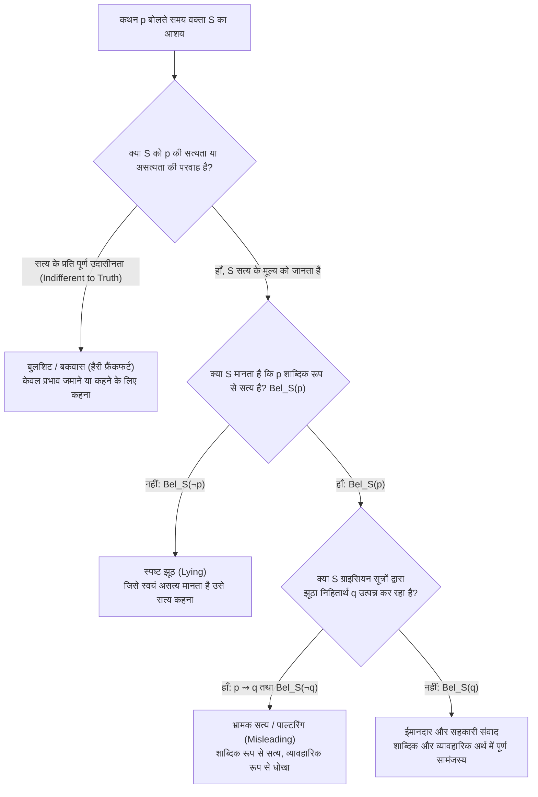

चौथी शताब्दी ईस्वी में, <strong>अलेक्जेंड्रिया के बिशप एथानासियस (Saint Athanasius)</strong> रोमन सम्राट के सैनिकों से बचकर नील नदी में एक नाव पर भाग रहे थे। जब रोमन सैनिकों की नाव उनके पास पहुँची, तो सैनिकों ने एथानासियस को चेहरे से पहचाने बिना उनसे पूछा: *"क्या तुमने देशद्रोही एथानासियस को देखा है?"* एथानासियस ने शांत भाव से खड़े होकर उत्तर दिया: <strong>*"वह यहाँ से ज़्यादा दूर नहीं है!"</strong>* यह सुनकर सैनिक पूरी गति से उनकी नाव को पार कर आगे बढ़ गए, और एथानासियस की जान बच गई।

तर्कशास्त्र और शाब्दिक अर्थ (Literal Semantics) की दृष्टि से *"वह यहाँ से ज़्यादा दूर नहीं है"* वाक्य <strong>100% सत्य</strong> था (वास्तव में एथानासियस की स्वयं से दूरी शून्य थी: $d(x, x) = 0$) ! फिर भी, संवादात्मक रूप से यह वाक्य सैनिकों के मन में यह झूठा विश्वास पैदा करने के लिए बोला गया था कि एथानासियस उनसे आगे कहीं भाग रहा है, न कि ठीक उनके सामने खड़ा है।

सोलह सौ वर्ष बाद, यही दार्शनिक पहेली संयुक्त राज्य अमेरिका के सर्वोच्च न्यायालय के ऐतिहासिक मुक़दमे <strong>*Bronston v. United States* (1973)</strong> में सामने आई। दिवालियापन की सुनवाई में शपथ के तहत गवाही देते हुए फिल्म निर्माता सैमुअल ब्रॉन्स्टन से सरकारी वकील ने पूछा:
- <strong>वकील</strong>: *"क्या आपका स्विस बैंकों में कोई खाता है?"*
- <strong>ब्रॉन्स्टन</strong>: *"नहीं, श्रीमान।"* (सुनवाई के समय उनका व्यक्तिगत खाता बंद हो चुका था)।
- <strong>वकील</strong>: *"क्या आपका <strong>कभी</strong> स्विस बैंकों में कोई खाता रहा है?"*
- <strong>ब्रॉन्स्टन</strong>: *"कंपनी का ज्यूरिख में छह महीने तक एक खाता था।"*

वास्तविकता यह थी कि ब्रॉन्स्टन का स्वयं का जिनेवा में पाँच वर्षों तक एक विशाल <strong>व्यक्तिगत बैंक खाता</strong> रहा था जिसमें लाखों डॉलर जमा थे। किंतु उन्होंने जो वाक्य कहा (*"कंपनी का ज्यूरिख में खाता था"*), वह शाब्दिक रूप से पूर्णतः सत्य था। अमेरिकी सर्वोच्च न्यायालय ने सर्वसम्मति से निर्णय दिया कि ब्रॉन्स्टन <strong>झूठी गवाही (Perjury) के दोषी नहीं हैं</strong>: क़ानून शाब्दिक झूठ (*Lying*) को दंडित करता है, न कि शाब्दिक रूप से सत्य किंतु भ्रामक उत्तर (*Misleading*) को!

मानव भाषा में यह अद्भुत और ख़तरनाक क्षमता कहाँ से आती है कि कोई व्यक्ति <strong>केवल सत्य बोलकर भी सामने वाले को धोखा दे सकता है</strong>? और प्रिंसटन विश्वविद्यालय के दार्शनिक <strong>हैरी जी. फ्रैंकफर्ट (Harry G. Frankfurt)</strong> ने अपनी विश्व-प्रसिद्ध कृति <strong>*On Bullshit* (1986/2005)</strong> में क्यों सिद्ध किया कि झूठ और भ्रामकता से परे एक तीसरी श्रेणी—<strong>बकवास / बुलशिट (*Bullshit*)</strong>—सत्य की सबसे बड़ी शत्रु है? इस लेख में हम इन तीनों की तार्किक, भाषाई और नैतिक संरचना का गहन विश्लेषण करेंगे।

---

## अध्याय 1: झूठ (Lying) की औपचारिक परिभाषा — 'जो कहा गया' बनाम 'जो माना गया'

संत ऑगस्टीन के ग्रंथ *De Mendacio* (395 ई.) से लेकर आधुनिक विश्लेषणात्मक दार्शनिकों <strong>रॉडरिक चिज़ोम और थॉमस फ़ीहन (1977)</strong>, <strong>थॉमस कार्सन (2010)</strong>, तथा <strong>जेनिफ़र सॉल (2012)</strong> तक, झूठ की मानक दार्शनिक परिभाषा चार तार्किक शर्तों पर आधारित है:

वक्ता $S$ श्रोता $H$ से कथन $p$ के विषय में <strong>झूठ बोलता है</strong> यदि और केवल यदि:

$$\text{Lie}(S, H, p) \iff \text{Say}_S(p) \;\land\; \text{Bel}_S(\neg p) \;\land\; \text{Address}(S, H) \;\land\; \text{Warrant}(S, p)$$

1. <strong>स्पष्ट कथन की शर्त ($\text{Say}_S(p)$ — *What is Said*)</strong>: वक्ता $S$ भाषाई रूप से प्रस्ताव $p$ को व्यक्त करता है। (चुप रहना या संकेत करना धोखा हो सकता है, किंतु शाब्दिक झूठ नहीं)।
2. <strong>ज्ञानात्मक असत्यता की शर्त ($\text{Bel}_S(\neg p)$ — *Untruthfulness Condition*)</strong>: वक्ता $S$ स्वयं यह मानता है कि कथन $p$ <strong>असत्य</strong> है। ध्यान दें कि दार्शनिक रूप से झूठ का निर्धारण <strong>वक्ता के विश्वास ($\text{Bel}_S(\neg p)$)</strong> से होता है, न कि केवल बाहरी दुनिया के वस्तुनिष्ठ तथ्य से! यदि आप मानते हैं कि पुल टूटा हुआ है ($\text{Bel}_S(\neg p)$), फिर भी किसी को नुकसान पहुँचाने के लिए कहते हैं *"पुल पूरी तरह सुरक्षित है"* ($p$), और संयोगवश पुल की मरम्मत हो चुकी थी ($p$ वस्तुनिष्ठ रूप से सत्य निकला), तब भी आपने <strong>झूठ बोला है</strong>! इसके विपरीत, जो व्यक्ति अनजाने में ग़लत जानकारी को सच मानकर बोलता है, वह झूठा नहीं बल्कि केवल भ्रमित (*Honest Mistake*) है।
3. <strong>सत्य की गारंटी का संदर्भ ($\text{Warrant}(S, p)$)</strong>: रंगमंच पर अभिनेता का संवाद या उपन्यास की कथा झूठ नहीं है क्योंकि वहाँ सत्य की प्रतिज्ञा निलंबित रहती है। किंतु <strong>रॉय सोरेनसन (2007)</strong> के <strong>खुले झूठ (*Bald-Faced Lies*)</strong>—जैसे अदालत में माफ़िया के डर से गवाह का कहना *"मैंने कुछ नहीं देखा"* जबकि न्यायाधीश और सभी लोग जानते हैं कि वह झूठ बोल रहा है—सिद्ध करते हैं कि जब कोई सत्य की अपेक्षा वाले संदर्भ में $\text{Bel}_S(\neg p)$ कहता है, तो वह किसी को भ्रमित न कर पाने पर भी झूठ ही बोलता है।

---

## अध्याय 2: एच. पॉल ग्राइस का उपयोगितावाद (Pragmatics) — सच बोलकर गुमराह करने का तंत्र

एथानासियस और सैमुअल ब्रॉन्स्टन ने बिना झूठ बोले ($\text{Bel}_S(p)$) श्रोताओं को कैसे धोखा दिया? इसका उत्तर ऑक्सफ़ोर्ड के भाषा-दार्शनिक <strong>एच. पॉल ग्राइस (H. Paul Grice)</strong> ने 1967 के हार्वर्ड विलियम जेम्स व्याख्यानों (*"Logic and Conversation"*, 1975) में दिया।

ग्राइस ने भाषा के दो स्तरों में स्पष्ट भेद किया:
- <strong>शाब्दिक अर्थ (*What is Said*, $p$)</strong>: वाक्य के शब्दों और व्याकरण द्वारा निर्धारित तार्किक सत्य-शर्तें।
- <strong>संवादात्मक निहितार्थ (*Conversational Implicature*, $q$)</strong>: वह अतिरिक्त अर्थ जिसे श्रोता इसलिए निष्कर्षित करता है क्योंकि वह मानता है कि वक्ता <strong>सहयोग के सिद्धांत (*Cooperative Principle*)</strong> और उसके <strong>चार सूत्रों (Four Maxims)</strong> का पालन कर रहा है:

1. <strong>मात्रा का सूत्र (*Maxim of Quantity*)</strong>: जितनी जानकारी आवश्यक हो उतनी ही दें; न आवश्यकता से कम, न अधिक।
   - *स्केलर निहितार्थ (Scalar Implicature)*: यदि कोई छात्र कहे *"मैंने परीक्षा के <strong>कुछ</strong> प्रश्न हल किए"* ($p \equiv \exists x$), जबकि उसने <strong>सभी</strong> प्रश्न हल किए थे ($\forall x$), तो तर्कशास्त्र में $\forall x \implies \exists x$ के कारण उसका कथन शाब्दिक रूप से सत्य है! किंतु मात्रा के सूत्र के कारण श्रोता तुरंत यह निष्कर्ष ($q$) निकालता है कि *"उसने सभी प्रश्न हल नहीं किए"* ($\neg \forall x$)!
2. <strong>गुणवत्ता का सूत्र (*Maxim of Quality*)</strong>: वह न कहें जिसे आप झूठ मानते हैं या जिसके लिए प्रमाण न हो।
3. <strong>संबंध / प्रासंगिकता का सूत्र (*Maxim of Relation*)</strong>: प्रासंगिक बात कहें (*Be relevant*)।
   - *ब्रॉन्स्टन* मामले में जब व्यक्तिगत स्विस खाते के बारे में पूछा गया और ब्रॉन्स्टन ने कंपनी के ज्यूरिख खाते का उल्लेख किया, तो प्रासंगिकता के सूत्र के कारण वकील ने यह निहितार्थ ($q$) निकाला कि *"मेरा कोई व्यक्तिगत खाता कभी नहीं रहा।"*
   - ग्राइस का प्रसिद्ध उदाहरण: दर्शनशास्त्र के प्रोफ़ेसर से उनके छात्र के लिए प्रोफ़ेसर पद हेतु सिफ़ारिशी पत्र माँगा गया, और उन्होंने लिखा: *"श्री X की अंग्रेज़ी सुंदर है और वे कक्षा में समय पर आते हैं।"* शाब्दिक कथन ($p$) प्रशंसा है, किंतु प्रासंगिकता और मात्रा के सूत्र का जानबूझकर उल्लंघन यह निहितार्थ ($q$) देता है कि *"श्री X दर्शनशास्त्र में बिल्कुल अयोग्य हैं!"*
4. <strong>रीति का सूत्र (*Maxim of Manner*)</strong>: अस्पष्टता और अनेकार्थकता से बचें तथा क्रमबद्ध बोलें।

इस प्रकार, <strong>सत्य बोलकर गुमराह करने (*Misleading / Paltering*)</strong> की सटीक गणितीय परिभाषा यह है:

$$\text{Mislead}(S, H, p, q) \iff \text{Say}_S(p) \;\land\; \text{Bel}_S(p) \;\land\; (p \leadsto_{\text{Grice}} q) \;\land\; \text{Bel}_S(\neg q) \;\land\; \text{Intend}_S(\text{Bel}_H(q))$$

अर्थात् वक्ता ऐसा कथन $p$ बोलता है जिसे वह स्वयं <strong>सत्य</strong> मानता है ($\text{Bel}_S(p)$), किंतु वह ग्राइस के सूत्रों ($p \leadsto_{\text{Grice}} q$) का चालाकी से उपयोग करके श्रोता को एक ऐसे निहितार्थ $q$ पर पहुँचाता है जिसे वक्ता <strong>असत्य</strong> जानता है ($\text{Bel}_S(\neg q)$)!

---

## अध्याय 3: नैतिक बहस — क्या गुमराह करना झूठ बोलने से कम अनैतिक है?

1. <strong>इमैनुएल कांट का निरपेक्षवाद (1797) और शाब्दिक बचाव</strong>:
   अपने प्रसिद्ध निबंध *"परोपकार से प्रेरित होकर झूठ बोलने के कथित अधिकार पर"* में कांट ने तर्क दिया कि दरवाज़े पर खड़े हत्यारे से भी झूठ बोलना नैतिक कर्तव्य का उल्लंघन है। फिर भी, जब प्रशिया के राजा <strong>फ्रेडरिक विलियम द्वितीय</strong> ने कांट को धर्म पर लिखने से रोका, तो कांट ने लिखा: *"महामहिम के सबसे निष्ठावान सेवक के रूप में (*Als Ew. Königl. Majestät getreuester Untertan*), मैं आगे धर्म पर सार्वजनिक रूप से कुछ नहीं लिखूँगा"* — यह जानते हुए कि *"महामहिम के सेवक"* वाक्यांश केवल उस राजा के जीवित रहने तक ही लागू होगा! 1797 में राजा की मृत्यु होते ही कांट ने पुनः लिखना शुरू कर दिया।
2. <strong>जेनिफ़र सॉल (Jennifer Saul, 2012) की आलोचना</strong>:
   जहाँ कुछ दार्शनिक मानते हैं कि *Misleading* में श्रोता भी गलत निष्कर्ष निकालने के लिए आंशिक रूप से ज़िम्मेदार है (*Caveat Auditor*), वहीं जेनिफ़र सॉल अपनी पुस्तक *Lying, Misleading, and What is Said* में दिखाती हैं कि सामान्य जीवन में जानबूझकर गुमराह करना और झूठ बोलना <strong>नैतिक रूप से समान रूप से निंदनीय</strong> हैं, क्योंकि दोनों का उद्देश्य श्रोता की स्वायत्तता को नष्ट करके उसके मन में झूठा विश्वास $\text{Bel}_H(q)$ स्थापित करना है।

---

## अध्याय 4: हैरी फ्रैंकफर्ट का *On Bullshit* — झूठ से भी बड़ा सत्य का शत्रु

1986 के अपने कालजयी निबंध <strong>*On Bullshit</strong>* में <strong>हैरी जी. फ्रैंकफर्ट</strong> ने स्पष्ट किया कि <strong>झूठा व्यक्ति (Liar)</strong> और <strong>बकवास करने वाला (Bullshitter)</strong> दो बिल्कुल अलग दार्शनिक श्रेणियाँ हैं:

$$\begin{aligned}
\text{Honest}(S, p) &: \quad \text{Bel}_S(p) \;\land\; \text{Goal}_S = \text{सत्य को प्रकट करना} \\
\text{Liar}(S, p) &: \quad \text{Bel}_S(\neg p) \;\land\; \text{Goal}_S = \text{सत्य को छिपाना} \\
\text{Bullshitter}(S, p) &: \quad \text{Indifferent}_S(p, \neg p) \;\land\; \text{Goal}_S = \text{सत्य की परवाह किए बिना केवल प्रभाव छोड़ना}
\end{aligned}$$

- <strong>झूठा व्यक्ति सत्य के अस्तित्व का सम्मान करता है</strong>: एक सफल झूठ गढ़ने के लिए झूठे को यह जानना पड़ता है कि सत्य क्या है, ताकि वह श्रोता को सत्य से दूर ले जा सके।
- <strong>बुलशिटर (Bullshitter) सत्य के प्रति पूरी तरह उदासीन होता है</strong>: उसे इस बात से कोई सरोकार नहीं होता कि उसके शब्द वास्तविकता से मेल खाते हैं या नहीं; उसका एकमात्र उद्देश्य अपनी छवि बनाना, भीड़ को प्रभावित करना या प्रवाह बनाए रखना है। इसीलिए फ्रैंकफर्ट ने लिखा:

> <strong>*"बुलशिट (सत्य के प्रति उदासीन बकवास) झूठ की तुलना में सत्य का कहीं अधिक बड़ा शत्रु है।"</strong>*

आज के युग में दार्शनिकों (Hicks et al., 2024, *"ChatGPT is Bullshit"*) ने दिखाया है कि जब बड़े भाषा मॉडल (LLMs) बिना किसी बाहरी तथ्य-जाँच (Grounding) के केवल अगले टोकन की सांख्यिकीय प्रायिकता $\arg\max_w P_\theta(w_t \mid w_{<t})$ को अधिकतम करते हुए मनगढ़ंत संदर्भ बनाते हैं, तो वह तकनीकी रूप से फ्रैंकफर्ट के अर्थ में <strong>सांख्यिकीय बुलशिट</strong> का ही उदाहरण है!

---

## अध्याय 5: चारों संवादात्मक श्रेणियों की तुलनात्मक तालिका

| विश्लेषण का आयाम | ईमानदार कथन (*Truthful*) | स्पष्ट झूठ (*Lying*) | भ्रामक सत्य (*Misleading / Paltering*) | बुलशिट (*Bullshit* — फ्रैंकफर्ट) |
|---|---|---|---|---|
| <strong>शाब्दिक कथन ($p$)</strong> | $p$ कहता है | $p$ कहता है | $p$ कहता है | $p$ कहता है |
| <strong>वक्ता का ज्ञानात्मक विश्वास</strong> | $\text{Bel}_S(p)$ ($p$ को सत्य मानता है) | $\text{Bel}_S(\neg p)$ ($p$ को असत्य मानता है) | $\text{Bel}_S(p)$ (शाब्दिक रूप से सत्य मानता है) | $p$ के सत्य या असत्य होने के प्रति <strong>पूर्णतः उदासीन</strong> |
| <strong>ग्राइसियन निहितार्थ ($q$)</strong> | सत्य और पारदर्शी | प्रत्यक्ष रूप से मिथ्या | $p \leadsto_{\text{Grice}} q$ जहाँ $\text{Bel}_S(\neg q)$ | सत्यता से कोई संबंध नहीं |
| <strong>सत्य के प्रति दृष्टिकोण</strong> | सत्य के प्रति निष्ठा | सत्य को जानकर उसका विरोध | आंशिक सत्य की आड़ में पूर्ण सत्य को छिपाना | सत्य के नियम को ही खेल से बाहर कर देना |
| <strong>क़ानूनी स्थिति (*Bronston*)</strong> | वैध साक्ष्य | <strong>झूठी गवाही (Perjury)</strong> | तकनीकी रूप से Perjury नहीं | संदर्भ के अनुसार धोखाधड़ी या भ्रामक विज्ञापन |
| <strong>प्रमुख उदाहरण</strong> | वैज्ञानिक रिपोर्ट या पूर्ण साक्ष्य | खाता होते हुए भी मना करना | एथानासियस का उत्तर, ब्रॉन्स्टन का ज्यूरिख खाता | खोखला राजनीतिक प्रचार, बिना ग्राउंडिंग के AI आउटपुट |

---

## निष्कर्ष

भाषा का दर्शन हमें सिखाता है कि केवल शाब्दिक सत्य बोलना ही नैतिक या बौद्धिक ईमानदारी की गारंटी नहीं है। ग्राइस के संवादात्मक निहितार्थ और फ्रैंकफर्ट के बुलशिट विश्लेषण को समझना हमें राजनीति, क़ानून, मीडिया और कृत्रिम बुद्धिमत्ता के युग में भ्रामक तर्कों को पहचानने और बौद्धिक सत्यनिष्ठा की रक्षा करने की दृष्टि प्रदान करता है।
