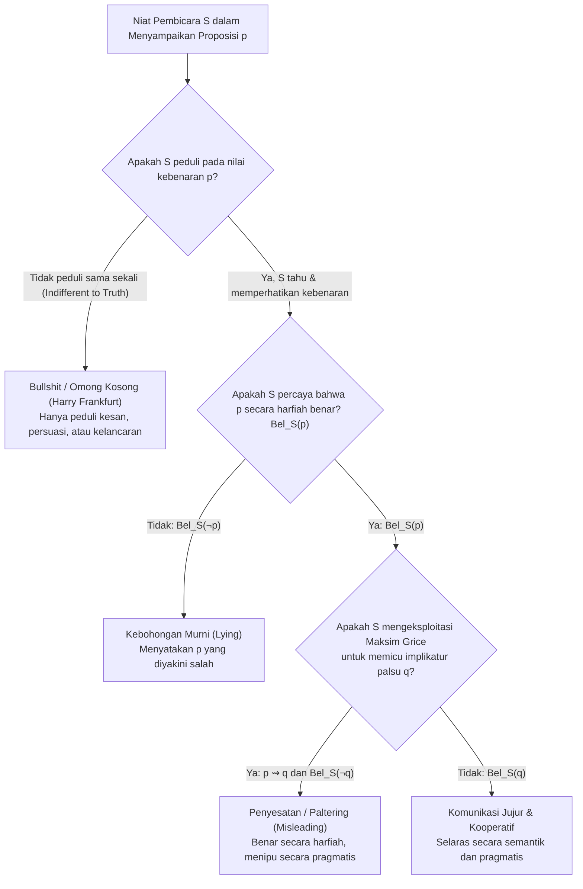

Pada abad ke-4 Masehi, Uskup <strong>Athanasius dari Aleksandria</strong> melarikan diri menggunakan perahu di Sungai Nil dari kejaran tentara Kekaisaran Romawi yang diperintahkan untuk menangkapnya. Ketika perahu militer Romawi mendekat dari belakang, para prajurit tidak mengenali wajah Athanasius dan berteriak kepadanya: *"Apakah engkau melihat pengkhianat Athanasius?"* Athanasius berdiri dengan tenang dan menjawab: <strong>*"Dia tidak jauh dari sini!"</strong>* Para prajurit itu segera mendayung sekuat tenaga melewati perahunya, dan Athanasius pun selamat.

Secara harfiah, kalimat *"Dia tidak jauh dari sini"* adalah <strong>100% benar secara faktual</strong> (bahkan jarak antara Athanasius dengan dirinya sendiri adalah nol: $d(x, x) = 0$). Namun secara komunikatif, ucapan tersebut dirancang secara sengaja untuk menanamkan keyakinan palsu di benak para prajurit bahwa Athanasius berada di depan mereka, bukan di atas perahu itu.

Lebih dari seribu enam ratus tahun kemudian, teka-teki yang sama muncul di Mahkamah Agung Amerika Serikat dalam kasus bersejarah <strong>*Bronston v. United States* (1973)</strong>. Samuel Bronston, seorang produser film yang sedang diperiksa di bawah sumpah dalam sidang kebangkrutan, ditanya oleh jaksa:
- <strong>Jaksa</strong>: *"Apakah Anda memiliki rekening bank di Swiss?"*
- <strong>Bronston</strong>: *"Tidak, Pak."* (Saat sidang berlangsung, rekening pribadinya memang sudah ditutup).
- <strong>Jaksa</strong>: *"Apakah Anda <strong>pernah</strong> memiliki rekening bank di Swiss?"*
- <strong>Bronston</strong>: *"Perusahaan pernah memiliki rekening di Zurich selama enam bulan, di sana."*

Faktanya, selama lima tahun sebelumnya Bronston memiliki <strong>rekening bank pribadi yang sangat besar di Jenewa</strong> dan menyembunyikan ratusan ribu dolar di dalamnya. Namun kalimat yang ia ucapkan (*"Perusahaan pernah memiliki rekening di Zurich..."*) secara harfiah benar. Mahkamah Agung AS memutuskan dengan suara bulat bahwa Bronston <strong>tidak terbukti melakukan sumpah palsu (perjury)</strong>: undang-undang sumpah palsu menghukum pernyataan yang secara harfiah salah (*lying*), bukan pernyataan yang secara harfiah benar tetapi menyesatkan (*misleading*).

Mengapa bahasa manusia memungkinkan seseorang untuk <strong>menipu dengan mengatakan kebenaran</strong>? Dan mengapa filsuf Princeton <strong>Harry G. Frankfurt</strong> dalam risalah terkenalnya <strong>*On Bullshit* (1986/2005)</strong> berargumen bahwa ada kategori ketiga—<strong>omong kosong (*bullshit*)</strong>—yang jauh lebih berbahaya bagi kebenaran daripada kebohongan itu sendiri? Dalam artikel ini, kita membedah arsitektur logika, pragmatik linguistik, dan etika di balik tiga fenomena komunikasi tersebut.

---

## Bab 1: Definisi Formal Kebohongan (Lying) — Apa yang Dikatakan vs. Apa yang Diyakini

Sejak risalah klasik Santo Agustinus *De Mendacio* (395 M) hingga formulasi analitik modern oleh <strong>Roderick Chisholm & Thomas Feehan (1977)</strong>, <strong>Thomas Carson (2010)</strong>, dan <strong>Jennifer Saul (2012)</strong>, definisi standar kebohongan (*Traditional Definition of Lying*) bertumpu pada empat kondisi logis:

Pembicara $S$ <strong>berbohong</strong> kepada pendengar $H$ jika dan hanya jika:

$$\text{Lie}(S, H, p) \iff \text{Say}_S(p) \;\land\; \text{Bel}_S(\neg p) \;\land\; \text{Address}(S, H) \;\land\; \text{Warrant}(S, p)$$

1. <strong>Kondisi Pernyataan Eksplisit ($\text{Say}_S(p)$ — *What is Said*)</strong>: $S$ secara eksplisit menyatakan proposisi semantik $p$. (Diam seribu bahasa atau mengedipkan mata bukanlah kebohongan dalam arti semantik ketat).
2. <strong>Kondisi Ketidakjujuran Epistemik ($\text{Bel}_S(\neg p)$ — *Untruthfulness Condition*)</strong>: $S$ sendiri percaya bahwa proposisi $p$ adalah <strong>salah</strong>. Perhatikan konsekuensi penting ini: kebohongan ditentukan oleh <strong>ketidakcocokan antara ucapan dan keyakinan pembicara ($\text{Bel}_S(\neg p)$)</strong>, bukan semata-mata oleh apakah $p$ salah secara objektif di dunia nyata! Jika Anda percaya bahwa jembatan sudah runtuh ($\text{Bel}_S(\neg p)$), lalu Anda berkata kepada musuh Anda *"Jembatan itu aman"* ($p$) agar ia celaka, tetapi ternyata jembatan itu baru saja diperbaiki tanpa sepengetahuan Anda ($p$ benar secara objektif), Anda <strong>tetap telah berbohong</strong>! Sebaliknya, seseorang yang menyampaikan informasi keliru karena ia sendiri jujur salah paham bukanlah pembohong, melainkan просто keliru (*honest mistake*).
3. <strong>Kondisi Konteks Jaminan Kebenaran ($\text{Warrant}(S, p)$)</strong> atau <strong>Niat Menipu ($\text{Intend}_S(\text{Bel}_H(p))$)</strong>: Ketika seorang aktor di panggung teater berkata *"Akulah Raja Denmark!"* atau seorang novelis menulis kalimat fiksi, konteks wacana menangguhkan jaminan kebenaran. Namun seperti ditunjukkan oleh <strong>Roy Sorensen (2007)</strong> dan <strong>Thomas Carson</strong> melalui kasus <strong>Kebohongan Terang-terangan (*Bald-Faced Lies*)</strong>—misalnya seorang saksi yang diintimidasi mafia bersaksi di pengadilan *"Saya tidak melihat apa-apa"* meskipun hakim, jaksa, dan seluruh ruangan tahu pasti ia berbohong—seseorang tetap berbohong meskipun ia tidak berniat membuat siapa pun percaya, selama ia menyatakan $\text{Bel}_S(\neg p)$ dalam konteks resmi yang menuntut kebenaran.

---

## Bab 2: Pragmatik H. Paul Grice — Mesin di Balik Penyesatan dengan Fakta (Misleading / Paltering)

Bagaimana Athanasius dan Samuel Bronston berhasil menipu pendengar mereka tanpa melanggar kondisi $\text{Say}_S(p) \land \text{Bel}_S(\neg p)$? Jawabannya ditemukan oleh filsuf bahasa Oxford <strong>H. Paul Grice</strong> dalam kuliah William James tahun 1967 di Harvard (*"Logic and Conversation"*, diterbitkan 1975).

Grice membedakan secara tajam antara:
- <strong>Makna Semantik Harfiah (*What is Said*, $p$)</strong>: Kondisi kebenaran proposisional yang ditentukan oleh kosakata dan sintaksis kalimat.
- <strong>Implikatur Percakapan (*Conversational Implicature*, $q$)</strong>: Proposisi tambahan yang disimpulkan secara pragmatis oleh pendengar karena mengasumsikan bahwa pembicara mematuhi <strong>Prinsip Kerja Sama (*Cooperative Principle*)</strong>:

> *"Buatlah kontribusi percakapan Anda sebagaimana yang dituntut, pada tahapan saat percakapan itu terjadi, oleh tujuan atau arah pertukaran pembicaraan yang Anda ikuti."*

Prinsip Kerja Sama ini dijabarkan ke dalam <strong>Empat Maksim Grice</strong>:

1. <strong>Maksim Kuantitas (*Maxim of Quantity*)</strong>:
   - (i) Buatlah kontribusi Anda seinformatif yang dibutuhkan untuk tujuan percakapan saat ini.
   - (ii) Jangan membuat kontribusi Anda lebih informatif daripada yang dibutuhkan.
   - *Contoh Implikatur Skalar*: Jika seorang anak berkata kepada ibunya, *"Aku sudah memakan <strong>sebagian</strong> kue di stoples"* ($p \equiv \exists x \in C, \text{Ate}(x)$), padahal ia memakan <strong>seluruh</strong> kue ($\forall x \in C, \text{Ate}(x)$), dalam logika formal kalimat $\exists x$ adalah <strong>benar</strong> ketika $\forall x$ benar! Namun karena kata *"semua"* lebih informatif daripada *"sebagian"*, berdasarkan Maksim Kuantitas sang ibu secara otomatis menyimpulkan implikatur $q \equiv \neg(\forall x \in C, \text{Ate}(x))$ (*"Ia tidak memakan semuanya"*).
2. <strong>Maksim Kualitas (*Maxim of Quality*)</strong>: Jangan katakan apa yang Anda yakini salah, atau apa yang tidak memiliki bukti memadai.
3. <strong>Maksim Relasi / Relevansi (*Maxim of Relation*)</strong>: Berbicaralah secara relevan.
   - Dalam kasus *Bronston*, ketika ditanya *"Apakah Anda pernah punya rekening di Swiss?"*, jawaban Bronston tentang rekening perusahaan hanya relevan jika ia bermaksud menyiratkan $q =$ *"Secara pribadi saya tidak pernah punya rekening."*
   - Contoh klasik Grice: Seorang profesor filsafat diminta menulis surat rekomendasi untuk mahasiswanya yang melamar pekerjaan dosen filsafat, lalu menulis: *"Yang Terhormat, penguasaan bahasa Inggris Saudara X sangat baik, dan kehadirannya di kelas selalu tepat waktu. Hormat saya."* Secara harfiah $p$ memuji mahasiswa itu, tetapi pelanggaran mencolok terhadap Maksim Kuantitas dan Relevansi mengirimkan implikatur tajam $q =$ *"Saudara X sama sekali tidak berbakat dalam filsafat."*
4. <strong>Maksim Cara (*Maxim of Manner*)</strong>: Hindari ketidakjelasan, hindari ambiguitas, berbicaralah secara singkat dan teratur.
   - *Contoh Implikatur Urutan/Kausalitas*: Jika seseorang berkata, *"Ana menikah dan hamil,"* makna semantiknya adalah konjungsi logis $A \land B$ (yang identik nilai kebenarannya dengan $B \land A$). Namun Maksim Cara menyiratkan urutan waktu $t(A) < t(B)$.

Dengan kerangka Grice ini, kita dapat mendefinisikan <strong>Penyesatan melalui Fakta Benar (*Misleading / Paltering*)</strong> secara matematis:

$$\text{Mislead}(S, H, p, q) \iff \text{Say}_S(p) \;\land\; \text{Bel}_S(p) \;\land\; (p \leadsto_{\text{Grice}} q) \;\land\; \text{Bel}_S(\neg q) \;\land\; \text{Intend}_S(\text{Bel}_H(q))$$

Artinya: Pembicara menyatakan $p$ yang ia yakini <strong>benar</strong> ($\text{Bel}_S(p)$), namun secara strategis mengeksploitasi maksim Grice ($p \leadsto_{\text{Grice}} q$) agar pendengar menarik kesimpulan pragmatis $q$ yang diketahui pembicara adalah <strong>salah</strong> ($\text{Bel}_S(\neg q)$)!

---

## Bab 3: Debat Etika — Apakah Menyesatkan Lebih Baik Secara Moral daripada Berbohong?

Sepanjang sejarah etika Barat, banyak pemikir—mulai dari tradisi kasuistik Katolik (<strong>Doktrin Reservasi Mental Luas / *Mental Reservation</strong>* yang membela Santo Athanasius) hingga <strong>Immanuel Kant</strong>—menganggap bahwa ada jurang moral yang tegas antara <strong>berbohong (*lying*)</strong> dan <strong>sekadar menyesatkan (*merely misleading*)</strong>.

### 1. Rigorisme Absolut Immanuel Kant dan Celah Ekuivokasi
Dalam esai terkenalnya tahun 1797, *"Über ein vermeintes Recht aus Menschenliebe zu lügen" (Tentang Hak yang Diduga untuk Berbohong demi Cinta Kemanusiaan)*, Kant menyatakan bahwa berbohong adalah pelanggaran mutlak terhadap kewajiban moral kepada kemanusiaan, bahkan jika seorang <strong>pembunuh berantai</strong> mengetuk pintu rumah Anda dan bertanya apakah sahabat Anda bersembunyi di dalam! Menurut Kant, kebohongan menghancurkan fondasi kontrak bahasa itu sendiri.

Namun dalam *Lectures on Ethics* dan kehidupan pribadinya sendiri, Kant menarik batas ketat antara kebohongan dan pernyataan benar yang mengelak. Ketika Raja Prusia <strong>Friedrich Wilhelm II</strong> menuntut Kant agar tidak lagi menerbitkan tulisan tentang agama yang menyimpang dari ortodoksi negara, Kant menulis surat balasan:

> *"Sebagai hamba <strong>Yang Mulia</strong> yang paling setia (*Als Ew. Königl. Majestät getreuester Untertan*), saya menyatakan bahwa selanjutnya saya akan sepenuhnya menahan diri dari semua kuliah dan tulisan publik mengenai agama."*

Raja mengira Kant telah berjanji untuk bungkam seumur hidup ($q$). Namun begitu Friedrich Wilhelm II wafat pada tahun 1797, Kant kembali menerbitkan tulisan agamanya! Mengapa? Karena frasa *"Sebagai hamba Yang Mulia"* secara harfiah hanya mengikat Kant selama *raja tersebut* masih hidup! Kant merancang kalimat yang secara semantik benar ($p$) sambil membiarkan sang Raja menarik implikatur yang salah ($q$).

### 2. Mengapa Sebagian Filsuf Menganggap Penyesatan Lebih Ringan, dan Kritik Jennifer Saul
Mengapa tradisi hukum (seperti *Bronston*) dan sebagian filsuf moral (seperti Jonathan Adler dan Bernard Williams) menilai *misleading* lebih ringan daripada *lying*?
- <strong>Argumen Pembagian Tanggung Jawab Epistemik (*Caveat Auditor*)</strong>: Ketika $S$ berbohong, $S$ memalsukan bukti langsung. Namun ketika $S$ mengatakan kebenaran harfiah $p$ yang menyiratkan $q$, pendengar $H$ turut melakukan langkah inferensi pragmatis sendiri ($p \leadsto q$). Di ruang sidang yang bersifat adversarial, jaksa memiliki tanggung jawab untuk mengajukan pertanyaan lanjutan yang presisi.
- <strong>Argumen Pelestarian Kepercayaan Bahasa (Seana Shiffrin)</strong>: Jika kebohongan harfiah diizinkan, kita kehilangan jangkar terakhir komunikasi; dengan melarang kebohongan harfiah, pendengar yang curiga selalu bisa memojokkan pembicara dengan bertanya secara eksplisit: *"Ya atau tidak: apakah Anda punya rekening pribadi di Jenewa?"*

Sebaliknya, <strong>Jennifer Saul</strong> dalam bukunya *Lying, Misleading, and What is Said* (2012) membuktikan bahwa dalam kehidupan sehari-hari, tindakan *misleading* yang disengaja umumnya <strong>sama buruknya secara moral</strong> dengan berbohong: baik pembohong maupun penyesat sama-sama memanipulasi otonomi rasional korban demi menanamkan keyakinan palsu $\text{Bel}_H(q)$. Merasa diri "suci secara moral" hanya karena memilih kata-kata yang secara teknis benar adalah kemunafikan moral.

---

## Bab 4: Harry G. Frankfurt dan *On Bullshit* — Musuh Kebenaran yang Lebih Berbahaya daripada Pembohong

Pada tahun 1986 (dan diterbitkan ulang sebagai buku terlaris tahun 2005), filsuf <strong>Harry G. Frankfurt</strong> melakukan analisis konseptual terhadap fenomena yang merajalela dalam politik, periklanan, hubungan masyarakat, dan wacana publik: <strong>*Bullshit* (Omong Kosong)</strong>.

Apa perbedaan struktural antara <strong>Pembohong (*Liar*)</strong> dan <strong>Tukang Omong Kosong (*Bullshitter*)</strong>?

$$\begin{aligned}
\text{Honest}(S, p) &: \quad \text{Bel}_S(p) \;\land\; \text{Goal}_S = \text{Reveal}(\text{Truth}) \\
\text{Liar}(S, p) &: \quad \text{Bel}_S(\neg p) \;\land\; \text{Goal}_S = \text{Conceal}(\text{Truth}) \\
\text{Bullshitter}(S, p) &: \quad \text{Indifferent}_S(p, \neg p) \;\land\; \text{Goal}_S = \text{Impression / Persuasion}
\end{aligned}$$

Frankfurt menunjukkan sebuah paradoks yang tajam:
1. <strong>Pembohong masih menghormati otoritas kebenaran</strong>: Untuk merancang kebohongan yang efektif, seorang pembohong <strong>harus tahu apa yang benar</strong> dan sangat peduli pada batas antara fakta dan fiksi, justru agar ia bisa menyembunyikan fakta tersebut. Pembohong bermain di dalam permainan kebenaran, hanya saja di sisi yang berlawanan.
2. <strong>Tukang Omong Kosong (*Bullshitter*) sama sekali tidak peduli pada kebenaran</strong>: Ia tidak tertarik apakah kalimat yang keluar dari mulutnya benar atau salah. Satu-satunya hal yang ia pedulikan adalah <strong>dampak retoris, citra diri, atau kepatuhan pada agenda tertentu</strong>. Jika kebetulan kalimatnya benar, itu hanya kebetulan; jika salah, ia pun tidak peduli.

Oleh karena itu, Frankfurt menyimpulkan kalimat terkenalnya:

> <strong>*"Bullshit is a greater enemy of the truth than lies are."</strong>*
> *(Omong kosong adalah musuh kebenaran yang lebih besar daripada kebohongan.)*

### Perluasan Kontemporer: Cohenian Bullshit dan "Halusinasi" Large Language Models (LLM)
- <strong>G.A. Cohen (2002, *"Deeper into Bullshit"*)</strong>: Membedakan antara *Frankfurtian Bullshit* (ketidakpedulian niat pembicara terhadap kebenaran, seperti politisi demagog) dan *Cohenian Bullshit* (wacana pseudo-akademis yang sangat kabur dan tidak dapat diklarifikasi sehingga bahkan tidak memiliki kondisi kebenaran yang bermakna).
- <strong>AI dan Large Language Models (Hicks, Humphries & Slater 2024, *"ChatGPT is Bullshit"*)</strong>: Ketika model bahasa besar (LLM) menghasilkan kutipan jurnal fiktif atau fakta sejarah yang keliru, istilah populer *"halusinasi"* sebenarnya kurang tepat secara filosofis karena LLM tidak memiliki persepsi sensorik. Secara matematis, LLM yang murni meminimalkan *cross-entropy loss* prediksi token berikutnya:
  $$\mathcal{L}(\theta) = -\sum_{t=1}^T \log P_\theta(w_t \mid w_{<t})$$
  tanpa mekanisme verifikasi dunia nyata dirancang untuk menghasilkan <strong>teks yang terdengar paling meyakinkan secara statistik (*plausible-sounding text*) tanpa kepedulian intrinsik terhadap nilai kebenaran referensial</strong>. Dalam terminologi Frankfurt, kesalahan LLM tanpa *grounding* adalah manifestasi komputasional murni dari *Bullshit*!

---

## Bab 5: Tabel Perbandingan Komprehensif — Jujur, Berbohong, Menyesatkan, dan Bullshit

| Dimensi Analisis | Pernyataan Jujur (*Truthful Statement*) | Kebohongan (*Lying*) | Penyesatan dengan Fakta (*Misleading / Paltering*) | Omong Kosong (*Bullshit* — Frankfurt) |
|---|---|---|---|---|
| <strong>Makna Semantik Harfiah ($p$)</strong> | Menyatakan $p$ | Menyatakan $p$ | Menyatakan $p$ | Menyatakan $p$ |
| <strong>Sikap Epistemik Pembicara terhadap $p$</strong> | $\text{Bel}_S(p)$ (Percaya $p$ benar) | $\text{Bel}_S(\neg p)$ (Percaya $p$ salah) | $\text{Bel}_S(p)$ (Percaya $p$ benar secara harfiah) | <strong>Acuh tak acuh</strong> terhadap kebenaran $p$ |
| <strong>Implikatur Pragmatis Grice ($q$)</strong> | $\text{Bel}_S(q)$ (Selaras dengan fakta) | Menyiratkan $\neg\text{Truth}$ | $p \leadsto_{\text{Grice}} q$ di mana $\text{Bel}_S(\neg q)$ | Tidak peduli apakah $q$ benar atau salah |
| <strong>Hubungan dengan Kebenaran</strong> | Mengungkapkan kebenaran | Menolak & menyembunyikan kebenaran | Memakai fakta parsial untuk menyembunyikan kebenaran utuh | Mengabaikan aturan permainan kebenaran sama sekali |
| <strong>Status Hukum Sumpah Palsu (*Bronston*)</strong> | Sah / Jujur | <strong>Perjury (Pidana Sumpah Palsu)</strong> | Bukan Perjury secara teknis (kecuali ditanya lebih spesifik) | Bergantung pada apakah klaim faktualnya terbukti palsu |
| <strong>Contoh Klasik</strong> | Saksi melaporkan fakta secara utuh dan relevan | Saksi berkata *"Saya tidak punya rekening"* padahal punya | Kasus *Bronston* (1973) & Santo Athanasius (*"Dia tidak jauh dari sini"*) | Retorika kampanye kosong, iklan bombastis, *ungrounded* LLM output |

---

## Bab 6: Kesimpulan — Menjaga Integritas Epistemik di Era Informasi

Filsafat bahasa mengajarkan kepada kita bahwa komunikasi manusia jauh lebih kaya—dan sekaligus jauh lebih rentan dimanipulasi—daripada sekadar tabel kebenaran logika proposisional. Antara kebenaran dan kebohongan terbentang wilayah abu-abu <strong>implikatur pragmatis Grice</strong>, tempat politisi, pengacara, dan negosiator menyusun kalimat yang secara teknis tak bercela namun merusak pemahaman pendengar (*paltering*), serta kabut tebal <strong>bullshit</strong> yang mengikis rasa hormat masyarakat terhadap fakta objektif. Memahami anatomi formal dari *what is said*, *what is implicated*, dan *epistemic care for truth* adalah pertahanan intelektual terbaik bagi setiap warga negara, ilmuwan, dan insinyur di abad ke-21.
