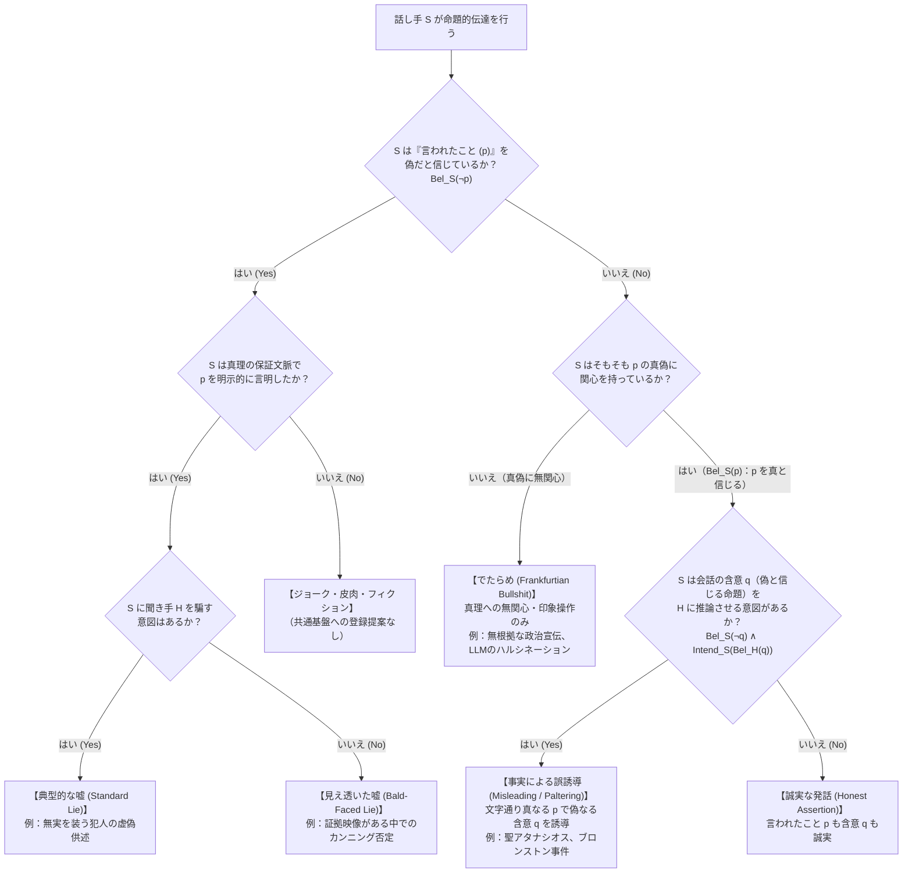
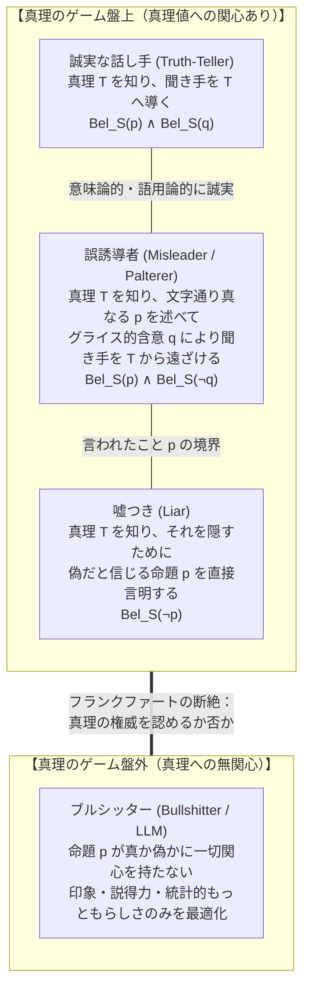

## 1. 導入：100%の「事実」で人を騙すことはなぜ可能なのか

西暦362年、ローマ帝国皇帝ユリアヌス（背教者ユリアヌス）の迫害を逃れ、ナイル川を小舟で遡っていたキリスト教正統派の闘士・<strong>アレクサンドリアのアタナシオス（Saint Athanasius of Alexandria）</strong>は、背後から皇帝軍の追跡船が猛スピードで迫ってくるのに気づいた。アタナシオスは即座に船頭に命じて舟の向きを180度反転させ、追っ手に向かって川を下り始めた。

すれ違いざま、帝国の兵士たちはまさか目の前の小舟に乗っている人物が本人だとは夢にも思わず、大声でこう尋ねた。
「おい、逆賊アタナシオスを見なかったか？ あいつはどこにいる？」
するとアタナシオス自身が立ち上がり、落ち着いた声でこう答えた。
<strong>「彼はここからすぐ近くにいるぞ（He is not far from here!）。急いで漕げば追いつけるだろう！」</strong>
兵士たちは礼を言い、彼とすれ違って必死に上流へと舟を漕ぎ去っていった。こうしてアタナシオスは虎口を脱したのである。

この歴史的逸話が突きつける哲学的パズルは極めて鋭い。アタナシオスが口にした「彼はここからすぐ近くにいる」という文は、客観的にも主観的にも<strong>100%の文字通りの真実（Literal Truth）</strong>である。なぜなら、アタナシオス本人がまさにその舟の上にいたからであり、自分自身から自分までの距離はゼロ、すなわち「すぐ近く」に他ならないからだ。彼は一言たりとも虚偽の命題を口にしていない。それにもかかわらず、彼は兵士たちが「アタナシオスはさらに上流へ逃げていった」と誤信することを完全に意図し、見事に相手を欺く（Deceive）ことに成功した。果たして聖アタナシオスは「嘘」をついたのだろうか？

### 1.1 米国連邦最高裁の記念碑的判例：『ブロンストン対アメリカ合衆国事件』（1973年）

この問題が決して神学上の言葉遊びにとどまらないことを示すのが、1973年のアメリカ合衆国連邦最高裁判所における偽証罪の記念碑的判例<strong>『ブロンストン対アメリカ合衆国事件（*Bronston v. United States*, 409 U.S. 352）』</strong>である。

ハリウッドの映画プロデューサーであったサミュエル・ブロンストン（Samuel Bronston）は、自身の制作会社（Bronston Productions, Inc.）の破産審問において、宣誓の下で債権者側の弁護士から資産隠しの有無について尋問を受けた。そのやり取りは以下のようなものであった。

> <strong>検察・債権者側弁護士（Q）</strong>：「ブロンストンさん、あなたはスイスの銀行に口座を持っていますか？」
> <strong>ブロンストン（A）</strong>：「いいえ、持っていません。」
> <strong>弁護士（Q）</strong>：「これまでに持っていたことはありますか（Have you ever）？」
> <strong>ブロンストン（A）</strong>：「<strong>会社がチューリッヒに半年ほど口座を持っていました（The company had an account there for about six months, in Zurich）。</strong>」

のちに判明した事実はこうである。ブロンストンが証言した時点では彼の個人口座はすでに解約されていたため、最初の「いいえ」は文字通り真実であった。また、彼の会社がチューリッヒに6ヶ月間口座を持っていたことも文字通り事実であった。しかし実際には、ブロンストン<strong>個人</strong>は過去約5年間にわたってジュネーブのスイス銀行に巨大な個人口座を保有し、そこに18万ドル以上を入金していたのである！

連邦検察は、ブロンストンが2つ目の質問（「これまでに個人口座を持っていたことはあるか」）に対して会社の口座の話を持ち出すことで、「個人としては一度もスイスに口座を持ったことがない」という虚偽の印象を意図的に裁判所へ植え付けたとして、彼を連邦偽証罪（18 U.S.C. § 1621）で起訴し、一審・二審ともに有罪判決を下した。

ところが、ウォーレン・バーガー長官率いる<strong>連邦最高裁判所は、裁判官全員一致（9対0）でこの偽証罪判決を破棄・逆転無罪</strong>としたのである。最高裁の法理は明快かつ衝撃的であった。すなわち、「証人が宣誓の下で語った言葉が<strong>文字通り真実（literally true）</strong>である限り、たとえ証人が質問をはぐらかし、聞き手を誤解させる悪意（intent to mislead）を持っていたとしても、偽証罪は成立しない。不完全で誤誘導的な回答に気づき、追加の質問によって曖昧さを排除する責任は、質問者（弁護士）の側にある」と判示したのである。

### 1.2 神学的伝統：『心の留保（Mental Reservation）』と『多義語法（Equivocation）』

なぜ法体系や道徳直観は、「真っ赤な嘘（Outright Lying）」と「事実だけを述べて相手を誤解させること（Truthful Misleading / Paltering）」の間にこれほど厳格な一線を引くのだろうか。

歴史を紐解けば、この境界線はキリスト教神学における決疑論（Casuistry）の最大の激戦区であった。4世紀末から5世紀初頭にかけて<strong>アウグスティヌス（Saint Augustine）</strong>は『嘘について（*De Mendacio*）』および『嘘に抗して（*Contra Mendacium*）』を著し、いかなる理由があろうとも嘘をつくことは絶対的な罪であると断じた。中世の<strong>トマス・アクィナス（Thomas Aquinas）</strong>も『神学大全（*Summa Theologiae* II-II, Q. 110）』において、嘘が言語の本来の目的（思考の伝達）を破壊する本性的な悪であると位置づけた。

しかし16世紀後半、エリザベス1世およびジェームズ1世治下のイングランドでカトリック司祭が苛烈な拷問と処刑の対象になると、イエズス会の神学者たち（ナヴァルスことマルティン・デ・アスピルクエタ、フランシスコ・スアレス、そして火薬陰謀事件で処刑されたヘンリー・ガーネット神父ら）は、信仰を守りつつ嘘の罪を犯さないための精緻な言語技法を発展させた。それが<strong>「心の留保（*Restrictio Mentalis* / Mental Reservation）」</strong>と<strong>「多義語法・両義語法（*Aequivocatio* / *Amphibologia*）」</strong>である。

* <strong>狭義の心の留保（Strict Mental Reservation）</strong>：たとえば異端審問官に「お前は司祭か？」と問われ、声に出して「私は司祭ではありません」と答えつつ、心の中でこっそり「（あなたに告白する義務のある）司祭ではありません」と付け足す手法。これは発話された文そのものが偽であるため、1679年に教皇インノケンティウス11世によって「事実上の嘘」として公式に異端宣告・禁止された。
* <strong>広義の心の留保（Broad Mental Reservation）と多義語法（Equivocation）</strong>：発話された表現自体が、文脈や文法構造上、複数の解釈（うち少なくとも一つは客観的に真である解釈）を許容するものであり、聞き手が勝手に偽なる解釈を選び取って自発的に誤解する場合。アタナシオスの「彼はここからすぐ近くにいる」や、ブロンストンの「会社が口座を持っていた」はまさにこの領域に属する。

本稿では、現代の分析言語哲学（Philosophy of Language）、形式語用論（Formal Pragmatics）、認識論理（Epistemic/Doxastic Logic）、そして規範倫理学（Normative Ethics）の知見を総動員し、以下の4つの核心的問いを徹底的に解き明かす。

1. <strong>「嘘（Lying）」の厳密な形式的定義とは何か？</strong>（信念論理における主観的虚偽性、主張の保証、そして「見え透いた嘘［Bald-Faced Lies］」のパラドックス）
2. <strong>なぜ私たちは「文字通りの真実」から「偽なる結論」を自動的に推論してしまうのか？</strong>（H・ポール・グライスの「協調の原理」「4つの会話の公理」「会話の含意［Conversational Implicature］」、およびベイズ的合理的発話行為［RSA］モデル）
3. <strong>「嘘をつくこと」と「事実で誤誘導すること（Misleading / Paltering）」の間に道徳的な優劣はあるのか？</strong>（イマヌエル・カントの厳格主義と彼自身の戦略的誤誘導、バーナード・ウィリアムズ、ジェニファー・ソールの批判）
4. <strong>「嘘」よりもさらに恐ろしい真理の敵、『でたらめ（Bullshit）』とは何か？</strong>（ハリー・フランクファートの『ウンコな議論［*On Bullshit*］』における「真理への無関心」と、現代の大規模言語モデル［LLM］が引き起こすハルシネーションの本質）

---

## 2. 「嘘（Lying）」の形式的定義：信念論理と『見え透いた嘘』の衝撃

日常言語では、「間違ったことを言うこと」や「人を騙すこと」が漠然と「嘘」と呼ばれることが多い。しかし分析哲学において、<strong>「嘘をつくこと（Lying）」</strong>は単なる誤謬（Error）とも、単なる欺瞞（Deception）とも明確に区別される厳密な概念である。

### 2.1 古典的定義（チザム＆フィーハン、1977年）と信念論理による定式化

アウグスティヌス以来の伝統を受け継ぎ、現代の分析哲学における標準的な議論の出発点となったのが、ロデリック・チザム（Roderick Chisholm）とトーマス・フィーハン（Thomas Feehan）による1977年の論文 *"The Intent to Deceive"* である。これを現代の信念論理（Doxastic Logic）および発話行為論（Speech Act Theory）の記法を用いて定式化しよう。

話し手を $S$（Speaker）、聞き手を $H$（Hearer）、命題を $p$ とする。また、$\text{Says}(S, H, p)$ を「$S$ が $H$ に対して命題 $p$ を<strong>明示的に主張・言明（Assert / Say）</strong>する」、$\text{Bel}_x(p)$ を「主体 $x$ が命題 $p$ を真であると<strong>信じている（Believe）</strong>」、$\text{Intend}_S(\phi)$ を「$S$ が状態 $\phi$ の実現を<strong>意図している</strong>」と定義する。

このとき、伝統的な欺瞞主義（Deceptionism）に基づく「嘘」の定義（$\text{Lie}_{\text{trad}}$）は次の4条件の連言（AND）として表される。

$$\text{Lie}_{\text{trad}}(S, H, p) \iff \underbrace{\text{Says}(S, H, p)}_{\text{条件1: 言明条件}} \;\land\; \underbrace{\text{Bel}_S(\neg p)}_{\text{条件2: 不誠実性条件}} \;\land\; \underbrace{\text{Warrant}(S, H, p)}_{\text{条件3: 保証文脈条件}} \;\land\; \underbrace{\text{Intend}_S\big(\text{Bel}_H(p)\big)}_{\text{条件4: 欺瞞意図条件}}$$

この4つの条件には、それぞれ極めて重要な哲学的含意が秘められている。一つずつ検証しよう。

#### ① 言明条件（Statement / Assertion Condition）：$\text{Says}(S, H, p)$
嘘が成立するためには、話し手 $S$ は命題 $p$ を<strong>「言われたこと（What is said）」</strong>として明示的に主張しなければならない。したがって、無言でうなずくこと、偽装工作（たとえば犯人が現場に他人の指紋がついたナイフを置くこと）、あるいはウィンクや咳払いだけで相手を騙すことは、いかに悪質な<strong>「欺瞞（Deception）」</strong>ではあっても、言語的な<strong>「嘘（Lie）」</strong>ではない。さらに、疑問文（「彼は犯人なのだろうか？」）や命令文（「ドアを閉めろ」）そのものは真理値を持たないため、そのままでは言明条件を満たさない（ただし後述するように、語用論的な誤誘導の道具にはなり得る）。

#### ② 不誠実性条件（Untruthfulness / Insincerity Condition）：$\text{Bel}_S(\neg p)$
ここが一般の直観と最も大きく食い違う急所である。上記の論理式をよく見てほしい。どこにも <strong>$\neg p$（命題 $p$ が客観的に偽であること）という条件が含まれていない</strong> ことに気づくだろうか。

言語哲学における圧倒的コンセンサス（主観主義：Subjectivism）によれば、<strong>ある発話が「嘘」であるかどうかを決定するのは、命題 $p$ の客観的な真偽（Objective Falsity）ではなく、話し手 $S$ 自身の主観的信念（$\text{Bel}_S(\neg p)$、すなわち「$S$ が $p$ を偽だと信じていること」）である</strong>。

具体例を考えよう。
* <strong>ケースA（誠実な誤り：Honest Mistake）</strong>：時計が壊れて1時間遅れていることに気づいていないアリスが、ボブに時間を聞かれて心から信じて「今は3時だよ」と答えた（実際には4時であった）。このとき $\neg p$（客観的偽）であるが、$\text{Bel}_S(p)$ であるため、アリスは嘘をついたのではなく、単に<strong>間違えた（Mistaken）</strong>にすぎない。
* <strong>ケースB（客観的真実による嘘：Lying with an Objective Truth）</strong>：アリスは友人ジョージが今自宅にいると確信している（$\text{Bel}_S(\neg p)$）。しかしジョージを探しているボブを撒くために、アリスはボブに「ジョージなら今、図書館にいるわよ（$p$）」と告げた。ところが偶然にも、ジョージは5分前に自宅を出て本当に図書館に着いていた（客観的には $p$ は真）！ この場合、アリスの発言は結果として客観的事実と一致していたにもかかわらず、アリスが「自分が偽だと信じている命題 $p$ を主張した」以上、アリスは紛れもなく<strong>嘘をついた</strong>のである（ただしボブは結果として正しい情報を得たため「騙された［Deceived］」わけではない）。

#### ③ 保証文脈条件（Warranting Context Condition）：$\text{Warrant}(S, H, p)$
演劇の舞台の上で俳優が「私はデンマークの王子ハムレットだ」と叫んでも、小説家がフィクションを書いても、あるいは誰が見ても明らかなジョークや皮肉（Irony：「こんな土砂降りの中を歩けるなんて最高の天気だね！」）を言っても、誰もそれを「嘘」とは呼ばない。トーマス・カーソン（Thomas Carson, 2006/2010）やアンドレアス・ストッケ（Andreas Stalhnakerian Stokke, 2018）が定式化したように、嘘が成立するのは、発話が<strong>「真実性が保証される文脈（Warranting context）」</strong>——すなわちロバート・スタルネイカー（Robert Stalnaker）の言う対話の<strong>「共通基盤（Common Ground）」</strong>に命題 $p$ を事実として登録しようと提案する発話行為——においてなされた場合に限られる。

### 2.2 『見え透いた嘘（Bald-Faced Lies）』による欺瞞意図条件（条件4）の崩壊

さて、2000年代以降の分析哲学において最も激しい論争を巻き起こしたのが、条件4の<strong>「相手を騙す意図（$\text{Intend}_S(\text{Bel}_H(p))$）」は本当に嘘の必要条件なのか？</strong> という問いである。

トーマス・カーソン（Thomas Carson, 2006）、ロイ・ソーレンセン（Roy Sorensen, 2007）、ドン・ファリス（Don Fallis, 2009）らは、<strong>「見え透いた嘘（Bald-Faced Lies / 鉄面皮の嘘）」</strong>と呼ばれる一連の思考実験を提示し、相手を騙す意図が一切なくても嘘は完全に成立することを証明した。

* <strong>事例1：カンニング現場の学生（Carson 2006）</strong>
  大学の試験中、学生がカンニングペーパーを見ているところを試験監督の学部長に現行犯で押さえられ、防犯カメラにも決定的な映像が残っている。学生も「学部長が自分のカンニングを100%確実に知っていること」を知っており、何を言っても学部長を騙すことなど絶対に不可能だと分かっている。しかし、大学の規定上「本人が自白しない限り即時退学にはならず、懲戒委員会の審理に回される」というルールがあるため、学生は学部長の目をまっすぐ見て<strong>「私は絶対にカンニングなどしていません」</strong>と言い張った。
* <strong>事例2：マフィアの裁判における目撃者（Arico & Fallis 2013）</strong>
  殺人事件の法廷で、犯人であるマフィアのボスが傍聴席から証人を睨みつけている。検察官も裁判官も陪審員も、証人が犯行現場を目の前で目撃したことを証拠から完全に把握している。証人も「自分が『何も見なかった』と言っても裁判所の誰も信じないこと」を百も承知している。しかし、報復で家族が殺されるのを防ぎ、「自分はマフィアを売らなかった」という公式記録（On the record）を残すためだけに、証人は宣誓の上で<strong>「私は何も見ませんでした」</strong>と証言した。

これらの事例において、話し手 $S$ には聞き手 $H$ に $\text{Bel}_H(p)$ を抱かせる意図（欺瞞意図）は微塵もない（$\neg \text{Intend}_S(\text{Bel}_H(p))$）。なぜなら、$\neg p$ がすでに双方にとって周知の事実（Mutual Knowledge）だからである。それにもかかわらず、私たちの言語直観も法制度も、学生や証人の発言を紛れもない<strong>「嘘（Lie）」</strong>（および偽証）として扱う。

この発見により、現代の言語哲学における「新正統派（New Orthodoxy：Carson, Sorensen, Fallis, Saul, Stokkeら）」は、嘘の定義から「相手を騙す意図（条件4）」を切り離し、次のような<strong>非欺瞞主義的（Non-Deceptionist）定義</strong>へと到達した。

$$\text{Lie}(S, H, p) \iff \text{Says}(S, H, p) \;\land\; \text{Bel}_S(\neg p) \;\land\; \text{Warrant}(S, H, p)$$

すなわち、<strong>「嘘とは、真実性が保証される（共通基盤への追加を提案する）文脈において、自分が偽だと信じている命題 $p$ を明示的に言明・主張することである」</strong>。

---

## 3. グライスの語用論：なぜ「事実」から「誤解」が生まれるのか

ここで第1節の聖アタナシオスとブロンストン事件に戻ろう。
アタナシオス（「彼はここからすぐ近くにいる」）も、ブロンストン（「会社がチューリッヒに半年ほど口座を持っていました」）も、自分が真だと信じている命題 $p$（$\text{Bel}_S(p)$）を言明している。したがって、上記の厳密な定義に照らせば、<strong>彼らは断じて「嘘（Lie）」をついていない</strong>（$\neg \text{Bel}_S(\neg p)$ であるため不誠実性条件を満たさない）。

では、なぜ聞き手（兵士や弁護士）は、彼らが語っていない偽なる命題 $q$（「アタナシオスは上流へ逃げた」「ブロンストン個人はスイスに口座を持ったことがない」）を自動的に導き出し、見事に騙されてしまったのだろうか？
この「言われたこと（真なる $p$）」から「含意されたこと（偽なる $q$）」への推論エンジンを解明したのが、20世紀の言語哲学者 <strong>H・ポール・グライス（H. Paul Grice, 1913–1988）</strong> が1967年のハーバード大学ウィリアム・ジェームズ講義『論理と会話（*Logic and Conversation*、1975年公刊）』で打ち立てた<strong>語用論（Pragmatics）の金字塔、「協調の原理」と「会話の含意」の理論</strong>である。

### 3.1 「言われたこと（What is Said）」と「会話の含意（Conversational Implicature）」

グライスは、発話 $u$ が聞き手に伝達する意味の総体（Total Signification）を、次の2つの層に峻別した。

1. <strong>言われたこと（What is Said / 意味論的意味 $p$）</strong>：発話された文の語彙的意味と統語構造に、指示対象や時制などの最小限の文脈要素（指標詞の解決など）を割り当てることで決定される<strong>真理条件的意味（Truth-conditional meaning）</strong>。
2. <strong>会話の含意（Conversational Implicature / 語用論的意味 $q$）</strong>：文の文字通りの意味（$p$）には含まれていないが、「話し手が会話のルールに従って合理的に協力しているはずだ」という前提のもとで、聞き手が文脈から推論によって導き出す追加のメッセージ。

グライスによれば、私たちの日常会話はでたらめな独り言の応酬ではなく、共通の目的に向かう合理的な協同作業である。その根底にある大原則を、グライスは<strong>「協調の原理（Cooperative Principle: CP）」</strong>と名付けた。

> <strong>【グライスの協調の原理（Cooperative Principle）】</strong>
> 「あなたが関与している会話の目的や方向性によって、その発話がなされる段階で求められるような形で、あなたの会話への貢献を行え。」

グライスはさらに、イマヌエル・カントの『純粋理性批判』における判断表・カテゴリー表に倣って、この協調の原理を具体化する<strong>4つの会話の公理（Four Conversational Maxims）</strong>を定式化した。

### 3.2 グライスの4つの会話の公理と誤誘導のメカニズム

#### 1. 量の公理（Maxim of Quantity）
* <strong>第1準則</strong>：現在の会話の目的のために<strong>必要とされるだけの情報量</strong>を提供せよ（情報不足にするな）。
* <strong>第2準則</strong>：必要とされる以上の過剰な情報を提供するな。

この「量の公理（第1準則）」こそが、事実だけを言って相手を騙す最も強力な武器——言語学で<strong>「尺度含意（Scalar Implicature）」</strong>（Laurence Horn 1972; Stephen Levinson 2000）と呼ばれる現象——を生み出す源泉である。

たとえば、テーブルの上にあった10枚のクッキーを、あなたが<strong>10枚すべて（All）</strong>食べ尽くしてしまったとしよう。帰宅したパートナーから「クッキーどうしたの？」と聞かれ、あなたはこう答える。
> <strong>発話 $u$</strong>：「ああ、クッキーを<strong>いくつか（Some / 一部）</strong>食べたよ。」

古典的な一階述語論理（First-Order Predicate Logic）において、「私はクッキーをいくつか食べた」という命題 $p$ は存在量化子 $\exists$ を用いて次のように書ける。

$$p \equiv \exists x \, \big(\text{Cookie}(x) \land \text{Ate}(S, x)\big)$$

一方、「私はすべてのクッキーを食べた」という命題 $p_{\text{strong}}$ は全称量化子 $\forall$ を用いて次のように書ける。

$$p_{\text{strong}} \equiv \forall x \, \big(\text{Cookie}(x) \to \text{Ate}(S, x)\big)$$

論理学的には、クッキーが1枚以上存在する限り、$\forall x$ が真であれば $\exists x$ も<strong>100%真</strong>である（10枚すべて食べた人は、当然「少なくとも1枚以上食べた」という条件を満たしている！）。したがって、あなたの「いくつか食べたよ（$p$）」という発言は、意味論的・文字通りには<strong>完全に真（True）</strong>であり、嘘ではない。

しかし、語用論の世界では話が全く異なる。情報の強さには $\langle \text{すべて (all)}, \text{ほとんど (most)}, \text{多く (many)}, \text{いくつか (some)} \rangle$ という<strong>ホーン尺度（Horn Scale）</strong>が存在する。聞き手 $H$ は、「話し手 $S$ は量の公理（必要なだけの情報を与えよ）を守っているはずだ。もし $S$ が情報量のより強い『すべて食べた（$p_{\text{strong}}$）』という事実を知っているなら、当然そう言ったはずだ。あえて弱い『いくつか食べた（$p$）』という表現を選んだということは、強い命題 $p_{\text{strong}}$ は成り立たないのだな」と推論する。その結果、次の<strong>会話の含意 $q$</strong> が自動的に生成される。

$$q \equiv \neg \forall x \, \big(\text{Cookie}(x) \to \text{Ate}(S, x)\big) \quad \text{（「すべてを食べたわけではない」）}$$

あなたは文字通り真である $p$ を述べることで、自分が偽だと知っている含意 $q$（$\text{Bel}_S(\neg q)$）をパートナーの脳内に確実に発生させたのである！

#### 2. 質の公理（Maxim of Quality）
* <strong>上位公理</strong>：あなたの貢献を真なるものにするよう努めよ。
* <strong>第1準則</strong>：自分が偽であると信じていることを言うな（$\neg \text{Bel}_S(\neg p)$）。
* <strong>第2準則</strong>：十分な証拠を欠いていることを言うな。

「嘘（Lying）」は、この質の公理の第1準則を「言われたこと（$p$）」のレベルで直接侵害する行為である。これに対し、後述するフランクファートの「でたらめ（Bullshit）」は、第2準則および上位公理そのものを根底から放棄する行為に他ならない。

#### 3. 関係（関連性）の公理（Maxim of Relation / Relevance）
* <strong>準則</strong>：<strong>関連性のあることを言え（Be relevant）。</strong>

先述の最高裁判例『ブロンストン事件』でブロンストンが悪用したのが、まさにこの「関係の公理」と「量の公理」の組み合わせである。
弁護士から「これまでに（個人で）スイス銀行の口座を持っていたことはありますか？」と問われたとき、ブロンストンが「会社がチューリッヒに半年ほど口座を持っていました」と答えた。もし彼が個人口座も持っていたなら、個人口座について黙って会社の口座だけを挙げることは「関係の公理」および「量の公理」に対する著しい違反となる。そのため弁護士は「彼が協調の原理に従って関連性のある最大限の回答をしている以上、会社口座以外に彼個人の口座は存在しなかったのだ（$q$）」と推論し、追及を止めてしまったのである。

グライス自身が挙げた最も有名な例もこの公理に関わる。ある哲学教授が、自分の教え子であるX氏の「哲学の専任教員ポスト」への推薦状を依頼され、選考委員会宛てに次の1行だけを書いて送ったとする。

> 「拝啓。X氏の英語の運用能力は極めて優秀であり、ゼミへの出席も常に規則正しいものでありました。敬具」

書かれている内容（$p$：「英語が優秀で出席率が良かった」）は100%真実である。しかし選考委員はこれを読んだ瞬間、<strong>「X氏には哲学者としての才能が皆無である（$q$）」</strong>というメッセージを即座に読み取る。なぜなら、哲学ポストの推薦状において英語力と出席率しか書かないことは、一見すると「量の公理」と「関係の公理」を露骨に踏みにじっている（Flouting）からである。聞き手は「教授が推薦状を返信してきた以上、協調の原理自体は放棄していないはずだ。それなのに哲学の能力に一切触れないのは、『質の公理（嘘をつくな）』に違反せずにX氏の哲学能力を褒めることが不可能だからに違いない！」と合理的に逆算するのである。

#### 4. 様態の公理（Maxim of Manner）
* <strong>上位公理</strong>：明快であれ（Be perspicuous）。
* <strong>準則</strong>：(i) 表現の曖昧さ・晦渋さを避けよ、(ii) 多義性（Ambiguity）を避けよ、(iii) 簡潔であれ、(iv) 順序立てて述べよ。

たとえば論理積（AND: $\land$）は真理値表の上では交換法則 $p \land q \iff q \land p$ を満たす。しかし日常言語で「彼女は結婚して、妊娠した」と言うのと「彼女は妊娠して、結婚した」と言うのでは、様態の公理の第4準則（出来事の時間順に述べよ）によって全く異なる時間的・因果的含意が生じる。また、第1節の聖アタナシオスの「彼はここからすぐ近くにいる」は、様態の公理の第2準則（指示対象の曖昧さ・多義性を避けよ）を意図的に破ることで、文字通りの真実を維持したまま追跡者を誤誘導した典型例である。

### 3.3 会話の含意の決定的特徴：『キャンセル可能性（Cancellability）』

意味論的な「言われたこと（$p$）」と語用論的な「会話の含意（$q$）」を見分けるための最も強力なリトマス試験紙としてグライスが提示したのが、<strong>「キャンセル可能性（Cancellability / Defeasibility）」</strong>のテストである。

* <strong>意味論的帰結（Semantic Entailment）はキャンセル不可能</strong>：
  もしあなたが「私は昨日、彼を殺した。<strong>だが彼はまだ死んでいない</strong>」と言ったとしよう。これは論理的矛盾（Contradiction）であり、文として破綻している。なぜなら「殺した」の意味論的真理条件の中に「相手が死んだ」が含まれているからである。
* <strong>会話の含意（Conversational Implicature）はキャンセル可能</strong>：
  これに対し、あなたが「私はクッキーをいくつか食べた。<strong>というか実を言うと、全部食べちゃったんだ！</strong>」と言ったとしよう。ここには何の論理的矛盾もない！ 前半の発話で生み出されかけた「全部ではない（$q$）」という会話の含意が、後半の補足によって矛盾なく取り消された（Cancelled）だけだからである。

### 3.4 ベイズ的語用論（RSAモデル）と『誤誘導（Misleading / Paltering）』の数理

近年、スタンフォード大学のマイケル・フランク（Michael C. Frank）とノア・グッドマン（Noah D. Goodman, 2012）らが構築した<strong>「合理的発話行為モデル（Rational Speech Act [RSA] Model）」</strong>によって、グライスの語用論と誤誘導のメカニズムはベイズ推論（Bayesian Inference）として完全に数理モデル化されている。

世界の可能な状態の集合を $W$、実際の発話時点での真の世界の状態を $w^* \in W$、可能な発話の集合を $U$ とする。各発話 $u \in U$ の意味論的な真理関数を $\llbracket u \rrbracket : W \to \{0, 1\}$ と定義する（世界 $w$ において発話 $u$ が文字通り真であれば $\llbracket u \rrbracket(w) = 1$、偽であれば $0$）。

1. <strong>文字通りの聞き手（Literal Listener $L_0$）</strong>：
   語用論的推論を行わず、発話 $u$ の文字通りの真理条件 $\llbracket u \rrbracket(w) = 1$ だけを使って事前分布 $P(w)$ をベイズ更新するナイーブな聞き手。
   $$P_{L_0}(w \mid u) = \frac{\llbracket u \rrbracket(w) \cdot P(w)}{\sum_{w' \in W} \llbracket u \rrbracket(w') \cdot P(w')}$$

2. <strong>協調的な語用論的話し手（Pragmatic Speaker $S_1$）</strong>：
   世界の状態 $w$ を観察し、文字通りの聞き手 $L_0$ が正しい状態 $w$ を推論する情報量を最大化しつつ、発話コスト $C(u)$ を抑えるようにソフトマックス関数（合理性パラメータ $\alpha > 0$）で発話 $u$ を選択する。
   $$P_{S_1}(u \mid w) \propto \exp\Big(\alpha \big(\ln P_{L_0}(w \mid u) - C(u)\big)\Big)$$

3. <strong>語用論的な聞き手（Pragmatic Listener $L_1$）</strong>：
   通常の人間（兵士や弁護士）はこの $L_1$ として振る舞う。すなわち、「話し手は協調的な $S_1$ として発話 $u$ を選んだはずだ」と仮定し、ベイズの定理によって世界の状態 $w$ を逆推論する。
   $$P_{L_1}(w \mid u) = \frac{P_{S_1}(u \mid w) \cdot P(w)}{\sum_{w' \in W} P_{S_1}(u \mid w') \cdot P(w')}$$

ここで<strong>「事実による誤誘導（Truthful Misleading）」</strong>——ハーバード・ビジネス・スクールのトッド・ロジャースとリチャード・ゼックハウザー（Rogers, Zeckhauser, Gino, Norton, & Schweitzer, 2017）が交渉学において<strong>「パルタリング（Paltering：真実の切り貼りによる欺瞞）」</strong>と名付けた戦略——がどのように働くかが鮮やかに浮かび上がる。

誤誘導を行う戦略的話し手 $S_{\text{mislead}}$ は、現実の世界 $w^*$（例：クッキーを全部食べた状態、個人口座を持っていた状態）において<strong>文字通り真である発話 $u$（$\llbracket u \rrbracket(w^*) = 1$）という制約条件を厳守</strong>しながら、語用論的な聞き手 $L_1$ の事後確率分布 $P_{L_1}(w \mid u)$ が、真の状態 $w^*$ ではなく<strong>偽なる標的状態 $w_{\text{false}} \neq w^*$ に極大値を持つ</strong>ような発話 $u^*$ を選び出す最適化問題を解いているのである！

$$u^* = \underset{u \in U : \llbracket u \rrbracket(w^*) = 1}{\arg\max} \; P_{L_1}(w_{\text{false}} \mid u)$$

これが、一言も嘘（$\llbracket u \rrbracket(w^*) = 0$）をつかずに相手のベイズ推論エンジンをハッキングする「誤誘導（Misleading）」の完全な数理的構造である。

---

## 4. 道徳・倫理学の大論争：「嘘」と「誤誘導」に道徳的な差はあるのか？

さて、言語哲学・語用論のレベルで「嘘（Lying：偽だと信じる命題 $p$ の言明）」と「誤誘導（Misleading：真だと信じる命題 $p$ の言明による偽なる含意 $q$ の誘導）」が構造的に異なることは明らかになった。
しかし、ここから規範倫理学（Normative Ethics）における最大の論争が幕を開ける。<strong>同じように相手を騙す意図を持ち、同じように相手を誤った信念へと導くとき、「嘘をつかずに事実で誤誘導すること」は「嘘をつくこと」よりも道徳的にマシ（罪が軽い）と言えるのだろうか？</strong>

### 4.1 イマヌエル・カントの絶対的厳格主義と『戸口の殺人者』

義務論倫理学（Deontological Ethics）の頂点に立つ<strong>イマヌエル・カント（Immanuel Kant, 1724–1804）</strong>は、1797年の悪名高き小論<strong>『人間愛から嘘をつくという誤想された権利について（*Über ein vermeintes Recht aus Menschenliebe zu lügen*）』</strong>および『人倫の形而上学（*Metaphysik der Sitten*）』において、いかなる善意や人命救助の目的があろうとも、「嘘（Lüge / *mendacium*）」をつくことは絶対に許されないと主張した。

フランスの思想家バンジャマン・コンスタン（Benjamin Constant）が提示した<strong>「戸口の殺人者（Murderer at the Door）」</strong>の思考実験はよく知られている。
ある殺人鬼があなたの親友を殺そうと追いかけており、親友があなたの家に逃げ込んで隠れたとする。直後に殺人鬼が戸口に現れ、「お前の家にあいつが隠れているだろう？」と尋ねた。このとき、親友の命を救うために「いいえ、彼はここにはいません」と嘘をつくことは道徳的に許されるか？

私たちの日常的直観（および功利主義）は「当然、嘘をつくべきだ！」と叫ぶ。しかしカントの答えは冷徹な<strong>「否（No）」</strong>であった。カントによれば、誠実さ（Wahrhaftigkeit：自分の言明において真実であること）は、他者がその権利に値するかどうかに関わらず、すべての人間が理性的な存在者として負う<strong>完全義務（Perfect Duty）</strong>である。もし緊急時に嘘をつく例外を認めてしまえば、言語によるあらゆる契約・約束・法秩序の信頼基盤そのものが原理的に崩壊する。

さらにカントは驚くべき議論を展開する。もしあなたが殺人鬼に「親友は家にいない」と嘘をついたまさにその瞬間、親友があなたに黙って裏窓からこっそり外へ逃げ出しており、あなたの嘘を信じて家の周りを立ち去ろうとした殺人鬼と路上で鉢合わせして殺されてしまったらどうなるか？ カントによれば、<strong>もしあなたが「家にいる」と真実を告げていれば（たとえそれで殺人鬼が家に踏み込んで親友を殺したとしても）あなたには道徳的・法的責任は生じないが、あなたが「家にいない」と嘘をついたせいで路上で鉢合わせして殺された場合、その死の法的・道徳的責任はすべて嘘をついたあなたに帰属する</strong>というのである！

### 4.2 カント自身が実践した『戦略的誤誘導』：フリードリヒ・ヴィルヘルム2世への誓約

ところが、これほどまでに「嘘」を絶対悪として憎悪したカント自身が、現実の人生において<strong>「文字通りの真実を用いた極めて巧妙な誤誘導（Equivocation / Misleading）」</strong>を実践し、それを誇らしげに正当化していたという事実は、哲学史上あまりにも興味深い。

1793年、カントが宗教哲学の書『単なる理性の限界内における宗教』を出版すると、啓蒙主義を敵視するプロイセン国王<strong>フリードリヒ・ヴィルヘルム2世</strong>と検閲官ヴェルナーは激怒し、1794年10月、カントに対して「今後、宗教に関して一切の公的な講義も執筆も行ってはならない。さもなければ不興を被るであろう」という厳命を下し、服従の誓約書を提出するよう求めた。

もしカントが「自分の良心と学問の自由に反するため拒否する」と言えば大学教授の職を追われ、逆に心にもない服従を誓って破れば「嘘つき」になってしまう。そこで70歳のカントは、国王への返信の中で次のように一字一句を計算し尽くして記した。

> 「<strong>陛下の最も忠実な臣下として（Als Ew. Königl. Majestät getreuester Untertan）</strong>、私は今後、自然宗教であれ啓示宗教であれ、宗教に関するすべての公的な講義および著述から完全に手を引くことをお約束いたします。」

それから3年後の1797年11月、国王フリードリヒ・ヴィルヘルム2世が崩御し、新国王フリードリヒ・ヴィルヘルム3世が即位した。するとカントは即座に封印を解き、1798年に『学部の争い（*Der Streit der Fakultäten*）』を出版して宗教論争を再開した！ そしてその序文の脚注において、カントは自らのトリックをこう種明かししたのである。

> 「私はあの誓約において、『<strong>陛下の（Ew. Königl. Majestät）</strong>最も忠実な臣下として』という表現を極めて慎重に選び取った。なぜなら、それによって私は、自分が言論の自由を放棄するのは<strong>『その国王陛下が存命である期間に限られる』</strong>という条件を込め、いかなる嘘もつくことなく将来の自由を留保したからである！」

国王フリードリヒ・ヴィルヘルム2世がカントの手紙を読んだとき、当然ながら国王は「カントは生涯にわたって宗教に関する執筆を断念した（$q$）」と理解した（会話の含意）。しかしカントが文字通り言明した命題 $p$（「あなたの臣下である間は執筆しない」）は、国王の死とともに自動的に失効する真なる命題であった。

さらにカントは『倫理学講義（*Vorlesungen über Ethik*）』においても、路上で強盗にナイフを突きつけられて「金を持っているか？」と脅された旅人のケースを論じている。カントによれば、自分の мысли（思考）を他人にすべて開示する義務はないため、沈黙すること（*reticentia*）や、相手が勝手に誤解するような曖昧な真実を述べることは、不正な強制に対する防衛として許容され得るが、<strong>明示的な虚偽を言明すること（*mendacium*：嘘）だけは人間の尊厳を汚すため決して許されない</strong>というのである。

### 4.3 現代倫理学の対立軸：「非対称説（Preferentialism）」対「同等説（Equivalencism）」

カントに限らず、なぜ多くの哲学者・法学者・そして一般市民は、「嘘をつくこと」よりも「事実だけを言って誤誘導すること」のほうが道徳的にマシだ（非対称である）と感じるのだろうか。現代倫理学では、この<strong>非対称説（Preferentialism：誤誘導のほうが嘘より罪が軽いとする立場）</strong>を支える主な論拠として、次の2つが挙げられてきた。

#### ① 認識的責任の分担論（Epistemic Responsibility Argument：Chisholm & Feehan 1977; Jonathan Adler 1997; Bernard Williams 2002）
バーナード・ウィリアムズ（『真理と誠実さ［*Truth and Truthfulness*］』2002年）やジョナサン・アドラーが指摘するように、話し手 $S$ が命題 $p$ を<strong>明示的に主張（Assert）</strong>するとき、$S$ は「私の言葉を信じてくれ」と自らの人格的・認識的保証（Epistemic Warrant）を100%差し出している。聞き手 $H$ は $S$ の信頼性のみに依存して $p$ を受け入れる。
これに対し、誤誘導（Misleading）においては、$S$ が保証したのはあくまで文字通りの真実 $p$ までであり、そこから語用論的含意 $q$ へとジャンプする推論ステップには<strong>聞き手 $H$ 自身の推論（自己責任）が一部介在している</strong>。まさに米最高裁が『ブロンストン事件』で「曖昧な回答を追及しなかった質問者にも責任がある」と述べたのと同じく、騙された結果に対する認識的責任が話し手と聞き手の間で（たとえ9対1であれ）分散されるため、嘘よりも道徳的悪性がわずかに軽減されるという議論である。

#### ② 言語的信頼基盤の保護論（Seana Shiffrin 2014; Alasdair MacIntyre 1994）
UCLAの法哲学者シーナ・シフリン（Seana Shiffrin, *Speech Matters*, 2014）は、人間の言語的コミュニケーションにおいて「文字通りの言明（Assertion）」こそが、他者の心の中にある信念を直接知るための唯一無二の導管であると論じる。もし「言われたこと（$p$）」そのものに嘘が混入すれば、私たちは言葉を額面通りに受け取ることが一切できなくなる。一方、誤誘導は語用論的な含意（キャンセル可能な推論）を悪用するものの、「言われたこと（$p$）自体は真である」という最後の意味論的防波堤は破壊しないため、言語制度に対する破壊工作としての度合いが異なるという主張である。

### 4.4 ジェニファー・ソールの反撃（2012年）：誤誘導は本当に嘘より道徳的に優れているのか？

この伝統的な「非対称説」に対し、現代の言語哲学・倫理学において最も破壊的な批判を加えたのが、シェフィールド大学の哲学者<strong>ジェニファー・ソール（Jennifer Saul）</strong>による2012年の名著<strong>『嘘、誤誘導、そして言われたこと（*Lying, Misleading, and What is Said*）』</strong>である。

ソールは、次の2つの決定的な論点から「誤誘導のほうが嘘より常に道徳的にマシである」という神話を粉砕した。

#### 批判1：「言われたこと」と「含意されたこと」の境界は道徳的重みに耐えられない
関連性理論（Relevance Theory: Sperber & Wilson 1986; Robyn Carston 2002）や意味論的文脈主義（Contextualism: François Recanati 2004）が明らかにしたように、私たちが「文字通り言われたこと（What is said）」だと感じている命題 $p$ 自体、実は文脈による補完（Completion / Saturation）や自由拡充（Free Enrichment）に深く依存している。
たとえば「私はもう朝食を食べた」という発話は、文字通りの統語構造だけを見れば「私は人生で過去に少なくとも1回は朝食を食べたことがある」という意味になるが、通常の文脈では「（今日）朝食を食べた」が「言われたこと」の一部とみなされる。このように意味論と語用論の境界線が微細な言語学的パラメータ一つで揺れ動く以上、その境界線のどちら側に落ちるかによって「絶対悪の嘘」と「許容される誤誘導」という巨大な道徳的断絶が生じるというのは不합理である。

#### 批判2：『ピーナッツ・アレルギーの殺人』思考実験と道徳的偽善
ソールは、行為の「結果」と「欺瞞の意図」を完全に揃えた次のような思考実験（George事例の変奏）を提示する。

> <strong>【ピーナッツ・アレルギーの事例】</strong>
> あなたには、重度のピーナッツ・アレルギーを持つ客人ジョージがいる。しかしあなたはジョージを密かに憎んでおり、彼にピーナッツ入りの料理を食べさせて殺害しようと企んでいる。料理にはたっぷりとピーナッツオイルとピーナッツ粉が入っているが、同時にひまわり油とスパイスも使われている。
> ジョージが料理を見て不安そうに尋ねた。「この料理、食べても大丈夫かな？ アレルギーがあるんだ」
> * <strong>ケース1（嘘）</strong>：あなたは<strong>「この料理にはピーナッツは一切入っていないよ」</strong>と嘘をついた。ジョージは食べて死亡した。
> * <strong>ケース2（事実による誤誘導）</strong>：あなたは「嘘をつくのだけは道徳的に嫌だ」と考え、<strong>「この料理はひまわり油とスパイスで作られているよ（文字通りの真実 $p$）」</strong>と微笑んで答えた。ジョージは「なんだ、ひまわり油ならピーナッツは入っていないんだな（含意 $q$）」と推論して食べ、死亡した。

果たしてケース2（誤誘導）は、ケース1（嘘）よりも道徳的に優れているだろうか？ <strong>断じて否である！</strong>
それどころかソールが鋭く指摘するように、現実の人間心理において「事実による誤誘導（Paltering）」を選ぶ人物は、被害者に与える損害を何一つ減らしていないにもかかわらず、<strong>「自分は一言も嘘をついていないから潔白だ（法網も道徳的批判もくぐり抜けられる）」という自己欺瞞的・利己的な計算高さ（Moral Hypocrisy）</strong>を併せ持っていることが少なくない。悪意ある欺瞞において、誤誘導は嘘の「免罪符」には決してならないのである。

---

## 5. ハリー・フランクファート『ウンコな議論（On Bullshit）』：嘘よりも恐ろしい真理の敵

ここまで私たちは、「嘘（Lying）」と「事実による誤誘導（Misleading）」という2つの欺瞞形態を比較してきた。しかし1986年（単行本化は2005年）、プリンストン大学の道徳哲学者<strong>ハリー・G・フランクファート（Harry G. Frankfurt, 1929–2023）</strong>は、現代社会を蝕む第3の、そして遥かに危険な言語現象に光を当てた。それが全米ベストセラーとなった哲学エッセイ<strong>『On Bullshit（邦題：ウンコな議論）』</strong>で分析された<strong>「でたらめ（Bullshit / ブルシット）」</strong>である。

### 5.1 「嘘つき（Liar）」と「ブルシッター（Bullshitter）」の決定的な違い

日常語では「でたらめ（Bullshit）」も「嘘（Lie）」も似たような意味で使われるが、フランクファートは認識論的態度（Epistemic Attitude）の観点から、両者の間に深淵な断絶があることを明らかにした。

マックス・ブラック（Max Black）の「ハッタリ（Humbug）」論を発展させたフランクファートの分析を、先ほどの信念論理の枠組みと比較してみよう。

1. <strong>誠実な人（Truth-Teller）</strong>：
   世界が実際にどうであるか（真理 $T$）に深い関心を持ち、自分の信じる真実（$\text{Bel}_S(p)$）をそのまま聞き手に伝えようとする。
2. <strong>嘘つき（Liar）</strong>：
   実は<strong>嘘つきもまた、世界が実際にどうであるか（真理 $T$）に極めて強い関心を持ち、真理の権威に敬意を払っている！</strong>
   なぜか？ 上手に嘘をつくためには（そして上手に誤誘導するためにも）、話し手 $S$ はまず<strong>「何が真実であり、何が虚偽であるか」を正確に把握していなければならない（$\text{Bel}_S(\neg p)$）</strong>からである。嘘つきは、真理という座標軸を常に睨みつけながら、自分が今どこにいて、聞き手をどの方向へ遠ざければよいかを緻密に計算している。フランクファートが言うように、誠実な人と嘘つきは、いわば<strong>「真理という同じゲームの盤上」</strong>で敵味方に分かれて戦っているプレイヤーなのである。
3. <strong>でたらめを言う人（Bullshitter / ブルシッター）</strong>：
   これに対し、ブルシッターは<strong>自分の語っている命題 $p$ が現実に真であるか偽であるかということに、そもそも何の関心も持っていない（Indifference to truth）</strong>。
   ブルシッターの目的は、聞き手に特定の真偽の信念を植え付けることですらない。彼（彼女）の唯一の目的は、<strong>「自分がどう見られるか（印象操作）」「その場をうまくやり過ごすこと」「相手を感心させたり説得したりすること」</strong>である。その目的のために都合が良い言葉であれば、それがたまたま事実（True）であろうと、たまたま虚偽（False）であろうと、ブルシッターにとっては本当にどうでもよいのだ！

フランクファートはこの本質的な違いを、次のように鮮烈に表現している。

> 「嘘つき（Liar）が隠そうとしているのは『自分が嘘をついている（真実を知りながら偽りを述べている）という事実』である。これに対し、ブルシッター（Bullshitter）が隠そうとしているのは、<strong>『自分の発言の真偽など自分にとっては最初からどうでもよいという事実』</strong>である。……ブルシッターは真理の権威に反逆するのではなく、真理に対して完全に背を向け、無視を決め込んでいる。したがって、<strong>でたらめ（Bullshit）は、嘘（Lies）以上に恐ろしい真理の最大の敵である</strong>。」

### 5.2 なぜ社会に『でたらめ（Bullshit）』が蔓延するのか？

フランクファートは、現代社会にブルシットが溢れかえる構造的原因として次の2つを挙げている。

1. <strong>無知な事柄について意見を述べることの社会的強制</strong>：
   「でたらめ（Bullshit）は、自分が何を話しているのかよく知らない事柄について、状況上どうしても何かを語らなければならないときに不可避的に発生する。」政治家が専門外の外交・経済・科学問題についてテレビカメラの前で堂々と語る場面、広報・PR担当者や広告代理店が商品のイメージだけを膨らませる場面、あるいは学生が読んでいない課題図書について読書感想文や試験の論述をひねり出す場面は、まさにブルシットの温床である。
2. <strong>反実在論・主観主義の肥大化</strong>：
   「客観的な事実（客観的真理）など存在しない、すべては個人の『誠実な感情（Sincerity）』や『ナラティブ（物語）』にすぎない」という風潮が強まると、「事実を正確に調べる（Accuracy）」という規律が失われ、「自分が今そう感じているのだから何を言っても正しい」というブルシットが正当化されてしまう。

なお、オックスフォード大学の政治哲学者<strong>ジェラルド・コーエン（G. A. Cohen）</strong>は2002年の論文 *"Deeper into Bullshit"* において、フランクファートが分析した「話し手の態度としてのブルシット（広告・政治・日常のハッタリ）」に加え、一部のポストモダン思想や難解を極める学術論文に見られるような<strong>「そもそも真偽を検証できるような明確な意味内容すら持たない、救いようのない曖昧で深遠ぶった言説（Unclarifiable obscurity）」</strong>という第2のブルシット（のちにゴードン・ペニークックらが2015年のイグノーベル賞受賞研究 *"On the reception and detection of pseudo-profound bullshit"* で実証的に測定した「擬似深遠なブルシット」）を区別している。

### 5.3 現代の究極のブルシット・マシン：大規模言語モデル（LLM）の『ハルシネーション』

フランクファートが1986年に提唱したこの「ブルシット」概念は、それから約40年を経た2020年代の人工知能（AI）時代において、誰もが予想しなかった形で劇的な復活を遂げた。

ChatGPTをはじめとする<strong>大規模言語モデル（Large Language Models: LLMs）</strong>が、実在しない判例や架空の論文、もっともらしい嘘の経歴を自信満々に生成する現象は、一般に<strong>「ハルシネーション（Hallucination：幻覚）」</strong>や「AIがつく嘘」と呼ばれている。
しかし2024年、グラスゴー大学の哲学者マイケル・ヒックス、ジェームズ・ハンフリーズ、ジョー・スレーター（Hicks, Humphries, & Slater, 2024）は、倫理学誌 *Ethics and Information Technology* に発表した話題の論文 <strong>*"ChatGPT is Bullshit"</strong>* において、「AIが幻覚を見ている」とか「AIが嘘をついている」という表現は擬人化の誤謬であり、哲学的に最も正確な技術用語は<strong>「LLMはフランクファート的ブルシット（Frankfurtian Bullshit）を生成している」</strong>であると論証した。

その理由は、LLMの自己回帰的（Autoregressive）な数理構造を見れば一目瞭然である。語彙集合を $\mathcal{V}$、文脈トークン列を $w_{1:t-1}$ としたとき、パラメータ $\theta$ を持つLLMは次のトークン $w_t$ の条件付き確率分布をソフトマックス関数（温度パラメータ $\tau$）によって計算し、サンプリングしているにすぎない。

$$P_\theta(w_t \mid w_1, w_2, \ldots, w_{t-1}) = \frac{\exp\big(z_\theta(w_t \mid w_{1:t-1}) / \tau\big)}{\sum_{v \in \mathcal{V}} \exp\big(z_\theta(v \mid w_{1:t-1}) / \tau\big)}$$

この目的関数（交差エントロピー損失の最小化およびRLHFによる人間好みの応答の強化）が最適化しているのは、<strong>「人間の書いたテキストとして統計的にいかに自然で、もっともらしく見えるか（Statistical Plausibility / Impression）」</strong>であって、出力された命題 $p$ が現実世界 $w^*$ の事実と対応しているか（Truth-conditional grounding）ではない。

つまり、外部検索や検証機構を持たない素のLLMには、そもそも $\text{Bel}_{\text{LLM}}(p)$（真だと信じる）も $\text{Bel}_{\text{LLM}}(\neg p)$（偽だと信じる）も存在せず、<strong>「自分の出力する文が真であるか偽であるかに対して構造的に100%無関心（Indifferent to truth）でありながら、聞き手にとって最も説得力がありそうに響くトークン列を出力するよう設計されている」</strong>のである。偶然学習データと一致して正しい事実を出力しているときでさえ、その内部プロセスは「誠実な発話」ではなく、フランクファートの定義した<strong>純粋なブルシット（Bullshit）</strong>そのものなのである。

---

## 6. 総合比較：発話の認識論的・語用論的・倫理的タクソノミー

ここまでの議論を統合し、人間の発話行為およびAIの出力における6つのカテゴリーを、認識論理・グライス語用論・道徳的評価の観点から一覧表および構造図にまとめよう。

| 発話カテゴリー | 言われたこと ($p$) の客観的真偽 | 話し手の信念状態 ($\text{Bel}_S$) | 会話の含意 ($q$) への意図 | グライス公理との関わり | 代表的な事例 |
| :--- | :--- | :--- | :--- | :--- | :--- |
| <strong>1. 誠実な発話</strong> *(Honest Assertion)* | 真（または偶然偽） | $\text{Bel}_S(p)$ かつ $\text{Bel}_S(q)$ | 自分が真と信じる含意のみを伝達 | 4つの公理すべてを誠実に遵守 | 通常の誠実な情報伝達・証言 |
| <strong>2. 誠実な誤り</strong> *(Honest Mistake)* | 偽 ($\neg p$) | $\text{Bel}_S(p)$（真だと誤信） | 欺瞞意図なし | 主観的には質の公理を遵守（客観的に違反） | 壊れた時計を見て間違った時刻を教える |
| <strong>3. 典型的な嘘</strong> *(Standard Lie)* | 通常は偽（偶然真でも成立） | <strong>$\text{Bel}_S(\neg p)$</strong>（偽だと信じる） | 聞き手に $\text{Bel}_H(p)$ を抱かせる意図あり | <strong>質の公理（第1準則）</strong>を意味論レベルで直接侵害 | 犯人がアリバイを捏造する、「ピーナッツは入っていない」と偽る |
| <strong>4. 見え透いた嘘</strong> *(Bald-Faced Lie)* | 偽（双方が偽だと周知） | <strong>$\text{Bel}_S(\neg p)$</strong>（偽だと信じる） | 相手を騙す意図なし（公式記録上の否定など） | 質の公理を公然と侵害（保証文脈での不誠実言明） | カメラ映像がある中でのカンニング否定、脅迫下の法廷証言 |
| <strong>5. 事実による誤誘導</strong> *(Truthful Misleading / Paltering)* | <strong>真 ($p$)</strong> | <strong>$\text{Bel}_S(p)$</strong> だが <strong>$\text{Bel}_S(\neg q)$</strong> | 真なる $p$ から偽なる含意 $q$ を推論させる（$\text{Intend}_S(\text{Bel}_H(q))$） | 質の公理は表面上遵守しつつ、<strong>量・関係・様態の公理</strong>を戦略的に悪用 | 聖アタナシオス、米最高裁ブロンストン事件、カントの国王への誓約書 |
| <strong>6. でたらめ</strong> *(Frankfurtian Bullshit)* | 真偽不問（偶然真または偽） | <strong>真偽に無関心</strong> ($\neg \text{Care}_S(p \leftrightarrow T)$) | 真理伝達ではなく<strong>印象操作・説得・場の切り抜け</strong>のみを意図 | <strong>質の公理の上位公理・第2準則</strong>（根拠の要請）を根底から放棄 | 無根拠な政治プロパガンダ、過剰な広告コピー、LLMのハルシネーション |

---

## 7. 結論：ポスト真実とAIの時代を生き抜くための言語哲学

「嘘をつくこと」と「事実だけを言って相手を誤解させること」、そして「でたらめ（Bullshit）を語ること」をめぐる2,000年以上の哲学的探求は、私たちに3つの極めて実践的な教訓を与えてくれる。

第一に、<strong>「文字通りの真実（Literal Truth）は、誠実さ（Truthfulness）の十分条件ではない」</strong>ということである。グライスの語用論とベイズ的発話行為モデル（RSA）が示す通り、人間のコミュニケーションは「言われたこと（$p$）」という氷山の一角の下に、「会話の含意（$q$）」という巨大な推論の塊を抱えている。政治家の答弁、企業のプレスリリース、契約交渉における「パルタリング（Paltering）」に直面したとき、私たちは「相手の言った命題 $p$ が事実かどうか」だけでなく、<strong>「相手が量の公理や関係の公理を悪用して、どのような語用論的含意 $q$ を私たちの脳内に自動生成させようとしているか（そして、何を意図的に語らなかったか）」</strong>をキャンセル可能性テストによって冷徹に解剖しなければならない。まさに米連邦最高裁が『ブロンストン事件』で警告した通り、誤誘導を見破り追加質問で逃げ道を塞ぐ認識的リテラシーは、聞き手である私たちの側に課されているのである。

第二に、ジェニファー・ソールが明らかにした通り、<strong>「私は一言も嘘をついていない」という弁明は、道徳的な免罪符にはならない</strong>。相手を欺いて不当な不利益を与える意図があるとき、技術的に「言われたこと（$p$）」の真実性を守って「含意（$q$）」に毒を盛る手法は、単なる嘘以上に計算高い道徳的偽善であり得る。私たちが自らの倫理性を問うとき、問われるべきは「意味論的な一線を越えたか否か」という形式主義ではなく、「相手の合理的な認識的信頼に対して誠実であったか」という実質的な徳（Virtue of Truthfulness）である。

そして第三に、ハリー・フランクファートが喝破した通り、私たちが現代において最も警戒すべきは、真理を知りながらそれを裏切る「嘘つき」以上に、<strong>「そもそも何が真実であるかに何の関心も持たず、ただ心地よくもっともらしい言葉を紡ぎ出す『ブルシット（でたらめ）』の氾濫」</strong>である。SNSのアルゴリズムが拡散する扇動的な言説も、大規模言語モデル（LLM）が確率分布に従って流暢に出力するトークン列も、それ自体は真理へのコミットメントを持たない。言語の意味論・語用論・認識論の構造を深く理解し、「もっともらしさ（Plausibility）」と「真理（Truth）」を峻別する批判的思考の錨を下ろすことこそが、現代を生きる私たちにとって最大の知的防衛術なのである。

---

## 参考文献・主要論考

* Augustine, Saint. (395 / 420). *De Mendacio* (On Lying) & *Contra Mendacium* (Against Lying).
* Aquinas, Thomas. (1265–1274). *Summa Theologiae*, II-II, Question 110 (Of the Vices Opposed to Truth, and First of Lying).
* *Bronston v. United States*, 409 U.S. 352 (1973). Supreme Court of the United States.
* Carson, Thomas L. (2006). "The Definition of Lying." *Noûs*, 40(2), 284–306.
* Carson, Thomas L. (2010). *Lying and Deception: Theory and Practice*. Oxford University Press.
* Chisholm, Roderick M., & Feehan, Thomas D. (1977). "The Intent to Deceive." *The Journal of Philosophy*, 74(3), 143–159.
* Cohen, G. A. (2002). "Deeper into Bullshit." In S. Buss & L. Overton (Eds.), *Contours of Agency: Essays on Themes from Harry Frankfurt* (pp. 321–339). MIT Press.
* Fallis, Don. (2009). "What is Lying?" *The Journal of Philosophy*, 106(1), 29–56.
* Frank, Michael C., & Goodman, Noah D. (2012). "Predicting Pragmatic Reasoning in Language Games." *Science*, 336(6084), 998.
* Frankfurt, Harry G. (1986 / 2005). *On Bullshit*. Princeton University Press.（ハリー・G・フランクファート『ウンコな議論』山形浩生訳、筑摩書房、2006年）
* Grice, H. Paul. (1975). "Logic and Conversation." In P. Cole & J. L. Morgan (Eds.), *Syntax and Semantics, Vol. 3: Speech Acts* (pp. 41–58). Academic Press.（H・P・グライス『論理と会話』清塚邦彦訳、勁草書房）
* Hicks, Michael Townsen, Humphries, James, & Slater, Joe. (2024). "ChatGPT is Bullshit." *Ethics and Information Technology*, 26(2), 38.
* Horn, Laurence R. (1972). *On the Semantic Properties of Logical Operators in English*. PhD Dissertation, UCLA.
* Kant, Immanuel. (1797). *Über ein vermeintes Recht aus Menschenliebe zu lügen* (On a Supposed Right to Lie from Philanthropic Concerns).
* Pennycook, Gordon, Cheyne, James Allan, Barr, Nathaniel, Koehler, Derek J., & Fugelsang, Jonathan A. (2015). "On the reception and detection of pseudo-profound bullshit." *Judgment and Decision Making*, 10(6), 549–563.
* Rogers, Todd, Zeckhauser, Richard, Gino, Francesca, Norton, Michael I., & Schweitzer, Maurice E. (2017). "Artful Paltering: The Risks and Rewards of Using Truthful Statements to Mislead Others." *Journal of Personality and Social Psychology*, 112(3), 456–473.
* Saul, Jennifer Mather. (2012). *Lying, Misleading, and What is Said: An Exploration in Philosophy of Language and in Ethics*. Oxford University Press.
* Shiffrin, Seana Valentine. (2014). *Speech Matters: On Lying, Morality, and the Law*. Princeton University Press.
* Sorensen, Roy. (2007). "Bald-Faced Lies! Thrilling Examples of Contempt for Rationality." *Pacific Philosophical Quarterly*, 88(2), 251–264.
* Stokke, Andreas. (2018). *Lying and Insincerity*. Oxford University Press.
* Williams, Bernard. (2002). *Truth and Truthfulness: An Essay in Genealogy*. Princeton University Press.
