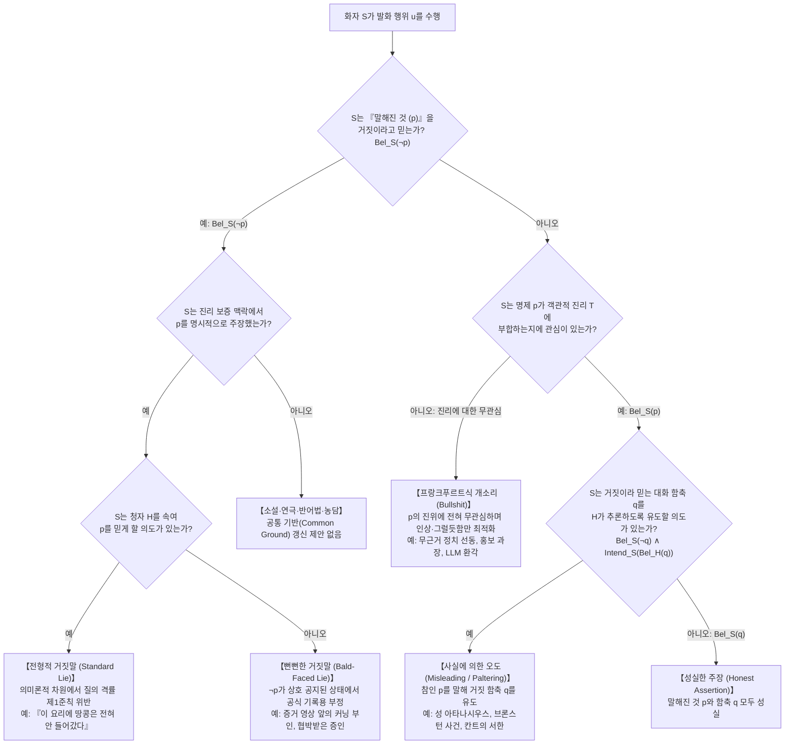
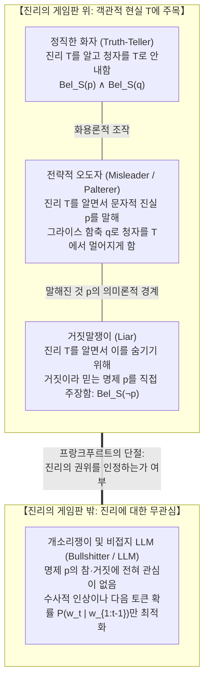

## 1. 서론: 왜 100%의 ‘문자적 사실’로 사람을 속이는 것이 가능한가?

서기 362년, 로마 제국의 황제 배교자 율리아누스(Julian the Apostate)의 박해를 피해 나일강을 거슬러 작은 배를 타고 도망치던 정통파 기독교의 수호자 <strong>알렉산드리아의 성 아타나시우스(Saint Athanasius of Alexandria)</strong>는 황제군의 추격선이 뒤에서 무서운 속도로 다가오는 것을 발견했다. 아타나시우스는 즉시 뱃사공에게 배의 방향을 180도 돌려 추격선을 향해 강을 내려가라고 명령했다.

두 배가 스쳐 지나갈 때, 로마 병사들은 설마 눈앞의 배에 탄 인물이 본인일 줄은 꿈에도 생각지 못하고 큰 소리로 물었다.
“이보게, 반역자 아타나시우스를 보지 못했나? 그자는 어디에 있는가?”
그러자 아타나시우스 본인이 자리에서 일어나 침착한 목소리로 이렇게 대답했다.
<strong>“그는 여기서 멀지 않은 곳에 있소(He is not far from here!)! 서둘러 노를 저으면 곧 따라잡을 수 있을 것이오!”</strong>
병사들은 고맙다고 인사한 뒤 그를 지나쳐 필사적으로 상류를 향해 노를 저어 갔고, 아타나시우스는 무사히 알렉산드리아로 귀환했다.

이 역사적 일화가 언어철학과 윤리학에 던지는 퍼즐은 매우 날카롭다. 아타나시우스가 발화한 “그는 여기서 멀지 않은 곳에 있다”라는 문장은 객관적으로도 주관적으로도 <strong>100% 문자 그대로의 진실(Literal Truth)</strong>이다. 아타나시우스 본인이 바로 그 배 위에 서 있었으므로 자기 자신과의 거리는 0, 즉 ‘멀지 않은 곳’이기 때문이다. 그는 단 한 마디의 거짓 명제도 입에 담지 않았다. 그럼에도 불구하고 그는 병사들이 “아타나시우스가 상류 쪽으로 도망쳤다”고 오인하도록 철저히 의도했고, 완벽하게 상대를 속이는 데(Deceive) 성공했다. 과연 성 아타나시우스는 ‘거짓말(Lie)’을 한 것일까?

### 1.1 미국 연방대법원의 기념비적 판례: 『브론스턴 대 미합중국 사건』(1973년)

이 구분이 결코 중세 신학자들의 말장난에 그치지 않음을 보여주는 것이 1973년 미국 연방대법원의 위증죄 판례 <strong>『브론스턴 대 미합중국 사건(*Bronston v. United States*, 409 U.S. 352)』</strong>이다.

할리우드 영화 제작자 새뮤얼 브론스턴(Samuel Bronston)은 자신의 제작사(`Bronston Productions, Inc.`) 파산 심리에서 선서 하에 채권자 측 변호사로부터 은닉 자산 여부에 관한 신문을 받았다.

> <strong>변호사 (Q)</strong>: “브론스턴 씨, 당신은 스위스 은행에 계좌를 가지고 있습니까?”
> <strong>브론스턴 (A)</strong>: “아니오, 없습니다.”
> <strong>변호사 (Q)</strong>: “지금까지 가지고 있었던 적이 있습니까(Have you ever)?”
> <strong>브론스턴 (A)</strong>: <strong>“회사가 취리히에 약 6개월 동안 계좌를 가지고 있었습니다(The company had an account there for about six months, in Zurich).”</strong>

나중에 밝혀진 사실은 다음과 같다. 증언 당시 브론스턴의 개인 계좌는 이미 해지된 상태였으므로 첫 번째 대답(“아니오”)은 문자 그대로 진실이었다. 또한 그의 회사가 취리히에 6개월간 계좌를 보유했던 것도 문자 그대로 사실이었다. 그러나 실제로는 브론스턴 <strong>개인</strong>이 과거 약 5년 동안 제네바의 스위스 은행에 거액의 개인 비밀 계좌를 보유하며 18만 달러 이상을 입출금했던 것이다!

연방 검찰은 브론스턴이 두 번째 질문(“개인 계좌를 가진 적이 있는가”)에 대해 회사 계좌 이야기를 꺼냄으로써 “개인적으로는 스위스 계좌를 가진 적이 없다”는 허위 인상을 법정에 심어주었다며 위증죄로 기소했고, 1심과 항소심은 유죄를 선고했다. 그러나 워런 버거 대법원장이 이끄는 <strong>연방대법원은 재판관 전원일치(9 대 0)로 위증죄 유죄 판결을 파기 환송(무죄)</strong>했다. 대법원은 “증인이 선서 하에 말한 내용이 <strong>문자 그대로 진실(literally true)</strong>인 한, 비록 질문을 회피하고 청자를 오도하려는 의도(intent to mislead)가 있었더라도 위증죄는 성립하지 않는다. 불완전하고 오도적인 답변을 간파하고 추가 질문으로 진실을 밝혀낼 책임은 질문자인 변호사에게 있다”고 판시했다.

### 1.2 신학적 결의론 전통: 『마음속 유보(Mental Reservation)』와 『다의어법(Equivocation)』

기독교 신학의 역사에서 <strong>성 아우구스티누스(Saint Augustine)</strong>는 『거짓말에 대하여(*De Mendacio*)』에서 어떠한 선의나 생명 구제의 목적이 있더라도 거짓말은 절대적 죄악이라고 단언했고, <strong>토마스 아퀴나스(Thomas Aquinas)</strong> 역시 『신학대전(*Summa Theologiae* II-II, Q. 110)』에서 자신의 생각과 반대되는 발화(*locutio contra mentem*)는 언어의 본성을 파괴하는 악이라고 규정했다.

그러나 16~17세기 잉글랜드에서 가톨릭 사제들이 혹독한 박해와 고문에 직면하자, 예수회 신학자들(나바루스, 프란시스코 수아레스, 헨리 가넷 신부 등)은 거짓말의 죄를 짓지 않으면서 박해자를 피하기 위해 <strong>‘마음속 유보(*Restrictio Mentalis*)’</strong>와 <strong>‘다의어법(*Aequivocatio*)’</strong> 교리를 발전시켰다. 발화된 문장 자체가 공적 언어 안에서 적어도 하나의 참된 해석을 허용할 때(광의의 마음속 유보 및 다의어법), 청자가 스스로 거짓된 해석을 선택해 오해하는 것은 화자의 거짓말이 아니라는 논리였다.

---

## 2. ‘거짓말(Lying)’의 형식적 정의: 신념 논리와 『뻔뻔한 거짓말』

분석철학에서 <strong>거짓말(Lying)</strong>은 단순한 오류(Error)나 비언어적 기만(Deception)과 엄격히 구별된다. 로더릭 치점과 토머스 피한(Chisholm & Feehan 1977)의 고전적 정의를 현대 신념 논리(Doxastic Logic)로 정식화하면 다음과 같다. 화자를 $S$, 청자를 $H$, 명제를 $p$라 하자.

$$\text{Lie}_{\text{trad}}(S, H, p) \iff \underbrace{\text{Says}(S, H, p)}_{\text{1. 언명 조건}} \;\land\; \underbrace{\text{Bel}_S(\neg p)}_{\text{2. 불성실성 조건}} \;\land\; \underbrace{\text{Warrant}(S, H, p)}_{\text{3. 보증 맥락 조건}} \;\land\; \underbrace{\text{Intend}_S\big(\text{Bel}_H(p)\big)}_{\text{4. 기만 의도 조건}}$$

1. <strong>언명 조건($\text{Says}(S, H, p)$)</strong>: 화자 $S$는 명제 $p$를 ‘말해진 것(What is said)’으로서 명시적으로 주장해야 한다. 침묵이나 위장, 의문문 자체는 거짓말이 아니다.
2. <strong>불성실성 조건($\text{Bel}_S(\neg p)$) — 객관적 거짓($\neg p$)이 아니라 주관적 불신념!</strong>:
   수식에 객관적 거짓($\neg p$) 조건이 없다는 점에 주목하라. 고장 난 시계를 보고 진심으로 “지금 3시야”라고 말한 사람은 <strong>정직한 착오(Honest Mistake)</strong>를 범한 것이지 거짓말을 한 것이 아니다. 반대로, 친구 조지가 집에 있다고 굳게 믿으면서($\text{Bel}_S(\neg p)$) 상대를 속이려고 “조지는 지금 도서관에 있어($p$)”라고 말했는데 우연히 조지가 5분 전에 정말 도서관에 가 있었다면($p$가 객관적으로 참), 화자는 객관적 사실을 말했음에도 불구하고 <strong>거짓말을 한 것이다</strong>!
3. <strong>보증 맥락 조건($\text{Warrant}(S, H, p)$)</strong>: 연극 무대에서의 대사, 소설, 명백한 반어법(Irony)은 대화의 <strong>‘공통 기반(Common Ground, Stalnaker 2002)’</strong>에 사실을 등록하려는 보증 맥락이 아니므로 거짓말이 아니다.
4. <strong>『뻔뻔한 거짓말(Bald-Faced Lies)』과 기만 의도 조건의 붕괴</strong>:
   토머스 카슨(Carson 2006), 로이 소렌슨(Sorensen 2007), 돈 팔리스(Fallis 2009)는 상대를 속일 의도가 전혀 없어도 거짓말이 성립함을 증명했다. 예를 들어, CCTV 증거가 완벽해 학장이 자신의 커닝 사실을 100% 알고 있음을 알면서도 단지 ‘자백하지 않으면 즉각 퇴학당하지 않는다’는 학칙 때문에 학장 눈을 보고 <strong>“저는 커닝하지 않았습니다”</strong>라고 말하는 학생이나, 법정 방청석의 마피아 보스의 보복이 두려워 판사와 배심원 모두가 자신이 목격자임을 아는 상태에서도 선서 하에 <strong>“저는 아무것도 보지 못했습니다”</strong>라고 증언하는 목격자는, 아무도 속일 의도가 없지만($\neg \text{Intend}_S(\text{Bel}_H(p))$) 명백히 <strong>거짓말(Lie)</strong>을 하고 있다. 따라서 현대 언어철학의 표준 정의는 다음과 같다.

$$\text{Lie}(S, H, p) \iff \text{Says}(S, H, p) \;\land\; \text{Bel}_S(\neg p) \;\land\; \text{Warrant}(S, H, p)$$

---

## 3. 그라이스의 화용론: 왜 ‘사실’에서 ‘오해’가 자동으로 추론되는가?

성 아타나시우스와 브론스턴은 자신이 참이라고 믿는 명제 $p$($\text{Bel}_S(p)$)를 말했으므로 거짓말을 하지 않았다. 그렇다면 청자는 왜 그들이 말하지 않은 거짓 명제 $q$를 스스로 추론해 속아 넘어간 것일까? 이 메커니즘을 규명한 것이 <strong>H. 폴 그라이스(H. Paul Grice)</strong>의 1967년 윌리엄 제임스 강연 <strong>『논리와 대화(*Logic and Conversation*, 1975)』</strong>이다.

### 3.1 ‘말해진 것(What is Said, $p$)’과 ‘대화 함축(Conversational Implicature, $q$)’

그라이스는 대화가 합리적인 협동 작업이라는 <strong>‘협동의 원리(Cooperative Principle, CP)’</strong> 아래 4가지 대화 격률(Maxims)을 제시했다.

1. <strong>양의 격률(Maxim of Quantity)</strong>: 요구되는 만큼의 정보를 제공하라.
   * <strong>척도 함축(Scalar Implicature — Horn 1972)</strong>: 쿠키 10개를 <strong>모두(All)</strong> 먹어 치운 뒤 “쿠키를 <strong>몇 개(Some)</strong> 먹었어”라고 답하는 경우를 보자. 1차 술어 논리에서 $\forall x \, (\text{Cookie}(x) \to \text{Ate}(S, x))$는 $\exists x \, (\text{Cookie}(x) \land \text{Ate}(S, x))$를 논리적으로 함의하므로, “몇 개 먹었다($p$)”는 의미론적으로 <strong>100% 참</strong>이다. 그러나 청자는 화자가 양의 격률을 지킨다고 가정하므로, 더 강한 표현인 ‘모두(all)’를 쓰지 않은 이유를 추론하여 <strong>“모두 먹은 것은 아니다($q \equiv \neg \forall x$)”</strong>라는 거짓된 대화 함축을 자동으로 도출한다!
2. <strong>질의 격률(Maxim of Quality)</strong>: (i) 거짓이라고 믿는 것을 말하지 말라($\neg \text{Bel}_S(\neg p)$). (ii) 충분한 증거가 없는 것을 말하지 말라.
3. <strong>관계(관련성)의 격률(Maxim of Relation)</strong>: 관련성 있는 말을 하라(Be relevant).
   * 브론스턴이 개인 계좌 질문에 회사 계좌만 언급한 것이나, 그라이스의 유명한 <strong>철학과 교수 추천서 사례</strong>(“X 군은 영어 실력이 뛰어나고 수업 출석이 규칙적입니다”라고만 적어 $q =$ “X 군은 철학 재능이 전혀 없다”를 함축하는 사례)가 바로 이 격률을 이용한 것이다.
4. <strong>양태의 격률(Maxim of Manner)</strong>: 모호성과 중의성(Ambiguity)을 피하고 질서 있게 말하라.

대화 함축 $q$는 의미론적 귀결($p$)과 달리 논리적 모순 없이 <strong>취소 가능(Cancellable)</strong>하다(“쿠키를 몇 개 먹었어—사실은 전부 다 먹었어!”).

### 3.2 베이즈 합리적 화행(RSA) 모델과 『교묘한 오도(Paltering)』의 수리적 구조

프랭크와 굿맨(Frank & Goodman 2012)의 <strong>합리적 화행 모델(RSA Model)</strong>에서 화용론적 청자 $L_1$은 화자 $S_1$의 협동성을 가정하여 베이즈 정리로 세계 상태 $w$를 역추론한다:

$$P_{L_1}(w \mid u) = \frac{P_{S_1}(u \mid w) \cdot P(w)}{\sum_{w' \in W} P_{S_1}(u \mid w') \cdot P(w')}, \quad P_{S_1}(u \mid w) \propto \exp\Big(\alpha \big(\ln P_{L_0}(w \mid u) - C(u)\big)\Big)$$

하버드 협상학자 로저스와 제크하우저(Rogers, Zeckhauser et al. 2017)가 <strong>‘교묘한 오도(Paltering)’</strong>라 명명한 전략적 오도 화자 $S_{\text{mislead}}$는 실제 세계 $w^*$에서 <strong>문자 그대로 참인 발화($\llbracket u \rrbracket(w^*) = 1$)라는 제약 조건</strong>을 지키면서, 청자 $L_1$의 사후 확률이 거짓 상태 $w_{\text{false}} \neq w^*$에서 극대화되도록 발화 $u^*$를 선택한다:

$$u^* = \underset{u \in U \,:\, \llbracket u \rrbracket(w^*) = 1}{\arg\max} \; P_{L_1}(w_{\text{false}} \mid u)$$

---

## 4. 도덕·윤리학 논쟁: 사실에 의한 오도는 거짓말보다 도덕적으로 우월한가?

### 4.1 칸트의 절대적 엄격주의와 프리드리히 빌헬름 2세에 대한 전략적 오도

<strong>임마누엘 칸트(Immanuel Kant)</strong>는 1797년 논문 『인간애에서 거짓말할 소위 권리에 대하여』에서 <strong>‘문 앞의 살인자(Murderer at the Door)’</strong> 사례를 다루며, 친구의 목숨을 구하기 위해서라도 명시적 거짓 진술(*Aussage*)을 하는 것은 인간성의 존엄과 모든 법적·언어적 계약의 기반을 파괴하는 무조건적 악이라고 주장했다.

그러나 놀랍게도 <strong>칸트 자신이 현실에서는 문자적 진실을 이용한 전략적 오도(Misleading)를 실천했다!</strong>
1794년 프로이센 국왕 <strong>프리드리히 빌헬름 2세</strong>가 칸트의 종교 저술을 문제 삼아 향후 종교에 관한 일체의 공적 강연과 저술을 금하라는 서약을 요구했을 때, 칸트는 다음과 같이 답신을 썼다.

> “<strong>폐하의 가장 충실한 신하로서(Als Ew. Königl. Majestät getreuester Untertan)</strong>, 저는 향후 자연종교든 계시종교든 종교에 관한 모든 공적 강의와 저술을 완전히 삼갈 것을 선언합니다.”

3년 뒤인 1797년 국왕이 사망하자, 칸트는 즉시 1798년 『학부들의 투쟁』을 출간하며 종교 논쟁을 재개했고, 서문 각주에서 자신이 당시에 거짓말을 하지 않으면서도 <strong>‘현재의 국왕 폐하가 살아 계신 동안에만’</strong> 서약이 유효하도록 “폐하의 가장 충실한 신하로서”라는 어구를 치밀하게 선택했다고 밝혔다! 국왕은 당연히 칸트가 평생 침묵할 것($q$)으로 추론했지만, 칸트가 문자 그대로 언명한 명제($p$)는 참이었던 것이다.

### 4.2 현대 윤리학의 대립: 비대칭설(Preferentialism) 대 제니퍼 솔의 비판

버나드 윌리엄스(Williams 2002)와 시나 시프린(Shiffrin 2014) 같은 <strong>비대칭설</strong> 옹호자들은 오도의 경우 청자 자신의 추론 책임(*caveat auditor*)이 일부 개입하며 언어의 의미론적 신뢰 기반을 직접 파괴하지 않는다고 본다.
반면 <strong>제니퍼 솔(Jennifer Saul, *Lying, Misleading, and What is Said*, 2012)</strong>은 의미론과 화용론의 경계가 도덕적 무게를 견딜 수 없음을 증명하고, <strong>‘치명적 땅콩 알레르기 살인 사례’</strong>(땅콩이 든 카레를 주며 “땅콩이 안 들어갔다”고 거짓말하는 것과 “해바라기유와 향신료로 만들었다”고 사실만 말해 상대를 죽게 하는 것)를 통해 악의적 기만에서 오도는 거짓말보다 결코 도덕적으로 우월하지 않으며 오히려 자기기만적 위선(Moral Hypocrisy)일 수 있음을 폭로했다.

---

## 5. 해리 프랑크푸르트의 『개소리에 대하여(On Bullshit)』와 AI 환각

프린스턴 대학교의 철학자 <strong>해리 프랑크푸르트(Harry G. Frankfurt, 1929–2023)</strong>는 『개소리에 대하여(*On Bullshit*, 1986/2005)』에서 <strong>거짓말쟁이(Liar)</strong>와 <strong>개소리쟁이(Bullshitter)</strong>의 결정적 차이를 규명했다.

* <strong>정직한 사람</strong>과 <strong>거짓말쟁이</strong>는 모두 <strong>진리($T$)의 권위와 사실이 무엇인지에 깊은 관심</strong>을 가진다. 거짓말쟁이도 무엇이 진실인지 알아야만($\text{Bel}_S(\neg p)$) 청자를 진실로부터 멀어지게 할 수 있기 때문이다.
* 반면 <strong>개소리쟁이(Bullshitter)</strong>는 <strong>자신이 하는 말이 참인지 거짓인지에 대해 아예 아무런 관심이 없다($\neg \text{Care}_S(p \leftrightarrow T)$)</strong>. 그의 유일한 목적은 인상 조작과 설득뿐이다. 따라서 프랑크푸르트는 <strong>“개소리(Bullshit)는 거짓말보다 훨씬 더 위험한 진리의 최대의 적이다”</strong>라고 선언했다.

2024년 힉스 등(Hicks, Humphries, & Slater 2024)이 논문 <strong>*"ChatGPT is Bullshit"</strong>*에서 밝혔듯, 대규모 언어 모델(LLM)이 다음 토큰의 조건부 확률 $P_\theta(w_t \mid w_{1:t-1}) = \text{softmax}(z_\theta / \tau)$만을 최적화하여 그럴듯한 허구를 생성하는 현상(소위 ‘AI 환각’)은 철학적으로 볼 때 명제적 진리 조건에 구조적으로 무관심한 <strong>순수한 프랑크푸르트식 개소리(Bullshit)</strong>의 수학적 구현이다.

---

## 6. 종합 비교: 발화 행위의 인식론적·화용론적·윤리적 분류표

| 발화 범주 | 말해진 것($p$)의 객관적 진위 | 화자의 신념 상태($\text{Bel}_S$) | 대화 함축($q$) 및 의도 | 그라이스 격률과의 관계 | 대표적 사례 |
| :--- | :--- | :--- | :--- | :--- | :--- |
| <strong>1. 성실한 주장</strong> *(Honest Assertion)* | 참 (또는 우연히 거짓) | $\text{Bel}_S(p) \land \text{Bel}_S(q)$ | 참이라 믿는 함축만 전달 | 4대 격률을 성실히 준수 | 정직한 증언 및 과학 보고 |
| <strong>2. 정직한 착오</strong> *(Honest Mistake)* | 거짓 ($\neg p$) | $\text{Bel}_S(p)$ (참으로 오인) | 기만 의도 없음 | 주관적으로 질의 격률 준수 | 멈춘 시계를 보고 잘못된 시각 전달 |
| <strong>3. 전형적 거짓말</strong> *(Standard Lie)* | 통상 거짓 (우연히 참이어도 성립) | <strong>$\text{Bel}_S(\neg p)$</strong> | $\text{Intend}_S(\text{Bel}_H(p))$ | 의미론 차원에서 <strong>질의 격률 제1준칙</strong> 직접 위반 | 알리바이 날조, “땅콩이 없다”고 속임 |
| <strong>4. 뻔뻔한 거짓말</strong> *(Bald-Faced Lie)* | 거짓 ($\neg p$가 상호 공지) | <strong>$\text{Bel}_S(\neg p)$</strong> | 기만 의도 없음 (공식 기록용) | 보증 맥락에서 질의 격률을 공공연히 위반 | 증거 영상 앞의 커닝 부인, 협박하의 법정 증언 |
| <strong>5. 사실에 의한 오도</strong> *(Truthful Misleading / Paltering)* | <strong>참 ($p$)</strong> | <strong>$\text{Bel}_S(p)$</strong> 이나 <strong>$\text{Bel}_S(\neg q)$</strong> | 참인 $p$로 거짓 함축 $q$ 유도 | 질의 격률은 표면상 준수하며 <strong>양·관계·양태 격률</strong> 악용 | 성 아타나시우스, 브론스턴 판결, 칸트의 서한 |
| <strong>6. 프랑크푸르트식 개소리</strong> *(Frankfurtian Bullshit)* | 진위 불문 (우연히 참/거짓) | <strong>진위에 무관심</strong> ($\neg \text{Care}_S(p \leftrightarrow T)$) | 오직 <strong>인상 조작·설득·통계적 그럴듯함</strong>만 추구 | <strong>질의 격률 상위 원리 및 근거 요구</strong>를 근본부터 포기 | 무근거 정치 선동, 과장 광고, LLM 환각 |

