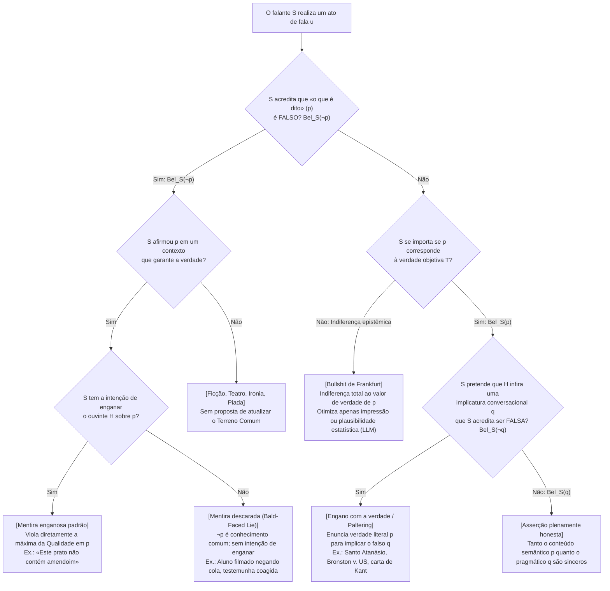
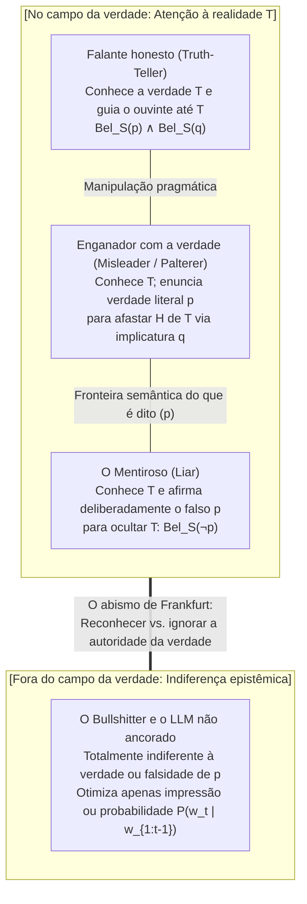

## 1. Introdução: O paradoxo de enganar com 100% da verdade literal

No ano 362 d.C., fugindo da perseguição do imperador romano Juliano, o Apóstata, <strong>santo Atanásio de Alexandria</strong> subia o rio Nilo num pequeno barco. Ao perceber que a galé imperial se aproximava rapidamente, Atanásio ordenou ao timoneiro que desse meia-volta de 180 graus e remasse diretamente na direção de seus perseguidores.

Quando as duas embarcações se cruzaram, os soldados romanos — sem jamais suspeitar que sua presa remava em direção a eles — gritaram sobre a água:
*«Vocês viram o traidor Atanásio? Onde ele está?»*
O próprio Atanásio levantou-se no barco e respondeu com voz calma:
<strong>«Ele não está longe daqui (He is not far from here!)! Remem rápido e vocês o alcançarão!»</strong>
Os soldados agradeceram e remaram furiosamente rio acima, enquanto Atanásio retornava em segurança para Alexandria.

Essa célebre anedota patrística coloca um enigma filosófico afiado. A frase proferida por Atanásio (*«Ele não está longe daqui»*) era <strong>100% verdadeira em sentido literal e objetivo</strong>: como o próprio Atanásio estava naquele barco, sua distância em relação a si mesmo era zero. Ele não pronunciou nenhuma proposição falsa. Contudo, falou com a intenção explícita de levar os soldados a formar a crença falsa de que Atanásio fugia mais adiante rio acima, enganando-os perfeitamente. Santo Atanásio mentiu?

### 1.1 O marco da Suprema Corte dos EUA sobre perjúrio: *Bronston v. United States* (1973)

Que essa distinção vai muito além de um jogo escolástico fica evidente na histórica decisão unânime da Suprema Corte dos Estados Unidos sobre perjúrio em <strong>*Bronston v. United States* (409 U.S. 352, 1973)</strong>.

O produtor de cinema Samuel Bronston foi interrogado sob juramento em uma audiência federal de falência:

> <strong>Advogado (P):</strong> *«O senhor tem contas bancárias em bancos suíços, Sr. Bronston?»*
> <strong>Bronston (R):</strong> *«Não, senhor.»*
> <strong>Advogado (P):</strong> *«Já teve alguma vez (Have you ever)?»*
> <strong>Bronston (R):</strong> <strong>*«A empresa teve uma conta lá por cerca de seis meses, em Zurique.»</strong>*

Na realidade, a conta pessoal de Bronston já estava encerrada no dia do depoimento (tornando seu primeiro *«Não»* literalmente verdadeiro), e sua empresa de fato tivera uma conta em Zurique por seis meses. Mas Bronston ocultou que ele <strong>pessoalmente</strong> mantivera uma conta bancária privada em Genebra durante cinco anos, movimentando mais de 180 mil dólares!

Condenado por perjúrio nas instâncias inferiores, <strong>Bronston teve sua condenação revertida por unanimidade (9–0) pela Suprema Corte dos EUA</strong>. O Chief Justice Warren Burger decidiu que a lei federal de perjúrio não pune a testemunha que diz a <strong>verdade literal</strong>, mesmo que sua resposta seja evasiva e calculada para induzir o interrogador ao erro (*intent to mislead*). Cabe à perspicácia do advogado interrogador (*caveat auditor*) detectar a evasão e fazer perguntas complementares.

### 1.2 A casuística teológica: Reserva mental (*Restrictio Mentalis*) e equívoco (*Aequivocatio*)

Na teologia moral cristã, <strong>santo Agostinho</strong> (*De Mendacio*, 395; *Contra Mendacium*, 420) e <strong>são Tomás de Aquino</strong> (*Summa Theologiae* II-II, q. 110) condenaram toda mentira (*locutio contra mentem*) como intrinsecamente pecaminosa. Nos séculos XVI e XVII, porém, diante da tortura e execução de padres católicos na Inglaterra elisabetana, teólogos jesuítas como <strong>Martín de Azpilcueta (Doctor Navarrus)</strong>, <strong>Francisco Suárez</strong> e <strong>Henry Garnet</strong> desenvolveram a doutrina da <strong>reserva mental (*Restrictio Mentalis*)</strong> e do <strong>equívoco (*Aequivocatio*)</strong>: enquanto a reserva estritamente mental foi condenada pelo papa Inocêncio XI em 1679, a reserva mental ampla e o equívoco — nos quais o enunciado possui uma interpretação literalmente verdadeira na língua pública, deixando que o ouvinte infira por conta própria a leitura falsa — foram considerados isentos de mentira.

---

## 2. A definição formal de mentira: Lógica doxástica e «mentiras descaradas» (Bald-Faced Lies)

Na filosofia analítica da linguagem (Chisholm & Feehan 1977; Carson 2010; Saul 2012; Stokke 2018), o ato de <strong>mentir (lying)</strong> é formalizado na <strong>lógica doxástica</strong> (lógica da crença). Sejam $S$ o falante, $H$ o ouvinte e $p$ uma proposição.

A definição decepcionista clássica ($\text{Lie}_{\text{trad}}$) exige quatro condições:

$$\text{Lie}_{\text{trad}}(S, H, p) \iff \underbrace{\text{Says}(S, H, p)}_{\text{1. Enunciação}} \;\land\; \underbrace{\text{Bel}_S(\neg p)}_{\text{2. Insinceridade}} \;\land\; \underbrace{\text{Warrant}(S, H, p)}_{\text{3. Contexto de garantia}} \;\land\; \underbrace{\text{Intend}_S\big(\text{Bel}_H(p)\big)}_{\text{4. Intenção de enganar}}$$

1. <strong>Condição de enunciação ($\text{Says}(S, H, p)$)</strong>: $S$ deve afirmar explicitamente $p$ como *o que é dito (what is said)*. O silêncio, o disfarce não verbal ou perguntas gramaticais não são mentiras.
2. <strong>Condição de insinceridade ($\text{Bel}_S(\neg p)$) — Crença subjetiva versus falsidade objetiva</strong>:
   Observe que $\neg p$ (a falsidade objetiva de $p$) <strong>não aparece na fórmula</strong>! Se Alice olha para um relógio parado e diz sinceramente *«São três horas»* quando são quatro, ela comete um <strong>erro honesto (honest mistake)</strong>, mas não mente. Por outro lado, se Alice acredita firmemente que Jorge está em casa ($\text{Bel}_S(\neg p)$) e diz a Bob *«Jorge está na biblioteca»* ($p$) para enganá-lo, mas por puro acaso Jorge acabou de chegar à biblioteca cinco minutos antes ($p$ é objetivamente verdadeira), <strong>Alice mentiu dizendo uma verdade objetiva!</strong>
3. <strong>Condição de garantia e terreno comum ($\text{Warrant}(S, H, p)$)</strong>: No teatro, na ficção ou na ironia evidente, o falante não propõe adicionar $p$ ao <strong>terreno comum (Common Ground, Stalnaker 2002)</strong> da conversa.
4. <strong>A revolução das «mentiras descaradas» (Bald-Faced Lies — Carson 2006; Sorensen 2007; Fallis 2009)</strong>:
   Um estudante flagrado em vídeo colando na prova que diz ao reitor *«Eu não colei»* apenas para evitar uma confissão formal no processo, ou uma testemunha intimidada por um chefe da máfia que declara sob juramento *«Não vi nada»* quando todo o tribunal sabe que ela presenciou o crime, <strong>não tem intenção de enganar ninguém</strong> ($\neg \text{Intend}_S(\text{Bel}_H(p))$), mas indiscutivelmente <strong>mente</strong>! Assim, a «Nova Ortodoxia» define a mentira sem a intenção de enganar:

$$\text{Lie}(S, H, p) \iff \text{Says}(S, H, p) \;\land\; \text{Bel}_S(\neg p) \;\land\; \text{Warrant}(S, H, p)$$

---

## 3. A pragmática de H. Paul Grice: O motor das verdades enganosas

Por que nem santo Atanásio nem Bronston mentiram, embora tenham enganado com sucesso? Porque acreditavam ser verdadeira a proposição literal $p$ que enunciaram ($\text{Bel}_S(p)$), enquanto a falsidade foi gerada como <strong>implicatura conversacional ($q$)</strong> segundo a teoria formulada por <strong>H. Paul Grice (1975)</strong> em *Logic and Conversation*.

### 3.1 O Princípio de Cooperação e as quatro máximas conversacionais

Segundo Grice, os ouvintes presumem racionalmente que o falante segue o <strong>Princípio de Cooperação (Cooperative Principle)</strong> e quatro máximas de inspiração kantiana:

1. <strong>Máxima da Quantidade (Maxim of Quantity)</strong>: Faça sua contribuição tão informativa quanto requerido.
   * <strong>Implicaturas escalares (Horn 1972; Levinson 2000)</strong>: Se você comeu <strong>todos</strong> os 10 biscoitos ($\forall x \, (\text{Biscoito}(x) \to \text{Comeu}(S, x))$) mas diz *«Comi <strong>alguns (some)</strong> biscoitos»* ($p \equiv \exists x \, (\text{Biscoito}(x) \land \text{Comeu}(S, x))$), seu enunciado $p$ é <strong>100% verdadeiro na lógica de primeira ordem</strong> (pois $\forall x \models \exists x$). Mas na escala de Horn $\langle \text{todos}, \text{a maioria}, \text{alguns} \rangle$, o ouvinte deduz pela máxima da Quantidade a implicatura falsa $q \equiv \neg \forall x$ (*«S não comeu todos os biscoitos»*).
2. <strong>Máxima da Qualidade (Maxim of Quality)</strong>: Não diga o que acredita ser falso ($\neg \text{Bel}_S(\neg p)$) nem aquilo para o qual lhe faltam provas adequadas.
3. <strong>Máxima da Relação / Relevância (Maxim of Relation)</strong>: Seja relevante (*Be relevant*).
   * No famoso exemplo de Grice da <strong>carta de recomendação para uma vaga de filosofia</strong>, um professor escreve apenas: *«O Sr. X tem excelente domínio do inglês e frequentou regularmente as tutorias.»* Ao violar ostensivamente (*flouting*) a Quantidade e a Relevância para não violar a Qualidade, ele implica $q =$ *«O Sr. X é péssimo em filosofia»*.
4. <strong>Máxima do Modo / Maneira (Maxim of Manner)</strong>: Evite obscuridade e ambiguidade; seja ordenado.

O teste diagnóstico que separa a implicatura $q$ do que é dito $p$ é sua <strong>cancelabilidade (Cancellability)</strong> sem contradição lógica (*«Comi alguns biscoitos; na verdade, comi todos!»*).

### 3.2 Pragmática bayesiana (modelo RSA) e «Paltering»

No modelo <strong>Rational Speech Act (RSA)</strong> (Frank & Goodman 2012), o ouvinte pragmático $L_1$ inverte o modelo do falante cooperativo $S_1$ via teorema de Bayes:

$$P_{L_1}(w \mid u) = \frac{P_{S_1}(u \mid w) \cdot P(w)}{\sum_{w' \in W} P_{S_1}(u \mid w') \cdot P(w')}, \quad P_{S_1}(u \mid w) \propto \exp\Big(\alpha \big(\ln P_{L_0}(w \mid u) - C(u)\big)\Big)$$

O <strong>engano pela verdade (Truthful Misleading / Paltering, Rogers et al. 2017)</strong> consiste em escolher no mundo real $w^*$ um enunciado literalmente verdadeiro $u^*$ ($\llbracket u^* \rrbracket(w^*) = 1$) que maximiza a probabilidade a posteriori $P_{L_1}(w_{\text{false}} \mid u^*)$ de um estado falso $w_{\text{false}} \neq w^*$:

$$\text{Mislead}_{\text{truthful}}(S, H, p, q) \iff \text{Says}(S, H, p) \;\land\; \text{Bel}_S(p) \;\land\; \text{Implicates}(S, H, p, q) \;\land\; \text{Bel}_S(\neg q) \;\land\; \text{Intend}_S\big(\text{Bel}_H(q)\big)$$

---

## 4. O debate ético: O rigorismo de Kant, seu próprio estratagema e a crítica de Jennifer Saul

### 4.1 O «assassino à porta» de Kant versus sua promessa ao rei Frederico Guilherme II

Em seu famoso ensaio de 1797 <strong>*Sobre um suposto direito de mentir por filantropia</strong>*, <strong>Immanuel Kant</strong> sustentou que, mesmo que um assassino bata à sua porta perguntando pelo seu amigo inocente escondido lá dentro, fazer uma declaração falsa (*Aussage* / *mendacium*) é absolutamente proibido, pois destrói a base formal de todo contrato e a dignidade racional.

Contudo, <strong>o próprio Kant praticou magistralmente o engano estratégico pela verdade literal!</strong> Em 1794, repreendido pelo rei da Prússia <strong>Frederico Guilherme II</strong> por seus escritos sobre religião, Kant redigiu sua promessa de silêncio nestes termos:

> *«<strong>Como o súdito mais fiel de Vossa Majestade Real</strong> [Als Ew. Königl. Majestät getreuester Untertan], declaro solenemente que doravante me absterei completamente de todas as palestras e escritos públicos relativos à religião...»*

Assim que Frederico Guilherme II morreu, em novembro de 1797, Kant publicou *O conflito das faculdades* (1798) e explicou com orgulho em nota de rodapé que escolhera a expressão *«súdito de Vossa Majestade»* para ficar vinculado <strong>apenas enquanto aquele monarca específico estivesse vivo</strong>, induzindo o rei a inferir uma promessa vitalícia ($q$) sem jamais proferir uma mentira formal ($p$)!

### 4.2 Assimetrismo (Williams, Shiffrin) versus a crítica de Jennifer Saul (2012)

Enquanto <strong>Bernard Williams (2002)</strong> e <strong>Seana Shiffrin (2014)</strong> argumentam que induzir ao erro com a verdade é moralmente menos grave do que mentir porque o ouvinte compartilha responsabilidade epistêmica na inferência $p \to q$, <strong>Jennifer Saul</strong> demonstra em <strong>*Lying, Misleading, and What is Said* (2012)</strong> — por meio do caso do <strong>assassinato por alergia a amendoim</strong> (dizer a verdade *«Este prato é feito com óleo de girassol e especiarias»* em vez de mentir *«Não contém amendoim»* para matar um convidado alérgico) — que o engano calculado por verdades literais não é moralmente superior à mentira e frequentemente encobre pura hipocrisia moral.

---

## 5. *On Bullshit* (1986/2005) de Harry G. Frankfurt e as alucinações da IA

Em seu ensaio clássico <strong>*On Bullshit* (1986/2005)</strong>, <strong>Harry G. Frankfurt</strong> estabeleceu a distinção fundamental entre o <strong>mentiroso (liar)</strong> e o <strong>embusteiro (bullshitter)</strong>:
* Tanto a <strong>pessoa honesta</strong> quanto o <strong>mentiroso</strong> jogam no campo da verdade $T$: para mentir ($\text{Bel}_S(\neg p)$), o mentiroso precisa conhecer a verdade a fim de ocultá-la.
* O <strong>bullshitter</strong>, ao contrário, <strong>é completamente indiferente a se o que diz é verdadeiro ou falso</strong> ($\neg \text{Care}_S(p \leftrightarrow T)$). Ele busca apenas causar impressão ou persuadir. Por isso Frankfurt conclui: <strong>*«O bullshit é um inimigo da verdade maior do que as mentiras.»</strong>*

Como demonstraram <strong>Hicks, Humphries e Slater (2024)</strong> em <strong>*"ChatGPT is Bullshit"</strong>*, as chamadas «alucinações» dos grandes modelos de linguagem (LLMs), que otimizam exclusivamente a probabilidade condicional do próximo token $P_\theta(w_t \mid w_{1:t-1}) = \text{softmax}(z_\theta / \tau)$ buscando plausibilidade estatística sem crença ancorada na realidade $\text{Bel}_{\text{LLM}}(p)$, são <strong>bullshit frankfurtiano puro</strong> em sentido matemático.

---

## 6. Síntese: Taxonomia epistêmica, pragmática e ética

| Categoria de ato de fala | Verdade objetiva do *que é dito* ($p$) | Estado doxástico ($\text{Bel}_S$) | Implicatura ($q$) e Intenção | Relação com as máximas de Grice | Exemplos paradigmáticos |
| :--- | :--- | :--- | :--- | :--- | :--- |
| <strong>1. Asserção honesta</strong> | Verdadeiro (ou falso por acidente) | $\text{Bel}_S(p) \land \text{Bel}_S(q)$ | Pretende transmitir apenas $q$ verdadeiro | Cumpre cooperativamente as 4 máximas | Testemunho sincero, relatório científico |
| <strong>2. Erro honesto</strong> | Falso ($\neg p$) | $\text{Bel}_S(p)$ (crença errônea) | Sem intenção de enganar | Cumpre subjetivamente a Qualidade | Olhar a hora em um relógio parado |
| <strong>3. Mentira padrão</strong> | Geralmente falso (pode ser verdadeiro por acaso) | <strong>$\text{Bel}_S(\neg p)$</strong> | Intenção de enganar: $\text{Intend}_S(\text{Bel}_H(p))$ | Viola diretamente a <strong>máxima da Qualidade (1)</strong> em $p$ | Álibi falso; *«Não contém amendoim»* |
| <strong>4. Mentira descarada</strong> *(Bald-Faced Lie)* | Falso ($\neg p$ é conhecimento comum) | <strong>$\text{Bel}_S(\neg p)$</strong> | <strong>Sem intenção de enganar</strong> (para registro oficial) | Violação aberta da Qualidade em contexto de garantia | Aluno filmado negando cola; testemunha coagida |
| <strong>5. Engano com a verdade</strong> *(Misleading / Paltering)* | <strong>Verdadeiro ($p$)</strong> | <strong>$\text{Bel}_S(p)$</strong>, mas <strong>$\text{Bel}_S(\neg q)$</strong> | Usa o verdadeiro $p$ para induzir o falso $q$ | Cumpre Qualidade em $p$, explora <strong>Quantidade, Relevância, Modo</strong> | Santo Atanásio; *Bronston v. US*; carta de Kant ao rei |
| <strong>6. Bullshit de Frankfurt</strong> | Verdadeiro ou falso (incidental) | <strong>Indiferente à verdade</strong> | Busca apenas <strong>impressão, persuasão ou plausibilidade</strong> | Abandona totalmente a <strong>Qualidade e a exigência de provas</strong> | Demagogia política; spin de RP; alucinações de LLMs |

