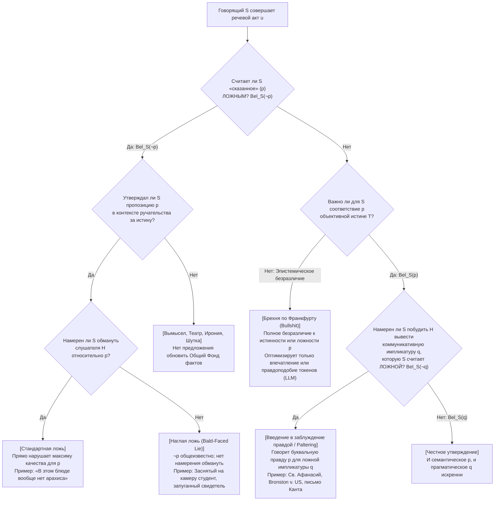
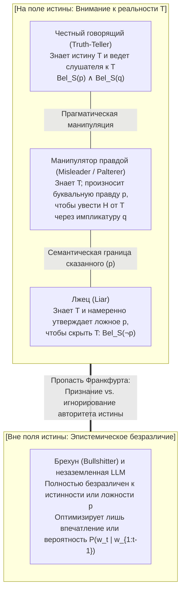

## 1. Введение: парадокс обмана с помощью 100%-ной буквальной правды

В 362 году н. э., спасаясь от преследований римского императора Юлиана Отступника, архиепископ <strong>Афанасий Великий (святитель Афанасий Александрийский)</strong> плыл вверх по Нилу в небольшой лодке. Заметив, что императорская галера стремительно настигает его, Афанасий приказал кормчему развернуть лодку на 180 градусов и грести прямо навстречу преследователям.

Когда суда поравнялись, римские солдаты — не подозревая, что их цель плывет прямо на них — крикнули через борт:
*«Вы не видели предателя Афанасия? Где он?»*
Сам Афанасий встал в лодке и спокойным голосом ответил:
<strong>«Он недалеко отсюда (He is not far from here!)! Гребите быстрее, и вы догоните его!»</strong>
Солдаты поблагодарили незнакомца и изо всех сил погребли дальше вверх по реке, а Афанасий благополучно вернулся в Александрию.

Этот знаменитый святоотеческий эпизод ставит перед философией языка и этикой острейшую загадку. Высказывание Афанасия (*«Он недалеко отсюда»*) было <strong>на 100% буквально и объективно истинным</strong>: поскольку сам Афанасий находился прямо в этой лодке, расстояние от него до него самого равнялось нулю. Он не произнес ни одного ложного суждения. И все же он говорил с явным намерением внушить солдатам ложное убеждение, будто Афанасий бежит дальше вверх по течению, и блестяще обманул их. Солгал ли святитель Афанасий?

### 1.1 Исторический прецедент Верховного суда США о лжесвидетельстве: *Bronston v. United States* (1973)

То, что это различие — отнюдь не схоластическая игра слов, доказывает знаменитое решение Верховного суда США по делу о лжесвидетельстве <strong>*Bronston v. United States* (409 U.S. 352, 1973)</strong>.

Голливудский кинопродюсер Сэмюэл Бронстон давал показания под присягой в федеральном суде по делам о банкротстве:

> <strong>Адвокат кредиторов (В):</strong> *«Есть ли у вас банковские счета в швейцарских банках, мистер Бронстон?»*
> <strong>Бронстон (О):</strong> *«Нет, сэр.»*
> <strong>Адвокат (В):</strong> *«А были ли когда-нибудь (Have you ever)?»*
> <strong>Бронстон (О):</strong> <strong>*«У компании был счет там около шести месяцев, в Цюрихе.»</strong>*

Как выяснилось позже, личный счет Бронстона к моменту допроса уже был закрыт (поэтому его первый ответ *«Нет»* был буквально правдив), а у его компании действительно в течение шести месяцев имелся счет в Цюрихе. Однако Бронстон скрыл, что он <strong>лично</strong> на протяжении пяти лет владел частным счетом в банке Женевы, через который прошло более 180 000 долларов!

Суды первой и апелляционной инстанций признали Бронстона виновным в лжесвидетельстве, однако <strong>Верховный суд США единогласно (9–0) отменил приговор</strong>. Председатель Верховного суда Уоррен Бергер постановил, что федеральный закон о лжесвидетельстве не карает свидетеля, говорящего <strong>буквальную правду (literal truth)</strong>, даже если ответ уклончив и рассчитан на введение спрашивающего в заблуждение (*intent to mislead*). Обязанность распознать уловку и задать уточняющие вопросы лежит на самом юристе (*caveat auditor*).

### 1.2 Богословская казуистика: мысленная оговорка (*Restrictio Mentalis*) и эквивокация (*Aequivocatio*)

В христианской моральной теологии <strong>блаженный Августин</strong> (*De Mendacio*, 395; *Contra Mendacium*, 420) и <strong>Фома Аквинский</strong> (*Summa Theologiae* II-II, q. 110) осуждали всякую ложь (*locutio contra mentem*) как безусловный грех. Однако в XVI–XVII веках, когда католическим священникам в Англии грозили пытки и казнь, иезуитские богословы (<strong>Мартин де Аспилькуэта [Доктор Наваррус]</strong>, <strong>Франсиско Суарес</strong>, <strong>Генри Гарнет</strong>) разработали учение о <strong>мысленной оговорке (*Restrictio Mentalis*)</strong> и <strong>двусмысленности / эквивокации (*Aequivocatio*)</strong>: если чисто мысленная оговорка была осуждена папой Иннокентием XI в 1679 году как скрытая ложь, то широкая мысленная оговорка и эквивокация — когда произнесенная фраза имеет истинное буквальное прочтение в общедоступном языке, а слушатель сам выбирает ложную интерпретацию — признавались допустимой защитой без греха лжи.

---

## 2. Формальное определение лжи: доксастическая логика и «наглая ложь» (Bald-Faced Lies)

В аналитической философии языка (Chisholm & Feehan 1977; Carson 2010; Saul 2012; Stokke 2018) <strong>ложь (lying)</strong> строго формализуется средствами <strong>доксастической логики</strong> (логики убеждений). Пусть $S$ — говорящий, $H$ — слушающий, а $p$ — пропозиция.

Классическое децепционистское определение ($\text{Lie}_{\text{trad}}$) включает четыре условия:

$$\text{Lie}_{\text{trad}}(S, H, p) \iff \underbrace{\text{Says}(S, H, p)}_{\text{1. Условие высказывания}} \;\land\; \underbrace{\text{Bel}_S(\neg p)}_{\text{2. Неискренность}} \;\land\; \underbrace{\text{Warrant}(S, H, p)}_{\text{3. Контекст ручательства}} \;\land\; \underbrace{\text{Intend}_S\big(\text{Bel}_H(p)\big)}_{\text{4. Намерение обмануть}}$$

1. <strong>Условие высказывания ($\text{Says}(S, H, p)$)</strong>: $S$ должен явно утверждать $p$ как *сказанное (what is said)*. Молчание, невербальная маскировка или грамматический вопрос сами по себе ложью не являются.
2. <strong>Условие неискренности ($\text{Bel}_S(\neg p)$) — субъективное убеждение важнее объективной ложности</strong>:
   Обратите внимание: в формуле <strong>нет условия объективной ложности $\neg p$</strong>! Если Алиса смотрит на остановившиеся часы и искренне говорит *«Сейчас три часа»*, когда на самом деле четыре, она совершает <strong>честную ошибку (honest mistake)</strong>, но не лжет. Напротив, если Алиса уверена, что Джордж сидит дома ($\text{Bel}_S(\neg p)$), и говорит Бобу *«Джордж сейчас в библиотеке»* ($p$), чтобы запутать его, но по чистой случайности Джордж пять минут назад действительно пришел в библиотеку ($p$ объективно истинно), <strong>Алиса все равно солгала, высказав объективную правду!</strong>
3. <strong>Условие ручательства и общего фонда ($\text{Warrant}(S, H, p)$)</strong>: Актер на сцене, автор романа или говорящий с явной иронией не предлагают внести $p$ в <strong>общий фонд (Common Ground, Stalnaker 2002)</strong> диалога.
4. <strong>Революция «наглой лжи» (Bald-Faced Lies — Carson 2006; Sorensen 2007; Fallis 2009)</strong>:
   Студент, пойманный деканом на списывании под запись видеокамеры, который говорит *«Я не списывал»* исключительно ради того, чтобы в протоколе не было формального признания; или запуганный мафией свидетель в суде, заявляющий под присягой *«Я ничего не видел»*, когда весь зал суда знает, что он видел убийство, <strong>не имеют ни малейшего намерения кого-либо обмануть</strong> ($\neg \text{Intend}_S(\text{Bel}_H(p))$), но они, безусловно, <strong>лгут</strong>! Поэтому современная «Новая ортодоксия» определяет ложь без условия намерения обмануть:

$$\text{Lie}(S, H, p) \iff \text{Says}(S, H, p) \;\land\; \text{Bel}_S(\neg p) \;\land\; \text{Warrant}(S, H, p)$$

---

## 3. Прагматика Г. П. Грайса: механизм вводящей в заблуждение правды

Почему ни святитель Афанасий, ни Бронстон не солгали, хотя успешно обманули собеседников? Потому что они верили в истинность буквально сказанной пропозиции $p$ ($\text{Bel}_S(p)$), а ложный вывод порождался как <strong>коммуникативная импликатура ($q$)</strong> согласно теории <strong>Г. П. Грайса (H. Paul Grice, 1975)</strong> в работе *«Логика и речевое общение» (Logic and Conversation)*.

### 3.1 Принцип кооперации и четыре максимы общения

По Грайсу, участники диалога рационально полагают, что собеседник соблюдает <strong>Принцип кооперации (Cooperative Principle)</strong> и четыре кантианские максимы:

1. <strong>Максима количества (Maxim of Quantity)</strong>: Твое высказывание должно содержать не меньше (и не больше) информации, чем требуется.
   * <strong>Скалярные импликатуры (Horn 1972; Levinson 2000)</strong>: Если вы съели <strong>все</strong> 10 печений ($\forall x \, (\text{Печенье}(x) \to \text{Съел}(S, x))$), но говорите: *«Я съел <strong>несколько (some)</strong> печений»* ($p \equiv \exists x \, (\text{Печенье}(x) \land \text{Съел}(S, x))$), то в логике предикатов первого порядка ваше высказывание $p$ <strong>на 100% истинно</strong> (так как $\forall x \models \exists x$). Но на шкале Хорна $\langle \text{все}, \text{большинство}, \text{несколько} \rangle$ слушатель по максиме количества автоматически выводит ложную импликатуру $q \equiv \neg \forall x$ (*«S съел не все печенья»*).
2. <strong>Максима качества (Maxim of Quality)</strong>: Не говори того, что считаешь ложным ($\neg \text{Bel}_S(\neg p)$), и того, для чего у тебя нет достаточных оснований.
3. <strong>Максима отношения / релевантности (Maxim of Relation)</strong>: Не отклоняйся от темы (*Be relevant*).
   * В знаменитом примере Грайса с <strong>рекомендательным письмом для соискателя должности профессора философии</strong> научный руководитель пишет лишь: *«Г-н X прекрасно владеет английским языком и аккуратно посещал семинары.»* Демонстративно нарушая (*flouting*) максимы количества и релевантности ради соблюдения максимы качества, профессор имплицирует $q =$ *«Г-н X совершенно бездарен как философ»*.
4. <strong>Максима способа выражения (Maxim of Manner)</strong>: Избегай неясности и двусмысленности; будь последователен.

Главный диагностический тест, отличающий импликатуру $q$ от сказанного $p$, — это <strong>отменяемость (Cancellability)</strong> без логического противоречия (*«Я съел несколько печений — а точнее, я съел их все!»*).

### 3.2 Байесовская прагматика (модель RSA) и математика «палтеринга (Paltering)»

В модели <strong>Rational Speech Act (RSA)</strong> (Frank & Goodman 2012) прагматический слушатель $L_1$ обращает модель кооперативного говорящего $S_1$ по формуле Байеса:

$$P_{L_1}(w \mid u) = \frac{P_{S_1}(u \mid w) \cdot P(w)}{\sum_{w' \in W} P_{S_1}(u \mid w') \cdot P(w')}, \quad P_{S_1}(u \mid w) \propto \exp\Big(\alpha \big(\ln P_{L_0}(w \mid u) - C(u)\big)\Big)$$

<strong>Введение в заблуждение правдой (Truthful Misleading / Paltering, Rogers et al. 2017)</strong> состоит в том, что в реальном мире $w^*$ говорящий выбирает буквально истинное высказывание $u^*$ ($\llbracket u^* \rrbracket(w^*) = 1$), максимизирующее апостериорную вероятность $P_{L_1}(w_{\text{false}} \mid u^*)$ ложного состояния мира $w_{\text{false}} \neq w^*$:

$$\text{Mislead}_{\text{truthful}}(S, H, p, q) \iff \text{Says}(S, H, p) \;\land\; \text{Bel}_S(p) \;\land\; \text{Implicates}(S, H, p, q) \;\land\; \text{Bel}_S(\neg q) \;\land\; \text{Intend}_S\big(\text{Bel}_H(q)\big)$$

---

## 4. Этическая дискуссия: ригоризм Канта, его собственная уловка и критика Дженнифер Сол

### 4.1 «Убийца у двери» Канта против его обещания королю Фридриху Вильгельму II

В знаменитом эссе 1797 года <strong>*«О мнимом праве лгать из человеколюбия»</strong>* <strong>Иммануил Кант</strong> утверждал, что даже если убийца стучит в дверь и спрашивает, дома ли ваш невинный друг, сделать ложное заявление (*Aussage* / *mendacium*) абсолютно недопустимо, ибо ложь разрушает формальное основание всякого договора и человеческое достоинство.

Однако <strong>сам Кант в реальной жизни блестяще применил стратегическое введение в заблуждение буквальной правдой!</strong> В 1794 году, получив строгий выговор от прусского короля <strong>Фридриха Вильгельма II</strong> за книгу о религии, Кант сформулировал свое обещание хранить молчание следующим образом:

> *«<strong>Как верноподданный Вашего Королевского Величества</strong> [Als Ew. Königl. Majestät getreuester Untertan], я торжественно заявляю, что впредь полностью воздержусь от всех публичных лекций и сочинений, касающихся религии...»*

Когда в ноябре 1797 года Фридрих Вильгельм II умер, Кант немедленно опубликовал *«Спор факультетов»* (1798) и в примечании к предисловию с гордостью пояснил, что специально выбрал оборот *«верноподданный Вашего Величества»*, чтобы связать себя обещанием <strong>только на время жизни этого конкретного монарха</strong>, побудив короля вывести ложную импликатуру ($q$) без единого слова формальной лжи ($p$)!

### 4.2 Асимметризм (Уильямс, Шиффрин) против критики Дженнифер Сол (2012)

Если <strong>Бернард Уильямс (2002)</strong> и <strong>Шона Шиффрин (2014)</strong> считают, что введение в заблуждение морально менее предосудительно, чем ложь, так как слушатель разделяет эпистемическую ответственность за вывод $p \to q$, то <strong>Дженнифер Сол</strong> в книге <strong>*Lying, Misleading, and What is Said* (2012)</strong> на примере <strong>убийства гостя с аллергией на арахис</strong> (сказать правду *«Блюдо приготовлено на подсолнечном масле со специями»* вместо лжи *«В нем нет арахиса»*, чтобы убить аллергика) доказала, что расчетливый обман буквальной правдой ничуть не лучше лжи и часто служит лишь моральному лицемерию.

---

## 5. *On Bullshit* (1986/2005) Гарри Франкфурта и галлюцинации ИИ

В классическом эссе <strong>*«О брехне» (On Bullshit, 1986/2005)</strong>* <strong>Гарри Франкфурт</strong> провел фундаментальное различие между <strong>лжецом (liar)</strong> и <strong>брехуном (bullshitter)</strong>:
* И <strong>честный человек</strong>, и <strong>лжец</strong> играют на поле истины $T$: чтобы солгать ($\text{Bel}_S(\neg p)$), лжец обязан знать правду, чтобы скрыть ее.
* <strong>Брехун (bullshitter)</strong> же <strong>совершенно безразличен к тому, истинны или ложны его слова</strong> ($\neg \text{Care}_S(p \leftrightarrow T)$). Его заботит лишь производимое впечатление. Поэтому Франкфурт заключает: <strong>*«Брехня (bullshit) — больший враг истины, чем ложь.»</strong>*

Как показали <strong>Хикс, Хамфрис и Слейтер (Hicks, Humphries, & Slater 2024)</strong> в статье <strong>*"ChatGPT is Bullshit"</strong>*, так называемые «галлюцинации» больших языковых моделей (LLM), оптимизирующих исключительно условную вероятность следующего токена $P_\theta(w_t \mid w_{1:t-1}) = \text{softmax}(z_\theta / \tau)$ ради статистического правдоподобия текста без убеждений $\text{Bel}_{\text{LLM}}(p)$, представляют собой <strong>чистый франкфуртовский булшит</strong> в строгом математическом смысле.

---

## 6. Синтез: эпистемическая, прагматическая и этическая таксономия

| Категория речевого акта | Объективная истинность *сказанного* ($p$) | Доксастическое состояние ($\text{Bel}_S$) | Импликатура ($q$) и намерение | Отношение к максимам Грайса | Парадигмальные примеры |
| :--- | :--- | :--- | :--- | :--- | :--- |
| <strong>1. Честное утверждение</strong> | Истинно (или случайно ложно) | $\text{Bel}_S(p) \land \text{Bel}_S(q)$ | Передает только истинное $q$ | Кооперативно соблюдает все 4 максимы | Искренние показания, научный отчет |
| <strong>2. Честная ошибка</strong> | Ложно ($\neg p$) | $\text{Bel}_S(p)$ (ошибочное убеждение) | Нет намерения обмануть | Субъективно соблюдает максиму качества | Назвать время по остановившимся часам |
| <strong>3. Стандартная ложь</strong> | Обычно ложно (может случайно оказаться истинным) | <strong>$\text{Bel}_S(\neg p)$</strong> | Намерение обмануть: $\text{Intend}_S(\text{Bel}_H(p))$ | Прямо нарушает <strong>максиму качества (1)</strong> для $p$ | Ложное алиби; *«В блюде нет арахиса»* |
| <strong>4. Наглая ложь</strong> *(Bald-Faced Lie)* | Ложно ($\neg p$ общеизвестно) | <strong>$\text{Bel}_S(\neg p)$</strong> | <strong>Без намерения обмануть</strong> (для протокола) | Открытое нарушение качества в контексте ручательства | Заснятый на камеру студент; запуганный свидетель |
| <strong>5. Введение в заблуждение правдой</strong> *(Misleading / Paltering)* | <strong>Истинно ($p$)</strong> | <strong>$\text{Bel}_S(p)$</strong>, но <strong>$\text{Bel}_S(\neg q)$</strong> | Использует истинное $p$ для вывода ложного $q$ | Соблюдает качество в $p$, эксплуатирует <strong>количество, релевантность, способ</strong> | Св. Афанасий; *Bronston v. US*; письмо Канта королю |
| <strong>6. Брехня по Франкфурту</strong> *(Frankfurtian Bullshit)* | Истинно или ложно (случайно) | <strong>Безразличен к истине</strong> | Цель — только <strong>впечатление, убеждение или правдоподобие</strong> | Полностью отвергает <strong>максиму качества и требование оснований</strong> | Политическая демагогия; PR-спин; галлюцинации LLM |

