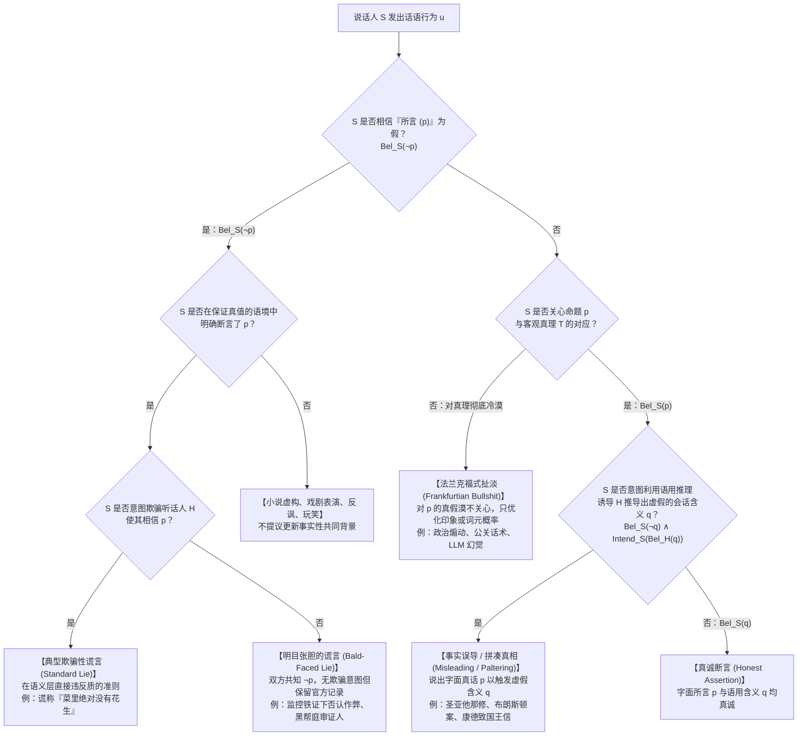
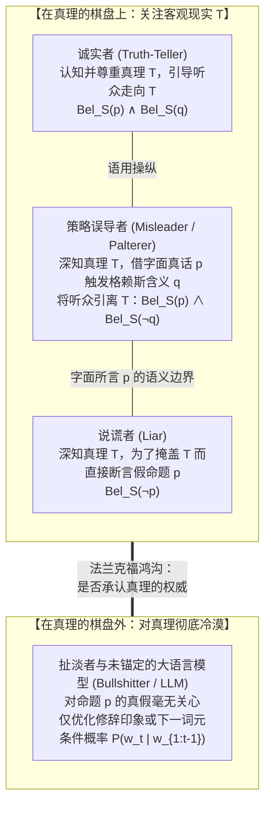

## 1. 引言：为何100%的“字面事实”能够完美地欺骗他人？

公元362年，在罗马帝国皇帝“背教者”尤利安（Julian the Apostate）的宗教迫害下，基督教尼西亚正统派的领袖<strong>亚历山大港的圣亚他那修（Saint Athanasius of Alexandria）</strong>乘着一艘小船沿尼罗河逃亡。当他发现皇家追兵的战船正从后方全速逼近时，亚他那修当机立断，命令船夫将小船原地掉头180度，迎着追兵的船只顺流而下。

两船擦肩而过之际，罗马士兵做梦也没想到迎面驶来的就是他们要抓捕的目标，于是隔着水面大声喝问：
“喂！你们看见叛贼亚他那修了吗？他在哪里？”
亚他那修本人站起身来，用平静而坚定的声音回答道：
<strong>“他离这里不远（He is not far from here!）！你们快点划桨就能追上他！”</strong>
罗马士兵连声道谢，拼命向上游划去；而亚他那修则顺流安全返回了亚历山大港。

这则著名的教父历史轶事向语言哲学与伦理学提出了一个极为尖锐的难题：亚他那修所说的“他离这里不远”在客观上与主观上都是<strong>100%的字面事实（Literal Truth）</strong>——因为亚他那修本人就站在船上，自己与自己的空间距离为零，自然“离这里不远”。他连半句虚假的命题都没有说出口。然而，他却完全是有意让士兵产生“亚他那修还在上游逃窜”的错误信念，并成功地实施了<strong>欺骗（Deception）</strong>。那么，圣亚他那修究竟有没有“撒谎（Lying）”？

### 1.1 美国联邦最高法院的里程碑判例：《布朗斯顿诉合众国案》（1973年）

这种区分绝非神学家的文字游戏。1973年，美国联邦最高法院在著名的伪证罪判例<strong>《布朗斯顿诉合众国案（*Bronston v. United States*, 409 U.S. 352）》</strong>中，对完全相同的语言现象做出了影响深远的司法裁决。

好莱坞著名电影制片人塞缪尔·布朗斯顿（Samuel Bronston）在其制片公司（`Bronston Productions, Inc.`）的联邦破产听证会上宣誓作证。债权人律师为了追查隐藏资产，与他进行了如下交锋：

> <strong>债权人律师（问）</strong>：“布朗斯顿先生，你在瑞士的银行里有账户吗？”
> <strong>布朗斯顿（答）</strong>：“没有，先生。”
> <strong>律师（问）</strong>：“你曾经有过吗（Have you ever）？”
> <strong>布朗斯顿（答）</strong>：“<strong>公司在苏黎世曾经有一个账户，大概维持了六个月（The company had an account there for about six months, in Zurich）。</strong>”

事后查明的真相令人震惊：在作证当天，布朗斯顿的瑞士个人账户确实已经注销，所以第一句“没有”是字面真话；他的制片公司也确实在苏黎世开过六个月的账户，所以第二句回答同样是100%的字面真话。然而在1959年至1964年间，布朗斯顿<strong>以个人名义</strong>在瑞士日内瓦的国际信贷银行拥有一个长达五年的秘密私人账户，累计存入并支取了超过18万美元！

联邦检察官以伪证罪（18 U.S.C. § 1621）起诉了布朗斯顿，理由是他面对“你个人是否曾经拥有瑞士账户”的提问时，故意搬出公司的苏黎世账户作答，蓄意诱导法庭推断出“他个人从未有过瑞士账户”的虚假结论。一审与上诉法院均判处其有罪。

然而，由首席大法官沃伦·伯格（Warren Burger）主笔的<strong>美国联邦最高法院以9比0全票推翻了有罪判决</strong>！最高法院裁定：联邦伪证罪法条绝不惩罚说出<strong>字面真话（literal truth）</strong>的证人，即便证人回答得狡猾、答非所问，且怀有误导提问者的恶意（intent to mislead）。最高法院指出，识别答非所问的回避并通过敏锐的交叉质询堵死漏洞，是提问律师自己的认知责任（*caveat auditor*）。

### 1.2 神学决疑论传统：『内心保留（Mental Reservation）』与『歧义语（Equivocation）』

在西方思想史上，这一边界曾是基督教道德神学与决疑论（Casuistry）激烈交锋的核心。公元4世纪末至5世纪初，<strong>圣奥古斯丁（Saint Augustine）</strong>撰写了《论谎言（*De Mendacio*）》与《反谎言（*Contra Mendacium*）》，确立了无论出于何种善意（哪怕为了拯救生命）都绝对禁止撒谎的严格主义传统。13世纪的<strong>托马斯·阿奎那（Thomas Aquinas）</strong>在《神学大全（*Summa Theologiae* II-II, Q. 110）》中进一步论证：语言的自然目的在于表达内在思想，违背心意说出虚假命题（*locutio contra mentem*）在本性上就是罪恶。

然而到了16至17世纪，面对伊丽莎白一世与詹姆士一世在英格兰对天主教神父的酷刑与处决，耶稣会神学家——如纳瓦鲁斯博士（Martín de Azpilcueta）、苏亚雷斯（Francisco Suárez）以及因火药阴谋案受审的亨利·加尼特神父（Father Henry Garnet，《论歧义语》作者）——发展出了著名的<strong>“内心保留（*Restrictio Mentalis*）”</strong>与<strong>“歧义语（*Aequivocatio*）”</strong>学说：
* <strong>狭义的内心保留（Strict Mental Reservation）</strong>：口头上直接说出假话（如对审判官说“我不是神父”），同时在心里默默补上半句（“……不是我有义务向异端法庭坦白的神父”）。由于公开语句本身没有任何真解释，教皇英诺森十一世于1679年正式将其谴责为伪装的谎言。
* <strong>广义的内心保留（Broad Mental Reservation）与歧义语（Equivocation）</strong>：说出的语句在公共语言或语境中确实包含一个<strong>客观为真的字面解释</strong>，只是听话人自己根据常规语境推断出了错误的解释。神学家认为，此时说话人只对字面真值负责，听话人的误解属于其“自我欺骗”。

本文将结合当代<strong>分析语言哲学</strong>、<strong>形式语用学</strong>、<strong>信念逻辑（Doxastic Logic）</strong>、<strong>贝叶斯认知建模</strong>与<strong>规范伦理学</strong>，系统解答四个核心问题：
1. <strong>“谎言（Lying）”的形式定义是什么？</strong>（为何撒谎取决于主观信念而非客观假值？“明目张胆的谎言”如何推翻了传统的欺骗意图条件？）
2. <strong>为什么人类会从“字面真话”中自动推导出一连串虚假结论？</strong>（格赖斯的合作原则、四条会话准则、等级含义与贝叶斯理性言语行为［RSA］模型。）
3. <strong>用事实误导他人（Misleading / Paltering）在道德上真的比撒谎更高尚吗？</strong>（康德的绝对主义与他对普鲁士国王的策略性误导，以及威廉姆斯、希夫林与珍妮弗·索尔的当代伦理交锋。）
4. <strong>为什么哈里·法兰克福所说的“扯淡（Bullshit）”是比谎言更可怕的真理之敌？</strong>（对真理的冷漠，以及当代大语言模型［LLM］“幻觉”作为数学化扯淡机器的本质。）

---

## 2. “谎言（Lying）”的形式定义：信念逻辑与『明目张胆的谎言』

在日常语言中，人们常把“说错话”或“欺骗”统称为撒谎。但在分析语言哲学中，<strong>撒谎（Lying）</strong>是一个边界极其严格的言语行为（Speech Act）。

### 2.1 经典欺骗主义定义（Chisholm & Feehan, 1977）与信念逻辑公式

现代哲学关于谎言的标准讨论始于罗德里克·奇泽姆（Roderick Chisholm）与托马斯·费汉（Thomas Feehan）1977年的经典论文 *"The Intent to Deceive"*。设说话人为 $S$（Speaker），听话人为 $H$（Hearer），命题为 $p$。令 $\text{Says}(S, H, p)$ 表示“$S$ 向 $H$ 明确断言（Assert/Say）了字面命题 $p$”；令 $\text{Bel}_x(p)$ 表示“主体 $x$ 相信命题 $p$ 为真”；令 $\text{Warrant}(S, H, p)$ 表示“话语发生在保证真实性的严肃语境中”；令 $\text{Intend}_S(\phi)$ 表示“$S$ 意图实现状态 $\phi$”。

传统欺骗主义（Deceptionism）将谎言定义为以下四个必要条件的合取：

$$\text{Lie}_{\text{trad}}(S, H, p) \iff \underbrace{\text{Says}(S, H, p)}_{\text{条件1: 言明/断言条件}} \;\land\; \underbrace{\text{Bel}_S(\neg p)}_{\text{条件2: 不真诚性条件}} \;\land\; \underbrace{\text{Warrant}(S, H, p)}_{\text{条件3: 保证语境条件}} \;\land\; \underbrace{\text{Intend}_S\big(\text{Bel}_H(p)\big)}_{\text{条件4: 欺骗意图条件}}$$

让我们逐一剖析其中的核心洞见：

1. <strong>言明条件（Statement Condition）：$\text{Says}(S, H, p)$</strong>
   撒谎要求说话人必须明确断言命题 $p$（即 $p$ 属于语义学上的“所言之物［What is said］”）。因此，非语言的伪装（如戴假发、在犯罪现场伪造指纹）、沉默不语、或者纯粹的疑问句与祈使句，即便构成了恶意的<strong>欺骗（Deception）</strong>，也不构成语言上的<strong>谎言（Lie）</strong>。
2. <strong>不真诚性条件（Untruthfulness Condition）：$\text{Bel}_S(\neg p)$ —— 主观信念高于客观真假！</strong>
   请仔细观察上述公式：<strong>公式中根本没有出现 $\neg p$（即命题 $p$ 在客观现实中为假）这一条件！</strong>
   在语言哲学的主观主义（Subjectivism）共识中，决定一句话是不是谎言的，不是这句话在客观世界上是不是假的，而是<strong>说话人自己内心是否相信它是假的（$\text{Bel}_S(\neg p)$）</strong>：
   * <strong>情况A（诚实的错误 / Honest Mistake）</strong>：爱丽丝不知道自己的手表慢了一个小时，真诚地告诉鲍勃“现在是下午3点”（实际是4点）。虽然 $\neg p$ 客观成立，但由于 $\text{Bel}_S(p)$，爱丽丝只是<strong>搞错了</strong>，绝没有撒谎。
   * <strong>情况B（用客观真话撒谎 / Lying with an Objective Truth）</strong>：爱丽丝确信朋友乔治此时正在家里睡觉（$\text{Bel}_S(\neg p)$）。为了把找乔治的鲍勃支开，爱丽丝对鲍勃说：“乔治现在在大学图书馆里（$p$）。”然而爱丽丝不知道的是，乔治五分钟前恰好出门去了图书馆，因此 $p$ 在客观上竟然是<strong>真的</strong>！即便如此，由于爱丽丝断言了一个她自己深信为假的命题 $p$，她依然徹头徹尾地<strong>撒了谎</strong>（尽管鲍勃歪打正着得到了真信息，因而没有“受骗”）。
3. <strong>保证语境与共同背景条件（Warrant / Common Ground Condition）：$\text{Warrant}(S, H, p)$</strong>
   演员在舞台上高喊“我是丹麦王子哈姆雷特”、小说家撰写虚构故事、或者人们在暴风雨中说反话（Irony：“今天天气真好啊！”），虽然说话人也知道字面命题为假，但没有人会指责他们撒谎。正如托马斯·卡森（Thomas Carson, 2006/2010）与安德烈亚斯·斯托克（Andreas Stokke, 2018）结合罗伯特·斯塔alnaker（Robert Stalnaker）的语用学所指出的，唯有当说话人处于<strong>保证真值的语境</strong>中，即提议将命题 $p$ 作为事实写入对话双方的<strong>“共同背景（Common Ground, $CG$）”</strong>时，不真诚的断言才构成谎言。

### 2.2 『明目张胆的谎言（Bald-Faced Lies）』对欺骗意图条件的颠覆

21世纪初，托马斯·卡森（Carson 2006）、罗伊·索伦森（Roy Sorensen 2007）与唐·法利斯（Don Fallis 2009）提出了一类极具颠覆性的反例——<strong>“明目张胆的谎言 / 厚颜无耻的谎言（Bald-Faced Lies）”</strong>，彻底推翻了延续上千年的“条件4（欺骗意图条件）”：

* <strong>案例1：被抓现行的作弊学生（Carson 2006）</strong>
  一名大学生在考试中看小抄被院长当场抓获，高清监控摄像头也拍下了铁证。学生心知肚明院长100%知道自己作弊了，无论自己说什么都不可能骗过院长。但学生知道学校有一条官僚规定：“只要学生本人不亲口承认作弊，就不能立即开除，必须交由委员会漫长审议。”于是学生直视院长的眼睛说：<strong>“我没有作弊。”</strong>
* <strong>案例2：黑手党审判中的目击证人（Fallis 2009）</strong>
  在黑手党谋杀案庭审中，黑帮教父坐在旁听席上恶狠狠地盯着唯一目击证人。法官、检察官、陪审团和证人全都从录像中清楚知道证人亲眼目睹了枪杀过程，证人也知道法庭上没有任何人会相信他的否认。但为了避免自己和家人遭到黑帮灭口，在正式庭审记录（On the record）上留下“自己没有出卖黑帮”的证明，证人宣誓后说道：<strong>“我什么都没看见。”</strong>

在这两个案例中，$\neg p$ 是双方的共同知识（Common Knowledge），说话人完全没有让听话人相信 $p$ 的欺骗意图（$\neg \text{Intend}_S(\text{Bel}_H(p))$），但无论是日常语言直觉还是法律上的伪证罪，都毫无争议地判定他们在<strong>撒谎</strong>！因此，当代语言哲学的“新正统派（New Orthodoxy）”将谎言严格定义为<strong>保证语境下的不真诚断言</strong>：

$$\text{Lie}(S, H, p) \iff \text{Says}(S, H, p) \;\land\; \text{Bel}_S(\neg p) \;\land\; \text{Warrant}(S, H, p)$$

---

## 3. 格赖斯语用学：为什么“字面事实”会自动导出“虚假结论”？

回到圣亚他那修（“他离这里不远”）与布朗斯顿（“公司在苏黎世有过六个月的账户”）。由于他们都相信自己所断言的字面命题 $p$ 为真（$\text{Bel}_S(p)$），根据上述定义，<strong>他们确实没有撒谎</strong>。那么，他们是如何让听话人自动推导出虚假命题 $q$ 的？

1967年，英国语言哲学家 <strong>H·保罗·格赖斯（H. Paul Grice, 1913–1988）</strong> 在哈佛大学威廉·詹姆斯讲座中发表了划时代的《逻辑与会话（*Logic and Conversation*，1975年出版）》，创立了现代<strong>语用学（Pragmatics）</strong>的核心机制。

### 3.1 “所言（What is Said）”与“会话含义（Conversational Implicature）”

格赖斯将话语 $u$ 传递的总意义划分为两个层面：
1. <strong>所言（What is Said, $p$）</strong>：由词汇意义、句法结构以及指示词消解所决定的真值条件语义内容。
2. <strong>会话含义（Conversational Implicature, $q$）</strong>：不包含在字面语义 $p$ 中，但听话人基于“说话人正在遵守<strong>合作原则（Cooperative Principle, CP）</strong>”的假设，结合语境推导出的隐含命题。

格赖斯仿照康德的范畴表，将合作原则具体化为<strong>四条会话准则（Four Conversational Maxims）</strong>：

#### 1. 量的准则（Maxim of Quantity）
* (i) 提供当前交谈目的所要求的足够信息量；(ii) 不要提供多于要求的信息量。
* <strong>等级含义（Scalar Implicature — Laurence Horn 1972; Stephen Levinson 2000）</strong>：
  假设罐子里有10块饼干，你把<strong>全部10块（All）</strong>都吃光了。室友问你饼干去哪儿了，你回答：*“我吃了<strong>一些（Some）</strong>饼干。”*
  在一阶谓词逻辑中，“我吃了一些饼干”（$p \equiv \exists x \, (\text{Cookie}(x) \land \text{Ate}(S, x))$）被“我吃了全部饼干”（$p_{\text{strong}} \equiv \forall x \, (\text{Cookie}(x) \to \text{Ate}(S, x))$）在逻辑上所蕴涵（$\forall x \models \exists x$）。因此，当你吃光10块饼干时，说“我吃了一些”在语义逻辑上是<strong>100%为真</strong>的！
  然而在自然语言的<strong>霍恩等级（Horn Scale）</strong> $\langle \text{全部 (all)}, \text{大多数 (most)}, \text{一些 (some)} \rangle$ 中，室友假定你遵守“量的准则”：如果你知道更强的命题 $\forall x$ 成立，你本应直接说“全部”；你既然选择了较弱的“一些”，必然是因为更强的命题不成立。于是室友自动推导出了虚假的<strong>等级会话含义 $q$</strong>：
  $$q \equiv \neg \forall x \, \big(\text{Cookie}(x) \to \text{Ate}(S, x)\big) \quad \text{（“我并没有全部吃光”）}$$

#### 2. 质的准则（Maxim of Quality）
* 总准则：努力使你的话语为真。(i) 不要说你相信为假的话（$\neg \text{Bel}_S(\neg p)$）；(ii) 不要说缺乏足够证据的话。
* <strong>撒谎</strong>直接违反质的准则第(i)条；<strong>扯淡（Bullshit）</strong>彻底抛弃第(ii)条与总准则；而<strong>事实误导（Misleading）</strong>则是在字面命题 $p$ 上严格遵守质的准则，从而利用其余三条准则来操控听话人的推理！

#### 3. 关系（关联）准则（Maxim of Relation / Relevance）
* 准则：<strong>要有关联（Be relevant）。</strong>
* 布朗斯顿在法庭上被问及个人是否有瑞士账户时回答“公司在苏黎世有账户”，正是利用了关联准则与量的准则。格赖斯最著名的<strong>哲学推荐信案例</strong>也是如此：一位教授受邀为申请哲学教职的学生X先生写推荐信，信中只写了一句真话：*“尊敬的先生：X先生的英语造诣极佳，且按时参加辅导课。”* 招聘委员会立刻读出了会话含义 $q =$ <strong>“X先生在哲学上毫无才华”</strong>——因为教授故意公然违反（Flouting）关联准则与量的准则，唯一的合理解释就是：受限于质的准则（不撒谎），教授实在无法夸奖X先生的哲学能力。

#### 4. 方式准则（Maxim of Manner）
* 总准则：要清楚明白——(i) 避免晦涩；(ii) 避免歧义（Ambiguity）；(iii) 简练；(iv) 井然有序。
* 圣亚他那修的“他离这里不远”正是故意利用指示与指称上的歧义（违反方式准则第ii条），在保持字面真值的同时误导了追兵。

### 3.2 会话含义的试金石：『可取消性（Cancellability）』

格赖斯指出，区分语义“所言（$p$）”与语用“会话含义（$q$）”的决定性标准是<strong>可取消性（Cancellability）</strong>：
* <strong>语义蕴涵不可取消</strong>：说*“我昨天杀了他，但他还没死”*会产生逻辑矛盾（$\perp$）。
* <strong>会话含义可以无矛盾地取消</strong>：说*“我吃了一些饼干——事实上，我把它们全吃光了！”*在逻辑上完全融贯，后半句只是取消了前半句原本会触发的语用含义 $q$。

### 3.3 贝叶斯理性言语行为（RSA）模型与『巧妙误导（Paltering）』的数学机制

在认知科学中，<strong>弗兰克与古德曼（Frank & Goodman 2012）</strong>提出的<strong>理性言语行为模型（Rational Speech Act, RSA）</strong>将格赖斯语用学形式化为递归贝叶斯博弈。设世界状态集合为 $W$，真实世界状态为 $w^* \in W$，话语 $u$ 的真值条件函数为 $\llbracket u \rrbracket : W \to \{0, 1\}$：
* <strong>字面听话人（$L_0$）</strong>：$P_{L_0}(w \mid u) \propto \llbracket u \rrbracket(w) \cdot P(w)$
* <strong>合作语用说话人（$S_1$）</strong>：$P_{S_1}(u \mid w) \propto \exp\big(\alpha (\ln P_{L_0}(w \mid u) - C(u))\big)$
* <strong>语用听话人（$L_1$）</strong>：$P_{L_1}(w \mid u) \propto P_{S_1}(u \mid w) \cdot P(w)$

哈佛大学谈判学家<strong>罗杰斯与泽克豪泽等人（Rogers, Zeckhauser et al. 2017）</strong>将“主动使用真话来制造错误印象”的策略命名为<strong>“巧妙误导 / 拼凑真相（Paltering）”</strong>。在RSA框架下，误导者 $S_{\text{mislead}}$ 严格遵守字面真值约束 $\llbracket u \rrbracket(w^*) = 1$，但精心挑选话语 $u^*$，使得语用听话人 $L_1$ 的贝叶斯后验概率最大化地集中在虚假状态 $w_{\text{false}} \neq w^*$ 上：

$$u^* = \underset{u \in U \,:\, \llbracket u \rrbracket(w^*) = 1}{\arg\max} \; P_{L_1}(w_{\text{false}} \mid u)$$

由此，我们可以写出<strong>事实误导（Truthful Misleading）</strong>的信念逻辑定义：

$$\text{Mislead}_{\text{truthful}}(S, H, p, q) \iff \text{Says}(S, H, p) \;\land\; \text{Bel}_S(p) \;\land\; \text{Implicates}(S, H, p, q) \;\land\; \text{Bel}_S(\neg q) \;\land\; \text{Intend}_S\big(\text{Bel}_H(q)\big)$$

---

## 4. 道德与伦理之争：误导真的比撒谎在道德上更高尚吗？

### 4.1 康德的绝对严格主义与他自己对国王的『策略性误导』

在1797年的著名论文《论出于博爱而撒谎的所谓权利（*Über ein vermeintes Recht aus Menschenliebe zu lügen*）》中，<strong>伊曼努尔·康德（Immanuel Kant）</strong>针对贡斯当提出的<strong>“门前的杀人犯（Murderer at the Door）”</strong>思想实验给出了震惊世人的回答：即便杀人犯追杀你躲在家中的无辜朋友并敲门询问，你也绝对不能撒谎说“他不在家”。康德认为，诚实声明（*Aussage*）是对全人类的完全义务（Perfect Duty），一旦允许撒谎，人类一切契约与理性的信任根基都将崩塌。

然而极具讽刺意味的是，<strong>痛恨谎言的康德本人在现实生活中却是一位运用“字面真话进行策略性误导”的大师！</strong>
1794年，普鲁士国王<strong>腓特烈·威廉二世（Friedrich Wilhelm II）</strong>因康德出版《单纯理性限度内的宗教》而震怒，勒令康德写下保证书，永远不再公开讲授或发表关于宗教的言论。为了既保住教职又不违背不撒谎的道德律，70岁的康德在回信中字斟句酌地写道：

> “<strong>作为陛下最忠实的臣民（Als Ew. Königl. Majestät getreuester Untertan）</strong>，我庄严声明，今后我将完全停止一切关于自然宗教或启示宗教的公开讲演与著述……”

三年后的1797年11月，腓特烈·威廉二世驾崩。康德立即在1798年出版《学科之争（*Der Streit der Fakultäten*）》重谈宗教，并在序言脚注中得意地揭秘道：他当年故意写下“作为<strong>陛下</strong>最忠实的臣民”，正是为了把承诺的效力严格限定在<strong>“这位国王陛下在世期间”</strong>，从而在不说半句谎言的前提下为自己保留了未来的言论自由！国王读信时自然推断出了会话含义 $q$（康德终生不再写宗教著作），但康德所说的字面命题 $p$ 却是完全为真的。

### 4.2 当代伦理学交锋：非对称论（Preferentialism）vs. 珍妮弗·索尔的批判

当代伦理学围绕“误导是否比撒谎罪责更轻”展开了激烈争论：
* <strong>支持非对称论（误导比撒谎轻）的理由</strong>：
  1. <strong>认知责任分担论（Bernard Williams 2002; Jonathan Adler 1997）</strong>：在直接断言 $p$ 时，说话人全额担保了 $p$ 的真值；而在误导中，从字面真话 $p$ 到虚假含义 $q$ 的跳跃包含了听话人自己的推理步骤（*caveat auditor*），因此听话人分担了一部分认知责任。
  2. <strong>维护语义通道论（Seana Shiffrin 2014）</strong>：撒谎直接污染了人类传达心智信念的唯一直接语义工具（字面断言），而误导至少保留了语义真值条件的完好。
* <strong>珍妮弗·索尔的致命反击（Jennifer Saul, *Lying, Misleading, and What is Said*, 2012）</strong>：
  英国哲学家珍妮弗·索尔指出，首先，现代关联理论与语境主义表明，“所言（语义）”与“所含（语用）”的边界极其微妙且受句法偶然性支配，根本无法承载巨大的道德落差。其次，索尔提出了著名的<strong>“致命花生过敏案”</strong>：
  > 假设弗里达想要毒死对花生严重过敏的客人乔治，在咖喱中掺入了大量花生油和花生粉，但也放了葵花籽油和香料。乔治警惕地询问这道菜是否安全。
  > * <strong>版本1（直接撒谎）</strong>：弗里达说：“这道菜里绝对没有花生。”乔治吃下后死亡。
  > * <strong>版本2（事实误导 / Paltering）</strong>：弗里达为了“保持不撒谎的清白”，微笑着说：“这道菜是用葵花籽油和香料做的！”（字面真话 $p$）。乔治由此推断出“没有花生”（含义 $q$），吃下后死亡。

  索尔一针见血地指出：版本2中的误导者在道德上绝不比版本1中的撒谎者高尚半分！相反，选择用字面真话误导他人往往暴露出更虚伪的<strong>道德自欺（Moral Hypocrisy）</strong>与规避法律责任的精明算计。

---

## 5. 哈里·法兰克福《论扯淡（On Bullshit）》：对真理的冷漠与AI幻觉

1986年（2005年结集出版），普林斯顿大学哲学家<strong>哈里·法兰克福（Harry G. Frankfurt, 1929–2023）</strong>在传世名作<strong>《论扯淡（*On Bullshit*）》</strong>中指出，除了撒谎与误导之外，现代社会还充斥着第三种更危险的语言病理——<strong>扯淡（Bullshit）</strong>。

### 5.1 诚实者、说谎者与扯淡者的三分法

法兰克福从说话人<strong>对真理权威（Truth $T$）的认知态度</strong>出发，揭示了说谎者与扯淡者之间的本质鸿沟：
1. <strong>诚实的人（Truth-Teller）</strong>：关心客观事实 $T$，努力使话语符合事实（$\text{Bel}_S(p)$）。
2. <strong>说谎者（Liar）与策略误导者</strong>：<strong>说谎者同样高度关心客观事实 $T$！</strong> 因为要想成功地说谎或误导，说话人心里必须清楚“什么是真相”（$\text{Bel}_S(\neg p)$），时刻盯着真相的坐标，才能把听话人引离真相。因此，诚实者与说谎者其实是在<strong>“由真理权威所定义的同一个棋盘上”</strong>博弈。
3. <strong>扯淡者（Bullshitter）</strong>：扯淡者根本不在真理的棋盘上博弈。<strong>扯淡者对自己所说的话究竟是真的还是假的完全漠不关心（$\neg \text{Care}_S(p \leftrightarrow T)$）</strong>。只要能达到操纵自身形象、博取眼球、应付场面或说服听众的目的，手头抓到什么话好用就说什么——哪怕这句话碰巧是真的，或者碰巧是假的，对扯淡者来说都毫无所谓。

法兰克福由此得出了那句震撼时代的结论：
> “说谎者虽然违抗真理的权威，却依然承认它的存在；而扯淡者则彻底无视真理。<strong>因此，扯淡是比谎言更可怕的真理之敌（Bullshit is a greater enemy of the truth than lies are）。</strong>”

### 5.2 当代大语言模型（LLM）：数学意义上的法兰克福式扯淡机器

2024年，哲学家ヒックス、汉弗莱斯与斯莱特（Hicks, Humphries, & Slater 2024）在《伦理学与信息技术》发表著名论文 <strong>*"ChatGPT is Bullshit"</strong>* 指出：把大语言模型（LLM）捏造事实称为“AI幻觉（Hallucination）”或“AI撒谎”在哲学上是不准确的；从严格的技术定义来看，未经事实锚定的自回归语言模型是一台纯粹的<strong>法兰克福式扯淡机器（Frankfurtian Bullshit Machine）</strong>。

考察自回归 Transformer 在词表 $\mathcal{V}$ 上预测下一个词元 $w_t$ 的概率公式：

$$P_\theta(w_t \mid w_1, w_2, \ldots, w_{t-1}) = \frac{\exp\big(z_\theta(w_t \mid w_{1:t-1}) / \tau\big)}{\sum_{v \in \mathcal{V}} \exp\big(z_\theta(v \mid w_{1:t-1}) / \tau\big)}$$

这一目标函数优化的唯一对象是<strong>“统计语言学上的逼真度与人类偏好印象（Statistical Plausibility）”</strong>，模型内部既没有信念态 $\text{Bel}_{\text{LLM}}(p)$，也不关心输出命题是否对应客观世界 $w^*$。无论它输出的句子碰巧正确还是完全捏造，其底层机制对真假值都保持着100%的结构性冷漠——这正是法兰克福笔下“扯淡（Bullshit）”的最完美数学化身。

---

## 6. 总结对比：言语行为的认知、语用与伦理分类表

| 言语行为类别 | 所言 ($p$) 的客观真假 | 说话人的信念状态 ($\text{Bel}_S$) | 会话含义 ($q$) 与意图 | 与格赖斯准则的关系 | 典型案例 |
| :--- | :--- | :--- | :--- | :--- | :--- |
| <strong>1. 真诚断言</strong> *(Honest Assertion)* | 真（或偶然为假） | $\text{Bel}_S(p) \land \text{Bel}_S(q)$ | 意图传递真实含义 $q$ | 合作遵守全部四条准则 | 诚实的科学报告与法庭作证 |
| <strong>2. 诚实的错误</strong> *(Honest Mistake)* | 假 ($\neg p$) | $\text{Bel}_S(p)$（误以为真） | 无欺骗意图 | 主观遵守质的准则（客观为假） | 看着停走的手表报出错误时间 |
| <strong>3. 典型欺骗性谎言</strong> *(Standard Lie)* | 通常为假（偶然为真亦成立） | <strong>$\text{Bel}_S(\neg p)$</strong> | 意图使 $H$ 相信 $p$：$\text{Intend}_S(\text{Bel}_H(p))$ | 在语义层直接违反<strong>质的准则第1条</strong> | 伪造不在场证明；谎称“菜里没有花生” |
| <strong>4. 明目张胆的谎言</strong> *(Bald-Faced Lie)* | 假（双方共知 $\neg p$） | <strong>$\text{Bel}_S(\neg p)$</strong> | <strong>无欺骗意图</strong>（只为官方记录免责） | 在保证语境下公然违反质的准则 | 监控铁证下否认作弊；受黑帮威胁的证人 |
| <strong>5. 事实误导</strong> *(Truthful Misleading / Paltering)* | <strong>真 ($p$)</strong> | <strong>$\text{Bel}_S(p)$</strong> 但 <strong>$\text{Bel}_S(\neg q)$</strong> | 利用真话 $p$ 诱导虚假含义 $q$ | 字面遵守质的准则，策略性滥用<strong>量、关联、方式准则</strong> | 圣亚他那修；布朗斯顿案；康德致普鲁士国王信 |
| <strong>6. 法兰克福式扯淡</strong> *(Frankfurtian Bullshit)* | 真假不论（纯属巧合） | <strong>对真假漠不关心</strong> ($\neg \text{Care}_S(p \leftrightarrow T)$) | 只追求<strong>印象操纵、说服力或统计逼真度</strong> | 彻底抛弃<strong>质的准则总原则与证据要求</strong> | 无根据的政治宣传、公关吹嘘、LLM幻觉 |

在后真相政治与生成式人工智能交织的今天，理解<strong>谎言（语义不真诚）</strong>、<strong>误导（语用推理操纵）</strong>与<strong>扯淡（对真理的认识论冷漠）</strong>之间的哲学边界，不仅是一场精妙的逻辑与语言学巡礼，更是我们守护理性判断力与认知自主性的必修课。
