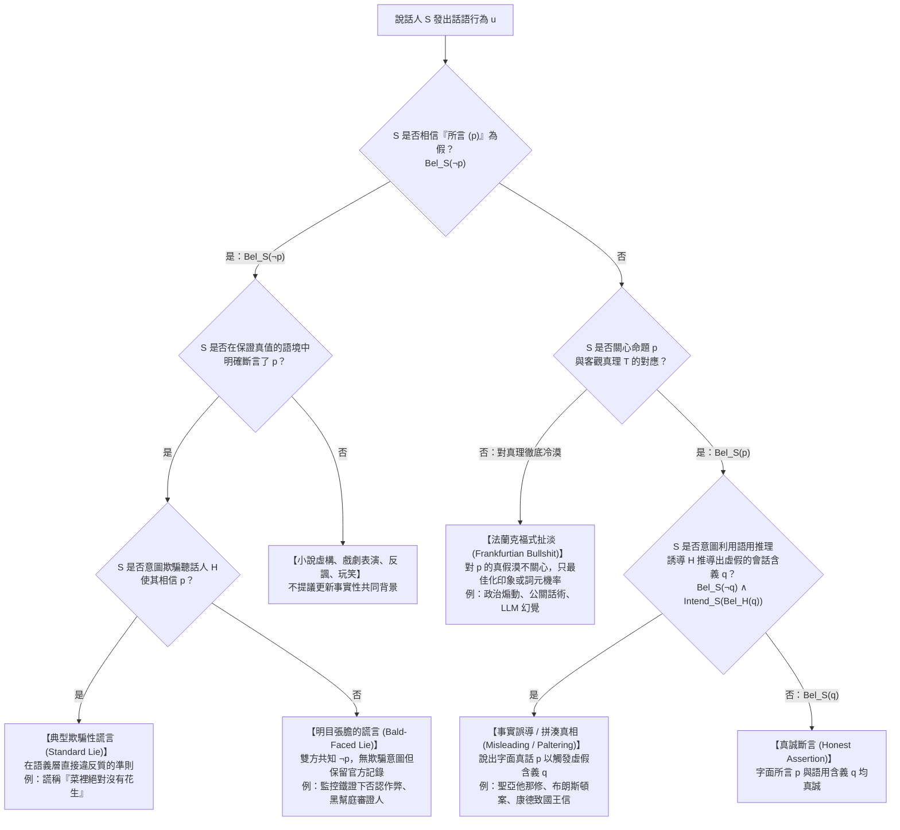
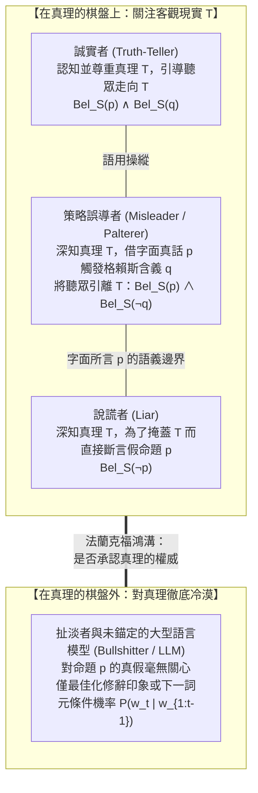

## 1. 引言：為何100%的「字面事實」能夠完美地欺騙他人？

西元362年，在羅馬帝國皇帝「背教者」尤利安（Julian the Apostate）的宗教迫害下，基督教尼西亞正統派的領袖<strong>亞歷山大港的聖亞他那修（Saint Athanasius of Alexandria）</strong>乘著一艘小船沿尼羅河逃亡。當他發現皇家追兵的戰船正從後方全速逼近時，亞他那修當機立斷，命令船夫將小船原地掉頭180度，迎著追兵的船隻順流而下。

兩船擦肩而過之際，羅馬士兵做夢也沒想到迎面駛來的就是他們要抓捕的目標，於是隔著水面大聲喝問：
「喂！你們看見叛賊亞他那修了嗎？他在哪裡？」
亞他那修本人站起身來，用平靜而堅定的聲音回答道：
<strong>「他離這裡不遠（He is not far from here!）！你們快點划槳就能追上他！」</strong>
羅馬士兵連聲道謝，拼命向上游划去；而亞他那修則順流安全返回了亞歷山大港。

這則著名的教父歷史軼事向語言哲學與倫理學提出了一個極為尖銳的難題：亞他那修所說的「他離這裡不遠」在客觀上與主觀上都是<strong>100%的字面事實（Literal Truth）</strong>——因為亞他那修本人就站在船上，自己與自己的空間距離為零，自然「離這裡不遠」。他連半句虛假的命題都沒有說出口。然而，他卻完全是有意讓士兵產生「亞他那修還在上游逃竄」的錯誤信念，並成功地實施了<strong>欺騙（Deception）</strong>。那麼，聖亞他那修究竟有沒有「撒謊（Lying）」？

### 1.1 美國聯邦最高法院的里程碑判例：《布朗斯頓訴合眾國案》（1973年）

這種區分絕非神學家的文字遊戲。1973年，美國聯邦最高法院在著名的偽證罪判例<strong>《布朗斯頓訴合眾國案（*Bronston v. United States*, 409 U.S. 352）》</strong>中，對完全相同的語言現象做出了影響深遠的司法裁決。

好萊塢著名電影製片人塞繆爾·布朗斯頓（Samuel Bronston）在其製片公司（`Bronston Productions, Inc.`）的聯邦破產聽證會上宣誓作證。債權人律師為了追查隱藏資產，與他進行了如下交鋒：

> <strong>債權人律師（問）</strong>：「布朗斯頓先生，你在瑞士的銀行裡有帳戶嗎？」
> <strong>布朗斯頓（答）</strong>：「沒有，先生。」
> <strong>律師（問）</strong>：「你曾經有過嗎（Have you ever）？」
> <strong>布朗斯頓（答）</strong>：「<strong>公司在蘇黎世曾經有一個帳戶，大概維持了六個月（The company had an account there for about six months, in Zurich）。</strong>」

事後查明的真相令人震驚：在作證當天，布朗斯頓的瑞士個人帳戶確實已經註銷，所以第一句「沒有」是字面真話；他的製片公司也確實在蘇黎世開過六個月的帳戶，所以第二句回答同樣是100%的字面真話。然而在1959年至1964年間，布朗斯頓<strong>以個人名義</strong>在瑞士日內瓦的國際信貸銀行擁有一個長達五年的秘密私人帳戶，累計存入並支取了超過18萬美元！

聯邦檢察官以偽證罪（18 U.S.C. § 1621）起訴了布朗斯頓，理由是他面對「你個人是否曾經擁有瑞士帳戶」的提問時，故意搬出公司的蘇黎世帳戶作答，蓄意誘導法庭推斷出「他個人從未有過瑞士帳戶」的虛假結論。一審與上訴法院均判處其有罪。

然而，由首席大法官沃倫·伯格（Warren Burger）主筆的<strong>美國聯邦最高法院以9比0全票推翻了有罪判決</strong>！最高法院裁定：聯邦偽證罪法條絕不懲罰說出<strong>字面真話（literal truth）</strong>的證人，即便證人回答得狡猾、答非所問，且懷有誤導提問者的惡意（intent to mislead）。最高法院指出，識別答非所問的迴避並通過敏銳的交叉質詢堵死漏洞，是提問律師自己的認知責任（*caveat auditor*）。

### 1.2 神學決疑論傳統：『內心保留（Mental Reservation）』與『歧義語（Equivocation）』

在西方思想史上，這一邊界曾是基督教道德神學與決疑論（Casuistry）激烈交鋒的核心。西元4世紀末至5世紀初，<strong>聖奧古斯丁（Saint Augustine）</strong>撰寫了《論謊言（*De Mendacio*）》與《反謊言（*Contra Mendacium*）》，確立了無論出於何種善意（哪怕為了拯救生命）都絕對禁止撒謊的嚴格主義傳統。13世紀的<strong>托馬斯·阿奎那（Thomas Aquinas）</strong>在《神學大全（*Summa Theologiae* II-II, Q. 110）》中進一步論證：語言的自然目的在於表達內在思想，違背心意說出虛假命題（*locutio contra mentem*）在本性上就是罪惡。

然而到了16至17世紀，面對伊麗莎白一世與詹姆士一世在英格蘭對天主教神父的酷刑與處決，耶穌會神學家——如納瓦魯斯博士（Martín de Azpilcueta）、蘇亞雷斯（Francisco Suárez）以及因火藥陰謀案受審的亨利·加尼特神父（Father Henry Garnet，《論歧義語》作者）——發展出了著名的<strong>「內心保留（*Restrictio Mentalis*）」</strong>與<strong>「歧義語（*Aequivocatio*）」</strong>學說：
* <strong>狹義的內心保留（Strict Mental Reservation）</strong>：口頭上直接說出假話（如對審判官說「我不是神父」），同時在心裡默默補上半句（「……不是我有義務向異端法庭坦白的神父」）。由於公開語句本身沒有任何真解釋，教宗英諾森十一世於1679年正式將其譴責為偽裝的謊言。
* <strong>廣義的內心保留（Broad Mental Reservation）與歧義語（Equivocation）</strong>：說出的語句在公共語言或語境中確實包含一個<strong>客觀為真的字面解釋</strong>，只是聽話人自己根據常規語境推斷出了錯誤的解釋。神學家認為，此時說話人只對字面真值負責，聽話人的誤解屬於其「自我欺騙」。

本文將結合當代<strong>分析語言哲學</strong>、<strong>形式語用學</strong>、<strong>信念邏輯（Doxastic Logic）</strong>、<strong>貝氏認知建模</strong>與<strong>規範倫理學</strong>，系統解答四個核心問題：
1. <strong>「謊言（Lying）」的形式定義是什麼？</strong>（為何撒謊取決於主觀信念而非客觀假值？「明目張膽的謊言」如何推翻了傳統的欺騙意圖條件？）
2. <strong>為什麼人類會從「字面真話」中自動推導出一連串虛假結論？</strong>（格賴斯的合作原則、四條會話準則、等級含義與貝氏理性言語行為［RSA］模型。）
3. <strong>用事實誤導他人（Misleading / Paltering）在道德上真的比撒謊更高尚嗎？</strong>（康德的絕對主義與他對普魯士國王的策略性誤導，以及威廉姆斯、希夫林與珍妮佛·索爾的當代倫理交鋒。）
4. <strong>為什麼哈里·法蘭克福所說的「扯淡（Bullshit）」是比謊言更可怕的真理之敵？</strong>（對真理的冷漠，以及當代大型語言模型［LLM］「幻覺」作為數學化扯淡機器的本質。）

---

## 2. 「謊言（Lying）」的形式定義：信念邏輯與『明目張膽的謊言』

在日常語言中，人們常把「說錯話」或「欺騙」統稱為撒謊。但在分析語言哲學中，<strong>撒謊（Lying）</strong>是一個邊界極其嚴格的言語行為（Speech Act）。

### 2.1 經典欺騙主義定義（Chisholm & Feehan, 1977）與信念邏輯公式

現代哲學關於謊言的標準討論始於羅德里克·奇澤姆（Roderick Chisholm）與托馬斯·費漢（Thomas Feehan）1977年的經典論文 *"The Intent to Deceive"*。設說話人為 $S$（Speaker），聽話人為 $H$（Hearer），命題為 $p$。令 $\text{Says}(S, H, p)$ 表示「$S$ 向 $H$ 明確斷言（Assert/Say）了字面命題 $p$」；令 $\text{Bel}_x(p)$ 表示「主體 $x$ 相信命題 $p$ 為真」；令 $\text{Warrant}(S, H, p)$ 表示「話語發生在保證真實性的嚴肅語境中」；令 $\text{Intend}_S(\phi)$ 表示「$S$ 意圖實現狀態 $\phi$」。

傳統欺騙主義（Deceptionism）將謊言定義為以下四個必要條件的合取：

$$\text{Lie}_{\text{trad}}(S, H, p) \iff \underbrace{\text{Says}(S, H, p)}_{\text{條件1: 言明/斷言條件}} \;\land\; \underbrace{\text{Bel}_S(\neg p)}_{\text{條件2: 不真誠性條件}} \;\land\; \underbrace{\text{Warrant}(S, H, p)}_{\text{條件3: 保證語境條件}} \;\land\; \underbrace{\text{Intend}_S\big(\text{Bel}_H(p)\big)}_{\text{條件4: 欺騙意圖條件}}$$

讓我們逐一剖析其中的核心洞見：

1. <strong>言明條件（Statement Condition）：$\text{Says}(S, H, p)$</strong>
   撒謊要求說話人必須明確斷言命題 $p$（即 $p$ 屬於語義學上的「所言之物［What is said］」）。因此，非語言的偽裝（如戴假髮、在犯罪現場偽造指紋）、沉默不語、或者純粹的疑問句與祈使句，即便構成了惡意的<strong>欺騙（Deception）</strong>，也不構成語言上的<strong>謊言（Lie）</strong>。
2. <strong>不真誠性條件（Untruthfulness Condition）：$\text{Bel}_S(\neg p)$ —— 主觀信念高於客觀真假！</strong>
   請仔細觀察上述公式：<strong>公式中根本沒有出現 $\neg p$（即命題 $p$ 在客觀現實中為假）這一條件！</strong>
   在語言哲學的主觀主義（Subjectivism）共識中，決定一句話是不是謊言的，不是這句話在客觀世界上是不是假的，而是<strong>說話人自己內心是否相信它是假的（$\text{Bel}_S(\neg p)$）</strong>：
   * <strong>情況A（誠實的錯誤 / Honest Mistake）</strong>：愛麗絲不知道自己的手錶慢了一個小時，真誠地告訴鮑勃「現在是下午3點」（實際是4點）。雖然 $\neg p$ 客觀成立，但由於 $\text{Bel}_S(p)$，愛麗絲只是<strong>搞錯了</strong>，絕沒有撒謊。
   * <strong>情況B（用客觀真話撒謊 / Lying with an Objective Truth）</strong>：愛麗絲確信朋友喬治此時正在家裡睡覺（$\text{Bel}_S(\neg p)$）。為了把找喬治的鮑勃支開，愛麗絲對鮑勃說：「喬治現在在大學圖書館裡（$p$）。」然而愛麗絲不知道的是，喬治五分鐘前恰好出門去了圖書館，因此 $p$ 在客觀上竟然是<strong>真的</strong>！即便如此，由於愛麗絲斷言了一個她自己深信為假的命題 $p$，她依然徹頭徹尾地<strong>撒了謊</strong>（儘管鮑勃歪打正著得到了真資訊，因而沒有「受騙」）。
3. <strong>保證語境與共同背景條件（Warrant / Common Ground Condition）：$\text{Warrant}(S, H, p)$</strong>
   演員在舞台上高喊「我是丹麥王子哈姆雷特」、小說家撰寫虛構故事、或者人們在暴風雨中說反話（Irony：「今天天氣真好啊！」），雖然說話人也知道字面命題為假，但沒有人會指責他們撒謊。正如托馬斯·卡森（Thomas Carson, 2006/2010）與安德烈亞斯·斯托克（Andreas Stokke, 2018）結合羅伯特·斯塔alnaker（Robert Stalnaker）的語用學所指出的，唯有當說話人處於<strong>保證真值的語境</strong>中，即提議將命題 $p$ 作為事實寫入對話雙方的<strong>「共同背景（Common Ground, $CG$）」</strong>時，不真誠的斷言才構成謊言。

### 2.2 『明目張膽的謊言（Bald-Faced Lies）』對欺騙意圖條件的顛覆

21世紀初，托馬斯·卡森（Carson 2006）、羅伊·索倫森（Roy Sorensen 2007）與唐·法利斯（Don Fallis 2009）提出了一類極具顛覆性的反例——<strong>「明目張膽的謊言 / 厚顏無恥的謊言（Bald-Faced Lies）」</strong>，徹底推翻了延續上千年的「條件4（欺騙意圖條件）」：

* <strong>案例1：被抓現行的作弊學生（Carson 2006）</strong>
  一名大學生在考試中看小抄被院長當場抓獲，高畫質監控攝影機也拍下了鐵證。學生心知肚明院長100%知道自己作弊了，無論自己說什麼都不可能騙過院長。但學生知道學校有一條官僚規定：「只要學生本人不親口承認作弊，就不能立即開除，必須交由委員會漫長審議。」於是學生直視院長的眼睛說：<strong>「我沒有作弊。」</strong>
* <strong>案例2：黑手黨審判中的目擊證人（Fallis 2009）</strong>
  在黑手黨謀殺案庭審中，黑幫教父坐在旁聽席上惡狠狠地盯著唯一目擊證人。法官、檢察官、陪審團和證人全都從錄影中清楚知道證人親眼目睹了槍殺過程，證人也知道法庭上沒有任何人會相信他的否認。但為了避免自己和家人遭到黑幫滅口，在正式庭審記錄（On the record）上留下「自己沒有出賣黑幫」的證明，證人宣誓後說道：<strong>「我什麼都沒看見。」</strong>

在這兩個案例中，$\neg p$ 是雙方的共同知識（Common Knowledge），說話人完全沒有讓聽話人相信 $p$ 的欺騙意圖（$\neg \text{Intend}_S(\text{Bel}_H(p))$），但無論是日常語言直覺還是法律上的偽證罪，都毫無爭議地判定他們在<strong>撒謊</strong>！因此，當代語言哲學的「新正統派（New Orthodoxy）」將謊言嚴格定義為<strong>保證語境下的不真誠斷言</strong>：

$$\text{Lie}(S, H, p) \iff \text{Says}(S, H, p) \;\land\; \text{Bel}_S(\neg p) \;\land\; \text{Warrant}(S, H, p)$$

---

## 3. 格賴斯語用學：為什麼「字面事實」會自動導出「虛假結論」？

回到聖亞他那修（「他離這裡不遠」）與布朗斯頓（「公司在蘇黎世有過六個月的帳戶」）。由於他們都相信自己所斷言的字面命題 $p$ 為真（$\text{Bel}_S(p)$），根據上述定義，<strong>他們確實沒有撒謊</strong>。那麼，他們是如何讓聽話人自動推導出虛假命題 $q$ 的？

1967年，英國語言哲學家 <strong>H·保羅·格賴斯（H. Paul Grice, 1913–1988）</strong> 在哈佛大學威廉·詹姆斯講座中發表了劃時代的《邏輯與會話（*Logic and Conversation*，1975年出版）》，創立了現代<strong>語用學（Pragmatics）</strong>的核心機制。

### 3.1 「所言（What is Said）」與「會話含義（Conversational Implicature）」

格賴斯將話語 $u$ 傳遞的總意義劃分為兩個層面：
1. <strong>所言（What is Said, $p$）</strong>：由詞彙意義、句法結構以及指示詞消解所決定的真值條件語義內容。
2. <strong>會話含義（Conversational Implicature, $q$）</strong>：不包含在字面語義 $p$ 中，但聽話人基於「說話人正在遵守<strong>合作原則（Cooperative Principle, CP）</strong>」的假設，結合語境推導出的隱含命題。

格賴斯仿照康德的範疇表，將合作原則具體化為<strong>四條會話準則（Four Conversational Maxims）</strong>：

#### 1. 量的準則（Maxim of Quantity）
* (i) 提供當前交談目的所要求的足夠資訊量；(ii) 不要提供多於要求的資訊量。
* <strong>等級含義（Scalar Implicature — Laurence Horn 1972; Stephen Levinson 2000）</strong>：
  假設罐子裡有10塊餅乾，你把<strong>全部10塊（All）</strong>都吃光了。室友問你餅乾去哪兒了，你回答：*「我吃了<strong>一些（Some）</strong>餅乾。」*
  在一階謂詞邏輯中，「我吃了一些餅乾」（$p \equiv \exists x \, (\text{Cookie}(x) \land \text{Ate}(S, x))$）被「我吃了全部餅乾」（$p_{\text{strong}} \equiv \forall x \, (\text{Cookie}(x) \to \text{Ate}(S, x))$）在邏輯上所蘊涵（$\forall x \models \exists x$）。因此，當你吃光10塊餅乾時，說「我吃了一些」在語義邏輯上是<strong>100%為真</strong>的！
  然而在自然語言的<strong>霍恩等級（Horn Scale）</strong> $\langle \text{全部 (all)}, \text{大多數 (most)}, \text{一些 (some)} \rangle$ 中，室友假定你遵守「量的準則」：如果你知道更強的命題 $\forall x$ 成立，你本應直接說「全部」；你既然選擇了較弱的「一些」，必然是因為更強的命題不成立。於是室友自動推導出了虛假的<strong>等級會話含義 $q$</strong>：
  $$q \equiv \neg \forall x \, \big(\text{Cookie}(x) \to \text{Ate}(S, x)\big) \quad \text{（「我並沒有全部吃光」）}$$

#### 2. 質的準則（Maxim of Quality）
* 總準則：努力使你的話語為真。(i) 不要說你相信為假的話（$\neg \text{Bel}_S(\neg p)$）；(ii) 不要說缺乏足夠證據的話。
* <strong>撒謊</strong>直接違反質的準則第(i)條；<strong>扯淡（Bullshit）</strong>徹底拋棄第(ii)條與總準則；而<strong>事實誤導（Misleading）</strong>則是在字面命題 $p$ 上嚴格遵守質的準則，從而利用其餘三條準則來操控聽話人的推理！

#### 3. 關係（關聯）準則（Maxim of Relation / Relevance）
* 準則：<strong>要有關聯（Be relevant）。</strong>
* 布朗斯頓在法庭上被問及個人是否有瑞士帳戶時回答「公司在蘇黎世有帳戶」，正是利用了關聯準則與量的準則。格賴斯最著名的<strong>哲學推薦信案例</strong>也是如此：一位教授受邀為申請哲學教職的學生X先生寫推薦信，信中只寫了一句真話：*「尊敬的先生：X先生的英語造詣極佳，且按時參加輔導課。」* 招聘委員會立刻讀出了會話含義 $q =$ <strong>「X先生在哲學上毫無才華」</strong>——因為教授故意公然違反（Flouting）關聯準則與量的準則，唯一的合理解釋就是：受限於質的準則（不撒謊），教授實在無法誇獎X先生的哲學能力。

#### 4. 方式準則（Maxim of Manner）
* 總準則：要清楚明白——(i) 避免晦澀；(ii) 避免歧義（Ambiguity）；(iii) 簡練；(iv) 井然有序。
* 聖亞他那修的「他離這裡不遠」正是故意利用指示與指稱上的歧義（違反方式準則第ii條），在保持字面真值的同時誤導了追兵。

### 3.2 會話含義的試金石：『可取消性（Cancellability）』

格賴斯指出，區分語義「所言（$p$）」與語用「會話含義（$q$）」的決定性標準是<strong>可取消性（Cancellability）</strong>：
* <strong>語義蘊涵不可取消</strong>：說*「我昨天殺了他，但他還沒死」*會產生邏輯矛盾（$\perp$）。
* <strong>會話含義可以無矛盾地取消</strong>：說*「我吃了一些餅乾——事實上，我把它們全吃光了！」*在邏輯上完全融貫，後半句只是取消了前半句原本會觸發的語用含義 $q$。

### 3.3 貝氏理性言語行為（RSA）模型與『巧妙誤導（Paltering）』的數學機制

在認知科學中，<strong>弗蘭克與古德曼（Frank & Goodman 2012）</strong>提出的<strong>理性言語行為模型（Rational Speech Act, RSA）</strong>將格賴斯語用學形式化為遞迴貝氏博弈。設世界狀態集合為 $W$，真實世界狀態為 $w^* \in W$，話語 $u$ 的真值條件函數為 $\llbracket u \rrbracket : W \to \{0, 1\}$：
* <strong>字面聽話人（$L_0$）</strong>：$P_{L_0}(w \mid u) \propto \llbracket u \rrbracket(w) \cdot P(w)$
* <strong>合作語用說話人（$S_1$）</strong>：$P_{S_1}(u \mid w) \propto \exp\big(\alpha (\ln P_{L_0}(w \mid u) - C(u))\big)$
* <strong>語用聽話人（$L_1$）</strong>：$P_{L_1}(w \mid u) \propto P_{S_1}(u \mid w) \cdot P(w)$

哈佛大學談判學家<strong>羅傑斯與澤克豪澤等人（Rogers, Zeckhauser et al. 2017）</strong>將「主動使用真話來製造錯誤印象」的策略命名為<strong>「巧妙誤導 / 拼湊真相（Paltering）」</strong>。在RSA框架下，誤導者 $S_{\text{mislead}}$ 嚴格遵守字面真值約束 $\llbracket u \rrbracket(w^*) = 1$，但精心挑選話語 $u^*$，使得語用聽話人 $L_1$ 的貝氏後驗機率最大化地集中在虛假狀態 $w_{\text{false}} \neq w^*$ 上：

$$u^* = \underset{u \in U \,:\, \llbracket u \rrbracket(w^*) = 1}{\arg\max} \; P_{L_1}(w_{\text{false}} \mid u)$$

由此，我們可以寫出<strong>事實誤導（Truthful Misleading）</strong>的信念邏輯定義：

$$\text{Mislead}_{\text{truthful}}(S, H, p, q) \iff \text{Says}(S, H, p) \;\land\; \text{Bel}_S(p) \;\land\; \text{Implicates}(S, H, p, q) \;\land\; \text{Bel}_S(\neg q) \;\land\; \text{Intend}_S\big(\text{Bel}_H(q)\big)$$

---

## 4. 道德與倫理之爭：誤導真的比撒謊在道德上更高尚嗎？

### 4.1 康德的絕對嚴格主義與他自己對國王的『策略性誤導』

在1797年的著名論文《論出於博愛而撒謊的所謂權利（*Über ein vermeintes Recht aus Menschenliebe zu lügen*）》中，<strong>伊曼努爾·康德（Immanuel Kant）</strong>針對貢斯當提出的<strong>「門前的殺人犯（Murderer at the Door）」</strong>思想實驗給出了震驚世人的回答：即便殺人犯追殺你躲在家中的無辜朋友並敲門詢問，你也絕對不能撒謊說「他不在家」。康德認為，誠實聲明（*Aussage*）是對全人類的完全義務（Perfect Duty），一旦允許撒謊，人類一切契約與理性的信任根基都將崩塌。

然而極具諷刺意味的是，<strong>痛恨謊言的康德本人在現實生活中卻是一位運用「字面真話進行策略性誤導」的大師！</strong>
1794年，普魯士國王<strong>腓特烈·威廉二世（Friedrich Wilhelm II）</strong>因康德出版《單純理性限度內的宗教》而震怒，勒令康德寫下保證書，永遠不再公開講授或發表關於宗教的言論。為了既保住教職又不違背不撒謊的道德律，70歲的康德在回信中字斟句酌地寫道：

> 「<strong>作為陛下最忠實的臣民（Als Ew. Königl. Majestät getreuester Untertan）</strong>，我莊嚴聲明，今後我將完全停止一切關於自然宗教或啟示宗教的公開講演與著述……」

三年後的1797年11月，腓特烈·威廉二世駕崩。康德立即在1798年出版《學科之爭（*Der Streit der Fakultäten*）》重談宗教，並在序言腳註中得意地揭秘道：他當年故意寫下「作為<strong>陛下</strong>最忠實的臣民」，正是為了把承諾的效力嚴格限定在<strong>「這位國王陛下在世期間」</strong>，從而在不說半句謊言的前提下為自己保留了未來的言論自由！國王讀信時自然推斷出了會話含義 $q$（康德終生不再寫宗教著作），但康德所說的字面命題 $p$ 卻是完全為真的。

### 4.2 當代倫理學交鋒：非對稱論（Preferentialism）vs. 珍妮佛·索爾的批判

當代倫理學圍繞「誤導是否比撒謊罪責更輕」展開了激烈爭論：
* <strong>支持非對稱論（誤導比撒謊輕）的理由</strong>：
  1. <strong>認知責任分擔論（Bernard Williams 2002; Jonathan Adler 1997）</strong>：在直接斷言 $p$ 時，說話人全額擔保了 $p$ 的真值；而在誤導中，從字面真話 $p$ 到虛假含義 $q$ 的跳躍包含了聽話人自己的推理步驟（*caveat auditor*），因此聽話人分擔了一部分認知責任。
  2. <strong>維護語義通道論（Seana Shiffrin 2014）</strong>：撒謊直接污染了人類傳達心智信念的唯一直接語義工具（字面斷言），而誤導至少保留了語義真值條件的完好。
* <strong>珍妮佛·索爾的致命反擊（Jennifer Saul, *Lying, Misleading, and What is Said*, 2012）</strong>：
  英國哲學家珍妮佛·索爾指出，首先，現代關聯理論與語境主義表明，「所言（語義）」與「所含（語用）」的邊界極其微妙且受句法偶然性支配，根本無法承載巨大的道德落差。其次，索爾提出了著名的<strong>「致命花生過敏案」</strong>：
  > 假設弗里達想要毒死對花生嚴重過敏的客人喬治，在咖哩中摻入了大量花生油和花生粉，但也放了葵花籽油和香料。喬治警惕地詢問這道菜是否安全。
  > * <strong>版本1（直接撒謊）</strong>：弗里達說：「這道菜裡絕對沒有花生。」喬治吃下後死亡。
  > * <strong>版本2（事實誤導 / Paltering）</strong>：弗里達為了「保持不撒謊的清白」，微笑著說：「這道菜是用葵花籽油和香料做的！」（字面真話 $p$）。喬治由此推斷出「沒有花生」（含義 $q$），吃下後死亡。

  索爾一針見血地指出：版本2中的誤導者在道德上絕不比版本1中的撒謊者高尚半分！相反，選擇用字面真話誤導他人往往暴露出更虛偽的<strong>道德自欺（Moral Hypocrisy）</strong>與規避法律責任的精明算計。

---

## 5. 哈里·法蘭克福《論扯淡（On Bullshit）》：對真理的冷漠與AI幻覺

1986年（2005年結集出版），普林斯頓大學哲學家<strong>哈里·法蘭克福（Harry G. Frankfurt, 1929–2023）</strong>在傳世名作<strong>《論扯淡（*On Bullshit*）》</strong>中指出，除了撒謊與誤導之外，現代社會還充斥著第三種更危險的語言病理——<strong>扯淡（Bullshit）</strong>。

### 5.1 誠實者、說謊者與扯淡者的三分法

法蘭克福從說話人<strong>對真理權威（Truth $T$）的認知態度</strong>出發，揭示了說謊者與扯淡者之間的本質鴻溝：
1. <strong>誠實的人（Truth-Teller）</strong>：關心客觀事實 $T$，努力使話語符合事實（$\text{Bel}_S(p)$）。
2. <strong>說謊者（Liar）與策略誤導者</strong>：<strong>說謊者同樣高度關心客觀事實 $T$！</strong> 因為要想成功地說謊或誤導，說話人心裡必須清楚「什麼是真相」（$\text{Bel}_S(\neg p)$），時刻盯著真相的座標，才能把聽話人引離真相。因此，誠實者與說謊者其實是在<strong>「由真理權威所定義的同一個棋盤上」</strong>博弈。
3. <strong>扯淡者（Bullshitter）</strong>：扯淡者根本不在真理的棋盤上博弈。<strong>扯淡者對自己所說的話究竟是真的還是假的完全漠不關心（$\neg \text{Care}_S(p \leftrightarrow T)$）</strong>。只要能達到操縱自身形象、博取眼球、應付場面或說服聽眾的目的，手頭抓到什麼話好用就說什麼——哪怕這句話碰巧是真的，或者碰巧是假的，對扯淡者來說都毫無所謂。

法蘭克福由此得出了那句震撼時代的結論：
> 「說謊者雖然違抗真理的權威，卻依然承認它的存在；而扯淡者則徹底無視真理。<strong>因此，扯淡是比謊言更可怕的真理之敵（Bullshit is a greater enemy of the truth than lies are）。</strong>」

### 5.2 當代大型語言模型（LLM）：數學意義上的法蘭克福式扯淡機器

2024年，哲學家希克斯、漢弗萊斯與斯萊特（Hicks, Humphries, & Slater 2024）在《倫理學與資訊科技》發表著名論文 <strong>*"ChatGPT is Bullshit"</strong>* 指出：把大型語言模型（LLM）捏造事實稱為「AI幻覺（Hallucination）」或「AI撒謊」在哲學上是不準確的；從嚴格的技術定義來看，未經事實錨定的自迴歸語言模型是一台純粹的<strong>法蘭克福式扯淡機器（Frankfurtian Bullshit Machine）</strong>。

考察自迴歸 Transformer 在詞表 $\mathcal{V}$ 上預測下一個詞元 $w_t$ 的機率公式：

$$P_\theta(w_t \mid w_1, w_2, \ldots, w_{t-1}) = \frac{\exp\big(z_\theta(w_t \mid w_{1:t-1}) / \tau\big)}{\sum_{v \in \mathcal{V}} \exp\big(z_\theta(v \mid w_{1:t-1}) / \tau\big)}$$

這一目標函數最佳化的唯一對象是<strong>「統計語言學上的逼真度與人類偏好印象（Statistical Plausibility）」</strong>，模型內部既沒有信念態 $\text{Bel}_{\text{LLM}}(p)$，也不關心輸出命題是否對應客觀世界 $w^*$。無論它輸出的句子碰巧正確還是完全捏造，其底層機制對真假值都保持著100%的結構性冷漠——這正是法蘭克福筆下「扯淡（Bullshit）」的最完美數學化身。

---

## 6. 總結對比：言語行為的認知、語用與倫理分類表

| 言語行為類別 | 所言 ($p$) 的客觀真假 | 說話人的信念狀態 ($\text{Bel}_S$) | 會話含義 ($q$) 與意圖 | 與格賴斯準則的關係 | 典型案例 |
| :--- | :--- | :--- | :--- | :--- | :--- |
| <strong>1. 真誠斷言</strong> *(Honest Assertion)* | 真（或偶然為假） | $\text{Bel}_S(p) \land \text{Bel}_S(q)$ | 意圖傳遞真實含義 $q$ | 合作遵守全部四條準則 | 誠實的科學報告與法庭作證 |
| <strong>2. 誠實的錯誤</strong> *(Honest Mistake)* | 假 ($\neg p$) | $\text{Bel}_S(p)$（誤以為真） | 無欺騙意圖 | 主觀遵守質的準則（客觀為假） | 看著停走的手錶報出錯誤時間 |
| <strong>3. 典型欺騙性謊言</strong> *(Standard Lie)* | 通常為假（偶然為真亦成立） | <strong>$\text{Bel}_S(\neg p)$</strong> | 意圖使 $H$ 相信 $p$：$\text{Intend}_S(\text{Bel}_H(p))$ | 在語義層直接違反<strong>質的準則第1條</strong> | 偽造不在場證明；謊稱「菜裡沒有花生」 |
| <strong>4. 明目張膽的謊言</strong> *(Bald-Faced Lie)* | 假（雙方共知 $\neg p$） | <strong>$\text{Bel}_S(\neg p)$</strong> | <strong>無欺騙意圖</strong>（只為官方記錄免責） | 在保證語境下公然違反質的準則 | 監控鐵證下否認作弊；受黑幫威脅的證人 |
| <strong>5. 事實誤導</strong> *(Truthful Misleading / Paltering)* | <strong>真 ($p$)</strong> | <strong>$\text{Bel}_S(p)$</strong> 但 <strong>$\text{Bel}_S(\neg q)$</strong> | 利用真話 $p$ 誘導虛假含義 $q$ | 字面遵守質的準則，策略性濫用<strong>量、關聯、方式準則</strong> | 聖亞他那修；布朗斯頓案；康德致普魯士國王信 |
| <strong>6. 法蘭克福式扯淡</strong> *(Frankfurtian Bullshit)* | 真假不論（純屬巧合） | <strong>對真假漠不關心</strong> ($\neg \text{Care}_S(p \leftrightarrow T)$) | 只追求<strong>印象操縱、說服力或統計逼真度</strong> | 徹底拋棄<strong>質的準則總原則與證據要求</strong> | 無根據的政治宣傳、公關吹噓、LLM幻覺 |

在後真相政治與生成式人工智慧交織的今天，理解<strong>謊言（語義不真誠）</strong>、<strong>誤導（語用推理操縱）</strong>與<strong>扯淡（對真理的認識論冷漠）</strong>之間的哲學邊界，不僅是一場精妙的邏輯與語言學巡禮，更是我們守護理性判斷力與認知自主性的必修課。
