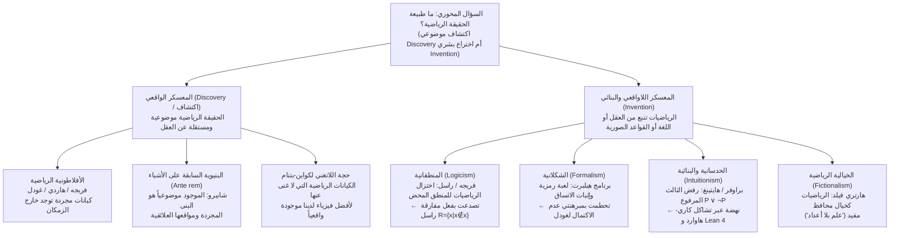
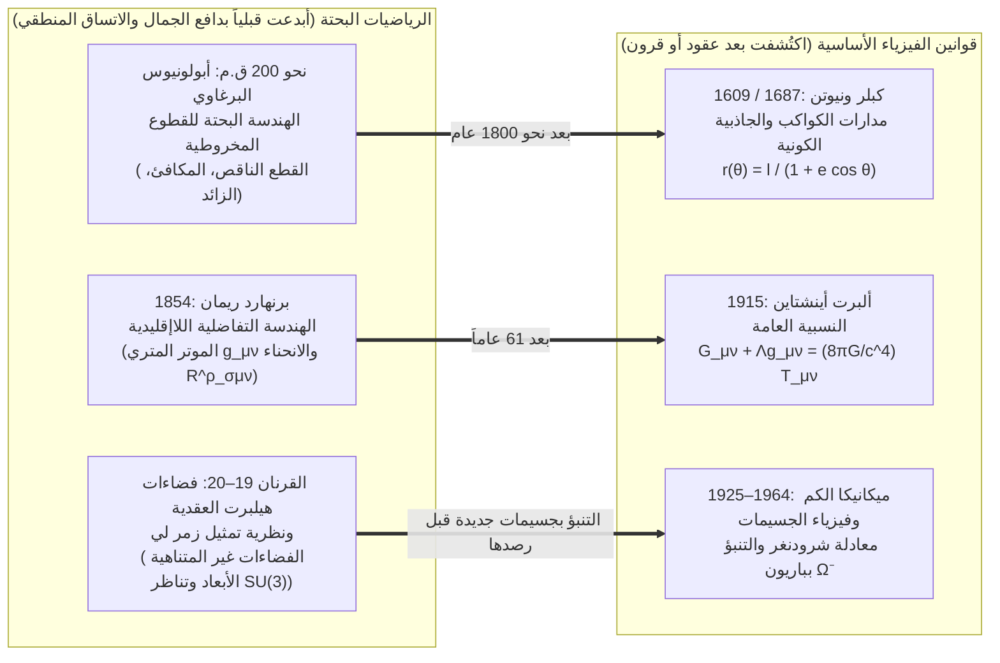

## مقدمة: هل كانت مجموعة ماندلبروت موجودة قبل الانفجار العظيم؟

في عام 1980، قام عالم الرياضيات بنوا ماندلبروت (Benoit Mandelbrot) باستخدام الحاسوب بتصوير سلوك علاقة تكرارية تربيعية بسيطة للغاية في المستوى العقدي:

$$z_{n+1} = z_n^2 + c \qquad (z_0 = 0,\; c \in \mathbb{C})$$

إن مجموعة جميع المعاملات العقدية $c$ التي تظل عندها المتتالية $\{z_n\}$ محدودة عندما تؤول $n \to \infty$ تشكّل ما يُعرف اليوم باسم <strong>مجموعة ماندلبروت ($\mathcal{M}$)</strong>. وعند تكبير حدودها (التي أُثبت أن بُعد هاوسدورف الخاص بها يساوي $2$ بالضبط)، ينكشف عالم لا ينضب من التعقيد الهندسي: أودية فرس البحر الحلزونية، والخيوط الدقيقة، والنسخ المصغرة المتداخلة إلى ما لا نهاية والتي لم يصممها أي عقل بشري من قبل.

يرغمنا هذا المشهد على مواجهة أحد أعمق الأسئلة الأنطولوجية والإبستمولوجية: هل <strong>اخترع (Invented)</strong> ماندلبروت هذه البنية أم <strong>اكتشفها (Discovered)</strong>؟

إذا فكرنا في لعبة الشطرنج، فلا أحد يعتقد أن قاعدة «التبييت» كانت موجودة في الكون البدائي قبل الحضارة البشرية؛ فالشطرنج بوضوح <strong>اختراع</strong> ثقافي. ولكن ماذا عن مبرهنة إقليدس حول لانهائية الأعداد الأولية، أو متطابقة أويلر $e^{i\pi} + 1 = 0$، أو الهندسة الكسيرية (الفراكتالية) لمجموعة $\mathcal{M}$؟ حتى لو لم تتطور حياة عاقلة في كوننا قط، أو لو طورت حضارة فضائية في مجرة المرأة المسلسلة رياضياتها الخاصة، يبدو من المؤكد أن العدد $17$ سيظل أولياً، وأن نسبة محيط الدائرة إلى قطرها في الفضاء الإقليدي ستظل $\pi$، وأن العلاقة $z_{n+1} = z_n^2 + c$ سترسم نفس الشكل الكسيري دون أدنى اختلاف.

غير أنه إذا كانت الأعداد والمجموعات والمتنوعات التفاضلية وفضاءات هيلبرت موجودة باستقلال عن العقل البشري، <strong>فأين</strong> توجد؟ نحن لا نستطيع رصد العدد $7$ بالتلسكوب ولا مصادمة المجموعة الخالية $\emptyset$ في مسرّع جسيمات. وإذا كانت الكيانات الرياضية تسكن عالماً أفلاطونياً خارج الزمان والمكان، فكيف يمكن لدماغ بشري بيولوجي أن يتصل بكيانات خاملة سببياً؟ وبالعكس، إذا كانت الرياضيات مجرد لعبة رمزية اخترعها الإنسان، فلماذا تتنبأ بانحناء الزمكان والعالم الكمي بدقة مذهلة؟ يستعرض هذا المقال المدارس الست الكبرى في <strong>فلسفة الرياضيات</strong> ويحلل لغز يوجين ويغنر الشهير حول <strong>«الفعالية غير المعقولة للرياضيات في العلوم الطبيعية»</strong>.

---

## الفصل الأول: الأفلاطونية الرياضية (الواقعية) ومعضلتا بيناسيراف

### 1.1 أفلاطون، فريجه، هاردي وغودل حول الواقع الرياضي الموضوعي

في ممارستهم البحثية اليومية، يعمل معظم علماء الرياضيات بوصفهم <strong>أفلاطونيين رياضيين (واقعيين)</strong> بالفطرة. وقد تطورت هذه الرؤية من نظرية المُثُل عند <strong>أفلاطون</strong> إلى صياغة منطقية صارمة على يد <strong>غوتلوب فريجه</strong>، و<strong>ج. هـ. هاردي</strong>، و<strong>كورت غودل</strong>:
* <strong>مناهضة النزعة النفسانية عند فريجه</strong>: في كتابه «أسس الحساب» (1884) ومقاله «الفكر» (1918)، دحض فريجه النزعة النفسانية التي تختزل الأعداد إلى تصورات ذهنية ذاتية. فلو كان العدد $2$ مجرد حالة عصبية في دماغي، لكان لكل إنسان عدد «$2$» خاص به، ولانهارت الحقيقة الموضوعية الكلية للمعادلة $2+2=4$. وإلى جانب العالم المادي والعالم النفسي الذاتي، يفترض فريجه وجود <strong>«عالم ثالث» (*Drittes Reich*)</strong> يضم الكيانات المجردة الموضوعية.
* <strong>واقعية هاردي وغودل</strong>: كتب هاردي في «دفاع عالم رياضيات» (1940): «إن 317 عدد أولي، ليس لأننا نعتقد ذلك، بل <strong>لأنه كذلك (because it is so)</strong>، لأن الواقع الرياضي مبني على هذا النحو». كما أكد كورت غودل (1947/1964) أثناء دراسته لفرضية المتصل ($2^{\aleph_0} = \aleph_1$) أن المجموعات موجودة موضوعياً وأن العقل البشري يمتلك <strong>«حدساً رياضياً»</strong> يماثل الإدراك الحسي.

تتحدد الأفلاطونية القياسية بثلاث أطروحات: (1) <strong>الوجود</strong> الموضوعي للكيانات الرياضية؛ (2) <strong>التجريد</strong> (فهي خارج الزمكان و<strong>خاملة سببياً / Causally Inert</strong>)؛ و(3) <strong>الاستقلال</strong> التام عن العقل البشري.

### 1.2 المعضلة الإبستمولوجية لبيناسيراف (1973): جدار الخمول السببي

في عام 1973، طرح الفيلسوف الأمريكي <strong>بول بيناسيراف (Paul Benacerraf)</strong> في ورقته الشهيرة *«Mathematical Truth»* اعتراضاً قاتلاً ضد الأفلاطونية:
1. <strong>مطلب الاتساق الدلالي</strong>: يجب تحليل الجمل الرياضية («يوجد عدد أولي أكبر من 17») بنفس دلالة شروط الصدق التارسكية المستخدمة في الجمل التجريبية، مما يتطلب أن يمر المكمّم الوجودي $\exists x$ على أشياء موجودة فعلاً ($\implies$ <strong>الأفلاطونية</strong>).
2. <strong>مطلب الإبستمولوجيا الطبيعية</strong>: لكي يمتلك كائن بيولوجي ذو دماغ مادي معرفة موثوقة عن مجال $D$ (أو لتفسير الموثوقية غير العرضية لمعتقداتنا الرياضية وفق صياغة هارتري فيلد عام 1989)، لا بد من وجود رابط سببي أو معلوماتي بين $D$ وحالاتنا الإدراكية.

التناقض صارخ: فبحسب التعريف الأفلاطوني، الكيانات المجردة <strong>خاملة سببياً</strong>؛ فالأعداد الأولية لا تطلق فوتونات ولا تحفز خلايا عصبية. فإذا كانت الأفلاطونية صحيحة، <strong>تصبح المعرفة الرياضية مستحيلة من حيث المبدأ</strong>!

### 1.3 مشكلة التعيين لبيناسيراف (1965) والبنيوية الرياضية

في عام 1965، كشف بيناسيراف في مقاله *«What Numbers Could Not Be»* عن <strong>مشكلة الاختزالات المتعددة (Identification Problem)</strong>. في نظرية المجموعات، يمكن بناء الأعداد الطبيعية $0, 1, 2, 3, \dots$ بطرق لا حصر لها:
* <strong>بناء تسيرميلو (1908)</strong>: $0_Z = \emptyset,\; 1_Z = \{\emptyset\},\; 2_Z = \{\{\emptyset\}\},\; 3_Z = \{\{\{\emptyset\}\}\}, \dots$ ($S(n) = \{n\}$).
* <strong>أعداد فون نويمان الترتيبية (1923)</strong>: $0_N = \emptyset,\; 1_N = \{\emptyset\},\; 2_N = \{\emptyset, \{\emptyset\}\},\; 3_N = \{\emptyset, \{\emptyset\}, \{\emptyset, \{\emptyset\}\}\}, \dots$ ($S(n) = n \cup \{n\}$).

كلا البناءين يحقق مسلمات بيانو وهما متشاكلان في كل الحساب. لكن عند السؤال: «هل يتحقق $1 \in 3$؟»، يجيب بناء فون نويمان بـ <strong>صادق</strong> ($1_N \in 3_N$) بينما يجيب بناء تسيرميلو بـ <strong>كاذب</strong> ($1_Z \notin 3_Z$)! فأيهما هو «العدد $3$ الحقيقي»؟ لا واحد منهما بذاته: استنتج بيناسيراف أن <strong>«الأعداد لا يمكن أن تكون أشياء منفردة على الإطلاق»</strong>.

ومن هنا ولدت <strong>البنيوية الرياضية (ستيوارت شابيرو، مايكل ريزنيك، جيفري هيلمان)</strong>: لا تدرس الرياضيات أشياء معزولة، بل تدرس <strong>البنى المجردة والمواقع العلائقية («الأماكن») داخلها</strong>. فالعدد «$2$» ليس سوى الموقع الواقع بين $1$ و$3$ في أي متتالية-$\omega$. ويدافع شابيرو عن <strong>بنيوية سابقة على الأشياء (*ante rem*)</strong>، بينما يطرح هيلمان <strong>بنيوية جهوية (*in re* / Modal Structuralism)</strong> تترجم الرياضيات عبر مؤثري الضرورة والإمكان $\Box$ و$\Diamond$.

---

## الفصل الثاني: أزمة الأسس: المنطقانية، الشكلانية، والحدسانية

### 2.1 المنطقانية ومفارقة راسل

سعت <strong>المنطقانية</strong> (فريجه، راسل، وايتهيد) إلى إثبات أن الرياضيات كلها تختزل إلى المنطق المحض. وفي «القوانين الأساسية للحساب»، اعتمد فريجه على القانون الأساسي الخامس (الشمول غير المقيد). وفي عام 1902، صاغ <strong>برتراند راسل</strong> المجموعة $R = \{x \mid x \notin x\}$، مفجراً <strong>مفارقة راسل</strong>:

$$R = \{x \mid x \notin x\} \quad \Longrightarrow \quad R \in R \iff R \notin R$$

وفي كتاب *Principia Mathematica* (1910–1913)، أدخل راسل ووايتهيد نظرية الأنماط المتفرعة لتفادي الإحالة الذاتية، لكنهما اضطرا إلى افتراض مسلمة اللانهاية ومسلمة القابلية للاختزال، وهما ليستا من المنطق المحض.

### 2.2 شكلانية هيلبرت ومبرهنتا عدم الاكتمال لغودل

لإنقاذ فردوس كانتور اللانهائي، أطلق <strong>ديفيد هيلبرت</strong> <strong>الشكلانية</strong> و<strong>برنامج هيلبرت</strong>: صياغة الرياضيات الكلاسيكية كافة في نظام مسلمات صوري $T$ وإثبات <strong>اكتماله</strong> و<strong>اتساقه ($\text{Con}(T)$)</strong> بوسائل ميتا-رياضية <strong>تناهية (Finitary)</strong> خالصة.

غير أنه في عام 1931، نشر <strong>كورت غودل</strong> <strong>مبرهنتي عدم الاكتمال</strong>:
1. <strong>مبرهنة عدم الاكتمال الأولى</strong>: في أي نظام صوري متسق وقابل للأكسيمة عودياً $T$ يتضمن حساب بيانو ($\text{PA}$)، توجد جملة حسابية $G_T$ («أنا غير قابلة للإثبات في $T$») بحيث:
   $$T \nvdash G_T \quad \text{و} \quad T \nvdash \neg G_T$$
   إن $G_T$ <strong>صادقة في النموذج القياسي $\mathbb{N}$، لكنها غير قابلة للإثبات داخل $T$</strong>!
2. <strong>مبرهنة عدم الاكتمال الثانية</strong>: لا يمكن لأي نظام متسق $T$ من هذا النوع أن يثبت اتساقه الذاتي:
   $$T \nvdash \text{Con}(T)$$

فالحقيقة الرياضية أوسع حتماً من قابلية الإثبات الصوري.

### 2.3 الحدسانية وتشاكل كاري-هاوارد

أسس <strong>ل. إ. ي. براوفر</strong> وصاغ <strong>أرند هايتينغ</strong> <strong>الحدسانية / البنائية</strong> التي ترى الرياضيات <strong>نشاطاً بنائياً ذهنياً</strong> في حدس الزمان. ويعني الوجود ($\exists x P(x)$) امتلاك خوارزمية متناهية تبني شاهداً صريحاً $x$.

لذلك <strong>ترفض الحدسانية اللانهاية الفعلية</strong> كما ترفض <strong>مبدأ الثالث المرفوع ($P \lor \neg P$)</strong> وإلغاء النفي المزدوج ($\neg\neg P \to P$). وفي علوم الحاسوب الحديثة، انتصر هذا المنطق البنائي بفضل <strong>تشاكل كاري-هاوارد (Curry-Howard Isomorphism)</strong>:

$$\text{القضايا (Propositions)} \cong \text{الأنماط (Types)}, \qquad \text{البراهين (Proofs)} \cong \text{البرامج (Programs)}$$

فكل برهان بنائي هو برنامج حاسوبي قابل للتنفيذ مباشرة، وهو الأساس الذي تقوم عليه مساعدات الإثبات الحديثة مثل <strong>Coq (Rocq)</strong> و<strong>Agda</strong> و<strong>Lean 4</strong>.

---

## الفصل الثالث: مقارنة المدارس الست ونقاش اللاتغني

| المدرسة الفلسفية | الوضع الأنطولوجي للكيانات الرياضية | مصدر الحقيقة الرياضية (الإبستمولوجيا) | الموقف من اللانهاية الفعلية | أبرز الممثلين | الاعتراض / الحد الرئيسي |
| :--- | :--- | :--- | :--- | :--- | :--- |
| <strong>الأفلاطونية</strong> | كيانات مجردة موضوعية خارج الزمكان (<strong>اكتشاف</strong>) | البصيرة العقلية / الحدس الغودلي | قبول تام (التراتبية الفوق-متناهية) | أفلاطون، فريجه، هاردي، غودل | <strong>معضلة بيناسيراف الإبستمولوجية</strong> ومشكلة التعيين |
| <strong>المنطقانية</strong> | تختزل إلى مفاهيم منطقية وامتدادات فئات | استنباط تحليلي قبلي من المنطق المحض | تتطلب مسلمة اللانهاية غير المنطقية | فريجه، راسل، وايتهيد | <strong>مفارقة راسل</strong> ($R=\{x\mid x\notin x\}$) |
| <strong>الشكلانية</strong> | لا توجد كيانات؛ لعبة تركيبية بسلاسل الرموز (<strong>اختراع</strong>) | الاشتقاق الصوري + <strong>إثبات اتساق تناهي</strong> | تُقبل بوصفها «عناصر مثالية» مبسطة | ديفيد هيلبرت، هاسكل كاري | <strong>مبرهنتا غودل الأولى والثانية</strong> ($T \nvdash G_T,\; T \nvdash \text{Con}(T)$) |
| <strong>الحدسانية</strong> | بناءات ذهنية في الحدس الزماني (<strong>اختراع</strong>) | امتلاك خوارزمية بناء صريحة (BHK) | <strong>ترفض اللانهاية الفعلية</strong> (اللانهاية بالقوة فقط) | براوفر، هايتينغ، مارتن-لوف | رفض $P \lor \neg P$ يقيّد التحليل الكلاسيكي |
| <strong>البنيوية</strong> | <strong>مواقع علائقية</strong> داخل بنى مجردة | اللاتغير بالتشاكل أو الإمكان الجهوي | مقبولة عبر مسلمات فئوية أو جهوية | بيناسيراف، شابيرو، ريزنيك، هيلمان | إبستمولوجيا البنى *ante rem*؛ الجهة الأولية |
| <strong>الخيالية</strong> | غير موجودة؛ <strong>تخييلات مفيدة</strong> كشرلوك هولمز (<strong>اختراع</strong>) | الاتساق الداخلي لـ«السردية الرياضية» | تُستخدم بحرية كأداة تخييلية | هارتري فيلد، مارك بالاغير | <strong>حجة كواين-بتنام</strong>؛ عقبة فضاءات هيلبرت الكمية |

تؤكد <strong>حجة اللاتغني لكواين-بتنام (Indispensability Argument)</strong> أنه بما أن الكيانات الرياضية لا غنى عنها لأفضل نظرياتنا الفيزيائية، فإن كلانية التأكيد تلزمنا بالإيمان بوجودها الفعلي. وفي كتابه *Science Without Numbers* (1980)، رد <strong>هارتري فيلد</strong> بـ<strong>الخيالية الرياضية</strong>، معتبراً الرياضيات مجرد طريق استنتاجي مختصر («توسيع محافظ») وأعاد صياغة جاذبية نيوتن بلا أعداد — وإن كان هذا البرنامج يصطدم بفضاءات هيلبرت في ميكانيكا الكم.

---

## الفصل الرابع: لغز ويغنر: «الفعالية غير المعقولة للرياضيات في العلوم الطبيعية»

### 4.1 معجزة الاختراع الرياضي السابق للاكتشاف الفيزيائي

في عام 1960، نشر الحائز على جائزة نوبل في الفيزياء <strong>يوجين ويغنر (Eugene Wigner)</strong> مقاله الشهير *«The Unreasonable Effectiveness of Mathematics in the Natural Sciences»*. كيف نفسر أن نظريات رياضية ابتُكرت بصورة مستقلة تماماً بدافع الجمال الصوري، يتبين بعد عقود أو قرون أنها اللغة الدقيقة لأعمق قوانين الطبيعة؟

1. <strong>من قطوع أبولونيوس المخروطية إلى مدارات كبلر</strong>: درس أبولونيوس البرغاوي نحو عام 200 ق.م القطوع المخروطية بدافع هندسي بحت، ليتبين بعد 1800 عام أنها تصف بدقة مدارات الكواكب تحت قوة الجاذبية $1/r^2$ عند كبلر ونيوتن: $r(\theta) = \frac{\ell}{1 + e\cos\theta}$.
2. <strong>من هندسة ريمان إلى النسبية العامة لأينشتاين</strong>: وفرت هندسة المتنوعات المنحنية التي ابتكرها برنهارد ريمان عام 1854 الإطار الرياضي الجاهز لمعادلات مجال الجاذبية لأينشتاين عام 1915:
   $$R_{\mu\nu} - \frac{1}{2} R g_{\mu\nu} + \Lambda g_{\mu\nu} = \frac{8\pi G}{c^4} T_{\mu\nu}$$
3. <strong>من فضاءات هيلبرت وزمرة $\text{SU}(3)$ إلى باريون $\Omega^-$</strong>: تحكم الأعداد العقدية وفضاءات هيلبرت معادلة شرودنغر $i\hbar \frac{\partial}{\partial t}|\psi\rangle = \hat{H}|\psi\rangle$، وفي عام 1961 تنبأ موري غيل-مان بوجود وكتلة ($1672\text{ MeV}/c^2$) <strong>باريون $\Omega^-$</strong> (الذي رُصد عام 1964) انطلاقاً من موقع شاغر واحد في التمثيل العشاري لزمرة لي $\text{SU}(3)$.

### 4.2 أربع إجابات فلسفية والتركيب النهائي: «نحن نخترع المسلمات، ونكتشف المبرهنات»

تتضافر أربعة تفسيرات لحل هذا اللغز: (1) <strong>فرضية الكون الرياضي (MUH) لماكس تيغمارك</strong> (الكون المادي *هو* بنية رياضية)؛ (2) <strong>الواقعية البنيوية (Structural Realism)</strong> مقترنة بمبرهنة نويثر (قوانين الفيزياء هي لا متغيرات تناظر، والرياضيات تصنف كل التناظرات الممكنة منطقياً)؛ (3) <strong>انحياز الانتقاء لريتشارد هامينغ</strong> والإبستمولوجيا التطورية؛ و(4) <strong>التركيب الجدلي</strong>: <strong>نحن نخترع بحرية المفاهيم والمسلمات الأولية (مثل $z_{n+1} = z_n^2 + c$)، لكننا نكتشف المبرهنات والبنى التي تترتب عليها بضرورة موضوعية مطلقة.</strong>
