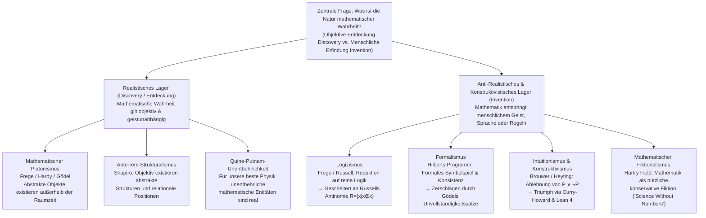
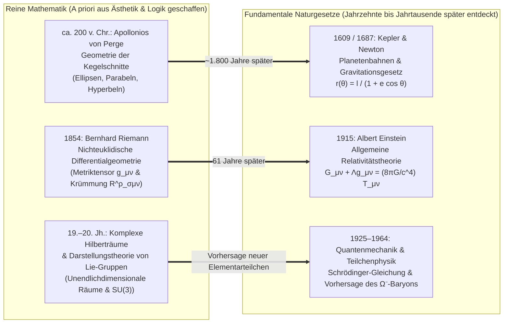

## Einleitung: Existierte die Mandelbrot-Menge schon vor dem Urknall?

Im Jahr 1980 visualisierte der Mathematiker Benoit Mandelbrot am Computer das Verhalten einer verblüffend einfachen quadratischen Rekursionsformel in der komplexen Zahlenebene:

$$z_{n+1} = z_n^2 + c \qquad (z_0 = 0,\; c \in \mathbb{C})$$

Die Menge aller komplexen Parameter $c$, für welche die Folge $\{z_n\}$ für $n \to \infty$ beschränkt bleibt, bildet die berühmte <strong>Mandelbrot-Menge ($\mathcal{M}$)</strong>. Zoomt man in ihren Rand hinein (dessen Hausdorff-Dimension exakt $2$ beträgt), offenbart sich ein unerschöpfliches Universum geometrischer Strukturen: spiralförmige „Seepferdchen-Täler“, filigrane Verästelungen und unendlich tief verschachtelte Miniaturkopien der Gesamtmenge – Strukturen, die niemals zuvor ein menschlicher Geist entworfen hatte.

Dieses Phänomen zwingt uns zu einer der tiefsten Fragen der Philosophie: Hat Mandelbrot diese Struktur <strong>erfunden (Invented)</strong> oder <strong>entdeckt (Discovered)</strong>?

Vergleichen wir dies mit dem Schachspiel: Niemand glaubt, dass die Rochade-Regel bereits vor der Entstehung der Menschheit im Kosmos existierte; Schach ist offenkundig eine kulturelle <strong>Erfindung</strong>. Doch wie steht es um den Satz des Euklid, dass es unendlich viele Primzahlen gibt, um die Eulersche Identität $e^{i\pi} + 1 = 0$ oder um die Geometrie der Mandelbrot-Menge? Selbst wenn im Universum niemals biologisches Leben entstanden wäre oder eine außerirdische Zivilisation in der Andromeda-Galaxie eine eigene Mathematik entwickelt hätte, wäre $17$ dennoch eine Primzahl, das Verhältnis von Kreisumfang zu Durchmesser im euklidischen Raum bliebe $\pi$, und die Rekursion $z_{n+1} = z_n^2 + c$ würde exakt dieselbe fraktale Grenze erzeugen.

Wenn Zahlen, Mengen, Mannigfaltigkeiten und Hilberträume jedoch unabhängig vom menschlichen Geist existieren – <strong>wo</strong> und <strong>was</strong> sind sie dann? Wir können die Zahl $7$ nicht durch ein Teleskop beobachten und die leere Menge $\emptyset$ nicht in einem Teilchenbeschleuniger zur Kollision bringen. Wenn mathematische Objekte in einem zeit- und raumlosen platonischen Ideenhimmel existieren, wie kann dann ein physisches menschliches Gehirn jemals kausalen Kontakt zu ihnen aufnehmen und verlässliches Wissen über sie erlangen? Und wenn Mathematik umgekehrt nur ein vom Menschen erfundenes Symbolspiel ist, warum beschreibt diese Erfindung dann Jahrhunderte später die Krümmung der Raumzeit und die Quantenwelt mit unheimlicher Präzision? Dieser Artikel untersucht systematisch die Hauptströmungen der <strong>Philosophie der Mathematik</strong> und analysiert schließlich Eugene Wigners berühmtes Rätsel der <strong>„unvernünftigen Effektivität der Mathematik in den Naturwissenschaften“</strong>.

---

## Kapitel 1: Mathematischer Platonismus (Realismus) und Benacerrafs Zwillingsdilemmata

### 1.1 Platon, Frege, Hardy und Gödel über objektive mathematische Realität

Die überwiegende Mehrheit arbeitender Mathematiker agiert im Forschungsalltag als instinktive <strong>mathematische Platonisten (Realisten)</strong>. Historisch wurzelt diese Sichtweise in <strong>Platons</strong> Ideenlehre: Während jeder in den Sand gezeichnete Kreis unvollkommen und vergänglich ist, gelten geometrische Sätze absolut und zeitlos für die unveränderlichen „Ideen (Formen)“.

In der Moderne wurde der Platonismus von <strong>Gottlob Frege</strong>, <strong>G. H. Hardy</strong> und <strong>Kurt Gödel</strong> logisch präzisiert:
* <strong>Freges Anti-Psychologismus</strong>: In den *Grundlagen der Arithmetik* (1884) und im Aufsatz *Der Gedanke* (1918) widerlegte Frege den Psychologismus, der Zahlen als subjektive psychische Vorstellungen im Kopf einzelner Menschen deutete. Wäre die Zahl $2$ nur ein Zustand meines Gehirns, gäbe es Milliarden privater „Zweien“ und keine objektive Wahrheit von $2+2=4$. Neben der physischen Außenwelt und der subjektiven Innenwelt muss es laut Frege ein <strong>„Drittes Reich“</strong> objektiver, nicht-sinnlicher Gedanken und mathematischer Gegenstände geben.
* <strong>Hardys und Gödels Realismus</strong>: G. H. Hardy schrieb 1940 in *A Mathematician's Apology*: „317 ist eine Primzahl, nicht weil wir es so denken, sondern <strong>weil es so ist (because it is so)</strong>, weil die mathematische Realität so gebaut ist.“ Kurt Gödel (1947/1964) argumentierte im Kontext der Kontinuumshypothese ($2^{\aleph_0} = \aleph_1$), dass Mengen unabhängig von unseren Axiomen existieren und der Mensch über eine <strong>„mathematische Intuition“</strong> verfügt, die analog zur Sinneswahrnehmung abstrakte Begriffe erfasst.

Der klassische Platonismus ruht auf drei Thesen: (1) <strong>Existenz</strong> (mathematische Objekte existieren), (2) <strong>Abstraktheit</strong> (sie befinden sich außerhalb von Raum und Zeit und sind <strong>kausal völlig inert / wirkungslos</strong>) und (3) <strong>Unabhängigkeit</strong> (sie sind unabhängig von menschlichem Denken und Beweisen).

### 1.2 Benacerrafs erkenntnistheoretisches Problem (1973): Die Mauer der kausalen Inertheit

Im Jahr 1973 formulierte <strong>Paul Benacerraf</strong> in seinem Aufsatz *„Mathematical Truth“* das berühmte <strong>erkenntnistheoretische Dilemma (Benacerraf's Epistemological Problem)</strong>:
1. <strong>Semantische Uniformitätsforderung</strong>: Mathematische Sätze (wie „Es gibt eine Primzahl größer als 17“) müssen nach derselben Tarskischen Wahrheitsbedingungs-Semantik analysiert werden wie empirische Sätze. Damit der Existenzquantor $\exists x$ wahr ist, müssen die quantifizierten abstrakten Objekte real existieren ($\implies$ <strong>Platonismus</strong>).
2. <strong>Naturalistische Erkenntnistheorie</strong>: Damit ein biologischer Organismus mit einem physischen Gehirn verlässliches Wissen über eine Gegenstandsdomäne $D$ erwerben kann (bzw. um die nicht-zufällige Zuverlässigkeit unserer mathematischen Überzeugungen zu erklären, wie Hartry Field 1989 präzisierte), muss eine kausale oder informationstheoretische Verbindung zwischen $D$ und unseren Gehirnzuständen bestehen.

Der Widerspruch ist eklatant: Da platonische Objekte laut Definition außerhalb der Raumzeit stehen und <strong>kausal inert</strong> sind, senden Primzahlen keine Photonen aus und lösen keine neuronalen Aktionspotenziale aus. Wenn der Platonismus wahr ist, ist <strong>mathematisches Wissen für den Menschen prinzipiell unerreichbar</strong>!

### 1.3 Benacerrafs Identifikationsproblem (1965) und der mathematische Strukturalismus

Bereits 1965 hatte Benacerraf in *„What Numbers Could Not Be“* das <strong>Identifikationsproblem (Multiple Reductions Problem)</strong> aufgedeckt. In der Mengenlehre lassen sich die natürlichen Zahlen $0, 1, 2, 3, \dots$ auf unendlich viele verschiedene Weisen als reine Mengen konstruieren:
* <strong>Zermelos Konstruktion (1908)</strong>: $0_Z = \emptyset,\; 1_Z = \{\emptyset\},\; 2_Z = \{\{\emptyset\}\},\; 3_Z = \{\{\{\emptyset\}\}\}, \dots$ ($S(n) = \{n\}$).
* <strong>Von Neumanns Ordinalzahlen (1923)</strong>: $0_N = \emptyset,\; 1_N = \{\emptyset\},\; 2_N = \{\emptyset, \{\emptyset\}\},\; 3_N = \{\emptyset, \{\emptyset\}, \{\emptyset, \{\emptyset\}\}\}, \dots$ ($S(n) = n \cup \{n\}$).

Beide Systeme erfüllen die Peano-Axiome perfekt und sind arithmetisch isomorph. Doch auf die Frage „Gilt $1 \in 3$?“ antwortet von Neumann mit <strong>Wahr</strong> ($1_N \in 3_N$), Zermelo hingegen mit <strong>Falsch</strong> ($1_Z \notin 3_Z$)! Welche Menge ist nun die „wahre Zahl $3$“? Da keine Antwort Vorrang hat, folgerte Benacerraf: <strong>„Zahlen können überhaupt keine isolierten ‚Gegenstände (Objects)‘ sein!“</strong>

Daraus entstand der <strong>mathematische Strukturalismus (Stewart Shapiro, Michael Resnik, Geoffrey Hellman)</strong>: Mathematik handelt nicht von isolierten Objekten, sondern von <strong>abstrakten Strukturen und den relationalen Positionen („Stellen“) innerhalb dieser Strukturen</strong>. So wie das Amt des „Präsidenten“ oder die Position des „Torwarts“ durch Spielregeln definiert ist und von verschiedenen Personen ausgefüllt werden kann, ist die Zahl „$2$“ schlicht die zweite Position nach $0$ und $1$ in jeder beliebigen $\omega$-Sequenz. Während Shapiro einen <strong>*Ante-rem*-Strukturalismus</strong> vertritt (Strukturen existieren objektiv vor ihren Instanzen), übersetzt Hellmans <strong>modaler Strukturalismus (*in re*)</strong> mathematische Aussagen mithilfe der Modaloperatoren $\Box$ und $\Diamond$ in Aussagen über alle logisch möglichen Systeme.

---

## Kapitel 2: Die Grundlagenkrise: Logizismus, Formalismus und Intuitionismus

### 2.1 Logizismus und die Russellsche Antinomie

Der von Frege, Bertrand Russell und A. N. Whitehead vertretene <strong>Logizismus</strong> wollte zeigen, dass die gesamte Mathematik auf reine Logik reduzierbar ist. In seinen *Grundgesetzen der Arithmetik* nutzte Frege das Grundgesetz V (unbeschränktes Komprehensionsprinzip), wonach jedes Prädikat $\varphi(x)$ eine Menge $\{x \mid \varphi(x)\}$ definiert.

1902 entdeckte Russell durch Wahl des Prädikats $x \notin x$ die <strong>Russellsche Antinomie (Russell's Paradox)</strong>:

$$R = \{x \mid x \notin x\} \quad \Longrightarrow \quad R \in R \iff R \notin R$$

Um diesen Widerspruch zu vermeiden, entwickelten Russell und Whitehead in den *Principia Mathematica* (1910–1913) die verzweigte Typentheorie, mussten jedoch das Unendlichkeitsaxiom und das Reduzibilitätsaxiom postulieren – womit der reine Logizismus scheiterte.

### 2.2 Hilberts Formalismus und Gödels Unvollständigkeitssätze

Um Cantors Mengenlehre („Cantors Paradies“) zu sichern, begründete <strong>David Hilbert</strong> den <strong>Formalismus</strong> und das <strong>Hilbert-Programm</strong>. Hilbert unterschied zwischen inhaltlich-anschaulicher <strong>finiter Mathematik</strong> und der <strong>idealen (infinitären) Mathematik</strong>, welche das Aktual-Unendliche als formales Hilfsmittel nutzt. Sein Ziel war es, die gesamte klassische Mathematik als formales Axiomensystem $T$ darzustellen und mit rein <strong>finiten metamathematischen Mitteln</strong> dessen <strong>Vollständigkeit</strong> und <strong>Widerspruchsfreiheit ($\text{Con}(T)$)</strong> zu beweisen.

Doch 1931 zerstörte der 25-jährige <strong>Kurt Gödel</strong> diesen Traum mit seinen beiden <strong>Unvollständigkeitssätzen (Gödel's Incompleteness Theorems)</strong>:
1. <strong>Erster Unvollständigkeitssatz</strong>: In jedem widerspruchsfreien, rekursiv axiomatisierbaren System $T$, das die Peano-Arithmetik ($\text{PA}$) enthält, existiert ein selbstbezüglicher arithmetischer Satz $G_T$ („Ich bin in $T$ nicht beweisbar“), sodass gilt:
   $$T \nvdash G_T \quad \text{und} \quad T \nvdash \neg G_T$$
   Im Standardmodell $\mathbb{N}$ ist $G_T$ <strong>inhaltlich wahr, aber in $T$ unbeweisbar</strong>!
2. <strong>Zweiter Unvollständigkeitssatz</strong>: Kein solches konsistentes System $T$ kann seine eigene Widerspruchsfreiheit mit eigenen Mitteln beweisen:
   $$T \nvdash \text{Con}(T)$$

Damit war bewiesen: <strong>Mathematische Wahrheit lässt sich niemals vollständig auf formale Beweisbarkeit reduzieren.</strong>

### 2.3 Intuitionismus und der Curry-Howard-Isomorphismus

Der von <strong>L. E. J. Brouwer</strong> begründete und von <strong>Arend Heyting</strong> formalisierte <strong>Intuitionismus / Konstruktivismus</strong> begreift Mathematik als <strong>geistige Konstruktionstätigkeit</strong> in der Anschauung der Zeit. Mathematische Existenz ($\exists x P(x)$) bedeutet strikt, über einen endlichen Algorithmus zur Konstruktion eines Zeugen $x$ zu verfügen.

Deshalb lehnt der Intuitionismus das <strong>Aktual-Unendliche</strong> sowie den <strong>Satz vom ausgeschlossenen Dritten ($P \lor \neg P$)</strong> und die Beseitigung der doppelten Verneinung ($\neg\neg P \to P$) ab! Für ungelöste Probleme wie die Goldbachsche Vermutung gilt $G \lor \neg G$ intuitionistisch nicht, und reine Widerspruchsbeweise ($\neg\forall x\neg P(x)$) liefern keinen konstruktiven Existenzbeweis.

In der modernen Informatik feierte die intuitionistische Logik durch den <strong>Curry-Howard-Isomorphismus</strong> einen triumphalen Durchbruch:

$$\text{Aussagen (Propositions)} \cong \text{Typen (Types)}, \qquad \text{Beweise (Proofs)} \cong \text{Programme (Programs)}$$

Jeder konstruktive Beweis ist direkt ein ausführbares Computerprogramm! Moderne Theorembeweiser wie <strong>Coq (Rocq)</strong>, <strong>Agda</strong> und <strong>Lean 4</strong> basieren exakt auf dieser konstruktiven Typentheorie.

---

## Kapitel 3: Vergleich der sechs Hauptströmungen und das Unentbehrlichkeitsargument

| Philosophische Schule | Ontologischer Status mathematischer Entitäten | Quelle mathematischer Wahrheit (Epistemologie) | Haltung zum Aktual-Unendlichen | Hauptvertreter | Zentrales Problem / Kritik |
| :--- | :--- | :--- | :--- | :--- | :--- |
| <strong>Platonismus</strong> | Zeitlose, objektive abstrakte Gegenstände (<strong>Entdeckung</strong>) | Rationale Einsicht & Gödelsche Intuition | Vollständige Akzeptanz (Transfinite Mengen) | Platon, Frege, Hardy, Gödel | <strong>Benacerrafs erkenntnistheoretisches Problem</strong> & Identifikationsproblem |
| <strong>Logizismus</strong> | Reduktion auf logische Begriffe und Klassen | Analytisch-apriorische Ableitung aus reiner Logik | Benötigt außerlogisches Unendlichkeitsaxiom | Frege, Russell, Whitehead | <strong>Russells Antinomie</strong> ($R=\{x\mid x\notin x\}$); Scheitern der reinen Logikreduktion |
| <strong>Formalismus</strong> | Keine Gegenstände; syntaktisches Symbolspiel (<strong>Erfindung</strong>) | Ableitbarkeit + finiter <strong>Konsistenzbeweis</strong> | Als „ideale Elemente“ zur Beweisvereinfachung | David Hilbert, Haskell Curry | <strong>Gödels 1. & 2. Unvollständigkeitssatz</strong> ($T \nvdash G_T,\; T \nvdash \text{Con}(T)$) |
| <strong>Intuitionismus</strong> | Mentale Konstruktionen im menschlichen Geist (<strong>Erfindung</strong>) | Besitz eines expliziten Konstruktionsalgorithmus | <strong>Ablehnung des Aktual-Unendlichen</strong> | Brouwer, Heyting, Martin-Löf | Verzicht auf $P \lor \neg P$ schränkt klassische Analysis ein |
| <strong>Strukturalismus</strong> | Relationale <strong>Positionen („Stellen“) in Strukturen</strong> | Erfassung struktureller Isomorphie / Modalität | Akzeptiert über kategorische Axiome oder Modalität | Benacerraf, Shapiro, Resnik, Hellman | Epistemologie abstrakter Strukturen; primitive Modalität |
| <strong>Fiktionalismus</strong> | Existieren nicht; nützliche <strong>Fiktionen</strong> (<strong>Erfindung</strong>) | Interne Konsistenz der „mathematischen Erzählung“ | Als fiktionales Werkzeug frei nutzbar | Hartry Field, Mark Balaguer | <strong>Quine-Putnam-Unentbehrlichkeit</strong>; Scheitern bei Quanten-Hilberträumen |

Mit dem <strong>Quine-Putnam-Unentbehrlichkeitsargument (Indispensability Argument)</strong> begründeten W. V. O. Quine und Hilary Putnam den mathematischen Realismus empirisch: Da reelle Zahlen, Mannigfaltigkeiten und Hilberträume für unsere besten physikalischen Theorien <strong>unentbehrlich</strong> sind, verpflichtet uns der Bestätigungsholismus auf ihre Existenz. Dagegen entwickelte <strong>Hartry Field</strong> in *Science Without Numbers* (1980) den <strong>mathematischen Fiktionalismus</strong>: Mathematik sei nur eine „konservative Erweiterung“ (Abkürzung) für physikalische Schlüsse. Field gelang zwar eine zahlenfreie Formulierung der Newtonschen Gravitation, doch an den unendlichdimensionalen Hilberträumen der Quantenmechanik stößt dieses Programm an enge Grenzen.

---

## Kapitel 4: Wigners Rätsel: „Die unvernünftige Effektivität der Mathematik in den Naturwissenschaften“

### 4.1 Das Wunder vorauseilender Mathematik und nachfolgender Physik

1960 veröffentlichte Nobelpreisträger <strong>Eugene Wigner</strong> seinen berühmten Essay *„The Unreasonable Effectiveness of Mathematics in the Natural Sciences“*. Warum passen mathematische Theorien, die völlig unabhängig von der Erfahrung aus rein ästhetischen oder formalen Motiven ersonnen wurden, Jahrzehnte oder Jahrhunderte später exakt auf die tiefsten Naturgesetze?

1. <strong>Kegelschnitte und Planetenbahnen</strong>: Apollonios von Perge untersuchte um 200 v. Chr. Kegelschnitte aus rein geometrischem Interesse; 1800 Jahre später zeigten Kepler und Newton, dass jede Bewegung im Gravitationsfeld $\mathbf{F} = -G\frac{Mm}{r^2}\hat{\mathbf{r}}$ exakt einem Kegelschnitt $r(\theta) = \frac{\ell}{1 + e\cos\theta}$ folgt.
2. <strong>Riemannsche Geometrie und Allgemeine Relativitätstheorie</strong>: 1854 entwickelte Bernhard Riemann die Differentialgeometrie gekrümmter Mannigfaltigkeiten; 1915 erkannte Albert Einstein, dass die physikalische Raumzeit genau eine solche $(3+1)$-dimensionale Mannigfaltigkeit ist:
   $$R_{\mu\nu} - \frac{1}{2} R g_{\mu\nu} + \Lambda g_{\mu\nu} = \frac{8\pi G}{c^4} T_{\mu\nu}$$
3. <strong>Hilberträume, Lie-Gruppe $\text{SU}(3)$ und das $\Omega^-$-Baryon</strong>: Komplexe Hilberträume wurden zum Fundament der Quantenmechanik ($i\hbar \frac{\partial}{\partial t}|\psi\rangle = \hat{H}|\psi\rangle$), und 1961 sagte Murray Gell-Mann allein aus einer freien Stelle im 10-dimensionalen Darstellungs-Dekuplett der Lie-Gruppe $\text{SU}(3)$ die Existenz und Masse ($1672\text{ MeV}/c^2$) des <strong>$\Omega^-$-Baryons</strong> voraus, das 1964 im Beschleuniger nachgewiesen wurde.

### 4.2 Vier Erklärungsansätze und Fazit: „Axiome werden erfunden, Theoreme entdeckt“

Zur Erklärung konkurrieren vier Ansätze: (1) <strong>Max Tegmarks Mathematische-Universum-Hypothese (MUH)</strong>, wonach das physikalische Universum selbst eine mathematische Struktur *ist*; (2) der <strong>Strukturenrealismus (Structural Realism)</strong> in Verbindung mit dem Noether-Theorem, wonach Naturgesetze Symmetrie-Invarianten sind und Mathematik alle logisch möglichen Symmetrien klassifiziert; (3) <strong>Richard Hammings Selektionsbias</strong> und evolutionäre Erkenntnistheorie; sowie (4) die <strong>dialektische Synthese</strong>: <strong>Wir erfinden frei die Begriffe, Regeln und Axiome (wie $z_{n+1} = z_n^2 + c$), aber sobald diese festgelegt sind, entdecken wir die daraus mit objektiver struktureller Notwendigkeit folgenden Theoreme.</strong>
