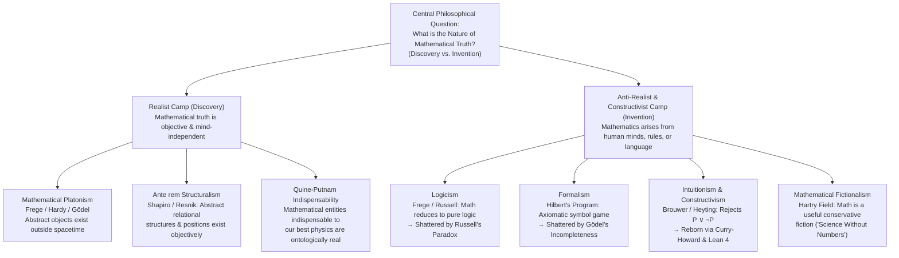
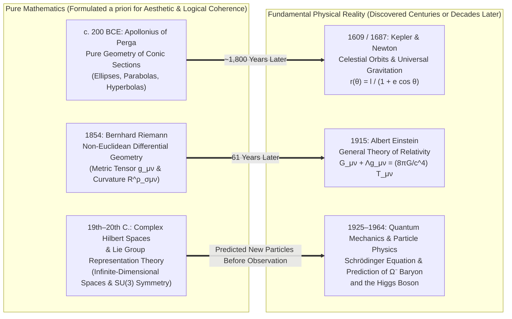

## Introduction: Did the Mandelbrot Set Exist Before the Big Bang?

In 1980, working at IBM's Thomas J. Watson Research Center, the mathematician Benoit Mandelbrot programmed a computer to visualize the behavior of a deceptively simple quadratic recurrence relation on the complex plane:

$$z_{n+1} = z_n^2 + c \qquad (z_0 = 0,\; c \in \mathbb{C})$$

The set of all complex parameters $c$ for which the orbit $\{z_n\}$ remains bounded as $n \to \infty$ forms what we now call the <strong>Mandelbrot Set ($\mathcal{M}$)</strong>. As Mandelbrot and subsequent researchers zoomed into the boundary $\partial \mathcal{M}$—a fractal curve whose Hausdorff dimension was later proven by Mitsuhiro Shishikura to be exactly $2$—they encountered a staggering, inexhaustible universe of geometric complexity: spiraling "seahorse valleys," filigree tendrils, and infinitely nested miniature copies of the whole set, none of which had ever been consciously designed by a human mind.

This spectacle forces every mathematician, physicist, and philosopher to confront one of the oldest and deepest questions in human inquiry: Did Mandelbrot <strong>invent</strong> this intricate structure, or did he <strong>discover</strong> it?

Consider the contrast with a game like chess. No one believes that the rules of castling or *en passant* existed in the primordial cosmos prior to human civilization; chess is transparently a cultural <strong>invention</strong>. Yet what about Euclid's theorem that there are infinitely many prime numbers, Euler's identity $e^{i\pi} + 1 = 0$, the classification of finite simple groups (including the Monster group $\mathbb{M}$ of order $\approx 8 \times 10^{53}$), or the fractal geometry of $\mathcal{M}$? Even if no sentient life had ever evolved in our universe, or if an alien civilization in the Andromeda galaxy developed mathematics from scratch, it seems undeniable that $17$ would still be prime, the ratio of a circle's circumference to its diameter in flat Euclidean space would still be $\pi$, and the boundedness locus of $z_{n+1} = z_n^2 + c$ would still trace out the exact same Mandelbrot set.

Yet if numbers, sets, manifolds, and Hilbert spaces exist *independently* of human minds, <strong>where</strong> and <strong>what</strong> are they? We cannot observe the number $7$ through a telescope, nor can we collide the empty set $\emptyset$ in a particle accelerator. If mathematical objects inhabit a timeless, non-physical Platonic realm outside spacetime, how can human beings—biological organisms equipped only with physical sensory organs and electrochemical neural networks—ever enter into contact with them or acquire reliable knowledge about them? Conversely, if mathematics is merely a formal game of symbol manipulation invented by human minds, why does this human invention predict the behavior of subatomic particles, spacetime curvature, and cosmic dynamics with terrifying, sixteen-decimal-place precision?

This article provides a rigorous, comprehensive investigation into the <strong>Philosophy of Mathematics</strong>. We examine the core ontological and epistemological clash between <strong>Mathematical Platonism (Realism)</strong>, <strong>Logicism</strong>, <strong>Formalism</strong>, <strong>Intuitionism (Constructivism)</strong>, <strong>Mathematical Structuralism</strong>, and <strong>Mathematical Fictionalism</strong>, culminating in an analysis of Eugene Wigner's famous enigma: <strong>"The Unreasonable Effectiveness of Mathematics in the Natural Sciences."</strong>

---

## Chapter 1: Mathematical Platonism (Realism) and Benacerraf's Twin Dilemmas

### 1.1 Plato, Frege, Hardy, and Gödel on Objective Mathematical Reality

When working mathematicians are immersed in proving theorems, the vast majority operate as instinctive <strong>Mathematical Platonists (Realists)</strong>. They experience their work not as arbitrary rule-making, but as an arduous expedition into an objective, unyielding landscape that resists their wishes and surprises their expectations.

The philosophical lineage of this view begins with <strong>Plato</strong> (*Republic*, *Meno*, *Phaedo*). Plato observed that every physical circle drawn in sand or crafted by a carpenter is imperfect and transient, whereas geometric theorems hold with absolute precision and eternity. He concluded that mathematical theorems describe not sensible physical things, but eternal, immutable, non-spatiotemporal <strong>Forms (Ideas)</strong> apprehended by pure intellect.

In the modern era, Mathematical Platonism was stripped of ancient mysticism and given rigorous logical articulation by <strong>Gottlob Frege</strong>, <strong>G. H. Hardy</strong>, and <strong>Kurt Gödel</strong>:
* <strong>Gottlob Frege's Anti-Psychologism</strong>: In *The Foundations of Arithmetic* (*Die Grundlagen der Arithmetik*, 1884) and his essay *Thought* (*Der Gedanke*, 1918), Frege demolished <strong>Psychologism</strong>—the view that numbers are subjective mental ideas (*Vorstellungen*) inside individual brains. If the number $2$ were merely a neural or psychological state in my mind, it would be numerically distinct from the number $2$ in your mind; there would be billions of private "twos," and the equation $2 + 2 = 4$ would be a contingent psychological report rather than an objective, universal truth. Frege argued that besides the *first realm* of physical objects and the *second realm* of subjective mental states, we must recognize a <strong>"Third Realm" (*Drittes Reich*)</strong> of objective, non-sensible thoughts and mathematical objects.
* <strong>G. H. Hardy's Realism</strong>: In *A Mathematician's Apology* (1940), the eminent British number theorist wrote:
  > "I believe that mathematical reality lies outside us, that our function is to discover or observe it, and that the theorems which we prove, and which we describe grandiloquently as our 'creations,' are simply our notes of our observations... 317 is a prime, not because we think so, or because our minds are shaped in one way rather than another, <strong>because it is so</strong>, because mathematical reality is built that way."
* <strong>Kurt Gödel's Conceptual Realism</strong>: Reflecting on Cantor's Continuum Hypothesis ($2^{\aleph_0} = \aleph_1$), which is independent of the standard Zermelo-Fraenkel axioms with the Axiom of Choice ($\text{ZFC}$), Gödel (1947/1964) argued that the question nevertheless possesses a determinate objective truth value because sets and concepts exist independently of human definitions. Just as sensory perception allows us to perceive physical bodies, Gödel posited a faculty of <strong>mathematical intuition</strong> through which the human mind perceives abstract concepts and axioms.

Formally, standard Mathematical Platonism is defined by the conjunction of three theses:
1. <strong>Existence</strong>: Mathematical objects (numbers, sets, functions, spaces) exist.
2. <strong>Abstractness</strong>: Mathematical objects are <strong>abstract</strong>—they are non-physical, non-mental, located outside spacetime, and completely <strong>causally inert</strong> (they neither act upon nor are acted upon by physical matter).
3. <strong>Independence</strong>: Mathematical objects and truths are entirely independent of intelligent agents, their language, and their practices of proof.

### 1.2 Benacerraf's Epistemological Problem (1973): The Wall of Causal Inertness

Despite its unmatched ability to account for the objectivity of mathematical truth, Platonism faces a devastating epistemological objection formulated by the Princeton philosopher <strong>Paul Benacerraf</strong> in his landmark 1973 paper, *"Mathematical Truth."*

Benacerraf demonstrated that two foundational desiderata for any philosophy of mathematics pull in diametrically opposite directions:
1. <strong>The Semantic Requirement (Uniform Tarskian Semantics)</strong>: Mathematical sentences should be analyzed using the exact same compositional truth-conditional semantics as ordinary empirical sentences. Consider the structural parallel between:
   $$\text{(Empirical): } \text{"There are at least three large cities older than New York."}$$
   $$\text{(Mathematical): } \text{"There are at least three perfect numbers greater than 17."}$$
   Both have the first-order logical form $\exists x \exists y \exists z \,(P(x) \land P(y) \land P(z) \land \dots)$. By Tarski's referential theory of truth, for the mathematical sentence to be literally true, its existential quantifiers must range over a domain of genuinely existing objects—namely, numbers ($\implies$ <strong>Platonism</strong>).
2. <strong>The Epistemological Requirement (Naturalized Epistemology)</strong>: Any acceptable account of truth must be compatible with a scientifically credible account of how human beings—finite biological organisms whose cognitive faculties operate via physical processes in spacetime—can come to *know* those truths. Under the causal theory of knowledge (or, more generally, as <strong>Hartry Field</strong> reformulated it in 1989, the demand to explain the <strong>non-accidental reliability</strong> of our mathematical beliefs), a cognitive agent $S$ can have reliable beliefs about a domain of entities $D$ only if there is an explanatory, causal, or information-theoretic link between the facts of $D$ and $S$'s belief states.

Here lies the trap: By the Platonist's own <strong>Abstractness Thesis</strong>, mathematical objects lie outside spacetime and are <strong>causally inert</strong>. Prime numbers emit no photons, exert no gravitational pull, and trigger no action potentials in human visual or prefrontal cortices. Even if the entire Platonic realm were instantaneously annihilated or altered, our physical brains would undergo the exact same physical states! Consequently, if Mathematical Platonism is true, <strong>mathematical knowledge is impossible</strong>—our beliefs about Platonic objects could be no more reliable than sheer coincidence. Conversely, if we adopt an anti-Platonist (combinatorial or constructivist) epistemology that grounds mathematical knowledge in human rule-following, we violate the Semantic Requirement and lose the literal truth of mathematics.

### 1.3 Benacerraf's Identification Problem (1965): "What Numbers Could Not Be"

Eight years earlier, in his classic 1965 paper *"What Numbers Could Not Be,"* Benacerraf uncovered a second fundamental crisis for object-based Platonism: the <strong>Multiple Reductions / Identification Problem</strong>.

In modern foundational mathematics, natural numbers $0, 1, 2, 3, \dots$ are reduced to pure sets built iteratively from the empty set $\emptyset$. However, there are infinitely many distinct, equally valid ways to perform this set-theoretic construction. The two most famous are:
* <strong>Ernst Zermelo's progression (1908)</strong>, where $0 = \emptyset$ and the successor function is $S(n) = \{n\}$:
  $$0_Z = \emptyset, \quad 1_Z = \{\emptyset\}, \quad 2_Z = \{\{\emptyset\}\}, \quad 3_Z = \{\{\{\emptyset\}\}\}, \dots$$
* <strong>John von Neumann's ordinal progression (1923)</strong>, where $0 = \emptyset$ and the successor function is $S(n) = n \cup \{n\}$:
  $$0_N = \emptyset, \quad 1_N = \{\emptyset\}, \quad 2_N = \{\emptyset, \{\emptyset\}\}, \quad 3_N = \{\emptyset, \{\emptyset\}, \{\emptyset, \{\emptyset\}\}\}, \dots$$

Both progressions satisfy the Dedekind-Peano axioms, and every purely arithmetic theorem ($2 + 2 = 4$, Fermat's Little Theorem, the Prime Number Theorem) holds identically in both. Yet as set-theoretic *objects*, they are completely different! If we ask the set-theoretic question "Does $1 \in 3$?", Von Neumann's progression answers <strong>True</strong> ($1_N \in 3_N$, and each number $n_N$ has exactly $n$ elements), whereas Zermelo's progression answers <strong>False</strong> ($1_Z \notin 3_Z$, since $3_Z$ is a singleton set containing only $2_Z$).

Benacerraf observed that if the natural number $3$ were a specific, freestanding Platonic *object*, there would have to be a determinate metaphysical fact of the matter as to whether $3 = \{\{\{\emptyset\}\}\}$ or $3 = \{\emptyset, \{\emptyset\}, \{\emptyset, \{\emptyset\}\}\}$. Because it is patently absurd that one progression is "the real numbers" and the other is an impostor, Benacerraf drew a revolutionary ontological conclusion: <strong>"Numbers could not be objects at all!"</strong> To be the number $3$ is nothing more and nothing less than to occupy the third relational position in any progression ($\omega$-sequence) satisfying the Peano axioms.

---

## Chapter 2: Mathematical Structuralism: From Objects to Relational Positions

Benacerraf's insight gave birth to one of the most influential movements in contemporary philosophy of mathematics: <strong>Mathematical Structuralism</strong>, championed by <strong>Stewart Shapiro</strong>, <strong>Michael Resnik</strong>, <strong>Charles Parsons</strong>, and <strong>Geoffrey Hellman</strong>.

Structuralism holds that the subject matter of any branch of mathematics (arithmetic, real analysis, group theory, topology) is not a collection of isolated, intrinsically characterized objects, but rather <strong>abstract structures (patterns) and the relational positions ("places" or "offices") within them</strong>.

Consider the "shortstop" in baseball or the "President" in a constitutional republic. The shortstop is not a particular human individual; it is a *position* defined entirely by its structural relations to first base, second base, the pitcher, and the rules of baseball. Different human players can *exemplify* or *fill* the office of shortstop in different games. Analogously, the natural number $2$ has no internal metaphysical essence beyond its structural relations to $0, 1, 3, 4, \dots$ within the <strong>natural number structure ($\mathbb{N}, 0, S$)</strong>. Both Zermelo's $\{\{\emptyset\}\}$ and von Neumann's $\{\emptyset, \{\emptyset\}\}$ are simply different set-theoretic *systems* that instantiate the same abstract $\omega$-sequence structure.

Within Structuralism, philosophers divide into two major camps regarding the ontological status of structures themselves:
1. <strong>*Ante rem* Structuralism (Platonist Structuralism — Stewart Shapiro)</strong>: Just as Platonic universals exist prior to (*ante rem*) their concrete instances, abstract structures (such as the natural number structure or the Monster group structure) exist objectively and independently of whether any physical or set-theoretic system happens to exemplify them. Within an *ante rem* structure, the "places" themselves function as bona fide objects when viewed from the "places-as-objects" perspective.
2. <strong>*In re* / Modal Structuralism (Eliminative / Nominalist Structuralism — Geoffrey Hellman)</strong>: Seeking to avoid Platonic ontology altogether, Hellman's <strong>Modal Structuralism</strong> eliminates abstract structures as freestanding entities. Instead, any arithmetic statement $A$ is translated into two modal-logical claims using the operators $\Box$ (logical necessity) and $\Diamond$ (logical possibility):
   * <strong>Hypothetical Component</strong>: Necessarily, in *any* system $X$ that satisfies the second-order Peano Axioms $\text{PA}^2$, $A$ holds in $X$: $\Box \forall X \,(\text{PA}^2(X) \to A|_X)$.
   * <strong>Categorical Component</strong>: It is logically possible that there exists a system satisfying $\text{PA}^2$: $\Diamond \exists X \,\text{PA}^2(X)$ (which avoids vacuous truth without committing to the actual existence of Platonic sets).

---

## Chapter 3: The Foundational Crisis: Logicism, Formalism, and Intuitionism

Between the 1880s and the 1930s, the rapid rigorization of real analysis and Georg Cantor's creation of transfinite set theory ($\aleph_0, \aleph_1, 2^{\aleph_0}, \dots$) triggered the <strong>Foundational Crisis of Mathematics (*Grundlagenkrise der Mathematik*)</strong>. Three grand foundational schools—<strong>Logicism</strong>, <strong>Formalism</strong>, and <strong>Intuitionism</strong>—fought to secure the certainty of mathematics. Although each classical program encountered profound internal limits, their collision gave birth to modern mathematical logic and theoretical computer science.

### 3.1 Logicism (Frege, Russell, Whitehead) and Russell's Paradox

<strong>Logicism</strong>, pioneered by Gottlob Frege and later championed by Bertrand Russell and Alfred North Whitehead, sought to prove that <strong>all of pure mathematics—especially arithmetic and analysis—is reducible to pure logic</strong>. Against Immanuel Kant, who had famously argued in the *Critique of Pure Reason* (1781) that mathematical truths are <strong>synthetic *a priori*</strong> grounded in the pure intuitions of space and time, Frege argued that arithmetic is purely <strong>analytic *a priori*</strong>: its truths follow from general logical laws plus explicit definitions alone.

In his monumental *Grundgesetze der Arithmetik* (Vol. I, 1893; Vol. II, 1903), Frege defined the cardinal number of a concept $F$ as the extension (class) of all concepts equinumerous (in 1-to-1 correspondence via Hume's Principle) with $F$. To manipulate extensions, Frege relied on <strong>Basic Law V</strong>, which is equivalent to the <strong>Unrestricted Comprehension Principle</strong> of naive set theory: for any expressible property $\varphi(x)$, there exists the set of all and only those objects satisfying $\varphi(x)$:

$$\exists y \forall x \,(x \in y \iff \varphi(x))$$

In June 1902, just as Volume II of Frege's life work was going to press, <strong>Bertrand Russell</strong> sent him a devastating letter pointing out what happens when we choose the predicate $\varphi(x) \equiv (x \notin x)$ ("$x$ is not a member of itself"). Let $R$ be the set of all sets that do not contain themselves:

$$R = \{x \mid x \notin x\}$$

Asking whether $R$ is a member of itself ($R \in R$) yields an immediate, inescapable contradiction:

$$R \in R \iff R \notin R$$

If $R \in R$, then by the defining condition of $R$, $R \notin R$; conversely, if $R \notin R$, then $R$ satisfies the defining condition and therefore $R \in R$. This is <strong>Russell's Paradox</strong>. Frege was forced to add a tragic appendix confessing that the foundation of his edifice had been swept away.

Russell and Whitehead spent the next decade constructing *Principia Mathematica* (1910–1913), introducing <strong>Ramified Type Theory</strong> to stratify objects into a strict hierarchy of types ($0, 1, 2, \dots$) so that $x \in y$ is syntactically well-formed only when $\text{type}(y) = \text{type}(x) + 1$, rendering $x \notin x$ meaningless. However, to deduce standard mathematics within Type Theory, Russell had to postulate two extra axioms: the <strong>Axiom of Infinity</strong> (that there exist infinitely many individuals at the lowest type) and the <strong>Axiom of Reducibility</strong>. Because neither axiom is a tautology of pure logic, classical Logicism failed to establish that mathematics is nothing but logic (though <strong>Neo-Logicism</strong>, led by Crispin Wright and Bob Hale, later revived a partial program by replacing Basic Law V with <strong>Hume's Principle</strong>: $\#F = \#G \iff F \approx G$, which is consistent by Frege's Theorem).

### 3.2 Hilbert's Formalism and Gödel's Incompleteness Theorems

To rescue classical mathematics—including Cantor's transfinite set theory—from both set-theoretic paradoxes and constructivist attacks, the towering German mathematician <strong>David Hilbert</strong> launched <strong>Formalism</strong> and <strong>Hilbert's Program</strong> in the 1920s.

In its crudest version (<strong>Game Formalism</strong>), mathematics is viewed as a purely syntactic game played with meaningless marks on paper according to explicit transformation rules—no different in principle from chess, where the "bishop" has no external referent beyond the rule that it moves diagonally. Hilbert's own philosophy, however, was far more sophisticated. He divided mathematics into two domains:
1. <strong>Finitary (Real) Mathematics</strong>: Concrete, contentful statements about finite configurations of symbols (e.g., $2 + 3 = 5$ or checking whether a finite string of symbols is a valid proof), whose truth is directly verifiable by concrete intuition without any appeal to the infinite.
2. <strong>Infinitary (Ideal) Mathematics</strong>: Classical mathematics involving actual infinities ($\mathbb{R}$, $\aleph_1$, non-constructive existence proofs). Just as algebraists adjoin the imaginary unit $i = \sqrt{-1}$ as an "ideal element" to simplify theorems about real polynomials, Hilbert argued that transfinite statements are <strong>ideal elements</strong> adjoined to finitary arithmetic to preserve the simplicity and power of classical logic (including the Law of Excluded Middle).

<strong>Hilbert's Program</strong> aimed to formalize the entirety of classical mathematics into a rigorous axiomatic system $T$ and then prove—using *only* universally accepted <strong>finitary methods</strong> in a new discipline he called <strong>Metamathematics (Proof Theory)</strong>—that $T$ is <strong>complete</strong> (capable of deciding every mathematical statement $A$ or $\neg A$) and <strong>consistent</strong> (incapable of deriving a contradiction $0 = 1$). Once consistency was finitarily proven, mathematicians could forever remain in "Cantor's paradise" with complete security.

In 1930, at a conference in Königsberg, Hilbert famously declared: *"Wir müssen wissen, wir werden wissen"* ("We must know, we will know"). Literally one day earlier in the very same city, a 24-year-old logician named <strong>Kurt Gödel</strong> quietly announced a result that would shatter Hilbert's Program forever. Published in 1931, <strong>Gödel's First and Second Incompleteness Theorems</strong> proved:

1. <strong>First Incompleteness Theorem</strong>: For any consistent, recursively axiomatizable formal system $T$ capable of expressing basic arithmetic (specifically, Robinson arithmetic $Q$ or Peano Arithmetic $\text{PA}$), there exists an explicit arithmetic sentence $G_T$ in the language of $T$ such that (assuming $\omega$-consistency, later weakened to plain consistency by J. Barkley Rosser in 1936):
   $$T \nvdash G_T \quad \text{and} \quad T \nvdash \neg G_T$$
   By assigning unique natural numbers (<strong>Gödel Numbers</strong> $\ulcorner \varphi \urcorner$) to every symbol, formula, and proof sequence, Gödel used the Diagonal Lemma to construct $G_T$ so that it is provably equivalent in $T$ to the statement *"The formula $G_T$ is not provable in $T$"*:
   $$T \vdash G_T \leftrightarrow \neg \text{Prov}_T(\ulcorner G_T \urcorner)$$
   Because $G_T$ is in fact unprovable in $T$, what $G_T$ asserts is <strong>true</strong> in the standard model of arithmetic $\mathbb{N}$! Thus, $G_T$ is a <strong>true mathematical statement that cannot be proven within the formal system $T$</strong>.
2. <strong>Second Incompleteness Theorem</strong>: Let $\text{Con}(T)$ be the canonical arithmetic formula expressing the consistency of $T$ (namely, $\neg \text{Prov}_T(\ulcorner 0 = 1 \urcorner)$). For any consistent recursively axiomatizable extension $T$ of Peano Arithmetic:
   $$T \nvdash \text{Con}(T)$$
   That is, <strong>no sufficiently powerful consistent formal system can prove its own consistency</strong>, let alone have its consistency proven by a strictly weaker finitary subsystem!

Gödel's theorems dealt a fatal blow to strict Formalism: <strong>mathematical truth cannot be equated with formal provability in any axiomatic system</strong>. No matter how many new axioms we add to our system $T$, a new undecidable Gödel sentence $G_{T'}$ immediately springs into existence.

### 3.3 Intuitionism, Constructivism, and the Curry-Howard Isomorphism

A third radical path was forged by the Dutch topologist <strong>L. E. J. Brouwer</strong> and formalized by his student <strong>Arend Heyting</strong>: <strong>Intuitionism</strong> (and more broadly, <strong>Constructivism</strong>, later developed by Errett Bishop and Per Martin-Löf).

For Brouwer, mathematics is neither the discovery of an external Platonic heaven nor a formal game played with ink marks on paper. Rather, mathematics is a <strong>languageless mental activity of the human mind</strong>, rooted in the primordial intuition of the flow of time (the "two-ity" of a moment splitting into past and present, generating the natural numbers $1, 2, 3, \dots$). Because mathematical objects are mental constructions, <strong>to exist in mathematics is to be constructed</strong>. There are no mind-independent mathematical truths waiting out there; a mathematical statement becomes true only when a mind constructs a proof of it.

This ontological stance forces a revolutionary revision of classical logic:
1. <strong>Rejection of Actual Infinity</strong>: An infinite set like $\mathbb{N}$ is never a completed totality (*Actual Infinity*); it is only an ever-growing, open-ended process of generation (*Potential Infinity*).
2. <strong>Rejection of the Law of Excluded Middle ($P \lor \neg P$) and Double Negation Elimination ($\neg\neg P \to P$)</strong>: Under the <strong>Brouwer-Heyting-Kolmogorov (BHK) Interpretation</strong> of intuitionistic logic:
   * A proof of $A \land B$ is a pair $\langle p, q \rangle$ where $p$ proves $A$ and $q$ proves $B$.
   * A proof of $A \lor B$ is a pair $\langle i, p \rangle$ where $i = 0$ and $p$ is a proof of $A$, or $i = 1$ and $p$ is a proof of $B$.
   * A proof of $A \to B$ is an effective construction (algorithm/function) that transforms any proof of $A$ into a proof of $B$.
   * A proof of $\exists x \in D \, P(x)$ is a pair $\langle a, p \rangle$ consisting of an explicitly constructed witness $a \in D$ together with a proof $p$ that $P(a)$ holds.

Consequently, one cannot assert $P \lor \neg P$ unless one actually possesses either a proof of $P$ or a refutation of $P$. For an unsolved problem like the Goldbach Conjecture ($G$), $G \lor \neg G$ is not intuitionistically valid! Moreover, proving $\neg \forall x \neg P(x)$ by *reductio ad absurdum* (showing that assuming no $x$ has property $P$ leads to a contradiction) does <strong>not</strong> establish $\exists x P(x)$, because a contradiction yields no algorithm for constructing a specific witness $x$.

Consider the classic theorem: <strong>"There exist two irrational numbers $a, b$ such that $a^b$ is rational."</strong>
* <strong>Classical Non-Constructive Proof</strong>: Consider $\sqrt{2}^{\sqrt{2}}$. By the Law of Excluded Middle, either $\sqrt{2}^{\sqrt{2}} \in \mathbb{Q}$ or $\sqrt{2}^{\sqrt{2}} \notin \mathbb{Q}$. If it is rational, set $a = \sqrt{2}, b = \sqrt{2}$. If it is irrational, set $a = \sqrt{2}^{\sqrt{2}}$ and $b = \sqrt{2}$; then $a^b = (\sqrt{2}^{\sqrt{2}})^{\sqrt{2}} = (\sqrt{2})^2 = 2 \in \mathbb{Q}$. Either way, such a pair exists! Yet an intuitionist rejects this proof because it fails to tell us *which* pair is the witness.
* <strong>Constructive Proof</strong>: A constructivist explicitly exhibits $a = \sqrt{2}$ (irrational) and $b = \log_2 9 = 2\log_2 3$ (constructively irrational since $3^m \ne 2^n$ for positive integers), and computes $a^b = (\sqrt{2})^{\log_2 9} = 3 \in \mathbb{Q}$ (or invokes the constructive Gelfond-Schneider theorem to prove $\sqrt{2}^{\sqrt{2}}$ is transcendental).

While Hilbert once fumed that taking the Law of Excluded Middle away from mathematicians was like "prohibiting the boxer the use of his fists," Intuitionism achieved a spectacular triumph in the late 20th and 21st centuries through the <strong>Curry-Howard Isomorphism (Propositions-as-Types / Proofs-as-Programs Correspondence)</strong> discovered by Haskell Curry and William Alvin Howard:

$$\begin{array}{ccc}
\textbf{Intuitionistic Logic} & \Longleftrightarrow & \textbf{Typed Lambda Calculus / Programming} \\
\text{Proposition } A & \longleftrightarrow & \text{Type } A \\
\text{Proof } p \text{ of } A & \longleftrightarrow & \text{Program / Term } t : A \\
\text{Implication } A \to B & \longleftrightarrow & \text{Function Type } A \to B \\
\text{Conjunction } A \land B & \longleftrightarrow & \text{Product / Pair Type } A \times B \\
\text{Disjunction } A \lor B & \longleftrightarrow & \text{Disjoint Sum Type } A + B \\
\text{Universal Quantifier } \forall x:A, B(x) & \longleftrightarrow & \text{Dependent Product Type } \Pi_{(x:A)} B(x) \\
\text{Existential Quantifier } \exists x:A, B(x) & \longleftrightarrow & \text{Dependent Sum Type } \Sigma_{(x:A)} B(x) \\
\text{Proof Normalization (Cut Elimination)} & \longleftrightarrow & \text{Program Execution ($\beta$-Reduction)}
\end{array}$$

Because constructive proofs contain explicit computational witnesses, every constructive proof *is* an executable computer program guaranteed by its type to satisfy its specification! This profound synthesis powers modern <strong>Interactive Theorem Provers (Proof Assistants)</strong> such as <strong>Coq (Rocq)</strong>, <strong>Agda</strong>, and <strong>Lean 4</strong>, which are today transforming how cutting-edge mathematics and verified software are built.

---

## Chapter 4: Comprehensive Comparison of the Six Major Schools

| Philosophical School | Ontological Status of Mathematical Entities | Source of Mathematical Truth & Knowledge (Epistemology) | Attitude Toward Actual Infinity | Key Proponents | Primary Vulnerability / Objection |
| :--- | :--- | :--- | :--- | :--- | :--- |
| <strong>Platonism (Realism)</strong> | Mind-independent, non-spatiotemporal <strong>abstract objects (Discovered)</strong> | Rational insight / Gödelian mathematical intuition | Fully embraced (all transfinite levels of the cumulative hierarchy $V$ exist) | Plato, Frege, Hardy, Gödel | <strong>Benacerraf's Epistemological Problem</strong> (causal inertness) & Identification Problem |
| <strong>Logicism</strong> | Reduced to logical concepts, classes, or extensions | Analytic *a priori* deduction from pure logic + explicit definitions | Requires Axiom of Infinity (breaking pure logicism) | Frege, Russell, Whitehead, C. Wright | <strong>Russell's Paradox</strong> ($R=\{x\mid x\notin x\}$); non-logical status of Infinity & Reducibility axioms |
| <strong>Formalism</strong> | No abstract objects; formal rules for manipulating syntactic strings (<strong>Invented</strong>) | Syntactic derivability from axioms + finitary <strong>consistency</strong> ($\text{Con}(T)$) | Treated as "ideal elements" (formal devices to streamline proofs) | David Hilbert, Haskell Curry | <strong>Gödel's 1st & 2nd Incompleteness Theorems</strong> ($T \nvdash G_T$ and $T \nvdash \text{Con}(T)$) |
| <strong>Intuitionism / Constructivism</strong> | Mental constructions built in human intuition over time (<strong>Invented</strong>) | Possession of an explicit finite construction / algorithm (BHK semantics) | <strong>Rejects Actual Infinity</strong>; accepts only Potential Infinity | L. E. J. Brouwer, Heyting, Bishop, Martin-Löf | Rejecting $P \lor \neg P$ invalidates classical non-constructive theorems in analysis |
| <strong>Structuralism</strong> | Relational <strong>positions ("places") within abstract structures</strong> | Grasping structural axioms, isomorphism invariance, or modal possibility | Accepted via categorical axioms ($\text{PA}^2, \text{ZFC}^2$) or modal consistency | Benacerraf, S. Shapiro, M. Resnik, G. Hellman | Epistemology of *ante rem* structures; reliance on primitive modality (*in re*) |
| <strong>Fictionalism</strong> | Do not exist; useful <strong>fictions</strong> like Sherlock Holmes (<strong>Invented</strong>) | Internal consistency ("truth according to the story of standard mathematics") | Freely usable as part of the mathematical fiction | Hartry Field, Mark Balaguer | <strong>Quine-Putnam Indispensability</strong>; difficulty nominalizing quantum Hilbert spaces |

---

## Chapter 5: The Indispensability Argument vs. Mathematical Fictionalism

### 5.1 The Quine-Putnam Indispensability Argument

In the second half of the 20th century, <strong>W. V. O. Quine</strong> and <strong>Hilary Putnam</strong> formulated the most powerful modern argument for Mathematical Realism—one that completely bypasses Gödelian mysticism by grounding mathematics in empirical natural science. The <strong>Quine-Putnam Indispensability Argument</strong> proceeds as follows:

1. <strong>Premise 1 (Ontological Commitment & Confirmational Holism)</strong>: We ought to have ontological commitment to all and only the entities that are <strong>indispensable</strong> to our best scientific theories. Because scientific theories face the "tribunal of experience" not as isolated sentences but as interconnected wholes (<strong>Quinean Holism</strong>), empirical confirmation of a physical theory confirms all the posits—both physical and mathematical—required to state the theory.
2. <strong>Premise 2 (Indispensability of Mathematics)</strong>: Mathematical entities (real and complex numbers, differential manifolds, tensor fields, Hilbert spaces, probability measures) are <strong>indispensable</strong> to our best scientific theories (General Relativity, Quantum Field Theory, Statistical Mechanics, Evolutionary Biology).
3. <strong>Conclusion</strong>: Therefore, we ought to be ontologically committed to the existence of mathematical entities on the exact same empirical grounds that we believe in electrons, quarks, and black holes.

As Putnam famously wrote in *Philosophy of Logic* (1971):
> "Quantification over mathematical entities is indispensable for science, both formal and physical; therefore we should accept such quantification; but this commits us to accepting the existence of the mathematical entities in question. This type of argument stems, of course, from Quine, who has for years stressed both the indispensability of quantification over mathematical entities and the intellectual dishonesty of denying the existence of what one daily presupposes."

### 5.2 Hartry Field's Fictionalism and *Science Without Numbers* (1980)

To defeat the Quine-Putnam argument without abandoning scientific naturalism, the philosopher <strong>Hartry Field</strong> mounted an audacious attack on Premise 2 in his 1980 book *Science Without Numbers*.

Field's position, <strong>Mathematical Fictionalism</strong>, asserts that there are no abstract objects whatsoever (<strong>Nominalism</strong>). Consequently, every existential mathematical statement (such as "There is an even prime number") is literally <strong>false</strong>, and every universal mathematical statement is vacuously true—for the exact same reason that "Sherlock Holmes lived at 221B Baker Street" is literally false in the real world (since Sherlock Holmes does not exist), though "true according to the fiction of Arthur Conan Doyle."

Why, then, is mathematics so extraordinarily useful in physics if it is false? Field argued that mathematics does not need to be *true* to be useful; it only needs to be <strong>conservative</strong>! A mathematical theory $M$ is <strong>conservative</strong> over a nominalistic (purely physical) scientific theory $N$ if, for any purely physical statement $\Phi$ that makes no reference to numbers or sets:

$$(N + M) \vdash \Phi \quad \Longrightarrow \quad N \vdash \Phi$$

That is, adjoining mathematics $M$ to our physical theory $N$ never generates any new physical conclusions that were not already logically implied by $N$ alone; mathematics merely provides an <strong>immensely shorter, computationally tractable deductive shortcut</strong>.

To prove that Premise 2 of the Indispensability Argument is false, Field actually carried out the <strong>nominalization of Newtonian gravitational theory</strong>. Instead of assigning real-number coordinates $(x, y, z, t) \in \mathbb{R}^4$ and a real-valued gravitational potential $\Phi: \mathbb{R}^4 \to \mathbb{R}$ satisfying Poisson's equation $\nabla^2 \Phi = 4\pi G \rho$, Field treated <strong>spacetime regions and points</strong> as concrete physical entities and axiomatized Newtonian gravity using purely qualitative, synthetic geometric predicates inspired by Hilbert's *Foundations of Geometry* (such as temporal precedence, spatial <strong>Betweenness</strong> $B(x, y, z)$, and gravitational-potential <strong>Congruence</strong>). Using representation and uniqueness theorems, Field proved that every physical prediction of standard mathematical Newtonian mechanics follows from his number-free physical axioms alone!

However, as <strong>David Malament</strong> and others demonstrated, Field's nominalization program hits a formidable wall when confronted with <strong>Quantum Mechanics</strong> and statistical mechanics. In Newtonian spacetime, the points $(x,y,z,t)$ are concrete locations in physical spacetime. In Quantum Mechanics, by contrast, the state of an $N$-particle system is a ray in an infinite-dimensional complex Hilbert space $\mathcal{H} = L^2(\mathbb{R}^{3N}, \mathbb{C})$, and observables are self-adjoint operators $\hat{A}$ acting on $\mathcal{H}$. There are no obvious "concrete physical spacetime points" capable of standing in for the propositions of a quantum logic lattice or amplitudes in configuration space. Thus, the battle between Indispensability Realists and Nominalist Fictionalists remains one of the liveliest frontiers in contemporary philosophy of science.

---

## Chapter 6: Wigner's Enigma: "The Unreasonable Effectiveness of Mathematics in the Natural Sciences"

### 6.1 The Miracle of Prior Mathematical Invention and Subsequent Physical Discovery

Whether one leans toward Platonism, Structuralism, or Constructivism, one must confront the astonishing historical phenomenon highlighted in 1960 by the Nobel Prize-winning physicist <strong>Eugene Wigner</strong> in his celebrated Courant Lecture, *"The Unreasonable Effectiveness of Mathematics in the Natural Sciences"*:

> "The miracle of the appropriateness of the language of mathematics for the formulation of the laws of physics is a wonderful gift which we neither understand nor deserve. We should be grateful for it and hope that it will remain valid in future research and that it will extend, for better or for worse, to our pleasure, even though perhaps also to our bafflement, to wide branches of learning."

If mathematics consisted solely of concepts abstracted directly from everyday physical measurements—like counting sheep with integers $1, 2, 3$ or measuring land plots with Euclidean triangles—its applicability to the world would be completely unsurprising. What makes the effectiveness of mathematics <strong>"unreasonable"</strong> (in the sense of defying any simple *a priori* explanation) is that <strong>mathematicians repeatedly develop deep, abstract structures purely for internal aesthetic beauty, logical generalization, or formal puzzle-solving, with zero connection to physical reality—only for physicists decades or centuries later to discover that nature's most fundamental laws are written in those exact mathematical structures!</strong>

Let us examine four monumental historical examples of this phenomenon:

1. <strong>From Apollonius's Conic Sections to Keplerian Orbits (An 1,800-Year Leap)</strong>:
   Around 200 BCE, the Greek geometer <strong>Apollonius of Perga</strong> wrote his eight-volume treatise *Conics*, investigating the intricate geometric properties of ellipses, parabolas, and hyperbolas obtained by slicing a double cone with a plane. For Apollonius and the Greeks, this was pure intellectual contemplation; they believed heavenly bodies moved in circles. Eighteen centuries later, <strong>Johannes Kepler</strong> (1609) discovered from Tycho Brahe's observations of Mars that planetary orbits are ellipses with the Sun at one focus, and <strong>Isaac Newton</strong> (1687) proved in the *Principia* that *any* body moving under an inverse-square central force $\mathbf{F} = -G\frac{Mm}{r^2}\hat{\mathbf{r}}$ must trace out a conic section:
   $$r(\theta) = \frac{\ell}{1 + e \cos\theta}$$
   Depending on total mechanical energy $E$, the trajectory is an ellipse ($E < 0, e < 1$), a parabola ($E = 0, e = 1$), or a hyperbola ($E > 0, e > 1$).
2. <strong>From Riemannian Geometry to Einstein's General Relativity (A 61-Year Leap)</strong>:
   In his 1854 *Habilitationsschrift* ("On the Hypotheses Which Lie at the Bases of Geometry"), <strong>Bernhard Riemann</strong> generalized Gauss's theory of surfaces to $n$-dimensional manifolds equipped with an intrinsic metric tensor $ds^2 = g_{\mu\nu} dx^\mu dx^\nu$ and a curvature tensor $R^\rho_{\sigma\mu\nu}$—purely as a foundational exercise in abstract geometry. Sixty-one years later, when <strong>Albert Einstein</strong> (1915) sought to reconcile gravity with the Equivalence Principle, his friend Marcel Grossmann pointed him to the tensor calculus of Riemann, Gregorio Ricci-Curbastro, and Tullio Levi-Civita. Einstein discovered that physical spacetime *is* a $(3+1)$-dimensional pseudo-Riemannian manifold whose Einstein curvature tensor $G_{\mu\nu} \equiv R_{\mu\nu} - \frac{1}{2}Rg_{\mu\nu}$ is directly proportional to the stress-energy tensor $T_{\mu\nu}$ of matter and radiation:
   $$R_{\mu\nu} - \frac{1}{2} R g_{\mu\nu} + \Lambda g_{\mu\nu} = \frac{8\pi G}{c^4} T_{\mu\nu}$$
   Even more miraculously, the purely geometric <strong>contracted Bianchi identity</strong> ($\nabla^\mu G_{\mu\nu} \equiv 0$), proven by mathematicians without any thought of physics, automatically guaranteed the local conservation of physical energy and momentum ($\nabla^\mu T_{\mu\nu} = 0$)!
3. <strong>From Imaginary Numbers and Hilbert Spaces to Quantum Mechanics</strong>:
   Sixteenth-century Italian algebraists (Cardano, Bombelli) invented the "fictitious" square root of minus one, $i = \sqrt{-1}$, merely as an algebraic trick to pass through intermediate steps in solving cubic equations $x^3 = px + q$. In the early 20th century, David Hilbert and John von Neumann developed the pure theory of infinite-dimensional inner-product spaces (<strong>Hilbert Spaces $\mathcal{H}$</strong>) and linear operators. When Werner Heisenberg, Erwin Schrödinger, Max Born, and Paul Dirac formulated <strong>Quantum Mechanics</strong> (1925–1930), they discovered that nature at its most fundamental level is not governed by real numbers at all, but by complex probability amplitudes $|\psi\rangle \in \mathcal{H}$ evolving unitarily via $i = \sqrt{-1}$:
   $$i\hbar \frac{\partial}{\partial t}|\psi(t)\rangle = \hat{H}|\psi(t)\rangle, \qquad [\hat{x}, \hat{p}] = i\hbar$$
4. <strong>From Lie Group Representation Theory to the $\Omega^-$ Baryon and the Higgs Boson</strong>:
   In the late 19th and early 20th centuries, Sophus Lie, Élie Cartan, and Hermann Weyl classified abstract continuous symmetry groups (<strong>Lie Groups</strong>) and their irreducible representations. In 1961, <strong>Murray Gell-Mann</strong> and <strong>Yuval Ne'eman</strong> noticed that known hadrons fit into the 8-dimensional adjoint representation (the "Eightfold Way") and the 10-dimensional symmetric representation (the <strong>decuplet</strong>) of the abstract special unitary group $\text{SU}(3)$. Nine of the ten slots in the spin-$3/2$ baryon decuplet were occupied by known particles ($\Delta, \Sigma^*, \Xi^*$), leaving <strong>one empty slot at the apex of the triangle</strong>. Purely from the mathematical structure of $\text{SU}(3)$, Gell-Mann predicted that a tenth particle—the <strong>Omega-minus ($\Omega^-$) baryon</strong>—must exist in nature with charge $Q = -1$, spin $J = 3/2$, strangeness $S = -3$, and a mass of approximately $1672\text{ MeV}/c^2$. In 1964, physicists at Brookhaven National Laboratory photographed the exact decay track of the $\Omega^-$ baryon at $1672.45\text{ MeV}/c^2$. Similarly, the mathematical requirement of local gauge invariance ($\text{SU}(3)_C \times \text{SU}(2)_L \times \text{U}(1)_Y$) combined with spontaneous symmetry breaking led Peter Higgs, François Englert, and Robert Brout in 1964 to predict the <strong>Higgs Boson</strong>, discovered at CERN's Large Hadron Collider in 2012.

### 6.2 Four Philosophical Explanations for the Unreasonable Effectiveness

How can we account for this uncanny harmony between pure mathematics and the physical cosmos? Contemporary philosophers and scientists offer four distinct explanatory frameworks:

1. <strong>Max Tegmark's Mathematical Universe Hypothesis (MUH — Radical Ontic Platonism)</strong>:
   In *Our Mathematical Universe* (2014), the MIT cosmologist <strong>Max Tegmark</strong> argues that if we accept the <strong>External Reality Hypothesis (ERH)</strong>—that there exists an external physical reality completely independent of humans—then a complete description of that reality must be expressible in a language completely free of human perceptual baggage ("baggage-free"). The only completely baggage-free description is a pure mathematical structure (sets of abstract entities with relations). Therefore, ERH implies the <strong>Mathematical Universe Hypothesis (MUH)</strong>: our physical universe is not merely *described* by mathematics; <strong>our physical universe *is* a mathematical structure</strong>. Mathematics is effective in physics for the trivial reason that the physical world is made of mathematics.
2. <strong>Ontic Structural Realism (OSR) and Symmetry Invariance</strong>:
   Developed by <strong>John Worrall</strong>, <strong>James Ladyman</strong>, and <strong>Steven French</strong>, <strong>Structural Realism</strong> offers a more moderate, scientifically grounded explanation. Mathematics is, by definition, the general science of <strong>structure, relational patterns, and invariance under transformations (symmetries)</strong>. Meanwhile, as <strong>Emmy Noether's Theorem (1918)</strong> proved, every fundamental conservation law in physics (conservation of energy, momentum, angular momentum, electric charge) is nothing other than the consequence of a continuous symmetry (invariance under time translation, space translation, rotation, or $\text{U}(1)$ phase shift) of the physical action $S = \int \mathcal{L}\,d^4x$. Because any objective law of nature must be invariant across different observers and reference frames, the possible forms that laws of nature can take are severely constrained by group theory and differential geometry. Mathematics hits the bullseye in physics because mathematics systematically catalogs all logically possible symmetry structures!
3. <strong>Richard Hamming's Selection Bias and Evolutionary Epistemology</strong>:
   In his 1980 response *"The Unreasonable Effectiveness of Mathematics,"* the computer scientist <strong>Richard Hamming</strong> offered a sobering Kantian and evolutionary counterpoint:
   * <strong>Evolutionary Shaping of the Mind</strong>: Human brains evolved over millions of years inside this physical universe. Our primordial intuitions of number (discrete objects), geometry (rigid body motion in 3D space), and linearity were sculpted by natural selection to match the macroscopic regularities of our environment.
   * <strong>Observational Selection Bias ("Looking Through Mathematical Glasses")</strong>: We selectively define "fundamental physics" as precisely those regular, symmetric, isolable phenomena where mathematics works brilliantly (planetary two-body problems, quantum harmonic oscillators, elementary particles), while conveniently ignoring or brackets off domains where mathematics is vastly less effective or only crudely approximate (turbulent fluid dynamics, protein folding, evolutionary contingencies, human consciousness, and socio-economic history). As Hamming quipped, if we walk around wearing blue-tinted glasses, we should not be astonished that the world looks blue!
4. <strong>The Dialectical Synthesis: Invented Axioms, Discovered Consequences</strong>:
   Finally, many contemporary philosophers of mathematics converge on a synthesis that transcends the simplistic binary of "pure invention" vs. "pure discovery."

---

## Conclusion: "We Invent the Concepts and Axioms; We Discover the Theorems"

So, is mathematics discovered or invented? The deepest insight of modern philosophy of mathematics is that <strong>it is inextricably both—operating at two distinct levels of logical architecture</strong>:

* <strong>The Moment of Invention (Conceptual & Axiomatic Freedom)</strong>: Human beings <strong>invent</strong> the initial concepts, definitions, notations, and axiomatic starting points. Whether we choose to study Euclidean geometry or Riemannian manifolds, commutative rings or non-abelian Lie groups, Zermelo-Fraenkel set theory ($\text{ZFC}$) or Homotopy Type Theory ($\text{HoTT}$), reflects human curiosity, physical experience, aesthetic judgment, and historical need. In this sense, the *entry points* into the mathematical landscape are creations of human culture.
* <strong>The Moment of Discovery (Objective Structural Necessity)</strong>: Once a set of axioms and rules of inference is fixed, <strong>human choice ends and objective necessity begins</strong>. Whether $317$ is prime, whether the Monster group has order $808,017,424,794,512,875,886,459,904,961,710,757,005,754,368,000,000,000$, whether $\text{PA}$ can prove its own consistency, or what fractal filaments emerge along the boundary of $z_{n+1} = z_n^2 + c$ are <strong>objective, mind-independent structural facts</strong> about what follows from those definitions. We cannot wish them away or legislate them otherwise.

Numbers and shapes do not need to float like ghostly physical statues in a supernatural heaven, nor are they mere ink marks on paper. They exist as <strong>objective possibilities of relational structure</strong>. When we invent an axiom system, we build a telescope; when we prove a theorem—or see that theorem mirrored in the curvature of spacetime and the symmetries of elementary particles—we look through that telescope and <strong>discover</strong> the deep structural architecture of reality itself.
