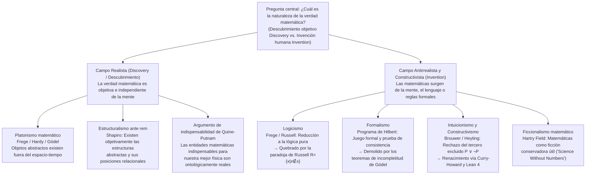
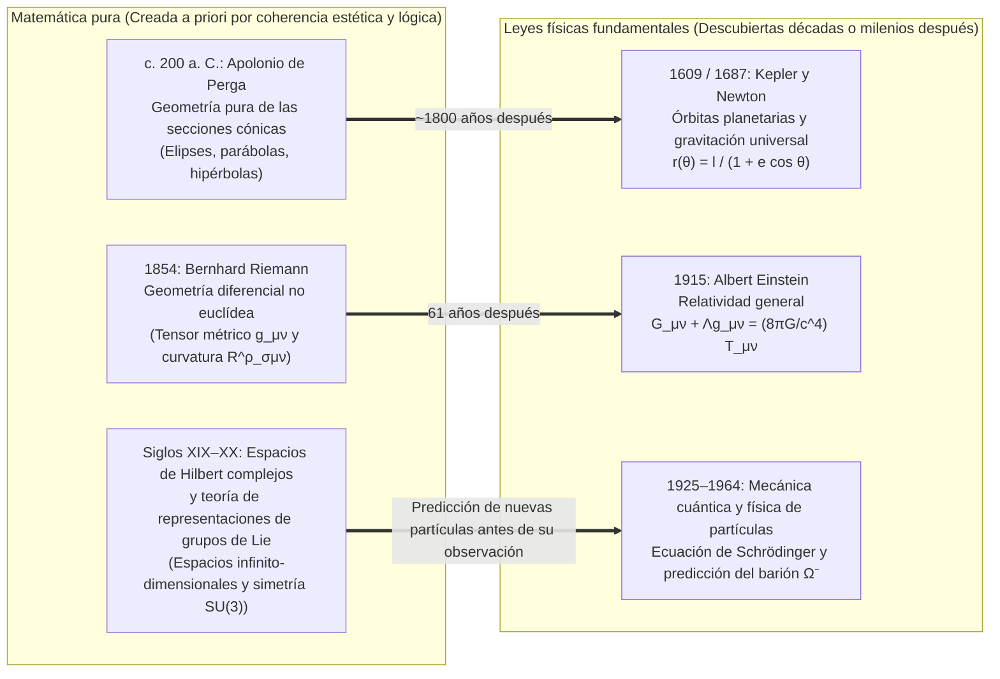

## Introducción: ¿Existía el conjunto de Mandelbrot antes del Big Bang?

En 1980, el matemático Benoit Mandelbrot visualizó por ordenador el comportamiento de una relación de recurrencia cuadrática engañosamente sencilla en el plano complejo:

$$z_{n+1} = z_n^2 + c \qquad (z_0 = 0,\; c \in \mathbb{C})$$

El conjunto de todos los parámetros complejos $c$ para los cuales la sucesión $\{z_n\}$ permanece acotada cuando $n \to \infty$ conforma el célebre <strong>conjunto de Mandelbrot ($\mathcal{M}$)</strong>. Al ampliar su frontera (cuya dimensión de Hausdorff demostró ser exactamente $2$), emerge un universo inagotable de complejidad geométrica: valles de caballitos de mar en espiral, filigranas y copias en miniatura infinitamente anidadas que ninguna mente humana había diseñado jamás.

Este espectáculo nos obliga a plantearnos una de las preguntas ontológicas y epistemológicas más profundas: ¿Mandelbrot <strong>inventó (Invented)</strong> esta estructura o la <strong>descubrió (Discovered)</strong>?

Si pensamos en el ajedrez, nadie cree que la regla del enroque existiera en el cosmos primordial antes de la humanidad; el ajedrez es claramente una <strong>invención</strong> cultural. Pero ¿qué decir del teorema de Euclides sobre la infinitud de los números primos, de la identidad de Euler $e^{i\pi} + 1 = 0$ o de la geometría fractal de $\mathcal{M}$? Incluso si nunca hubiera evolucionado vida inteligente en nuestro universo, o si una civilización alienígena en la galaxia de Andrómeda desarrollara sus propias matemáticas, parece innegable que el $17$ seguiría siendo primo, la razón entre la circunferencia y el diámetro de un círculo euclídeo seguiría siendo $\pi$, y $z_{n+1} = z_n^2 + c$ trazaría exactamente el mismo fractal.

Sin embargo, si los números, los conjuntos, las variedades diferenciables y los espacios de Hilbert existen con independencia de la mente humana, ¿<strong>dónde</strong> existen? No podemos observar el número $7$ con un telescopio ni hacer colisionar el conjunto vacío $\emptyset$ en un acelerador de partículas. Si los objetos matemáticos habitan en un cielo platónico fuera del espacio-tiempo, ¿cómo puede un cerebro biológico humano entrar en contacto con entidades causalmente inertes? Y si, por el contrario, las matemáticas son solo un juego formal de símbolos inventado por el hombre, ¿por qué predicen la curvatura del espacio-tiempo y el mundo cuántico con una precisión sobrecogedora? Este artículo examina las seis grandes escuelas de la <strong>filosofía de las matemáticas</strong> y analiza el famoso enigma de Eugene Wigner sobre <strong>«la irrazonable eficacia de las matemáticas en las ciencias naturales»</strong>.

---

## Capítulo 1: El platonismo matemático (realismo) y los dos dilemas de Benacerraf

### 1.1 Platón, Frege, Hardy y Gödel sobre la realidad matemática objetiva

En su labor diaria, la inmensa mayoría de los matemáticos trabaja como <strong>platonistas matemáticos (realistas)</strong> instintivos. Heredero de la teoría de las Formas de <strong>Platón</strong>, este realismo recibió una formulación lógica rigurosa con <strong>Gottlob Frege</strong>, <strong>G. H. Hardy</strong> y <strong>Kurt Gödel</strong>:
* <strong>El antipsicologismo de Frege</strong>: En *Los fundamentos de la aritmética* (1884) y *El pensamiento* (1918), Frege demolió el psicologismo que reducía los números a ideas mentales subjetivas. Si el número $2$ fuera solo un estado neuronal en mi cerebro, cada persona tendría su propio «$2$» privado y desaparecería la verdad objetiva universal de $2+2=4$. Además del mundo físico y del mundo psíquico subjetivo, Frege postula un <strong>«Tercer Reino» (*Drittes Reich*)</strong> de objetos abstractos objetivos.
* <strong>El realismo de Hardy y Gödel</strong>: En *Apología de un matemático* (1940), Hardy escribió: «317 es un número primo, no porque así lo pensemos, sino <strong>porque es así (because it is so)</strong>, porque la realidad matemática está construida de esa manera». Kurt Gödel (1947/1964), al estudiar la hipótesis del continuo ($2^{\aleph_0} = \aleph_1$), sostuvo que los conjuntos existen objetivamente y que la mente humana posee una <strong>«intuición matemática»</strong> análoga a la percepción sensorial.

El platonismo estándar se define por tres tesis: (1) <strong>Existencia</strong> de los objetos matemáticos; (2) <strong>Abstracción</strong> (están fuera del espacio-tiempo y son <strong>causalmente inertes</strong>); y (3) <strong>Independencia</strong> total respecto de la mente humana.

### 1.2 El problema epistemológico de Benacerraf (1973): El muro de la inercia causal

En 1973, en su histórico artículo *«Mathematical Truth»*, <strong>Paul Benacerraf</strong> planteó una objeción devastadora contra el platonismo:
1. <strong>Requisito de uniformidad semántica</strong>: Las oraciones matemáticas («Existe un número primo mayor que 17») deben analizarse con la misma semántica tarskiana de condiciones de verdad que las oraciones empíricas, lo que exige que el cuantificador $\exists x$ recorra objetos realmente existentes ($\implies$ <strong>platonismo</strong>).
2. <strong>Requisito de epistemología naturalizada</strong>: Para que un organismo biológico con un cerebro físico posea conocimiento fiable sobre un dominio $D$ (o para explicar la fiabilidad no accidental de nuestras creencias matemáticas, según la reformulación de Hartry Field en 1989), debe existir un vínculo causal o informacional entre $D$ y nuestros estados cognitivos.

La contradicción es letal: por definición platónica, los objetos abstractos son <strong>causalmente inertes</strong>; los números primos no emiten fotones ni excitan neuronas. ¡Si el platonismo es verdadero, <strong>el conocimiento matemático resulta en principio imposible</strong>!

### 1.3 El problema de identificación de Benacerraf (1965) y el estructuralismo matemático

En 1965, en *«What Numbers Could Not Be»*, Benacerraf descubrió el <strong>problema de las reducciones múltiples (Identification Problem)</strong>. En teoría de conjuntos, los números naturales $0, 1, 2, 3, \dots$ pueden construirse de infinitas maneras:
* <strong>Construcción de Zermelo (1908)</strong>: $0_Z = \emptyset,\; 1_Z = \{\emptyset\},\; 2_Z = \{\{\emptyset\}\},\; 3_Z = \{\{\{\emptyset\}\}\}, \dots$ ($S(n) = \{n\}$).
* <strong>Ordinales de von Neumann (1923)</strong>: $0_N = \emptyset,\; 1_N = \{\emptyset\},\; 2_N = \{\emptyset, \{\emptyset\}\},\; 3_N = \{\emptyset, \{\emptyset\}, \{\emptyset, \{\emptyset\}\}\}, \dots$ ($S(n) = n \cup \{n\}$).

Ambas progresiones satisfacen los axiomas de Peano y son isomorfas en toda la aritmética. Pero ante la pregunta «¿Se cumple $1 \in 3$?», von Neumann responde <strong>Verdadero</strong> ($1_N \in 3_N$) mientras que Zermelo responde <strong>Falso</strong> ($1_Z \notin 3_Z$). ¿Cuál es el «verdadero número $3$»? Ninguno en particular: Benacerraf concluyó que <strong>«los números no pueden ser objetos individuales en absoluto»</strong>.

De ahí nació el <strong>estructuralismo matemático (Stewart Shapiro, Michael Resnik, Geoffrey Hellman)</strong>: las matemáticas no tratan de objetos aislados, sino de <strong>estructuras abstractas y las posiciones relacionales («lugares») dentro de ellas</strong>. El número «$2$» no es más que la posición situada entre el $1$ y el $3$ en cualquier $\omega$-sucesión. Shapiro defiende un <strong>estructuralismo *ante rem*</strong> (las estructuras existen objetivamente antes de sus instancias), mientras que Hellman propone un <strong>estructuralismo modal (*in re*)</strong> que traduce las matemáticas mediante los operadores modales $\Box$ y $\Diamond$.

---

## Capítulo 2: La crisis de los fundamentos: Logicismo, formalismo e intuicionismo

### 2.1 El logicismo y la paradoja de Russell

El <strong>logicismo</strong> (Frege, Russell, Whitehead) intentó reducir toda la matemática a la lógica pura. En sus *Leyes básicas de la aritmética*, Frege empleó la Ley Básica V (comprensión irrestricta). En 1902, <strong>Bertrand Russell</strong> definió el conjunto $R = \{x \mid x \notin x\}$, desatando la <strong>paradoja de Russell</strong>:

$$R = \{x \mid x \notin x\} \quad \Longrightarrow \quad R \in R \iff R \notin R$$

En los *Principia Mathematica* (1910–1913), Russell y Whitehead introdujeron la teoría ramificada de tipos para evitar la autorreferencia, pero tuvieron que postular el axioma del infinito y el axioma de reducibilidad, que no son verdades lógicas puras.

### 2.2 El formalismo de Hilbert y los teoremas de incompletitud de Gödel

Para salvar el paraíso cantoriano del infinito, <strong>David Hilbert</strong> impulsó el <strong>formalismo</strong> y el <strong>programa de Hilbert</strong>: formalizar toda la matemática clásica en un sistema axiomático $T$ y demostrar, mediante métodos metamatemáticos estrictamente <strong>finitistas</strong>, la <strong>completitud</strong> y la <strong>consistencia ($\text{Con}(T)$)</strong> de $T$.

Sin embargo, en 1931, <strong>Kurt Gödel</strong> publicó sus dos <strong>teoremas de incompletitud</strong>:
1. <strong>Primer teorema de incompletitud</strong>: En todo sistema formal consistente y recursivamente axiomatizable $T$ que contenga la aritmética de Peano ($\text{PA}$), existe un enunciado aritmético $G_T$ («Yo no soy demostrable en $T$») tal que:
   $$T \nvdash G_T \quad \text{y} \quad T \nvdash \neg G_T$$
   ¡$G_T$ es <strong>verdadero en el modelo estándar $\mathbb{N}$, pero indemostrable en $T$</strong>!
2. <strong>Segundo teorema de incompletitud</strong>: Ningún sistema consistente $T$ de ese tipo puede demostrar su propia consistencia:
   $$T \nvdash \text{Con}(T)$$

La verdad matemática jamás puede reducirse a la mera demostrabilidad formal.

### 2.3 El intuicionismo y el isomorfismo de Curry-Howard

Fundado por <strong>L. E. J. Brouwer</strong> y formalizado por <strong>Arend Heyting</strong>, el <strong>intuicionismo / constructivismo</strong> concibe la matemática como una <strong>actividad de construcción mental</strong> en la intuición del tiempo. Existir ($\exists x P(x)$) equivale a poseer un algoritmo finito que construya explícitamente un testigo $x$.

Por ello, el intuicionismo <strong>rechaza el infinito actual</strong> así como el <strong>principio del tercero excluido ($P \lor \neg P$)</strong> y la eliminación de la doble negación ($\neg\neg P \to P$). En la ciencia de la computación moderna, esta lógica constructiva triunfó gracias al <strong>isomorfismo de Curry-Howard</strong>:

$$\text{Proposiciones (Propositions)} \cong \text{Tipos (Types)}, \qquad \text{Demostraciones (Proofs)} \cong \text{Programas (Programs)}$$

Toda demostración constructiva es directamente un programa informático ejecutable, base de los asistentes de pruebas actuales como <strong>Coq (Rocq)</strong>, <strong>Agda</strong> y <strong>Lean 4</strong>.

---

## Capítulo 3: Comparación de las seis escuelas y el debate sobre la indispensabilidad

| Escuela filosófica | Estatuto ontológico de las entidades matemáticas | Fuente de la verdad matemática (Epistemología) | Actitud hacia el infinito actual | Figuras clave | Objeción / Límite principal |
| :--- | :--- | :--- | :--- | :--- | :--- |
| <strong>Platonismo</strong> | Objetos abstractos objetivos fuera del espacio-tiempo (<strong>Descubrimiento</strong>) | Intuición racional / intuición gödeliana | Plenamente aceptado (jerarquía transfinita) | Platón, Frege, Hardy, Gödel | <strong>Problema epistemológico de Benacerraf</strong> y problema de identificación |
| <strong>Logicismo</strong> | Reducido a conceptos lógicos y extensiones de clases | Deducción analítica *a priori* desde la lógica pura | Requiere el axioma extralógico del infinito | Frege, Russell, Whitehead | <strong>Paradoja de Russell</strong> ($R=\{x\mid x\notin x\}$) |
| <strong>Formalismo</strong> | Sin objetos; juego sintáctico con cadenas de símbolos (<strong>Invención</strong>) | Derivabilidad formal + <strong>prueba finitista de consistencia</strong> | Tolerado como «elemento ideal» simplificador | David Hilbert, Haskell Curry | <strong>1.º y 2.º teoremas de incompletitud de Gödel</strong> ($T \nvdash G_T,\; T \nvdash \text{Con}(T)$) |
| <strong>Intuicionismo</strong> | Construcciones mentales en la intuición temporal (<strong>Invención</strong>) | Posesión de un algoritmo constructivo (BHK) | <strong>Rechaza el infinito actual</strong> (solo infinito potencial) | Brouwer, Heyting, Martin-Löf | El rechazo de $P \lor \neg P$ restringe el análisis clásico |
| <strong>Estructuralismo</strong> | <strong>Posiciones relacionales</strong> dentro de estructuras abstractas | Invariancia por isomorfismo o posibilidad modal | Aceptado vía axiomas categóricos o modalidad | Benacerraf, Shapiro, Resnik, Hellman | Epistemología de estructuras *ante rem*; modalidad primitiva |
| <strong>Ficcionalismo</strong> | No existen; <strong>ficciones útiles</strong> como Sherlock Holmes (<strong>Invención</strong>) | Consistencia interna del «relato matemático» | Utilizable libremente como herramienta ficcional | Hartry Field, Mark Balaguer | <strong>Indispensabilidad de Quine-Putnam</strong>; límite en espacios de Hilbert cuánticos |

El <strong>argumento de indispensabilidad de Quine-Putnam</strong> sostiene que, dado que las entidades matemáticas son indispensables para nuestras mejores teorías físicas, el holismo confirmacional nos compromete con su existencia real. En *Science Without Numbers* (1980), <strong>Hartry Field</strong> respondió con el <strong>ficcionalismo matemático</strong>, argumentando que la matemática es solo un atajo deductivo («extensión conservadora») y reformulando la gravitación newtoniana sin números —aunque dicho programa tropieza ante los espacios de Hilbert de la mecánica cuántica—.

---

## Capítulo 4: El enigma de Wigner: «La irrazonable eficacia de las matemáticas en las ciencias naturales»

### 4.1 El milagro de la invención matemática previa al descubrimiento físico

En 1960, el premio Nobel de Física <strong>Eugene Wigner</strong> publicó su célebre ensayo *«The Unreasonable Effectiveness of Mathematics in the Natural Sciences»*. ¿Cómo explicar que teorías matemáticas creadas de forma puramente autónoma por su belleza formal resulten ser, décadas o milenios después, el lenguaje exacto de las leyes más profundas de la naturaleza?

1. <strong>De las cónicas de Apolonio a las órbitas de Kepler</strong>: Estudiadas hacia el 200 a. C. por Apolonio de Perga por puro interés geométrico, las secciones cónicas describen exactamente las órbitas gravitatorias bajo una fuerza $1/r^2$ demostradas 1800 años después por Kepler y Newton: $r(\theta) = \frac{\ell}{1 + e\cos\theta}$.
2. <strong>De la geometría de Riemann a la relatividad general de Einstein</strong>: Creada en 1854 por Bernhard Riemann, la geometría de variedades curvas proporcionó en 1915 a Einstein el marco exacto de las ecuaciones del campo gravitatorio:
   $$R_{\mu\nu} - \frac{1}{2} R g_{\mu\nu} + \Lambda g_{\mu\nu} = \frac{8\pi G}{c^4} T_{\mu\nu}$$
3. <strong>De los espacios de Hilbert y el grupo $\text{SU}(3)$ al barión $\Omega^-$</strong>: Los números complejos y los espacios de Hilbert rigen la ecuación de Schrödinger $i\hbar \frac{\partial}{\partial t}|\psi\rangle = \hat{H}|\psi\rangle$, y en 1961 Murray Gell-Mann predijo la existencia y masa ($1672\text{ MeV}/c^2$) del <strong>barión $\Omega^-$</strong> (observado en 1964) a partir de un simple hueco vacío en el decuplete de representación del grupo de Lie $\text{SU}(3)$.

### 4.2 Cuatro respuestas filosóficas y síntesis final: «Inventamos los axiomas, descubrimos los teoremas»

Cuatro explicaciones iluminan este misterio: (1) la <strong>Hipótesis del Universo Matemático (MUH) de Max Tegmark</strong> (el universo físico *es* una estructura matemática); (2) el <strong>realismo estructural (Structural Realism)</strong> unido al teorema de Noether (las leyes físicas son invariantes de simetría y la matemática clasifica todas las simetrías posibles); (3) el <strong>sesgo de selección de Richard Hamming</strong> y la epistemología evolucionista; y (4) la <strong>síntesis dialéctica</strong>: <strong>inventamos libremente los conceptos y axiomas iniciales (como $z_{n+1} = z_n^2 + c$), pero descubrimos los teoremas y estructuras que se derivan de ellos con una necesidad objetiva absoluta.</strong>
