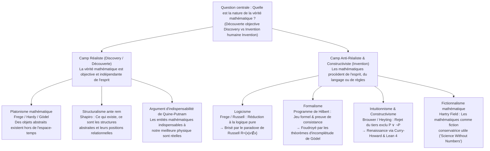
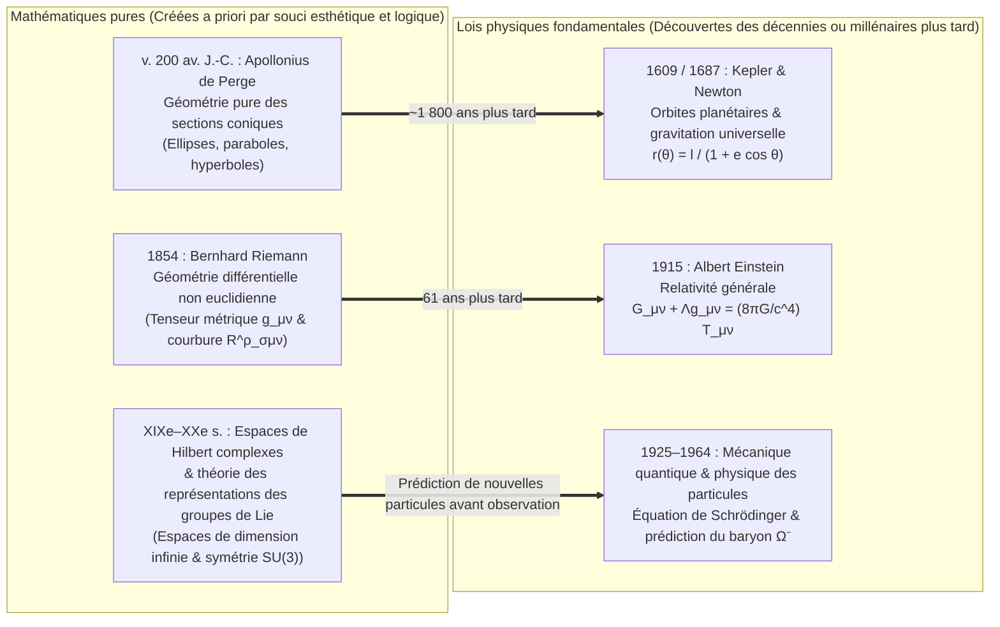

## Introduction : L’ensemble de Mandelbrot existait-il avant le Big Bang ?

En 1980, le mathématicien Benoît Mandelbrot visualisa sur ordinateur le comportement d’une relation de récurrence quadratique d’une simplicité trompeuse dans le plan complexe :

$$z_{n+1} = z_n^2 + c \qquad (z_0 = 0,\; c \in \mathbb{C})$$

L’ensemble des paramètres complexes $c$ pour lesquels la suite $\{z_n\}$ demeure bornée lorsque $n \to \infty$ forme le célèbre <strong>ensemble de Mandelbrot ($\mathcal{M}$)</strong>. En zoomant sur sa frontière (dont la dimension de Hausdorff est exactement égale à $2$), on découvre un univers inépuisable de motifs géométriques : vallées d’hippocampes spiralées, filaments baroques et copies miniatures infiniment imbriquées qu’aucun esprit humain n’avait jamais dessinés auparavant.

Ce spectacle impose à tout scientifique et philosophe une question ontologique et épistémologique fondamentale : Mandelbrot a-t-il <strong>inventé (Invented)</strong> cette structure ou l’a-t-il <strong>découverte (Discovered)</strong> ?

Si l’on songe au jeu d’échecs, personne ne soutiendra que la règle du roque existait dans le cosmos primordial avant l’humanité ; les échecs sont manifestement une <strong>invention</strong> culturelle. Mais qu’en est-il du théorème d’Euclide sur l’infinité des nombres premiers, de l’identité d’Euler $e^{i\pi} + 1 = 0$ ou de la géométrie fractale de $\mathcal{M}$ ? Même si aucune vie consciente n’était apparue dans notre univers, ou si une civilisation extraterrestre de la galaxie d’Andromède élaborait ses propres mathématiques, il semble indéniable que $17$ resterait premier, que le rapport de la circonférence au diamètre d’un cercle euclidien demeurerait $\pi$, et que $z_{n+1} = z_n^2 + c$ engendrerait exactement la même fractale.

Pourtant, si les nombres, les ensembles, les variétés différentielles et les espaces de Hilbert existent indépendamment de l’esprit humain, <strong>où</strong> existent-ils ? Nous ne pouvons ni observer le nombre $7$ au télescope ni faire entrer l’ensemble vide $\emptyset$ en collision dans un accélérateur de particules. Si les objets mathématiques résident dans un ciel platonicien hors de l’espace-temps, comment un cerveau humain biologique peut-il entrer en contact avec des entités causalement inertes ? Inversement, si les mathématiques ne sont qu’un jeu formel de symboles inventé par l’homme, pourquoi prédisent-elles la courbure de l’espace-temps et la physique quantique avec une précision stupéfiante ? Cet article examine les six grands courants de la <strong>philosophie des mathématiques</strong> et résout l’énigme d’Eugene Wigner sur <strong>« la déraisonnable efficacité des mathématiques dans les sciences de la nature »</strong>.

---

## Chapitre 1 : Le platonisme mathématique (réalisme) et les deux dilemmes de Benacerraf

### 1.1 Platon, Frege, Hardy et Gödel sur la réalité mathématique objective

Dans leur pratique quotidienne, la majorité des mathématiciens adhèrent spontanément au <strong>platonisme mathématique (réalisme)</strong>. Issu de la théorie des Idées de <strong>Platon</strong>, ce réalisme a reçu une formulation logique rigoureuse chez <strong>Gottlob Frege</strong>, <strong>G. H. Hardy</strong> et <strong>Kurt Gödel</strong> :
* <strong>L’anti-psychologisme de Frege</strong> : Dans *Les Fondements de l’arithmétique* (1884) et *La Pensée* (1918), Frege réfute le psychologisme qui réduit les nombres à des représentations mentales subjectives. Si le nombre $2$ n’était qu’un état neuronal propre à mon cerveau, chacun aurait son propre « $2$ » privé, ruinant l’objectivité universelle de $2+2=4$. Au-delà du monde physique et du monde psychologique, Frege postule un <strong>« Troisième Royaume » (*Drittes Reich*)</strong> peuplé d’objets abstraits objectifs.
* <strong>Le réalisme de Hardy et Gödel</strong> : Dans *L’Apologie d’un mathématicien* (1940), Hardy écrit : « 317 est un nombre premier, non parce que nous le pensons, mais <strong>parce qu’il en est ainsi (because it is so)</strong>, parce que la réalité mathématique est construite ainsi. » Kurt Gödel (1947/1964), étudiant l’hypothèse du continu ($2^{\aleph_0} = \aleph_1$), soutient que les ensembles existent objectivement et que l’esprit humain possède une <strong>« intuition mathématique »</strong> analogue à la perception sensorielle.

Le platonisme standard repose sur trois thèses : (1) <strong>Existence</strong> des objets mathématiques ; (2) <strong>Abstraction</strong> (ils sont hors de l’espace-temps et <strong>causalement inertes</strong>) ; (3) <strong>Indépendance</strong> totale vis-à-vis de l’esprit humain.

### 1.2 Le problème épistémologique de Benacerraf (1973) : Le mur de l’inertie causale

En 1973, dans son article célèbre *« Mathematical Truth »*, <strong>Paul Benacerraf</strong> a enfermé le platonisme dans un dilemme redoutable :
1. <strong>Exigence d’uniformité sémantique</strong> : Les énoncés mathématiques (« Il existe un nombre premier supérieur à 17 ») doivent obéir à la même sémantique tarskienne de la vérité que les énoncés empiriques, ce qui exige que le quantificateur $\exists x$ parcoure des objets réellement existants ($\implies$ <strong>platonisme</strong>).
2. <strong>Exigence d’épistémologie naturalisée</strong> : Pour qu’un organisme biologique doté d’un cerveau physique possède une connaissance fiable d’un domaine $D$ (ou pour expliquer la corrélation non accidentelle entre nos croyances et les faits mathématiques, selon la reformulation de Hartry Field en 1989), il doit exister un lien causal ou informationnel entre $D$ et nos états cognitifs.

Or, par définition platonicienne, les objets abstraits sont <strong>causalement inertes</strong> : les nombres premiers n’émettent aucun photon et n’activent aucun neurone. Si le platonisme est vrai, <strong>la connaissance mathématique devient en principe impossible</strong> !

### 1.3 Le problème d’identification de Benacerraf (1965) et le structuralisme mathématique

Dès 1965, dans *« What Numbers Could Not Be »*, Benacerraf avait soulevé le <strong>problème des réductions multiples (Identification Problem)</strong>. En théorie des ensembles, les entiers naturels $0, 1, 2, 3, \dots$ peuvent être construits d’une infinité de manières :
* <strong>Construction de Zermelo (1908)</strong> : $0_Z = \emptyset,\; 1_Z = \{\emptyset\},\; 2_Z = \{\{\emptyset\}\},\; 3_Z = \{\{\{\emptyset\}\}\}, \dots$ ($S(n) = \{n\}$).
* <strong>Ordinaux de von Neumann (1923)</strong> : $0_N = \emptyset,\; 1_N = \{\emptyset\},\; 2_N = \{\emptyset, \{\emptyset\}\},\; 3_N = \{\emptyset, \{\emptyset\}, \{\emptyset, \{\emptyset\}\}\}, \dots$ ($S(n) = n \cup \{n\}$).

Les deux suites vérifient les axiomes de Peano et sont isomorphes pour toute l’arithmétique. Mais à la question « A-t-on $1 \in 3$ ? », von Neumann répond <strong>Vrai</strong> ($1_N \in 3_N$) tandis que Zermelo répond <strong>Faux</strong> ($1_Z \notin 3_Z$) ! Lequel est le « vrai nombre $3$ » ? Aucun des deux ! Benacerraf en conclut que <strong>« les nombres ne peuvent pas être des objets individuels »</strong>.

De là est né le <strong>structuralisme mathématique (Stewart Shapiro, Michael Resnik, Geoffrey Hellman)</strong> : les mathématiques n’étudient pas des objets isolés, mais des <strong>structures abstraites et les positions relationnelles (« places ») au sein de ces structures</strong>. Le nombre « $2$ » n’est rien d’autre que la position située entre $1$ et $3$ dans toute $\omega$-séquence. Shapiro défend un <strong>structuralisme *ante rem*</strong> (les structures existent objectivement avant leurs instanciations), tandis que Hellman propose un <strong>structuralisme modal (*in re*)</strong> traduisant les mathématiques à l’aide des opérateurs modaux $\Box$ et $\Diamond$.

---

## Chapitre 2 : La crise des fondements : Logicisme, formalisme et intuitionnisme

### 2.1 Le logicisme et le paradoxe de Russell

Le <strong>logicisme</strong> (Frege, Russell, Whitehead) cherchait à réduire toutes les mathématiques à la pure logique. Dans ses *Lois fondamentales de l’arithmétique*, Frege s’appuyait sur la Loi fondamentale V (compréhension non restreinte). En 1902, <strong>Bertrand Russell</strong> posa $R = \{x \mid x \notin x\}$, faisant surgir le <strong>paradoxe de Russell</strong> :

$$R = \{x \mid x \notin x\} \quad \Longrightarrow \quad R \in R \iff R \notin R$$

Dans les *Principia Mathematica* (1910–1913), Russell et Whitehead introduisirent la théorie des types pour bloquer l’auto-appartenance, mais durent postuler l’axiome de l’infini et l’axiome de réductibilité, qui n’appartiennent pas à la logique pure.

### 2.2 Le formalisme de Hilbert et les théorèmes d’incomplétude de Gödel

Pour sauver la théorie cantorienne de l’infini, <strong>David Hilbert</strong> lança le <strong>formalisme</strong> et le <strong>programme de Hilbert</strong> : formaliser toutes les mathématiques classiques dans un système axiomatique $T$ et démontrer, par des méthodes métamathématiques purement <strong>finitistes</strong>, la <strong>complétude</strong> et la <strong>non-contradiction ($\text{Con}(T)$)</strong> de $T$.

Or, en 1931, <strong>Kurt Gödel</strong> publia ses deux <strong>théorèmes d’incomplétude</strong> :
1. <strong>Premier théorème d’incomplétude</strong> : Dans tout système formel cohérent et récursivement axiomatisable $T$ contenant l’arithmétique de Peano ($\text{PA}$), il existe un énoncé arithmétique $G_T$ (« Je ne suis pas démontrable dans $T$ ») tel que :
   $$T \nvdash G_T \quad \text{et} \quad T \nvdash \neg G_T$$
   $G_T$ est <strong>vrai dans le modèle standard $\mathbb{N}$, mais indémontrable dans $T$</strong> !
2. <strong>Second théorème d’incomplétude</strong> : Aucun tel système cohérent $T$ ne peut démontrer sa propre cohérence :
   $$T \nvdash \text{Con}(T)$$

La vérité mathématique excède donc irréductiblement la prouvabilité formelle.

### 2.3 L’intuitionnisme et la correspondance de Curry-Howard

Fondé par <strong>L. E. J. Brouwer</strong> et formalisé par <strong>Arend Heyting</strong>, l’<strong>intuitionnisme / constructivisme</strong> conçoit les mathématiques comme une <strong>activité de construction mentale</strong> dans l’intuition du temps. Exister ($\exists x P(x)$) signifie disposer d’un algorithme explicite construisant un témoin $x$.

Par conséquent, l’intuitionnisme <strong>rejette l’infini actuel</strong> ainsi que le <strong>principe du tiers exclu ($P \lor \neg P$)</strong> et l’élimination de la double négation ($\neg\neg P \to P$) ! Au XXe siècle, cette logique constructive a triomphé en informatique grâce à la <strong>correspondance de Curry-Howard</strong> :

$$\text{Propositions} \cong \text{Types}, \qquad \text{Preuves (Proofs)} \cong \text{Programmes (Programs)}$$

Chaque preuve constructive est directement un programme informatique exécutable, au fondement des assistants de preuve modernes tels que <strong>Coq (Rocq)</strong>, <strong>Agda</strong> et <strong>Lean 4</strong>.

---

## Chapitre 3 : Comparaison des six grandes écoles et débat sur l’indispensabilité

| École philosophique | Statut ontologique des entités mathématiques | Source de la vérité mathématique (Épistémologie) | Attitude envers l’infini actuel | Figures clés | Objection / Limite principale |
| :--- | :--- | :--- | :--- | :--- | :--- |
| <strong>Platonisme</strong> | Objets abstraits objectifs hors de l’espace-temps (<strong>Découverte</strong>) | Intuition rationnelle / intuition gödelienne | Pleinement accepté (hiérarchie transfinie) | Platon, Frege, Hardy, Gödel | <strong>Problème épistémologique de Benacerraf</strong> & problème d’identification |
| <strong>Logicisme</strong> | Réduit aux concepts logiques et extensions de classes | Déduction analytique *a priori* depuis la logique pure | Requiert l’axiome extra-logique de l’infini | Frege, Russell, Whitehead | <strong>Paradoxe de Russell</strong> ($R=\{x\mid x\notin x\}$) |
| <strong>Formalisme</strong> | Aucun objet ; jeu syntaxique sur des chaînes de symboles (<strong>Invention</strong>) | Dérivabilité formelle + <strong>preuve finitiste de cohérence</strong> | Toléré comme « élément idéal » simplificateur | David Hilbert, Haskell Curry | <strong>1er & 2nd théorèmes d’incomplétude de Gödel</strong> ($T \nvdash G_T,\; T \nvdash \text{Con}(T)$) |
| <strong>Intuitionnisme</strong> | Constructions mentales dans l’intuition temporelle (<strong>Invention</strong>) | Possession d’un algorithme de construction (BHK) | <strong>Rejette l’infini actuel</strong> (infini potentiel seul) | Brouwer, Heyting, Martin-Löf | Le rejet de $P \lor \neg P$ ampute l’analyse classique |
| <strong>Structuralisme</strong> | <strong>Positions relationnelles</strong> au sein de structures abstraites | Saisie de l’invariance par isomorphisme ou modalité | Accepté via axiomes catégoriques ou modalité | Benacerraf, Shapiro, Resnik, Hellman | Épistémologie des structures *ante rem* ; modalité primitive |
| <strong>Fictionnalisme</strong> | N’existent pas ; <strong>fictions utiles</strong> comme Sherlock Holmes (<strong>Invention</strong>) | Cohérence interne du « récit mathématique » | Utilisable librement comme outil fictionnel | Hartry Field, Mark Balaguer | <strong>Indispensabilité de Quine-Putnam</strong> ; échec sur les espaces de Hilbert quantiques |

L’<strong>argument d’indispensabilité de Quine-Putnam</strong> soutient que puisque les entités mathématiques sont indispensables à nos meilleures théories physiques, le holisme de la confirmation nous engage à croire en leur existence réelle. Dans *Science Without Numbers* (1980), <strong>Hartry Field</strong> a répliqué par le <strong>fictionnalisme mathématique</strong>, montrant que les mathématiques ne sont qu’un raccourci déductif (« extension conservatrice ») et reformulant la gravité newtonienne sans nombres — un programme qui bute toutefois sur les espaces de Hilbert de la mécanique quantique.

---

## Chapitre 4 : L’énigme de Wigner : « La déraisonnable efficacité des mathématiques dans les sciences de la nature »

### 4.1 Le miracle de l’antériorité mathématique sur la découverte physique

En 1960, le prix Nobel de physique <strong>Eugene Wigner</strong> publia son célèbre essai *« The Unreasonable Effectiveness of Mathematics in the Natural Sciences »*. Comment expliquer que des théories mathématiques élaborées de manière purement autonome pour leur beauté formelle s’avèrent, des décennies ou des millénaires plus tard, gouverner les lois les plus intimes de la matière et du cosmos ?

1. <strong>Des sections coniques d’Apollonius aux orbites de Kepler</strong> : Étudiées vers 200 av. J.-C. par Apollonius de Perge par pure spéculation géométrique, les coniques décrivent exactement les trajectoires célestes sous une force en $1/r^2$ démontrées 1 800 ans plus tard par Kepler et Newton : $r(\theta) = \frac{\ell}{1 + e\cos\theta}$.
2. <strong>De la géométrie riemannienne à la relativité générale d’Einstein</strong> : Créée en 1854 par Bernhard Riemann, la géométrie des variétés courbes fournit en 1915 à Einstein le cadre exact de l’équation du champ gravitationnel :
   $$R_{\mu\nu} - \frac{1}{2} R g_{\mu\nu} + \Lambda g_{\mu\nu} = \frac{8\pi G}{c^4} T_{\mu\nu}$$
3. <strong>Des espaces de Hilbert et du groupe $\text{SU}(3)$ au baryon $\Omega^-$</strong> : Les nombres complexes et les espaces de Hilbert gouvernent l’équation de Schrödinger $i\hbar \frac{\partial}{\partial t}|\psi\rangle = \hat{H}|\psi\rangle$, et en 1961, Murray Gell-Mann prédit l’existence et la masse ($1672\text{ MeV}/c^2$) du <strong>baryon $\Omega^-$</strong> (observé en 1964) à partir d’une simple case vide dans le décuplet de représentation du groupe de Lie $\text{SU}(3)$ !

### 4.2 Quatre réponses philosophiques et synthèse finale : « On invente les axiomes, on découvre les théorèmes »

Quatre explications majeures éclairent ce mystère : (1) l’<strong>Hypothèse de l’Univers Mathématique (MUH) de Max Tegmark</strong> (l’univers physique *est* une structure mathématique) ; (2) le <strong>réalisme structurel (Structural Realism)</strong> allié au théorème de Noether (les lois physiques sont des invariants de symétrie et les mathématiques cataloguent toutes les symétries possibles) ; (3) le <strong>biais de sélection de Richard Hamming</strong> et l’épistémologie évolutionniste ; et (4) la <strong>synthèse dialectique</strong> : <strong>nous inventons librement les concepts et les axiomes initiaux (comme $z_{n+1} = z_n^2 + c$), mais nous découvrons les théorèmes et les structures qui en découlent avec une nécessité objective absolue.</strong>
