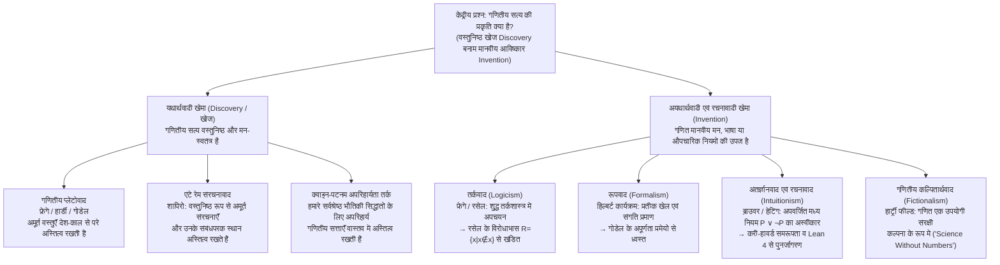
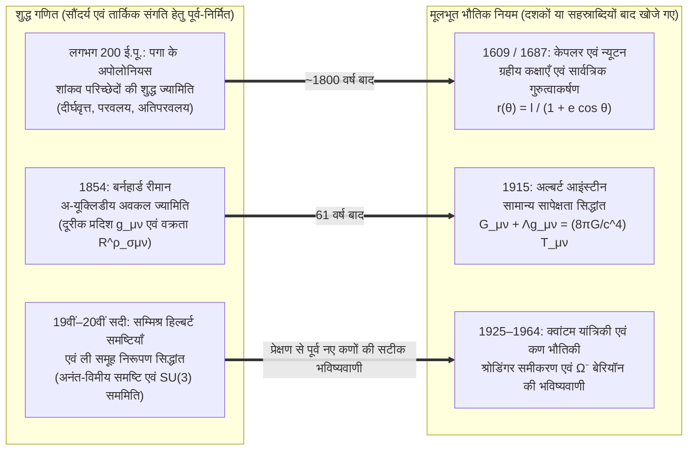

## प्रस्तावना: क्या मैंडलब्रॉट समुच्चय बिग बैंग से पहले भी अस्तित्व में था?

वर्ष 1980 में गणितज्ञ बेनोइट मैंडलब्रॉट (Benoit Mandelbrot) ने कंप्यूटर की सहायता से सम्मिश्र तल (Complex Plane) पर एक अत्यंत सरल दिखने वाले द्विघात पुनरावृत्ति संबंध (Quadratic Recurrence Relation) के व्यवहार को चित्रित किया:

$$z_{n+1} = z_n^2 + c \qquad (z_0 = 0,\; c \in \mathbb{C})$$

उन सभी सम्मिश्र प्राचलों $c$ का समुच्चय, जिनके लिए $n \to \infty$ होने पर अनुक्रम $\{z_n\}$ परिबद्ध (Bounded) रहता है, प्रसिद्ध <strong>मैंडलब्रॉट समुच्चय ($\mathcal{M}$)</strong> का निर्माण करता है। जब हम इसकी सीमा (जिसकी हॉसडॉर्फ विमा ठीक $2$ सिद्ध की गई है) को ज़ूम करके देखते हैं, तो ज्यामितीय जटिलता का एक अथाह ब्रह्मांड प्रकट होता है: सर्पिल ‘सीहॉर्स घाटियाँ’, बारीक तंतु और अनंत रूप से पिरोए गए सूक्ष्म प्रतिरूप जिन्हें किसी मानवीय मस्तिष्क ने पहले कभी डिज़ाइन नहीं किया था।

यह दृश्य प्रत्येक वैज्ञानिक और दार्शनिक को सबसे गहरे सत्तामीमांसीय (Ontological) और ज्ञानमीमांसीय (Epistemological) प्रश्न के सामने खड़ा कर देता है: क्या मैंडलब्रॉट ने इस संरचना का <strong>आविष्कार (Invented)</strong> किया, या उन्होंने इसकी <strong>खोज (Discovered)</strong> की?

यदि हम शतरंज के खेल पर विचार करें, तो कोई नहीं मानता कि ‘कैसलिंग’ का नियम मानव सभ्यता से पहले ब्रह्मांड में मौजूद था; शतरंज स्पष्टतः एक सांस्कृतिक <strong>आविष्कार</strong> है। किंतु अभाज्य संख्याओं की अनंतता (यूक्लिड का प्रमेय), ऑयलर सर्वसमिका $e^{i\pi} + 1 = 0$, या $\mathcal{M}$ की फ्रैक्टल ज्यामिति के बारे में क्या कहा जाए? भले ही हमारे ब्रह्मांड में कभी सचेत जीवन विकसित न हुआ होता, या एंड्रोमेडा आकाशगंगा की किसी परग्रही सभ्यता ने स्वतंत्र रूप से गणित विकसित किया होता, फिर भी निस्संदेह $17$ एक अभाज्य संख्या ही होती, यूक्लिडीय वृत्त की परिधि और व्यास का अनुपात $\pi$ ही रहता, और $z_{n+1} = z_n^2 + c$ बिल्कुल वही फ्रैक्टल आकृति उकेरता।

परंतु यदि संख्याएँ, समुच्चय, अवकलनीय प्रसमष्टि (Manifolds) और हिल्बर्ट समष्टियाँ मानवीय मन से स्वतंत्र रूप से अस्तित्व रखती हैं, तो वे <strong>कहाँ</strong> अस्तित्व रखती हैं? हम दूरबीन से संख्या $7$ को नहीं देख सकते और न ही कण त्वरक (Particle Accelerator) में रिक्त समुच्चय $\emptyset$ की टक्कर करा सकते हैं। यदि गणितीय वस्तुएँ देश-काल से परे किसी प्लेटोवादी लोक में रहती हैं, तो भौतिक मस्तिष्क वाला मनुष्य कारणता की दृष्टि से निष्क्रिय (Causally Inert) वस्तुओं के बारे में विश्वसनीय ज्ञान कैसे प्राप्त कर सकता है? इसके विपरीत, यदि गणित मात्र मनुष्य द्वारा गढ़ा गया प्रतीकों का खेल है, तो वह दिक्-काल की वक्रता और क्वांटम जगत की भविष्यवाणी इतनी अचूक सटीकता से कैसे कर लेता है? इस लेख में हम <strong>गणित के दर्शन (Philosophy of Mathematics)</strong> की छह प्रमुख धाराओं की समीक्षा करेंगे और यूजीन विग्नर की प्रसिद्ध पहेली <strong>“प्राकृतिक विज्ञानों में गणित की अतार्किक प्रभावशीलता”</strong> का समाधान खोजेंगे।

---

## अध्याय 1: गणितीय प्लेटोवाद (यथार्थवाद) और बेनासेराफ की दोहरी दुविधाएँ

### 1.1 वस्तुनिष्ठ गणितीय यथार्थ पर प्लेटो, फ्रेगे, हार्डी और गोडेल

अपने दैनिक शोध कार्य में अधिकांश गणितज्ञ सहज रूप से <strong>गणितीय प्लेटोवादी (यथार्थवादी)</strong> की भाँति कार्य करते हैं। <strong>प्लेटो</strong> के प्रत्यय-सिद्धांत (Theory of Forms) से निकली इस धारा को आधुनिक युग में <strong>गॉटलोब फ्रेगे</strong>, <strong>जी. एच. हार्डी</strong> और <strong>कर्ट गोडेल</strong> ने कठोर तार्किक रूप प्रदान किया:
* <strong>फ्रेगे का मनोविज्ञानवाद-विरोध (Anti-Psychologism)</strong>: *द फाउंडेशन्स ऑफ अरिथमेटिक* (1884) और *थॉट* (1918) में फ्रेगे ने उस मनोविज्ञानवाद का खंडन किया जो संख्याओं को व्यक्ति के मस्तिष्क की आत्मगत मानसिक छवियों में घटा देता था। यदि संख्या $2$ केवल मेरे मस्तिष्क की एक तंत्रिका अवस्था होती, तो प्रत्येक व्यक्ति का अपना अलग निजी ‘$2$’ होता और $2+2=4$ की सार्वभौमिक वस्तुनिष्ठता समाप्त हो जाती। भौतिक जगत और आत्मगत मानसिक जगत के अतिरिक्त फ्रेगे ने वस्तुनिष्ठ अमूर्त वस्तुओं के एक <strong>‘तीसरे लोक’ (*Drittes Reich*)</strong> की स्थापना की।
* <strong>हार्डी और गोडेल का यथार्थवाद</strong>: *ए मैथमेटिशियन्स अपोलॉजी* (1940) में हार्डी ने लिखा: “317 एक अभाज्य संख्या है, इसलिए नहीं कि हम ऐसा सोचते हैं, बल्कि <strong>इसलिए कि वह ऐसी ही है (because it is so)</strong>, क्योंकि गणितीय यथार्थ इसी प्रकार निर्मित है।” कर्ट गोडेल (1947/1964) ने सांतत्य परिकल्पना ($2^{\aleph_0} = \aleph_1$) के संदर्भ में तर्क दिया कि समुच्चय वस्तुनिष्ठ रूप से अस्तित्व रखते हैं और मानव मन के पास इंद्रिय-बोध के समान एक <strong>‘गणितीय अंतर्ज्ञान (Mathematical Intuition)’</strong> होता है।

मानक प्लेटोवाद तीन सिद्धांतों पर आधारित है: (1) गणितीय वस्तुओं का <strong>अस्तित्व (Existence)</strong>; (2) <strong>अमूर्तता (Abstractness)</strong> (वे देश-काल से बाहर हैं और <strong>कारणतातः पूर्णतः निष्क्रिय / Causally Inert</strong> हैं); तथा (3) मानव मन से पूर्ण <strong>स्वतंत्रता (Independence)</strong>।

### 1.2 बेनासेराफ की ज्ञानमीमांसीय समस्या (1973): कारणता-निष्क्रियता की दीवार

1973 में अपने ऐतिहासिक शोधपत्र *“Mathematical Truth”* में <strong>पॉल बेनासेराफ (Paul Benacerraf)</strong> ने प्लेटोवाद के विरुद्ध एक गंभीर ज्ञानमीमांसीय दुविधा प्रस्तुत की:
1. <strong>अर्थगत एकरूपता की माँग</strong>: गणितीय वाक्यों (“17 से बड़ी एक अभाज्य संख्या है”) का विश्लेषण अनुभवजन्य वाक्यों के समान ही टार्स्की के सत्य-शर्त अर्थविज्ञान से होना चाहिए, जिसके लिए आवश्यक है कि परिमाणक $\exists x$ वास्तव में अस्तित्व रखने वाली वस्तुओं को इंगित करे ($\implies$ <strong>प्लेटोवाद</strong>)।
2. <strong>प्राकृतिकृत ज्ञानमीमांसा की माँग</strong>: भौतिक मस्तिष्क वाले जैविक प्राणी को किसी क्षेत्र $D$ के बारे में विश्वसनीय ज्ञान होने के लिए (अथवा हमारी गणितीय मान्यताओं और गणितीय तथ्यों के बीच गैर-आकस्मिक सहसंबंध को समझाने के लिए, जैसा हार्ट्री फील्ड ने 1989 में स्पष्ट किया), $D$ और हमारी संज्ञानात्मक अवस्थाओं के बीच कोई कारण-कार्य या सूचनात्मक संबंध होना अनिवार्य है।

विरोधाभास घातक है: प्लेटोवादी परिभाषा के अनुसार अमूर्त वस्तुएँ <strong>कारणतातः निष्क्रिय</strong> हैं—अभाज्य संख्याएँ न तो फोटॉन उत्सर्जित करती हैं और न ही न्यूरॉनों को सक्रिय करती हैं। यदि प्लेटोवाद सत्य है, तो <strong>गणितीय ज्ञान सिद्धांततः असंभव हो जाता है</strong>!

### 1.3 बेनासेराफ की तादात्म्य समस्या (1965) और गणितीय संरचनावाद

1965 में *“What Numbers Could Not Be”* में बेनासेराफ ने <strong>बहुविध अपचयन एवं तादात्म्य समस्या (Identification Problem)</strong> को उजागर किया। समुच्चय सिद्धांत में प्राकृत संख्याओं $0, 1, 2, 3, \dots$ का निर्माण अनंत तरीकों से किया जा सकता है:
* <strong>ज़र्मेलो का निर्माण (1908)</strong>: $0_Z = \emptyset,\; 1_Z = \{\emptyset\},\; 2_Z = \{\{\emptyset\}\},\; 3_Z = \{\{\{\emptyset\}\}\}, \dots$ ($S(n) = \{n\}$).
* <strong>वॉन न्यूमैन के क्रमसूचक (1923)</strong>: $0_N = \emptyset,\; 1_N = \{\emptyset\},\; 2_N = \{\emptyset, \{\emptyset\}\},\; 3_N = \{\emptyset, \{\emptyset\}, \{\emptyset, \{\emptyset\}\}\}, \dots$ ($S(n) = n \cup \{n\}$).

दोनों श्रेणियाँ पियानो के अभिगृहीतों को संतुष्ट करती हैं और संपूर्ण अंकगणित में समरूप (Isomorphic) हैं। किंतु “क्या $1 \in 3$ सत्य है?” पूछने पर वॉन न्यूमैन की प्रणाली <strong>सत्य</strong> ($1_N \in 3_N$) कहती है जबकि ज़र्मेलो की प्रणाली <strong>असत्य</strong> ($1_Z \notin 3_Z$)! इनमें से ‘असली संख्या $3$’ कौन-सी है? कोई भी एक विशेष नहीं: बेनासेराफ ने निष्कर्ष निकाला कि <strong>“संख्याएँ вообще पृथक ‘वस्तुएँ (Objects)’ हो ही नहीं सकतीं!”</strong>

इसी से <strong>गणितीय संरचनावाद (स्टुअर्ट शापिरो, माइकल रेज़निक, जेफ्री हेलमैन)</strong> का जन्म हुआ: गणित पृथक वस्तुओं का नहीं, बल्कि <strong>अमूर्त संरचनाओं और उनके भीतर के संबंधपरक स्थानों (Positions / Places)</strong> का अध्ययन करता है। संख्या ‘$2$’ किसी भी $\omega$-अनुक्रम में $1$ और $3$ के बीच का स्थान मात्र है। शापिरो <strong>*एंटे रेम* संरचनावाद</strong> (संरचनाएँ अपने उदाहरणों से पूर्व वस्तुनिष्ठ रूप से अस्तित्व रखती हैं) का समर्थन करते हैं, जबकि हेलमैन <strong>मॉडल संरचनावाद (*in re*)</strong> के तहत $\Box$ और $\Diamond$ संकारकों का उपयोग करते हैं।

---

## अध्याय 2: आधारभूत संकट: तर्कवाद, रूपवाद और अंतर्ज्ञानवाद

### 2.1 तर्कवाद और रसेल का विरोधाभास

<strong>तर्कवाद</strong> (फ्रेगे, रसेल, व्हाइटहेड) ने संपूर्ण गणित को शुद्ध तर्कशास्त्र में अपचयित करने का प्रयास किया। फ्रेगे ने मूल नियम V (असीमित बोध अभिगृहीत) का प्रयोग किया। 1902 में <strong>बर्ट्रेंड रसेल</strong> ने समुच्चय $R = \{x \mid x \notin x\}$ परिभाषित कर <strong>रसेल का विरोधाभास</strong> खड़ा कर दिया:

$$R = \{x \mid x \notin x\} \quad \Longrightarrow \quad R \in R \iff R \notin R$$

*प्रिंसिपिया मैथमैटिका* (1910–1913) में रसेल और व्हाइटहेड ने प्रकार सिद्धांत (Type Theory) पेश किया, पर उन्हें अनंतता अभिगृहीत और अपचनीयता अभिगृहीत मानने पड़े जो शुद्ध तर्क नहीं हैं।

### 2.2 हिल्बर्ट का रूपवाद और गोडेल के अपूर्णता प्रमेय

कैंटर के अनंत समुच्चय सिद्धांत की रक्षा हेतु <strong>डेविड हिल्बर्ट</strong> ने <strong>रूपवाद (Formalism)</strong> और <strong>हिल्बर्ट कार्यक्रम</strong> प्रस्तुत किया: संपूर्ण शास्त्रीय गणित को औपचारिक अभिगृहीत तंत्र $T$ में ढालकर विशुद्ध <strong>परिमितवादी (Finitary)</strong> मेटा-गणितीय विधियों से $T$ की <strong>पूर्णता</strong> और <strong>संगति ($\text{Con}(T)$)</strong> सिद्ध करना।

किंतु 1931 में <strong>कर्ट गोडेल</strong> ने अपने दो <strong>अपूर्णता प्रमेय</strong> प्रकाशित किए:
1. <strong>प्रथम अपूर्णता प्रमेय</strong>: पियानो अंकगणित ($\text{PA}$) को समाहित करने वाले किसी भी संगत, पुनरावर्ती रूप से अभिगृहीतीकरणीय तंत्र $T$ में एक ऐसा अंकगणितीय कथन $G_T$ (“मैं $T$ में सिद्ध नहीं किया जा सकता”) मौजूद होता है कि:
   $$T \nvdash G_T \quad \text{तथा} \quad T \nvdash \neg G_T$$
   अर्थात् $G_T$ मानक मॉडल $\mathbb{N}$ में <strong>सत्य है, किंतु तंत्र $T$ के भीतर असिद्धनीय है</strong>!
2. <strong>द्वितीय अपूर्णता प्रमेय</strong>: ऐसा कोई भी संगत तंत्र $T$ अपनी स्वयं की संगति को सिद्ध नहीं कर सकता:
   $$T \nvdash \text{Con}(T)$$

अतः गणितीय सत्य को औपचारिक सिद्धनीयता में कभी सीमित नहीं किया जा सकता।

### 2.3 अंतर्ज्ञानवाद और करी-हावर्ड समरूपता

<strong>एल. ई. जे. ब्राउवर</strong> द्वारा स्थापित और <strong>आरेंड हेटिंग</strong> द्वारा औपचारिकृत <strong>अंतर्ज्ञानवाद / रचनावाद</strong> गणित को समय के अंतर्ज्ञान में चलने वाली <strong>मानसिक निर्माण गतिविधि</strong> मानता है। अस्तित्व ($\exists x P(x)$) का अर्थ है साक्षी $x$ का निर्माण करने की परिमित एल्गोरिदम होना।

इसलिए अंतर्ज्ञानवाद <strong>वास्तविक अनंत (Actual Infinity)</strong> के साथ-साथ <strong>अपवर्जित मध्य के नियम ($P \lor \neg P$)</strong> और दोहरे निषेध उन्मूलन ($\neg\neg P \to P$) को अस्वीकार करता है। आधुनिक कंप्यूटर विज्ञान में यह रचनात्मक तर्क <strong>करी-हावर्ड समरूपता (Curry-Howard Isomorphism)</strong> के माध्यम से विजयी हुआ:

$$\text{कथन (Propositions)} \cong \text{प्रकार (Types)}, \qquad \text{प्रमाण (Proofs)} \cong \text{प्रोग्राम (Programs)}$$

प्रत्येक रचनात्मक प्रमाण सीधे एक निष्पादनीय कंप्यूटर प्रोग्राम है, जिस पर आज <strong>Coq (Rocq)</strong>, <strong>Agda</strong> और <strong>Lean 4</strong> जैसे प्रमाण सहायक टिके हैं।

---

## अध्याय 3: छह प्रमुख संप्रदायों की तुलना और अपरिहार्यता की बहस

| दार्शनिक संप्रदाय | गणितीय सत्ताओं की सत्तामीमांसीय स्थिति | गणितीय सत्य का स्रोत (ज्ञानमीमांसा) | वास्तविक अनंत के प्रति दृष्टिकोण | प्रमुख विचारक | मुख्य आपत्ति / सीमा |
| :--- | :--- | :--- | :--- | :--- | :--- |
| <strong>प्लेटोवाद</strong> | देश-काल से परे वस्तुनिष्ठ अमूर्त वस्तुएँ (<strong>खोज</strong>) | तार्किक अंतर्दृष्टि / गोडेलीय अंतर्ज्ञान | पूर्ण स्वीकार (परा-परिमित पदानुक्रम) | प्लेटो, फ्रेगे, हार्डी, गोडेल | <strong>बेनासेराफ की ज्ञानमीमांसीय समस्या</strong> एवं तादात्म्य समस्या |
| <strong>तर्कवाद</strong> | तार्किक अवधारणाओं और वर्ग-विस्तार में अपचयन | शुद्ध तर्क से विश्लेषणात्मक *a priori* निगमन | तर्केतर अनंतता अभिगृहीत आवश्यक | फ्रेगे, रसेल, व्हाइटहेड | <strong>रसेल का विरोधाभास</strong> ($R=\{x\mid x\notin x\}$) |
| <strong>रूपवाद</strong> | कोई वस्तु नहीं; प्रतीक शृंखलाओं का सिंटैक्टिक खेल (<strong>आविष्कार</strong>) | औपचारिक व्युत्पत्ति + <strong>परिमितवादी संगति प्रमाण</strong> | सरलीकरण हेतु ‘आदर्श तत्व’ के रूप में स्वीकार | डेविड हिल्बर्ट, हैस्केल करी | <strong>गोडेल के प्रथम व द्वितीय अपूर्णता प्रमेय</strong> ($T \nvdash G_T,\; T \nvdash \text{Con}(T)$) |
| <strong>अंतर्ज्ञानवाद</strong> | कालिक अंतर्ज्ञान में मानसिक निर्माण (<strong>आविष्कार</strong>) | स्पष्ट रचनात्मक एल्गोरिदम की उपस्थिति (BHK) | <strong>वास्तविक अनंत का अस्वीकार</strong> (केवल संभाव्य अनंत) | ब्राउवर, हेटिंग, मार्टिन-लोफ | $P \lor \neg P$ के त्याग से शास्त्रीय विश्लेषण सीमित |
| <strong>संरचनावाद</strong> | अमूर्त संरचनाओं के भीतर <strong>संबंधपरक स्थान</strong> | समरूपता अपरिवर्तनीयता या मॉडल संभावना | श्रेणीबद्ध अभिगृहीतों या मॉडलिटी द्वारा स्वीकार | बेनासेराफ, शापिरो, रेज़निक, हेलमैन | *एंटे रेम* संरचनाओं की ज्ञानमीमांसा; आदिम मॉडलिटी |
| <strong>कल्पितार्थवाद</strong> | अस्तित्व नहीं; शर्लक होम्स जैसी <strong>उपयोगी कल्पना</strong> (<strong>आविष्कार</strong>) | ‘गणितीय कथा’ की आंतरिक संगति | काल्पनिक उपकरण के रूप में स्वतंत्र उपयोग | हार्ट्री फील्ड, मार्क बालागेर | <strong>क्वाइन-पटनम अपरिहार्यता</strong>; क्वांटम हिल्बर्ट समष्टि की चुनौती |

<strong>क्वाइन-पटनम अपरिहार्यता तर्क (Indispensability Argument)</strong> कहता है कि चूँकि हमारे सर्वश्रेष्ठ भौतिक सिद्धांतों के लिए गणितीय सत्ताएँ अपरिहार्य हैं, इसलिए पुष्टिकरण समग्रतावाद (Confirmational Holism) हमें उनके वास्तविक अस्तित्व को मानने के लिए बाध्य करता है। *Science Without Numbers* (1980) में <strong>हार्ट्री फील्ड</strong> ने <strong>गणितीय कल्पितार्थवाद</strong> के ज़रिए उत्तर दिया कि गणित केवल एक निगमनात्मक शॉर्टकट (‘संरक्षी विस्तार’) है और उन्होंने संख्याओं के बिना न्यूटन के गुरुत्वाकर्षण का पुनर्निर्माण किया—हालाँकि क्वांटम यांत्रिकी की हिल्बर्ट समष्टियों के सामने यह कार्यक्रम कठिनाई में पड़ जाता है।

---

## अध्याय 4: विग्नर की पहेली: “प्राकृतिक विज्ञानों में गणित की अतार्किक प्रभावशीलता”

### 4.1 भौतिक खोज से पूर्व गणितीय आविष्कार का चमत्कार

1960 में भौतिकी के नोबेल पुरस्कार विजेता <strong>यूजीन विग्नर (Eugene Wigner)</strong> ने अपना प्रसिद्ध निबंध *“The Unreasonable Effectiveness of Mathematics in the Natural Sciences”* प्रकाशित किया। यह कैसे समझाया जाए कि विशुद्ध रूप से औपचारिक सौंदर्य के लिए रचे गए गणितीय सिद्धांत दशकों या सहस्राब्दियों बाद प्रकृति के सबसे गहरे नियमों की सटीक भाषा सिद्ध होते हैं?

1. <strong>अपोलोनियस के शांकवों से केपलर की कक्षाओं तक</strong>: लगभग 200 ई.पू. पगा के अपोलोनियस द्वारा शुद्ध ज्यामितीय जिज्ञासा से अध्ययन किए गए शांकव परिच्छेद 1800 वर्ष बाद केपलर और न्यूटन द्वारा खोजे गए $1/r^2$ गुरुत्वाकर्षण बल के अधीन ग्रहीय कक्षाओं का सटीक वर्णन करते हैं: $r(\theta) = \frac{\ell}{1 + e\cos\theta}$।
2. <strong>रीमानीय ज्यामिति से आइंस्टीन की सामान्य सापेक्षता तक</strong>: 1854 में बर्नहार्ड रीमान द्वारा निर्मित वक्रित प्रसमष्टियों की ज्यामिति ने 1915 में आइंस्टीन को गुरुत्वाकर्षण क्षेत्र समीकरणों का सटीक ढाँचा प्रदान किया:
   $$R_{\mu\nu} - \frac{1}{2} R g_{\mu\nu} + \Lambda g_{\mu\nu} = \frac{8\pi G}{c^4} T_{\mu\nu}$$
3. <strong>हिल्बर्ट समष्टियों और $\text{SU}(3)$ समूह से $\Omega^-$ बेरियॉन तक</strong>: सम्मिश्र संख्याएँ और हिल्बर्ट समष्टियाँ श्रोडिंगर समीकरण $i\hbar \frac{\partial}{\partial t}|\psi\rangle = \hat{H}|\psi\rangle$ को संचालित करती हैं, और 1961 में मरे गेल-मान ने ली समूह $\text{SU}(3)$ के 10-विमीय निरूपण (डेकप्लेट) में केवल एक खाली स्थान के आधार पर <strong>$\Omega^-$ बेरियॉन</strong> के अस्तित्व और द्रव्यमान ($1672\text{ MeV}/c^2$) की सटीक भविष्यवाणी कर दी, जिसे 1964 में प्रयोगशाला में खोज लिया गया!

### 4.2 चार दार्शनिक उत्तर और अंतिम संश्लेषण: “हम अभिगृहीतों का आविष्कार करते हैं, प्रमेयों की खोज करते हैं”

इस रहस्य पर चार दृष्टिकोण प्रकाश डालते हैं: (1) <strong>मैक्स टेगमार्क की गणितीय ब्रह्मांड परिकल्पना (MUH)</strong> (भौतिक ब्रह्मांड स्वयं एक गणितीय संरचना *है*); (2) नोएदर प्रमेय के साथ जुड़ा <strong>संरचनात्मक यथार्थवाद (Structural Realism)</strong> (भौतिक नियम सममिति-अपरिवर्तनीयताएँ हैं और गणित सभी संभावित सममितियों का वर्गीकरण करता है); (3) <strong>रिचर्ड हैमिंग का चयन पूर्वाग्रह</strong> और विकासवादी ज्ञानमीमांसा; तथा (4) <strong>द्वंद्वात्मक संश्लेषण</strong>: <strong>हम प्रारंभिक अवधारणाओं और अभिगृहीतों (जैसे $z_{n+1} = z_n^2 + c$) का स्वतंत्र रूप से आविष्कार करते हैं, किंतु उनसे वस्तुनिष्ठ संरचनात्मक अनिवार्यता के साथ निकलने वाले प्रमेयों और संरचनाओं की हम खोज करते हैं।</strong>
