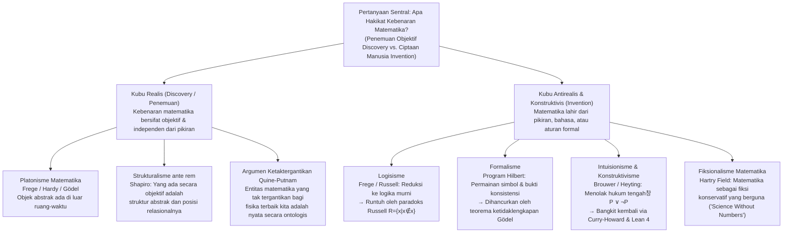
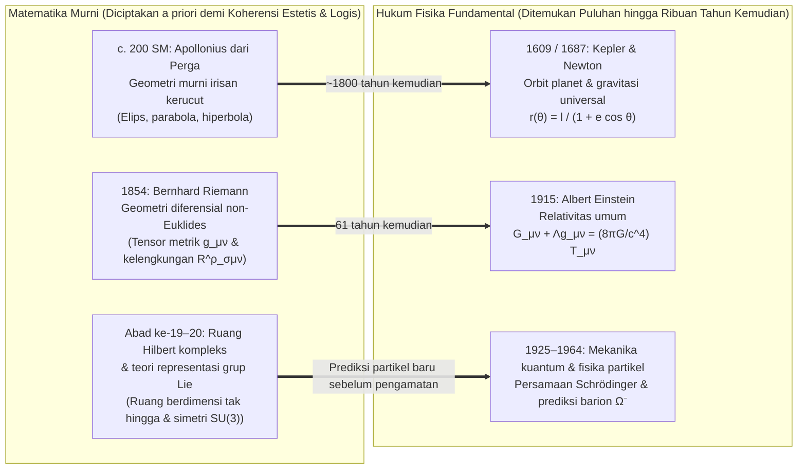

## Pendahuluan: Apakah Himpunan Mandelbrot Sudah Ada Sebelum Big Bang?

Pada tahun 1980, matematikawan Benoit Mandelbrot memvisualisasikan melalui komputer perilaku relasi rekurensi kuadratik yang tampak sangat sederhana pada bidang kompleks:

$$z_{n+1} = z_n^2 + c \qquad (z_0 = 0,\; c \in \mathbb{C})$$

Himpunan semua parameter kompleks $c$ yang membuat barisan $\{z_n\}$ tetap terbatas saat $n \to \infty$ membentuk <strong>himpunan Mandelbrot ($\mathcal{M}$)</strong> yang terkenal. Saat kita memperbesar batasnya (yang dimensi Hausdorff-nya terbukti tepat $2$), muncul semesta kerumitan geometris yang tak habis-habisnya: lembah kuda laut berpilin, sulur-sulur rumit, dan salinan miniatur yang bersarang tanpa batas yang belum pernah dirancang oleh pikiran manusia mana pun.

Pemandangan ini memaksa setiap ilmuwan dan filsuf menghadapi pertanyaan ontologis dan epistemologis paling mendasar: apakah Mandelbrot <strong>menciptakan / menemukan sebagai invensi (Invented)</strong> struktur ini, ataukah ia <strong>menemukannya sebagai penyingkapan (Discovered)</strong>?

Jika kita memikirkan permainan catur, tidak ada yang percaya bahwa aturan rokade sudah ada di kosmos purba sebelum peradaban manusia; catur jelas merupakan <strong>ciptaan (invensi)</strong> budaya. Namun bagaimana dengan teorema Euklides tentang tak terhingganya bilangan prima, identitas Euler $e^{i\pi} + 1 = 0$, atau geometri fraktal $\mathcal{M}$? Bahkan seandainya kehidupan cerdas tidak pernah berevolusi di alam semesta kita, atauหาก peradaban asing di galaksi Andromeda mengembangkan matematikanya sendiri, tampak tak terbantahkan bahwa $17$ tetaplah bilangan prima, rasio keliling terhadap diameter lingkaran Euklides tetaplah $\pi$, dan $z_{n+1} = z_n^2 + c$ tetap akan melukiskan fraktal yang persis sama.

Namun, jika bilangan, himpunan, manifold diferensiabel, dan ruang Hilbert ada secara independen dari pikiran manusia, <strong>di mana</strong> mereka berada? Kita tidak dapat mengamati angka $7$ lewat teleskop atau menabrakkan himpunan kosong $\emptyset$ di dalam akselerator partikel. Jika objek matematika menghuni alam Platonis di luar ruang-waktu, bagaimana otak biologis manusia dapat bersentuhan dengan entitas yang secara kausal lembam (inert)? Sebaliknya, jika matematika hanyalah permainan simbol formal ciptaan manusia, mengapa ia mampu memprediksi kelengkungan ruang-waktu dan dunia kuantum dengan ketelitian luar biasa? Artikel ini mengkaji enam aliran utama <strong>filsafat matematika</strong> dan mengurai teka-teki terkenal Eugene Wigner tentang <strong>“efektivitas matematika yang tak masuk akal dalam ilmu-ilmu alam”</strong>.

---

## Bab 1: Platonisme Matematika (Realisme) dan Dua Dilema Benacerraf

### 1.1 Plato, Frege, Hardy, dan Gödel tentang Realitas Matematika Objektif

Dalam kegiatan riset sehari-hari, sebagian besar matematikawan bekerja sebagai <strong>Platonis matematika (realis)</strong> secara naluriah. Berakar pada teori Ide <strong>Plato</strong>, realisme ini memperoleh perumusan logis yang ketat melalui <strong>Gottlob Frege</strong>, <strong>G. H. Hardy</strong>, dan <strong>Kurt Gödel</strong>:
* <strong>Antipsikologisme Frege</strong>: Dalam *The Foundations of Arithmetic* (1884) dan esai *Thought* (1918), Frege meruntuhkan psikologisme yang mereduksi angka menjadi representasi mental subjektif di kepala masing-masing orang. Jika angka $2$ hanyalah keadaan saraf di otak saya, setiap orang akan memiliki angka “$2$” pribadi dan kebenaran objektif universal $2+2=4$ akan lenyap. Selain dunia fisik dan dunia psikis subjektif, Frege mempostulatkan <strong>“Alam Ketiga” (*Drittes Reich*)</strong> tempat objek-objek abstrak objektif berada.
* <strong>Realisme Hardy dan Gödel</strong>: Dalam *A Mathematician's Apology* (1940), Hardy menulis: “317 adalah bilangan prima, bukan karena kita berpikir demikian, melainkan <strong>karena memang demikian adanya (because it is so)</strong>, karena realitas matematika dibangun seperti itu.” Kurt Gödel (1947/1964), saat mengkaji hipotesis kontinum ($2^{\aleph_0} = \aleph_1$), menegaskan bahwa himpunan bereksistensi secara objektif dan pikiran manusia memiliki <strong>“intuisi matematika”</strong> yang analog dengan persepsi indrawi.

Platonisme standar didefinisikan oleh tiga tesis: (1) <strong>Eksistensi</strong> objek matematika; (2) <strong>Keabstrakan</strong> (berada di luar ruang-waktu dan <strong>lembam secara kausal / causally inert</strong>); serta (3) <strong>Independensi</strong> penuh dari pikiran manusia.

### 1.2 Masalah Epistemologis Benacerraf (1973): Tembok Kelembaman Kausal

Pada tahun 1973, dalam makalah terkenalnya *“Mathematical Truth”*, <strong>Paul Benacerraf</strong> mengajukan keberatan mematikan terhadap Platonisme:
1. <strong>Tuntutan Keseragaman Semantik</strong>: Kalimat matematika (“Ada bilangan prima lebih besar dari 17”) harus dianalisis dengan semantik kondisi-kebenaran Tarskian yang sama dengan kalimat empiris, yang menuntut agar kuantor $\exists x$ menjangkau objek-objek yang benar-benar ada ($\implies$ <strong>Platonisme</strong>).
2. <strong>Tuntutan Epistemologi Naturalis</strong>: Agar organisme biologis dengan otak fisik memiliki pengetahuan andal tentang suatu domain $D$ (atau untuk menjelaskan keandalan non-kebetulan dari keyakinan matematika kita, menurut perumusan ulang Hartry Field tahun 1989), harus ada hubungan kausal atau informasional antara $D$ dan keadaan kognitif kita.

Kontradiksinya bersifat fatal: menurut definisi Platonis, objek abstrak bersifat <strong>lembam secara kausal</strong>; bilangan prima tidak memancarkan foton dan tidak memicu neuron. Jika Platonisme benar, <strong>pengetahuan matematika menjadi mustahil secara prinsip</strong>!

### 1.3 Masalah Identifikasi Benacerraf (1965) dan Strukturalisme Matematika

Pada tahun 1965, dalam *“What Numbers Could Not Be”*, Benacerraf mengungkap <strong>masalah reduksi ganda (Identification Problem)</strong>. Dalam teori himpunan, bilangan asli $0, 1, 2, 3, \dots$ dapat dikonstruksi dengan tak terhingga banyaknya cara:
* <strong>Konstruksi Zermelo (1908)</strong>: $0_Z = \emptyset,\; 1_Z = \{\emptyset\},\; 2_Z = \{\{\emptyset\}\},\; 3_Z = \{\{\{\emptyset\}\}\}, \dots$ ($S(n) = \{n\}$).
* <strong>Ordinal von Neumann (1923)</strong>: $0_N = \emptyset,\; 1_N = \{\emptyset\},\; 2_N = \{\emptyset, \{\emptyset\}\},\; 3_N = \{\emptyset, \{\emptyset\}, \{\emptyset, \{\emptyset\}\}\}, \dots$ ($S(n) = n \cup \{n\}$).

Kedua barisan memenuhi aksioma Peano dan bersifat isomorfik di seluruh aritmetika. Namun terhadap pertanyaan “Apakah $1 \in 3$?”, von Neumann menjawab <strong>Benar</strong> ($1_N \in 3_N$) sedangkan Zermelo menjawab <strong>Salah</strong> ($1_Z \notin 3_Z$). Manakah “angka $3$ yang sejati”? Tidak ada satu pun secara khusus: Benacerraf menyimpulkan bahwa <strong>“angka sama sekali tidak mungkin berupa objek-objek individual”</strong>.

Dari sinilah lahir <strong>strukturalisme matematika (Stewart Shapiro, Michael Resnik, Geoffrey Hellman)</strong>: matematika tidak membahas objek terisolasi, melainkan <strong>struktur abstrak dan posisi relasional (“tempat”) di dalamnya</strong>. Angka “$2$” tidak lain adalah posisi di antara $1$ dan $3$ dalam sembarang barisan-$\omega$. Shapiro membela <strong>strukturalisme *ante rem*</strong> (struktur ada secara objektif mendahului instansiasinya), sementara Hellman mengajukan <strong>strukturalisme modal (*in re*)</strong> yang menerjemahkan matematika menggunakan operator modal $\Box$ dan $\Diamond$.

---

## Bab 2: Krisis Fondasi Matematika: Logisisme, Formalisme, dan Intuisionisme

### 2.1 Logisisme dan Paradoks Russell

<strong>Logisisme</strong> (Frege, Russell, Whitehead) berupaya mereduksi seluruh matematika menjadi logika murni. Dalam *Basic Laws of Arithmetic*, Frege menggunakan Hukum Dasar V (komprehensi tak terbatas). Pada tahun 1902, <strong>Bertrand Russell</strong> mendefinisikan himpunan $R = \{x \mid x \notin x\}$, memicu <strong>paradoks Russell</strong>:

$$R = \{x \mid x \notin x\} \quad \Longrightarrow \quad R \in R \iff R \notin R$$

Dalam *Principia Mathematica* (1910–1913), Russell dan Whitehead memperkenalkan teori tipe bercabang untuk menghindari swarujuk, tetapi terpaksa mempostulatkan aksioma ketakterhinggaan dan aksioma redusibilitas yang bukan kebenaran logika murni.

### 2.2 Formalisme Hilbert dan Teorema Ketidaklengkapan Gödel

Untuk menyelamatkan surga ketakterhinggaan Cantor, <strong>David Hilbert</strong> menggagas <strong>formalisme</strong> dan <strong>program Hilbert</strong>: memformalkan seluruh matematika klasik ke dalam sistem aksiomatik $T$ dan membuktikan, dengan metode metamatematika yang строго <strong>finitistik</strong>, <strong>kelengkapan</strong> serta <strong>konsistensi ($\text{Con}(T)$)</strong> dari $T$.

Namun pada tahun 1931, <strong>Kurt Gödel</strong> menerbitkan dua <strong>teorema ketidaklengkapannya</strong>:
1. <strong>Teorema Ketidaklengkapan Pertama</strong>: Dalam setiap sistem formal konsisten yang dapat diaksiomatisasi secara rekursif $T$ dan memuat aritmetika Peano ($\text{PA}$), terdapat kalimat aritmetika $G_T$ (“Saya tidak dapat dibuktikan di dalam $T$”) sedemikian sehingga:
   $$T \nvdash G_T \quad \text{dan} \quad T \nvdash \neg G_T$$
   $G_T$ <strong>benar dalam model standar $\mathbb{N}$, tetapi tidak dapat dibuktikan di dalam $T$</strong>!
2. <strong>Teorema Ketidaklengkapan Kedua</strong>: Tidak ada sistem konsisten $T$ semacam itu yang dapat membuktikan konsistensinya sendiri:
   $$T \nvdash \text{Con}(T)$$

Kebenaran matematika tidak pernah dapat direduksi menjadi sekadar keterbuktian formal.

### 2.3 Intuisionisme dan Isomorfisme Curry-Howard

Didirikan oleh <strong>L. E. J. Brouwer</strong> dan diformalkan oleh <strong>Arend Heyting</strong>, <strong>intuisionisme / konstruktivisme</strong> memandang matematika sebagai <strong>aktivitas konstruksi mental</strong> dalam intuisi waktu. Bereksistensi ($\exists x P(x)$) berarti memiliki algoritma hingga yang secara eksplisit mengonstruksi saksi $x$.

Oleh sebab itu, intuisionisme <strong>menolak ketakterhinggaan aktual</strong> serta <strong>hukum tengah yangco-dikecualikan (Law of Excluded Middle, $P \lor \neg P$)</strong> dan eliminasi negasi ganda ($\neg\neg P \to P$). Dalam ilmu komputer modern, logika konstruktif ini berjaya berkat <strong>isomorfisme Curry-Howard</strong>:

$$\text{Proposisi (Propositions)} \cong \text{Tipe (Types)}, \qquad \text{Bukti (Proofs)} \cong \text{Program (Programs)}$$

Setiap bukti konstruktif secara langsung merupakan program komputer yang dapat dieksekusi, menjadi fondasi asisten pembuktian modern seperti <strong>Coq (Rocq)</strong>, <strong>Agda</strong>, dan <strong>Lean 4</strong>.

---

## Bab 3: Perbandingan Enam Aliran dan Perdebatan Ketaktergantikan

| Aliran Filsafat | Status Ontologis Entitas Matematika | Sumber Kebenaran Matematika (Epistemologi) | Sikap terhadap Ketakterhinggaan Aktual | Tokoh Kunci | Keberatan / Batasan Utama |
| :--- | :--- | :--- | :--- | :--- | :--- |
| <strong>Platonisme</strong> | Objek abstrak objektif di luar ruang-waktu (<strong>Penemuan</strong>) | Intuisi rasional / intuisi Gödelian | Diterima sepenuhnya (hierarki transfinit) | Plato, Frege, Hardy, Gödel | <strong>Masalah epistemologis Benacerraf</strong> & masalah identifikasi |
| <strong>Logisisme</strong> | Direduksi ke konsep logis dan ekstensi kelas | Deduksi analitik *a priori* dari logika murni | Memerlukan aksioma ekstralogis ketakterhinggaan | Frege, Russell, Whitehead | <strong>Paradoks Russell</strong> ($R=\{x\mid x\notin x\}$) |
| <strong>Formalisme</strong> | Tanpa objek; permainan sintaksis untai simbol (<strong>Ciptaan</strong>) | Keterjabaran formal + <strong>bukti konsistensi finitistik</strong> | Ditoleransi sebagai “elemen ideal” penyederhana | David Hilbert, Haskell Curry | <strong>Teorema ketidaklengkapan ke-1 & ke-2 Gödel</strong> ($T \nvdash G_T,\; T \nvdash \text{Con}(T)$) |
| <strong>Intuisionisme</strong> | Konstruksi mental dalam intuisi waktu (<strong>Ciptaan</strong>) | Kepemilikan algoritma konstruktif (BHK) | <strong>Menolak ketakterhinggaan aktual</strong> (hanya potensial) | Brouwer, Heyting, Martin-Löf | Penolakan $P \lor \neg P$ membatasi analisis klasik |
| <strong>Strukturalisme</strong> | <strong>Posisi relasional</strong> di dalam struktur abstrak | Invariansi isomorfisme atau kemungkinan modal | Diterima via aksioma kategoris atau modalitas | Benacerraf, Shapiro, Resnik, Hellman | Epistemologi struktur *ante rem*; modalitas primitif |
| <strong>Fiksionalisme</strong> | Tidak ada; <strong>fiksi berguna</strong> seperti Sherlock Holmes (<strong>Ciptaan</strong>) | Konsistensi internal “kisah matematika” | Bebas digunakan sebagai perangkat fiksional | Hartry Field, Mark Balaguer | <strong>Ketaktergantikan Quine-Putnam</strong>; batas pada ruang Hilbert kuantum |

<strong>Argumen ketaktergantikan Quine-Putnam</strong> menyatakan bahwa karena entitas matematika tak tergantikan bagi teori fisika terbaik kita, holisme konfirmasi mengikat kita pada keberadaan nyata mereka. Dalam *Science Without Numbers* (1980), <strong>Hartry Field</strong> menjawab dengan <strong>fiksionalisme matematika</strong>, berargumen bahwa matematika hanyalah jalan pintas deduktif (“ekstensi konservatif”) dan merumuskan ulang gravitasi Newton tanpa angka—meskipun program ini terbentur pada ruang Hilbert mekanika kuantum.

---

## Bab 4: Teka-teki Wigner: “Efektivitas Matematika yang Tak Masuk Akal dalam Ilmu-Ilmu Alam”

### 4.1 Keajaiban Penciptaan Matematika yang Mendahului Penemuan Fisika

Pada tahun 1960, peraih Nobel Fisika <strong>Eugene Wigner</strong> menerbitkan esai klasiknya *“The Unreasonable Effectiveness of Mathematics in the Natural Sciences”*. Bagaimana menjelaskan bahwa teori matematika yang diciptakan secara murni otonom demi keindahan formal ternyata, puluhan atau ribuan tahun kemudian, menjadi bahasa persis dari hukum-hukum alam terdalam?

1. <strong>Dari Irisan Kerucut Apollonius ke Orbit Kepler</strong>: Dikaji sekitar 200 SM oleh Apollonius dari Perga karena minat geometris murni, irisan kerucut mendeskripsikan secara persis orbit gravitasi di bawah gaya $1/r^2$ yang dibuktikan 1800 tahun kemudian oleh Kepler dan Newton: $r(\theta) = \frac{\ell}{1 + e\cos\theta}$.
2. <strong>Dari Geometri Riemann ke Relativitas Umum Einstein</strong>: Diciptakan pada tahun 1854 oleh Bernhard Riemann, geometri manifold melengkung memberikan kepada Einstein pada tahun 1915 kerangka persis persamaan medan gravitasi:
   $$R_{\mu\nu} - \frac{1}{2} R g_{\mu\nu} + \Lambda g_{\mu\nu} = \frac{8\pi G}{c^4} T_{\mu\nu}$$
3. <strong>Dari Ruang Hilbert dan Grup $\text{SU}(3)$ ke Barion $\Omega^-$</strong>: Bilangan kompleks dan ruang Hilbert mengatur persamaan Schrödinger $i\hbar \frac{\partial}{\partial t}|\psi\rangle = \hat{H}|\psi\rangle$, dan pada tahun 1961 Murray Gell-Mann memprediksi keberadaan serta massa ($1672\text{ MeV}/c^2$) <strong>barion $\Omega^-$</strong> (teramati tahun 1964) hanya dari satu slot kosong dalam dekuplet representasi grup Lie $\text{SU}(3)$.

### 4.2 Empat Jawaban Filosofis dan Sintesis Akhir: “Kita Menciptakan Aksioma, Kita Menemukan Teorema”

Empat penjelasan menerangi misteri ini: (1) <strong>Hipotesis Alam Semesta Matematika (MUH) Max Tegmark</strong> (alam semesta fisik *adalah* struktur matematika); (2) <strong>realisme struktural (Structural Realism)</strong> bersama teorema Noether (hukum fisika adalah invarian simetri dan matematika mengklasifikasikan semua simetri yang mungkin); (3) <strong>bias seleksi Richard Hamming</strong> dan epistemologi evolusioner; serta (4) <strong>sintesis dialektis</strong>: <strong>kita dengan bebas menciptakan konsep dan aksioma awal (seperti $z_{n+1} = z_n^2 + c$), tetapi kita menemukan teorema dan struktur yang mengalir darinya dengan keniscayaan objektif mutlak.</strong>
