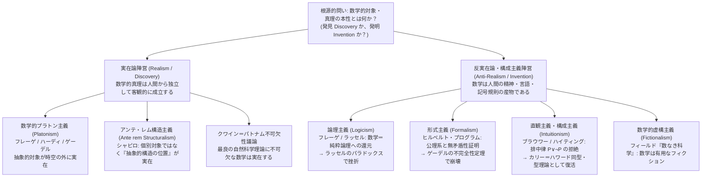
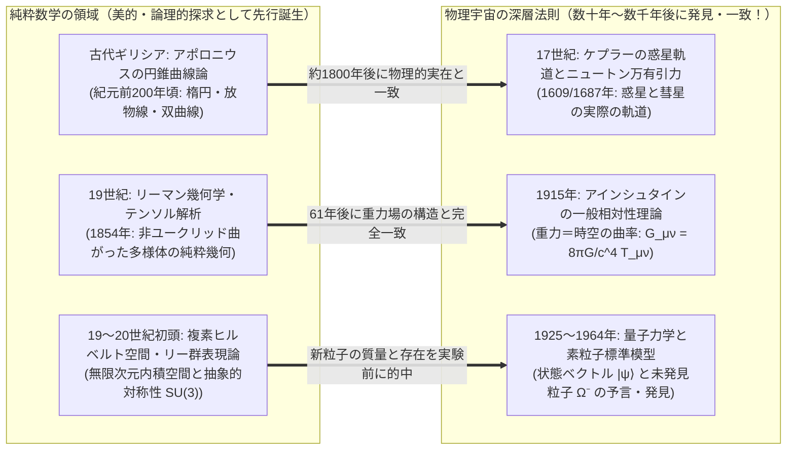

## 序論：マンデルブロ集合は「ビッグバンの前」からそこにあったのか？

1980年、数学者ブノワ・マンデルブロ（Benoit Mandelbrot）は、複素平面上の極めて単純な2次漸化式

$$z_{n+1} = z_n^2 + c \qquad (z_0 = 0,\; c \in \mathbb{C})$$

において、$n \to \infty$ の極限で数列 $\{z_n\}$ が無限大に発散しない複素数パラメータ $c$ の集合——今日<strong>マンデルブロ集合（Mandelbrot Set）</strong> $\mathcal{M}$ と呼ばれるフラクタル図形——をコンピュータの画面上に描き出した。その境界領域を拡大していくと、そこには渦巻くタツノオトシゴの尾のような装飾、無限に入れ子状に反復されるミニチュアのマンデルブロ集合、そしてどれだけ倍率を上げても決して尽きることのない幾何学的構造が果てしなく広がっていた。

ここで、あらゆる科学者と哲学者の胸を突く根源的な問いが立ち現れる。マンデルブロは、この精緻極まりない図形を<strong>「発明（Invent）」</strong>したのだろうか、それとも<strong>「発見（Discover）」</strong>したのだろうか？

もしチェスや将棋のルールであれば、それは明らかに人間が歴史のある時点で「発明」した文化的な創作物である。人類が誕生する前の宇宙に「桂馬の飛び方」や「キャスリングの規則」が存在していたと考える者はいない。しかし、素数が無限に存在すること（ユークリッドの定理）や、オイラーの等式 $e^{i\pi} + 1 = 0$、あるいはマンデルブロ集合 $\mathcal{M}$ の境界が持つハウスドルフ次元が $2$ であるという事実はどうだろうか。仮に138億年前のビッグバン直後に知性を持つ生命体が一人も存在しなかったとしても、あるいは地球から遠く離れたアンドロメダ銀河の異星文明が独自に数学を発展させたとしても、やはり $17$ は素数であり、$\pi$ の十進展開の比率は変わらず、$z_{n+1} = z_n^2 + c$ の収束領域は寸分違わぬ同じフラクタル構造を描くように思われる。

一方で、もし数や集合、多様体やヒルベルト空間が「人間の心から独立して客観的に存在する」のだとしたら、それらは一体<strong>どこに</strong>存在するのか？ 私たちは望遠鏡で素数を見ることもできなければ、粒子加速器で「空集合 $\emptyset$」を衝突させることもできない。時空の外側にある非物質的なイデア界に数学的対象が鎮座しているのだとすれば、生身の物理的な脳（ニューロンの電気化学的ネットワーク）を持つにすぎない人間が、どうして因果的接触を一切持たないはずの抽象的対象について確実な真理を知ることができるのか？

さらに謎を深めるのは、人間が純粋な知的パズルとして頭の中で紡ぎ出したはずの抽象数学が、何百年も経ってから現実の物理宇宙の深奥を恐るべき精度で記述してしまうという事実である。本稿では、<strong>数学の哲学（Philosophy of Mathematics）</strong>における存在論（Ontology）と認識論（Epistemology）の核心的対立軸——<strong>数学的プラトン主義（実在論）</strong>、<strong>論理主義</strong>、<strong>形式主義</strong>、<strong>直観主義（構成主義）</strong>、<strong>構造主義</strong>、そして<strong>虚構主義</strong>——を体系的に検証し、最後にノーベル物理学賞受賞者ユージン・ウィグナーが提起した<strong>「自然科学における数学の不合理な有効性（The Unreasonable Effectiveness of Mathematics in the Natural Sciences）」</strong>の謎に迫る。

---

## 第1章 数学的プラトン主義（実在論）とベナセラフの2つのジレンマ

### 1.1 プラトン、フレーゲ、ハーディ、ゲーデルの数学的実在論

現場の研究数学者の大多数が、研究に没頭している最中に暗黙のうちに抱いている素朴かつ強力な世界観は、<strong>数学的プラトン主義（Mathematical Platonism）</strong>あるいは<strong>数学的実在論（Mathematical Realism）</strong>と呼ばれる立場である。その起源は古代ギリシアのプラトン（Plato）が『国家』や『メノン』で説いたイデア論に遡る。物理世界に描かれた円や三角形はすべて不完全な模造品にすぎないが、感覚を超えたイデア界には完全無欠な「円そのもの」「数そのもの」が永遠不変に実在しており、数学的認識とは魂がその実在を想起（アナムネーシス）し観照することである、とプラトンは考えた。

近代以降、この立場を論理的に鍛え上げたのが<strong>ゴットロープ・フレーゲ（Gottlob Frege）</strong>、<strong>G.H.ハーディ（G. H. Hardy）</strong>、そして<strong>クルト・ゲーデル（Kurt Gödel）</strong>である。フレーゲは『算術の基礎』（1884年）において、数を人間の主観的な心理表象（メンタル・イメージ）に還元する「心理主義（Psychologism）」を徹底的に論破した。もし「$2$」が私の頭の中の観念にすぎないなら、あなたの頭の中の「$2$」とは別物になり、$2 + 2 = 4$ という命題が万人に共通の客観的真理である理由が説明できなくなる。したがって、数学的対象は物理的対象でも心理的対象でもない「第三領域（Drittes Reich）」に属する客観的・抽象的実在でなければならない。

イギリスの数論学者 G.H.ハーディは『ある数学者の弁明』（1940年）の中で次のように断言した。

> 「私は、数学的現実が我々の外部に横たわっており、我々の役割はそれを発見し、あるいは観察することであって、我々が証明し、大げさに『創造』と呼んでいる定理の数々は、単に我々の観察の記録にすぎないと信じている。……317が素数であるのは、我々がそう考えるからでも、我々の精神が特定の仕方で形作られているからでもなく、<strong>それがそうだから（because it is so）</strong>であり、数学的現実がそのように構築されているからである。」

さらにクルト・ゲーデルは、集合論における連続体仮説（Continuum Hypothesis: $2^{\aleph_0} = \aleph_1$）の研究を通じて強力なプラトン主義を擁護した。ゲーデルによれば、集合や概念は物理的物体と同じくらい客観的に実在しており、私たちが五感（感覚的知覚）によって物理的対象を捉えるのと全く類比的に、人間には<strong>「数学的直観（Mathematical Intuition）」</strong>という知的な知覚能力が備わっており、それによって超感覚的な集合の世界を直接洞察しているのだという。

数学的プラトン主義は、以下の3つのテーゼ（命題）の連言として定式化できる。
1. <strong>存在テーゼ（Existence）</strong>：数・集合・関数などの数学的対象は客観的に存在する。
2. <strong>抽象性テーゼ（Abstractness）</strong>：数学的対象は時空間内に位置を持たず、因果的作用（Causal Efficacy）を持たない<strong>抽象的対象（Abstract Objects）</strong>である。
3. <strong>独立性テーゼ（Independence）</strong>：数学的対象の存在およびその性質は、人間（やいかなる知的生命体）の精神・言語・証明活動から完全に独立している。

### 1.2 ベナセラフの認識論的ジレンマ（1973年）：因果的不活性の壁

プラトン主義は「数学的真理の客観性」を見事に説明する一方で、致命的なアキレス腱を抱えている。それを決定的な形で突きつけたのが、アメリカの哲学者<strong>ポール・ベナセラフ（Paul Benacerraf）</strong>による1973年の歴史的論文『数学的真理』（*Mathematical Truth*）である。

ベナセラフは、私たちが数学に対して抱く2つの極めてもっともらしい要請が、互いに真っ向から衝突することを示した。
* <strong>第1要請（意味論的一様性 Semantic Uniformity）</strong>：数学の命題（例：「7より大きい素数が存在する：$\exists x (\text{Prime}(x) \land x > 7)$」）の真理条件は、日常言語や自然科学の命題（例：「火星より大きい惑星が存在する：$\exists x (\text{Planet}(x) \land x > \text{Mars})$」）と全く同じ一様な意味論（タルスキ的指示理論）によって解釈されなければならない。これを認めると、数学的命題が真であるためには、その量記号が走る変域（ドメイン）に「素数」という抽象的対象が実際に存在していなければならない（$\implies$ <strong>プラトン主義の要請</strong>）。
* <strong>第2要請（合理的認識論 Reasonable Epistemology）</strong>：人間の知識に関する理論は、認識主体である人間（物理的な身体と脳を持つ生物）がいかにしてその対象についての知識を獲得できるかを、自然主義的・科学的に説明できなければならない。知識の標準的な説明モデル（たとえば因果的知識理論や信頼性主義）によれば、主体 $S$ が対象 $X$ について知るためには、$X$ と $S$ の認知器官との間に何らかの<strong>因果的・情報的結合（Causal / Information-Theoretic Connection）</strong>が存在しなければならない。

ここで破局が生じる。プラトン主義の定義（抽象性テーゼ）により、数や集合は時空の外にあり、<strong>因果的に完全に不活性（Causally Inert）</strong>である。数「$7$」は光子を放出することもなければ、重力波を発生させることもなく、人間の網膜やシナプスに物理的変化を引き起こすことは原理的に不可能である。すると、もしプラトン主義が正しいならば、<strong>人間が数学的対象について何かを知ることは原理的に不可能になる</strong>。逆に、人間が数学を知ることができる（反プラトン主義・構成主義）とするならば、今度は数学命題の標準的な意味論（客観的指示）が崩壊する。これが現代の数理哲学を二分し続ける<strong>ベナセラフの認識論的問題（Benacerraf's Epistemological Problem）</strong>、および後にハートリー・フィールドが洗練させた<strong>信頼性の挑戦（Reliability Challenge）</strong>である。

### 1.3 ベナセラフの同定問題（1965年）：「数は何ではありえないか」

ベナセラフはもう一つ、1965年の論文『数は何ではありえないか』（*What Numbers Could Not Be*）において、プラトン主義の「対象（Object）」概念そのものを揺るがす爆弾を投下した。

現代数学において、自然数 $0, 1, 2, 3, \dots$ は集合論の内部で「純粋集合（空集合 $\emptyset$ から出発して作られる集合）」として構成（還元）される。ところが、その構成法は一意ではない。
* <strong>ツェルメロ（Ernst Zermelo）の構成法</strong>では、$0 = \emptyset$ とし、後者関数 $S(n) = \{n\}$ と定義する：
  $$0_Z = \emptyset, \quad 1_Z = \{\emptyset\}, \quad 2_Z = \{\{\emptyset\}\}, \quad 3_Z = \{\{\{\emptyset\}\}\}, \dots$$
* <strong>フォン・ノイマン（John von Neumann）の構成法</strong>では、$0 = \emptyset$ とし、後者関数 $S(n) = n \cup \{n\}$ と定義する：
  $$0_N = \emptyset, \quad 1_N = \{\emptyset\}, \quad 2_N = \{\emptyset, \{\emptyset\}\}, \quad 3_N = \{\emptyset, \{\emptyset\}, \{\emptyset, \{\emptyset\}\}\}, \dots$$

ツェルメロの自然数系もフォン・ノイマンの自然数系も、ペアノの公理系（Peano Axioms）を完璧に満たし、算術のすべての定理（$2 + 3 = 5$ や素数定理など）において完全に同型（Isomorphic）に振る舞う。しかし、集合としてのメンバーシップ関係（$\in$）を問うた瞬間、両者は真っ向から食い違う。フォン・ノイマン流では $1_N \in 3_N$ は<strong>真</strong>であり、集合 $2_N$ の要素数は $2$ 個であるが、ツェルメロ流では $1_Z \in 3_Z$ は<strong>偽</strong>であり、集合 $2_Z$ の要素数は $1$ 個しかない！

ベナセラフは問う。「もし自然数 $2$ や $3$ がプラトン界に実在する 고유の『対象（Object）』であるならば、ツェルメロの集合とフォン・ノイマンの集合のどちらが『本物の数 $2$』なのか？」もちろん、算術的に見てどちらか一方だけが「本物の $2$」であるべき理由はどこにも存在しない。ここからベナセラフが導き出した結論は衝撃的であった——<strong>「数はそもそも個別の『対象（Objects）』ではありえない！」</strong> 数とは独立した実体ではなく、無限に続く系列（Progression）の中で占める<strong>「関係的な位置（Relational Positions）」</strong>にすぎないのである。

---

## 第2章 数学的構造主義（Mathematical Structuralism）：対象から「構造」へ

ベナセラフの同定問題を真正面から受け止め、現代の数学の哲学において最も有力な潮流の一つとなったのが<strong>数学的構造主義（Mathematical Structuralism）</strong>である。スチュワート・シャピロ（Stewart Shapiro）やマイケル・レズニック（Michael Resnik）らが展開したこの立場は、数学の主題を「個別の数学的対象」から<strong>「抽象的な構造（Structure）およびその中の位置（Places / Positions）」</strong>へと転換する。

たとえば、野球における「ショート（遊撃手）」というポジションを考えてみよう。遊撃手とは特定の個人（たとえば坂本勇人や源田壮亮）のことではない。それは「野球の守備体系」という全体構造の中で、二塁と三塁の間に位置し、特定のルールと役割によって定義される「空席（スロット / オフィス）」である。同様に、自然数「$2$」とは、『$\{\{\emptyset\}\}$』という特定の集合個体ではなく、ペアノの公理が規定する<strong>「自然数構造（$\omega$-列構造）」において「$1$ の次であり、$3$ の前である」という構造的ポジションそのもの</strong>なのである。

構造主義には、構造自体の存在論的身分をめぐって2つの主要な流派が存在する。
1. <strong>アンテ・レム構造主義（*Ante rem* Structuralism：個物に先立つ構造主義）</strong>：スチュワート・シャピロが提唱する「プラトン主義的構造主義」。具体的なシステム（ツェルメロ集合や物理的な石ころの並び）が存在するかどうかに関わらず、「自然数構造そのもの」「群構造そのもの」が抽象的実在として独立に存在する、とする立場。
2. <strong>イン・レ構造主義 / 様相構造主義（*In re* / Modal Structuralism：個物のうちにある構造主義）</strong>：ポール・ヘルマン（Geoffrey Hellman）らが提唱する「唯名論的・反プラトン主義的構造主義」。抽象的な「構造そのもの」というプラトン的実体を認めず、すべての算術命題 $A$ を、「<strong>もし</strong>ペアノの公理を満たす任意のシステム $X$ が論理的に可能であるならば、そのシステム $X$ において $A$ が成り立つ（$\Box \forall X (\text{PA}(X) \to A(X))$）」という様相論理（Modal Logic）の命題へと翻訳する立場である。

---

## 第3章 数学の基礎づけの危機：論理主義・形式主義・直観主義の死闘

19世紀末から20世紀前半にかけて、数学の歴史は「数学とは何か」をめぐる最大の危機——<strong>数学の基礎論論争（Foundational Crisis of Mathematics）</strong>——に直面した。そこでは<strong>論理主義</strong>、<strong>形式主義</strong>、<strong>直観主義</strong>という三大陣営が激しい論争を繰り広げ、その帰結が現代のコンピュータ科学と数理論理学を生み出すことになった。

### 3.1 論理主義（Logicism）とラッセルのパラドックス

フレーゲとバートランド・ラッセル（Bertrand Russell）が推進した<strong>論理主義（Logicism）</strong>は、「すべての数学的真理は、実は<strong>純粋な論理学（Logic）の真理</strong>に還元できる（数学とは論理学の延長にすぎない）」という壮大なプログラムであった。もし数を論理的命題と集合（概念の外延）だけで定義できれば、数学の確実性は「思考の普遍法則である論理学」によって完全に保証されるはずであった。

フレーゲは主著『算術の基本法則』において、「いかなる性質（述語）$\varphi(x)$ に対しても、それを満たす対象全体の集合 $\{x \mid \varphi(x)\}$ が存在する」という直観的に自明に見える<strong>無制限の内包公理（Unrestricted Comprehension Axiom）</strong>を採用した。しかし1902年、第2巻の印刷直前に、若きラッセルからフレーゲのもとへ一通の手紙が届く。それが有名な<strong>ラッセルのパラドックス（Russell's Paradox）</strong>であった。

性質 $\varphi(x)$ として「自分自身を要素として含まない（$x \notin x$）」という性質を選び、そのような集合全体の集合 $R$ を考える：

$$R = \{x \mid x \notin x\}$$

ここで「集合 $R$ は自分自身を要素として含むか（$R \in R$ か）？」と問うと、致命的な矛盾が爆発する：

$$R \in R \iff R \notin R$$

もし $R \in R$ ならば定義より $R \notin R$ となり、もし $R \notin R$ ならば定義の条件を満たすので $R \in R$ となる。この単純極まりないパラドックスによってフレーゲの体系は崩壊した。その後、ラッセルとアルフレッド・ノース・ホワイトヘッドは大著『プリンキピア・マテマティカ』（*Principia Mathematica*, 1910–1913年）において、集合に厳格な階層を設ける「型理論（Type Theory）」を導入してパラドックスを回避しようとしたが、無限公理（Axiom of Infinity）や還元公理（Axiom of Reducibility）など、到底「純粋な論理の法則」とは呼べない実質的な数学的仮定を密輸入せざるを得ず、純粋な論理主義は挫折を余儀なくされた。

### 3.2 ヒルベルトの形式主義（Formalism）とゲーデルの不完全性定理

パラドックスの衝撃から古典数学（とりわけカントールの無限集合論）を救い出すために立ち上がったのが、20世紀最大の数学者<strong>ダフィット・ヒルベルト（David Hilbert）</strong>であった。ヒルベルトは、「私たちの有限な領分から、カントールが築き上げた楽園（無限集合論）から何人も我々を追放することはできない」と宣言し、<strong>形式主義（Formalism）</strong>に基づく<strong>ヒルベルト・プログラム（Hilbert's Program）</strong>を提唱した。

極端な形式主義（「ゲーム形式主義 Game Formalism」）においては、数学とはそもそも外部の対象について語る真理ではなく、<strong>意味を持たない記号の列（文字列）を、定められた推論規則に従って変形していくチェスのような形式ゲーム</strong>であるとみなされる。ヒルベルト自身の構想はさらに精緻であった。彼は数学を以下の二層に分けた：
1. <strong>実在的数学（Real / Finitary Mathematics）</strong>：具体的な有限個の記号操作に関する、直観的に疑いようのない有限的算術。
2. <strong>理想的数学（Ideal / Infinitary Mathematics）</strong>：実無限（Actual Infinity）や超越的な対象を含む高度な古典数学。これは計算を円滑にするために導入された「形式的な理念的補助物（虚数 $i$ のようなもの）」である。

ヒルベルトの計画は、無限を含む古典数学全体を厳密な形式公理系 $T$ として記号化し、その公理系 $T$ から決して矛盾（$0 = 1$）が導き出されないこと——すなわち<strong>無矛盾性（Consistency）</strong>——を、誰もが疑い得ない「有限の立場（Finitary Standpoint）」の手段だけを用いてメタ数学的に完全証明することであった。これが成功すれば、数学者は存在論的な悩みから解放され、安心して無限の数学を自由に使えるはずであった。

しかし1931年、弱冠25歳の<strong>クルト・ゲーデル（Kurt Gödel）</strong>が発表した論文『プリンキピア・マテマティカおよび関連体系における形式的に決定不能な命題について』が、ヒルベルトの夢を根底から粉砕した。<strong>ゲーデルの不完全性定理（Gödel's Incompleteness Theorems）</strong>である。

* <strong>第一不完全性定理（First Incompleteness Theorem）</strong>：自然数の算術（ペアノ算術 $\text{PA}$）を含む任意の無矛盾な再帰的公理化可能理論 $T$ において、その体系 $T$ の内部では証明も反証もできない命題（ゲーデル文 $G_T$）が必ず存在する：
  $$T \nvdash G_T \quad \text{かつ} \quad T \nvdash \neg G_T$$
  しかも、ゲーデル数化（Gödel Numbering）を通じて $G_T$ は「私（$G_T$）は理論 $T$ において証明できない」という自己言及的命題を算術的に表現しており、メタ視点から見れば $G_T$ は<strong>真（True）であるにもかかわらず形式体系 $T$ では証明不可能（Unprovable）</strong>なのである！
* <strong>第二不完全性定理（Second Incompleteness Theorem）</strong>：そのような無矛盾な体系 $T$ は、自分自身の無矛盾性を表す算術的命題 $\text{Con}(T)$ を、体系 $T$ 自身の内部で証明することはできない：
  $$T \nvdash \text{Con}(T)$$

ゲーデルの定理が数学の哲学に与えた衝撃は計り知れない。第一に、「無限の数学の無矛盾性を、それより弱い有限の算術だけで証明する」というヒルベルト・プログラムは論理的に不可能であることが証明された。第二に、<strong>「数学的真理（Mathematical Truth）」という概念は、「いかなる固定された形式体系における証明可能性（Formal Provability）」よりも本質的に広く、決して形式的な記号ゲームへと還元し尽くすことはできない</strong>ことが暴露されたのである。

### 3.3 直観主義・構成主義（Intuitionism / Constructivism）からカリー＝ハワード同型へ

プラトン主義にも形式主義にも猛烈に反旗を翻したのが、オランダの位相幾何学者<strong>L.E.J.ブラウワー（L. E. J. Brouwer）</strong>が創始し、弟子<strong>アーレント・ハイティング（Arend Heyting）</strong>が形式化した<strong>直観主義（Intuitionism）</strong>および<strong>構成主義（Constructivism）</strong>である。

ブラウワーにとって、数学とは外部のイデア界の発見でもなければ、紙の上の無意味な記号ゲームでもない。数学とは<strong>人間の精神（心）が時間的な直観（Two-ity of time）に基づいて行う「精神的な構成活動（Mental Construction）」そのもの</strong>である。したがって、ある数学的対象が「存在する（$\exists x P(x)$）」とは、「人間がその対象 $x$ を具体的に構成する有限の手続き（アルゴリズム）を実際に手にしていること」を意味する。

この構成主義的真理観から、古典論理学の根幹を揺るがす帰結が導かれる——<strong>排中律（Law of Excluded Middle: $P \lor \neg P$）および二重否定除去則（$\neg\neg P \to P$）の拒絶</strong>である。

ブラウワー流の直観主義論理（ハイティングのBHK解釈：Brouwer-Heyting-Kolmogorov Interpretation）では、論理結合子の意味は「真理値表」ではなく「証明（構成法）の条件」によって定義される：
* $A \land B$ の証明とは、$A$ の証明と $B$ の証明のペア $\langle p, q \rangle$ である。
* $A \lor B$ の証明とは、$A$ の証明であるか、または $B$ の証明であるかのいずれかを具体的に指定した構成である。
* $A \to B$ の証明とは、$A$ の任意の証明を $B$ の証明へと変換する有効な手続き（関数）である。
* $\neg A$（すなわち $A \to \bot$）の証明とは、$A$ の証明が存在すると仮定したら矛盾 $\bot$ が導かれることを示す手続きである。

すると、未解決問題（たとえば「ゴールドバッハの予想 $G$」）に対して、私たちは現時点で $G$ の証明も $\neg G$ の証明も持っていない。したがって、直観主義においては現時点で「$G \lor \neg G$」を主張することは許されない！ さらに、背理法によって「$\forall x \neg P(x)$ と仮定すると矛盾する（$\neg \forall x \neg P(x)$）」ことを示しただけでは、具体的にどの $x$ が $P(x)$ を満たすのかを構成するアルゴリズムが一切得られないため、直観主義では<strong>非構成的な存在証明（Non-Constructive Existence Proof）</strong>は認められない。

この違いを鮮やかに示す有名な例がある。<strong>「無理数の無理数乗 $a^b$ が有理数になるような無理数の組 $(a, b)$ は存在するか？」</strong>
* <strong>古典論理（非構成的証明）</strong>：$x = \sqrt{2}^{\sqrt{2}}$ とおく。排中律により、「$x$ は有理数である」か「$x$ は無理数である」かのどちらかである。（ケース1）もし $x$ が有理数なら、$a = \sqrt{2}, b = \sqrt{2}$ とすればよい。（ケース2）もし $x$ が無理数なら、$a = \sqrt{2}^{\sqrt{2}}, b = \sqrt{2}$ とおけば、$a^b = (\sqrt{2}^{\sqrt{2}})^{\sqrt{2}} = (\sqrt{2})^2 = 2$（有理数）となる。いずれにせよ、そのような組 $(a, b)$ は存在する！——しかしこの証明は、結局 $\sqrt{2}^{\sqrt{2}}$ が有理数なのか無理数なのか、したがって $(a, b)$ がどちらのペアなのかを一切教えてくれない。
* <strong>構成主義的証明</strong>：一方、構成主義者は $a = \sqrt{2}$（無理数）、$b = 2 \log_2 3 = \log_2 9$（無理数であることが容易に構成的に示せる）という具体的なペアを直接提示し、$a^b = (\sqrt{2})^{\log_2 9} = 2^{\frac{1}{2}\log_2 9} = 3$（有理数）を計算してみせる（なお、ゲルフォント＝シュナイダーの定理により $\sqrt{2}^{\sqrt{2}}$ も超越数＝無理数であることが後に構成的に証明された）。

20世紀前半には「主流の数学から多くの定理を切り捨てる過激派」と見なされた直観主義は、20世紀後半から21世紀にかけて<strong>計算機科学（Computer Science）と型理論（Type Theory）の心臓部として劇的な復活</strong>を遂げた。それが<strong>カリー＝ハワード同型対応（Curry-Howard Isomorphism）</strong>である。

$$\text{命題 (Propositions)} \cong \text{型 (Types)}, \qquad \text{証明 (Proofs)} \cong \text{プログラム (Programs)}$$

直観主義論理における証明は、そのままコンピュータ上で実行可能なプログラム（ラムダ計算の項）と1対1に対応し、証明の正規化（カット除去）はプログラムの計算実行（$\beta$-簡約）と完全に一致する！ 今日、<strong>Coq（Rocq）</strong>、<strong>Agda</strong>、そして現代数学の形式化を牽引する<strong>Lean 4</strong>などの定理証明支援系（Interactive Theorem Provers）は、まさにこの構成的型理論（Calculus of Inductive Constructions）を基盤として動いているのである。

---

## 第4章 数学的哲学の主要6大潮流の比較体系

ここで、数学の哲学における主要な6つの立場を、存在論・認識論・無限の扱い・代表者の観点から一覧表に整理しよう。

| 哲学的立場 | 数学的対象の存在論的身分 | 数学的真理の根拠（認識論） | 実無限（Actual Infinity）の扱い | 代表的論者 | 決定的な課題・批判 |
| :--- | :--- | :--- | :--- | :--- | :--- |
| <strong>プラトン主義 (Platonism)</strong> | 時空を超えた客観的・抽象的対象として<strong>実在（発見）</strong> | 数学的直観・理性的洞察による把握 | 全面的に肯定（カントールの超限集合階層を実在とみなす） | プラトン, フレーゲ, ハーディ, ゲーデル | <strong>ベナセラフの認識論的問題</strong>（因果的不活性な対象をなぜ脳が知れるのか）と同定問題 |
| <strong>論理主義 (Logicism)</strong> | 論理的概念・クラスの外延に還元される | 純粋な論理法則と定義からの分析的演繹 | 無限公理の仮定が必要となり純粋論理から逸脱 | フレーゲ, ラッセル, ホワイトヘッド | <strong>ラッセルのパラドックス</strong>（$R=\{x\mid x\notin x\}$）と無限公理・還元公理の非論理性 |
| <strong>形式主義 (Formalism)</strong> | 対象は存在しない。無意味な記号列の操作規則（<strong>発明</strong>） | 公理系からの構文論的導出可能性と<strong>無矛盾性</strong> | 計算を簡便にする「理想的要素（記号）」として許容 | ダフィット・ヒルベルト, カリー | <strong>ゲーデルの不完全性定理</strong>（無矛盾性の自己証明不可能、真だが証明不能な命題の存在） |
| <strong>直観主義・構成主義 (Intuitionism)</strong> | 人間の精神が時間の中で作り出す<strong>心的構成物（発明）</strong> | 具体的な構成手続き（アルゴリズム）の所持 | <strong>実無限を拒絶</strong>し、生成途上の可能無限（Potential Infinity）のみ認める | ブラウワー, ハイティング, マルティン＝レーフ | <strong>排中律（$P \lor \neg P$）の拒絶</strong>により古典解析学の多くの非構成的定理が制限される |
| <strong>構造主義 (Structuralism)</strong> | 個別対象ではなく、<strong>抽象的構造の中の「位置（Positions）」</strong> | 公理系が規定する構造的関係・同型不変性の把握 | 構造の公理的整合性または様相的可能性として肯定 | ベナセラフ, シャピロ, レズニック, ヘルマン | 「構造そのもの」をどう認識するか（アンテ・レム）、様相概念の前提（イン・レ） |
| <strong>虚構主義 (Fictionalism)</strong> | 存在しない。シャーロック・ホームズと同じ<strong>有用な虚構（発明）</strong> | 公理という「物語の設定」の内部での論理的整合性 | フィクションの物語内の設定として自由に利用可能 | ハートリー・フィールド, バラゲール | <strong>クワイン＝パトナム不可欠性議論</strong>および「なぜ虚構が物理現実を予測できるのか」 |

---

## 第5章 不可欠性議論 vs. 数学的虚構主義：『数なき科学』は可能か？

### 5.1 クワイン＝パトナムの不可欠性議論（Indispensability Argument）

ベナセラフの認識論的ジレンマによって苦境に立たされた数学的実在論（プラトン主義）を、神秘的な「数学的直観」に頼らずに救い出そうとしたのが、<strong>W.V.O.クワイン（Willard Van Orman Quine）</strong>と<strong>ヒラリー・パトナム（Hilary Putnam）</strong>による<strong>不可欠性議論（Quine-Putnam Indispensability Argument）</strong>である。その論理構造は以下の三段論法（Modus Ponens）で定式化される：

* <strong>前提1（存在論的コミットメントと全体論）</strong>：私たちは、自分たちの最良の科学理論（Best Scientific Theories）が真であるために不可欠（Indispensable）な構成要素として量化している（$\exists x$ の対象としている）すべての対象に対して、存在論的コミットメント（それらが実在すると信じる義務）を負う（<strong>確認全体論 Confirmational Holism</strong>）。
* <strong>前提2（数学の不可欠性）</strong>：数学的対象（実数、関数、微分方程式、ヒルベルト空間、リーマン多様体など）は、私たちの最良の自然科学理論（一般相対性理論、量子力学、統計力学など）を定式化し予測を行うために<strong>不可欠（Indispensable）</strong>である。
* <strong>結論</strong>：したがって、私たちは電子やクォークや重力場の実在を信じるのと全く同じ経験的根拠によって、<strong>数学的対象の実在を信じなければならない</strong>。

パトナムは『論理の哲学』（1971年）の中で、「物理法則を書き下すのに不可欠な数や関数の存在を否定しながら、その法則を使ってロケットを飛ばしたり橋を架けたりするのは<strong>知的不誠実（Intellectual Dishonesty）</strong>である」と強く迫った。

### 5.2 ハートリー・フィールドの虚構主義と『数なき科学』（1980年）

このクワイン＝パトナムの不可欠性議論に対して、真っ向から「前提2（数学の不可欠性）」を突き崩そうとしたのが、アメリカの哲学者<strong>ハートリー・フィールド（Hartry Field）</strong>による衝撃作『数なき科学』（*Science Without Numbers*, 1980年）である。

フィールドが提唱した<strong>数学的虚構主義（Mathematical Fictionalism）</strong>は、「数学の命題は文字通りの意味ではすべて<strong>偽（または空虚な真）</strong>である」と主張する。なぜなら「数」という対象は、小説の中のシャーロック・ホームズやハリー・ポッターと同じく、現実には存在しない<strong>フィクション（虚構）</strong>だからである。「7は素数である」という文は、「シャーロック・ホームズはベイカー街221Bに住んでいる」という文と同じく、『標準数学という物語（公理系）に従えば』正しいということにすぎない。

では、なぜ物理学は数学を使うのか？ フィールドの答えは明快である。数学は物理学にとって本質的に不可欠なのではなく、物理的推論を劇的に短縮してくれる<strong>「保存的拡大（Conservative Extension）としての便利なショートカット」</strong>にすぎないのだ！

これを証明するため、フィールドは実際にニュートン重力理論（ポアソン方程式 $\nabla^2 \Phi = 4\pi G \rho$）から「実数」「関数」「座標」といった<strong>すべての数学的対象を完全に消去（Nominalize）</strong>してみせた。彼はヒルベルトの幾何学公理化を応用し、物理的な「時空点（Spacetime Points）」そのものの間の「間にある関係（Betweenness）」と「合同関係（Congruence）」という純粋に物理的・幾何学的な関係だけを用いて重力理論を書き直し、そこから数学を使った場合と全く同じ物理的結論が導けること（そして数学を付け加えても新しい物理的帰結は増えないという<strong>保存性 Conservativeness</strong>）を証明したのである。

もっとも、デイヴィッド・マament（David Malament）らが指摘したように、フィールドの唯名論化プログラムは古典的なニュートン重力場には成功したものの、状態空間そのものが無限次元の抽象的な複素ヒルベルト空間 $\mathcal{H}$ で記述される<strong>量子力学</strong>や、統計力学の位相空間に対しては同じ手法が適用できず、現在も「数学は本当に科学から消去可能か」をめぐる論争は続いている。

---

## 第6章 ウィグナーの問い：「自然科学における数学の不合理な有効性」

### 6.1 1960年の歴史的エッセイと3つの驚異的実例

数学が「発見」であれ「発明」であれ、私たちが決して避けて通ることができない最大の神秘がある。1960年、ノーベル物理学賞受賞者<strong>ユージン・ウィグナー（Eugene Wigner）</strong>は、不朽の論文『自然科学における数学の不合理な有効性』（*The Unreasonable Effectiveness of Mathematics in the Natural Sciences*）を発表し、次のように記した。

> 「自然の法則を定式化する上で数学という言語が極めて適切であるという奇跡は、我々が理解することもできなければ、我々がそれに値するわけでもない素晴らしい贈り物（a wonderful gift which we neither understand nor deserve）である。」

なぜウィグナーはそれを「不合理な（Unreasonable＝理屈では説明がつかないほど出来すぎた）有効性」と呼んだのか？ それは、<strong>数学者が現実の物理世界とは何の関係もなく、ただ純粋な美的感覚や論理的パズル、形式的対称性の追求（いわば「発明」的な知的遊戯）として生み出した抽象数学が、数十年あるいは数百年後に、自然界の最も深い根本法則（いわば「発見」される物理的実在）と寸分違わず一致する</strong>という現象が、科学史の中で何度も繰り返されてきたからである。

その代表的な3つの事例を見てみよう。

1. <strong>円錐曲線からケプラー軌道へ（1800年の時空を超えた一致）</strong>：
   紀元前200年頃、古代ギリシアの幾何学者ペルガのアポロニウス（Apollonius of Perga）は、円錐を平面で切断したときに現れる断面図形——楕円、放物線、双曲線——の幾何学的性質を、実用目的とは一切無縁の純粋な幾何学的美の探求として徹底的に研究した。それから約1800年後の17世紀初頭、ヨハネス・ケプラーとアイザック・ニュートンが逆二乗則の万有引力 $\mathbf{F} = -G\frac{Mm}{r^2}\hat{\mathbf{r}}$ の下での天体の運動方程式を解いたとき、惑星や彗星が描く軌道はアポロニウスが調べ上げた円錐曲線そのものであった：
   $$r(\theta) = \frac{\ell}{1 + e \cos\theta}$$
2. <strong>リーマン幾何学からアインシュタインの一般相対性理論へ</strong>：
   1854年、ベルンハルト・リーマン（Bernhard Riemann）はガウスの曲面論を一般化し、外側の空間を仮定せずに高次元空間自体の内在的な曲がり具合（計量テンソル $g_{\mu\nu}$ とリーマン曲率テンソル $R^\rho_{\sigma\mu\nu}$）を記述する純粋数学<strong>「リーマン幾何学」</strong>を創始した。それから61年後の1915年、アルベルト・アインシュタインが重力の本質（等価原理）を記述する方程式を探し求めたとき、彼が必要とした数学的構造は、すでにリーマン、リッチ、レヴィ＝チヴィタによって完璧な形で用意されていた。それが<strong>アインシュタインの場の方程式</strong>である：
   $$R_{\mu\nu} - \frac{1}{2} R g_{\mu\nu} + \Lambda g_{\mu\nu} = \frac{8\pi G}{c^4} T_{\mu\nu}$$
   純粋数学者が頭の中で組み立てた曲率テンソルの恒等式（ビアンキ恒等式 $\nabla^\mu G_{\mu\nu} = 0$）が、物理世界におけるエネルギー・運動量保存則（$\nabla^\mu T_{\mu\nu} = 0$）と自動的に一致していたのである。
3. <strong>複素ヒルベルト空間・リー群表現論と素粒子予言の奇跡</strong>：
   虚数単位 $i = \sqrt{-1}$ は元々3次方程式の解の公式を通過するための「架空の数（Imaginary Number）」として導入された。しかし1925〜1926年に誕生した量子力学では、物理系の状態そのものが複素ヒルベルト空間 $\mathcal{H}$ のベクトル $|\psi\rangle$ であり、時間発展を決めるシュレーディンガー方程式には本質的に虚数 $i$ が刻み込まれている：
   $$i\hbar \frac{\partial}{\partial t} |\psi(t)\rangle = \hat{H} |\psi(t)\rangle$$
   さらに1961年、マレー・ゲルマン（Murray Gell-Mann）とユヴァル・ネエマンは、純粋数学の抽象的なリー群である<strong>特殊ユニタリ群 $\text{SU}(3)$</strong> の既約表現（八道説 / 10次元表現デカプレット）にハドロンを当てはめた。すると、10個の座席のうち1つが空席になっていることが判明した。数学的対称性の要請だけから、彼らはこの未発見粒子<strong>「$\Omega^-$（オメガ・マイナス）粒子」</strong>の電荷（$-1$）、スピン（$3/2$）、ストレンジネス（$-3$）、さらには質量（約 $1672\text{ MeV}/c^2$）までをピンポイントで予言した。そして1964年、ブルックヘブン国立研究所の加速器実験で、予言通りの質量と性質を持つ $\Omega^-$ 粒子が実際に<strong>発見</strong>されたのである！ 数学の対称性パズルの中にあった「空席」が、現実の宇宙に存在する未知の素粒子を言い当てた瞬間であった。

### 6.2 なぜ数学はこれほど自然に効くのか？——4つの哲学的解答

ウィグナーの問いに対して、現代の哲学者・物理学者・認知科学者は主に以下の4つの異なる角度から解答を試みている。

1. <strong>マックス・テグマークの「数学的宇宙仮説（Mathematical Universe Hypothesis, MUH）」</strong>：
   MITの宇宙論学者マックス・テグマーク（Max Tegmark, 2014年）は、プラトン主義を極限まで推し進めた大胆な解答を提示した。なぜ数学が物理宇宙をこれほど完璧に記述できるのか？ それは「数学が宇宙を近似的に記述している」からではなく、<strong>「私たちの物理宇宙そのものが、実は1つの巨大な数学的構造（Mathematical Structure）そのものだからである」</strong>（外部実在仮説から数学的宇宙仮説への演繹）。この立場に立てば、物理学の探求とは数学的構造の発見そのものにほかならない。
2. <strong>構造的実在論（Structural Realism）と対称性による必然性</strong>：
   ジョン・ウォラル（John Worrall）やジェームズ・レディマン（James Ladyman）が説く<strong>認識的・存在論的構造的実在論（Ontic Structural Realism）</strong>によれば、数学とはそもそも「特定のモノの性質」ではなく「関係と構造、および変換に対する不変性（対称性）」を研究する学問である。一方、物理法則とは「観測者の座標系や時刻・場所の変換に対して不変に保たれる自然界の構造的関係（ネーターの定理）」にほかならない。両者がともに「構造的不変性」を対象としている以上、抽象数学の分類学（群論や微分幾何学）が物理法則の可能な形式を網羅してしまうのは必然である。
3. <strong>リチャード・ハミング（Richard Hamming）とカント的「色眼鏡（選択バイアス）」説</strong>：
   情報理論・数値解析の巨人リチャード・ハミング（1980年）やイマヌエル・カントの認識論に連なる視点である。私たちは「あらゆる自然現象に数学が魔法のように効いている」と錯覚しているが、実際には<strong>「数学で綺麗に記述できる現象（素粒子や天体軌道）だけを選んで『物理学の成功』と呼び、数学がうまく効かない複雑な現象（意識、歴史、生態系、乱流など）を脇に置いているだけ（選択バイアス Selection Bias）」</strong>ではないか。また、そもそも人間の脳と数学の基礎（数えること、空間を測ること）自体が、この物理宇宙の中で何億年もの自然淘汰を通じて進化してきたため、宇宙の基本構造と人間の数学的直観が適合しているのは進化論的に当然である（進化論的認識論）。
4. <strong>「発明」と「発見」の弁証法的螺旋モデル</strong>：
   そして最も説得力を持つ統合的視点は、数学を<strong>「公理や概念の初期設定における『発明（Invention）』と、そこから論理的必然性によって立ち現れる帰結の『発見（Discovery）』の結合」</strong>として捉える見方である。

---

## 結論：「公理は発明され、定理は発見される」

ここまで見てきた通り、「数学は発見か、発明か」という問いに対する答えは、どちらか一方の極端な二者択一ではない。

私たちがどのような概念（素数、群、多様体、複素数）に注目し、どのような公理系や定義を出発点として選ぶか——そこには間違いなく、人間の歴史的・文化的関心、身体的経験、そして美意識に基づく<strong>創造的な「発明（Invention）」の自由</strong>が存在する。もし私たちが異なる問題意識を持っていたなら、別の数学分野が先に開拓されていたかもしれない。

しかし、ひとたび私たちが自然数の公理や複素平面の演算規則、あるいは $z_{n+1} = z_n^2 + c$ という定義を定めた瞬間、<strong>その定義から論理的・構造的必然性によって導き出される無数の帰結（定理、素数の分布、マンデルブロ集合のフラクタル構造、ゲーデルの不完全性）は、もはや私たちの恣意や願望では指一本動かすことのできない鋼鉄の客観性をもって立ち現れる</strong>。数学者は自らが発明したランタンを手に、論理的必然性という広大で未知の地下迷宮へと降りていき、そこに眠る構造的真理を驚きとともに<strong>「発見（Discovery）」</strong>するのである。

数や図形は、時空の彼方の雲の上にある神秘的な物体として存在するのでもなければ、単なる紙の上のインクの染みとして尽きるのでもない。それは、論理的整合性と構造的関係性が織りなす<strong>客観的な可能性のネットワーク（構造）</strong>として存在し、物理宇宙の法則も、私たちの思考も、そしてコンピュータのプログラムも、同じその深遠な構造の海を共有しているのである。
