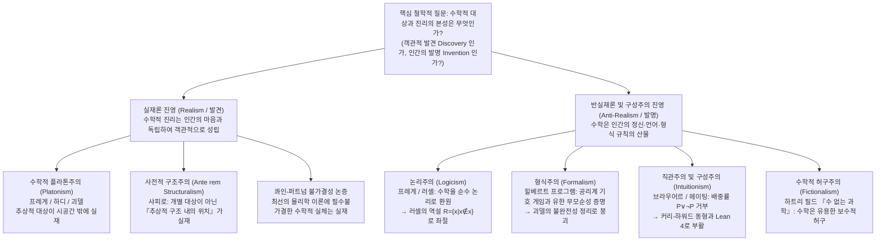
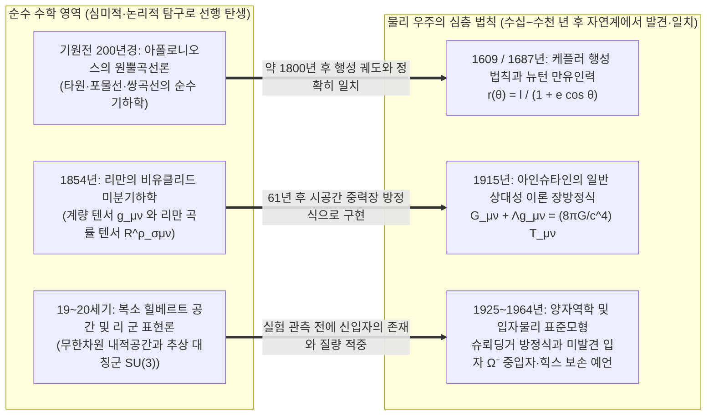

## 서론: 만델브로 집합은 빅뱅 이전부터 그곳에 존재했는가?

1980년 수학자 브누아 만델브로(Benoit Mandelbrot)는 컴퓨터를 이용해 복소평면 위의 지극히 단순한 이차 점화식

$$z_{n+1} = z_n^2 + c \qquad (z_0 = 0,\; c \in \mathbb{C})$$

에서 $n \to \infty$일 때 수열 $\{z_n\}$이 발산하지 않고 유계로 남는 복소수 파라미터 $c$들의 집합—오늘날 <strong>만델브로 집합(Mandelbrot Set, $\mathcal{M}$)</strong>이라 불리는 프랙탈 도형—을 시각화했다. 그 경계선(하우스도르프 차원이 정확히 $2$임이 증명된 곡선)을 확대해 들어가자, 소용돌이치는 해마 계곡과 무수히 중첩된 미니 만델브로 집합들이 끝없이 펼쳐졌다. 그 어떤 인간의 두뇌도 사전에 이러한 기하학적 문양을 설계한 적이 없었다.

이 경이로운 풍경은 모든 과학자와 철학자에게 가장 근원적인 존재론적·인식론적 질문을 던진다. 만델브로는 이 정교한 구조를 <strong>발명(Invent)</strong>한 것인가, 아니면 <strong>발견(Discover)</strong>한 것인가?

체스나 바둑의 규칙을 생각해보면, 인류 문명이 탄생하기 전에 우주 어딘가에 ‘캐슬링 규칙’이나 ‘패싸움 규칙’이 존재했다고 믿는 사람은 없다. 그것은 명백히 인간의 문화적 <strong>발명품</strong>이다. 그러나 소수가 무한히 많다는 유클리드의 정리, 오일러 항등식 $e^{i\pi} + 1 = 0$, 혹은 만델브로 집합의 프랙탈 구조는 어떠한가? 설령 우주에 지적 생명체가 전혀 진화하지 않았거나 안드로메다 은하의 외계 문명이 독자적으로 수학을 발전시켰더라도, $17$은 여전히 소수이고 $\pi$의 값은 변하지 않으며 $z_{n+1} = z_n^2 + c$의 수렴 영역은 한 치의 오차도 없는 동일한 프랙탈을 그릴 것처럼 보인다.

하지만 만약 수, 집합, 다양체, 힐베르트 공간이 인간의 마음과 독립하여 객관적으로 존재한다면, 그것들은 대체 <strong>어디에</strong> 존재하는가? 우리는 망원경으로 숫자 $7$을 관측할 수 없고 입자가속기에서 공집합 $\emptyset$을 충돌시킬 수도 없다. 수학적 대상이 시공간 바깥의 비물질적 플라톤의 이데아계에 존재한다면, 물리적 두뇌(뉴런의 전기화학적 신경망)만을 가진 인간이 어떻게 인과적으로 완전히 단절된 추상적 대상에 대해 확실한 지식을 얻을 수 있는가? 반대로 수학이 인간이 발명한 기호 게임에 불과하다면, 수백 년 전 순수한 지적 유희로 고안된 추상 수학이 어떻게 소수점 아래 열 몇 자리의 정밀도로 소립자와 시공간 곡률을 예측해내는가? 본고에서는 <strong>수리철학(Philosophy of Mathematics)</strong>의 6대 핵심 조류를 체계적으로 검증하고, 유진 위그너가 제기한 <strong>‘자연과학에서 수학의 불합리한 유효성’</strong>의 수수께끼를 해명한다.

---

## 제1장 수학적 플라톤주의(실재론)와 베나세라프의 두 가지 딜레마

### 1.1 플라톤, 프레게, 하디, 괴델의 객관적 수학적 실재론

연구에 몰두하고 있는 대다수 현장 수학자들은 본능적으로 <strong>수학적 플라톤주의(Mathematical Platonism / Realism)</strong>의 관점을 취한다. 고대 그리스의 <strong>플라톤(Plato)</strong>은 감각 세계의 불완전한 원이나 삼각형 너머에 영원불변하는 ‘이데아(Forms)’가 실재한다고 보았다.

현대에 이르러 <strong>고틀로프 프레게(Gottlob Frege)</strong>, <strong>G.H. 하디(G. H. Hardy)</strong>, <strong>쿠르트 괴델(Kurt Gödel)</strong>은 이를 엄밀한 논리적 실재론으로 발전시켰다.
* <strong>프레게의 반심리주의(Anti-Psychologism)</strong>: 『산술의 기초』(1884)에서 프레게는 수를 ‘개인 두뇌 속의 주관적 심적 표상’으로 환원하는 심리주의를 논파했다. 만약 숫자 $2$가 내 머릿속의 관념에 불과하다면 당신 머릿속의 $2$와는 다른 대상이 되어 $2+2=4$의 객관적 보편성이 무너진다. 따라서 물리적 세계와 주관적 심리 세계 외에 객관적 추상 대상들이 속하는 <strong>‘제3의 영역(Drittes Reich)’</strong>이 존재해야 한다.
* <strong>하디와 괴델의 실재론</strong>: 하디는 『어느 수학자의 변명』(1940)에서 “317이 소수인 것은 우리가 그렇게 생각해서가 아니라 <strong>원래 그러하기 때문(because it is so)</strong>이며, 수학적 실재가 그렇게 지어져 있기 때문”이라고 단언했다. 괴델 또한 연속체 가설($2^{\aleph_0} = \aleph_1$) 연구를 통해 집합과 개념이 물리적 물체만큼이나 객관적으로 실재하며, 인간에게는 감각 지각과 유사한 <strong>‘수학적 직관(Mathematical Intuition)’</strong>이 있어 추상적 세계를 직접 통찰한다고 주장했다.

표준적인 수학적 플라톤주의는 세 가지 테제로 요약된다. (1) <strong>존재 테제(Existence)</strong>: 수학적 대상은 실재한다. (2) <strong>추상성 테제(Abstractness)</strong>: 수학적 대상은 시공간 밖에 존재하며 <strong>인과적으로 완전히 불활성(Causally Inert)</strong>이다. (3) <strong>독립성 테제(Independence)</strong>: 수학적 대상과 진리는 인간의 정신·언어·증명 활동으로부터 완전히 독립되어 있다.

### 1.2 베나세라프의 인식론적 딜레마(1973): 인과적 불활성의 벽

1973년 미국의 철학자 <strong>폴 베나세라프(Paul Benacerraf)</strong>는 기념비적 논문 「수학적 진리」(<em>Mathematical Truth</em>)에서 플라톤주의의 치명적 약점을 폭로했다(<strong>베나세라프의 인식론적 문제</strong>).
1. <strong>의미론적 획일성 요구</strong>: 수학 명제(예: “17보다 큰 완전수가 존재한다”)는 일상 경험 명제(예: “뉴욕보다 오래된 대도시가 존재한다”)와 동일한 타르스키적 지시 의미론으로 분석되어야 한다. 이는 양화사 $\exists x$가 실제로 존재하는 추상적 대상을 지시할 것을 요구한다(<strong>플라톤주의</strong>).
2. <strong>자연주의적 인식론 요구</strong>: 시공간 내의 생물학적 유기체인 인간이 어떤 대상 영역 $D$에 대해 신뢰할 수 있는 지식을 가지려면(하트리 필드의 표현대로 ‘우리의 수학적 신념과 수학적 사실 사이의 비우연적 상관관계를 설명하려면’), 인식 주체와 대상 사이에 인과적·정보적 연결고리가 있어야 한다.

딜레마는 명확하다. 플라톤주의의 정의상 수와 집합은 시공간 밖에 있으며 <strong>인과적으로 불활성</strong>이다. 소수는 광자를 방출하지도 않고 인간의 시신경이나 시냅스에 물리적 변화를 일으키지도 못한다. 따라서 플라톤주의가 참이라면 <strong>인간은 수학적 대상에 대해 아무것도 알 수 없게 된다!</strong>

### 1.3 베나세라프의 동일성 문제(1965)와 수학적 구조주의의 탄생

앞서 1965년 논문 「수는 무엇일 수 없는가」(<em>What Numbers Could Not Be</em>)에서 베나세라프는 또 다른 폭탄인 <strong>다중 환원 및 동일성 문제(Identification Problem)</strong>를 제기했다. 현대 집합론에서 자연수 $0, 1, 2, 3, \dots$은 공집합 $\emptyset$으로부터 순수 집합으로 구성되는데, 그 방법이 유일하지 않다.
* <strong>체르멜로(Zermelo)의 구성</strong>: $0_Z = \emptyset,\; 1_Z = \{\emptyset\},\; 2_Z = \{\{\emptyset\}\},\; 3_Z = \{\{\{\emptyset\}\}\}, \dots$ ($S(n) = \{n\}$).
* <strong>폰 노이만(von Neumann)의 서수 구성</strong>: $0_N = \emptyset,\; 1_N = \{\emptyset\},\; 2_N = \{\emptyset, \{\emptyset\}\},\; 3_N = \{\emptyset, \{\emptyset\}, \{\emptyset, \{\emptyset\}\}\}, \dots$ ($S(n) = n \cup \{n\}$).

두 체계 모두 페아노 공리계를 완벽히 만족하며 모든 산술 정리에서 동형(Isomorphic)이다. 그러나 “$1 \in 3$인가?”라고 물으면 폰 노이만 체계에서는 <strong>참</strong>($1_N \in 3_N$)이지만 체르멜로 체계에서는 <strong>거짓</strong>($1_Z \notin 3_Z$)이다! 둘 중 어느 것이 ‘진짜 숫자 $3$’인가? 어느 한쪽만 진짜일 이유가 없으므로 베나세라프는 혁명적 결론을 내린다. <strong>“수는 애초에 개별적인 ‘대상(Objects)’일 수 없다!”</strong>

이 통찰은 현대 수리철학의 주류인 <strong>수학적 구조주의(Mathematical Structuralism, 스튜어트 샤피로 Stewart Shapiro, 마이클 레즈닉, 제프리 헬만)</strong>를 탄생시켰다. 수학이 탐구하는 것은 고립된 대상이 아니라 <strong>추상적 구조(Structure)와 그 안에서의 관계적 위치(Positions / Places)</strong>이다. 야구의 ‘유격수’가 특정 개인이 아니라 수비 체계 내의 역할 위치이듯, 자연수 ‘$2$’는 자연수 구조($\omega$-수열)에서 ‘$1$ 다음이고 $3$ 앞인 위치’ 그 자체이다. 샤피로는 구조 자체가 개별 체계에 앞서 실재한다는 <strong>사전적 구조주의(<em>Ante rem</em> Structuralism)</strong>를, 헬만은 양상 논리 연산자($\Box, \Diamond$)를 통해 수학 명제를 가능한 모든 체계에 관한 조건문으로 번역하는 <strong>양상 구조주의(Modal Structuralism)</strong>를 전개했다.

---

## 제2장 수학 기초론의 위기: 논리주의, 형식주의, 직관주의의 격돌

### 2.1 논리주의(Logicism)와 러셀의 역설

프레게, 버트런드 러셀(Bertrand Russell), 화이트헤드(A. N. Whitehead)가 주도한 <strong>논리주의</strong>는 모든 순수 수학이 순수 논리학으로 환원될 수 있음을 증명하고자 했다. 프레게는 『산술의 기본법칙』에서 임의의 술어 $\varphi(x)$에 대해 집합 $\{x \mid \varphi(x)\}$가 존재한다는 무제한적 내포 공리(기본법칙 V)를 사용했다.

그러나 1902년 러셀은 자기 자신을 원소로 포함하지 않는 집합들의 집합 $R$을 제시했다.

$$R = \{x \mid x \notin x\} \quad \Longrightarrow \quad R \in R \iff R \notin R$$

이 <strong>러셀의 역설(Russell's Paradox)</strong>은 프레게의 체계를 무너뜨렸다. 이후 러셀과 화이트헤드는 『수학 원리』(<em>Principia Mathematica</em>, 1910–1913)에서 유형 이론(Type Theory)을 도입해 역설을 피했으나, 순수 논리 법칙이라 할 수 없는 ‘무한 공리’와 ‘환원 공리’를 가정해야 했으므로 고전 논리주의는 한계에 부딪혔다.

### 2.2 힐베르트의 형식주의(Formalism)와 괴델의 불완전성 정리

칸토어의 무한집합론을 역설로부터 구출하기 위해 <strong>다비트 힐베르트(David Hilbert)</strong>는 <strong>형식주의</strong>와 <strong>힐베르트 프로그램(Hilbert's Program)</strong>을 제창했다. 게임 형식주의에서 수학은 무의미한 기호열을 규칙에 따라 변형하는 체스 같은 형식 게임이다. 힐베르트는 직관적으로 확실한 <strong>유한 산술(Finitary Mathematics)</strong>과 무한을 이상적 보조물로 도입한 <strong>이상적 수학(Ideal Mathematics)</strong>을 구분하고, 고전 수학 전체를 형식 공리계 $T$로 만든 뒤 오직 <strong>유한적 방법</strong>만으로 $T$의 <strong>완전성</strong>과 <strong>무모순성($\text{Con}(T)$)</strong>을 메타수학적으로 증명하고자 했다.

그러나 1931년 25세의 <strong>쿠르트 괴델(Kurt Gödel)</strong>이 발표한 <strong>제1 및 제2 불완전성 정리(Gödel's Incompleteness Theorems)</strong>가 이 꿈을 산산조각 냈다.
1. <strong>제1 불완전성 정리</strong>: 페아노 산술($\text{PA}$)을 포함하는 임의의 무모순적 재귀적 공리화 가능 체계 $T$에는, 스스로 “나는 $T$에서 증명될 수 없다”고 말하는 산술 명제 $G_T$가 존재하여 다음이 성립한다.
   $$T \nvdash G_T \quad \text{그리고} \quad T \nvdash \neg G_T$$
   즉, $G_T$는 표준 산술 모델에서 <strong>참(True)이지만 체계 $T$ 안에서 증명 불가능(Unprovable)</strong>하다!
2. <strong>제2 불완전성 정리</strong>: 그러한 무모순적 체계 $T$는 자기 자신의 무모순성을 표현하는 명제 $\text{Con}(T)$를 스스로 증명할 수 없다.
   $$T \nvdash \text{Con}(T)$$

이로써 <strong>수학적 진리는 그 어떤 고정된 형식 공리계의 증명 가능성으로도 환원될 수 없음</strong>이 수학적으로 증명되었다.

### 2.3 직관주의(Intuitionism)와 커리-하워드 동형(Curry-Howard Isomorphism)

네덜란드 위상수학자 <strong>브라우어르(L. E. J. Brouwer)</strong>와 제자 <strong>아렌트 헤이팅(Arend Heyting)</strong>이 정립한 <strong>직관주의 / 구성주의</strong>는 수학을 인간의 정신이 시간 직관 위에서 수행하는 <strong>정신적 구성 활동(Mental Construction)</strong>으로 본다. 수학에서 어떤 대상이 ‘존재한다($\exists x P(x)$)’는 것은 곧 그 대상을 유한한 단계 안에 구체적으로 만들어내는 알고리즘을 가지고 있음을 뜻한다.

이에 따라 직관주의는 <strong>실무한(Actual Infinity)을 거부</strong>(잠재적 무한만 인정)하고, 고전 논리의 <strong>배중률(Law of Excluded Middle: $P \lor \neg P$)과 이중부정 제거법칙($\neg\neg P \to P$)을 거부</strong>한다! 헤이팅의 BHK 해석에 따르면, 아직 증명도 반증도 없는 골드바흐 추측 $G$에 대해 $G \lor \neg G$를 참이라고 단정할 수 없으며, 귀류법으로 $\neg\forall x\neg P(x)$를 보인 것만으로는 구체적인 해 $x$를 구성할 수 없으므로 비구성적 존재 증명은 인정되지 않는다.

과거에 과격한 소수파로 여겨졌던 직관주의 논리는 현대 컴퓨터 과학에서 <strong>커리-하워드 동형 대응(Curry-Howard Isomorphism)</strong>을 통해 화려하게 부활했다.

$$\text{명제 (Propositions)} \cong \text{타입 (Types)}, \qquad \text{증명 (Proofs)} \cong \text{프로그램 (Programs)}$$

직관주의적 구성 증명은 그 자체로 실행 가능한 컴퓨터 프로그램이며, 오늘날 <strong>Coq (Rocq)</strong>, <strong>Agda</strong>, <strong>Lean 4</strong>와 같은 현대 정리 증명 지원기(Proof Assistants)의 핵심 엔진으로 작동하고 있다.

---

## 제3장 수리철학 6대 조류 비교 및 불가결성 논쟁

| 철학적 입장 | 수학적 대상의 존재론적 지위 | 수학적 진리와 지식의 원천 (인식론) | 실무한에 대한 태도 | 대표 학자 | 핵심 난점 및 비판 |
| :--- | :--- | :--- | :--- | :--- | :--- |
| <strong>플라톤주의 (Platonism)</strong> | 시공간을 초월한 객관적 추상 대상 (<strong>발견</strong>) | 이성적 통찰 및 괴델적 수학적 직관 | 초한집합 계층 전체를 실재로 수용 | 플라톤, 프레게, 하디, 괴델 | <strong>베나세라프의 인식론적 문제</strong>(인과적 불활성) 및 동일성 문제 |
| <strong>논리주의 (Logicism)</strong> | 순수 논리 개념 및 외연으로 환원 | 순수 논리 법칙과 정의로부터의 분석적 연역 | 무한 공리의 추가 가정이 필요함 | 프레게, 러셀, 화이트헤드 | <strong>러셀의 역설</strong>($R=\{x\mid x\notin x\}$); 무한 공리의 비논리성 |
| <strong>형식주의 (Formalism)</strong> | 추상 대상 없음; 기호열 조작 규칙 (<strong>발명</strong>) | 공리계로부터의 구문론적 도출 및 <strong>무모순성</strong> | 추론을 단순화하는 ‘이상적 요소’로 허용 | 다비트 힐베르트, 커리 | <strong>괴델의 제1·제2 불완전성 정리</strong>($T \nvdash G_T,\; T \nvdash \text{Con}(T)$) |
| <strong>직관주의 / 구성주의</strong> | 인간 정신의 시간 직관 속 <strong>심적 구성물 (발명)</strong> | 명시적 구성 알고리즘의 보유 (BHK 의미론) | <strong>실무한 거부</strong>, 잠재적 무한만 인정 | 브라우어르, 헤이팅, 마르틴뢰프 | 배중률 $P \lor \neg P$ 거부로 고전 해석학의 비구성적 정리 제한 |
| <strong>구조주의 (Structuralism)</strong> | 추상적 구조 내의 <strong>관계적 위치 (Positions)</strong> | 공리계의 구조적 동형 불변성 또는 양상 가능성 | 공리적 범주성 또는 양상 무모순성 하에 수용 | 베나세라프, 샤피로, 레즈닉, 헬만 | 추상 구조 자체의 인식론; 원초적 양상 개념의 전제 |
| <strong>허구주의 (Fictionalism)</strong> | 존재하지 않음; 셜록 홈즈 같은 <strong>유용한 허구 (발명)</strong> | 수학이라는 ‘이야기 설정’ 내부의 정합성 | 허구적 서사 도구로 자유롭게 사용 | 하트리 필드, 발라게르 | <strong>콰인-퍼트넘 불가결성 논증</strong>; 양자역학 힐베르트 공간의 유명론화 한계 |

현대 과학철학에서 <strong>콰인(W. V. O. Quine)</strong>과 <strong>퍼트넘(Hilary Putnam)</strong>은 <strong>불가결성 논증(Indispensability Argument)</strong>을 제시했다. 실수, 미분다양체, 힐베르트 공간이 최선의 물리학 이론에 <strong>필수불가결(Indispensable)</strong>하므로, 우리는 전자나 쿼크의 실재를 믿는 것과 똑같은 경험적 근거로 수학적 대상의 실재를 믿어야 한다는 것이다. 이에 맞서 <strong>하트리 필드(Hartry Field)</strong>는 『수 없는 과학』(<em>Science Without Numbers</em>, 1980)에서 <strong>수학적 허구주의(Fictionalism)</strong>를 제창하며 수학은 물리적 추론을 단축해주는 ‘보수적 확장(Conservative Extension)’일 뿐이라고 주장하고 뉴턴 중력이론에서 수를 완전히 제거해보였으나, 무한차원 복소 힐베르트 공간을 사용하는 양자역학을 수 없이 서술하는 데에는 여전히 큰 난관이 남아 있다.

---

## 제4장 위그너의 수수께끼: “자연과학에서 수학의 불합리한 유효성”

### 4.1 순수 수학의 선행 발명과 물리 법칙의 후행 발견이라는 세 가지 기적

1960년 노벨 물리학상 수상자 <strong>유진 위그너(Eugene Wigner)</strong>는 역사적 논문 「자연과학에서 수학의 불합리한 유효성」(<em>The Unreasonable Effectiveness of Mathematics in the Natural Sciences</em>)을 발표했다. 수학자들이 물리 현실과는 무관하게 오직 내적 아름다움과 논리적 일반화를 위해 고안한 추상 수학이, 수십 년 혹은 수천 년 뒤 자연계의 가장 깊은 근본 법칙과 정확히 일치하는 기적은 어떻게 설명될 수 있는가?

1. <strong>아폴로니오스의 원뿔곡선에서 케플러 궤도로</strong>: 기원전 200년경 고대 그리스의 아폴로니오스가 순수 기하학적 호기심으로 연구한 원뿔곡선(타원·포물선·쌍곡선)은 1800년 뒤 케플러와 뉴턴이 밝혀낸 역제곱 중력장 내 천체의 궤도 방정식 $r(\theta) = \frac{\ell}{1 + e\cos\theta}$와 정확히 일치했다.
2. <strong>리만 기하학에서 아인슈타인의 일반 상대성 이론으로</strong>: 1854년 베른하르트 리만이 고안한 고차원 휘어진 다양체의 기하학은 61년 뒤인 1915년 아인슈타인이 중력을 시공간의 곡률로 정식화한 장방정식과 완벽히 들어맞았다.
   $$R_{\mu\nu} - \frac{1}{2} R g_{\mu\nu} + \Lambda g_{\mu\nu} = \frac{8\pi G}{c^4} T_{\mu\nu}$$
3. <strong>복소 힐베르트 공간과 리 군 $\text{SU}(3)$에서 $\Omega^-$ 입자 발견으로</strong>: 허수 $i = \sqrt{-1}$와 힐베르트 공간은 양자역학 슈뢰딩거 방정식 $i\hbar \frac{\partial}{\partial t}|\psi\rangle = \hat{H}|\psi\rangle$의 본질이 되었으며, 1961년 머리 겔만(Murray Gell-Mann)은 특수 유니타리 군 $\text{SU}(3)$의 10차원 기약표현(십중항)에서 비어 있는 한 자리를 근거로 미발견 입자인 <strong>$\Omega^-$ 중입자</strong>의 질량과 성질을 정확히 예언하여 1964년 실험으로 입증했다.

### 4.2 네 가지 철학적 해답과 변증법적 결론: “공리는 발명되고, 정리는 발견된다”

이 수수께끼에 대해 현대 학계는 (1) 물리 우주 자체가 하나의 수학적 구조라는 <strong>맥스 테그마크(Max Tegmark)의 수학적 우주 가설(MUH)</strong>, (2) 물리 법칙은 변환에 대한 불변성(대칭성, 뇌터 정리)이며 수학은 모든 가능한 대칭 구조를 분류하는 학문이라는 <strong>구조적 실재론(Structural Realism)</strong>, (3) 인간의 인지 진화와 수학적으로 다룰 수 있는 현상만 물리학으로 선택한다는 <strong>리처드 해밍(Richard Hamming)의 선택 편향설</strong>을 제시한다.

결론적으로 수학은 단순한 발명도 단순한 발견도 아니다. <strong>인간은 어떤 개념과 공리계를 출발점으로 삼을지를 자유롭게 ‘발명(Invent)’하지만, 일단 공리와 규칙이 설정된 순간 그로부터 논리적·구조적 필연성에 의해 도출되는 무수한 정리와 구조적 진리들은 우리가 경외감 속에서 ‘발견(Discover)’할 수밖에 없는 객관적 실재인 것이다.</strong>
