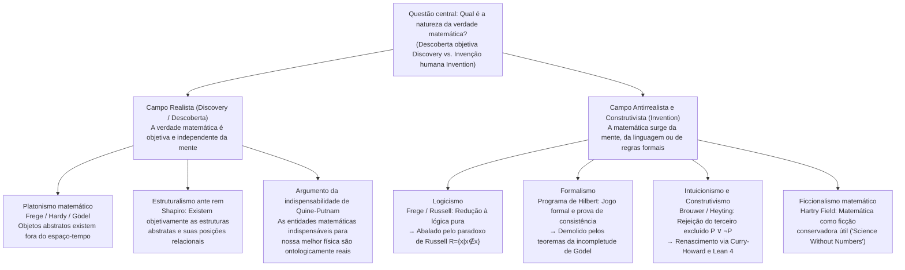
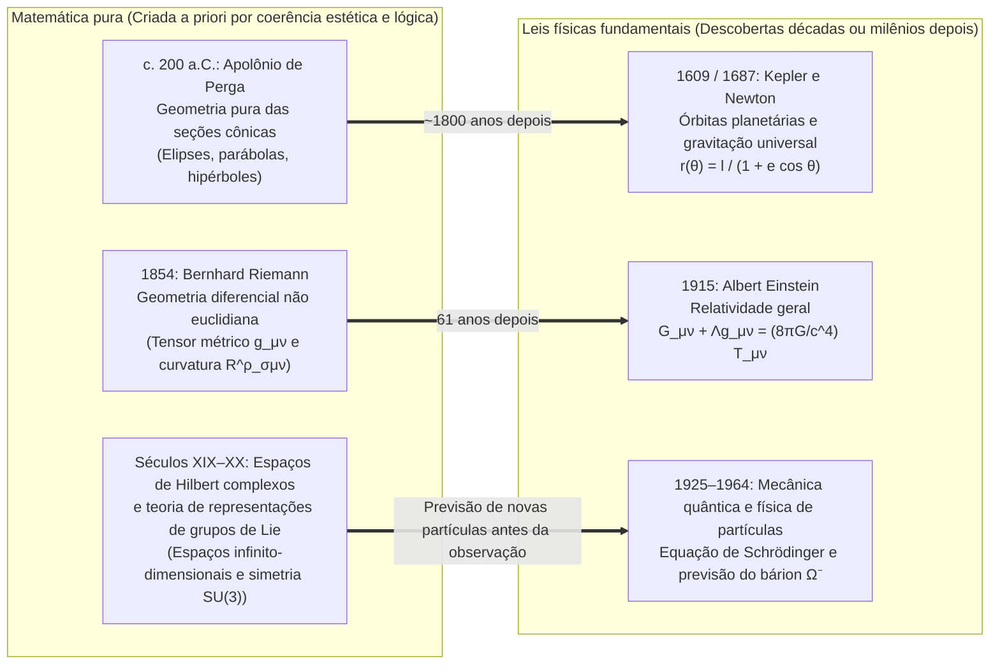

## Introdução: O conjunto de Mandelbrot já existia antes do Big Bang?

Em 1980, o matemático Benoit Mandelbrot visualizou em computador o comportamento de uma relação de recorrência quadrática enganosamente simples no plano complexo:

$$z_{n+1} = z_n^2 + c \qquad (z_0 = 0,\; c \in \mathbb{C})$$

O conjunto de todos os parâmetros complexos $c$ para os quais a sequência $\{z_n\}$ permanece limitada quando $n \to \infty$ forma o célebre <strong>conjunto de Mandelbrot ($\mathcal{M}$)</strong>. Ao ampliarmos sua fronteira (cuja dimensão de Hausdorff provou-se ser exatamente $2$), emerge um universo inesgotável de complexidade geométrica: vales de cavalos-marinhos em espiral, filigranas e cópias em miniatura infinitamente aninhadas que nenhuma mente humana jamais havia projetado.

Esse espetáculo obriga-nos a enfrentar uma das questões ontológicas e epistemológicas mais profundas: Mandelbrot <strong>inventou (Invented)</strong> essa estrutura ou a <strong>descobriu (Discovered)</strong>?

Se pensarmos no xadrez, ninguém acredita que a regra do roque existisse no cosmos primordial antes da humanidade; o xadrez é claramente uma <strong>invenção</strong> cultural. Mas o que dizer do teorema de Euclides sobre a infinitude dos números primos, da identidade de Euler $e^{i\pi} + 1 = 0$ ou da geometria fractal de $\mathcal{M}$? Mesmo que nunca tivesse evoluído vida inteligente em nosso universo, ou se uma civilização alienígena na galáxia de Andrômeda desenvolvesse sua própria matemática, parece inegável que o $17$ continuaria sendo primo, a razão entre a circunferência e o diâmetro de um círculo euclidiano continuaria sendo $\pi$, e $z_{n+1} = z_n^2 + c$ traçaria exatamente o mesmo fractal.

Contudo, se os números, os conjuntos, as variedades diferenciáveis e os espaços de Hilbert existem independentemente da mente humana, <strong>onde</strong> existem? Não podemos observar o número $7$ com um telescópio nem colidir o conjunto vazio $\emptyset$ em um acelerador de partículas. Se os objetos matemáticos habitam um céu platônico fora do espaço-tempo, como pode um cérebro biológico humano entrar em contato com entidades causalmente inertes? E se, pelo contrário, a matemática for apenas um jogo formal de símbolos inventado pelo homem, por que ela prevê a curvatura do espaço-tempo e o mundo quântico com precisão assombrosa? Este artigo examina as seis grandes escolas da <strong>filosofia da matemática</strong> e analisa o famoso enigma de Eugene Wigner sobre <strong>“a irracional eficácia da matemática nas ciências naturais”</strong>.

---

## Capítulo 1: O Platonismo Matemático (Realismo) e os Dois Dilemas de Benacerraf

### 1.1 Platão, Frege, Hardy e Gödel sobre a realidade matemática objetiva

Em seu trabalho diário, a imensa maioria dos matemáticos atua como <strong>platonistas matemáticos (realistas)</strong> instintivos. Herdeiro da teoria das Formas de <strong>Platão</strong>, esse realismo recebeu formulação lógica rigorosa com <strong>Gottlob Frege</strong>, <strong>G. H. Hardy</strong> e <strong>Kurt Gödel</strong>:
* <strong>O antipsicologismo de Frege</strong>: Em *Os Fundamentos da Aritmética* (1884) e *O Pensamento* (1918), Frege demoliu o psicologismo que reduzia os números a ideias mentais subjetivas. Se o número $2$ fosse apenas um estado neural em meu cérebro, cada pessoa teria seu próprio “$2$” privado e desapareceria a verdade objetiva universal de $2+2=4$. Além do mundo físico e do mundo psíquico subjetivo, Frege postula um <strong>“Terceiro Reino” (*Drittes Reich*)</strong> de objetos abstratos objetivos.
* <strong>O realismo de Hardy e Gödel</strong>: Em *Em Defesa de um Matemático* (1940), Hardy escreveu: “317 é um número primo, não porque assim o pensamos, mas <strong>porque é assim (because it is so)</strong>, porque a realidade matemática é construída dessa maneira”. Kurt Gödel (1947/1964), ao estudar a hipótese do contínuo ($2^{\aleph_0} = \aleph_1$), sustentou que os conjuntos existem objetivamente e que a mente humana possui uma <strong>“intuição matemática”</strong> análoga à percepção sensorial.

O platonismo padrão define-se por três teses: (1) <strong>Existência</strong> dos objetos matemáticos; (2) <strong>Abstração</strong> (estão fora do espaço-tempo e são <strong>causalmente inertes</strong>); e (3) <strong>Independência</strong> total em relação à mente humana.

### 1.2 O problema epistemológico de Benacerraf (1973): O muro da inércia causal

Em 1973, em seu histórico artigo *“Mathematical Truth”*, <strong>Paul Benacerraf</strong> formulou uma objeção devastadora contra o platonismo:
1. <strong>Requisito de uniformidade semântica</strong>: As sentenças matemáticas (“Existe um número primo maior que 17”) devem ser analisadas com a mesma semântica tarskiana de condições de verdade que as sentenças empíricas, o que exige que o quantificador $\exists x$ percorra objetos realmente existentes ($\implies$ <strong>platonismo</strong>).
2. <strong>Requisito de epistemologia naturalizada</strong>: Para que um organismo biológico com um cérebro físico possua conhecimento confiável sobre um domínio $D$ (ou para explicar a confiabilidade não acidental de nossas crenças matemáticas, segundo a reformulação de Hartry Field em 1989), deve existir um vínculo causal ou informacional entre $D$ e nossos estados cognitivos.

A contradição é letal: por definição platônica, os objetos abstratos são <strong>causalmente inertes</strong>; números primos não emitem fótons nem excitam neurônios. Se o platonismo for verdadeiro, <strong>o conhecimento matemático torna-se em princípio impossível</strong>!

### 1.3 O problema de identificação de Benacerraf (1965) e o estruturalismo matemático

Em 1965, em *“What Numbers Could Not Be”*, Benacerraf descobriu o <strong>problema das reduções múltiplas (Identification Problem)</strong>. Na teoria dos conjuntos, os números naturais $0, 1, 2, 3, \dots$ podem ser construídos de infinitas maneiras:
* <strong>Construção de Zermelo (1908)</strong>: $0_Z = \emptyset,\; 1_Z = \{\emptyset\},\; 2_Z = \{\{\emptyset\}\},\; 3_Z = \{\{\{\emptyset\}\}\}, \dots$ ($S(n) = \{n\}$).
* <strong>Ordinais de von Neumann (1923)</strong>: $0_N = \emptyset,\; 1_N = \{\emptyset\},\; 2_N = \{\emptyset, \{\emptyset\}\},\; 3_N = \{\emptyset, \{\emptyset\}, \{\emptyset, \{\emptyset\}\}\}, \dots$ ($S(n) = n \cup \{n\}$).

Ambas as progressões satisfazem os axiomas de Peano e são isomorfas em toda a aritmética. Mas, diante da pergunta “Vale $1 \in 3$?”, von Neumann responde <strong>Verdadeiro</strong> ($1_N \in 3_N$), enquanto Zermelo responde <strong>Falso</strong> ($1_Z \notin 3_Z$). Qual é o “verdadeiro número $3$”? Nenhum em particular: Benacerraf concluiu que <strong>“os números não podem ser objetos individuais de modo algum”</strong>.

Daí nasceu o <strong>estruturalismo matemático (Stewart Shapiro, Michael Resnik, Geoffrey Hellman)</strong>: a matemática não trata de objetos isolados, mas de <strong>estruturas abstratas e das posições relacionais (“lugares”) dentro delas</strong>. O número “$2$” nada mais é do que a posição situada entre o $1$ e o $3$ em qualquer $\omega$-sequência. Shapiro defende um <strong>estruturalismo *ante rem*</strong> (as estruturas existem objetivamente antes de suas instâncias), ao passo que Hellman propõe um <strong>estruturalismo modal (*in re*)</strong> que traduz a matemática mediante os operadores modais $\Box$ e $\Diamond$.

---

## Capítulo 2: A Crise dos Fundamentos: Logicismo, Formalismo e Intuicionismo

### 2.1 O logicismo e o paradoxo de Russell

O <strong>logicismo</strong> (Frege, Russell, Whitehead) tentou reduzir toda a matemática à lógica pura. Em suas *Leis Básicas da Aritmética*, Frege empregou a Lei Básica V (compreensão irrestrita). Em 1902, <strong>Bertrand Russell</strong> definiu o conjunto $R = \{x \mid x \notin x\}$, desencadeando o <strong>paradoxo de Russell</strong>:

$$R = \{x \mid x \notin x\} \quad \Longrightarrow \quad R \in R \iff R \notin R$$

Nos *Principia Mathematica* (1910–1913), Russell e Whitehead introduziram a teoria ramificada dos tipos para evitar a autorreferência, mas tiveram de postular o axioma do infinito e o axioma da redutibilidade, que não são verdades lógicas puras.

### 2.2 O formalismo de Hilbert e os teoremas da incompletude de Gödel

Para salvar o paraíso cantoriano do infinito, <strong>David Hilbert</strong> impulsionou o <strong>formalismo</strong> e o <strong>programa de Hilbert</strong>: formalizar toda a matemática clássica em um sistema axiomático $T$ e demonstrar, mediante métodos metamatemáticos estritamente <strong>finitistas</strong>, a <strong>completude</strong> e a <strong>consistência ($\text{Con}(T)$)</strong> de $T$.

Contudo, em 1931, <strong>Kurt Gödel</strong> publicou seus dois <strong>teoremas da incompletude</strong>:
1. <strong>Primeiro teorema da incompletude</strong>: Em todo sistema formal consistente e recursivamente axiomatizável $T$ que contenha a aritmética de Peano ($\text{PA}$), existe um enunciado aritmético $G_T$ (“Eu não sou demonstrável em $T$”) tal que:
   $$T \nvdash G_T \quad \text{e} \quad T \nvdash \neg G_T$$
   $G_T$ é <strong>verdadeiro no modelo padrão $\mathbb{N}$, mas indemonstrável em $T$</strong>!
2. <strong>Segundo teorema da incompletude</strong>: Nenhum sistema consistente $T$ desse tipo pode demonstrar sua própria consistência:
   $$T \nvdash \text{Con}(T)$$

A verdade matemática jamais pode ser reduzida à mera demonstrabilidade formal.

### 2.3 O intuicionismo e o isomorfismo de Curry-Howard

Fundado por <strong>L. E. J. Brouwer</strong> e formalizado por <strong>Arend Heyting</strong>, o <strong>intuicionismo / construtivismo</strong> concebe a matemática como uma <strong>atividade de construção mental</strong> na intuição do tempo. Existir ($\exists x P(x)$) equivale a possuir um algoritmo finito que construa explicitamente uma testemunha $x$.

Por isso, o intuicionismo <strong>rejeita o infinito atual</strong> bem como o <strong>princípio do terceiro excluído ($P \lor \neg P$)</strong> e a eliminação da dupla negação ($\neg\neg P \to P$). Na ciência da computação moderna, essa lógica construtiva triunfou graças ao <strong>isomorfismo de Curry-Howard</strong>:

$$\text{Proposições (Propositions)} \cong \text{Tipos (Types)}, \qquad \text{Demonstrações (Proofs)} \cong \text{Programas (Programs)}$$

Toda demonstração construtiva é diretamente um programa de computador executável, base dos assistentes de provas atuais como <strong>Coq (Rocq)</strong>, <strong>Agda</strong> e <strong>Lean 4</strong>.

---

## Capítulo 3: Comparação das Seis Escolas e o Debate sobre a Indispensabilidade

| Escola filosófica | Estatuto ontológico das entidades matemáticas | Fonte da verdade matemática (Epistemologia) | Atitude perante o infinito atual | Figuras-chave | Objeção / Limite principal |
| :--- | :--- | :--- | :--- | :--- | :--- |
| <strong>Platonismo</strong> | Objetos abstratos objetivos fora do espaço-tempo (<strong>Descoberta</strong>) | Intuição racional / intuição gödeliana | Plenamente aceito (hierarquia transfinita) | Platão, Frege, Hardy, Gödel | <strong>Problema epistemológico de Benacerraf</strong> e problema de identificação |
| <strong>Logicismo</strong> | Reduzido a conceitos lógicos e extensões de classes | Dedução analítica *a priori* a partir da lógica pura | Requer o axioma extralógico do infinito | Frege, Russell, Whitehead | <strong>Paradoxo de Russell</strong> ($R=\{x\mid x\notin x\}$) |
| <strong>Formalismo</strong> | Sem objetos; jogo sintático com cadeias de símbolos (<strong>Invenção</strong>) | Derivabilidade formal + <strong>prova finitista de consistência</strong> | Tolerado como “elemento ideal” simplificador | David Hilbert, Haskell Curry | <strong>1.º e 2.º teoremas da incompletude de Gödel</strong> ($T \nvdash G_T,\; T \nvdash \text{Con}(T)$) |
| <strong>Intuicionismo</strong> | Construções mentais na intuição temporal (<strong>Invenção</strong>) | Posse de um algoritmo construtivo (BHK) | <strong>Rejeita o infinito atual</strong> (apenas infinito potencial) | Brouwer, Heyting, Martin-Löf | A rejeição de $P \lor \neg P$ restringe a análise clássica |
| <strong>Estruturalismo</strong> | <strong>Posições relacionais</strong> dentro de estruturas abstratas | Invariância por isomorfismo ou possibilidade modal | Aceito via axiomas categóricos ou modalidade | Benacerraf, Shapiro, Resnik, Hellman | Epistemologia de estruturas *ante rem*; modalidade primitiva |
| <strong>Ficcionalismo</strong> | Não existem; <strong>ficções úteis</strong> como Sherlock Holmes (<strong>Invenção</strong>) | Consistência interna do “relato matemático” | Utilizável livremente como ferramenta ficcional | Hartry Field, Mark Balaguer | <strong>Indispensabilidade de Quine-Putnam</strong>; limite em espaços de Hilbert quânticos |

O <strong>argumento da indispensabilidade de Quine-Putnam</strong> sustenta que, visto que as entidades matemáticas são indispensáveis para nossas melhores teorias físicas, o holismo confirmacional compromete-nos com sua existência real. Em *Science Without Numbers* (1980), <strong>Hartry Field</strong> respondeu com o <strong>ficcionalismo matemático</strong>, argumentando que a matemática é apenas um atalho dedutivo (“extensão conservadora”) e reformulando a gravitação newtoniana sem números — embora tal programa esbarre nos espaços de Hilbert da mecânica quântica.

---

## Capítulo 4: O Enigma de Wigner: “A Irracional Eficácia da Matemática nas Ciências Naturais”

### 4.1 O milagre da invenção matemática prévia à descoberta física

Em 1960, o prêmio Nobel de Física <strong>Eugene Wigner</strong> publicou seu célebre ensaio *“The Unreasonable Effectiveness of Mathematics in the Natural Sciences”*. Como explicar que teorias matemáticas criadas de forma puramente autônoma por sua beleza formal revelem ser, décadas ou milênios depois, a linguagem exata das leis mais profundas da natureza?

1. <strong>Das cônicas de Apolônio às órbitas de Kepler</strong>: Estudadas por volta de 200 a.C. por Apolônio de Perga por puro interesse geométrico, as seções cônicas descrevem exatamente as órbitas gravitacionais sob uma força $1/r^2$ demonstradas 1800 anos depois por Kepler e Newton: $r(\theta) = \frac{\ell}{1 + e\cos\theta}$.
2. <strong>Da geometria de Riemann à relatividade geral de Einstein</strong>: Criada em 1854 por Bernhard Riemann, a geometria de variedades curvas forneceu em 1915 a Einstein o arcabouço exato das equações do campo gravitacional:
   $$R_{\mu\nu} - \frac{1}{2} R g_{\mu\nu} + \Lambda g_{\mu\nu} = \frac{8\pi G}{c^4} T_{\mu\nu}$$
3. <strong>Dos espaços de Hilbert e do grupo $\text{SU}(3)$ ao bárion $\Omega^-$</strong>: Os números complexos e os espaços de Hilbert regem a equação de Schrödinger $i\hbar \frac{\partial}{\partial t}|\psi\rangle = \hat{H}|\psi\rangle$, e em 1961 Murray Gell-Mann previu a existência e a massa ($1672\text{ MeV}/c^2$) do <strong>bárion $\Omega^-$</strong> (observado em 1964) a partir de uma simples vaga vazia no decupleto de representação do grupo de Lie $\text{SU}(3)$.

### 4.2 Quatro respostas filosóficas e síntese final: “Inventamos os axiomas, descobrimos os teoremas”

Quatro explicações iluminam esse mistério: (1) a <strong>Hipótese do Universo Matemático (MUH) de Max Tegmark</strong> (o universo físico *é* uma estrutura matemática); (2) o <strong>realismo estrutural (Structural Realism)</strong> unido ao teorema de Noether (as leis físicas são invariantes de simetria e a matemática classifica todas as simetrias possíveis); (3) o <strong>viés de seleção de Richard Hamming</strong> e a epistemologia evolucionista; e (4) a <strong>síntese dialética</strong>: <strong>inventamos livremente os conceitos e axiomas iniciais (como $z_{n+1} = z_n^2 + c$), mas descobrimos os teoremas e estruturas que deles decorrem com uma necessidade objetiva absoluta.</strong>
