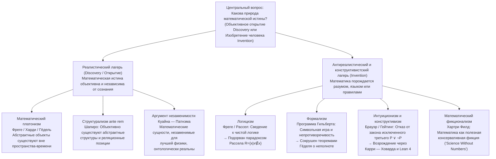
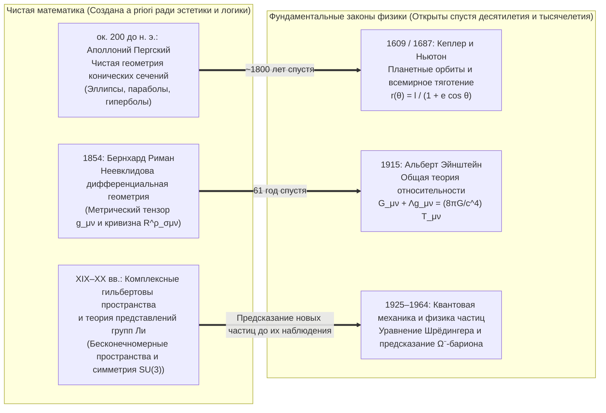

## Введение: Существовало ли множество Мандельброта до Большого взрыва?

В 1980 году математик Бенуа Мандельброт визуализировал на компьютере поведение обманчиво простого квадратичного рекуррентного соотношения на комплексной плоскости:

$$z_{n+1} = z_n^2 + c \qquad (z_0 = 0,\; c \in \mathbb{C})$$

Множество всех комплексных параметров $c$, при которых последовательность $\{z_n\}$ остается ограниченной при $n \to \infty$, образует знаменитое <strong>множество Мандельброта ($\mathcal{M}$)</strong>. При увеличении его границы (хаусдорфова размерность которой в точности равна $2$) открывается неисчерпаемая вселенная геометрической сложности: спиральные «долины морских коньков», кружевные нити и бесконечно вложенные миниатюрные копии всего множества, которые никогда заранее не проектировал человеческий разум.

Это зрелище заставляет каждого ученого и философа задаться глубочайшим онтологическим и эпистемологическим вопросом: <strong>изобрел (Invented)</strong> ли Мандельброт эту структуру или <strong>открыл (Discovered)</strong> ее?

Если вспомнить шахматы, никто не считает, что правило рокировки существовало в первичном космосе до появления человечества; шахматы — это очевидное культурное <strong>изобретение</strong>. Но как быть с теоремой Евклида о бесконечности простых чисел, тождеством Эйлера $e^{i\pi} + 1 = 0$ или фрактальной геометрией $\mathcal{M}$? Даже если бы в нашей Вселенной никогда не возникла разумная жизнь или инопланетная цивилизация в галактике Андромеды создала собственную математику, число $17$ все равно оставалось бы простым, отношение длины окружности к диаметру в евклидовом пространстве равнялось бы $\pi$, а рекурсия $z_{n+1} = z_n^2 + c$ порождала бы в точности тот же самый фрактал.

Однако если числа, множества, многообразия и гильбертовы пространства существуют независимо от человеческого сознания, то <strong>где</strong> именно они существуют? Мы не можем увидеть число $7$ в телескоп или столкнуть пустое множество $\emptyset$ в ускорителе частиц. Если математические объекты обитают в платоновском мире идей вне пространства и времени, как биологический мозг человека может вступить в контакт с каузально инертными сущностями? И наоборот, если математика — лишь формальная игра с символами, выдуманная людьми, почему она с поразительной точностью предсказывает искривление пространства-времени и квантовые явления? В этой статье мы систематически разберем шесть главных школ <strong>философии математики</strong> и проанализируем знаменитую загадку Юджина Вигнера о <strong>«непостижимой эффективности математики в естественных науках»</strong>.

---

## Глава 1. Математический платонизм (реализм) и две дилеммы Бенасеррафа

### 1.1 Платон, Фреге, Харди и Гёдель об объективной математической реальности

В повседневной научной работе подавляющее большинство математиков инстинктивно придерживаются <strong>математического платонизма (реализма)</strong>. Восходя к учению об Эйдосах (Идеях) <strong>Платона</strong>, этот реализм получил строгую логическую формулировку в трудах <strong>Готлоба Фреге</strong>, <strong>Г. Х. Харди</strong> и <strong>Курта Гёделя</strong>:
* <strong>Антипсихологизм Фреге</strong>: В «Основоположениях арифметики» (1884) и статье «Мысль» (1918) Фреге разгромил психологизм, сводивший числа к субъективным психическим представлениям. Если бы число $2$ было лишь нейронным состоянием в моем мозгу, у каждого человека была бы своя частная «двойка», и универсальная объективность равенства $2+2=4$ рухнула бы. Помимо физического мира и субъективного психического мира Фреге постулировал <strong>«Третье царство» (*Drittes Reich*)</strong> объективных абстрактных объектов.
* <strong>Реализм Харди и Гёделя</strong>: В «Апологии математика» (1940) Харди писал: «317 — простое число не потому, что мы так думаем, а <strong>потому, что это так (because it is so)</strong>, потому что так устроена математическая реальность». Курт Гёдель (1947/1964), исследуя континуум-гипотезу ($2^{\aleph_0} = \aleph_1$), утверждал, что множества существуют объективно, а человеческий разум обладает <strong>«математической интуицией»</strong>, аналогичной чувственному восприятию.

Стандартный платонизм определяется тремя тезисами: (1) <strong>Существование</strong> математических объектов; (2) <strong>Абстрактность</strong> (они находятся вне пространства-времени и <strong>каузально инертны</strong>); (3) полная <strong>Независимость</strong> от человеческого разума.

### 1.2 Эпистемологическая проблема Бенасеррафа (1973): стена каузальной инертности

В 1973 году в классической статье *«Mathematical Truth»* <strong>Пол Бенасерраф (Paul Benacerraf)</strong> сформулировал разрушительную дилемму против платонизма:
1. <strong>Требование семантического единообразия</strong>: математические высказывания («Существует простое число больше 17») должны анализироваться с помощью той же семантики условий истинности Тарского, что и эмпирические высказывания, а значит, квантор $\exists x$ должен пробегать по реально существующим объектам ($\implies$ <strong>платонизм</strong>).
2. <strong>Требование натурализованной эпистемологии</strong>: чтобы биологический организм с физическим мозгом обладал надежным знанием о предметной области $D$ (или чтобы объяснить неслучайную надежность наших математических убеждений, как уточнил Хартри Филд в 1989 году), между областью $D$ и нашими когнитивными состояниями должна существовать причинно-следственная или информационная связь.

Противоречие очевидно: по определению платонизма абстрактные объекты <strong>каузально инертны</strong> — простые числа не излучают фотонов и не возбуждают синапсы. Если платонизм истинен, <strong>математическое знание становится в принципе невозможным</strong>!

### 1.3 Проблема идентификации Бенасеррафа (1965) и математический структурализм

В 1965 году в статье *«What Numbers Could Not Be»* Бенасерраф вскрыл <strong>проблему множественности редукций (Identification Problem)</strong>. В теории множеств натуральные числа $0, 1, 2, 3, \dots$ можно построить бесконечным числом способов:
* <strong>Конструкция Цермело (1908)</strong>: $0_Z = \emptyset,\; 1_Z = \{\emptyset\},\; 2_Z = \{\{\emptyset\}\},\; 3_Z = \{\{\{\emptyset\}\}\}, \dots$ ($S(n) = \{n\}$).
* <strong>Ординалы фон Неймана (1923)</strong>: $0_N = \emptyset,\; 1_N = \{\emptyset\},\; 2_N = \{\emptyset, \{\emptyset\}\},\; 3_N = \{\emptyset, \{\emptyset\}, \{\emptyset, \{\emptyset\}\}\}, \dots$ ($S(n) = n \cup \{n\}$).

Обе прогрессии удовлетворяют аксиомам Пеано и изоморфны во всей арифметике. Но на вопрос «Верно ли, что $1 \in 3$?» система фон Неймана отвечает <strong>Истина</strong> ($1_N \in 3_N$), а система Цермело — <strong>Ложь</strong> ($1_Z \notin 3_Z$). Какое же множество является «настоящим числом $3$»? Никакое в отдельности: Бенасерраф заключил, что <strong>«числа вообще не могут быть индивидуальными объектами»</strong>.

Это породило <strong>математический структурализм (Стюарт Шапиро, Майкл Резник, Джеффри Хеллман)</strong>: математика изучает не изолированные объекты, а <strong>абстрактные структуры и реляционные позиции («места») внутри них</strong>. Число «$2$» — это просто позиция между $1$ и $3$ в любой $\omega$-последовательности. Шапиро защищает <strong>структурализм *ante rem*</strong> (структуры объективно существуют до своих реализаций), тогда как Хеллман развивает <strong>модальный структурализм (*in re*)</strong>, переводящий математические утверждения с помощью модальных операторов $\Box$ и $\Diamond$.

---

## Глава 2. Кризис оснований математики: логицизм, формализм и интуиционизм

### 2.1 Логицизм и парадокс Рассела

<strong>Логицизм</strong> (Фреге, Рассел, Уайтхед) стремился свести всю математику к чистой логике. В «Основных законах арифметики» Фреге опирался на Основной закон V (неограниченное свертывание). В 1902 году <strong>Бертран Рассел</strong> рассмотрел множество $R = \{x \mid x \notin x\}$, открыв <strong>парадокс Рассела</strong>:

$$R = \{x \mid x \notin x\} \quad \Longrightarrow \quad R \in R \iff R \notin R$$

В *Principia Mathematica* (1910–1913) Рассел и Уайтхед ввели разветвленную теорию типов для устранения самоприменимости, но были вынуждены постулировать аксиому бесконечности и аксиому сводимости, не являющиеся чисто логическими истинами.

### 2.2 Формализм Гильберта и теоремы Гёделя о неполноте

Чтобы спасти канторовский рай бесконечности, <strong>Давид Гильберт</strong> выдвинул <strong>формализм</strong> и <strong>программу Гильберта</strong>: формализовать всю классическую математику в виде аксиоматической системы $T$ и доказать чисто <strong>финитными</strong> метаматематическими средствами <strong>полноту</strong> и <strong>непротиворечивость ($\text{Con}(T)$)</strong> системы $T$.

Однако в 1931 году <strong>Курт Гёдель</strong> опубликовал две свои <strong>теоремы о неполноте</strong>:
1. <strong>Первая теорема о неполноте</strong>: В любой непротиворечивой рекурсивно аксиоматизируемой системе $T$, содержащей арифметику Пеано ($\text{PA}$), существует арифметическое предложение $G_T$ («Я недоказуемо в $T$»), такое что:
   $$T \nvdash G_T \quad \text{и} \quad T \nvdash \neg G_T$$
   Предложение $G_T$ <strong>истинно в стандартной модели $\mathbb{N}$, но недоказуемо в $T$</strong>!
2. <strong>Вторая теорема о неполноте</strong>: Никакая такая непротиворечивая система $T$ не может доказать собственную непротиворечивость:
   $$T \nvdash \text{Con}(T)$$

Математическая истина принципиально шире формальной доказуемости.

### 2.3 Интуиционизм и изоморфизм Карри — Ховарда

Основанный <strong>Л. Э. Я. Брауэром</strong> и формализованный <strong>Арендом Гейтингом</strong> <strong>интуиционизм / конструктивизм</strong> трактует математику как <strong>умственную конструктивную деятельность</strong> в интуиции времени. Существовать ($\exists x P(x)$) значит располагать конечным алгоритмом построения конкретного объекта $x$.

Поэтому интуиционизм <strong>отвергает актуальную бесконечность</strong>, а также <strong>закон исключенного третьего ($P \lor \neg P$)</strong> и снятие двойного отрицания ($\neg\neg P \to P$). В современной информатике эта конструктивная логика восторжествовала благодаря <strong>изоморфизму Карри — Ховарда</strong>:

$$\text{Высказывания (Propositions)} \cong \text{Типы (Types)}, \qquad \text{Доказательства (Proofs)} \cong \text{Программы (Programs)}$$

Каждое конструктивное доказательство является непосредственно исполняемой компьютерной программой, что лежит в основе современных систем интерактивного доказательства теорем <strong>Coq (Rocq)</strong>, <strong>Agda</strong> и <strong>Lean 4</strong>.

---

## Глава 3. Сравнение шести школ и спор о незаменимости

| Философская школа | Онтологический статус математических объектов | Источник математической истины (Эпистемология) | Отношение к актуальной бесконечности | Ключевые фигуры | Главная трудность / критика |
| :--- | :--- | :--- | :--- | :--- | :--- |
| <strong>Платонизм</strong> | Объективные абстрактные объекты вне пространства-времени (<strong>Открытие</strong>) | Рациональное усмотрение / гёделевская интуиция | Полное принятие (трансфинитная иерархия) | Платон, Фреге, Харди, Гёдель | <strong>Эпистемологическая проблема Бенасеррафа</strong> и проблема идентификации |
| <strong>Логицизм</strong> | Сведение к логическим понятиям и объемам классов | Аналитическая *a priori* дедукция из чистой логики | Требует внелогической аксиомы бесконечности | Фреге, Рассел, Уайтхед | <strong>Парадокс Рассела</strong> ($R=\{x\mid x\notin x\}$) |
| <strong>Формализм</strong> | Объектов нет; синтаксическая игра с цепочками символов (<strong>Изобретение</strong>) | Формальная выводимость + <strong>финитное доказательство непротиворечивости</strong> | Допускается как «идеальный элемент» | Давид Гильберт, Хаскелл Карри | <strong>1-я и 2-я теоремы Гёделя о неполноте</strong> ($T \nvdash G_T,\; T \nvdash \text{Con}(T)$) |
| <strong>Интуиционизм</strong> | Ментальные конструкции во временной интуиции (<strong>Изобретение</strong>) | Наличие конструктивного алгоритма (семантика BHK) | <strong>Отвергает актуальную бесконечность</strong> | Брауэр, Гейтинг, Мартин-Лёф | Отказ от $P \lor \neg P$ ограничивает классический анализ |
| <strong>Структурализм</strong> | <strong>Реляционные позиции</strong> внутри абстрактных структур | Изоморфная инвариантность или модальная возможность | Принимается через категоричные аксиомы или модальность | Бенасерраф, Шапиро, Резник, Хеллман | Эпистемология структур *ante rem*; примитивная модальность |
| <strong>Фикционализм</strong> | Не существуют; <strong>полезные фикции</strong> подобно Шерлоку Холмсу (<strong>Изобретение</strong>) | Внутренняя непротиворечивость «математического нарратива» | Свободно используется как фикциональный инструмент | Хартри Филд, Марк Балагер | <strong>Аргумент Куайна — Патнэма</strong>; трудность номинализации квантовой механики |

<strong>Аргумент незаменимости Куайна — Патнэма</strong> утверждает: поскольку математические объекты незаменимы в наших лучших физических теориях, холизм подтверждения обязывает нас признать их реальное существование. В книге *Science Without Numbers* (1980) <strong>Хартри Филд</strong> ответил <strong>математическим фикционализмом</strong>, показав, что математика служит лишь дедуктивным сокращением («консервативным расширением»), и переформулировал ньютоновскую гравитацию без чисел — хотя эта программа сталкивается с препятствиями в бесконечномерных гильбертовых пространствах квантовой механики.

---

## Глава 4. Загадка Вигнера: «Непостижимая эффективность математики в естественных науках»

### 4.1 Чудо опережающего математического изобретения и последующего физического открытия

В 1960 году нобелевский лауреат по физике <strong>Юджин Вигнер (Eugene Wigner)</strong> опубликовал знаменитое эссе *«The Unreasonable Effectiveness of Mathematics in the Natural Sciences»*. Как объяснить то, что математические теории, созданные чисто автономно ради формальной красоты, спустя десятилетия или тысячелетия оказываются точным языком фундаментальных законов природы?

1. <strong>От конических сечений Аполлония к орбитам Кеплера</strong>: изученные около 200 г. до н. э. Аполлонием Пергским из чисто геометрического интереса конические сечения в точности описывают гравитационные орбиты в поле $1/r^2$, открытые 1800 лет спустя Кеплером и Ньютоном: $r(\theta) = \frac{\ell}{1 + e\cos\theta}$.
2. <strong>От римановой геометрии к общей теории относительности Эйнштейна</strong>: созданная в 1854 году Бернхардом Риманом геометрия искривленных многообразий дала в 1915 году Эйнштейну точный аппарат уравнений гравитационного поля:
   $$R_{\mu\nu} - \frac{1}{2} R g_{\mu\nu} + \Lambda g_{\mu\nu} = \frac{8\pi G}{c^4} T_{\mu\nu}$$
3. <strong>От гильбертовых пространств и группы $\text{SU}(3)$ к $\Omega^-$-бариону</strong>: комплексные числа и гильбертовы пространства лежат в основе уравнения Шрёдингера $i\hbar \frac{\partial}{\partial t}|\psi\rangle = \hat{H}|\psi\rangle$, а в 1961 году Мюррей Гелл-Манн предсказал существование и массу ($1672\text{ МэВ}/c^2$) <strong>$\Omega^-$-бариона</strong> (обнаруженного в 1964 году) исключительно по пустой ячейке в декуплете представления группы Ли $\text{SU}(3)$.

### 4.2 Четыре философских ответа и итоговый синтез: «Аксиомы изобретаются, теоремы открываются»

Четыре концепции проливают свет на эту тайну: (1) <strong>Гипотеза математической Вселенной (MUH) Макса Тегмарка</strong> (физическая Вселенная *есть* математическая структура); (2) <strong>структурный реализм (Structural Realism)</strong> в сочетании с теоремой Нётер (законы физики суть инварианты симметрии, а математика классифицирует все возможные симметрии); (3) <strong>систематическая ошибка отбора Ричарда Хэмминга</strong> и эволюционная эпистемология; и (4) <strong>диалектический синтез</strong>: <strong>мы свободно изобретаем исходные понятия и аксиомы (такие как $z_{n+1} = z_n^2 + c$), но открываем теоремы и структуры, которые следуют из них с абсолютной объективной необходимостью.</strong>
