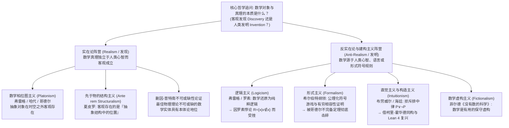
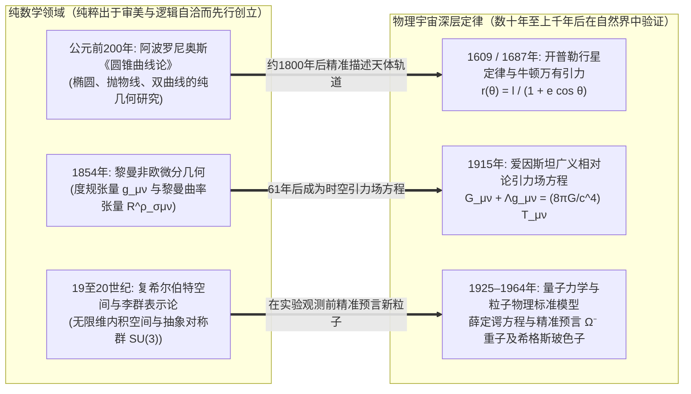

## 导论：曼德博集合在宇宙大爆炸之前就已经存在了吗？

1980年，数学家本华·曼德博（Benoit Mandelbrot）利用计算机在复平面上绘制出了一个极为简单的二次递推公式的收敛域：

$$z_{n+1} = z_n^2 + c \qquad (z_0 = 0,\; c \in \mathbb{C})$$

所有使得序列 $\{z_n\}$ 在 $n \to \infty$ 时保持有界的复参数 $c$ 的集合，构成了著名的<strong>曼德博集合（Mandelbrot Set, $\mathcal{M}$）</strong>。当我们不断放大它的边界（其豪斯多夫维数被证明恰好为 $2$）时，会看到盘旋的海马山谷、繁复的螺旋触须以及无穷嵌套的微缩曼德博集合——没有任何一个人类头脑曾预先设计过这些图案。

这一景象迫使每一位科学家与哲学家直面那个最古老也最深邃的本体论与认识论追问：曼德博究竟是<strong>发明（Invented）</strong>了这个结构，还是<strong>发现（Discovered）</strong>了它？

如果对比国际象棋或围棋，没有人会认为“王车易位”的规则在人类文明诞生前的宇宙中就已经存在；棋类规则显然是人类的文化<strong>发明</strong>。然而，素数有无穷多个（欧几里得定理）、欧拉恒等式 $e^{i\pi} + 1 = 0$，或者曼德博集合的几何分形呢？即便宇宙从未演化出智慧生命，或者仙女座星系的外星文明独立发展出数学，似乎 $17$ 依然是素数，$\pi$ 的数值依然不变，$z_{n+1} = z_n^2 + c$ 的有界域依然会呈现出分毫不差的同一幅分形图像。

然而，如果数、集合、流形与希尔伯特空间真的独立于人类心智而客观存在，它们究竟存在于<strong>哪里</strong>？我们既不能用望远镜观测数字 $7$，也无法在粒子对撞机里碰撞空集 $\emptyset$。如果数学对象栖居在超时空的非物质柏拉图理念界，那么仅拥有物理大脑（神经元电化学网络）的人类，如何能够跨越因果隔绝去认识它们？反过来，如果数学仅仅是人类大脑发明的符号游戏，为什么几百年前纯粹为了智力美感而编造的抽象数学，却能以小数点后十几位的惊人精度预言亚原子粒子与时空弯曲？本文将系统剖析<strong>数学哲学（Philosophy of Mathematics）</strong>的六大核心流派，并最终解答尤金·维格纳著名的<strong>“数学在自然科学中不可思议的有效性”</strong>之谜。

---

## 第一章 数学柏拉图主义（实在论）与贝纳塞拉夫的双重困境

### 1.1 柏拉图、弗雷格、哈代与哥德尔的客观数学实在论

绝大多数一线数学家在从事研究时，在直觉上都是本能的<strong>数学柏拉图主义者（Mathematical Platonists / Realists）</strong>。这一传统始于古希腊的<strong>柏拉图（Plato）</strong>：经验世界中的圆或三角形总是粗糙易逝的，而几何定理却永恒精确，因此数学描述的是独立于感官世界的永恒“理念（Forms）”。

在现代，<strong>戈特洛布·弗雷格（Gottlob Frege）</strong>、<strong>G.H.哈代（G. H. Hardy）</strong>与<strong>库尔特·哥德尔（Kurt Gödel）</strong>将其发展为严格的逻辑实在论：
* <strong>弗雷格的反心理主义（Anti-Psychologism）</strong>：在《算术基础》（1884）中，弗雷格彻底驳斥了将数字视为“个人大脑中的主观心理表象”的心理主义。如果数字 $2$ 只是我脑中的神经活动，那么每个人脑中都有不同的“$2$”，$2+2=4$ 就失去了客观普遍性。因此，除了物理世界与主观心理世界之外，必然存在一个由客观抽象对象构成的<strong>“第三领域（Drittes Reich）”</strong>。
* <strong>哈代与哥德尔的实在论</strong>：哈代在《一个数学家的辩白》（1940）中直言：“317是个素数，并不因为我们是这样认为的，而是<strong>因为它本来就是如此（because it is so）</strong>，因为数学实在就是这样构建的。”哥德尔（1947/1964）在研究连续统假设（$2^{\aleph_0} = \aleph_1$）时进一步主张，集合与概念就像物理客体一样客观存在，而人类拥有一种类似感官知觉的<strong>“数学直觉（Mathematical Intuition）”</strong>来直接洞察抽象集合世界。

标准数学柏拉图主义由三个命题共同定义：（1）<strong>存在性（Existence）</strong>：数学对象客观存在；（2）<strong>抽象性（Abstractness）</strong>：数学对象不占有时空位置，且<strong>在因果上完全惰性（Causally Inert）</strong>；（3）<strong>独立性（Independence）</strong>：数学对象及其真理完全独立于人类心智、语言与证明活动。

### 1.2 贝纳塞拉夫的认识论困境（1973）：因果惰性之墙

1973年，美国哲学家<strong>保罗·贝纳塞拉夫（Paul Benacerraf）</strong>在经典论文《数学真理》（*Mathematical Truth*）中提出了令柏拉图主义陷入绝境的<strong>贝纳塞拉夫认识论问题（Benacerraf's Epistemological Problem）</strong>：
1. <strong>语义学统一性要求</strong>：数学命题（如“存在大于17的完全数”）应当与日常经验命题（如“存在比纽约古老的大城市”）具有完全相同的塔斯基指称真值条件。这意味着量词 $\exists x$ 必须遍历真实存在的数学对象（指向<strong>柏拉图主义</strong>）。
2. <strong>自然主义认识论要求</strong>：人类作为时空中的生物有机体，要对某个领域 $D$ 的对象拥有可靠的知识（即哈特里·菲尔德所说的“解释我们的数学信念与数学事实之间的非偶然相关性”），认识主体与对象之间必须存在某种因果或信息传递机制。

矛盾在于：根据柏拉图主义的“抽象性”定义，数与集合位于时空之外且<strong>因果惰性</strong>——素数不会发射光子，也不会激发人类视网膜或突触的电位。如果柏拉图主义为真，人类大脑在原则上根本不可能获取关于柏拉图领域的任何知识！

### 1.3 贝纳塞拉夫的同一性问题（1965）与数学结构主义的诞生

早在1965年的另一篇名作《数不可能是什幺》（*What Numbers Could Not Be*）中，贝纳塞拉夫还揭露了<strong>多重还原与同一性问题（Identification Problem）</strong>。在现代集合论中，自然数 $0, 1, 2, 3, \dots$ 可以被构造为由空集 $\emptyset$ 生成的纯集合，但构造方式绝不唯一：
* <strong>策梅洛（Zermelo）构造</strong>：$0_Z = \emptyset,\; 1_Z = \{\emptyset\},\; 2_Z = \{\{\emptyset\}\},\; 3_Z = \{\{\{\emptyset\}\}\}, \dots$（后继 $S(n) = \{n\}$）。
* <strong>冯·诺依曼（von Neumann）序数构造</strong>：$0_N = \emptyset,\; 1_N = \{\emptyset\},\; 2_N = \{\emptyset, \{\emptyset\}\},\; 3_N = \{\emptyset, \{\emptyset\}, \{\emptyset, \{\emptyset\}\}\}, \dots$（后继 $S(n) = n \cup \{n\}$）。

这两种构造都完美满足皮亚诺公理（Peano Axioms），在所有算术定理上完全同构。但当我们询问集合论问题“$1 \in 3$ 是否成立？”时，冯·诺依曼体系回答<strong>真</strong>（$1_N \in 3_N$），而策梅洛体系回答<strong>假</strong>（$1_Z \notin 3_Z$）！究竟哪一个集合才是“真正的数字 $3$”？既然没有任何理由偏袒其中一方，贝纳塞拉夫得出了颠覆性结论：<strong>“数根本不可能是孤立的‘对象（Objects）’！”</strong>

这直接催生了当代最具影响力的<strong>数学结构主义（Mathematical Structuralism，代表人物斯图尔特·夏皮罗 Stewart Shapiro、迈克尔·雷斯尼克、杰弗里·赫尔曼）</strong>：数学研究的不是孤立对象的内在性质，而是<strong>抽象结构（Structure）以及结构中的关系位置（Positions / Places）</strong>。就像棒球中的“游击手”或宪政体制中的“总统”只是一个由规则定义的结构性职位而非特定个人一样，自然数“$2$”也仅仅是自然数序列结构（$\omega$-序列）中处于“$1$ 之后、$3$ 之前”的那个关系位置。夏皮罗主张结构本身先于具体系统而客观存在（<strong>先于物的结构主义 *Ante rem* Structuralism</strong>），而赫尔曼则用模态逻辑算子 $\Box$ 与 $\Diamond$ 将数学命题翻译为关于“一切逻辑上可能的系统”的模态命题（<strong>模态结构主义 Modal Structuralism</strong>）。

---

## 第二章 数学基础危机：逻辑主义、形式主义与直觉主义的交锋

### 2.1 逻辑主义（Logicism）与罗素悖论

弗雷格、罗素（Bertrand Russell）与怀特海（A. N. Whitehead）推动的<strong>逻辑主义</strong>试图证明：全部纯数学都可以还原为纯粹的逻辑学（分析先验真理）。弗雷格在《算术基本规律》中依赖了无限制的概括公理（基本规律 V）：任何性质 $\varphi(x)$ 都决定一个集合 $\{x \mid \varphi(x)\}$。

1902年，罗素构造了性质 $x \notin x$（不属于自身的集合），定义了罗素集合：

$$R = \{x \mid x \notin x\} \quad \Longrightarrow \quad R \in R \iff R \notin R$$

这一<strong>罗素悖论（Russell's Paradox）</strong>直接摧毁了弗雷格的体系。随后罗素与怀特海在《数学原理》（*Principia Mathematica*, 1910–1913）中引入分支类型论（Type Theory）消除了自指悖论，但为了导出算术与分析，不得不引入并非纯逻辑重言式的“无穷公理”与“可还原性公理”，古典逻辑主义由此受挫。

### 2.2 希尔伯特的形式主义（Formalism）与哥德尔不完备定理

为了保卫康托尔（Georg Cantor）的无穷集合论乐园，<strong>大卫·希尔伯特（David Hilbert）</strong>提出了<strong>形式主义</strong>与<strong>希尔伯特纲领（Hilbert's Program）</strong>。在游戏形式主义看来，数学只是按照显式规则操作无意义符号串的形式游戏。希尔伯特本人则将数学划分为有直接直观意义的<strong>有穷实存数学（Finitary Mathematics）</strong>和引入无穷作为理想辅助工具的<strong>理想数学（Ideal Mathematics）</strong>。他的纲领旨在将全部古典数学形式化为公理系统 $T$，并在元数学（证明论）中仅用绝对可靠的<strong>有穷方法</strong>证明系统 $T$ 的<strong>完备性</strong>与<strong>相容性（无矛盾性 $\text{Con}(T)$）</strong>。

然而在1931年，年仅25岁的<strong>库尔特·哥德尔（Kurt Gödel）</strong>发表了震古烁今的<strong>哥德尔第一与第二不完备定理（Gödel's Incompleteness Theorems）</strong>：
1. <strong>第一不完备定理</strong>：任何包含初等算术（皮亚诺算术 $\text{PA}$）的相容形式公理系统 $T$，都必然存在一个算术命题 $G_T$（其元数学含义为“本命题在 $T$ 中不可证”），使得：
   $$T \nvdash G_T \quad \text{且} \quad T \nvdash \neg G_T$$
   在标准算术模型中，$G_T$ 是<strong>真的，但在系统 $T$ 内却不可证明</strong>！
2. <strong>第二不完备定理</strong>：任何包含初等算术的相容形式系统 $T$，都无法在系统内部证明其自身的相容性：
   $$T \nvdash \text{Con}(T)$$

哥德尔定理宣告了希尔伯特纲领的破产：<strong>数学真理绝对无法被穷尽或等同于任何固定形式公理系统中的形式可证性</strong>。

### 2.3 直觉主义（Intuitionism）与柯里-霍华德同构（Curry-Howard Isomorphism）

由荷兰拓扑学家<strong>布劳威尔（L. E. J. Brouwer）</strong>创立、<strong>阿兰德·海廷（Arend Heyting）</strong>形式化的<strong>直觉主义 / 构造主义</strong>认为，数学既非发现柏拉图理念，也非符号游戏，而是人类心智基于时间直觉进行的<strong>心智构造活动（Mental Construction）</strong>。在数学中，“存在（$\exists x P(x)$）”严格等同于“能够通过有限算法显式构造出满足 $P(x)$ 的实例 $x$”。

由此，直觉主义果断<strong>拒斥实无穷（Actual Infinity）</strong>（只承认生成中的潜无穷），并<strong>拒斥古典逻辑的排中律（$P \lor \neg P$）与双重否定消去律（$\neg\neg P \to P$）</strong>！按照海廷的 BHK 解释，要断言 $P \lor \neg P$，我们必须手里已经握有 $P$ 的构造性证明或 $\neg P$ 的构造性反驳；对于像哥德巴赫猜想这样的未决问题，排中律并不成立。同理，仅靠反证法推出“假设不存在 $x$ 会导致矛盾”并不能提供构造 $x$ 的算法，因此非构造性存在证明被判无效。

这一看似严苛的哲学流派，在当代计算机科学中通过<strong>柯里-霍华德同构（Curry-Howard Isomorphism）</strong>迎来了辉煌复兴：

$$\text{逻辑命题 (Propositions)} \cong \text{数据类型 (Types)}, \qquad \text{构造性证明 (Proofs)} \cong \text{可执行程序 (Programs)}$$

在直觉主义类型论中，每一个构造性存在证明本身就是一个可运行的计算机程序！今天，以 <strong>Coq (Rocq)</strong>、<strong>Agda</strong> 和 <strong>Lean 4</strong> 为代表的交互式定理证明器正是建立在这一构造主义哲学基石之上。

---

## 第三章 六大数学哲学流派全景对比与不可或缺性之争

| 哲学流派 | 数学对象的本体论地位 | 数学真理与知识的来源（认识论） | 对实无穷的态度 | 代表人物 | 核心理论困境与批评 |
| :--- | :--- | :--- | :--- | :--- | :--- |
| <strong>柏拉图主义 (Platonism)</strong> | 超越时空的客观抽象实体（<strong>发现</strong>） | 理性洞察与哥德尔式数学直觉 | 完全接纳超穷集合谱系 | 柏拉图, 弗雷格, 哈代, 哥德尔 | <strong>贝纳塞拉夫认识论问题</strong>（因果惰性）与多重还原同一性问题 |
| <strong>逻辑主义 (Logicism)</strong> | 还原为纯逻辑概念与类的外延 | 纯逻辑法则与定义的分析先验演绎 | 需额外假设无穷公理 | 弗雷格, 罗素, 怀特海, 赖特 | <strong>罗素悖论</strong>（$R=\{x\mid x\notin x\}$）；无穷公理不属于纯逻辑 |
| <strong>形式主义 (Formalism)</strong> | 不存在抽象实体；只是符号串变换规则（<strong>发明</strong>） | 语法推演规则与有穷<strong>相容性证明</strong> | 作为简化推理的“理想元素” | 大卫·希尔伯特, 柯里 | <strong>哥德尔第一、第二不完备定理</strong>（$T \nvdash G_T,\; T \nvdash \text{Con}(T)$） |
| <strong>直觉主义 / 构造主义</strong> | 人类心智在时间直觉中的<strong>心智构造物（发明）</strong> | 拥有显式构造算法（BHK 语义） | <strong>拒斥实无穷</strong>，仅承认潜无穷 | 布劳威尔, 海廷, 毕晓普, 马丁-洛夫 | 拒斥排中律 $P \lor \neg P$ 导致古典分析学大量非构造性定理受限 |
| <strong>结构主义 (Structuralism)</strong> | 抽象结构中的<strong>关系位置（Positions）</strong> | 把握公理系统的结构同构不变性或模态可能性 | 在公理范畴性或模态相容下接纳 | 贝纳塞拉夫, 夏皮罗, 雷斯尼克, 赫尔曼 | 抽象结构本身的认识论难题；模态算子的原始预设 |
| <strong>虚构主义 (Fictionalism)</strong> | 不存在；如同福尔摩斯般的<strong>有用虚构（发明）</strong> | 数学“故事设定”内部的逻辑相容性 | 作为虚构叙事工具自由使用 | 哈特里·菲尔德, 巴拉格尔 | <strong>蒯因-普特南不可或缺性论证</strong>；难以对量子力学希尔伯特空间去数学化 |

在当代科学哲学中，<strong>蒯因（W. V. O. Quine）</strong>与<strong>普特南（Hilary Putnam）</strong>提出了著名的<strong>不可或缺性论证（Indispensability Argument）</strong>：既然实数、微分流形与希尔伯特空间对于我们最成功的物理理论（广义相对论、量子力学）是<strong>不可或缺的</strong>，那么根据确认整体论（Holism），我们就有同样的经验理由相信数学对象与电子、夸克一样真实存在。对此，<strong>哈特里·菲尔德（Hartry Field）</strong>在《没有数的科学》（*Science Without Numbers*, 1980）中提出了<strong>数学虚构主义（Mathematical Fictionalism）</strong>，试图证明数学只是物理推理的“保守扩张（Conservative Extension）”捷径，并通过纯几何关系公理成功消去了牛顿引力理论中的所有数字，但在面对无限维复希尔伯特空间的量子力学时仍面临严峻挑战。

---

## 第四章 维格纳之谜：“数学在自然科学中不可思议的有效性”

### 4.1 纯数学超前发明与物理定律滞后发现的三大奇迹

1960年，诺贝尔物理学奖得主<strong>尤金·维格纳（Eugene Wigner）</strong>发表了著名演讲《数学在自然科学中不可思议的有效性》（*The Unreasonable Effectiveness of Mathematics in the Natural Sciences*）。他惊叹道：为什么数学家纯粹出于内在审美、逻辑推广或形式游戏而“发明”的抽象结构，往往在几十年甚至上千年后，被物理学家发现恰好是统治宇宙最深层物理实在的精确语言？

1. <strong>从阿波罗尼奥斯圆锥曲线到开普勒行星轨道</strong>：古希腊几何学家阿波罗尼奥斯（约公元前200年）纯粹为了几何美感研究了平面切割圆锥所得的椭圆、抛物线与双曲线。1800年后，开普勒与牛顿发现万有引力 $\mathbf{F} = -G\frac{Mm}{r^2}\hat{\mathbf{r}}$ 下的天体轨道精确服从圆锥曲线方程 $r(\theta) = \frac{\ell}{1 + e\cos\theta}$。
2. <strong>从黎曼几何到爱因斯坦广义相对论</strong>：1854年，波恩哈德·黎曼创立了描述高维弯曲流形内禀曲率的黎曼几何。61年后的1915年，爱因斯坦发现物理时空本身就是一个 $(3+1)$ 维伪黎曼流形，其曲率张量直接由物质能量-动量张量决定：
   $$R_{\mu\nu} - \frac{1}{2} R g_{\mu\nu} + \Lambda g_{\mu\nu} = \frac{8\pi G}{c^4} T_{\mu\nu}$$
3. <strong>从复希尔伯特空间、李群 $\text{SU}(3)$ 到 $\Omega^-$ 重子的预言</strong>：原本作为解三次方程虚构工具的虚数 $i = \sqrt{-1}$ 与希尔伯特空间，成为了量子力学薛定谔方程 $i\hbar \frac{\partial}{\partial t}|\psi\rangle = \hat{H}|\psi\rangle$ 的核心。1961年，盖尔曼（Murray Gell-Mann）与内埃曼利用纯数学中的特殊酉群 $\text{SU}(3)$ 的10维不可约表示（十重态）对强子进行分类，仅凭数学对称性图谱上的一个“空缺位置”，就精确预言了尚未发现的 <strong>$\Omega^-$（欧米伽负）重子</strong>的电荷、自旋、奇异数与质量（约 $1672\text{ MeV}/c^2$），并在1964年被布鲁克海文实验室完美证实！

### 4.2 四种哲学解答与最终综合：公理是发明的，定理是发现的

面对维格纳之谜，当代学者提出了四种解释：（1）<strong>马克斯·泰格马克（Max Tegmark）的“数学宇宙假说（MUH）”</strong>：物理宇宙不仅被数学描述，宇宙本身就是一个巨大的数学结构；（2）<strong>结构实在论（Structural Realism）与诺特定理</strong>：物理定律本质上是跨参考系的不变性（对称性），而数学正是系统分类一切逻辑可能对称结构的科学；（3）<strong>理查德·汉明（Richard Hamming）的选择偏差与演化认识论</strong>：人类大脑在物理宇宙中演化而来，且我们只把数学能完美处理的对称现象称为“基础物理学”；（4）<strong>“发明与发现”的辩证综合</strong>。

归根结底，<strong>人类自由地“发明”了数学的初始概念与公理（如定义复平面与递推规则 $z_{n+1} = z_n^2 + c$），但一旦公理确立，从中由逻辑与结构必然性所涌现出的无穷推论（定理、素数分布、曼德博集合的分形边界、哥德尔不完备性）则是我们只能怀着敬畏去“发现”的客观结构真理。</strong>
