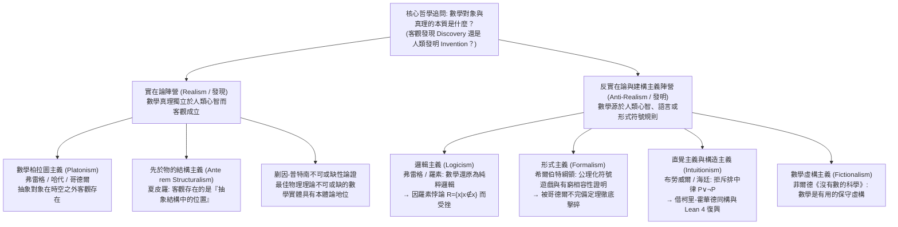
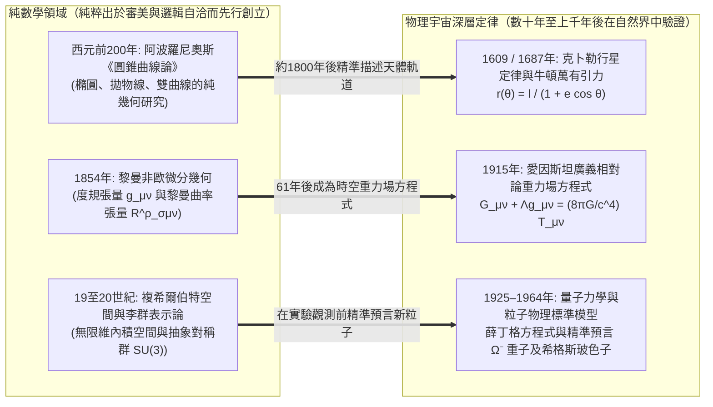

## 導論：曼德博集合在宇宙大爆炸之前就已經存在了嗎？

1980年，數學家本華·曼德博（Benoit Mandelbrot）利用電腦在複平面上繪製出了一個極為簡單的二次遞推公式的收斂域：

$$z_{n+1} = z_n^2 + c \qquad (z_0 = 0,\; c \in \mathbb{C})$$

所有使得序列 $\{z_n\}$ 在 $n \to \infty$ 時保持有界的複參數 $c$ 的集合，構成了著名的<strong>曼德博集合（Mandelbrot Set, $\mathcal{M}$）</strong>。當我們不斷放大它的邊界（其豪斯多夫維數被證明恰好為 $2$）時，會看到盤旋的海馬山谷、繁複的螺旋觸鬚以及無窮嵌套的微縮曼德博集合——沒有任何一個人類頭腦曾預先設計過這些圖案。

這一景象迫使每一位科學家與哲學家直面那個最古老也最深邃的本體論與認識論追問：曼德博究竟是<strong>發明（Invented）</strong>了這個結構，還是<strong>發現（Discovered）</strong>了它？

如果對比西洋棋或圍棋，沒有人會認為「王車易位」的規則在人類文明誕生前的宇宙中就已經存在；棋類規則顯然是人類的文化<strong>發明</strong>。然而，質數有無窮多個（歐幾里得定理）、歐拉恆等式 $e^{i\pi} + 1 = 0$，或者曼德博集合的幾何碎形呢？即便宇宙從未演化出智慧生命，或者仙女座星系的外星文明獨立發展出數學，似乎 $17$ 依然是質數，$\pi$ 的數值依然不變，$z_{n+1} = z_n^2 + c$ 的有界域依然會呈現出分毫不差的同一幅碎形圖像。

然而，如果數、集合、流形與希爾伯特空間真的獨立於人類心智而客觀存在，它們究竟存在於<strong>哪裡</strong>？我們既不能用望遠鏡觀測數字 $7$，也無法在粒子對撞機裡碰撞空集 $\emptyset$。如果數學對象棲居在超時空的非物質柏拉圖理型界，那麼僅擁有物理大腦（神經元電化學網路）的人類，如何能夠跨越因果隔絕去認識它們？反過來，如果數學僅僅是人類大腦發明的符號遊戲，為什麼幾百年前純粹為了智力美感而編造的抽象數學，卻能以小數點後十幾位的驚人精度預言次原子粒子與時空彎曲？本文將系統剖析<strong>數學哲學（Philosophy of Mathematics）</strong>的六大核心流派，並最終解答尤金·維格納著名的<strong>「數學在自然科學中不可思議的有效性」</strong>之謎。

---

## 第一章 數學柏拉圖主義（實在論）與貝納塞拉夫的雙重困境

### 1.1 柏拉圖、弗雷格、哈代與哥德爾的客觀數學實在論

絕大多數一線數學家在從事研究時，在直覺上都是本能的<strong>數學柏拉圖主義者（Mathematical Platonists / Realists）</strong>。這一傳統始於古希臘的<strong>柏拉圖（Plato）</strong>：經驗世界中的圓或三角形總是粗糙易逝的，而幾何定理卻永恆精確，因此數學描述的是獨立於感官世界的永恆「理型（Forms）」。

在現代，<strong>戈特洛布·弗雷格（Gottlob Frege）</strong>、<strong>G.H.哈代（G. H. Hardy）</strong>與<strong>庫爾特·哥德爾（Kurt Gödel）</strong>將其發展為嚴格的邏輯實在論：
* <strong>弗雷格的反心理主義（Anti-Psychologism）</strong>：在《算術基礎》（1884）中，弗雷格徹底駁斥了將數字視為「個人大腦中的主觀心理表象」的心理主義。如果數字 $2$ 只是我腦中的神經活動，那麼每個人腦中都有不同的「$2$」，$2+2=4$ 就失去了客觀普遍性。因此，除了物理世界與主觀心理世界之外，必然存在一個由客觀抽象對象構成的<strong>「第三領域（Drittes Reich）」</strong>。
* <strong>哈代與哥德爾的實在論</strong>：哈代在《一個數學家的辯白》（1940）中直言：「317是個質數，並不因為我們是這樣認為的，而是<strong>因為它本來就是如此（because it is so）</strong>，因為數學實在就是這樣構建的。」哥德爾（1947/1964）在研究連續統假設（$2^{\aleph_0} = \aleph_1$）時進一步主張，集合與概念就像物理客體一樣客觀存在，而人類擁有一種類似感官知覺的<strong>「數學直覺（Mathematical Intuition）」</strong>來直接洞察抽象集合世界。

標準數學柏拉圖主義由三個命題共同定義：（1）<strong>存在性（Existence）</strong>：數學對象客觀存在；（2）<strong>抽象性（Abstractness）</strong>：數學對象不佔有時空位置，且<strong>在因果上完全惰性（Causally Inert）</strong>；（3）<strong>獨立性（Independence）</strong>：數學對象及其真理完全獨立於人類心智、語言與證明活動。

### 1.2 貝納塞拉夫的認識論困境（1973）：因果惰性之牆

1973年，美國哲學家<strong>保羅·貝納塞拉夫（Paul Benacerraf）</strong>在經典論文《數學真理》（*Mathematical Truth*）中提出了令柏拉圖主義陷入絕境的<strong>貝納塞拉夫認識論問題（Benacerraf's Epistemological Problem）</strong>：
1. <strong>語義學統一性要求</strong>：數學命題（如「存在大於17的完全數」）應當與日常經驗命題（如「存在比紐約古老的大城市」）具有完全相同的塔斯基指稱真值條件。這意味著量詞 $\exists x$ 必須遍歷真實存在的數學對象（指向<strong>柏拉圖主義</strong>）。
2. <strong>自然主義認識論要求</strong>：人類作為時空中的生物有機體，要對某個領域 $D$ 的對象擁有可靠的知識（即哈特里·菲爾德所說的「解釋我們的數學信念與數學事實之間的非偶然相關性」），認識主體與對象之間必須存在某種因果或資訊傳遞機制。

矛盾在於：根據柏拉圖主義的「抽象性」定義，數與集合位於時空之外且<strong>因果惰性</strong>——質數不會發射光子，也不會激發人類視網膜或突觸的電位。如果柏拉圖主義為真，人類大腦在原則上根本不可能獲取關於柏拉圖領域的任何知識！

### 1.3 貝納塞拉夫的同一性問題（1965）與數學結構主義的誕生

早在1965年的另一篇名作《數不可能是什麼》（*What Numbers Could Not Be*）中，貝納塞拉夫還揭露了<strong>多重還原與同一性問題（Identification Problem）</strong>。在現代集合論中，自然數 $0, 1, 2, 3, \dots$ 可以被構造為由空集 $\emptyset$ 生成的純集合，但構造方式絕不唯一：
* <strong>策梅洛（Zermelo）構造</strong>：$0_Z = \emptyset,\; 1_Z = \{\emptyset\},\; 2_Z = \{\{\emptyset\}\},\; 3_Z = \{\{\{\emptyset\}\}\}, \dots$（後繼 $S(n) = \{n\}$）。
* <strong>馮·諾伊曼（von Neumann）序數構造</strong>：$0_N = \emptyset,\; 1_N = \{\emptyset\},\; 2_N = \{\emptyset, \{\emptyset\}\},\; 3_N = \{\emptyset, \{\emptyset\}, \{\emptyset, \{\emptyset\}\}\}, \dots$（後繼 $S(n) = n \cup \{n\}$）。

這兩種構造都完美滿足皮亞諾公理（Peano Axioms），在所有算術定理上完全同構。但當我們詢問集合論問題「$1 \in 3$ 是否成立？」時，馮·諾伊曼體系回答<strong>真</strong>（$1_N \in 3_N$），而策梅洛體系回答<strong>假</strong>（$1_Z \notin 3_Z$）！究竟哪一個集合才是「真正的數字 $3$」？既然沒有任何理由偏袒其中一方，貝納塞拉夫得出了顛覆性結論：<strong>「數根本不可能是孤立的『對象（Objects）』！」</strong>

這直接催生了當代最具影響力的<strong>數學結構主義（Mathematical Structuralism，代表人物史チュアート·夏皮羅 Stewart Shapiro、邁克爾·雷斯尼克、傑弗里·赫爾曼）</strong>：數學研究的不是孤立對象的內在性質，而是<strong>抽象結構（Structure）以及結構中的關係位置（Positions / Places）</strong>。就像棒球中的「游擊手」或憲政體制中的「總統」只是一個由規則定義的結構性職位而非特定個人一樣，自然數「$2$」也僅僅是自然數序列結構（$\omega$-序列）中處於「$1$ 之後、$3$ 之前」的那個關係位置。夏皮羅主張結構本身先於具體系統而客觀存在（<strong>先於物的結構主義 *Ante rem* Structuralism</strong>），而赫爾曼則用模態邏輯算子 $\Box$ 與 $\Diamond$ 將數學命題翻譯為關於「一切邏輯上可能的系統」的模態命題（<strong>模態結構主義 Modal Structuralism</strong>）。

---

## 第二章 數學基礎危機：邏輯主義、形式主義與直覺主義的交鋒

### 2.1 邏輯主義（Logicism）與羅素悖論

弗雷格、羅素（Bertrand Russell）與懷特海（A. N. Whitehead）推動的<strong>邏輯主義</strong>試圖證明：全部純數學都可以還原為純粹的邏輯學（分析先驗真理）。弗雷格在《算術基本規律》中依賴了無限制的概括公理（基本規律 V）：任何性質 $\varphi(x)$ 都決定一個集合 $\{x \mid \varphi(x)\}$。

1902年，羅素構造了性質 $x \notin x$（不屬於自身的集合），定義了羅素集合：

$$R = \{x \mid x \notin x\} \quad \Longrightarrow \quad R \in R \iff R \notin R$$

這一<strong>羅素悖論（Russell's Paradox）</strong>直接摧毀了弗雷格的體系。隨後羅素與懷特海在《數學原理》（*Principia Mathematica*, 1910–1913）中引入分支類型論（Type Theory）消除了自指悖論，但為了導出算術與分析，不得不引入並非純邏輯重言式的「無窮公理」與「可還原性公理」，古典邏輯主義由此受挫。

### 2.2 希爾伯特的形式主義（Formalism）與哥德爾不完備定理

為了保衛康托爾（Georg Cantor）的無窮集合論樂園，<strong>大衛·希爾伯特（David Hilbert）</strong>提出了<strong>形式主義</strong>與<strong>希爾伯特綱領（Hilbert's Program）</strong>。在遊戲形式主義看來，數學只是按照顯式規則操作無意義符號串的形式遊戲。希爾伯特本人則將數學劃分為有直接直觀意義的<strong>有窮實存數學（Finitary Mathematics）</strong>和引入無窮作為理想輔助工具的<strong>理想數學（Ideal Mathematics）</strong>。他的綱領旨在將全部古典數學形式化為公理系統 $T$，並在元數學（證明論）中僅用絕對可靠的<strong>有窮方法</strong>證明系統 $T$ 的<strong>完備性</strong>與<strong>相容性（無矛盾性 $\text{Con}(T)$）</strong>。

然而在1931年，年僅25歲的<strong>庫爾特·哥德爾（Kurt Gödel）</strong>發表了震古鑠今的<strong>哥德爾第一與第二不完備定理（Gödel's Incompleteness Theorems）</strong>：
1. <strong>第一不完備定理</strong>：任何包含初等算術（皮亞諾算術 $\text{PA}$）的相容形式公理系統 $T$，都必然存在一個算術命題 $G_T$（其元數學含義為「本命題在 $T$ 中不可證」），使得：
   $$T \nvdash G_T \quad \text{且} \quad T \nvdash \neg G_T$$
   在標準算術模型中，$G_T$ 是<strong>真的，但在系統 $T$ 內卻不可證明</strong>！
2. <strong>第二不完備定理</strong>：任何包含初等算術的相容形式系統 $T$，都無法在系統內部證明其自身的相容性：
   $$T \nvdash \text{Con}(T)$$

哥德爾定理宣告了希爾伯特綱領的破產：<strong>數學真理絕對無法被窮盡或等同於任何固定形式公理系統中的形式可證性</strong>。

### 2.3 直覺主義（Intuitionism）與柯里-霍華德同構（Curry-Howard Isomorphism）

由荷蘭拓撲學家<strong>布勞威爾（L. E. J. Brouwer）</strong>創立、<strong>阿蘭德·海廷（Arend Heyting）</strong>形式化的<strong>直覺主義 / 構造主義</strong>認為，數學既非發現柏拉圖理型，也非符號遊戲，而是人類心智基於時間直覺進行的<strong>心智構造活動（Mental Construction）</strong>。在數學中，「存在（$\exists x P(x)$）」嚴格等同於「能夠透過有限演算法顯式構造出滿足 $P(x)$ 的實例 $x$」。

由此，直覺主義果斷<strong>拒斥實無窮（Actual Infinity）</strong>（只承認生成中的潛無窮），並<strong>拒斥古典邏輯的排中律（$P \lor \neg P$）與雙重否定消去律（$\neg\neg P \to P$）</strong>！按照海廷的 BHK 解釋，要斷言 $P \lor \neg P$，我們必須手裡已經握有 $P$ 的構造性證明或 $\neg P$ 的構造性反駁；對於像哥德巴赫猜想這樣的未決問題，排中律並不成立。同理，僅靠反證法推出「假設不存在 $x$ 會導致矛盾」並不能提供構造 $x$ 的演算法，因此非構造性存在證明被判無效。

這一看似嚴苛的哲學流派，在當代電腦科學中透過<strong>柯里-霍華德同構（Curry-Howard Isomorphism）</strong>迎來了輝煌復興：

$$\text{邏輯命題 (Propositions)} \cong \text{資料型別 (Types)}, \qquad \text{構造性證明 (Proofs)} \cong \text{可執行程式 (Programs)}$$

在直覺主義型別論中，每一個構造性存在證明本身就是一個可運行的電腦程式！今天，以 <strong>Coq (Rocq)</strong>、<strong>Agda</strong> 和 <strong>Lean 4</strong> 為代表的互動式定理證明器正是建立在這一構造主義哲學基石之上。

---

## 第三章 六大數學哲學流派全景對比與不可或缺性之爭

| 哲學流派 | 數學對象的本體論地位 | 數學真理與知識的來源（認識論） | 對實無窮的態度 | 代表人物 | 核心理論困境與批評 |
| :--- | :--- | :--- | :--- | :--- | :--- |
| <strong>柏拉圖主義 (Platonism)</strong> | 超越時空的客觀抽象實體（<strong>發現</strong>） | 理性洞察與哥德爾式數學直覺 | 完全接納超窮集合譜系 | 柏拉圖, 弗雷格, 哈代, 哥德爾 | <strong>貝納塞拉夫認識論問題</strong>（因果惰性）與多重還原同一性問題 |
| <strong>邏輯主義 (Logicism)</strong> | 還原為純邏輯概念與類的外延 | 純邏輯法則與定義的分析先驗演繹 | 需額外假設無窮公理 | 弗雷格, 羅素, 懷特海, 賴特 | <strong>羅素悖論</strong>（$R=\{x\mid x\notin x\}$）；無窮公理不屬於純邏輯 |
| <strong>形式主義 (Formalism)</strong> | 不存在抽象實體；只是符號串變換規則（<strong>發明</strong>） | 語法推演規則與有窮<strong>相容性證明</strong> | 作為簡化推理的「理想元素」 | 大衛·希爾伯特, 柯里 | <strong>哥德爾第一、第二不完備定理</strong>（$T \nvdash G_T,\; T \nvdash \text{Con}(T)$） |
| <strong>直覺主義 / 構造主義</strong> | 人類心智在時間直覺中的<strong>心智構造物（發明）</strong> | 擁有顯式構造演算法（BHK 語義） | <strong>拒斥實無窮</strong>，僅承認潛無窮 | 布勞威爾, 海廷, 畢曉普, 馬丁-洛夫 | 拒斥排中律 $P \lor \neg P$ 導致古典分析學大量非構造性定理受限 |
| <strong>結構主義 (Structuralism)</strong> | 抽象結構中的<strong>關係位置（Positions）</strong> | 把握公理系統的結構同構不變性或模態可能性 | 在公理範疇性或模態相容下接納 | 貝納塞拉夫, 夏皮羅, 雷斯尼克, 赫爾曼 | 抽象結構本身的認識論難題；模態算子的原始預設 |
| <strong>虛構主義 (Fictionalism)</strong> | 不存在；如同福爾摩斯般的<strong>有用虛構（發明）</strong> | 數學「故事設定」內部的邏輯相容性 | 作為虛構敘事工具自由使用 | 哈特里·菲爾德, 巴拉格爾 | <strong>蒯因-普特南不可或缺性論證</strong>；難以對量子力學希爾伯特空間去數學化 |

在當代科學哲學中，<strong>蒯因（W. V. O. Quine）</strong>與<strong>普特南（Hilary Putnam）</strong>提出了著名的<strong>不可或缺性論證（Indispensability Argument）</strong>：既然實數、微分流形與希爾伯特空間對於我們最成功的物理理論（廣義相對論、量子力學）是<strong>不可或缺的</strong>，那麼根據確認整體論（Holism），我們就有同樣的經驗理由相信數學對象與電子、夸克一樣真實存在。對此，<strong>哈特里·菲爾德（Hartry Field）</strong>在《沒有數的科學》（*Science Without Numbers*, 1980）中提出了<strong>數學虛構主義（Mathematical Fictionalism）</strong>，試圖證明數學只是物理推理的「保守擴張（Conservative Extension）」捷徑，並透過純幾何關係公理成功消去了牛頓重力理論中的所有數字，但在面對無限維複希爾伯特空間的量子力學時仍面臨嚴峻挑戰。

---

## 第四章 維格納之謎：「數學在自然科學中不可思議的有效性」

### 4.1 純數學超前發明與物理定律滯後發現的三大奇蹟

1960年，諾貝爾物理學獎得主<strong>尤金·維格納（Eugene Wigner）</strong>發表了著名演講《數學在自然科學中不可思議的有效性》（*The Unreasonable Effectiveness of Mathematics in the Natural Sciences*）。他驚嘆道：為什麼數學家純粹出於內在審美、邏輯推廣或形式遊戲而「發明」的抽象結構，往往在幾十年甚至上千年後，被物理學家發現恰好是統治宇宙最深層物理實在的精確語言？

1. <strong>從阿波羅尼奧斯圓錐曲線到克卜勒行星軌道</strong>：古希臘幾何學家阿波羅尼奧斯（約西元前200年）純粹為了幾何美感研究了平面切割圓錐所得的橢圓、拋物線與雙曲線。1800年後，克卜勒與牛頓發現萬有引力 $\mathbf{F} = -G\frac{Mm}{r^2}\hat{\mathbf{r}}$ 下的天體軌道精確服從圓錐曲線方程式 $r(\theta) = \frac{\ell}{1 + e\cos\theta}$。
2. <strong>從黎曼幾何到愛因斯坦廣義相對論</strong>：1854年，波恩哈德·黎曼創立了描述高維彎曲流形內稟曲率的黎曼幾何。61年后的1915年，愛因斯坦發現物理時空本身就是一個 $(3+1)$ 維偽黎曼流形，其曲率張量直接由物質能量-動量張量決定：
   $$R_{\mu\nu} - \frac{1}{2} R g_{\mu\nu} + \Lambda g_{\mu\nu} = \frac{8\pi G}{c^4} T_{\mu\nu}$$
3. <strong>從複希爾伯特空間、李群 $\text{SU}(3)$ 到 $\Omega^-$ 重子的預言</strong>：原本作為解三次方程式虛構工具的虛數 $i = \sqrt{-1}$ 與希爾伯特空間，成為了量子力學薛丁格方程式 $i\hbar \frac{\partial}{\partial t}|\psi\rangle = \hat{H}|\psi\rangle$ 的核心。1961年，蓋爾曼（Murray Gell-Mann）與內埃曼利用純數學中的特殊酉群 $\text{SU}(3)$ 的10維不可約表示（十重態）對強子進行分類，僅憑數學對稱性圖譜上的一個「空缺位置」，就精確預言了尚未發現的 <strong>$\Omega^-$（歐米伽負）重子</strong>的電荷、自旋、奇異數與質量（約 $1672\text{ MeV}/c^2$），並在1964年被布魯克海文實驗室完美證實！

### 4.2 四種哲學解答與最終綜合：公理是發明的，定理是發現的

面對維格納之謎，當代學者提出了四種解釋：（1）<strong>馬克斯·泰格馬克（Max Tegmark）的「數學宇宙假說（MUH）」</strong>：物理宇宙不僅被數學描述，宇宙本身就是一個巨大的數學結構；（2）<strong>結構實在論（Structural Realism）與諾特定理</strong>：物理定律本質上是跨參考系的不變性（對稱性），而數學正是系統分類一切邏輯可能對稱結構的科學；（3）<strong>理查·漢明（Richard Hamming）的選擇偏差與演化認識論</strong>：人類大腦在物理宇宙中演化而來，且我們只把數學能完美處理的對稱現象稱為「基礎物理學」；（4）<strong>「發明與發現」的辯證綜合</strong>。

歸根結底，<strong>人類自由地「發明」了數學的初始概念與公理（如定義複平面與遞推規則 $z_{n+1} = z_n^2 + c$），但一旦公理確立，從中由邏輯與結構必然性所湧現出的無窮推論（定理、質數分佈、曼德博集合的碎形邊界、哥德爾不完備性）則是我們只能懷著敬畏去「發現」的客觀結構真理。</strong>
