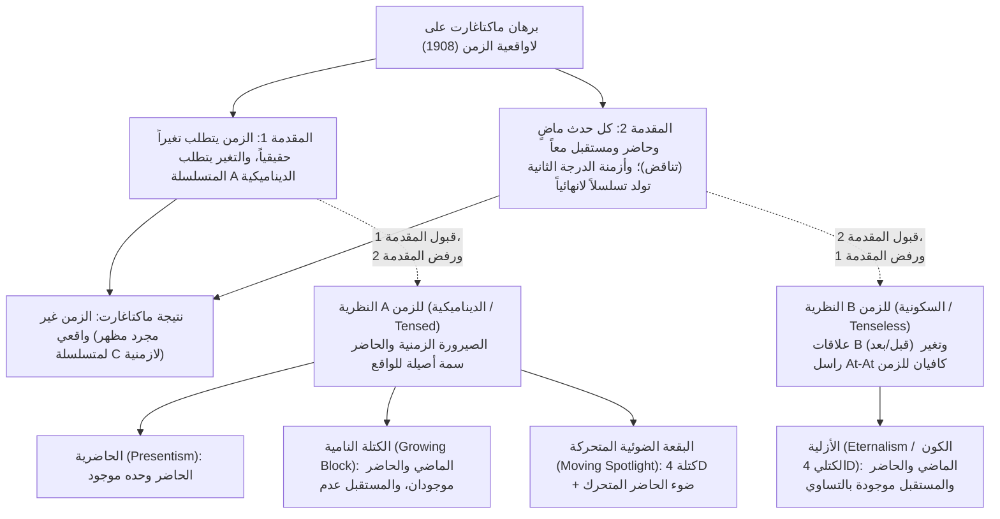
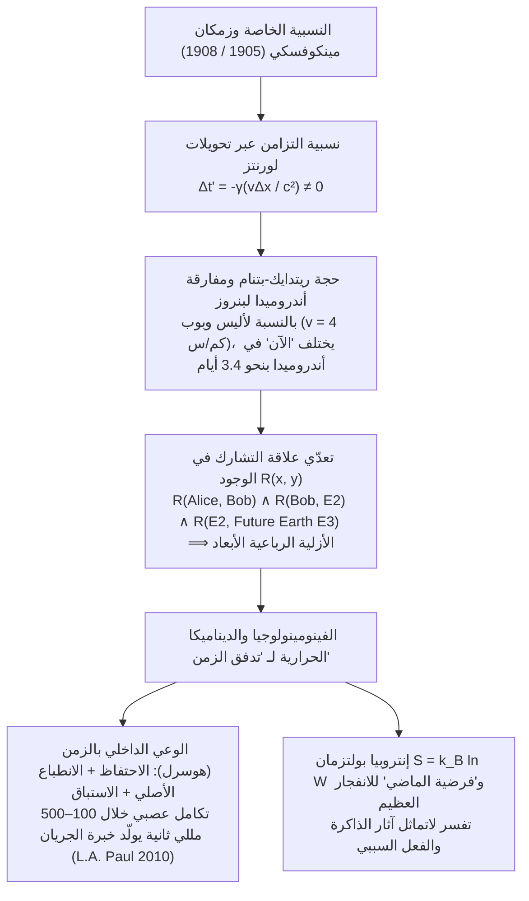

## 1. مقدمة و«لاواقعية الزمن» عند جون ماكتاغارت (1908)

حوالي عام 397 ميلادية، كتب القديس أوغسطينوس في كتابه «الاعترافات» (الكتاب الحادي عشر، الفصل 14) تساؤله الشهير: «ما هو الزمن إذن؟ إذا لم يسألني أحد عنه، فأنا أعرفه؛ وإذا رغبت في شرحه لمن يسألني، فأنا لا أعرفه». وفقاً لحدسنا اليومي الفطري، فإن الماضي (سقراط، الديناصورات) لم يعد موجوداً، والمستقبل لم يوجد بعد؛ وما يوجد حقاً هو فقط لحظة «الآن» (الحاضر) الحادة كشفرة الموسى.

في عام 1908، نشر فيلسوف كامبريدج <strong>جون ماكتاغارت (J.M.E. McTaggart)</strong> ورقته التأسيسية *«لاواقعية الزمن» (The Unreality of Time)* في مجلة *Mind*، مميزاً بين سلسلتين لترتيب الأحداث في الزمن:
1. <strong>المتسلسلة A (الديناميكية / الزمنية الصرفية):</strong> ترتب الأحداث نسبةً إلى «الآن» بوصفها *مستقبلية ($F(e)$)*، و*حاضرة ($N(e)$)*، و*ماضية ($P(e)$)*. وجوهرها هو التغير المستمر لهذه التعيينات.
2. <strong>المتسلسلة B (السكونية / اللاتصريفية):</strong> ترتب الأحداث عبر علاقات ثنائية دائمة وثابتة: *أسبق من ($E(e_1, e_2)$)*، و*متزامن مع*، و*ألحق من*.

يتألف برهان ماكتاغارت الاستنباطي على لاواقعية الزمن من خطوتين:
* <strong>المقدمة 1 (لا تغير ولا زمن بدون المتسلسلة A):</strong> الزمن يستلزم التغير. وفي المتسلسلة B الخالصة (ضد نظرية التغير *At-At* لبرتراند راسل)، تظل جميع خصائص الحدث وتاريخه ثابتة إلى الأبد؛ والشيء الوحيد الذي يتغير في الحدث هو انتقاله من المستقبل إلى الحاضر ثم إلى الماضي (المتسلسلة A).
* <strong>المقدمة 2 (تناقض المتسلسلة A والتسلسل اللانهائي الفاسد):</strong> الماضي $P(e)$ والحاضر $N(e)$ والمستقبل $F(e)$ صفات متنافية منطقياً، غير أن جريان الزمن يقتضي أن يتصف كل حدث $e$ بالصفات الثلاث جميعاً:
  $$\forall e \, \Big( \neg\big(P(e) \land N(e)\big) \land \neg\big(N(e) \land F(e)\big) \Big) \quad \text{vs.} \quad \forall e \, \big( P(e) \land N(e) \land F(e) \big)$$
  والاعتراض القائل بأن «$e$ *كان* مستقبلاً، و*هو الآن* حاضر، و*سيكون* ماضياً» يستدعي <strong>متسلسلة A من الدرجة الثانية</strong> (مصفوفة $3 \times 3$)، حيث يتكرر نفس التناقض على القطر الرئيسي ($P(P(e)), N(N(e)), F(F(e))$ )، مما يطلق <strong>تسلسلاً لانهائياً فاسداً (Vicious Infinite Regress)</strong> إلى درجات $3^n$.

---

## 2. النماذج الأنطولوجية الأربعة للزمن: الحاضرية مقابل الأزلية

1. <strong>الحاضرية (Presentism — آرثر برايور، نيد ماركوسيان):</strong> لا يوجد سوى الأشياء والأحداث الحاضرة. وهي تقطع تسلسل ماكتاغارت عبر عوامل زمنية أولية ($P, F$)، لكنها تصطدم بـ <strong>اعتراض صانع الصدق (Truthmaker Objection، Sider 2001)</strong> — ما الذي يجعل قضية «عاشت الديناصورات في العصر الطباشيري» صادقة إذا كان الماضي معدوماً تماماً؟ — ومشكلة العلاقات العابرة للزمن.
2. <strong>الأزلية / الكون الكتلي الرباعي الأبعاد (Eternalism — راسل، كواين، ميلور، تيد سايدر):</strong> الماضي والحاضر والمستقبل موجودة جميعاً على قدم المساواة داخل متصل الزمكان الرباعي الأبعاد. وكلمة «الآن» — تماماً مثل كلمة «هنا» — هي مجرد <strong>قرينة إشارية (Indexical)</strong> تعيّن الإحداثي الزمكاني للمتكلم.
3. <strong>الكون الكتلي النامي (Growing Block — سي. دي. برود 1923):</strong> الماضي والحاضر موجودان بينما المستقبل غير موجود؛ و«الحاضر» هو الحافة الأمامية لنمو الكتلة. لكنه ينهار أمام <strong>الاعتراض المعرفي «الماضي الميت» (Dead Past، Braddon-Mitchell 2004)</strong>: إذا كان لينكولن موجوداً في شريحة عام 1863 ويعتقد أنه يعيش «الآن»، فكيف نعلم أن عام 2026 هو الحافة الخارجية للكتلة وليس مدفوناً في الماضي الميت؟
4. <strong>نظرية البقعة الضوئية المتحركة (Moving Spotlight — روس كاميرون 2015):</strong> تضيف إلى الكتلة الرباعية الأبعاد حزمة ضوئية متحركة من «الحاضرية المطلقة»، لكنها ترث الشكوكية المعرفية ومفارقة سرعة مرور الزمن («ثانية لكل فوق-ثانية»).

| معيار المقارنة | الحاضرية (Presentism) | الكتلة النامية (Growing Block) | البقعة الضوئية المتحركة | الأزلية (الكون الكتلي 4D) |
| :--- | :--- | :--- | :--- | :--- |
| <strong>المعسكر الميتافيزيقي</strong> | النظرية A (ديناميكية) | النظرية A (ديناميكية) | النظرية A (ديناميكية) | النظرية B (سكونية / لاتصريفية) |
| <strong>وجود الماضي والمستقبل</strong> | الماضي <strong>لا</strong>، المستقبل <strong>لا</strong> | الماضي <strong>نعم</strong>، المستقبل <strong>لا</strong> | الماضي <strong>نعم</strong>، المستقبل <strong>نعم</strong> | الماضي <strong>نعم</strong>، المستقبل <strong>نعم</strong> |
| <strong>طبيعة «الآن»</strong> | مجمل الوجود ذاته | حافة النمو الأنطولوجية | خاصية أحادية متحركة | قرينة إشارية (مثل «هنا») |
| <strong>صانع الصدق لقضايا الماضي</strong> | <strong>مشكلة عويصة</strong> | <strong>محلولة</strong> (الماضي موجود) | <strong>محلولة</strong> (الماضي موجود) | <strong>محلولة</strong> (الكتلة 4D موجودة) |
| <strong>الاعتراض المعرفي</strong> | <strong>محصّنة</strong> | <strong>معرّضة قاتلة</strong> (Dead Past) | <strong>معرّضة قاتلة</strong> | <strong>محصّنة</strong> (إشارية في كل شريحة) |
| <strong>النسبية الخاصة</strong> | <strong>متعارضة</strong> بدون أثير | <strong>متعارضة</strong> بدون توريق كوني | <strong>متعارضة</strong> بدون توريق كوني | <strong>متوافقة مباشرة</strong> (مينكوفسكي) |

---

## 3. النسبية الخاصة، زمكان مينكوفسكي، ومفارقة أندروميدا

في <strong>النسبية الخاصة لأينشتاين (1905)</strong> و<strong>زمكان مينكوفسكي الرباعي الأبعاد (1908)</strong>، تكون الفترة الزمكانية الصامدة هي $ds^2 = -c^2 dt^2 + dx^2 + dy^2 + dz^2$. وبموجب <strong>تحويلات لورنتز</strong>:

$$t' = \gamma \left( t - \frac{vx}{c^2} \right), \qquad \gamma = \frac{1}{\sqrt{1 - v^2/c^2}} \implies \Delta t' = \gamma \left( \Delta t - \frac{v \Delta x}{c^2} \right)$$

إن حدثين متزامنين في الإطار $S$ ($\Delta t = 0$) تفصل بينهما مسافة $\Delta x > 0$ <strong>ليسا متزامنين</strong> في الإطار $S'$ المتحرك بسرعة $v$ ($\Delta t' = -\gamma \frac{v \Delta x}{c^2} \neq 0$).

وقد أثبت <strong>ريتدايك (1966)</strong> و<strong>هيلاري بتنام (1967)</strong> أن هذا يؤدي إلى انهيار الحاضرية لصالح الأزلية، وهو ما صوّره <strong>روجر بنروز (1989)</strong> في <strong>«مفارقة أندروميدا» (Andromeda Paradox)</strong>: إذا سار بوب ($B$) بسرعة المشي العادية $v = 4\text{ كم/س} \approx 1.11\text{ م/ث}$ بجوار أليس ($A$) الواقفة باتجاه مجرة أندروميدا ($L = 2.5 \times 10^6\text{ سنة ضوئية}$)، فإن مستويي التزامن لهما عند أندروميدا يختلفان بمقدار:

$$\Delta t \approx \frac{v L}{c^2} = \left(\frac{1.11\text{ m/s}}{3.0 \times 10^8\text{ m/s}}\right) \times 2.5 \times 10^6\text{ years} \approx 3.38\text{ أيام}$$

بالنسبة لأليس، فإن قرار غزو الأرض في أندروميدا لم يُتخذ بعد ($E_1$)؛ أما بالنسبة لبوب، فقد انطلقت الأسطول بالفعل قبل قرابة أربعة أيام ($E_2$)! وبفضل <strong>تعدّي علاقة الوجود</strong> $R(A, B) \land R(B, E_2) \land R(E_2, \text{أرض المستقبل } E_3)$، فإن كامل متصل مينكوفسكي الرباعي الأبعاد يتعايش في الوجود.

---

## 4. لماذا نشعر بأن الزمن يتدفق؟ — هوسرل، العلوم الإدراكية، وسهم الديناميكا الحرارية

1. <strong>فينومينولوجيا إدموند هوسرل وعلم الأعصاب الإدراكي:</strong> لكي ندرك لحناً موسيقياً ($C \to E \to G$)، يجمع كل «حاضر حي» بين ثلاثة أبعاد قصدية: <strong>الاحتفاظ (Retention)</strong> بالنغمة التي انقضت للتو، و<strong>الانطباع الأصلي (Urimpression)</strong> بالنغمة الحالية، و<strong>الاستباق (Protention)</strong> للنغمة الوشيكة. وكما أوضحت <strong>إل. إيه. بول (2010)</strong> و<strong>كريغ كالندر (2017)</strong>، فإن كل حالة دماغية $B(t_n)$ على طول خط عالمنا الرباعي الأبعاد تشفّر في آن واحد (ضمن نافذة تكامل من $100\text{–}500\text{ مللي ثانية}$) آثار الذاكرة العاملة لـ $t_{n-1}$ والنماذج التنبؤية لـ $t_{n+1}$، مما يولّد بالضرورة الخبرة الفينومينولوجية لتدفق الزمن.
2. <strong>الميكانيكا الإحصائية لبولتزمان و«فرضية الماضي» (Past Hypothesis):</strong> رغم أن القوانين الفيزيائية الميكروسكوبية متماثلة تحت عكس الزمن ($t \to -t$)، فإن <strong>سهم الزمن</strong> الماكروسكوبي ينبع من القانون الثاني للديناميكا الحرارية:
   $$S = k_B \ln W, \qquad \frac{dS}{dt} \geq 0$$
   وبالاقتران مع الشرط الحدي الكوني لانفجار عظيم ذي إنتروبيا منخفضة للغاية ($W_0 \ll W_{\max}$، <strong>Past Hypothesis</strong> عند ديفيد ألبرت، 2000)، يفسر هذا الانحدار الإنتروبي لماذا تتشكل السجلات والذكريات فقط باتجاه الماضي ولماذا تتفرع قراراتنا فقط باتجاه المستقبل.
