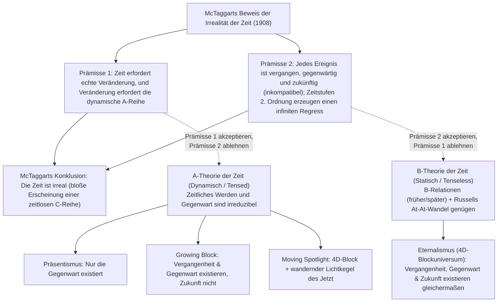
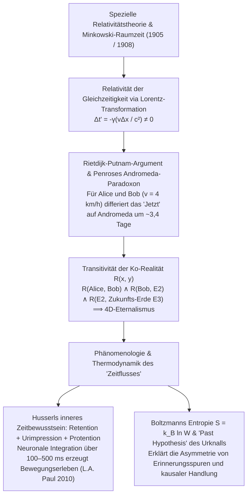

## 1. Einleitung und J.M.E. McTaggarts „The Unreality of Time“ (1908)

Um 397 n. Chr. formulierte Augustinus in den *Confessiones* (Buch XI, 14) das berühmte Rätsel: „Was also ist die Zeit? Wenn mich niemand danach fragt, weiß ich es; will ich es aber einem Fragenden erklären, weiß ich es nicht.“ Unserer Alltagsintuition zufolge existiert die Vergangenheit (Sokrates, die Dinosaurier) nicht mehr und die Zukunft noch nicht – wirklich existent ist allein das messerscharfe „Jetzt“ (die Gegenwart).

Im Jahr 1908 veröffentlichte der Cambridger Philosoph <strong>J.M.E. McTaggart</strong> seinen bahnbrechenden Aufsatz *„The Unreality of Time“*, in dem er zwei Arten der zeitlichen Ordnung unterscheidet:
1. <strong>Die A-Reihe (dynamisch / zeitstufig):</strong> Ordnet Ereignisse relativ zum „Jetzt“ als *zukünftig ($F(e)$)*, *gegenwärtig ($N(e)$)* und *vergangen ($P(e)$)*. Ihr Wesen ist die ständige Veränderung dieser Bestimmungen.
2. <strong>Die B-Reihe (statisch / zeitlos):</strong> Ordnet Ereignisse durch permanente zweistellige Relationen wie *früher als ($E(e_1, e_2)$)*, *gleichzeitig mit* und *später als*.

McTaggarts zweistufiger Beweis für die Irrealität der Zeit lautet:
* <strong>Prämisse 1 (Keine Zeit ohne A-Reihe):</strong> Zeit setzt Veränderung voraus. In einer reinen B-Reihe (gegen Bertrand Russells *At-At-Theorie*) bleiben alle Eigenschaften eines Ereignisses zu seinem Zeitpunkt ewig fixiert; verändern kann sich ein Ereignis nur, indem es von der Zukunft in die Gegenwart und Vergangenheit rückt.
* <strong>Prämisse 2 (Widerspruch der A-Reihe und infiniter Regress):</strong> Vergangenheit $P(e)$, Gegenwart $N(e)$ und Zukunft $F(e)$ schließen einander logisch aus, doch jedes zeitliche Ereignis muss nacheinander alle drei Bestimmungen besitzen:
  $$\forall e \, \Big( \neg\big(P(e) \land N(e)\big) \land \neg\big(N(e) \land F(e)\big) \Big) \quad \text{vs.} \quad \forall e \, \big( P(e) \land N(e) \land F(e) \big)$$
  Der Ausweg „$e$ *war* zukünftig, *ist* gegenwärtig und *wird* vergangen *sein*“ führt eine <strong>A-Reihe zweiter Stufe</strong> ($3 \times 3$-Matrix zusammengesetzter Zeitstufen) ein, auf deren Hauptdiagonale ($P(P(e)), N(N(e)), F(F(e))$) derselbe Widerspruch erneut auftritt – ein <strong>fehlerhafter unendlicher Regress (Vicious Infinite Regress)</strong>.

---

## 2. Die vier ontologischen Modelle der Zeit: Präsentismus vs. Eternalismus

1. <strong>Präsentismus (Arthur Prior, Ned Markosian):</strong> Nur gegenwärtige Objekte und Ereignisse existieren. Er blockiert McTaggarts Regress durch primitive Satzoperatoren ($P, F$), scheitert jedoch am <strong>Wahrmacher-Einwand (Truthmaker Objection, Sider 2001)</strong> – was in der bloßen Gegenwart macht den Satz „Im Mesozoikum lebten Dinosaurier“ wahr? – sowie am Problem zeitübergreifender Relationen.
2. <strong>Eternalismus / 4D-Blockuniversum (Bertrand Russell, W.V.O. Quine, D.H. Mellor, Ted Sider):</strong> Vergangenheit, Gegenwart und Zukunft existieren zeitlos gleichberechtigt in einer vierdimensionalen Raumzeit. „Jetzt“ ist – genau wie „hier“ – ein reiner <strong>Indexikal (Indexical)</strong>, der den Raumzeit-Ort des jeweiligen Sprechers bezeichnet.
3. <strong>Growing-Block-Theorie (C.D. Broad 1923):</strong> Vergangenheit und Gegenwart existieren, die Zukunft nicht; das „Jetzt“ ist die wachsende Kante des Blocks. Sie scheitert am <strong>epistemischen „Dead-Past“-Einwand (Braddon-Mitchell 2004)</strong>: Wenn Lincoln im Schnitt von 1863 existiert und dort glaubt, im „Jetzt“ zu leben, woher wissen wir, dass 2026 die Außenkante des Blocks ist und nicht längst in der „toten Vergangenheit“ liegt?
4. <strong>Moving-Spotlight-Theorie (Ross Cameron 2015):</strong> Kombiniert den 4D-Block mit einem wandernden Lichtkegel absoluter Gegenwärtigkeit, teilt aber das epistemische Problem sowie J.J.C. Smarts Einwand der Bewegungsrate („eine Sekunde pro Hyper-Sekunde“).

| Kriterium | Präsentismus | Growing Block Universe | Moving Spotlight | Eternalismus (Blockuniversum) |
| :--- | :--- | :--- | :--- | :--- |
| <strong>Metaphysisches Lager</strong> | A-Theorie (dynamisch) | A-Theorie (dynamisch) | A-Theorie (dynamisch) | B-Theorie (statisch / zeitlos) |
| <strong>Status von Vergangenheit & Zukunft</strong> | Verg. <strong>nein</strong>, Zuk. <strong>nein</strong> | Verg. <strong>ja</strong>, Zuk. <strong>nein</strong> | Verg. <strong>ja</strong>, Zuk. <strong>ja</strong> | Verg. <strong>ja</strong>, Zuk. <strong>ja</strong> |
| <strong>Natur des „Jetzt“</strong> | Gesamtheit des Seienden | Wachsende Kante des Seins | Wandernde monadische Eigenschaft | Indexikal (wie „hier“) |
| <strong>Wahrmacher für Vergangenes</strong> | <strong>Schweres Problem</strong> | <strong>Gelöst</strong> (Vergangenes existiert) | <strong>Gelöst</strong> (Vergangenes existiert) | <strong>Gelöst</strong> (4D-Block existiert) |
| <strong>Epistemischer „Jetzt“-Einwand</strong> | <strong>Immun</strong> | <strong>Fatal verwundbar</strong> (Dead Past) | <strong>Fatal verwundbar</strong> | <strong>Immun</strong> (Indexikal in jedem Schnitt) |
| <strong>Spezielle Relativitätstheorie</strong> | <strong>Inkompatibel</strong> ohne Äther | <strong>Inkompatibel</strong> ohne Faserung | <strong>Inkompatibel</strong> ohne Faserung | <strong>Direkt kompatibel</strong> (Minkowski) |

---

## 3. Spezielle Relativitätstheorie, Minkowski-Raumzeit und das Andromeda-Paradoxon

In Albert Einsteins <strong>Spezieller Relativitätstheorie (1905)</strong> und Hermann Minkowskis <strong>vierdimensionaler Raumzeit (1908)</strong> ist das invariante Intervall $ds^2 = -c^2 dt^2 + dx^2 + dy^2 + dz^2$. Aus der <strong>Lorentz-Transformation</strong> folgt:

$$t' = \gamma \left( t - \frac{vx}{c^2} \right), \qquad \gamma = \frac{1}{\sqrt{1 - v^2/c^2}} \implies \Delta t' = \gamma \left( \Delta t - \frac{v \Delta x}{c^2} \right)$$

Zwei im System $S$ gleichzeitige Ereignisse ($\Delta t = 0$) im Abstand $\Delta x > 0$ sind im relativ dazu mit $v$ bewegten System $S'$ <strong>nicht gleichzeitig</strong> ($\Delta t' = -\gamma \frac{v \Delta x}{c^2} \neq 0$).

<strong>C.W. Rietdijk (1966)</strong> und <strong>Hilary Putnam (1967)</strong> bewiesen daraus den Kollaps des Präsentismus in den Eternalismus, veranschaulicht durch <strong>Roger Penroses Andromeda-Paradoxon (1989)</strong>: Geht Bob ($B$) mit Schrittgeschwindigkeit $v = 4\text{ km/h} \approx 1.11\text{ m/s}$ an der stehenden Alice ($A$) vorbei in Richtung der $L = 2.5 \times 10^6\text{ Lichtjahre}$ entfernten Andromeda-Galaxie (M31), so weichen ihre Gleichzeitigkeits-Hyperebenen bei Andromeda um

$$\Delta t \approx \frac{v L}{c^2} = \left(\frac{1.11\text{ m/s}}{3.0 \times 10^8\text{ m/s}}\right) \times 2.5 \times 10^6\text{ Jahre} \approx 3.38\text{ Tage}$$

voneinander ab! Für Alice ist der Start einer Invasionsflotte auf Andromeda noch unentschiedene Zukunft ($E_1$), für Bob ist die Flotte bereits vor fast vier Tagen gestartet ($E_2$). Durch die <strong>Transitivität der Existenz</strong> $R(A, B) \land R(B, E_2) \land R(E_2, \text{Zukunfts-Erde } E_3)$ folgt, dass das gesamte 4D-Minkowski-Kontinuum zeitlos koexistiert.

---

## 4. Warum scheint die Zeit zu fließen? — Husserl, Kognitionswissenschaft und der thermodynamische Zeitpfeil

1. <strong>Edmund Husserls Phänomenologie des inneren Zeitbewusstseins und Kognitionswissenschaft:</strong> Damit wir eine Melodie ($C \to E \to G$) als zeitliche Folge hören, umfasst jede „lebendige Gegenwart“ drei Momente: <strong>Retention</strong> (unmittelbares Festhalten des soeben verklungenen Tons), <strong>Urimpression</strong> (gegenwärtiger Ton) und <strong>Protention</strong> (Antizipation des kommenden Tons). Wie <strong>L.A. Paul (2010)</strong> und <strong>Craig Callender (2017)</strong> zeigen, kodiert jeder Gehirnzustand $B(t_n)$ entlang unserer 4D-Weltlinie innerhalb eines Integrationsfensters von $100\text{–}500\text{ ms}$ zugleich Arbeitsgedächtnisspuren von $t_{n-1}$ und prädiktive Modelle von $t_{n+1}$ – was das qualitative Erleben eines dynamischen Fließens zwingend hervorbringt.
2. <strong>Boltzmanns statistische Mechanik und die „Past Hypothesis“:</strong> Während die Mikrogesetze der Physik zeitumkehrsymmetrisch ($t \to -t$) sind, entspringt der makroskopische <strong>Zeitpfeil</strong> dem Zweiten Hauptsatz der Thermodynamik:
   $$S = k_B \ln W, \qquad \frac{dS}{dt} \geq 0$$
   Zusammen mit der kosmologischen Randbedingung eines extrem niedrigentropischen Urknalls ($W_0 \ll W_{\max}$, David Alberts <strong>Past Hypothesis</strong>, 2000) erklärt dieser Entropiegradient, warum Gedächtnisspuren nur in Richtung Vergangenheit existieren und unsere Entscheidungen nur die Zukunft verzweigen.
