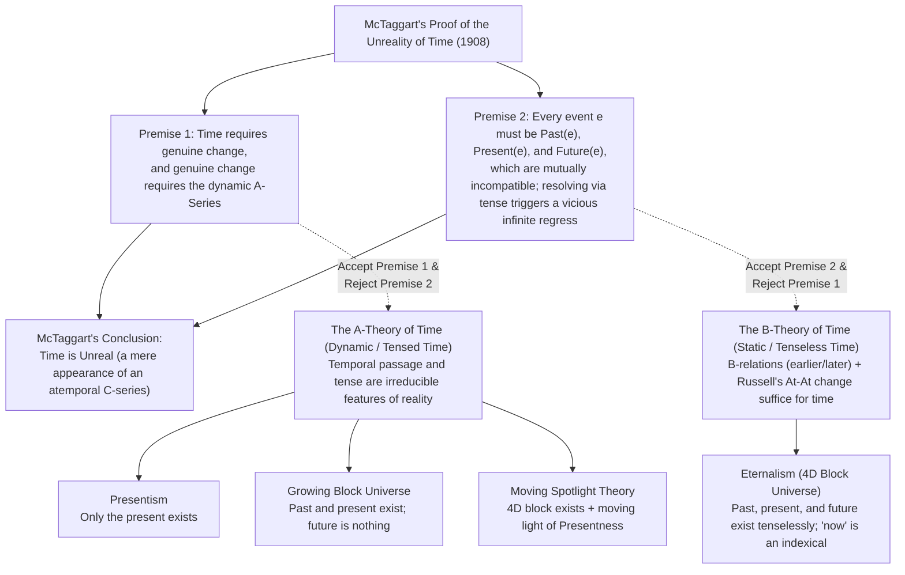
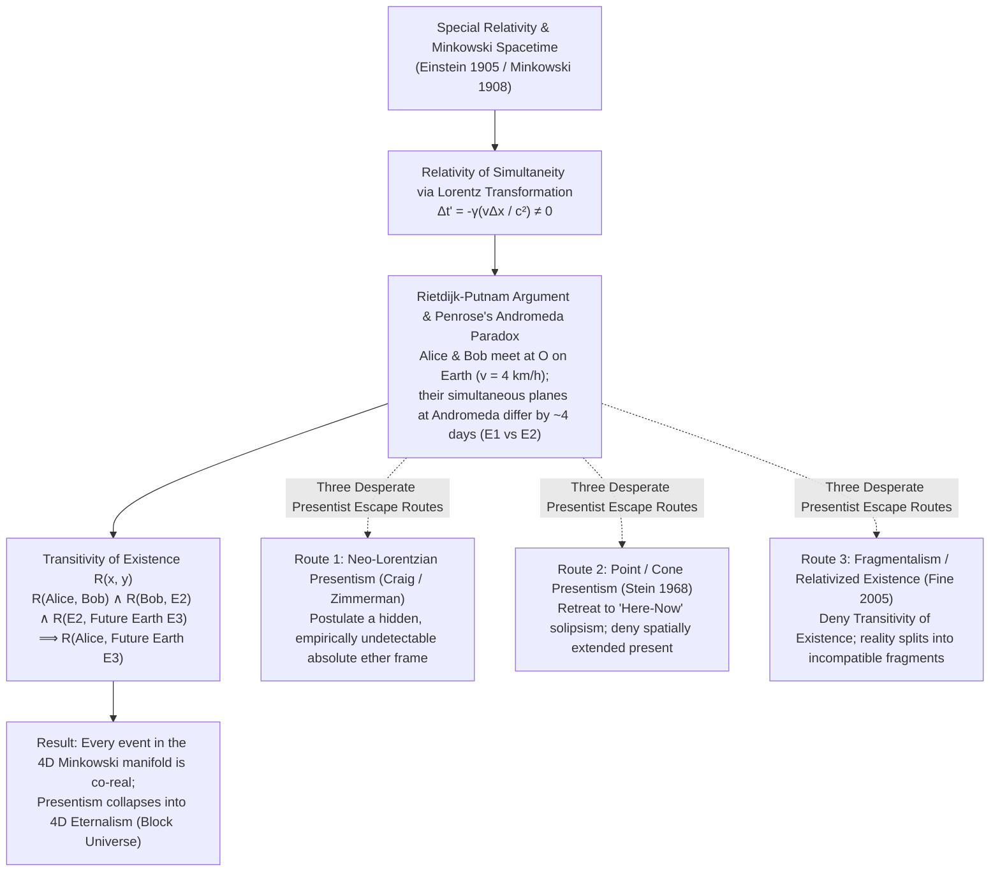
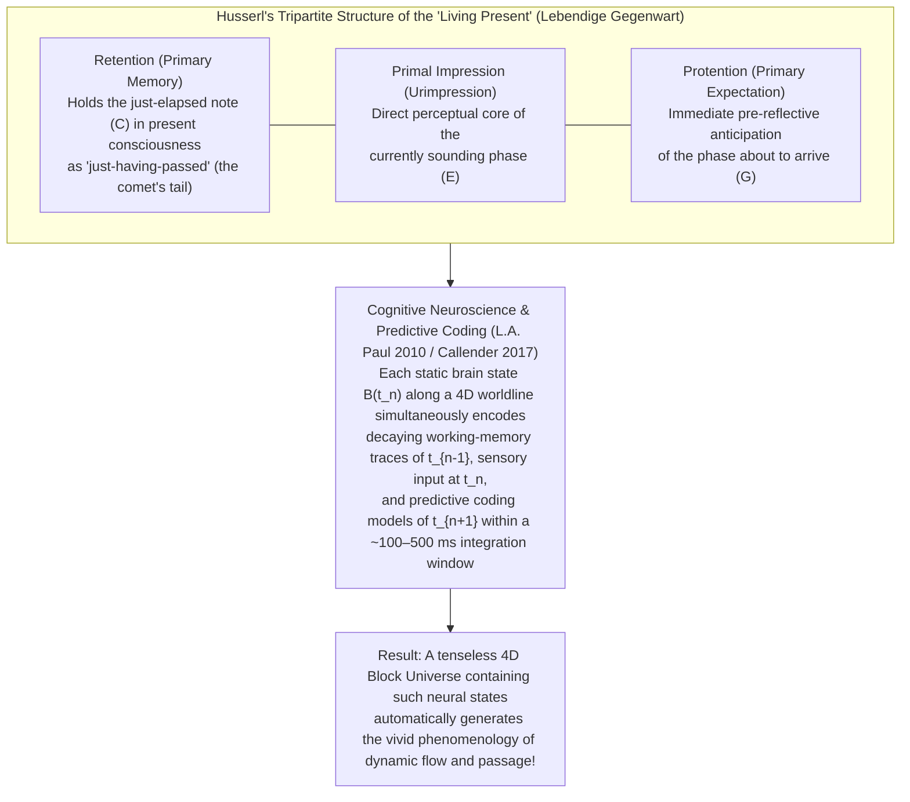

## Introduction: Saint Augustine's Lament and the Enigma of "Now"

Around the year 397 CE, in Book XI, Chapter 14 of his immortal *Confessions* (*Confessiones*), Saint Augustine of Hippo (354–430) articulated what remains the most famous and penetrating puzzle in the intellectual history of humanity's reflection on time:

> "What then is time? If no one asks me, I know; if I wish to explain it to one who asks, I know not (*Quid est ergo tempus? Si nemo ex me quaerat, scio; si quaerenti explicare velim, nescio*)."

In our pre-reflective everyday existence, nothing is more intimate or self-evident than time. We inhabit a vivid, luminous "now" (the present); we feel the moments of just a second ago slipping inexorably into the "past," while an open, unactualized "future" rushes continuously toward us to become the new present. According to our deepest common-sense intuition, the past is no longer real—Socrates, the dinosaurs, and yesterday's rainfall have vanished from existence—and the future is not yet real. All that genuinely exists is the razor-thin boundary where future becomes past: the present moment, "now."

Yet, as Augustine immediately realized, the moment we subject this common-sense intuition to rigorous logical analysis, it threatens to collapse into paradox. If the past *no longer* exists and the future *does not yet* exist, how can time have any duration or magnitude ("a long time" or "a short time")? Moreover, what is the duration of the "present" itself? If the present had any temporal extension—say, a year, an hour, or even a millisecond—it could be divided into earlier and later parts, meaning its earlier part would already be past and its later part would still be future. Thus, the strict present must be a durationless, extensionless point. But how can the entire reality of the universe be balanced upon a durationless instant sandwiched between two non-existents (an unreal past and an unreal future)?

In the early twentieth century, Augustine's ancient perplexity was transformed into a precise logico-mathematical and scientific battleground by two revolutionary developments that occurred in the exact same year, 1908:
1. In metaphysics, the Cambridge philosopher <strong>John McTaggart Ellis McTaggart (1866–1925)</strong> published his landmark paper <strong>"The Unreality of Time"</strong> in the journal *Mind*, introducing the distinction between the <strong>A-series</strong> and the <strong>B-series</strong> and constructing a deductively rigorous paradox against the reality of temporal passage.
2. In theoretical physics, building upon <strong>Albert Einstein's (1879–1955)</strong> 1905 Special Theory of Relativity, the mathematician <strong>Hermann Minkowski (1864–1909)</strong> formulated the geometry of four-dimensional <strong>Minkowski Spacetime</strong>, proving that simultaneous "presentness" across space is not an objective feature of reality, but varies relative to the velocity of the observer.

In this comprehensive study, we will investigate the architecture of the contemporary philosophy of time from the ground up: reconstructing McTaggart's Paradox, comparing the four major ontological models of time (<strong>Presentism, Eternalism, the Growing Block Universe, and the Moving Spotlight Theory</strong>), deriving the <strong>Relativity of Simultaneity</strong> and the <strong>Rietdijk-Putnam / Andromeda Paradox</strong> from the Lorentz transformations, and finally reconciling the tenseless four-dimensional spacetime of physics with the lived human experience of temporal passage via <strong>Edmund Husserl's phenomenology</strong>, modern cognitive neuroscience, and <strong>Ludwig Boltzmann's thermodynamic arrow of time</strong>.

---

## Chapter 1: J.M.E. McTaggart's "The Unreality of Time" (1908) — The A-Series, the B-Series, and the Vicious Infinite Regress

Virtually the entire landscape of twentieth- and twenty-first-century analytic philosophy of time flows from J.M.E. McTaggart's 1908 paper *"The Unreality of Time"* (later incorporated into Volume II of his magnum opus *The Nature of Existence*, 1927). McTaggart observed that in ordinary thought and language, we order positions and events in time in two fundamentally distinct ways.

### 1.1 Formal Definitions of the A-Series, B-Series, and C-Series

1. <strong>The A-Series (Tensed, Monadic, Dynamic Determinations)</strong>
   The A-series orders events according to their possession of the properties of being in the <strong>distant future</strong>, the <strong>near future</strong>, the <strong>present</strong>, the <strong>near past</strong>, and the <strong>distant past</strong>. Formally, A-determinations behave as monadic (one-place) properties—or indexical determinations anchored to a privileged "now"—such as $\text{Past}(e)$, $\text{Present}(e)$, and $\text{Future}(e)$ (along with metric refinements like *three days ago* or *two centuries hence*). The defining characteristic of the A-series is that <strong>its determinations are transitory and constantly changing</strong>: an event $e$ (such as the first human landing on Mars) begins in the distant future, moves closer to the present, momentarily exemplifies presentness, and then recedes ever further into the past.
2. <strong>The B-Series (Tenseless, Dyadic, Permanent Relations)</strong>
   The B-series orders events solely by means of two-place (dyadic) relational predicates: <strong>earlier than</strong> ($E(e_1, e_2)$), <strong>simultaneous with</strong> ($S(e_1, e_2)$), and <strong>later than</strong> ($L(e_1, e_2)$). Crucially, B-relations are transitive, asymmetric (for $E$ and $L$), irreflexive, and <strong>eternally permanent</strong>. If the Battle of Waterloo (1815) is earlier than the publication of Einstein's special relativity (1905), that relational fact holds tenselessly and timelessly: it was true in 5000 BCE, it is true in 2026 CE, and it will be true in 10,000 CE.
3. <strong>The C-Series (Atemporal Structural Order)</strong>
   McTaggart also identifies a third series, the <strong>C-series</strong>, which is a purely non-temporal, undirected permanent ordering of elements—analogous to the alphabetical order $A, B, C, D$ or the natural numbers $1, 2, 3, 4$. A C-series determines which element lies *between* two others, but it possesses no intrinsic temporal direction or flow until it is combined with the dynamic A-series to generate the directed B-series.

### 1.2 Reconstructing McTaggart's Two-Step Deductive Proof

McTaggart's argument for the unreality of time proceeds via two master premises:
* <strong>Premise 1 (The Essentiality of the A-Series for Change and Time):</strong> Time is unreal without genuine change, and genuine change cannot occur without the A-series.
* <strong>Premise 2 (The Incoherence of the A-Series):</strong> The A-series contains an inescapable internal contradiction, and every attempt to resolve this contradiction by appealing to succession triggers a vicious infinite regress.

Let us examine both steps in formal detail.

#### Step 1: Why Change Requires the A-Series (McTaggart vs. Russell's At-At Theory)
McTaggart takes it as an analytic truth that time involves change: a universe in which nothing ever changed would be a timeless universe. Now suppose we strip reality of the A-series (past, present, future) and leave only the permanent B-series (events ordered by *earlier than* and *later than*). Could anything change in a pure B-series?

McTaggart argues that it could not. Consider a specific historical event $e$, such as <em>the death of Queen Anne in 1714</em>. Can this event cease to exist, or merge into another event? No—it occupies its fixed position in 1714 forever. Can its intrinsic properties change? No—that it was caused by a stroke, that it occurred at Kensington Palace, and that it was painful are timelessly true of that event at 1714. Can its B-relations to other events change? No—it is forever later than the Norman Conquest (1066) and forever earlier than the Moon Landing (1969). In what respect, then, does the death of Queen Anne ever *change* at all? <strong>Only in its A-determinations!</strong> It began by being future, became present in 1714, became past, and is constantly becoming further and further past.

> [!IMPORTANT]
> <strong>The Clash with Bertrand Russell's "At-At" Theory of Change</strong>
> In *The Principles of Mathematics* (1903), McTaggart's fellow Cambridge philosopher Bertrand Russell proposed a purely B-theoretic account of change (often called the <strong>At-At Theory of Change</strong>): a poker changes from hot to cold simply in virtue of the tenseless facts that the poker has the property *hot* at time $t_1$ and the property *cold* at a later time $t_2$.
> McTaggart explicitly rejects Russell's account. For McTaggart, the fact that the poker is hot at $t_1$ is an eternal, unchanging fact, and the fact that the poker is cold at $t_2$ is likewise an eternal, unchanging fact. Just as a poker can be hot at its left spatial end $x_1$ and cold at its right spatial end $x_2$ without *changing* (merely exhibiting spatial variation across parts), having different properties at $t_1$ and $t_2$ is merely static variation along a dimension unless the A-series moves $t_1$ and $t_2$ from future to present to past! Thus, McTaggart concludes, <strong>without the A-series there is no change, and without change there is no time</strong>.

#### Step 2: The Contradiction of the A-Series and the Vicious Infinite Regress
Having argued that time requires the A-series, McTaggart delivers his coup de grâce: the A-series is self-contradictory. Let $P(e)$, $N(e)$, and $F(e)$ denote that event $e$ is past, present (now), and future, respectively.

First, the three A-determinations are <strong>mutually incompatible</strong>. If an event is present, it is not past and not future; if it is past, it is not present and not future:

$$\forall e \, \Big( \neg\big(P(e) \land N(e)\big) \land \neg\big(N(e) \land F(e)\big) \land \neg\big(P(e) \land F(e)\big) \Big)$$

Second, however, the very nature of temporal passage requires that <strong>every event in time possesses all three determinations</strong> (except possibly a first or last event of time, which would still possess at least two incompatible determinations):

$$\forall e \, \big( P(e) \land N(e) \land F(e) \big)$$

Conjoining these two equations yields an explicit formal contradiction!

At this point, McTaggart anticipates the immediate common-sense rejoinder:
> *"Wait, McTaggart! Nobody claims that an event $e$ is past, present, and future <strong>simultaneously</strong>! Rather, $e$ possesses these determinations <strong>successively</strong>: $e$ <strong>was</strong> future, <strong>is</strong> present, and <strong>will be</strong> past!"*

McTaggart's reply to this obvious move is devastating. What does it mean to say "$e$ *was* future, *is* present, and *will be* past"? Look closely at the auxiliary verbs *was*, *is*, and *will be*: to explain away the incompatibility of the first-order A-determinations, the objector has secretly invoked a <strong>second-order A-series</strong>! Specifically:
* "$e$ was future" means: at a <em>past</em> moment, $e$ is future $\longrightarrow P(F(e))$.
* "$e$ is present" means: at the <em>present</em> moment, $e$ is present $\longrightarrow N(N(e))$.
* "$e$ will be past" means: at a <em>future</em> moment, $e$ is past $\longrightarrow F(P(e))$.

More generally, combining the three outer tenses with the three inner tenses yields a $3 \times 3$ matrix of nine compound (second-order) A-determinations:

$$\begin{pmatrix}
P(P(e)) & P(N(e)) & P(F(e)) \\
N(P(e)) & N(N(e)) & N(F(e)) \\
F(P(e)) & F(N(e)) & F(F(e))
\end{pmatrix}$$

While off-diagonal combinations like $P(F(e))$ (future in the past), $N(N(e))$ (present in the present), and $F(P(e))$ (past in the future) are mutually compatible, <strong>every event $e$ that passes through time must also exemplify all nine second-order predicates, including the incompatible predicates along any row or along the main diagonal: $P(P(e))$, $N(N(e))$, and $F(F(e))$</strong> (or $N(P(e))$, $N(N(e))$, and $N(F(e))$: being past in the present, present in the present, and future in the present)!

To remove the contradiction at the second level, our objector is forced to make the exact same move again, appealing to a <strong>third-order A-series</strong> ($3^3 = 27$ predicates, such as $P(N(F(e)))$), which immediately generates a fresh contradiction among third-order diagonal predicates, requiring a fourth-order A-series ($3^4 = 81$ predicates), and so on *ad infinitum*. Because at no finite stage $n$ is a contradiction-free specification of the A-series ever achieved, the infinite regress is not a harmless entailment regress (like "$p$ is true $\implies$ it is true that $p$ is true"), but a <strong>vicious infinite regress</strong> in which every proposed resolution presupposes the very contradiction it was meant to solve. Therefore, the A-series cannot exist, and consequently, <strong>time is unreal</strong>.

---

## Chapter 2: A-Theory vs. B-Theory and the Four Ontological Models of Time

While very few contemporary philosophers accept McTaggart's idealistic conclusion that time is an illusion of an atemporal C-series, his proof permanently divided the metaphysics of time into two great rival camps, depending on which of his two premises one rejects:

* <strong>The A-Theory of Time (Dynamic / Tensed Time):</strong> Rejects McTaggart's Premise 2 while upholding Premise 1. A-theorists insist that temporal becoming—the objective passage of events from future to present to past—is a fundamental, irreducible feature of metaphysical reality, and that taking present tense as primitive blocks McTaggart's regress at the very first step.
* <strong>The B-Theory of Time (Tenseless / Static Time):</strong> Rejects McTaggart's Premise 1 while upholding Premise 2. B-theorists agree with McTaggart that an objective moving A-series is contradictory or superfluous, but follow Bertrand Russell in maintaining that permanent, tenseless B-relations (*earlier than*, *simultaneous with*, *later than*) and variation of properties across temporal parts are completely sufficient to constitute genuine time and change.

When we intersect this debate over <strong>tense and passage (A vs. B)</strong> with the fundamental <strong>ontological question</strong>—*Which temporal regions (past, present, future) actually exist in the domain of unrestricted quantification $\forall x$?*—we obtain the four canonical models in the metaphysics of time.

### 2.1 Presentism: Only "Now" Exists

Championed by <strong>Arthur Prior</strong> (the founder of formal Tense Logic), <strong>Ned Markosian</strong>, <strong>Dean Zimmerman</strong>, and <strong>Trenton Merricks</strong>, <strong>Presentism</strong> is the purest and most ontologically parsimonious version of the A-theory. Its defining thesis is radical:

> <strong>"Only present objects and present events exist."</strong>

If we draw up a complete inventory of everything that exists in reality (ranging over our most unrestricted existential quantifier $\exists x$), that list contains tables, chairs, living humans, and stars existing *right now*, and nothing else. Socrates does not exist; dinosaurs do not exist; the Battle of Waterloo does not exist; your unborn grandchildren in the 22nd century do not exist. Just as <strong>Modal Actualists</strong> (like Robert Adams and Alvin Plantinga, against David Lewis's Modal Realism) maintain that only the *actual* world exists and merely possible objects do not exist anywhere, Presentists are <strong>Temporal Actualists</strong>: only the *present* world exists.

#### How Presentism Blocks McTaggart's Regress
Following Arthur Prior, the Presentist diagnoses McTaggart's Paradox as arising from a fatal mistake: treating past and future events as *existing entities* smeared across a timeline that possess incompatible properties $\text{Past}(e)$ and $\text{Future}(e)$. For the Presentist, there are no non-present events to possess properties! Instead, fundamental reality is described exclusively in the present tense, supplemented by primitive, unanalyzable <strong>sentential tense operators</strong>: $P$ (*"It was the case that..."*) and $F$ (*"It will be the case that..."*). An event $e$ is present simply by existing ($e$ occurs); that it *was* future is expressed as $P(F(e))$, where the outer operator $P$ modifies the sentence without attributing a property to a non-existent object.

#### The Two Devastating Objections Against Presentism
Despite its intuitive appeal, Presentism faces two formidable metaphysical objections before we even turn to modern physics:

1. <strong>The Truthmaker Objection to Past Truths (Armstrong, Sider, Keller)</strong>
   A foundational principle of realist metaphysics is the <strong>Truthmaker Principle</strong> (or *Truth Supervenes on Being*, defended by D.M. Armstrong, John Bigelow, and Ted Sider): if a contingent proposition $\langle p \rangle$ is objectively true, there must exist some entity or state of affairs in the world whose existence necessitates or grounds the truth of $\langle p \rangle$.
   Now consider the proposition $\langle \text{Tyrannosaurus rex roamed the Earth in the Cretaceous period} \rangle$. This proposition is objectively <strong>true</strong>, whereas $\langle \text{Unicorns roamed the Earth in the Cretaceous period} \rangle$ is objectively <strong>false</strong>. Yet according to Presentism, the Cretaceous period and the dinosaurs <strong>do not exist at all</strong>—they are just as non-existent as unicorns! What existing feature of the purely *present* world in 2026 serves as the <strong>truthmaker</strong> that makes it true that dinosaurs existed?
   * *Why appealing to present fossils fails:* First, there are countless determinate truths about the past that left zero causal traces in the present (e.g., the exact number of times Julius Caesar blinked on his twentieth birthday), which would become truth-valueless if truthmakers were present fossils. Second, the sentence "Dinosaurs existed" is *about* past dinosaurs, not about mineral rocks currently sitting in a museum!
   * *The Lucretian Strategy and the Charge of "Ontological Cheating":* John Bigelow (1996) proposed <strong>Lucretian Presentism</strong>, arguing that the present world as a whole instantiates irreducible, primitive past-directed properties, such as the property of *having once contained dinosaurs*. However, as Ted Sider (*Four-Dimensionalism*, 2001) and Trenton Merricks forcefully object, such Lucretian properties are "hypothetical" or "non-categorical" properties that float completely free of the intrinsic physical arrangement of present matter—an ad hoc device of "ontological cheating" that posits unexplained brute properties purely to mimic the explanatory power of an existing past.
   * *Ersatz Presentism:* Philosophers like Thomas Crisp and Craig Bourne proposed constructing abstract "ersatz times" out of maximally consistent sets of present-tense propositions linked by an ersatz *earlier-than* relation. Yet this leaves unanswered why one abstract set of propositions rather than another counts as "having been actualized," and reduces concrete flesh-and-blood dinosaurs to bloodless abstract propositions.

2. <strong>The Problem of Cross-Time Relations (Causal, Comparative, and Intentional Relations)</strong>
   It is a logical axiom of relations (the <strong>Principle of Relations</strong>) that a genuine binary relation $R(a, b)$ can hold between $a$ and $b$ only if <strong>both relata $a$ and $b$ exist</strong>: $\forall a \forall b \big(R(a, b) \implies \exists x(x=a) \land \exists y(y=b)\big)$.
   Yet our world is woven together by cross-temporal relations:
   * *Causal relations:* The 1914 assassination of Archduke Franz Ferdinand *caused* the outbreak of World War I.
   * *Comparative relations:* Today's thunderstorm is *more violent than* yesterday's drizzle.
   * *Intentional relations:* I *admire* Socrates.
   If Socrates, yesterday's drizzle, and the 1914 assassination literally do not exist in the domain of quantification, how can a present entity stand in genuine causal, comparative, or intentional relations to sheer nothingness?

### 2.2 Eternalism / The Four-Dimensional Block Universe

Standing in direct opposition to Presentism is <strong>Eternalism</strong> (also known as the <strong>Four-Dimensional Block Universe</strong>), the dominant B-theoretic ontology championed by <strong>Bertrand Russell, W.V.O. Quine, J.J.C. Smart, D.H. Mellor</strong> (*Real Time*, 1981; *Real Time II*, 1998), <strong>David Lewis</strong>, and <strong>Ted Sider</strong> (*Four-Dimensionalism*, 2001).

Its core ontological thesis is uncompromising:
> <strong>"Past, present, and future objects and events all exist tenselessly on an equal ontological footing within a four-dimensional spacetime manifold."</strong>

In the Eternalist universe, Socrates drinking hemlock in 399 BCE, you reading this sentence in 2026 CE, and an astronaut stepping onto a distant exoplanet in 3000 CE are all equally real residents of the four-dimensional cosmic block, located at different temporal coordinates $t$. Socrates is absent from *2026* in the exact same way that Paris is absent from *Tokyo*: not because Socrates or Paris fails to exist in reality simpliciter, but because they are located at a different coordinate in the manifold.

#### The Indexical Analysis of "Now" (Temporal Parity with "Here")
Eternalism dissolves the mystique of "the Present" via a rigorous <strong>Space-Time Analogy</strong>. Consider the spatial term <strong>"here"</strong>. When a speaker in Tokyo utters "It is raining *here*," the word "here" refers to Tokyo; when a speaker in Paris utters "It is sunny *here*," the word "here" refers to Paris. No sane metaphysician concludes that Tokyo possesses an objective, glowing metaphysical aura of *Absolute Hereness* while Paris is unreal! Rather, "here" is a <strong>spatial indexical</strong> (a token-reflexive expression, in Hans Reichenbach's terminology): any utterance token $u$ of "here" simply picks out the spatial location at which $u$ occurs.

According to Eternalism and the B-theory, <strong>"now" (and "present") is purely a temporal indexical</strong>:
* When Abraham Lincoln in 1863 utters "We are *now* engaged in a great civil war," his utterance token $u_{1863}$ refers to the time simultaneous with $u_{1863}$ (namely, 1863).
* When you in 2026 think "I am *now* reading philosophy," your mental token $u_{2026}$ refers to the time simultaneous with $u_{2026}$ (namely, 2026).

Neither 1863 nor 2026 is metaphysically privileged as the "One True Present" of the cosmos. Every moment of time is "now" relative to the inhabitants located at that moment!

> [!NOTE]
> <strong>The Evolution from the "Old B-Theory" to the "New B-Theory" of Time</strong>
> Early B-theorists like Bertrand Russell and W.V.O. Quine (the <strong>Old B-Theory</strong>) claimed that tensed A-sentences (e.g., "The meeting is starting *now*") can be translated without any loss of meaning into tenseless B-sentences ("The meeting starts at 12:00 PM on October 14, 2026").
> However, following Arthur Prior's famous 1959 paper *"Thank Goodness That's Over!"* and the work of John Perry (*"The Problem of the Essential Indexical"*, 1979) and David Kaplan on indexicals, B-theorists led by <strong>D.H. Mellor</strong> and <strong>J.J.C. Smart</strong> formulated the <strong>New B-Theory of Time</strong>. The New B-Theory gladly concedes that tensed beliefs and sentences are <strong>semantically and cognitively irreducible</strong>: if I believe "The meeting starts at 12:00," I will not stand up and walk to the room unless I also hold the indexical belief "It is *now* 12:00!" (just as knowing "The bear is at coordinates $35^\circ\text{N}, 139^\circ\text{E}$" won't make me run unless I believe "I am *here*!"). Crucially, however, while *tensed linguistic/mental tokens* are irreducible for guiding timely action, <strong>the objective truthmakers in the world that make those tokens true or false are purely tenseless B-facts</strong> (e.g., the tenseless fact that my mental token occurs simultaneously with 12:00)!

Under Eternalism, both the Truthmaker Objection and the Problem of Cross-Time Relations vanish effortlessly: what makes "Dinosaurs existed" true is the concrete existence of dinosaurs located in the Cretaceous region of the 4D block, and cross-temporal relations hold seamlessly between equally existent relata across different spacetime coordinates.

### 2.3 The Growing Block Universe (Growing Block Theory)

Seeking a middle path that preserves the reality of the past (thus solving the Truthmaker Problem) while preserving the common-sense intuition that the future is genuinely open and unactualized, the Cambridge philosopher <strong>C.D. Broad (*Scientific Thought*, 1923)</strong> and later <strong>Michael Tooley (*Time, Tense, and Causation*, 1997)</strong> championed the <strong>Growing Block Theory of Time</strong>.

Its core thesis states:
> <strong>"The past and the present exist, whereas the future does not exist at all. The universe is a four-dimensional block that continuously grows through the accretion of new slices of existence at the present cutting edge."</strong>

For C.D. Broad, "becoming" is literally the coming-into-existence of new reality at the frontier of the block:
* Past events (Socrates, dinosaurs, yesterday) are permanently preserved inside the block, providing robust ontological truthmakers for all truths about the past.
* Future events (tomorrow's sea-battle in Aristotle's *De Interpretatione* Chapter 9) are sheer nothingness, guaranteeing an ontologically open future.
* The "Present (Now)" is not a subjective indexical, nor an arbitrary slice: it is the objective topological boundary—the very last, fresh layer of existence on the growing edge of the block, which has past events earlier than it, and *nothing at all* later than it.

#### The Fatal Epistemic Objection: "How Do We Know It Is Now?" (The Dead Past Objection)
Although the Growing Block Universe initially looks like an ideal synthesis of Presentism and Eternalism, in the early 2000s <strong>Craig Bourne (2002)</strong>, <strong>David Braddon-Mitchell (2004)</strong>, and <strong>Trenton Merricks (2006)</strong> uncovered a devastating epistemic pathology at its heart, known as the <strong>Epistemic Objection</strong> or the <strong>"Dead Past" Objection</strong>.

Suppose the Growing Block Theory is true, and the actual cutting edge of cosmic reality has currently grown up to the year <strong>3000 CE</strong>. Because the past exists in its entirety inside the block, Abraham Lincoln exists in the 1863 slice of the block delivering the Gettysburg Address, and *you* exist in the 2026 slice of the block reading this article.

Now ask: What is Abraham Lincoln thinking and experiencing inside the 1863 slice of the block? Every physical atom and neural state of Lincoln's brain in 1863 is present in that slice, so Lincoln is consciously thinking: *"I am speaking right <strong>now</strong>, on the cutting edge of reality, in the objective present!"*
Yet according to the Growing Block Theory, the objective present is only the outermost edge of the block (the year 3000 CE)! Therefore, Lincoln's belief in 1863 that he is living in the present is <strong>objectively false</strong>: he is actually buried deep inside the "dead past" of the block, centuries behind the true cutting edge!

Now turn the lens upon yourself in 2026: <strong>If the Growing Block Theory is true, how could you possibly know that 2026 is the outermost cutting edge of reality rather than a slice buried deep inside the dead past while the block's true edge is already in the year 4000 or the year 10,000,000?</strong>
Your brain states, sensory evidence, and introspective phenomenology in the 2026 slice would be 100% identical whether 2026 is on the frontier edge or three million years behind the edge! Moreover, because the hyper-volume of the interior of the block (all past instants) vastly outweighs the zero-measure surface of the single cutting-edge instant, the probability that we are actually located on the cutting edge is virtually zero. Thus, the Growing Block Theory forces us into complete skepticism about whether *now* is really now! (Peter Forrest 2004 attempted to rescue the theory via the <strong>"Dead Past Hypothesis"</strong>, claiming that consciousness is only active on the outermost boundary slice and that Lincoln in the past block is a non-conscious philosophical zombie—but this implies a bizarre panpsychist/epiphenomenalist miracle whereby two physically identical brain states differ in consciousness purely because of whether future slices exist later than them!)

### 2.4 The Moving Spotlight Theory

The fourth ontological model, also discussed by C.D. Broad (1923) and defended in sophisticated modern forms by <strong>Ross Cameron (2015)</strong> and <strong>Bradford Skow</strong>, is the <strong>Moving Spotlight Theory</strong>.

It accepts the full four-dimensional ontology of Eternalism—past, present, and future events all exist tenselessly in the block—but adds an A-theoretic metaphysical primitive: an objective monadic property of <strong>Absolute Presentness</strong> that moves steadily along the four-dimensional block from earlier slices to later slices, like a policeman's flashlight beam sweeping across a row of houses in the dark.

Yet the Moving Spotlight Theory inherits the worst problems of both worlds:
1. It falls prey to the exact same <strong>Epistemic "How Do We Know It Is Now?" Objection</strong> as the Growing Block Theory: if we exist inside the 2026 slice even when the spotlight has moved on to the year 3500, we in the dark 2026 slice still falsely believe we are illuminated by the spotlight!
2. It directly confronts J.J.C. Smart's famous <strong>Rate of Passage Objection</strong> and McTaggart's regress: if the spotlight moves across time, *at what rate* does it move? Speed is distance divided by time; what is the "rate of change of time with respect to time"? Answering "one second per second" ($\frac{1\text{ s}}{1\text{ s}} = 1$, a dimensionless number) is trivial, while positing a "second-order hyper-time" $T_2$ in which the spotlight moves at one second of $T_1$ per hyper-second of $T_2$ launches McTaggart's infinite hierarchy of meta-times!

### 2.5 Comparative Matrix of the Four Ontological Models of Time

| Dimension / Criterion | Presentism | Growing Block Universe | Moving Spotlight Theory | Eternalism (Block Universe) |
| :--- | :--- | :--- | :--- | :--- |
| <strong>Metaphysical Camp</strong> | A-Theory (Dynamic / Tensed) | A-Theory (Dynamic / Tensed) | A-Theory (Dynamic / Tensed) | B-Theory (Static / Tenseless) |
| <strong>Ontological Status of the Past</strong> | <strong>Does Not Exist</strong> | <strong>Exists</strong> | <strong>Exists</strong> | <strong>Exists</strong> |
| <strong>Ontological Status of the Present</strong> | <strong>Exists</strong> (Exhausts all of reality) | <strong>Exists</strong> (Outermost boundary edge) | <strong>Exists</strong> (Illuminated slice) | <strong>Exists</strong> (On par with all times) |
| <strong>Ontological Status of the Future</strong> | <strong>Does Not Exist</strong> | <strong>Does Not Exist</strong> | <strong>Exists</strong> | <strong>Exists</strong> |
| <strong>Nature of "Now"</strong> | All of existence itself | Ontological cutting edge of growth | Privileged monadic spotlight property | Token-reflexive indexical (like "here") |
| <strong>Truthmakers for Past Truths</strong> | <strong>Severe Problem</strong> (Requires Lucretian/ersatz patches) | <strong>Solved</strong> (Past entities exist in the block) | <strong>Solved</strong> (Past entities exist in the block) | <strong>Solved</strong> (All times exist in the block) |
| <strong>Epistemic "Now" Objection</strong> | <strong>Immune</strong> (If I exist, I am present) | <strong>Fatal Vulnerability</strong> (Dead past skepticism) | <strong>Fatal Vulnerability</strong> (Unlit past skepticism) | <strong>Immune</strong> ("Now" is indexical to every slice) |
| <strong>Compatibility with Special Relativity</strong> | <strong>Incompatible</strong> without hidden foliation or solipsism | <strong>Incompatible</strong> without privileged global foliation | <strong>Incompatible</strong> without privileged global foliation | <strong>Directly Compatible</strong> (Native to Minkowski spacetime) |

---

## Chapter 3: Einstein's Special Relativity, Minkowski Spacetime, and the Rietdijk-Putnam / Andromeda Paradox

As formidable as the purely metaphysical objections to Presentism and the A-theory are, the most decisive challenge to the thesis that "only the present exists" comes from modern physics: <strong>Albert Einstein's 1905 Special Theory of Relativity</strong> and <strong>Hermann Minkowski's 1908 four-dimensional geometry of spacetime</strong>.

### 3.1 Minkowski Spacetime and the Light-Cone Structure

In Isaac Newton's *Principia* (1687), the physical universe was governed by "absolute, true, and mathematical time, which of itself, and from its own nature, flows equably without relation to anything external." Geometrically, Newtonian spacetime possesses a unique, objective global foliation into three-dimensional hypersurfaces of simultaneous events ($t = \text{const.}$). Whether two events—say, a supernova exploding in the Andromeda Galaxy and you snapping your fingers on Earth—occur "at the same time" is an absolute, frame-independent fact in Newtonian physics.

In 1905, in his revolutionary paper *"On the Electrodynamics of Moving Bodies"* (*Zur Elektrodynamik bewegter Körper*), Einstein overthrew Newtonian absolute time on the basis of two empirically unshakeable postulates:
1. <strong>The Principle of Relativity:</strong> The laws of physics take the exact same mathematical form in all inertial frames of reference.
2. <strong>The Invariance of the Speed of Light:</strong> The speed of light in vacuum $c \approx 2.998 \times 10^8\text{ m/s}$ is exactly the same in all inertial frames, regardless of the motion of the light source or the observer.

Three years later, in his famous 1908 lecture *"Space and Time"* (*Raum und Zeit*) in Cologne, Hermann Minkowski revealed the deep four-dimensional geometry underlying Einstein's theory:

> "The views of space and time which I wish to lay before you have sprung from the soil of experimental physics, and therein lies their strength. They are radical. <strong>Henceforth space by itself, and time by itself, are doomed to fade away into mere shadows, and only a kind of union of the two will preserve an independent reality.</strong>"

In four-dimensional Minkowski spacetime, neither the spatial distance $\Delta r = \sqrt{\Delta x^2 + \Delta y^2 + \Delta z^2}$ nor the temporal interval $\Delta t$ between two events is invariant across inertial observers. Instead, what is objectively invariant under Lorentz transformations is the four-dimensional <strong>Minkowski spacetime interval</strong> $ds^2$:

$$ds^2 = -c^2 dt^2 + dx^2 + dy^2 + dz^2 = \eta_{\mu\nu} dx^\mu dx^\nu$$

Relative to any chosen origin event $O = (0, 0, 0, 0)$, the light cone $ds^2 = 0$ partitions the entire universe into three Lorentz-invariant regions:
1. <strong>Timelike Separation ($ds^2 < 0$, i.e., $|\Delta \mathbf{x}| < c|\Delta t|$):</strong> The interior of the future light cone ($dt > 0$, the *Absolute Future*) and the interior of the past light cone ($dt < 0$, the *Absolute Past*). Events in this region can be connected to $O$ by subluminal causal signals, and their temporal ordering (earlier/later than $O$) is invariant across <strong>all</strong> inertial frames.
2. <strong>Lightlike / Null Separation ($ds^2 = 0$, i.e., $|\Delta \mathbf{x}| = c|\Delta t|$):</strong> The surface of the future and past light cones, traced by light rays passing through $O$.
3. <strong>Spacelike Separation ($ds^2 > 0$, i.e., $|\Delta \mathbf{x}| > c|\Delta t|$):</strong> The vast region outside the light cone—what Einstein called the topological <strong>"Elsewhere"</strong>. No causal signal can travel between $O$ and any event $E$ in the Elsewhere without exceeding the speed of light. Crucially, <strong>for any event $E$ spacelike-separated from $O$, there is no objective, frame-independent fact of the matter as to whether $E$ is in the past of $O$, simultaneous with $O$, or in the future of $O$!</strong>

### 3.2 Deriving the Relativity of Simultaneity from the Lorentz Transformation

Let us derive this result explicitly. Consider two inertial reference frames in standard configuration: Frame $S$ with coordinates $(t, x, y, z)$, and Frame $S'$ with coordinates $(t', x', y', z')$ moving at constant velocity $v$ along the positive $x$-axis relative to $S$. By the <strong>Lorentz Transformation</strong>:

$$t' = \gamma \left( t - \frac{vx}{c^2} \right), \qquad x' = \gamma (x - vt), \qquad \gamma = \frac{1}{\sqrt{1 - v^2/c^2}}$$

Now consider two spatially separated events $e_1 = (t_1, x_1)$ and $e_2 = (t_2, x_2)$ with $\Delta x = x_2 - x_1 > 0$ that occur <strong>simultaneously in Frame $S$</strong>, so that $\Delta t = t_2 - t_1 = 0$. What is the time difference $\Delta t' = t'_2 - t'_1$ between these exact same two events as measured in the moving Frame $S'$? Substituting $\Delta t = 0$ into the Lorentz transformation immediately yields:

$$\Delta t' = \gamma \left( \Delta t - \frac{v \Delta x}{c^2} \right) = -\gamma \frac{v \Delta x}{c^2} \neq 0$$

Look closely at what this equation proves:
* In Frame $S$ ($v = 0$), $e_1$ and $e_2$ are <strong>simultaneous</strong> ($\Delta t = 0$): they both belong to the same 3D slice of "the Present."
* In Frame $S'$ moving in the $+x$ direction ($v > 0$), $\Delta t' < 0$, meaning event $e_2$ occurs <strong>earlier than</strong> $e_1$! When $e_1$ is present in $S'$, $e_2$ is already in the past.
* In a third Frame $S''$ moving in the $-x$ direction ($v < 0$), $\Delta t'' > 0$, meaning event $e_2$ occurs <strong>later than</strong> $e_1$! When $e_1$ is present in $S''$, $e_2$ lies in the future.

Geometrically, changing one's velocity $v$ tilts one's three-dimensional hyperplane of simultaneity ($t' = \text{const.}$) inside the four-dimensional Minkowski block by an angle $\theta = \arctan(v/c)$ in spacetime diagrams. There is no canonical, privileged horizontal slicing of the universe!

### 3.3 The Rietdijk-Putnam Argument and Roger Penrose's Andromeda Paradox

In 1966 and 1967, the physicist <strong>C.W. Rietdijk</strong> (*"A Rigorous Proof of Determinism Derived from the Special Theory of Relativity"*, 1966) and the philosopher <strong>Hilary Putnam</strong> (*"Time and Physical Geometry"*, 1967) independently deployed the relativity of simultaneity to construct a lethal formal refutation of Presentism and the Open Future. In 1989, the mathematical physicist <strong>Roger Penrose</strong> illustrated their argument in *The Emperor's New Mind* with his celebrated <strong>Andromeda Paradox</strong>.

#### Quantitative Calculation of the Andromeda Paradox
One might initially think that because the factor $v/c^2$ in $\Delta t' = -\gamma \frac{v \Delta x}{c^2}$ is tiny at everyday human speeds, the relativity of simultaneity is negligible outside particle accelerators. That is false, because $v/c^2$ is multiplied by the spatial distance $\Delta x$! Over astronomical distances $\Delta x$, even a slow walking speed $v$ tilts the hyperplane of "now" by <strong>days or years</strong>.

Following Penrose, imagine two people, <strong>Alice ($A$)</strong> and <strong>Bob ($B$)</strong>, on a sidewalk on Earth. Alice is standing still relative to Earth, while Bob is walking casually past her at a normal strolling pace of $v = 4\text{ km/h} \approx 1.11\text{ m/s}$ in the direction of the <strong>Andromeda Galaxy (M31)</strong>, located at a distance of $L = \Delta x \approx 2.5 \times 10^6\text{ light-years}$ from Earth. At the exact spacetime point $O$ where Alice and Bob brush shoulders on the sidewalk:
* Both Alice and Bob occupy the exact same "Here-Now" point $O$ on Earth.
* Yet because Bob is walking at $v = 1.11\text{ m/s}$ relative to Alice (with $\gamma \approx 1$), Bob's hyperplane of simultaneity ($t' = 0$) is tilted relative to Alice's hyperplane of simultaneity ($t = 0$). By how much time $\Delta t$ do their two definitions of "right now on Andromeda" differ?

$$\Delta t \approx \frac{v L}{c^2} = \left(\frac{v}{c}\right) \left(\frac{L}{c}\right) = \left(\frac{1.11\text{ m/s}}{3.0 \times 10^8\text{ m/s}}\right) \times 2.5 \times 10^6\text{ years} \approx 9.25 \times 10^{-3}\text{ years} \approx 3.38\text{ days (roughly 3.4 to 5 days!)}$$

Merely walking at $4\text{ km/h}$ shifts "what is happening right now in the Andromeda Galaxy" by <strong>more than three to five days</strong>!
In Penrose's vivid scenario, suppose an alien civilization in the Andromeda Galaxy is deliberating whether to launch a massive space fleet to invade Earth:
* On Alice's present hyperplane ($t = 0$), at Andromeda event $E_1$, the alien parliament has <strong>not yet decided</strong> whether to go to war; the invasion is still an unactualized future possibility.
* On Bob's present hyperplane ($t' = 0$), at Andromeda event $E_2$ (four days later along Andromeda's worldline), the decision has <strong>already been made days ago and the invasion fleet is already flying through space toward Earth!</strong>

#### Putnam's Deductive Proof via the Transitivity of Existence
Hilary Putnam (1967) formalized why this situation collapses Presentism into four-dimensional Eternalism. Define the binary relation $R(x, y)$ to mean *"event $y$ is real (exists) relative to observer/event $x$"*. Putnam lays down three principles:
1. <strong>Co-Reality of Simultaneous Events ($S_F(x, y) \implies R(x, y)$):</strong> According to Presentism, all events lying on an observer's present hyperplane of simultaneity exist relative to that observer.
2. <strong>No Privileged Inertial Frame (Relativity Principle):</strong> By Special Relativity, Bob's inertial frame $S'$ is completely on a par with Alice's inertial frame $S$; neither frame enjoys a metaphysical monopoly on reality.
3. <strong>Transitivity of Existence ($R(x, y) \land R(y, z) \implies R(x, z)$):</strong> Existence is an equivalence relation—specifically, it is <strong>transitive</strong>. What exists simpliciter cannot depend on one's state of motion: if $y$ is real for $x$, and $z$ is real for $y$, then $z$ must be real for $x$.

Now trace the chain of $R$-relations:
1. At the spacetime meeting point $O$ on Earth, Alice and Bob coincide locally in space and time, so Bob is undeniably real for Alice: $R(A, B)$.
2. In Bob's frame $S'$, the Andromeda fleet launch $E_2$ is simultaneous with Bob at $O$, so $E_2$ is real for Bob: $R(B, E_2)$.
3. By Transitivity, $E_2$ (which lies four days in the future of Alice's simultaneous Andromeda event $E_1$) is already real for Alice: $R(A, E_2)$!
4. Now place a third observer <strong>Charlie ($C$)</strong> at event $E_2$ in the Andromeda Galaxy, walking at $4\text{ km/h}$ in the opposite direction (away from Earth). Charlie's hyperplane of simultaneity tilts upward toward Earth, intersecting Earth's worldline at an event $E_3$ located <strong>roughly 7 to 10 days in Alice's own future on Earth</strong>!
5. Since $R(A, E_2)$ and $R(E_2, E_3)$, Transitivity entails $R(A, E_3)$: <strong>events lying 10 days in Alice's own future on Earth already exist right now!</strong> By iterating boosts, *every single event in the entire four-dimensional Minkowski spacetime manifold* stands in the transitive closure of $R$ to Alice at $O$. Presentism collapses completely into Four-Dimensional Eternalism!

### 3.4 The Three Escape Routes for Presentism and Their Exorbitant Costs

To resist Putnam's conclusion, a Presentist (or Growing Block / Moving Spotlight theorist) must reject one of Putnam's three premises. Each option carries a heavy philosophical price:

1. <strong>Neo-Lorentzian Presentism (Rejecting Premise 2 — Reviving the Ether Frame):</strong>
   Defended by William Lane Craig, Dean Zimmerman, and (motivated by non-local quantum state collapse or Bohmian mechanics) Tim Maudlin. On this view, Minkowski geometry is merely an "effective" symmetry of electromagnetic and matter fields; underneath it lies a hidden, metaphysically privileged global foliation (a Neo-Lorentzian absolute rest frame) that defines the "One True Present" across the cosmos, even though no physical experiment can ever detect which frame it is. For most physicists and philosophers of physics, positing an empirically undetectable metaphysical ether purely to rescue pre-relativistic intuitions violates fundamental methodological principles of science.
2. <strong>Point Presentism ("Here-Nowism") or Light-Cone Presentism (Rejecting Premise 1 — Howard Stein's Response):</strong>
   In a celebrated 1968 (and 1991) response to Putnam, the philosopher of physics <strong>Howard Stein</strong> proved mathematically that the only relations invariant under the automorphisms of Minkowski spacetime are those defined by the light-cone structure at a point (such as the single point $O$, or its past light cone). If one restricts reality at $O$ solely to the single spacetime point $O$ (*Here-Now Solipsism*) or to its backward light cone, Putnam's chain of spacelike simultaneity is blocked. However, the cost is catastrophic for common sense: <strong>under Point Presentism, nothing spatially separated from you right now—neither your family in the next room, nor the Sun, nor the Moon—exists!</strong>
3. <strong>Relativized Existence / Fragmentalism (Rejecting Premise 3 — Kit Fine 2005):</strong>
   In *"Tense and Reality"* (2005), <strong>Kit Fine</strong> proposed rejecting the Transitivity of Existence (what he calls "Neutrality" and "Absolutism"). According to Fine's <strong>Fragmentalism</strong>, reality is not a single unified world, but a collection of mutually incompatible "fragments" indexed to different inertial frames and times. Yet abandoning an unrestricted, transitive notion of *what exists simpliciter* threatens the very intelligibility of ontology itself.

Thus, if we respect both Special Relativity and the objectivity of existence, the <strong>Four-Dimensional Block Universe (Eternalism)</strong> emerges triumphant.

---

## Chapter 4: Why Does Time Feel Like It Flows? — Phenomenology, Cognitive Science, and the Thermodynamic Arrow

If we inhabit a tenseless four-dimensional Minkowski block universe (B-Theory / Eternalism) in which past, present, and future events all exist tenselessly and no metaphysical spotlight sweeps across spacetime, we are left with one profound explanatory obligation:
<strong>Why does our conscious lived experience feel so overwhelmingly dynamic? Why do we experience the relentless "whoosh" of temporal passage, and why is our experience so starkly asymmetric between an unchangeable, remembered past and an open, deliberative future?</strong>

To complete the philosophy of time, we must bridge the gap between physical representation and conscious phenomenology through two complimentary pillars: <strong>(1) Husserl's Phenomenology and the Cognitive Neuroscience of Temporal Experience</strong>, and <strong>(2) Boltzmann's Statistical Mechanics and the Thermodynamic Arrow of Time</strong>.

### 4.1 Edmund Husserl's Phenomenology of Internal Time-Consciousness and the Specious Present

How is it possible for a conscious subject to perceive *change*, *motion*, or *temporal succession* at all?
In *The Principles of Psychology* (1890), <strong>William James</strong> coined the term the <strong>"Specious Present"</strong> to describe the fact that the consciously experienced present is never a durationless mathematical point (a knife-edge), but a "saddle-back" of a few hundred milliseconds to a few seconds possessing its own internal temporal breadth and direction.

In his masterpiece *On the Phenomenology of the Consciousness of Internal Time* (*Zur Phänomenologie des inneren Zeitbewusstseins*, lectures from 1893–1917), the founder of phenomenology <strong>Edmund Husserl (1859–1938)</strong> analyzed this structure via his famous problem of <strong>hearing a musical melody</strong> (say, the triad of notes $C \to E \to G$):
* *The Dilemma of the Durationless Point:* Suppose that at each instant $t$, our consciousness only contained a perception of the note sounding at $t$. Then when $E$ is sounding, $C$ has already vanished from consciousness; when $G$ is sounding, both $C$ and $E$ have vanished. We would hear a series of isolated, disconnected notes—never a *melody* or a *succession*!
* *The Dilemma of Simultaneous Co-Presence:* Conversely, suppose that when $G$ is sounding at $t_3$, the earlier sensations of $C$ and $E$ simply lingered unchanged in consciousness alongside $G$. Then at $t_3$ we wouldn't hear a melody either—we would hear a simultaneous three-note *chord* (or cacophony)!

To solve this dilemma, Husserl demonstrated that every moment of the "living present" (*lebendige Gegenwart*) possesses an irreducible <strong>tripartite intentional horizon</strong>:
1. <strong>Primal Impression (*Urimpression*):</strong> The narrow perceptual core directed at the sensory phase occurring right now (e.g., the note $E$ currently sounding).
2. <strong>Retention (*Retention* / Primary Memory):</strong> The immediate, pre-reflective intentional holding-in-grasp of the *just-elapsed* phase (the note $C$) specifically modified <strong>as having-just-passed-away</strong> (*soeben gewesen*). Crucially, Husserl distinguishes primary *Retention* (which is a continuous structural component of present perception itself, like the glowing tail of a comet) from secondary *Recollection* (*Wiedererinnerung*, such as actively replaying a song from last year in one's imagination).
3. <strong>Protention (*Protention*):</strong> The immediate, open-ended perceptual anticipation directed toward the phase *about to arrive* (the note $G$).

### 4.2 The Cognitive Science of the "Flow" Experience (L.A. Paul and Craig Callender)

In a landmark 2010 paper *"Temporal Experience"*, the metaphysician <strong>L.A. Paul</strong> (alongside <strong>Craig Callender</strong> in *What Makes Time Special?*, 2017, and <strong>Simon Prosser</strong>) showed how Husserl's tripartite structure and empirical neuroscience allow the B-theorist/Eternalist to completely explain why time *feels* as though it flows, without positing any metaphysical moving spotlight.

Consider how the human brain perceives continuous motion on a cinema or computer screen via <strong>apparent motion (beta/phi movement)</strong>. On the physical screen, there is no continuous motion at all—only a sequence of static still frames flashed at 24 or 60 frames per second. Yet when visual cortex (specifically area MT/V5) processes stage $n$ alongside the retained neural trace of stage $n-1$ within a <strong>temporal integration window of roughly $100\text{ to }500\text{ milliseconds}$</strong>, the brain does not present us with "two static images at different positions"; it constructs a single, seamless perceptual representation with the *animated qualitative character of continuous motion*!

Now embed this neurocomputational architecture inside a four-dimensional Minkowski block universe:
* Along your four-dimensional worldline, at each successive coordinate $t_1, t_2, t_3, \dots$, there tenselessly exists a corresponding physical brain state $B(t_1), B(t_2), B(t_3), \dots$.
* Each individual brain state $B(t_n)$ at time $t_n$ is not an isolated camera snapshot: by the physical laws of neurobiology and predictive processing, $B(t_n)$ simultaneously encompasses (a) active sensory processing of $t_n$ (Primal Impression), (b) decaying reverberatory neural traces of $t_{n-1}$ (Retention), and (c) top-down Bayesian predictive models of $t_{n+1}$ (Protention), integrated across a $\sim 300\text{ ms}$ window.
* Therefore, for the conscious subject at each slice $t_n$, what it is like to be in state $B(t_n)$ is inherently to experience $t_n$ as <strong>emerging out of $t_{n-1}$ and flowing into $t_{n+1}$</strong>! And because this holds for $B(t_1)$, $B(t_2)$, $B(t_3)$, and every slice along your worldline, a four-dimensional block universe populated by neurobiologically complex agents *necessarily* gives rise to the rich, continuous phenomenology of temporal passage.

### 4.3 Boltzmann's Thermodynamic Arrow of Time and the "Past Hypothesis"

Finally, why do all these brain states $B(t_n)$ contain memories and traces only of the *earlier* direction ($t_{n-1}$) and never of the *later* direction ($t_{n+1}$)? And why do we experience the past as fixed and the future as open to our agency?

The fundamental microscopic laws of physics—Newton's $F = ma$, Maxwell's equations, Einstein's field equations $G_{\mu\nu} = \frac{8\pi G}{c^4} T_{\mu\nu}$, and the Schrödinger equation $i\hbar \partial_t |\psi\rangle = \hat{H}|\psi\rangle$—are symmetric under time reversal ($t \to -t$, or CPT invariance in quantum field theory). At the microscopic level, there is no intrinsic arrow pointing from past to future.

The macroscopic directionality of time—coined the <strong>"Arrow of Time"</strong> by the astrophysicist Arthur Eddington in 1927—arises instead from the <strong>Second Law of Thermodynamics</strong> and <strong>Ludwig Boltzmann's (1844–1906)</strong> statistical mechanics:

$$S = k_B \ln W, \qquad \frac{dS}{dt} \geq 0$$

where $S$ is entropy, $k_B$ is Boltzmann's constant, and $W$ is the phase-space volume (number of microstates) corresponding to a given macrostate. Because disordered high-entropy macrostates have vastly larger phase-space volume $W$ than ordered low-entropy macrostates, any system in a low-entropy state will overwhelmingly evolve toward higher entropy.

However, as Boltzmann's colleague Johann Loschmidt famously objected (<strong>Loschmidt's Reversibility Paradox</strong>), because the underlying dynamical laws are time-reversal symmetric, if we take a low-entropy state at the present time $t_0$ and evolve the equations backward toward the past ($t < t_0$) purely statistically, entropy should increase toward the past just as it increases toward the future! To prevent the absurd consequence that the past had *higher* entropy than the present, statistical mechanics requires a fundamental cosmological boundary condition—termed the <strong>"Past Hypothesis"</strong> by the philosopher of physics <strong>David Albert (*Time and Chance*, 2000)</strong> (alongside Barry Loewer, Huw Price, and Roger Penrose):

> <strong>The Past Hypothesis:</strong> One temporal boundary of the four-dimensional spacetime manifold—the Big Bang some 13.8 billion years ago—was constrained to lie in an extraordinarily tiny, ultra-low-entropy region of phase space ($W_0 \ll W_{\max}$, specifically characterized by near-zero Weyl curvature of the gravitational field).

As <strong>David Albert</strong>, <strong>Craig Callender</strong>, and the loop-quantum-gravity physicist <strong>Carlo Rovelli (*The Order of Time*, 2017)</strong> have demonstrated, the Past Hypothesis explains every single asymmetry of human temporal experience within a tenseless 4D block universe:
1. <strong>The Epistemic Asymmetry of Traces and Memory (Why We Remember the Past, Not the Future):</strong>
   What is a "record" or "memory" (a footprint on a sandy beach, a crater on the Moon, a photograph, or a synaptic engram in your hippocampus)? A localized, highly ordered structure whose trustworthiness depends on interpolating between the present state and the ultra-low-entropy boundary condition at the Big Bang (the Past Hypothesis)! You can infer from a footprint-shaped depression on the beach today that a person walked on the beach *earlier* (between the smooth low-entropy past state of the beach and today) because entropy increases away from the Past Hypothesis boundary. Because there is no low-entropy boundary condition in the future, localized macroscopic records can only ever form of events lying toward the Big Bang direction (the past).
2. <strong>The Causal and Agential Asymmetry (Why the Past Is Fixed and the Future Is Open to Choice):</strong>
   When we deliberate and act, our brains consume metabolic free energy and dissipate heat, creating macroscopic entropy gradients. Holding the low-entropy Past Hypothesis boundary fixed at one end of the block, small local variations in our current neural decision-making at $t_0$ propagate macroscopically outward into diverging macroscopic branches only in the direction of increasing entropy ($t > t_0$), while leaving the macroscopic past ($t < t_0$) invariant. Thus, for any thermodynamic agent embedded along the entropy gradient of a four-dimensional block universe, the direction toward the Big Bang necessarily presents itself as the <strong>fixed, recorded past</strong>, and the direction away from the Big Bang necessarily presents itself as the <strong>open, actionable future</strong>!

---

## Conclusion: What Is "Now"? — The Intersection of Cosmic Geometry and Embodied Agency

We are now in a position to answer Saint Augustine's sixteen-hundred-year-old question and resolve the tension between lived time and physical time:

1. <strong>At the level of Fundamental Ontology and Relativistic Physics:</strong>
   "Now" does not carve out a unique, globally privileged three-dimensional slice of existence while consigning the past and future to nothingness. McTaggart's Paradox exposes the logical instability of an absolute moving A-series; the Truthmaker Problem exposes the inability of Presentism to ground truths about the past; and Einstein's Special Relativity—crystallized in Minkowski spacetime and the Rietdijk-Putnam / Andromeda Paradox—proves that simultaneity across space depends on the observer's velocity. Past, present, and future events all exist tenselessly within the four-dimensional spacetime manifold (<strong>Eternalism / The Block Universe</strong>). Ontologically, <strong>"now" is an indexical like "here"</strong>: it marks the temporal coordinate of the speaker or thinker within the block.
2. <strong>At the level of Phenomenology, Cognitive Science, and Thermodynamics:</strong>
   Yet the indexicality of "now" does not render our experience of temporal flow empty or fraudulent. Because we are embodied thermodynamic agents living along a steep cosmic entropy gradient anchored by the Big Bang's Past Hypothesis, and because each state of our brains along our four-dimensional worldline weaves together Husserlian <strong>Retention</strong> (working memory of the just-past), <strong>Primal Impression</strong> (current sensory input), and <strong>Protention</strong> (predictive modeling of the immediate future), every conscious moment along our worldline is internally structured as a dynamic transition from a remembered past into an open, deliberative future.

In March 1955, just weeks before his own death, Albert Einstein wrote a letter of consolation to the family of his lifelong friend Michele Besso, who had just passed away:

> "Now he has departed from this strange world a little ahead of me. That means nothing. For us believing physicists, <strong>the distinction between past, present, and future is only a stubbornly persistent illusion.</strong>"

Seen from the four-dimensional vantage point of Minkowski spacetime (*sub specie aeternitatis*), no life, no joy, and no moment of existence ever truly vanishes into non-being; every event remains an indelible part of the geometry of reality. And seen from inside our worldline, "Here-Now" remains the irreplaceable locus where memory meets action, and where consciousness illuminates the spacetime manifold from within.
